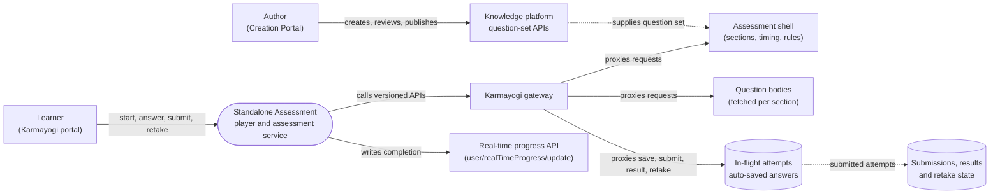

# Standalone Assessment — Context Diagram

## System boundary

Inside the feature is the assessment player (`sb-cb-ui-assessment`) and the assessment
service contracts it calls: shell and question reads, auto-save, versioned submit, result
and retake. Outside it are the learner and the author, the gateway in front of the
services, the knowledge-platform question-set APIs used for authoring, and the shared
real-time progress API that records completion.

## Diagram

## Elements

| Element | Role | Detailed in |
|---|---|---|
| Standalone Assessment (player and assessment service) | Central system: player library plus the shell, question, save, submit, result and retake contracts | [hld.md](hld.md) |
| Learner | Takes the attempt, submits, views results and retakes | [use-cases.md](use-cases.md) |
| Author | Builds the question set in the Creation Portal with its own review and publish cycle | [use-cases.md](use-cases.md) |
| Karmayogi gateway | Path from the player to the assessment service endpoints | [hld.md](hld.md) |
| Assessment shell | Sections, duration and rules; never includes answers | [lld.md](lld.md) |
| Question bodies | Fetched by id per section as the learner progresses | [apis.md](apis.md) |
| In-flight attempts | Server-side auto-saved answers during an attempt | [apis.md](apis.md) |
| Submissions, results and retake state | Versioned submit/result (v2 to v5) and per-assessment retake policy | [lld.md](lld.md) |
| Knowledge platform question-set APIs | Create, review and publish question sets, including the CQF path | [use-cases.md](use-cases.md) |
| Real-time progress API | Shared completion channel, so a passed assessment counts as completed learning | [lld.md](lld.md) |

> **Verification boundary:** read in full: index, use cases, APIs, HLD, LLD and the
> operations-manual stub of this feature. Spot-checked read-only in the workspace only that
> the player library and the gateway reference the v5 assessment and progress paths. The
> assessment service itself is not in the attached repo set, so its stores (attempts,
> results) are shown as documented behaviour, not traced to a datastore, and no repo or
> version is recorded for this feature. The dashed links are inferred from the HLD
> description, not traced in code.
