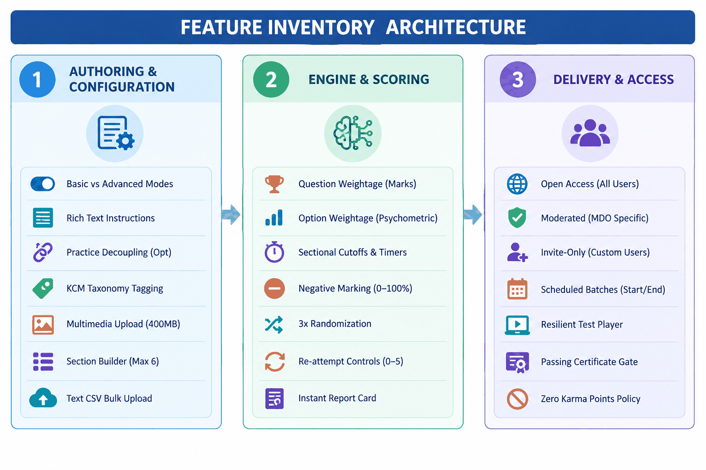
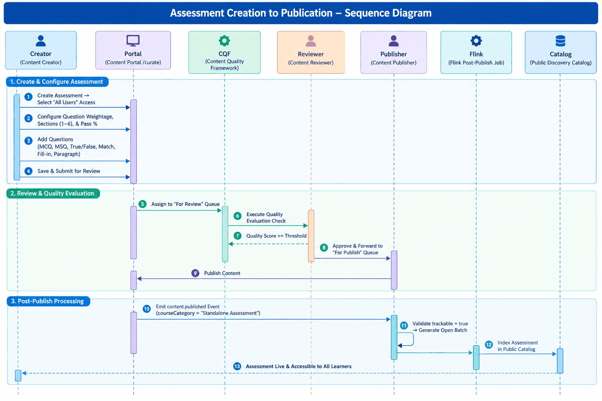
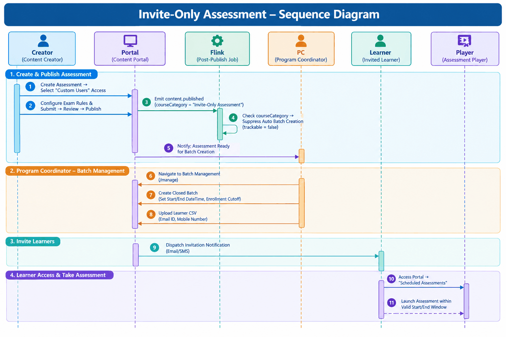
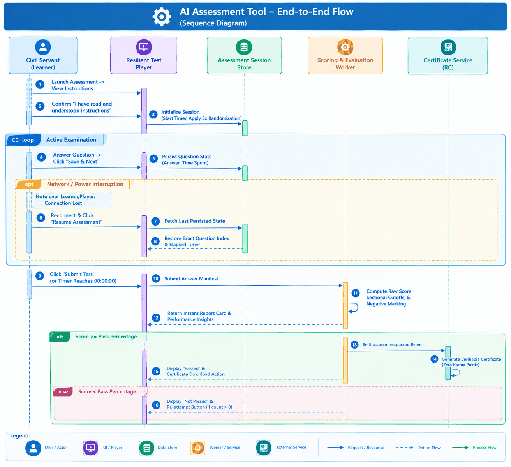
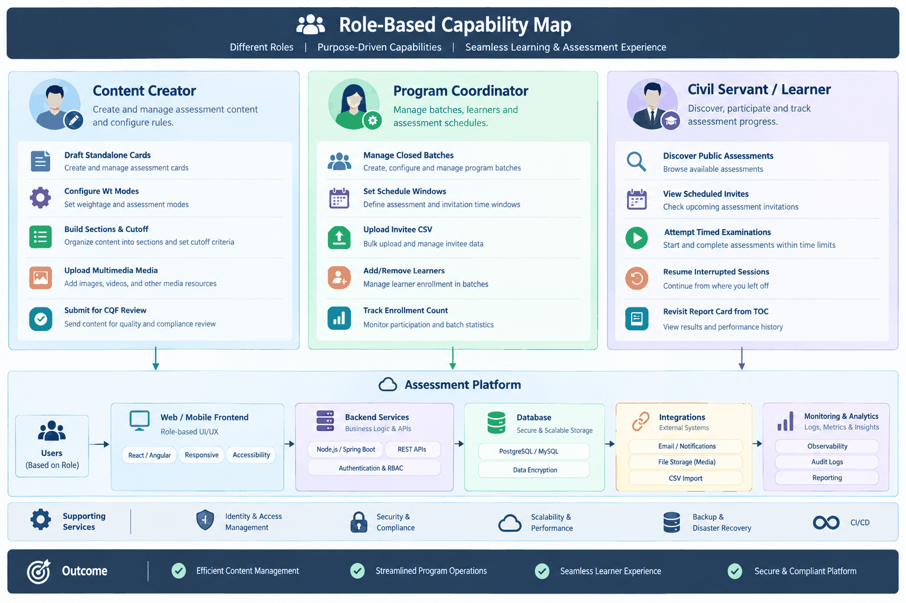
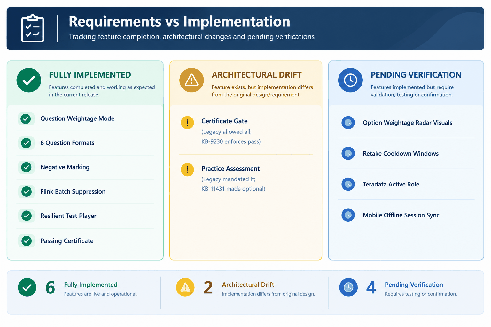

| Attribute | Details |
|---|---|
| Document Identifier | iGOT-OVR-STA-2026-V1.0 |
| Feature Name | Standalone Assessment |
| Platform | iGOT Karmayogi Platform |
| Preparation Date | 23 October 2026 |
| Document State | Final Deliverable for Step 1 (Executive Summary, Feature Scope, Workflows, Rules, Evaluation, and Gap Analysis) |
| Target Audience | Senior Product Leadership, Solution Architects, Technical Leads, and Quality Assurance Specialists |

## 1. Executive Summary

### 1.1 What the Feature Does

The **Standalone Assessment** feature on the **iGOT Karmayogi** platform provides an autonomous, competency-based evaluation engine that operates independently of structured courses or curated learning programs. It empowers content creators and departmental administrators to design, deliver, and score assessments across two foundational evaluation paradigms:

1. **Question Weightage Mode (Marks-Based / Competency Evaluation):** Evaluates specific knowledge retention, cognitive proficiency (Proficiency Levels 1–4 or Easy/Medium/Difficult/HOTS), and functional capabilities with configurable passing cutoffs and negative marking.
2. **Option Weightage Mode (Psychometric / Behavioral Evaluation):** Measures behavioral tendencies, psychometric traits, and survey responses by assigning weighted points to individual answer choices, bypassing conventional pass/fail labels.

The feature supports tri-modal distribution: **Open Access** (all authenticated civil servants), **Moderated Access** (restricted to specific Ministries, Departments, or Organizations), and **Invite-Only Access** (scheduled delivery windows managed by Program Coordinators with targeted rosters).

### 1.2 Business Problem Solved

Historically, assessments on digital learning platforms were tightly bound to course completions (such as Level-1 post-course quizzes). This architecture created several operational bottlenecks:

- **Inability to Benchmark Competencies Directly:** Ministries could not evaluate baseline workforce competencies without forcing officers through hours of redundant video or reading material.
- **Lack of Psychometric and Diagnostic Capabilities:** The legacy assessment player lacked support for option-weighted behavioral scoring, multi-section timing, and negative marking.
- **Uncontrolled Batch Scaling:** Invite-only assessments were hindered by automated batch generation engines that inadvertently published public batches to unintended audiences.
- **Credential Devaluation:** Completion certificates were historically generated for merely attempting an assessment, regardless of competency mastery or passing score.

### 1.3 Target User Personas

- **Learners (Civil Servants):** Central, All India Services (AIS), and State Civil Services officers undertaking diagnostic, scheduled, or voluntary evaluations.
- **Content Creators:** Subject matter experts within Content Provider organizations authoring evaluation sets and uploading multimedia questions.
- **Content Reviewers & Publishers:** Editorial and compliance authorities verifying assessment quality against the Content Quality Framework (CQF) before publication.
- **Program Coordinators:** Operational administrators managing invite-only closed batches, scheduling test windows, and uploading attendee rosters.
- **MDO Administrators & SPV Leadership:** Institutional stakeholders tracking departmental competency baselines through raw analytical exports.

### 1.4 Relationship to the Broader Platform

The feature acts as a foundational evaluation service across iGOT Karmayogi:

- Integrates upstream with the **Content Portal** (`/curate`, `/review`, `/publish`) for authoring and governance.
- Integrates with the **Taxonomy & Competency Service** to tag questions with Karmayogi Competency Model (KCM) themes and levels.
- Integrates with the **Knowledge Platform & Flink Stream Pipeline** for batch generation governance.
- Feeds downstream into the **Learner Profile & Passbook**, issuing verifiable digital certificates while deliberately granting **zero Karma Points** to prevent gamification distortions.

### 1.5 Current Delivery and Implementation Status

- **Core Authoring & Question Types (**`KB-1936`, `KB-2044`, `KB-3958`, `KB-3963`): **Production Deployed.** Supports 6 question types, Question/Option weightage, and negative marking.
- **Invite-Only Scheduling & Flink Suppression (**`KB-3959`, `KB-5350`, `KB-4212`, `KB-2960`): **Production Deployed / Open.** Flink batch suppression implemented in `BatchCreation.scala`.
- **Public Discovery (**`KB-764`, `KB-1039`, `KB-1040`): **Production Deployed** (Web) / **In-Progress** (Mobile).
- **Credentialing Governance (**`KB-8936`, `KB-9230`, `KB-5867`, `KB-6426`): **Production Deployed** (Passing-only certificates) / **Open** (Independent certificate templates).
- **Post-Exam Insights & Practice Flexibility (**`KB-11429`, `KB-11431`): **In-Progress / Open.** Revisit insights from TOC in active rollout; practice test decoupling specified.
- **Data Ingestion Schema** (`KB-15641`): **Design In Progress.** Enrolments table ingestion and `assessment_sub_type` taxonomy alignment.

## 2. Business Context and Objectives

### 2.1 Background

Under the National Programme for Civil Services Capacity Building (**Mission Karmayogi**), public administration in India is transitioning toward a competency-driven framework. To measure domain-specific, behavioral, and functional competencies objectively, government departments require robust diagnostic tools capable of delivering high-stakes exams, psychometric tests, and departmental screening assessments at national scale.

### 2.2 Documented Business Objectives

- **OBJ-01:** Provide autonomous, competency-linked assessments decoupled from learning content, allowing direct baseline skill measurement *(Source:* `KB_BRD_CP_Assessment`).
- **OBJ-02:** Establish psychometric testing capabilities via Option Weightage to capture behavioral tendencies and civil service leadership profiles *(Source:* `KB_BRD_CP_Assessment`).
- **OBJ-03:** Enforce academic rigor through multi-section timebounds, sectional passing cutoffs, configurable negative marking (), and 3x Randomization *(Source:* `KB_FRS_CP_Assessment`).
- **OBJ-04:** Enable scheduled, invite-only assessment delivery with controlled closed batches managed by departmental Program Coordinators *(Source:* `Invite-Only Enhancements doc`).
- **OBJ-05:** Maintain assessment credential integrity by restricting certificates strictly to passing learners and awarding zero Karma Points *(Source:* `KB-8936`, `KB-9230`).

### 2.3 Success Measures

- **Documented Success Measure:** System capacity supporting concurrent examination attempts in production with average API response latency under 3–5 seconds *(Source:* `SRS - Assessments`).
- **Documented Quality Metric:** Zero content submission without achieving the minimum quality benchmark in the Content Quality Framework (CQF) test *(Source:* `KB-6276 FRS`).
- **Analytical Success Measure** `[Proposed]`: prevention of accidental public batch creation for assessments marked `Invite-Only Assessment`.

## 3. Feature Scope

### 3.1 In-Scope Capabilities

- **Access Modes:** Tri-modal access setting (`All Users`, `MDO Specific`, `Custom Users / Invite-Only`).
- **Authoring Framework:**
  - Basic Final Assessment (single section, flat pass percentage).
  - Advanced Final Assessment (1–6 sections, sectional timebounds, sectional cutoffs, question weightage).
  - Option Weightage Assessment (psychometric mode with option-level scoring).
  - Optional Practice Assessment creation.

- **Question Formats:** Single-choice MCQ, Multiple-choice MSQ, True/False, Match the following, Fill-in-the-blanks (dropdown selection), Reading comprehension / paragraph-based questions.
- **Multimedia Questions:** Embedded audio (MP3), video (MP4), and images () with max file size of .
- **3x Randomization Engine:** Permutative option shuffling, sectional question sequence shuffling, and dynamic question extraction from larger pools.
- **Test Delivery & Resilience:** Time-bound test player, countdown timer color alerts (Green Orange Red), auto-submission on expiration, and state preservation upon power/network failure.
- **Credentialing:** Separate certificate templates awarded strictly upon passing; zero Karma Points awarded.
- **Historical Review:** Revisit assessment performance summary, accuracy, and question timing from the Table of Contents page (latest attempt only).

### 3.2 Out-of-Scope Capabilities

- **AI Question Generation:** Automated generative question creation from raw documents is out of scope for this module *(Source:* `KB_BRD_CP_Assessment`).
- **Offline Assessments:** Client-side offline test delivery without internet connectivity is excluded *(Source:* `KB_BRD_CP_Assessment`).
- **Remote Proctoring:** Webcam proctoring, browser lockdown, and facial verification are explicitly out of scope *(Source:* `KB_BRD_CP_Assessment`).
- **Multimedia Profanity Filtering:** Automated computer-vision or audio profanity checks on uploaded media are not supported *(Source:* `KB_BRD_CP_Assessment`).
- **Bulk Upload of Multimedia Questions:** CSV bulk question upload is restricted to textual questions only *(Source:* `KB_BRD_CP_Assessment`).

## 4. Complete Feature Inventory

## 5. End-to-End Business Workflows

### 5.1 Workflow 1: Open Standalone Assessment Authoring and Publishing

### 5.2 Workflow 2: Invite-Only Assessment Scheduling and Learner Delivery

### 5.3 Workflow 3: Assessment Taking, Resilience, and Credentialing

## 6. Major Business Rules

| Rule ID | Rule Statement & Operational Logic | Applicable Workflow | Failure / Edge Behavior | Source Reference |
|---|---|---|---|---|
| **BR-01** | **Access-to-Category Mapping:** • `All Users` `courseCategory = "Standalone Assessment"`. • `MDO Specific` `courseCategory = "Moderated Assessment"`. • `Custom Users` `courseCategory = "Invite-``Only Assessment"`. | Assessment Authoring | Selection locks upon initial save; cannot switch from `All Users` to `Custom Users` in settings. | `KB_BRD_CP Redesign`, `Invite-Only doc` |
| **BR-02** | **Flink Batch Suppression:** If `courseCategory` contains the substring `Invite-Only`, the post-publish Flink job must set `trackable = false`, suppressing automatic open-batch generation. | Post-Publish Pipeline | If suppression fails, open batch is generated, causing unintended public catalog visibility (`KB-4212`). | `KB-4212`, `BatchCreation.scala` |
| **BR-03** | **Sectional Boundaries:** An assessment may have 1 to 6 sections. If sections , sectional timebounds and sectional cutoffs become configurable. | Advanced Authoring | Setting sections is rejected by form validation. | `KB-3963`, `KB_FRS_CP_Assessment` |
| **BR-04** | **Option Weightage Invariance:** In Option Weightage mode, the assessment is implicitly restricted to 1 section; sectional cutoffs and traditional pass/fail statuses are suppressed. | Advanced Authoring | System suppresses multi-section tabs when Option Weightage is selected. | `KB-3963`, `KB_FRS_CP_Assessment` |
| **BR-05** | **Negative Marking Calculation:** Incorrect answers deduct of the question mark value from the overall achieved score. | Scoring Engine | Total test score cannot drop below zero (floored at ). | `KB-3963`, `KB_FRS_CP_Assessment` |
| **BR-06** | **3x Randomization Execution:** 1. Option positions randomized via permutations. 2. Question sequence randomized per section. 3. Questions drawn dynamically from section question pools. | Test Player | In paragraph questions, child questions must remain anchored to the parent passage. | `KB_FRS_CP_Assessment`, `KB-5279` |
| **BR-07** | **Sectional Timebound** **Enforcement:** When sectional timers are active, learners cannot advance to subsequent sections until time expires (or must confirm advancement via an irreversible modal). Once advanced, learners cannot return to completed sections. | Assessment Player | Attempts to navigate back to locked sections are blocked. | `KB_FRS_CP_Assessme``nt` |
| **BR-08** | **Session Disruption Recovery:** If network or power disruption terminates an attempt, the player must restore the learner to the exact question index with all saved answers and remaining timer state intact upon resume. | Assessment Player | Terminated sessions past their absolute end window transition to auto-submitted. | `KB_FRS_CP_Assessment` (s. 14) |
| **BR-09** | **Passing-Only Certificate Gate:** Certificates are issued **strictly upon achieving overall passing percentage**. Failing candidates receive zero certificates. | Certification Engine | Legacy behavior issuing certificates for completion is strictly suppressed. | `KB-8936`, `KB-9230` |
| **BR-10** | **Zero Karma Points Policy:** Standalone Assessments award **0 Karma Points**, preventing artificial leaderboard inflation from standalone tests. | Gamification Engine | Awarding Karma Points for standalone assessments is blocked. | `KB-8936`, `KB-9230` |
| **BR-11** | **Re-attempt Limits:** Content creators configure allowed re-attempts between 0 and 5. Re-attempt actions are accessible directly from the result screen. | Result Evaluation | Re-attempt button disabled when attempt count reaches configured limit. | `KB-3963`, `KB_FRS_CP_Assessment` |
| **BR-12** | **Optional Practice Assessments:** Practice assessment uploads are optional and do not block final assessment submission. | Assessment Authoring | System allows advancing without practice assessment upload. | `KB-11431` |
| **BR-13** | **Single-Button Cohort Management:** Program Coordinators manage invite rosters via a unified interface with inline Add and Remove actions. | Batch Management | Learners who have already commenced an assessment cannot be removed from the batch. | `KB-2960`, `KB_FRS_CP Redesign` |

## 7. Functional Capabilities by User Role

### 7.1 Content Creator

- Access the Content Portal `/curate` console and initiate Standalone Assessment authoring.
- Select target access setting (`All Users`, `MDO Specific`, `Custom Users`).
- Choose between **Basic** and **Advanced** creation flows.
- Configure Question Weightage (marks, difficulty, negative marking) or Option Weightage (psychometric).
- Add and structure 1 to 6 sections with optional sectional cutoffs and timebounds.
- Create and format 6 question types, including paragraph comprehension and multimedia attachments ().
- Perform bulk question uploads via structured CSV (textual questions only).
- Preview individual questions, preview sectional hierarchies, and submit content for CQF review.

### 7.2 Content Reviewer & Publisher

- **Content Reviewer:** Inspect submitted draft assessments, review question distributions, complete the mandatory Content Quality Framework (CQF) scoring evaluation, and approve or reject with comments.
- **Content Publisher:** Verify CQF passing scores, publish individual multimedia assets, and trigger final production publication to release the assessment to the platform catalog.

### 7.3 Program Coordinator

- Access the Content Portal `/manage` dashboard to view published invite-only assessments.
- Create closed batches defining Batch Name, Start DateTime, End DateTime, and Enrollment Cutoff DateTime.
- Manage invited learner rosters via directory search/filtering or bulk CSV upload (Email ID, Mobile Number).
- Utilize unified single-button invite management to add or remove attendees prior to attempt initiation.

### 7.4 Civil Servant / Learner

- Discover open standalone assessments via unauthenticated landing pages or the authenticated Learn Hub catalog.
- Access scheduled assessments via the dedicated "Scheduled Assessments" strip on the learner dashboard.
- Launch the assessment player, confirm instructions, and navigate questions across timed sections.
- Utilize player tools: Clear Response, Mark for Review & Next, Save & Next, and Section Navigation.
- Experience seamless session restoration upon power or network disruption.
- View instant performance report cards (score, accuracy %, question time breakdown, sectional mastery).
- Re-attempt assessments if authorized (0 to 5 attempts).
- Revisit latest performance insights from the Table of Contents page.
- Download verifiable digital certificates upon passing.

## 8. Major Enhancements Mapped to Jira Tickets

| Jira Key | Enhancement Domain | Architectural & Functional Description | Evolution Cycle |
|---|---|---|---|
| **KB-764, 1039, 1040** | **Public Catalog** | Exposed learning content metadata, including standalone assessments, on public unauthenticated web and mobile landing pages via "See All" catalog views. | Q2 Delivery |
| **KB-1936, 2044** | **Portal Redesign** | Consolidated content authoring into three primary cards (`Course`, `Program`, `Assessment`), establishing tri-modal access settings and open/closed batch semantics. | Q3 Delivery |
| **KB-2960** | **Cohort Management** | Replaced bifurcated "Add Learners" and "Remove Learners" actions with a unified, single-button invitation management console for Program Coordinators. | Q3 Delivery |
| **KB-3958, 3963** | **Evaluation Engine** | Transformed basic quizzes into a comprehensive evaluation engine: added multimedia support, difficulty tagging, Question vs Option weightage, sectional cutoffs, negative marking, and 3x Randomization. | Q4 Delivery |
| **KB-3959, 5350, 4212** | **Invite-Only Delivery** | Introduced `courseCategory = "Invite-Only Assessment"`, automated Flink batch creation suppression in `BatchCreation.scala`, and time-bounded scheduling. | Q4 Delivery |
| **KB-5867, 6426** | **Credentialing** | Decoupled assessment certification by introducing an independent certificate template designed specifically for Standalone Assessments (reflecting zero course modules). | Q5 Delivery |
| **KB-6276, 7067, 7466** | **Authoring Revamp** | Redesigned Content Portal navigation, bifurcated authoring into Basic vs Advanced flows, and enforced Content Quality Framework (CQF) review gates. | Q6 Delivery |
| **KB-8936,** **9230** | **Certification** **Gate** | Enforced that certificates are issued strictly upon achieving a passing score (`score >= pass_percentage`), and mandated zero Karma Points for standalone assessments. | Q8 Delivery |
| **KB-11429** | **Learner Analytics** | Enabled civil servants to revisit report cards, accuracy breakdowns, and question timing insights from the assessment TOC page (retaining latest attempt). | Q9 Delivery |
| **KB-11431** | **Authoring Prerequisite** | Relaxed practice assessment creation from a mandatory blocking prerequisite to an optional authoring choice. | Q9 Delivery |
| **KB-15641** | **Data Ingestion** | Updated analytical data pipeline: added standalone assessments to `enrolments` tables and populated `assessment_sub_type` in data warehouse schemas. | Active Task |

## 9. Requirements-versus-Implementation Evaluation

1. **Question Weightage Authoring & Scoring:** **100% Aligned.** Verified across `KB-3958`, `KB-3963`, and Sunbird schema `schemas/questionset/1.0/schema.json`. Parameters for `noOfSection`, `overallPassMarks`, `negativeMarkingPercentage`, and `questionLevelDefinition` are fully realized in the codebase.
2. **Flink Batch Suppression for Invite-Only Assessments:** **100% Aligned.** Verified in `BatchCreation.scala`:
  `val` `courseCategory = metadata.getOrDefault("courseCategory", "").asInstanceOf[String]` `if` `(trackable) {` `if` `(StringUtils.containsIgnoreCase(courseCategory, "Invite-Only")) { trackable = false logger.info("CourseCategory for " + identifier + " : " + courseCategory + ", setting trackable to false") } }`
  This code-level guard correctly prevents open-batch generation for invite-only assessments.
3. **Certification Governance:** **Architectural Drift Resolved.** Legacy Sunbird implementations generated completion certificates regardless of test performance. Tickets `KB-8936` and `KB-9230` updated this behavior, enforcing a strict passing cutoff gate and zero Karma Points.
4. **Practice Assessment Prerequisite:** **Requirements Evolution.** Original Q4 specifications (`KB_FRS_CP_Assessment`) mandated a practice assessment. Ticket `KB-11431` relaxed this rule to optional, aligning system behavior with operational partner needs.

## 10. Functional Gaps and Technical Debt

- **GAP-01: Psychometric / Option Weightage Analytics Visualization:** While Option Weightage is documented in `KB_BRD_CP_Assessment` and schema configuration files, the frontend visualization for dimensional tendencies (e.g., radar charts, psychological trait breakdowns) is not fully documented.
- **GAP-02: Maximum Re-attempt Window and Cooldown Enforcements:** Re-attempts are configurable (0 to 5 attempts), but business logic governing cooldown windows between retakes is undefined.
- **GAP-03: Sectional Timebound Navigation Inconsistency:** `KB_FRS_CP_Assessment` states learners cannot advance until sectional time expires, yet describes a "Next Section" override button. This conditional logic requires clarification in the LLD.
- **TD-01 (Technical Debt — Schema Ingestion Lag):** Ticket `KB-15641` indicates that standalone assessment telemetry was historically misaligned in data warehouse `enrolments` tables, requiring a retrofitted migration to support accurate analytics.
- **TD-02 (Technical Debt — Independent Certificate Template Deployment):** Tickets `KB-5867` and `KB-6426` remain Open in Jira, indicating that while passing logic is enforced (`KB-9230`), standalone assessments may still share standard course certificate templates.

## 11. Security, Performance, and Operational Considerations

### 11.1 Security and Access Control

- **Authentication:** All administrative authoring and learner exam submissions require signed OAuth2 / OpenID Connect JWT tokens issued by **NIC Parichay SSO**.
- **Role-Based Access Control (RBAC):**
  - Authoring routes (`/curate`, `/review`, `/publish`) are restricted to users with the `CONTENT_CREATOR`, `CONTENT_REVIEWER`, and `CONTENT_PUBLISHER` roles.
  - Batch administration is restricted to `PROGRAM_COORDINATOR`.
  - Public unauthenticated access is strictly confined to catalog metadata listings (`KB-764`).

- **Content Tamper Prevention:** Once an assessment is moved to `Live`, questions and scoring schemas are locked against in-place modification (`KB_FRS_CP_Assessment`).

### 11.2 Performance and Scalability

- **Concurrency Targets:** Designed to accommodate concurrent civil servants during peak evaluation windows *(Source:* `SRS - Assessments`).
- **Latency SLAs:** Test player operations, question rendering, and answer saves must sustain an average response time of 3–5 seconds under peak load *(Source:* `SRS - Assessments`).
- **Payload Constraints:** Multimedia question uploads are capped at per file.

### 11.3 Reliability and Disaster Recovery

- **State Preservation:** Player maintains dual-layer state persistence (client browser storage and backend Cassandra session stores), ensuring uninterrupted recovery upon network or power disruption.
- **Recovery Time Objective (RTO):** Business-critical assessment systems target an RTO of *(Source:* `SRS - Assessments`).

## 12. Risks, Assumptions, and Dependencies

### 12.1 Risks

- **RISK-01 (Accidental Public Batch Creation):** If an author misconfigures an invite-only assessment as `All Users`, an open batch will auto-generate immediately upon publish, exposing private exam questions to all platform learners.
- **RISK-02 (Flash Crowd Load Spikes):** Synchronous departmental exams scheduled at identical times can create concurrency spikes on Cassandra session writes and auto-submission endpoints.

### 12.2 Assumptions

- Civil servants have active government email or mobile credentials registered in e-HRMS and Parichay SSO.
- Sponsoring MDOs handle deep qualitative assessment reviews offline using exported raw CSV datasets.

### 12.3 Dependencies

- **Sunbird Content & Assessment Services:** Core infrastructure for question-set schema storage and answer evaluation.
- **Flink Knowledge Pipeline:** Critical dependency for post-publish batch generation rules.
- **RC Certificate Service:** Downstream service responsible for generating and digitally signing PDF credentials.

## 13. Open Questions and Recommended Actions

1. **Open Question 1:** Should Option Weightage (psychometric) assessments display instant raw scores to learners upon completion, or should score visibility be suppressed until departmental review?
  - *Recommendation:* Suppress dimensional feedback by default; provide MDO administrators with a toggle to release psychometric summaries post-review.

2. **Open Question 2:** What is the technical enforcement mechanism for sectional timebounds when a learner attempts to submit early?
  - *Recommendation:* Allow early sectional advancement only if the creator explicitly configures "Allow Early Section Exit"; otherwise enforce strict linear timers.

3. **Recommended Action 1:** Finalize Jira task `KB-15641` to align ClickHouse data warehouse schemas for standalone assessment reporting.
4. **Recommended Action 2:** Close and deploy `KB-5867` / `KB-6426` to release dedicated standalone assessment certificate templates across all production tenants.

## 14. Master Source References

- **Jira Feature Tickets:** `KB-764`, `KB-1039`, `KB-1040`, `KB-1936`, `KB-2044`, `KB-2960`, `KB-3958`, `KB-3959`, `KB-3963`, `KB-4212`, `KB-5350`, `KB-5867`, `KB-6426`, `KB-6276`, `KB-7067`, `KB-7466`, `KB-8936`, `KB-9230`, `KB-11429`, `KB-11431`, `KB-15641`.
- **Confluence Specifications:**
  - [KB_BRD_CP Redesign](https://karmayogibharat.atlassian.net/wiki/spaces/_/pages/21332163)
  - [KB_FRS_CP Redesign](https://karmayogibharat.atlassian.net/wiki/spaces/_/pages/22217482)
  - [KB_BRD_CP_Assessment](https://karmayogibharat.atlassian.net/wiki/spaces/TPT/pages/75890969/KB+BRD+CP+Assessment)
  - [KB_FRS_CP_Assessment](https://karmayogibharat.atlassian.net/wiki/spaces/TPT/pages/85295123/KB+FRS+CP+Assessment)
  - [Standalone Assessments -Invite Only Enhancements doc.](https://karmayogibharat.atlassian.net/wiki/spaces/TES/pages/89751668/Standalone+Assessments+-Invite+Only+Enhancements+doc.)
  - [KB-6276 | KB_BRD_Content Portal UI/UX](https://karmayogibharat.atlassian.net/wiki/spaces/TPT/pages/253132802/KB-6276+KB_BRD_Content+Portal+UI+UX)
  - [KB-6276 | KB_FRS_Content portal UI/UX Revamp](https://karmayogibharat.atlassian.net/wiki/spaces/TPT/pages/254083073/KB-6276+KB_FRS_Content+portal+UI+UX+Revamp)
  - [SRS - Assessments](https://karmayogibharat.atlassian.net/wiki/spaces/TES/pages/87392295/SRS+-+Assessments)
  - [SRS - Content Portal | UI/UX Revamp](https://karmayogibharat.atlassian.net/wiki/spaces/TES/pages/edit-v2/274628785)
