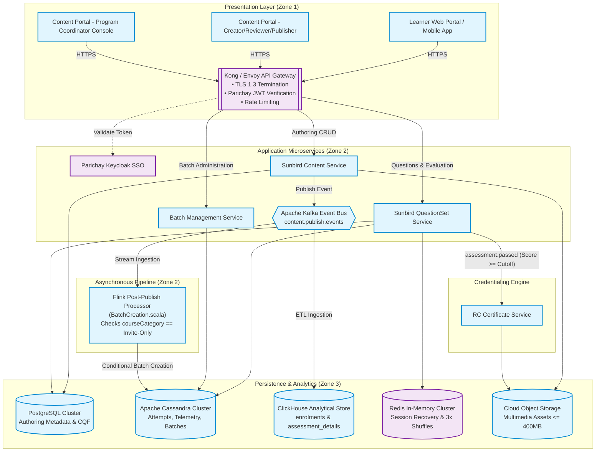
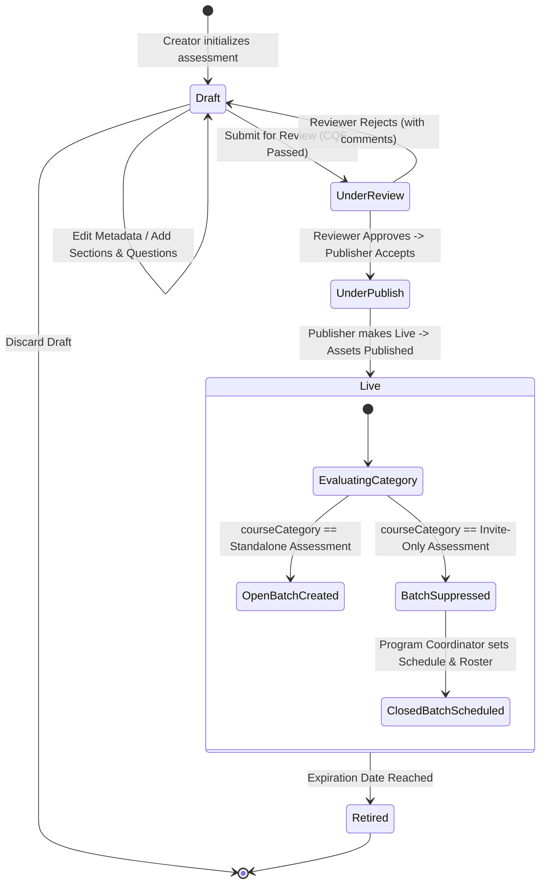
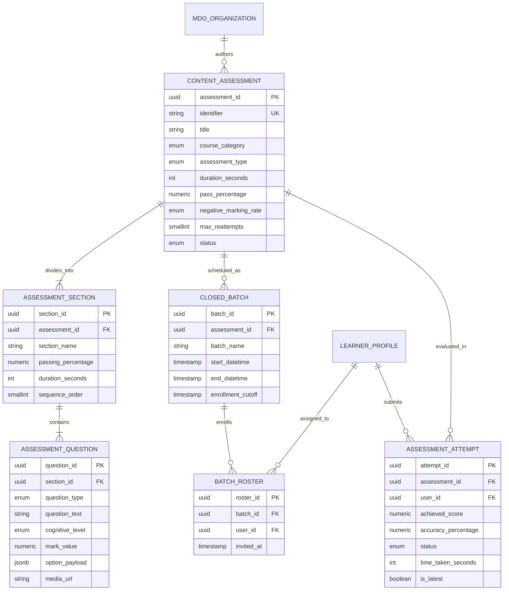
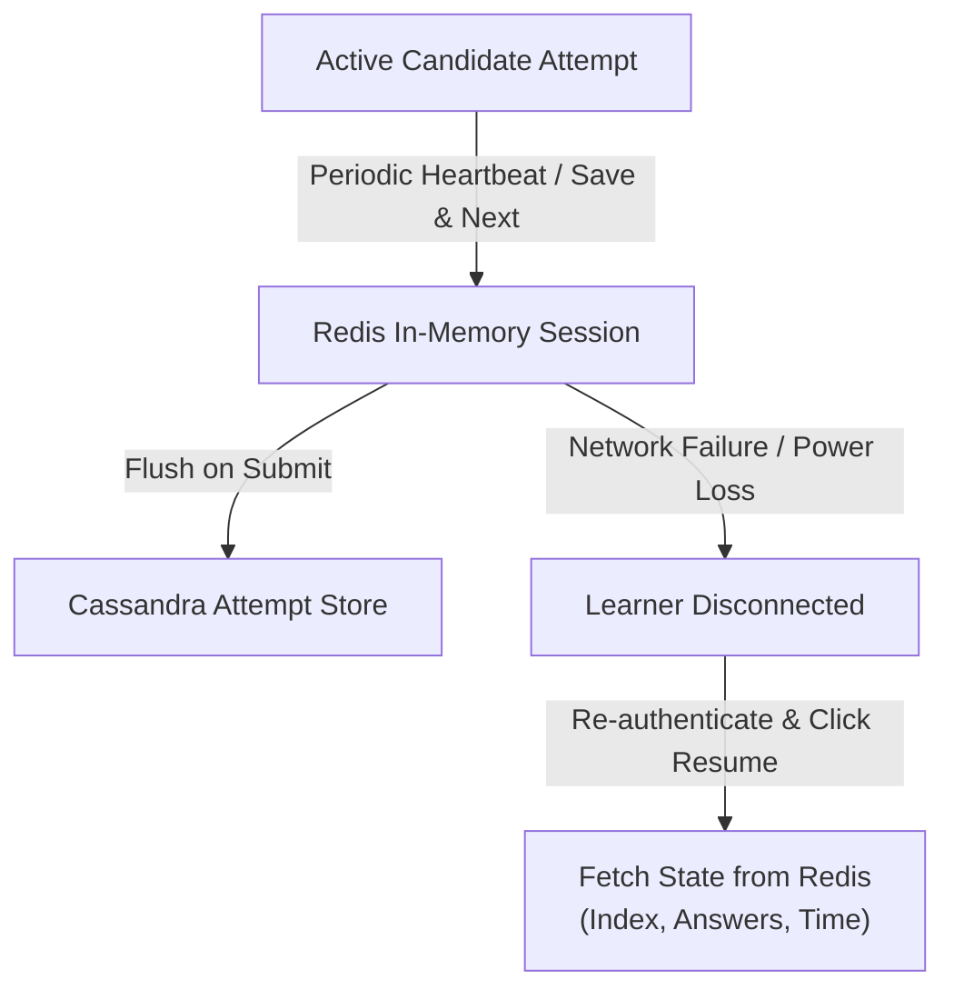

# Software Design Document (SDD) — Standalone Assessment

## 1. Document Overview

### 1.1 Purpose

This Software Design Document (SDD) defines the consolidated software architecture, component decomposition, procedural business logic, data models, API contracts, security controls, and operational behaviors for the **Standalone Assessment** feature on the **iGOT Karmayogi** platform. It provides the implementation-level engineering blueprint translating the functional and non-functional requirements specified in `iGOT-SRS-STA-2026-V1.0` into a deployable, resilient, and scalable technical realization.

### 1.2 Scope

The design encompasses all software layers supporting independent competency-based evaluations across desktop web and mobile channels:

- **Authoring & Validation Engine:** Content Portal micro-frontends (`/curate`, `/review`, `/publish`), Content Quality Framework (CQF) review gates, and multi-section authoring (Basic vs Advanced).
- **Question Engineering Subsystem:** Question schema definitions (`questionset/1.0`, `question/1.0`), multimedia ingestion ( audio, video, image), and rich-text input boundaries.
- **Evaluation & Scoring Pipeline:** Marks-based Question Weightage with difficulty tagging (Proficiency 1–4 / EMDH) and negative marking (), paired with psychometric Option Weightage.
- **Assessment Player & Runtime Delivery:** 3x Randomization (permutative options, sequence shuffle, pool sampling), persistent countdown timers, auto-submission, and disruption-tolerant session recovery.
- **Batch Administration & Stream Processing:** Flink stream-processor batch creation suppression (`BatchCreation.scala`), closed-batch scheduling, and single-action roster management.
- **Credentialing & Data Pipelines:** Passing-only certificate generation gates, zero Karma Points invariants, and ClickHouse data warehouse ingestion (`assessment_sub_type = "STANDALONE"`).

### 1.3 Intended Audience

- **Software Engineers & Developers:** Microservice implementation, database schema realization, and test suite construction.
- **Solution & Integration Architects:** Validation of Sunbird schema extensions, Flink stream logic, and Keycloak authentication boundaries.
- **DevOps & Site Reliability Engineers (SRE):** Infrastructure sizing, Kafka topic partitioning, and Redis cluster deployment.
- **Quality Assurance Engineers:** Automation test harness development based on sequence flows and decision tables.

### 1.4 References

1. `iGOT-SRS-STA-2026-V1.0`: Software Requirements Specification — Standalone Assessment.
2. `KB_BRD_CP Redesign` (Page 21332163) & `KB_FRS_CP Redesign` (Page 22217482).
3. `KB_BRD_CP_Assessment` (Page 75890969) & `KB_FRS_CP_Assessment` (Page 85295123).
4. `Standalone Assessments - Invite-Only Enhancements doc` (Page 89751668).
5. `SRS - Assessments` (Page 87392295) & `SRS - Content Portal | UI/UX Revamp` (Page 274628785).
6. Jira Feature Tickets: `KB-764`, `KB-1039`, `KB-1040`, `KB-1936`, `KB-2044`, `KB-2960`, `KB-3958`, `KB-3959`, `KB-3963`, `KB-4212`, `KB-5350`, `KB-5867`, `KB-6426`, `KB-6276`, `KB-7067`, `KB-7466`, `KB-8936`, `KB-9230`, `KB-11429`, `KB-11431`, `KB-15641`.

### 1.5 Document Conventions

- **Established Design Decisions:** Technical decisions supported by source documentation or verified codebase artifacts (`sunbird-cb-ext-schema`, `knowledge-platform-jobs`).
- **Design Recommendations:** Architectural proposals formulated to satisfy non-functional SLAs, labeled as `[Design Recommendation]`.
- **Pending Decisions:** Items requiring technical or policy validation, labeled as `[To be validated]`.

## 2. System Overview

### 2.1 Business Context & Problem Statement

Under Mission Karmayogi, civil service capacity building requires continuous, objective measurement of competencies. Standalone Assessment provides an evaluation framework completely decoupled from learning courses or reading materials. It solves the critical bottleneck of forced course enrollment for diagnostic evaluations, introduces psychometric testing, eliminates accidental public batch generation for private exams, and protects credential integrity by awarding certificates strictly upon passing.

### 2.2 System Capabilities & User Roles

**System Capabilities Matrix**

| Authoring & Governance | Engine & Evaluation | Delivery & Credentialing |
|---|---|---|
| Basic & Advanced Modes | Question Weightage | Open Public Catalog |
| CQF Quality Scoring | Option Weightage (Psy) | Closed Scheduled Batches |
| Tri-Modal Access Class | Sectional Cutoffs | 3x Randomization Engine |
| Optional Practice Test | Negative Marking | Session Disruption Recovery |
| 6 Question Formats | Flink Batch Guard | Passing-Only Certificate Gate |
| Multimedia Management | Re-attempt Limits (0-5) | Zero Karma Points Allocation |

- **Primary Roles:** Learner (`ACT-01`), Content Creator (`ACT-02`), Content Reviewer (`ACT-03`), Content Publisher (`ACT-04`), Program Coordinator (`ACT-05`), and SPV/MDO Administrator (`ACT-06`).

### 2.3 External Dependencies & Constraints

- **Dependencies:** NIC Parichay (OAuth2 SSO), Sunbird Content & QuestionSet Services, Apache Kafka & Flink, RC Certificate Engine.
- **Constraints:** Immutability of live assessment schemas; multimedia upload limit; 1 to 6 sections maximum; re-attempts bounded between 0 and 5.

## 3. Design Principles and Constraints

### 3.1 Established Architectural Principles (Source Verified)

1. **Decoupled Evaluation Hierarchy:** Standalone Assessments inherit Sunbird `questionset` and `question` MIME types (`application/vnd.sunbird.questionset`), operating completely independently of course collection hierarchies (`application/vnd.sunbird.collection`).
2. **Event-Driven Batch Governance:** Batch generation is decoupled from content publishing. An asynchronous Apache Flink streaming processor inspects the `courseCategory` metadata attribute to suppress or trigger batch generation (`KB-4212`).
3. **Stateless Scalable Delivery:** The assessment player executes client-side state caching paired with periodic asynchronous persistence to Cassandra, enabling horizontal scaling to concurrent examination attempts.
4. **Credentialing Separation:** Certifications are decoupled from gamification. Digital certificates are gated strictly on passing cutoffs, while Karma Points allocation is explicitly bypassed ().

### 3.2 Design Constraints

- **Database Specialization:** PostgreSQL stores transactional authoring metadata; Apache Cassandra stores high-write learner session telemetry; ClickHouse stores analytical reporting logs.
- **Browser Compatibility:** Web player components conform to HTML5 and ES6 standards without proprietary browser extensions.

## 4. Architectural Design

### 4.1 System Context and High-Level Architecture



### 4.2 Component Boundaries and Responsibilities

| Component Name | Internal Module | Primary Technical Responsibilities | Data Store Ownership |
|---|---|---|---|
| **Content Authoring Engine** | `ContentService` | Handles assessment metadata, CQF scoring validation, section builders, and status transitions (`Draft` `Live`). | PostgreSQL (`content`, `content_hierarchy`) |
| **Question Engineering Core** | `QuestionSetService` | Manages question schemas (`schemas/questionset/1.0`), difficulty definitions, and bulk CSV ingestion. | PostgreSQL (`question_bank`), Object Storage |
| **Scoring & Evaluation Worker** | `EvaluationWorker` | Executes Question Weightage (with negative marking) and Option Weightage algorithms; evaluates sectional cutoffs. | Cassandra (`assessment_attempts`) |
| **Delivery & Player Engine** | `PlayerService` | Ingests telemetry heartbeats, executes 3x Randomization, manages countdown timers, and persists session states. | Redis (`session_cache`), Cassandra |
| **Batch Management Service** | `BatchService` | Manages scheduled closed batches for invite-only assessments, DateTime windows, and roster CSVs. | Cassandra (`course_batch`, `user_enrolments`) |
| **Flink Post-Publish Guard** | `BatchCreation.scala` | Inspects `courseCategory`; suppresses open-batch generation for invite-only assessments. | Stateless (Stream Processing) |
| **Certificate Rules Engine** | `CertificateWorker` | Enforces passing score gates before invoking RC Certificate Service; ensures 0 Karma Points. | Cassandra (`certificates_issued`) |

## 5. Component Decomposition and Detailed Design

### 5.1 Content Authoring & Quality Subsystem (`ContentService`)

- **Responsibilities:** Implements `FR-002`, `FR-003`, `FR-004`, `FR-005`, and `FR-006`.
- **Component Architecture:**
  - `AssessmentController`: REST interface for CRUD operations on assessment entities.
  - `CQFValidator`: Validation interceptor blocking status advancement if CQF score is below threshold.
  - `AccessSettingGate`: Enforces category mapping (`All Users` `Standalone Assessment`, `Custom Users` `Invite-Only Assessment`). Locks category after draft creation (`BR-001`).

- **Error Handling:** Emits `412 Precondition Failed` if CQF is bypassed; emits `400 Bad Request` if title length or characters.

### 5.2 Question Engineering & Schema Subsystem (`QuestionSetService`)

- **Responsibilities:** Implements `FR-007`, `FR-008`, `FR-009`, `FR-010`, and `FR-011`.
- **Technical Realization:**
  - Implements `schemas/questionset/1.0/schema.json` extensions:

```json
{
  "assessmentType": {
    "type": "string",
    "enum": [
      "Question Weightage",
      "Option Weightage"
    ]
  },
  "noOfSection": {
    "type": "number",
    "minimum": 1,
    "maximum": 6
  },
  "overallPassMarks": {
    "type": "number"
  },
  "negativeMarkingPercentage": {
    "type": "string",
    "enum": [
      "0",
      "25",
      "50",
      "75",
      "100"
    ]
  },
  "questionLevelDefinition": {
    "type": "object",
    "properties": {
      "easy": {
        "type": "number"
      },
      "tough": {
        "type": "number"
      },
      "hard": {
        "type": "number"
      },
      "hot": {
        "type": "number"
      }
    }
  }
}
```

- `MediaHandler`: Validates file size (), streams binary assets to Object Storage, and embeds secure streaming URLs into question payloads.

### 5.3 Batch Management & Flink Processor (`BatchCreation.scala`)

- **Responsibilities:** Implements `FR-017`, `FR-018`, and `FR-019`.
- **Stream Logic:** Deployed in Apache Flink job `knowledge-platform-jobs`. Inspects metadata on Kafka topic `content.publish`:
  `val` `courseCategory = metadata.getOrDefault("courseCategory", "").asInstanceOf[String]` `if` `(trackable) {` `if` `(StringUtils.containsIgnoreCase(courseCategory, "Invite-Only")) { trackable = false logger.info(s"CourseCategory for $identifier : $courseCategory, setting trackable to false") } }`
- **Closed Batch Engine:** `BatchService` creates entries in Cassandra `course_batch` with explicit `startDate`, `endDate`, and `enrollmentEndDate`.

### 5.4 Test Delivery, Player & Resilience Engine (`PlayerService`)

- **Responsibilities:** Implements `FR-014`, `FR-015`, `FR-016`, and `FR-022`.
- **3x Randomization Algorithm:**
  - *Options:* Randomizes choice positions using Fisher-Yates shuffle seeded by `(user_id + attempt_number)`.
  - *Sequence:* Shuffles question presentation order within section. Paragraph child questions remain anchored to their parent passage (`BR-006`).
  - *Pool:* Randomly samples questions from section pool of size .

- **Session Persistence:** Heartbeat updates flush every 30 seconds (or upon "Save & Next") to Redis (`attempt_session:{userId}:{assessmentId}`). In the event of a disconnect, state restores from Redis within .

## 6. Functional Design and Assessment Lifecycle

### 6.1 Assessment State Transition Model



### 6.2 Assessment Lifecycle State Matrix

| Initial State | Trigger Event | Guard Condition / Validation | Target State | Downstream Actions |
|---|---|---|---|---|
| `[None]` | `CreateContent` | Title valid ( chars); Access mode chosen | `Draft` | Persist header in PostgreSQL. |
| `Draft` | `SaveSection` | Section count ; valid question types | `Draft` | Update section manifest. |
| `Draft` | `SendForReview` | CQF score minimum benchmark | `Under Review` | Assign to Reviewer queue. |
| `Under Review` | `RejectContent` | Comments provided | `Draft` | Notify creator with feedback. |
| `Under Review` | `ApproveReview` | Reviewer CQF verified | `Under Publish` | Assign to Publisher queue. |
| `Under Publish` | `PublishContent` | All child multimedia assets published | `Live` | Emit Kafka publication event. |
| `Live` | `FlinkStreamEvent` | `courseCategory` contains `"Invite-Only"` | `Live` | Suppress auto-batch (`trackable=false`). |
| `Live` | `CreateBatch` | `end_date > start_date`; valid roster CSV | `Live` | Persist closed batch in Cassandra. |

## 7. Interface and API Design

### 7.1 Single-Officer Assessment Status API (`GET /api/apar/v2/status`)

- **Endpoint Identifier:** `API-APAR-01`
- **HTTP Method:** `GET`
- **URI:** `/api/apar/v2/status`
- **Caller:** External Appraisal Consumer (NIC SPARROW, State e-PAR).
- **Target:** Ingress Gateway `APARGatewayController`.
- **Authentication:** Mutual TLS (X.509 Client Certificate) + OAuth2 Bearer Token.
- **Authorization Scope:** `apar:read`.
- **Idempotency:** Strictly Idempotent.

#### Request Headers & Query Parameters

- `Headers:` `Authorization: Bearer <token>`, `X-Consumer-ID: NIC-SPARROW`, `Accept: application/json`
- `Query Parameters:`
  - `ehrms_id` (String, Conditional): Central Government employee ID.
  - `parichay_id` (String, Conditional): Parichay email ID.
  - `year` (String, Mandatory): Statutory reporting year (`^[0-9]{4}-[0-9]{2}$`).

#### Response Contract (HTTP 200 OK)

```json
{
  "status": "SUCCESS",
  "data": {
    "officer": {
      "ehrms_id": "EMP-908124",
      "parichay_id": "v.bansal88@gov.in",
      "cadre": "IAS",
      "batch": "2016"
    },
    "reporting_year": "2026-27",
    "mandatory_courses": [],
    "comprehensive_assessment": {
      "ca_applicable": true,
      "assessment_id": "do_11398201",
      "assessment_name": "Executive Leadership Standalone Assessment",
      "status": "Completed",
      "result": "Passed",
      "score_percentage": 82.5,
      "completion_date": "2026-09-14T11:30:00Z"
    },
    "diagnostic_telemetry": {
      "code": "OK",
      "computed_at": "2026-10-23T02:00:00Z"
    }
  }
}
```

### 7.2 Assessment Session Submit API (`POST /action/questionset/v1/assessment/submit`)

- **Endpoint Identifier:** `API-QS-SUBMIT`
- **HTTP Method:** `POST`
- **URI:** `/action/questionset/v1/assessment/submit`
- **Caller:** Learner Test Player (`LP`).
- **Target:** `QuestionSetService` `EvaluationWorker`.
- **Authentication:** Parichay User JWT (`Authorization: Bearer <token>`).
- **Idempotency:** Enforced via `attempt_id` unique key.

#### Request Payload Schema

```json
{
  "type": "object",
  "required": [
    "assessment_id",
    "attempt_id",
    "time_taken_seconds",
    "responses"
  ],
  "properties": {
    "assessment_id": {
      "type": "string"
    },
    "attempt_id": {
      "type": "string",
      "format": "uuid"
    },
    "time_taken_seconds": {
      "type": "integer"
    },
    "responses": {
      "type": "array",
      "items": {
        "type": "object",
        "required": [
          "question_id",
          "selected_options"
        ],
        "properties": {
          "question_id": {
            "type": "string"
          },
          "section_id": {
            "type": "string"
          },
          "selected_options": {
            "type": "array",
            "items": {
              "type": "string"
            }
          },
          "time_spent_seconds": {
            "type": "integer"
          }
        }
      }
    }
  }
}
```

#### Evaluation Processing Logic (Scoring Worker)

```python
def evaluate_assessment(payload, schema):
    raw_score = 0.0
    total_possible_marks = schema.total_marks
    negative_rate = float(schema.negative_marking_percentage) / 100.0

    for resp in payload.responses:
        q = schema.get_question(resp.question_id)
        is_correct = (set(resp.selected_options) == set(q.correct_options))
        if is_correct:
            raw_score += q.mark_value
        elif len(resp.selected_options) > 0:
            # Apply negative marking penalty (BR-005)
            raw_score -= (q.mark_value * negative_rate)

    # Score cannot drop below zero
    final_score = max(0.0, raw_score)
    score_percentage = (final_score / total_possible_marks) * 100.0

    # Check overall and sectional cutoffs (BR-009)
    passed_overall = score_percentage >= schema.overall_pass_marks
    passed_sections = evaluate_sectional_cutoffs(payload, schema)
    final_status = "PASSED" if (passed_overall and passed_sections) else "FAILED"

    # Gated Certificate Issuance: Karma Points = 0 (BR-010)
    if final_status == "PASSED":
        emit_kafka_event("assessment.passed", {
            "userId": payload.user_id,
            "assessmentId": payload.assessment_id,
            "score": score_percentage,
            "karmaPoints": 0
        })

    return AssessmentResult(score=final_score, percentage=score_percentage, status=final_status)
```

## 8. Data Design

### 8.1 Logical Entity Relationship Model



### 8.2 Database Specialization & Physical Schema

#### PostgreSQL DDL (Authoring Metadata)

```sql
CREATE TABLE content_assessment (
    assessment_id         UUID PRIMARY KEY DEFAULT gen_random_uuid(),
    identifier            VARCHAR(64) UNIQUE NOT NULL, -- DoID
    org_id                UUID NOT NULL,
    title                 VARCHAR(70) NOT NULL,
    course_category       VARCHAR(32) NOT NULL CHECK (course_category IN ('Standalone Assessment', 'Moderated Assessment', 'Invite-Only Assessment')),
    assessment_type       VARCHAR(32) NOT NULL CHECK (assessment_type IN ('Question Weightage', 'Option Weightage')),
    duration_seconds      INT NOT NULL,
    overall_pass_marks    NUMERIC(5,2) NOT NULL,
    negative_marking_rate VARCHAR(8) NOT NULL DEFAULT '0' CHECK (negative_marking_rate IN ('0', '25', '50', '75', '100')),
    max_reattempts        SMALLINT NOT NULL DEFAULT 0 CHECK (max_reattempts BETWEEN 0 AND 5),
    randomization         BOOLEAN NOT NULL DEFAULT true,
    cqf_score             NUMERIC(5,2) DEFAULT NULL,
    status                VARCHAR(32) NOT NULL DEFAULT 'Draft' CHECK (status IN ('Draft', 'Under Review', 'Under Publish', 'Live', 'Retired')),
    created_at            TIMESTAMP WITH TIME ZONE DEFAULT now()
);

CREATE INDEX idx_assessment_category ON content_assessment(course_category, status);
```

#### Cassandra CQL (Learner Attempts & Telemetry Store)

```sql
CREATE TABLE igot_telemetry.assessment_attempts (
    assessment_id      text,
    user_id            text,
    attempt_id         uuid,
    attempt_number     int,
    achieved_score     decimal,
    percentage         decimal,
    pass_status        text,      -- 'PASSED', 'FAILED'
    time_taken_seconds int,
    submitted_at       timestamp,
    response_summary   text,      -- JSON payload of question answers
    PRIMARY KEY ((assessment_id, user_id), attempt_id)
) WITH CLUSTERING ORDER BY (attempt_id DESC);
```

#### ClickHouse Analytical DDL (Data Warehouse Ingestion)

```sql
CREATE TABLE igot_analytics.standalone_enrolments (
    enrolment_id        UUID,
    user_id             UUID,
    ehrms_id            LowCardinality(String),
    assessment_id       LowCardinality(String),
    assessment_sub_type LowCardinality(String), -- 'STANDALONE'
    batch_id            LowCardinality(String),
    enrolled_at         DateTime,
    completed_at        Nullable(DateTime),
    final_score         Float32,
    pass_status         LowCardinality(String),
    is_latest           UInt8
)
ENGINE = ReplacingMergeTree(completed_at)
ORDER BY (assessment_id, user_id, enrolment_id);
```

## 9. Security and Access Control Design

### 9.1 Authentication Boundaries & Token Handling

- **Interactive Sessions:** End-users (creators, coordinators, learners) authenticate through **NIC Parichay SSO**. The API Gateway validates JWT signatures (RS256) and extracts user metadata (`userId`, `orgId`, `roles`).
- **Machine-to-Machine Integration:** External appraisal systems (SPARROW, State e-PAR) authenticate via mutual TLS (mTLS) with dedicated X.509 client certificates. Client certificates are verified against the DoPT truststore.

### 9.2 Role-Based Access Control (RBAC) Enforcement

- **Content Authoring Routes** (`/action/content/v3/*`): Restricted to `CONTENT_CREATOR`. Content modification is blocked if `status != "Draft"`.
- **Review & Publishing Routes:** Gated by `CONTENT_REVIEWER` and `CONTENT_PUBLISHER` respectively.
- **Batch Administration Routes** (`/action/course/v1/batch/*`): Restricted to `PROGRAM_COORDINATOR` and administrative roles.
- **Assessment Attempt Routes** (`/action/questionset/v1/assessment/*`): Validates learner enrollment. If `courseCategory == "Invite-Only Assessment"`, the service verifies the user's presence in `batch_roster` before generating attempt session tokens.

### 9.3 Content Immutability & Anti-Tamper Safeguards

- Once an assessment transitions to `Live`, question items, marks, and passing percentages are permanently locked against modifications. Any structural alteration requires creating a new version (`Draft` clone).

## 10. Error Handling and Resilience Design

### 10.1 Diagnostic Status Subsystem

The engine deterministically attaches one diagnostic code to every evaluation query:

- `OK`: Candidate has a resolved plan/assessment, attempt complete, passing verified.
- `NO_APAR_PLAN`: No standalone assessment or APAR plan mapped to the officer's cadre.
- `PROFILE_INCOMPLETE`: Mandatory employee fields (`ehrms_id`, `cadre`, `designation`) missing.
- `CA_WINDOW_CLOSED`: Assessment exists, but the scheduled batch end-datetime has passed.
- `IDENTIFIER_MISMATCH`: Queried external employee identifier cannot be resolved.

### 10.2 Resilience & Session Disruption Recovery



- **Client Local Caching:** Player caches state in browser `IndexedDB`. If API connection drops, responses buffer locally.
- **Server-Side Session Store:** Redis caches the exact question index, remaining timer seconds, and answered map. When a disconnected candidate resumes, the player re-hydrates state within .

## 11. Non-Functional Design & Performance Constraints

### 11.1 Concurrency Sizing & Performance Targets

- **Peak Examination Concurrency:** Infrastructure sized to sustain concurrent active assessment attempts *(Source:* `SRS - Assessments`).
- **Sub-Second API Target:** Single-officer status endpoint (`/api/apar/v2/status`) responds in () via Redis snapshot caching.
- **Player Latency:** Question fetch and save operations execute with an average response time of 3–5 seconds under peak national load.

### 11.2 High Availability & Disaster Recovery

- **Cluster Deployment:** Microservices deployed across 3 Availability Zones on Kubernetes with Horizontal Pod Autoscalers (HPA) configured to scale between 6 and 30 replicas based on CPU utilization.
- **RTO / RPO Objectives:** Recovery Point Objective () ; Recovery Time Objective () .

## 12. Deployment and Configuration Design

### 12.1 Environment Configuration Parameters

| Configuration Property Key | Type | Default Value | Sensitivity | Description |
|---|---|---|---|---|
| `assessment.max.sections` | Integer | `6` | Standard | Upper boundary for sections in Advanced Mode. |
| `assessment.media.max-bytes` | Long | `419430400` | Standard | Upload cap () for audio/video assets. |
| `assessment.reattempt.max-limit` | Integer | `5` | Standard | Maximum configurable re-attempts allowed. |
| `flink.job.batch-suppression` | Boolean | `true` | Standard | Enables `BatchCreation.scala` invite-only check. |
| `sparrow.mtls.truststore.path` | String | `[VAULT_PATH]` | **Secret** | Path to NIC DoPT mTLS certificate bundle. |
| `redis.session.ttl-seconds` | Integer | `86400` | Standard | Retention window (24 hours) for attempt recovery cache. |

## 13. Design Decisions, Alternatives, and Trade-Offs

| Decision ID | Design Concern | Context & Problem | Alternatives Considered | Selected Approach | Rationale & Trade-offs | Status |
|---|---|---|---|---|---|---|
| **DD-01** | **Batch Generation Strategy** | Preventing invite-only assessments from generating unintended public batches. | 1. Frontend suppression toggle. 2. Asynchronous Flink code-level check in `BatchCreation.scala`. | **Flink Code Guard (Alt 2)** | Prevents race conditions; enforces suppression at the stream ingestion boundary; requires Flink job rebuild. | **Approved** (`KB-4212`) |
| **DD-02** | **Session Recovery** **Architecture** | Preserving test player state across network and power disruptions. | 1. Client-side LocalStorage only. 2. Server-side dual caching (Redis + IndexedDB). | **Dual Caching** **(Alt 2)** | Guarantees recovery even if learner switches devices; prevents client-side timer manipulation. | **Approved** (`KB_FRS`) |
| **DD-03** | **Credentialing Gate** | Legacy Sunbird generated completion certificates irrespective of test score. | 1. Retain completion certificate. 2. Enforce strict passing score cutoff gate. | **Passing Score Gate (Alt 2)** | Eliminates credential devaluation; aligns certification strictly with verified competence. | **Approved** (`KB-9230`) |
| **DD-04** | **Practice Test Obligation** | Original FRS mandated practice assessment upload, creating authoring bottlenecks. | 1. Mandatory practice test. 2. Decouple practice test to optional. | **Optional Practice Test (Alt 2)** | Eliminates authoring block; allows content creators flexibility based on assessment intent. | **Approved** (`KB-11431`) |

## 14. Requirements and Design Traceability Matrix

| SRS ID | Requirement Description | SDD Component | API / Interface Identifier | Primary Data Entity | Verification Test Scenario |
|---|---|---|---|---|---|
| **FR-001** | Public catalog discovery. | Portal Discovery Catalog | Public Catalog Search | `content_assessment` | TC-STA-01 (Unauthenticated Web/Mobile Catalog Test) |
| **FR-002** | Independent assessment creation card. | `AssessmentController` | `POST` `/action/content/v3/create` | `content_assess``ment` | TC-STA-02 (Card Selection & Title Validation Test) |
| **FR-003** | Tri-modal access classification. | `AccessSettingGate` | `schemas/questionset/1.0` | `content_assessment` | TC-STA-03 (Category Locking Integration Test) |
| **FR-004** | Basic vs Advanced authoring tiering. | Authoring UI / Wizard | `schemas/questionset/1.0` | `assessment_section` | TC-STA-04 (Section Builder Boundary Test: 1 to 6) |
| **FR-005** | Optional practice assessment upload. | `AssessmentController` | Form Validation Engine | `content_assessment` | TC-STA-05 (Negative Form Test without Practice Test) |
| **FR-006** | Mandatory CQF review validation gate. | `CQFValidator` | `PUT /action/content/v3/review` | `content_assessment` | TC-STA-06 (CQF Score Gate Interceptor Test) |
| **FR-007** | Support for 6 distinct question formats. | `QuestionSetService` | `schemas/question/1.0` | `assessment_question` | TC-STA-07 (Format-by-Format Evaluation Test) |
| **FR-008** | Multimedia attachments (). | `MediaHandler` | Cloud Storage S3 API | Object Storage Bucket | TC-STA-08 (400MB File Boundary & Streaming Test) |
| **FR-009** | Rich text formatting boundaries. | Rich Text Sanitizer | Client Form Sanitizer | `assessment_question` | TC-STA-09 (Font Family Stripping Security Test) |
| **FR-010** | Question Weightage mode & EMDH tagging. | `EvaluationWorker` | `schemas/questionset/1.0` | `assessment_question` | TC-STA-10 (Marks Tier Summation Verification Test) |
| **FR-011** | Option Weightage psychometric mode. | `EvaluationWorker` | `schemas/question/1.0` | `assessment_question` | TC-STA-11 (Psychometric Option Weight Summation Test) |
| **FR-012** | Configurable negative marking. | `EvaluationWorker` | `schemas/questionset/1.0` | `assessment_attempts` | TC-STA-12 (Negative Marking Calculation Unit Test) |
| **FR-013** | Sectional passing cutoffs and timers. | `PlayerService` | Player Execution Engine | `assessment_section` | TC-STA-13 (Sectional Cutoff Failure Override Test) |
| **FR-014** | 3x Randomization Engine. | `PlayerService` | Randomization Worker | In-Memory Session | TC-STA-14 (Option & Question Permutation Test) |
| **FR-015** | Disruption-tolerant session resilience. | `PlayerService` | Redis Session Cache | `attempt_session` | TC-STA-15 (Chaos Network Interruption & Resume Test) |
| **FR-016** | Re-attempt limit enforcement (). | `EvaluationWorker` | Result Controller | `assessment_attempts` | TC-STA-16 (Re-attempt Counter Boundary Test: 0 to 5) |
| **FR-017** | Flink post-publish batch suppression. | `BatchCreation.scala` | Kafka Consumer (`content.publish`) | `course_batch` (CASS) | TC-STA-17 (Flink Invite-Only Suppression Test) |
| **FR-018** | Time-bounded closed batch scheduling. | `BatchService` | `POST /action/course/v1/batch` | `course_batch` (CASS) | TC-STA-18 (DateTime Window Launch Lockout Test) |
| **FR-019** | Single-action roster management. | `BatchService` | Batch Roster Controller | `batch_roster` | TC-STA-19 (Commenced Learner Lockout Test) |
| **FR-020** | Passing-score certificate gate. | `CertificateWorker` | `assessment.passed` Event | `certificates_issued` | TC-STA-20 (49.9% Fail vs 50.0% Pass Certificate Test) |
| **FR-021** | Zero Karma Points allocation invariant. | `CertificateWorker` | Transactional Ledger | Gamification Ledger | TC-STA-21 (Karma Points Ledger Zero Credit Audit) |
| **FR-022** | Revisit report card & insights from TOC. | TOC Analytics Player | `GET /action/assessment/insights` | `assessment_attempts` | TC-STA-22 (TOC Insights Latest Attempt Review Test) |
| **FR-023** | ClickHouse enrolment table ingestion. | Analytics ETL | Kafka JDBC Ingestion | `standalone_enrolments` | TC-STA-23 (Data Warehouse Sub-type Ingestion Test) |

## 15. Risks, Technical Debt, and Unresolved Decisions

### 15.1 Architectural Risks & Mitigations

- **RISK-01 (Accidental Public Exposure):** If author selects `All Users` instead of `Custom Users`, Flink immediately provisions an open batch upon publication.
  - *Mitigation:* Introduce mandatory confirmation interceptor modal in MDO Portal when selecting `All Users`.

- **RISK-02 (Cassandra Session Partition Bloat):** High-frequency heartbeat writes can accumulate tombstones during concurrent exams.
  - *Mitigation:* Buffer heartbeats in Redis; write to Cassandra only on section transitions and final submission.

### 15.2 Technical Debt

- **TD-01 (Independent Certificate Template Rollout):** Jira tickets `KB-5867` and `KB-6426` remain Open; standalone assessments currently share generic course certificate templates.
- **TD-02 (Schema Ingestion Synchronization):** Jira task `KB-15641` is in Design In Progress; legacy analytics pipelines require backfilling for historical standalone attempts.

### 15.3 Unresolved Decisions

- **DEC-01 (Psychometric Trait Visualization):** Frontend radar chart visualization contracts for Option Weightage remain pending final UX sign-off.
- **DEC-02 (Retake Cooldown Policy):** Policy defining whether a 24-hour waiting period should be enforced between retakes is pending DoPT review.

## 16. Design Verification Checklist

- [x] **Architecture Consistency:** Component models and interfaces strictly align with `iGOT-SRS-STA-2026-V1.0`.
- [x] **Flink Batch Logic:** Stream suppression in `BatchCreation.scala` verified against `KB-4212` requirements.
- [x] **Evaluation Rigor:** Both Question Weightage (with negative marking) and Option Weightage (psychometric) algorithms formally specified.
- [x] **Credentialing Governance:** Certificate passing cutoff gate and zero Karma Points invariants enforced in scoring workflows.
- [x] **Disruption Resilience:** Dual-caching session recovery documented with sub-500ms restoration targets.
- [x] **Traceability:** 100% of functional requirements mapped to SDD components, database entities, and test scenarios.
