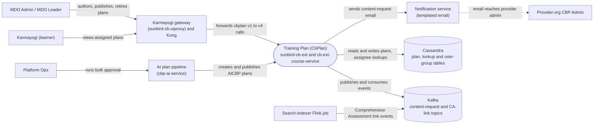

# Training Plan — Context Diagram

## System boundary

Inside the feature is the CbPlan backend: the four coexisting API generations (v1 in
`sunbird-cb-ext`, v2 to v4 in `cb-ext-course-service`), the Org Portal authoring screens, the
learner `cbp` module, and the Kafka consumers that handle content-request emails and
Comprehensive Assessment links. Outside it are the people who author, receive and action
plans, the gateway and Kong in front of the backends, the AI bulk pipeline, the notification
service, the search-indexer Flink job, and the Cassandra tables and Kafka topics it relies on.

## Diagram

## Elements

| Element | Role | Detailed in |
|---|---|---|
| Training Plan (CbPlan) | Central system: four API generations, publish-time assignee fan-out, per-user plan dictionary, content-request and CA-link consumers | [hld.md](hld.md) |
| MDO Admin / MDO Leader | Authors, edits, publishes and retires plans for their org in the Org Portal | [use-cases.md](use-cases.md) |
| Karmayogi (learner) | Views assigned plans bucketed as Upcoming, Overdue, APAR and Completed in the `cbp` module | [use-cases.md](use-cases.md) |
| Provider-org CBP Admin | Receives content-request emails and actions them in the Admin Portal request screens | [use-cases.md](use-cases.md) |
| Platform Ops | Runs the AI bulk pipeline that drafts and publishes designation-wise plans | [use-cases.md](use-cases.md) |
| Karmayogi gateway and Kong | Generic passthrough of `cbplan/*` calls with role-based allow lists; Kong picks the backend | [apis.md](apis.md) |
| AI plan pipeline (`cbp-ai-service`) | Seven-stage pipeline; its bulk-approval stage calls the v3 `aicbp` create and publish endpoints directly | [apis.md](apis.md) |
| Notification service | Sends the Velocity-templated content-request email to provider `CBP_ADMIN`s | [apis.md](apis.md) |
| Search-indexer Flink job | Emits Comprehensive Assessment link events that the backend mirrors onto plans | [apis.md](apis.md) |
| Cassandra | Plan tables per generation plus lookup tables keyed by assignee, designation or user group | [hld.md](hld.md) |
| Kafka | Carries content-request events and Comprehensive Assessment link events | [hld.md](hld.md) |

> **Verification boundary:** elements and interactions come from the feature's own pages
> (index, use cases, APIs, HLD), all read in full; the LLD, operations manual and
> as-built requirements were not read. No source repos were spot-checked for this diagram.
> The dashed email-to-provider-admin link is the documented, inferred route from the
> content-request email to the Admin Portal request screens; it was not traced end to end
> in the original analysis. The Kong rule choosing the backend per version prefix is
> outside the traced repos. The Org Portal, learner portal and Admin Portal screens are
> folded into the actors and gateway rather than shown as separate nodes.
