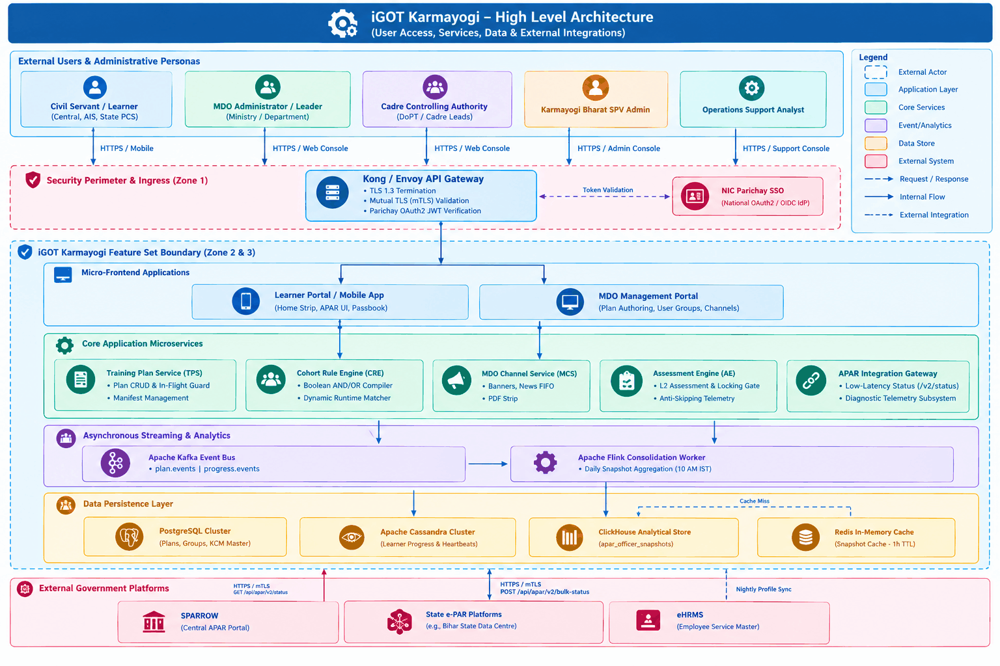
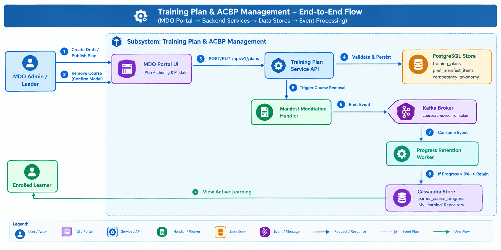
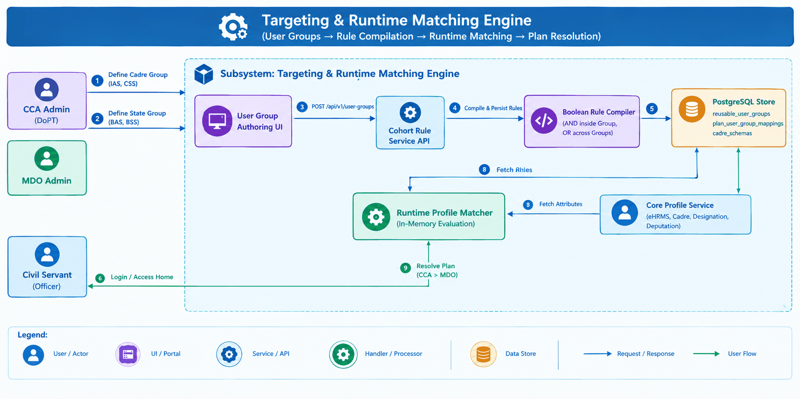

# Context Diagrams — Capacity Building Plan, Training Plans, and APAR Framework

## 1. Executive Architectural Summary

This document establishes the formal **Context Diagrams and System Boundary Specifications** for the complete feature set spanning **Capacity Building Plans (CBP)**, **Training Plans**, **MDO Channels**, and the **Annual Performance Appraisal Report (APAR) & Comprehensive Assessment (CA) Framework** across the Q2 through Q14 delivery evolution.

### Feature Grouping and Capabilities

Based on source analysis of the  Jira feature tickets and linked BRD/FRS/PRD documents, the capabilities are organized into three primary architectural subsystems:

## 2. Common Architectural Legend

The following visual conventions and node styles are applied across all diagrams:

- **Rectangle / Node (**`[]`): Confirmed software components, services, or data stores backed by source evidence.
- **Rounded Box (**`([" "])`): Human actors and user personas.
- **Thick Border / Double Box (**`[[]]`): Ingress API Gateway and security boundaries.
- **Cylinder** (`[()]`): Persistent storage systems (PostgreSQL, Cassandra, ClickHouse, Redis).
- **Hexagon (**`{{ }}`): Streaming bus and message broker infrastructure (Apache Kafka).
- **Dashed Border / Annotation (**`- - -`): Component or integration requiring implementation validation.

## 3.  Overall Platform Context Diagram

This provides the consolidated system context, illustrating the entire feature set boundary in relation to interacting government civil servants, departmental administrators, external national appraisal platforms, and shared platform services.

- **Purpose:** Establishes the macro-level boundary of the complete feature set within the iGOT Karmayogi digital workplace, identifying external actors, ingress gateways, internal microservices, streaming pipelines, data tiers, and external government platforms.
- **Scope:** Entire lifecycle across CBP creation, training plan authoring, departmental channels, assessment delivery, and statutory appraisal integration.
- **Actors and Components:** Civil Servants (`RL-01`), MDO Admins (`RL-02`), CCA Admins (`RL-03`), SPV Admins (`RL-04`), Support Analysts (`RL-06`). Core components: API Gateway, Micro-Frontends, TPS, CRE, MCS, AE, APAR Gateway, Kafka, Flink, PostgreSQL, Cassandra, ClickHouse, Redis.
- **Interactions:** End-users interact over HTTPS; administrative actions dispatch commands to TPS/CRE; course completions stream through Kafka to Flink; SPARROW queries APAR Gateway via mTLS REST.
- **External Dependencies:** NIC Parichay (Authentication), NIC SPARROW (Appraisal Consumer), Central e-HRMS (Employee Master Data), State e-PAR (State Appraisals).
- **Security Boundaries:** Zone 1 (DMZ/mTLS/JWT Ingress), Zone 2 (Kubernetes Overlay Private Network), Zone 3 (Isolated Persistence Subnet).
- **Source References:** `KB-752`, `KB-796`, `KB-2479`, `KB-3837`, `KB-5794`, `KB-5811`, `KB-8064`, `KB-10518`, `KB-10685`, `KB-12756`, `KB-13866`; `Q13 BRD/PRD`; `KB-10686 BRD/FRS`.
- **Assumptions and Gaps:** Assumes eHRMS ID is consistently populated across all Central Civil Service profiles.

## 4. Individual Feature Context Diagrams

### 4.1 Capacity Building Plans & Training Plan Management

Covers competency dictionary mapping, administrative plan drafting, in-flight course manifest modification with guidance modals, and defensive progress retention.

- **Purpose:** Explains administrative plan creation, draft lifecycle, course removal interceptors, and automated progress retention in "My Learning".
- **Scope:** Plan authoring, KCM taxonomy linkage, in-flight course manifest edits, and progress persistence.
- **Actors and Components:** MDO Admin, Enrolled Learner, MDO Portal UI, Training Plan Service, Manifest Handler, Retention Worker, PostgreSQL, Cassandra, Kafka.
- **Interactions:** Admin drafts and publishes plans; course removal triggers a guidance modal; upon confirmation, manifest updates and a Kafka event instructs the worker to preserve in-flight progress () in Cassandra.
- **External Dependencies:** Core Identity Service (Admin authorization).
- **Security Boundaries:** Scoped to administrative organization (`org_id`). Non-authors cannot edit drafts (`BR-004`).
- **Source References:** `KB-752`, `KB-796`, `KB-2479`, `KB-12756`; `BRD_Capacity_building_plan` (6750611); `BRD_TrainingPlanEnhancements` (693698562).
- **Assumptions and Gaps:** Assumes event-driven retention processing completes asynchronously within .

### 4.2 Diagram 2.2: Multi-Attribute Cohort Targeting & Runtime Matching

Covers the Reusable User Group engine, compound Boolean rule compilation (`AND`/`OR`), state cadre schemas (BAS/BSS), and dynamic runtime matching.

- **Purpose:** Details how complex targeting rules are compiled into reusable user groups and evaluated dynamically against civil servant profiles.
- **Scope:** Reusable user groups, Boolean evaluation (`AND` within groups, `OR` across groups), state cadre inclusions (BAS/BSS), and precedence resolution.
- **Actors and Components:** CCA Admin, MDO Admin, Civil Servant, Admin UI, Cohort Rule Engine, Rule Compiler, Runtime Matcher, PostgreSQL, Profile Service.
- **Interactions:** Administrators save targeting rules; officers logging in trigger runtime evaluation, resolving the highest-priority plan within .
- **External Dependencies:** Central e-HRMS (Officer cadre profile attributes).
- **Security Boundaries:** Organizational tree scoping enforces that MDO admins can only target child entities within their administrative hierarchy.
- **Source References:** `KB-10518`, `KB-10685`, `KB-13866`; `Q13 BRD/PRD` (1031307285, Section 5.1–5.3); `KB-10686 FRS`.
- **Assumptions and Gaps:** Incomplete profiles lacking mandatory cadre fields fail evaluation and receive diagnostic code `PROFILE_INCOMPLETE`.

### 4.3 Diagram 2.3: MDO Channels & Departmental Engagement

Covers departmental landing page management, image carousels, text announcements with FIFO auto-discard (capacity 15), and downloadable PDF manifests.

- communication banners, announcement queues, and downloadable plan documents.
- **Scope:** Channel configuration, carousel banners, announcements buffer (max 15), curated course playlists, and PDF manifest downloads.
- **Actors and Components:** MDO Admin, Learner, Channel Management UI, MDO Channel API, Announcement Buffer, PDF Generator, PostgreSQL, Object Storage.
- **Interactions:** Admin configures channel assets and news; announcements exceeding 15 trigger an automated FIFO purge; learners consume curated playlists and download printable PDF manifests.
- **External Dependencies:** SPV Admin configuration (MDO channel enablement).
- **Security Boundaries:** Only authorized departmental admins can publish content to their assigned channel (`BR-004`).
- **Source References:** `KB-5794`, `KB-5811`; `BRD MDO Channels` (77955254); `FRS MDO Channels` (85197083).
- **Assumptions and Gaps:** Assumes banner images are restricted to three carousel items.

### 4.4 Level-2 Comprehensive Assessments & Anti-Skipping Media Controls

Covers program-level evaluation, prerequisite locking gates, anti-skipping linear playback enforcement, and scoring thresholds ().

- **Purpose:** Models the enforcement of academic progression, linear video playback, prerequisite-based assessment locking, and standardized scoring benchmarks.
- **Scope:** Media scrub prevention, conditional assessment unlocking, minimum 50 questions enforcement, and passing cutoff.
- **Actors and Components:** Learner, Player UI, Assessment UI, Telemetry Validator, Prerequisite Gatekeeper, Scoring Worker, Cassandra, PostgreSQL.
- **Interactions:** Learner plays course videos linearly; forward seek attempts are dropped; once all courses reach , the gatekeeper unlocks the assessment; submissions are scored and recorded.
- **External Dependencies:** Content Provider / Faculty profiles (Network Hub linking).
- **Security Boundaries:** Client-side video player scrub prevention is backed by server-side heartbeat validation to prevent spoofing.
- **Source References:** `KB-8064`, `KB-8065`; `KB-8065 | Q8 | BRD | L2 Assessments` (373850243); `KB-10686 BRD/FRS`.
- **Assumptions and Gaps:** Assumes assessments can be configured with randomized question delivery.

### 4.5  Statutory APAR Synchronization & Diagnostic Telemetry

Covers the nightly Flink aggregation pipeline, pre-computed ClickHouse snapshots, Redis caching, low-latency REST endpoints, and read-only auto-fill of SPARROW Tables 11 & 12.

- **Purpose:** Details the asynchronous rollup of course completions into analytical snapshots and low-latency delivery to external performance appraisal systems.
- **Scope:** Nightly consolidation job, ClickHouse analytical store, Redis cache, low-latency status APIs, SPARROW Tables 11A/12A and 11B/12B auto-fill, and diagnostic codes.
- **Actors and Components:** NIC SPARROW, State e-PAR, Support Team, mTLS Gateway, Gateway Controller, Redis, ClickHouse, Flink Worker, Diagnostic Classifier, Kafka.
- **Interactions:** Progress events stream to Flink; Flink materializes denormalized snapshots in ClickHouse before 10:00 AM IST; external appraisal portals query status via mTLS; fields auto-fill in read-only mode.
- **External Dependencies:** NIC SPARROW (Appraisal consumer), State e-PAR platforms.
- **Security Boundaries:** Mutual TLS (mTLS) with whitelisted client certificates; diagnostic codes exposed via API/support tools but strictly hidden from SPARROW appraisal forms (`BR-026`).
- **Source References:** `KB-10685`, `KB-10686`, `KB-13866`; `Q13 APAR BRD/PRD` (1031307285, Section 5.4–7.3); `KB-10686 BRD/FRS`.
- **Assumptions and Gaps:** Assumes SPARROW supports JSON payloads mapped to Tables 11A/12A and 11B/12B.

## 5.  System Integration Context Diagram

This diagram maps every interface connecting the feature set to external and shared enterprise systems, highlighting communication protocols, authentication methods, payload exchanges, and failure impacts.

- **Purpose:** Details cross-boundary communication mechanisms, protocols, security handshakes, and operational failure implications.
- **Scope:** External platform interfaces: Parichay SSO, SPARROW, e-HRMS, State e-PAR, and Cloud Object Storage.
- **Actors and Components:** iGOT Core Microservices, Ingress Gateway, NIC Parichay, NIC SPARROW, Central e-HRMS, State Data Centres, Object Storage.
- **Interactions:** Ingress verifies Parichay JWT assertions; SPARROW queries single-officer appraisal records; State e-PAR streams bulk cadre blocks; e-HRMS supplies employee posting updates.
- **External Dependencies:** High dependency on NIC infrastructure (Parichay and SPARROW).
- **Security Boundaries:** Strict mTLS on all inbound appraisal queries; mutual token authentication on identity services.
- **Source References:** `Q13 BRD/PRD` (Section 6.1–7.3); `KB-10686 FRS` (Section 3.5).
- **Assumptions and Gaps:** Assumes state data centers have stable outbound Internet connectivity for mTLS calls.

## 6. User and Role Interaction Context Diagram

This  maps documented user roles to entry-point applications, authorized feature boundaries, and administrative entitlements.

- **Purpose:** Illustrates role-based access control (RBAC), mapping authenticated roles to portal entry points and authorized feature subsystems.
- **Scope:** Role permissions and operational boundaries across Learner, MDO Admin, CCA Admin, SPV Admin, and Support Analyst.
- **Actors and Components:** Documented roles `RL-01` through `RL-06`, Learner App, MDO Portal, SPV Portal, Support Console, and Feature Modules.
- **Interactions:** Learners access learning strips and assessments; MDO admins author plans and manage channels; CCA admins define cadre-wide rules; SPV admins manage taxonomy; support analysts triage diagnostic codes.
- **External Dependencies:** Parichay Keycloak role claim mapper.
- **Security Boundaries:** Enforces strict role-permission boundaries; learners cannot access administrative consoles; MDO admins cannot alter KCM taxonomy (`BR-001`).
- **Source References:** `FRS CBP Creation` (16679094); `Q13 BRD/PRD` (1031307285, Roles Table); `BRD MDO Channels` (77955254).
- **Assumptions and Gaps:** Permissions strictly conform to the role-permission matrix defined in Section 6.2 of `iGOT-SRS-CBP-APAR-2026-V1.0`.

## 7.  External System Dependency Diagram

- **Purpose:** Evaluates systemic dependencies and quantifies the operational impact of external service or database outages.
- **Scope:** All foundational runtime, streaming, storage, and identity dependencies.
- **Actors and Components:** Core Feature Modules, Parichay SSO, SPARROW, Cassandra, ClickHouse, Kafka.
- **Interactions:** Services rely on Parichay for identity assertions, Cassandra for progress state, Kafka for event distribution, and ClickHouse for analytical reads.
- **External Dependencies:** NIC Parichay and NIC SPARROW.
- **Security Boundaries:** Unavailability of external consumers (SPARROW) gracefully degrades via fallback notices without impacting iGOT learning availability (`BR-025`).
- **Source References:** `Q13 BRD/PRD` (NFR-1, NFR-2); `KB-10686 BRD`.
- **Assumptions and Gaps:** Assumes local database clustering provides high availability within cloud subnets.

## 8. Detailed Sequence Diagrams for Complex Interactions

### 8.1 Assessment Launch & Prerequisite Gate Verification

Models the step-by-step evaluation when an officer attempts to launch an L2

- **Purpose:** Specifies runtime conditional logic preventing learners from launching summative assessments prematurely.
- **Scope:** Prerequisite verification, authorization token generation, and locked modal rendering.
- **Source References:** `KB-8064`, `KB-8065`; `KB-8065 BRD` (373850243, Scope Item 2); `KB-10686 FRS`.

### 8.2 Single-Officer SPARROW Appraisal Status Query Flow

Models the low-latency auto-population sequence when an officer accesses their annual performance report.

- **Purpose:** Demonstrates how sub-second latency () is achieved via Redis caching and ClickHouse analytical read models during external appraisal form rendering.
- **Scope:** mTLS authentication, cache evaluation, ClickHouse querying, and SPARROW table auto-population.
- **Source References:** `Q13 BRD/PRD` (1031307285, Section 6.1); `KB-10686 BRD` (Section 8).
