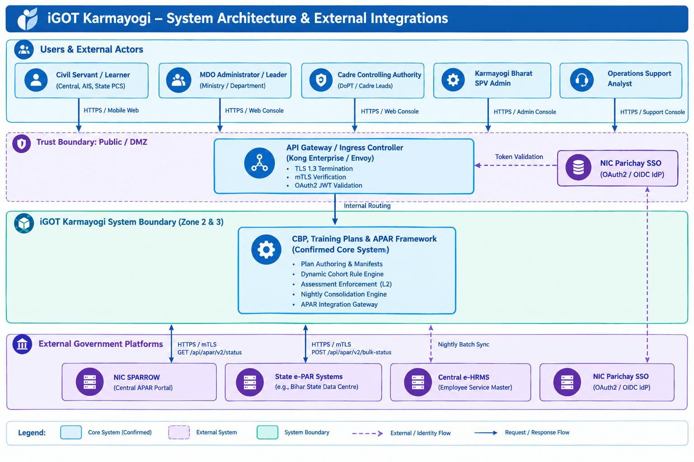
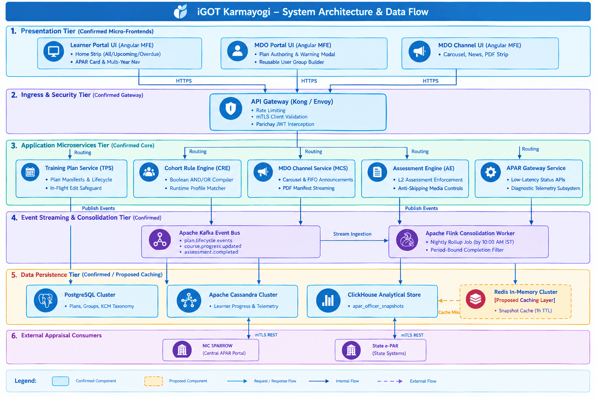
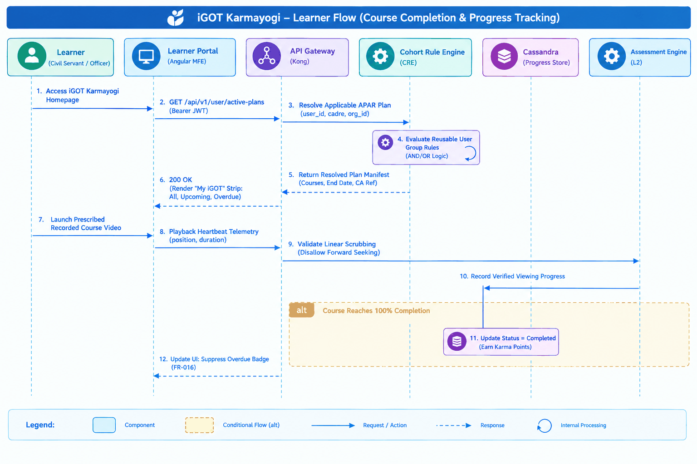
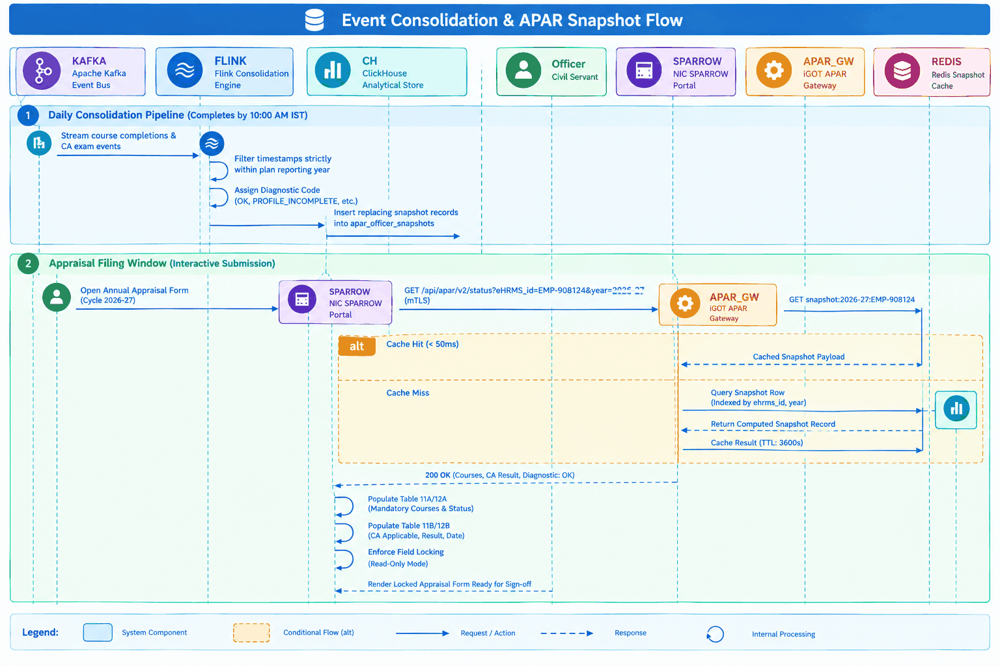
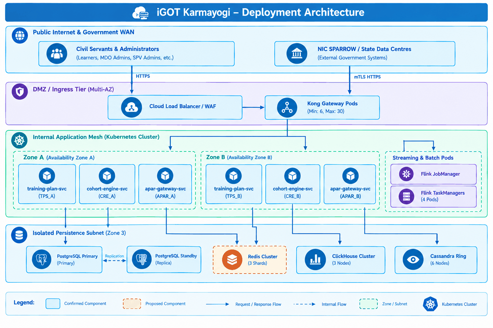

# High-Level Design (HLD) — Capacity Building Plan, Training Plans, and APAR Framework

## 1. Introduction

### 1.1 Purpose

This High-Level Design (HLD) establishes the enterprise software architecture, logical component boundaries, system integration topology, data distribution models, and security governance for the **Capacity Building Plan (CBP), Training Plans, and Annual Performance Appraisal Report (APAR) Framework** on the **iGOT Karmayogi** platform. It operationalizes the requirements defined in `iGOT-SRS-CBP-APAR-2026-V1.0` and aligns with the structural designs in `iGOT-SDD-CBP-APAR-2026-V1.0`.

### 1.2 Scope

The architectural scope encompasses all core modules, synchronous APIs, asynchronous streaming pipelines, and external gateways supporting Q2 through Q14 platform milestones:

- **Administrative Curation & Taxonomy:** Ingestion of the Karmayogi Competency Model (KCM) and authoring of Annual Capacity Building Plans (ACBPs) and departmental Training Plans.
- **Targeting & Cohort Evaluation:** Boolean user-group evaluation (`AND` of criteria, `OR` across groups) and dynamic runtime officer profile matching (Central, AIS, State PCS like Bihar BAS/BSS).
- **Delivery & Lifecycle Safeguards:** Learner consumption strips, course lifecycle management (the "Edit Content" in-flight safeguard and progress persistence), and MDO Channel integration.
- **Assessment & Compliance:** Level-2 (L2) Comprehensive Assessments (standalone and program-linked), conditional unlock engines, and anti-skipping playback controls.
- **Statutory Performance Appraisal Integration:** Nightly consolidation pipelines, low-latency REST endpoints (`/api/apar/v2/*`), and deterministic diagnostic telemetry subsystems powering read-only auto-population of APAR Tables 11A/12A and 11B/12B in SPARROW and state appraisal systems.

### 1.3 Architecture Objectives

1. **Low-Latency Integration:** Deliver single-officer appraisal status queries in () to prevent blocking interactive appraisal form rendering on external portals.
2. **Defensive Progress Persistence:** Guarantee that in-flight course progress, earned certificates, and accrued competency credits are preserved permanently during plan updates or organizational transfers.
3. **Decoupled Analytical Scalability:** Separate high-frequency external appraisal queries from transactional learning databases using Command Query Responsibility Segregation (CQRS).
4. **Deterministic Observability:** Provide binary diagnostic status codes to eliminate operational ambiguity during peak appraisal filing deadlines.

### 1.4 Intended Audience

- **Enterprise & Solution Architects:** Review of architectural patterns, trust boundaries, and cross-system integration contracts.
- **Engineering Leads & Developers:** Implementation of microservice boundaries, event schemas, and data pipelines.
- **External Integration Teams (NIC SPARROW, State IT):** Verification of ingestion contracts, mTLS protocols, and payload schemas.
- **Site Reliability Engineers (SRE) & DevOps:** Validation of container orchestration topologies, Redis caching layers, and ClickHouse cluster sizing.

### 1.5 References

1. `iGOT-SRS-CBP-APAR-2026-V1.0`: Software Requirements Specification.
2. `iGOT-SDD-CBP-APAR-2026-V1.0`: Software Design Document.
3. Confluence Specifications: `BRD_Capacity_building_plan` (6750611), `FRS_Capacity_building_plan_creation` (16679094), `BRD MDO Channels` (77955254), `FRS MDO Channels` (85197083), `KB-8065 BRD L2 Assessments` (373850243), `KB-10686 BRD/FRS APAR` (430964819, 432963599), `BRD Training Plan Enhancements` (693698562), `Q13 APAR BRD/PRD` (1031307285).
4. Jira Epics & Issues: `KB-752`, `KB-796`, `KB-2479`, `KB-3837`, `KB-5794`, `KB-5811`, `KB-8064`, `KB-10518`, `KB-10685`, `KB-12756`, `KB-13866`.

### 1.6 Assumptions and Constraints

- **Assumptions:** eHRMS ID serves as the persistent cross-system identifier for Central Government civil servants; external consumers support TLS with mutual certificate authentication (mTLS).
- **Constraints:** SPARROW statutory appraisal forms enforce immutable read-only locking on auto-populated iGOT fields; frontend deletion of core KCM taxonomy tables is strictly prohibited.

## 2. Architecture Drivers

### 2.1 Documented Architecture Drivers (Source Verified)

- **AD-01 (Statutory Appraisal Compliance):** Mandate annual completion of role-prescribed courses and assessments, auto-populating SPARROW Tables 11A/12A (Courses) and 11B/12B (Assessments) without manual data entry *(Source:* `KB-10686 | BRD`, Section 2).
- **AD-02 (Low-Latency SLA):** Single-officer status retrieval via `/api/apar/v2/status` shall respond within under typical concurrent load *(Source:* `Q13 BRD/PRD`, NFR-1).
- **AD-03 (Consolidation Freshness):** Nightly progress consolidation must produce verified officer snapshots available to integration endpoints by 10:00 AM IST daily *(Source:* `Q13 BRD/PRD`, NFR-3).
- **AD-04 (High Availability during Appraisal Window):** Core APAR endpoints and learner dashboards must sustain availability during peak appraisal periods (March–June) *(Source:* `Q13 BRD/PRD`, NFR-2).
- **AD-05 (Deterministic Diagnostic Telemetry):** Every appraisal evaluation must emit exactly one deterministic diagnostic code (`OK`, `NO_APAR_PLAN`, `PROFILE_INCOMPLETE`, `CA_WINDOW_CLOSED`, `IDENTIFIER_MISMATCH`) *(Source:* `Q13 BRD/PRD`, Section 5.5).
- **AD-06 (Progress Continuity Safeguard):** Course removal from active plans must preserve in-flight learner progress in "My Learning" *(Source:* `BRD Training Plan Enhancements`, Section 4.3).

### 2.2 Proposed Architecture Goals (Architectural Derivations)

- **AD-07 (CQRS Analytical Decoupling** `[Proposed]`): Isolate high-throughput read queries from transactional Cassandra write stores via ClickHouse read-models and Redis caching.
- **AD-08 (Zero-Downtime Microservice Upgrades** `[Proposed]`): Enforce blue/green deployments and backward-compatible event schemas on Apache Kafka topics.

## 3. System Context Diagram

The System Context diagram illustrates the system boundary, interacting user personas, external government applications, integration mechanisms, and security trust zones.

## 4. High-Level Component Architecture

The framework utilizes an asynchronous, microservices-based architecture following the CQRS pattern. Transactional writes execute against PostgreSQL and Apache Cassandra, while external appraisal integrations read from a pre-computed ClickHouse analytical repository fronted by Redis.

### 4.1 Component Descriptions and Responsibilities

| Component Name | Primary Responsibility | Inputs & Outputs | Dependencies | Ownership | Relevant Requirements |
|---|---|---|---|---|---|
| **Training Plan Service (TPS)** | Manages full lifecycle of training plans; enforces guidance modal warning during manifest edits. | **In:** Plan manifests, course additions/removals. **Out:** Plan states, Kafka events. | PostgreSQL, Kafka, Org Service | Core Backend Team | `FR-002`, `FR-003`, `FR-004`, `FR-005`, `FR-006` |
| **Cohort Rule Engine (CRE)** | Compiles Boolean targeting rules (`AND`/`OR`) and evaluates dynamic runtime matches. | **In:** User groups, officer cadre profiles. **Out:** Resolved active training plan ID. | PostgreSQL, User Profile Store | Core Backend Team | `FR-007`, `FR-008`, `FR-009` |
| **Assessment** **Engine (AE)** | Enforces Level-2 Comprehensive Assessments, conditional unlock gates, and anti-skipping video telemetry. | **In:** Video heartbeats, exam submissions. **Out:** Pass/Fail scores, unlock states. | Cassandra, Kafka, Content Service | Assessment Team | `FR-013`, `FR-014`, `FR-015` |
| **MDO Channel Service (MCS)** | Manages departmental channel carousels, text announcements (FIFO max 15), and PDF manifests. | **In:** Banners, news text. **Out:** Formatted channel JSON, PDF stream. | PostgreSQL, Storage Bucket | Portal Team | `FR-010`, `FR-011`, `FR-012` |
| **Flink Consolidation Worker** | Executes daily progress aggregation, period-bound date filtering, and snapshot materialization. | **In:** Progress and exam completion events. **Out:** Materialized ClickHouse snapshots. | Kafka, ClickHouse | Data Engineering | `FR-019`, `FR-023` |
| **APAR Gateway Service** | Serves low-latency single-officer and bulk export queries for external appraisal systems. | **In:** HTTPS queries (`eHRMS_id`, `year`). **Out:** Formatted Tables 11 & 12 payloads. | Redis, ClickHouse | Integration Team | `FR-020`, `FR-021`, `FR-022`, `FR-023` |

## 5. End-to-End Architecture Flow

### 5.1 Workflow 1: Dynamic Runtime Plan Matching and Learner Consumption

This workflow captures an officer accessing the portal, the dynamic resolution of their cadre-specific plan, video consumption enforcement, and progress recording.

### 5.2 Workflow 2: Nightly Consolidation and SPARROW Auto-Population

This workflow captures the asynchronous rollup of course completions and assessment outcomes into ClickHouse snapshots, followed by synchronous auto-population of SPARROW appraisal forms.

## 6. Integration Architecture

### 6.1 Enterprise Integration Matrix

| Source Component | Target Component | Purpose | Interface & Protocol | Authentication | Data Exchanged | Failure Handling & Retries | Operational Impact |
|---|---|---|---|---|---|---|---|
| **NIC SPARROW** | **iGOT APAR Gateway** | Auto-populate Tables 11A/12A & 11B/12B in statutory appraisal forms. | REST API over HTTPS (`GET /api/apar/v2/status`). | mTLS + OAuth2 Bearer Token. | Officer ID, Plan Details, Course List, CA Outcome, Diagnostic Code. | 3 retries ( backoff); fallback renders "Training data not available" notice. | Critical: Appraisal submission cannot show verified training without endpoint. |
| **State e-PAR Systems** | **iGOT APAR Gateway** | Bulk sync of State Civil Service training records (e.g., Bihar BAS/BSS). | REST API over HTTPS (`POST /api/apar/v2/bulk``-status`). | mTLS + Dedicated API Token. | Cadre, Org ID, chunked officer snapshot arrays (5,000/chunk). | Chunk resume via cursor; token bucket rate-limiting (3,000 req/min). | High: Delays state-level appraisal compliance processing. |
| **Central e-HRMS** | **iGOT User Profile Service** | Daily ingestion of officer postings, transfers, and cadre master updates. | Asynchronous SFTP / Kafka Bridge `[Proposed]`. | IP Whitelisting + SSH Key / mTLS. | Employee ID, eHRMS ID, Cadre, Batch, Designation, Deputation status. | Dead-letter queue for unparseable records; P1 alert on file absence. | High: Outdated profiles cause `PROFILE_INCOMPLETE` or plan misallocation. |
| **NIC Parichay SSO** | **iGOT Ingress Gateway** | Authenticate civil servants and administrative users. | OpenID Connect (OIDC) / OAuth2. | Signed RS256 JWT tokens. | User principal, email, mobile, Parichay ID, session claims. | Gateway fallback displays IdP unavailable error toast. | Blocker: Users cannot authenticate to iGOT platform. |
| **iGOT Core Services** | **Apache Kafka** | Distribute domain lifecycle and progress events across microservices. | Kafka Native Binary Protocol (TCP). | SASL/SCRAM over SSL. | `plan.created`, `course.progress.updated`, `assessment.completed`. | Producer retry buffer (max 5); persistent local commit logs. | Critical: Stream processing delay prevents timely snapshot generation. |

## 7. Data Architecture

### 7.1 Data Ownership & Systems of Record

- **iGOT PostgreSQL Store:** Authoritative System of Record for *Competency Dictionary Taxonomy (KCM)*, *Training Plan Definitions*, *Plan Course Manifests*, and *Reusable User Groups*.
- **iGOT Cassandra Store:** Authoritative System of Record for *Granular Learner Course Progress*, *Video Scrubbing Telemetry*, and *Karma Point Ledgers*.
- **iGOT ClickHouse Analytical Store:** Authoritative System of Record for *Consolidated Annual APAR Snapshots* and *Official Civil Service Learning Transcripts*.
- **Central e-HRMS (External):** Authoritative System of Record for *Employee Service Master Data (Cadre, Batch, Posting, Deputation)*.

### 7.3 Data Consistency Model

- **Transactional Operations (MDO Planning):** Enforces **Strict Immediate Consistency** within PostgreSQL using ACID relational transactions. Updating plan manifests executes inside a single database transaction.
- **Progress Tracking & Analytics:** Employs **Eventual Consistency** across Kafka, Flink, and ClickHouse. Learner progress updates propagate to the analytical read model within seconds under normal operation, with an absolute statutory synchronization boundary at 10:00 AM IST daily.

## 8. Security Architecture

### 8.1 Authentication, Authorization, and Trust Boundaries

- **Identity Management:** Parichay Keycloak handles all interactive user sessions. Ingress controllers validate cryptographic signatures (RS256) and reject expired assertions.
- **External Integration Security:** Ingress controllers enforce mutual TLS (mTLS) for all external consumers (`NIC SPARROW`, `State e-PAR`). Incoming connections must present X.509 client certificates issued by trusted government certificate authorities.
- **Role-Based Access Control (RBAC):** Microservices enforce role permissions mapped directly from JWT claims:
  - `RL-01 (Learner)`: Restricted to read access on assigned plans and self-progress records.
  - `RL-02 (MDO Admin)`: Restricted to CRUD operations within their organizational hierarchy tree (`org_id`).
  - `RL-03 (CCA Admin)`: Permitted to author plans scoped to specific service cadres nationwide.

### 8.2 API Threat Protection & Rate Limiting

- **Rate Limiting:** Gateway enforces token-bucket limits: maximum 3,000 requests per minute per external agency IP block; burst allowance up to 5,000.
- **Input Sanitization & Schema Validation:** Strict OpenAPI schema validation at ingress; payloads containing unexpected parameters, SQL injection vectors, or malformed regex patterns are rejected with HTTP 400.

### 8.3 Data Protection at Rest and in Transit

- **Transport Encryption:** Enforced TLS across all external and internal pod-to-pod communications via Kubernetes Istio/Envoy service mesh.
- **Data Encryption:** Persistent PostgreSQL, Cassandra, and ClickHouse block storage volumes encrypted via AES-256.
- **PII Masking:** Officer mobile numbers, personal email addresses, and national identity numbers are masked dynamically in operational logs and diagnostic exports.

## 9. Non-Functional Architecture

### 9.1 Quantitative Architecture Targets

- **Single-Officer Latency:** ; *(Source:* `Q13 BRD/PRD`, NFR-1).
- **Daily Pipeline SLA:** Snapshot materialization completed daily *(Source:* `Q13 BRD/PRD`, NFR-3).
- **Statutory Availability:** service availability March 1 through June 30 annually *(Source:* `Q13 BRD/PRD`, NFR-2).
- **Concurrent Exam Sizing:** Architecture sized to support 50,000 simultaneous civil servants undertaking Comprehensive Assessments `[Proposed Target]`.

## 10. Deployment and Infrastructure Architecture

The deployment topology utilizes containerized microservices hosted on high-availability Kubernetes clusters across multiple availability zones within Government Cloud infrastructure (NIC Cloud / GCP MeitY-empaneled regions).

## 11. Architecture Decisions Register (ADR)

| Decision ID | Architecture Topic | Context & Problem | Options Considered | Selected Decision | Rationale & Consequences | Status | Source / Approver |
|---|---|---|---|---|---|---|---|
| **ADR-01** | **Analytical Read Storage** | Serving high-concurrency SPARROW queries during appraisal deadlines without overloading transactional learner databases. | 1. Query Cassandra directly via REST. 2. Query PostgreSQL with read-replicas. 3. Materialize denormalized snapshots in ClickHouse. | **Option 3: ClickHouse Materialized Snapshots** | Completely decouples read load from transactional writes; provides sub-second aggregations; requires nightly stream consolidation. | **Approved** | Architecture Board / `Q13 PRD` |
| **ADR-02** | **Dynamic Cohort Evaluation** | Handling mid-year employee transfers and cadre reassignments without manual plan re-allocation. | 1. Static batch user-plan assignment table. 2. Dynamic runtime profile matching engine. | **Option 2: Dynamic Runtime Matching Engine** | Eliminates static population drift; transferred officers immediately see new department's plan; requires rule evaluation. | **Approved** | Core Arch Team / `KB-13866` |
| **ADR-03** | **Course Removal Safeguard** | Preserving in-flight training progress when an administrator removes a course from an active plan. | 1. Hard purge from all user enrollments. 2. Soft unlink: retain in "My Learning" if progress . | **Option 2: Defensive Progress Persistence** | Prevents learner data loss and user friction; maintains legal validity of completed training hours; increases storage retention slightly. | **Approved** | Product Directorate / `KB-12756` |
| **ADR-04** | **Diagnostic Telemetry Pattern** | Communicating operational root causes for unpopulated appraisal tables to support teams. | 1. Free-text HTTP error descriptions. 2. Deterministic binary diagnostic enumeration codes. | **Option 2: Deterministic Diagnostic Codes** | Allows automated triage rules; eliminates ambiguity; diagnostic codes hidden from appraisal forms to maintain executive clarity. | **Approved** | Integration Lead / `KB-13866` |

## 12. Risks and Mitigations

| Risk ID | Category | Description | Technical Impact | Architectural Mitigation Strategy |
|---|---|---|---|---|
| **RSK-01** | **Integration** | NIC SPARROW gateway connection timeouts during peak March appraisal deadlines. | External appraisal forms fail to auto-populate training tables. | Multi-tier Redis caching fronting ClickHouse; graceful UI fallback displaying *"Training data not available from iGOT"*. |
| **RSK-02** | **Data Integrity** | Mismatched cross-system identifiers (`eHRMS_id` vs `parichay_id`) blocking officer status lookup. | API returns `IDENTIFIER_MISMATCH`; appraisal credits omitted. | Nightly automated identity reconciliation jobs flagging unmapped officers for nodal administrative review. |
| **RSK-03** | **Performance** | Flash-crowd concurrency spikes on Assessment Engine during final week before APAR close. | Assessment submission latency spikes or pod memory exhaustion. | Kubernetes Horizontal Pod Autoscaling (HPA); assessment session isolation; asynchronous exam scoring via Kafka. |
| **RSK-****04** | **Security** | State civil service appraisal endpoints possess variable TLS certificate security postures. | Exposure of bulk officer training data during state data sync. | Mandatory mTLS verification; dedicated IP whitelisting; token-based encryption on chunked export payloads. |

## 13. Requirement-to-Architecture Traceability

| SRS Requirement ID | Requirement Summary | Architectural Component | Interface / Protocol | Primary Data Store | Security Control | Relevant Diagram |
|---|---|---|---|---|---|---|
| **FR-001** | Competency Taxonomy Ingestion | Core Taxonomy Service | REST / Admin Ingestion | PostgreSQL (`KCM_TAXONOMY`) | RBAC: SPV Admin Only | Context, Data ER |
| **FR-002**, **FR-003** | Plan Authoring & Publishing | Training Plan Service (TPS) | REST / Ingress Gateway | PostgreSQL (`TRAINING_PLANS`) | RBAC: MDO Admin Scope | Component, Deployment |
| **FR-004**, **FR-005** | Plan Modification & Progress Retention | TPS Manifest Handler | Kafka Event Bus | Cassandra (`Progress Store`) | Audit Logging Interceptor | Sequence 5.1 |
| **FR-006** | Retired Content De-linking | Content Lifecycle Scheduler | Async Internal Event | PostgreSQL / Cassandra | System Identity | Component Arch |
| **FR-007**, **FR-008** | Granular Targeting & Reusable Groups | Cohort Rule Engine (CRE) | REST / Rule Parser | PostgreSQL (`USER_GROUPS`) | Organizational Scope Gate | Component, Data ER |
| **FR-009** | Dynamic Runtime Plan Matching | CRE Runtime Matcher | In-Memory Rule Worker | PostgreSQL Read Replica | Session JWT Validation | Sequence 5.1 |
| **FR-010**, **FR-011** | MDO Channels & Announcements | MDO Channel Service (MCS) | REST / Ingress Gateway | PostgreSQL (`MDO_CHANNELS`) | RBAC: Channel Admin | Component Arch |
| **FR-012** | Downloadable CBP PDF Strip | MCS PDF Generation Stream | Streaming HTTPS REST | Object Storage Bucket | Read Access Token | Component Arch |
| **FR-013**, **FR-014** | L2 Assessment & Prerequisite Gates | Assessment Engine (AE) | REST / Exam Controller | Cassandra / PostgreSQL | Prerequisite Verification | Component Arch |
| **FR-015** | Anti-Skipping Media Controls | AE Telemetry Validator | WSS / HTTPS Heartbeat | Cassandra Telemetry Store | Playback Token Signing | Sequence 5.1 |
| **FR-016** | Overdue Status Correction | Learner Portal MFE | Angular Rendering Engine | Local Storage / Session | Client State Validation | Sequence 5.1 |
| **FR-017** | Multi-Year APAR Cycle Navigation | Learner Portal MFE | REST / Ingress Gateway | ClickHouse Read Model | OAuth2 JWT Scope | Sequence 5.1 |
| **FR-018** | Departmental Transfer Reconciliation | Profile Sync Listener | Kafka Event Stream | Cassandra / PostgreSQL | Asynchronous Worker Auth | Context Diagram |
| **FR-019** | Scheduled Daily Consolidation | Flink Consolidation Engine | Kafka Consumer / CH Batch | ClickHouse Analytical Store | Private Subnet Isolation | Sequence 5.2 |
| **FR-020** | Low-Latency Single-Officer API | APAR Gateway Service | HTTPS (`GET /v2/status`) | Redis / ClickHouse | mTLS + OAuth2 Token | Sequence 5.2 |
| **FR-021** | Bulk Cadre Export API | APAR Gateway Service | HTTPS (`POST /v2/bulk-status`) | ClickHouse Analytical Store | mTLS + Rate Limiting | Component, Deployment |
| **FR-022** | SPARROW Auto-Population Tables | APAR Gateway Adapter | REST JSON Contract | SPARROW Database (NIC) | Form Read-Only Locking | Sequence 5.2 |
| **FR-023** | Deterministic Diagnostic Telemetry | Flink / Diagnostic Classifier | REST JSON Attribute | ClickHouse Analytical Store | Error Code Sanitization | Sequence 5.2 |

## 14. Architecture Validation Checklist

- **Functional Completeness:** Does the design fulfill all 23 functional requirements from `iGOT-SRS-CBP-APAR-2026-V1.0`? *(Yes, mapped in Section 13)*.
- **Low-Latency Verification:** Does the architecture support response times for single-officer status checks? *(Yes, achieved via ClickHouse pre-computed snapshots and Redis caching in Section 4 and 11.1)*.
- **Data Persistence Guarantee:** Is in-flight learner progress protected against loss when active plan manifests are edited? *(Yes, validated via Kafka event sequence in Section 5.1)*.
- **Cadre Targeting Rigor:** Does the Cohort Rule Engine support complex compound Boolean rules (`AND` of criteria, `OR` across groups) and state schemas (BAS/BSS)? *(Yes, specified in Section 4.1 and 5.1)*.
- **Integration Security:** Are all external appraisal connections secured via mutual TLS (mTLS) with whitelisted certificates? *(Yes, enforced at Kong Ingress in Section 8.1)*.
- **High Availability Topology:** Is the architecture resilient against single-node or single-datacenter failure? *(Yes, multi-AZ deployment topology documented in Section 10)*.
- **Operational Diagnostics:** Are integration errors classified deterministically without exposing internal technical traces on appraisal forms? *(Yes, diagnostic decision tree in Section 10.1)*.
