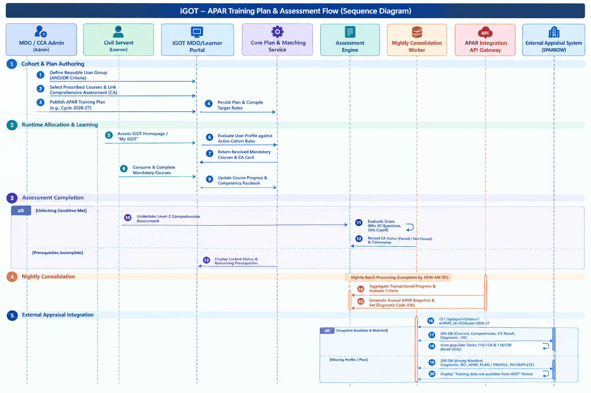
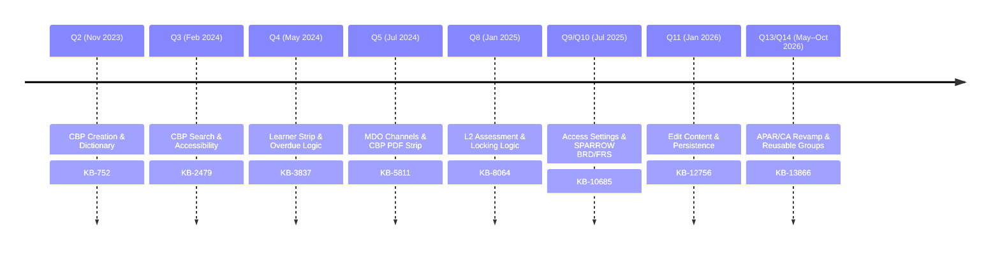
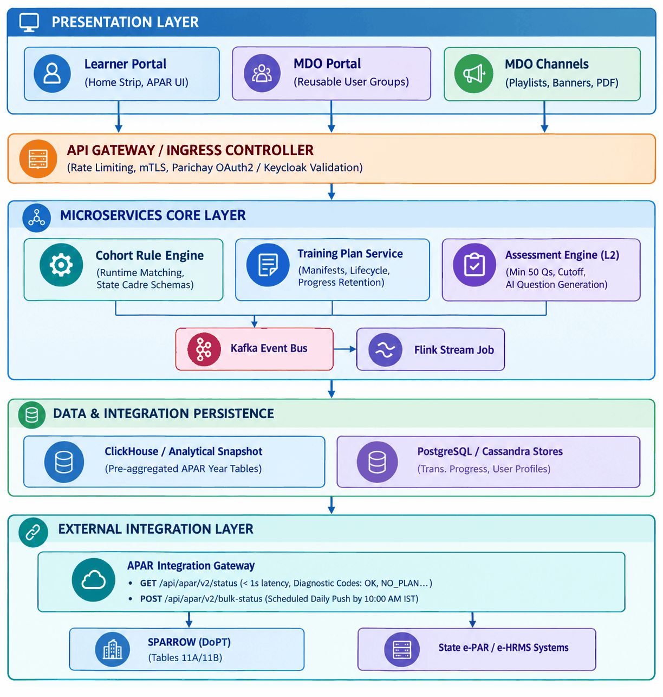

| Attribute | Details |
|---|---|
| Document Version | 1.0 |
| Preparation Date | 23 October 2026 |
| Document Classification | Formal Technical Specification & Architecture Review |
| Author Role | Senior Product Analyst, Business Analyst, and Solution Architect |
| Review Status | Draft for Executive & Architecture Review |
| Target Audience | Senior Management, Product Stakeholders, System Integrators, Architecture Review Board (ARB) |

## 1. Executive Summary

### What the Feature Does

The **Capacity Building Plan (CBP), Training Plans, and Annual Performance Appraisal Report (APAR) Framework** is the enterprise competency allocation, governance, and compliance engine of the **iGOT Karmayogi** digital platform. The framework enables Ministries, Departments, and Organizations (MDOs) as well as Cadre Controlling Authorities (CCAs) to curate, assign, track, and enforce targeted learning curricula (comprising courses, curated programs, blended programs, moderated courses, and Level-2 Comprehensive Assessments) for civil servants across Central, All India Services (AIS), and State/Provincial Civil Services (PCS) cadres. It automates the linkage between mandatory learning completion on iGOT and formal annual performance appraisal systems (e.g., SPARROW, state e-PAR, e-HRMS).

### Why It Was Introduced

Under Mission Karmayogi, capacity building shifted from ad-hoc, rule-based training to an agile, competency-driven model. The Government of India mandated that civil servants complete role-relevant competencies annually, with verifiable training milestones directly feeding into statutory annual appraisal reports. This required transforming what was previously a disconnected, offline exercise into an auditable digital lifecycle on iGOT Karmayogi.

### The Business Problem It Solves

1. **Siloed and Offline Training Planning:** MDOs previously formulated Annual Capacity Building Plans (ACBPs) through offline spreadsheets without systemic alignment to standardized competency dictionaries or course availability.
2. **Lack of Performance Appraisal Integration:** No automated bridge existed between digital training completion and civil service performance appraisal records (SPARROW / e-HRMS), requiring manual verification and subjective compliance checks.
3. **Imprecise Targeting:** Training allocations lacked granular, multi-attribute access control (e.g., targeting by Service, Cadre, Batch Seniority, Central Deputation, and Hierarchy).
4. **Content Lifecycle & Progress Loss:** Administrative plan modifications, organizational transfers, or course retirements frequently caused learner friction, progress disassociation, and reporting inconsistencies.

### Target Users

- **Learners (Civil Servants):** Central government employees, AIS officers (IAS, IPS, IFS), and State PCS officers who consume mandatory courses and complete Comprehensive Assessments.
- **MDO Leaders / Administrators:** Departmental administrators responsible for creating, editing, and publishing Training Plans and MDO Channel experiences.
- **Cadre Controlling Authorities (CCAs):** Central authorities (e.g., DoPT) responsible for curating service-wide mandatory annual training curricula.
- **SPV Administrators:** Karmayogi Bharat SPV administrators governing platform-wide channel enablements, master competency dictionaries, and system-level configurations.
- **External Appraisal Systems:** Automated consuming endpoints, including SPARROW (NIC), state e-PAR systems, and e-HRMS platforms.

### Major Capabilities

- **Competency Dictionary & Curated Allocation:** Multi-tiered competency structure (Functional, Behavioral, Domain) linked directly to course manifests.
- **Multi-Attribute Access Control Engine:** Runtime user-group allocation evaluating Boolean conditions (`AND` of criteria across Service, Cadre, Batch, Designation, Deputation, Organization Hierarchy, and Custom Profile Fields).
- **Comprehensive Assessment (CA / L2 Assessment):** Standalone or program-level evaluations enforcing completion thresholds, sectional cutoffs, and AI-assisted question generation.
- **Automated APAR Synchronization:** Nightly batch consolidation and low-latency REST APIs providing structured APAR form auto-population (Tables 11A/12A for courses and 11B/12B for CA results) with diagnostic error telemetry (`OK`, `NO_APAR_PLAN`, `PROFILE_INCOMPLETE`, `IDENTIFIER_MISMATCH`).

- **Resilient Content Persistence:** Automated progress retention across plan modifications, designation changes, inter-departmental transfers, and course retirements.
- **MDO Channels Integration:** Departmental branding, curated course playlists, broadcast announcements, and telemetry widgets.

### Relationship to the Broader iGOT Karmayogi Platform

The framework serves as the core orchestration layer connecting the **Learner Portal** (UI/Mobile consumption), **MDO Portal** (administrative planning and user grouping), **CBP/Content Portal** (content authoring and competency mapping), **Assessment Engine** (evaluation delivery), and the **Data Pipeline / Reporting Engine** (ClickHouse/Cassandra/Flink event streaming to Looker and external API consumers).

### Current Delivery and Implementation Status

- **Q2–Q5 Baseline (KB-752, KB-796, KB-2479, KB-3837, KB-5794, KB-5811):** Basic CBP creation, MDO Channels, Learner Homepage strips, and status indicators are **Production Deployed**.
- **Q8–Q10 Enhancements (KB-8064, KB-10518, KB-10685):** L2 Comprehensive Assessment creation, basic access settings, and preliminary SPARROW sync are **Production Deployed / KB Approved**.
- **Q11 Content Lifecycle (KB-12756):** Edit Content capability on active training plans with learner progress persistence is **Documented / Open**.
- **Q13–Q14 Revamp (KB-13866, KB-15846):** Reusable user groups, runtime profile matching, v2 bulk status APIs, state cadre expansion (e.g., BAS/BSS), and AI-assisted CA generation are in **Dev in Progress / Active Development**.

## 2. Business Context and Objectives

### Background and Business Context

Under Mission Karmayogi, capacity building is grounded in the **National Programme for Civil Services Capacity Building (NPCSCB)**. Every civil servant must continuously acquire targeted behavioral, functional, and domain competencies. The integration of iGOT training status into statutory appraisal forms (such as DoPT SPARROW) establishes a policy mandate where platform learning directly impacts career appraisal and progression.

### Existing Problems and Limitations

- **Manual Data Entry in Performance Appraisals:** Historically, officers self-reported training attended, resulting in non-standardized records and zero verification against learning outcomes.
- **Rigid Static Assignments:** Initial implementations assigned plans statically upon creation, meaning newly onboarded or transferred personnel missed mandated training cycles.
- **Loss of Training History upon Departmental Transfer:** Inter-departmental transfers previously risked detaching active training plans and historical competency logs.
- **Administrative Redundancy:** MDO administrators had to recreate user groups and plan definitions from scratch each annual cycle.

### Business Objectives

- **BR-1:** Establish automated, zero-touch auto-population of iGOT mandatory training and Comprehensive Assessment outcomes into APAR forms across central and state appraisal systems.
- **BR-2:** Position iGOT Karmayogi as the single, authoritative system of record for civil servant competency and training compliance.
- **BR-3:** Provide learners with transparent, real-time visibility into applicable mandatory annual targets, progress status, and appraisal compliance.
- **BR-4:** Empower MDOs and CCAs with autonomous, granular targeting mechanisms aligning with diverse cadre schemas (AIS, CSS, State PCS) without requiring engineering interventions.
- **BR-5:** Equip operational support teams with deterministic diagnostic codes to immediately identify reasons for training plan or appraisal synchronization discrepancies.

### Expected Outcomes

- Elimination of manual training data entry on SPARROW and state appraisal portals.
- 100% auditable traceability between assigned competency plans, course consumption timestamps, and appraisal grades.
- Streamlined annual administrative planning through reusable user-group targeting rules.

### User and Stakeholder Benefits

- **Civil Servants:** Automated appraisal credit for online learning; transparent progress tracking; protection against loss of course progress during administrative transfers.
- **MDO Administrators:** Self-service plan authoring; dynamic runtime cohort assignment; visibility into departmental completion compliance.
- **DoPT / Policy Bodies:** Enterprise-wide real-time analytics on national capacity building compliance.
- **Support / War-Room Teams:** Systematic triage using structured diagnostic error codes during high-volume appraisal submission windows.

### Business Success Measures

#### Documented Business Objectives (Source Verified)

- Auto-population of APAR Section 11A/12A (Courses) and 11B/12B (CA Results).
- Availability of previous day's consolidated training snapshot by 10:00 AM IST daily.
- Single-officer status retrieval API latency .
- Core service availability during peak APAR filing windows.

#### Proposed Success Measures (Analytical Recommendation)

- reduction in support ticket volume related to "missing training data on SPARROW."
- Zero reported incidents of progress data loss during active plan course updates or cadre reassignments.
- Sub-minute processing time for bulk MDO plan runtime re-evaluation jobs.

## 3. Feature Evolution and Timeline

### Chronological Milestones

#### 1. Q2 Baseline — Digitization of Capacity Building Plan (Nov 2023)

- **Sources:** `KB-752`, `BRD_Capacity_building_plan` (Page 6750611), `FRS_Capacity_building_plan_creation` (Page 16679094).
- **Delivered:** Creation of basic CBP line items in MDO Portal (All Users, By Designation, Custom Users); introduction of backend Competency Dictionary (Functional, Behavioral, Domain); basic Learner Homepage CBP display; handling of internal transfers, inter-organization transfers, and retired course de-linking.

#### 2. Q3 Enhancements — Usability & Enablement (Feb 2024)

- **Sources:** `KB-796`, `KB-2479`.
- **Delivered:** Enhanced search and selection UX for content and assignees using pill-based multi-selection with tooltips; bulk enablement workflows.

#### 3. Q4 Refinements — Learner Progress & Overdue Logic (Apr–May 2024)

- **Sources:** `KB-3837`, `KB-4908`.
- **Delivered:** Refactored Learner Homepage strip to prevent completed courses from displaying an "Overdue" status; introduced explicit "All", "Upcoming", and "Overdue" status bucketing.

#### 4. Q5 Broadcast Integration — MDO Channels (Jul 2024)

- **Sources:** `KB-5794`, `KB-5811`, `BRD MDO Channels` (Page 77955254), `FRS MDO Channels` (Page 85197083).
- **Delivered:** Introduction of dedicated MDO Channel pages with custom banners, text announcements, curated course playlists, nightly aggregate telemetry, and downloadable CBP PDF manifests.

#### 5. Q8 Evolution — Program-Level L2 Assessments (Jan–Apr 2025)

- **Sources:** `KB-8064`, `KB-8065`, `KB-8065 | Q8 | BRD | L2 Assessments` (Page 373850243).
- **Delivered:** Conception of Level-2 (L2) Comprehensive Assessments at the curated program level; conditional assessment locking (unlocking only upon 100% course completion); anti-skipping playback constraints.

#### 6. Q9–Q10 Integration — Formal APAR & SPARROW Framework (Jul–Oct 2025)

- **Sources:** `KB-10518`, `KB-10685`, `KB-10686 | BRD` (Page 430964819), `KB-10686 | FRS` (Page 432963599).
- **Delivered:** Formal specification of APAR Mandatory Courses and Comprehensive Assessment; mandatory profile attributes (eHRMS ID, Parichay ID, Service, Cadre, Batch, Deputation); SPARROW Tables 11A/12A and 11B/12B specification; Reporting API integration (`is_apar`, `competency_type`, `comprehensive_level_assessment_status`).

#### 7. Q11 Resilience — Training Plan Content Modification (Jan 2026)

- **Sources:** `KB-12756`, `BRD_TrainingPlanEnhancements_v1.0_r2025_Q4` (Page 693698562).
- **Delivered:** Administrative "Edit Content" action on active Training Plans; mandatory guidance warning modal; automated learner persistence ensuring removed courses with initiated progress remain in the learner's "My Learning" tab.

#### 8. Q13–Q14 Revamp — Reusable User Groups, State Cadres & Diagnostic Telemetry (May–Oct 2026)

- **Sources:** `KB-13866`, `KB-15846`, `Q13 | APAR and CA 2026-27 | BRD/PRD` (Page 1031307285).
- **Current Delivery:** Reusable user groups with Boolean evaluation (`AND` of criteria, `OR` across groups); dynamic runtime profile matching; expansion to State Civil Services (e.g., Bihar BAS, BSS); AI-assisted CA question generation; v2 bulk snapshot APIs; deterministic diagnostic status codes (`OK`, `NO_APAR_PLAN`, `PROFILE_INCOMPLETE`, `CA_WINDOW_CLOSED`, `IDENTIFIER_MISMATCH`).

## 5. End-to-End Business Workflow

### Actors

- **MDO Admin / CCA:** Configures cohorts, curates course manifests, links assessments, and publishes plans.
- **Learner (Civil Servant):** Completes profile attributes, consumes assigned courses, and undertakes Comprehensive Assessments.
- **Consolidation Worker:** Nightly batch processing engine aggregating progress and computing snapshots.
- **External Appraisal System (SPARROW / e-HRMS):** Consumes consolidated training snapshots and renders read-only appraisal tables.
- **Support Analyst:** Monitors system health and triages synchronization exceptions using diagnostic telemetry.

### Preconditions

1. Civil servant possesses an active iGOT profile containing verified Employee ID, eHRMS ID, Parichay ID, Service, Cadre, Batch, and Designation.
2. Required courses and assessments are published in the iGOT catalogue with verified Competency Dictionary (KCM) mappings.
3. External appraisal system establishes secure mutual TLS / API authentication with iGOT API gateways.

### Detailed Workflow Stages

1. **Targeting & Cohort Configuration:** MDO Admin constructs or reuses a saved User Group defining cohort inclusion rules (e.g., `Cadre = IAS AND Batch = 2018 AND Deputation = True`).
2. **Curriculum Manifest Definition:** Admin names the plan, specifies the reporting cycle (e.g., `2026-27`), selects 6–8 mandatory courses, and attaches an L2 Comprehensive Assessment.
3. **Publication:** MDO Admin publishes the plan. The platform evaluates runtime assignments without requiring SPV moderation.
4. **Learner Discovery & Consumption:** Assigned items appear dynamically on the learner's homepage strip under the current reporting year. If a course is completed, progress increments toward the annual 50% compliance threshold.
5. **Comprehensive Assessment Execution:** The CA unlocks either conditionally upon reaching course completion thresholds or via scheduled window rules. The officer attempts the assessment (minimum 50 questions, 50% pass mark).
6. **Nightly Consolidation Run:** A daily batch pipeline executes overnight, aggregating course completion timestamps, assessment pass/fail results, and profile states into a denormalized officer snapshot by 10:00 AM IST.
7. **Appraisal Form Auto-Population:** When the officer opens their annual performance report on SPARROW or state e-PAR, the external system queries `/api/apar/v2/status`. iGOT returns verified completion records, auto-populating Tables 11A/12A and 11B/12B as locked, read-only fields.

### Failure & Alternative Scenarios

- **Incomplete User Profile:** If an officer lacks mandatory cadre attributes, assignment evaluation blocks the plan, flagging the record with diagnostic code `PROFILE_INCOMPLETE`.
- **In-Flight Course Deletion:** If an admin removes a course from an active plan, learners who already started it retain the course in "My Learning," preventing data loss.
- **Identifier Mismatch on Appraisal Sync:** If SPARROW requests an unmapped eHRMS ID, iGOT returns HTTP 404 with diagnostic code `IDENTIFIER_MISMATCH`, allowing the appraisal workflow to proceed with a fallback notice.

## 6. Functional Scope

### Confirmed In-Scope Capabilities

- **Dynamic Cohort Targeting:** Boolean combination of profile attributes (`AND` conditions within groups, `OR` across groups) evaluating Service, Cadre, Batch Seniority, Designation, Deputation, Hierarchy, and Custom Fields.
- **State Civil Service Inclusions:** Explicit inclusion of state cadre structures, specifically modeled for Bihar Administrative Service (BAS) and Bihar Secretariat Service (BSS).
- **Course Lifecycle Management:** Administrative editing of active training plans with mandatory warning modals and automated retention of in-flight progress in "My Learning."
- **Comprehensive Assessment Enforcement:** Program-level and standalone assessments enforcing question minimums, pass percentages, retake rules, and conditional unlock triggers.
- **External Appraisal Integration:** Daily batch push and low-latency single-officer pull APIs delivering formatted training status directly into SPARROW and state appraisal systems.
- **Diagnostic Telemetry:** Structured diagnostic codes (`OK`, `NO_APAR_PLAN`, `PROFILE_INCOMPLETE`, `CA_WINDOW_CLOSED`, `IDENTIFIER_MISMATCH`) exposed for supportability.
- **MDO Channel Operations:** Departmental banners, announcements (max 15), curated course playlists, nightly aggregate metrics, and PDF manifest downloads.

### Confirmed Out-of-Scope Capabilities

- **External SPARROW Appraisal Business Rules:** Modifying appraisal evaluation rules, grading scales, or appraisal workflows outside the designated training tables.
- **Identity Management Modifications:** Changes to Parichay Single Sign-On (SSO) architecture or core national identity systems.
- **Non-APAR Learning Synchronization:** Syncing general self-enrolled, non-APAR courses or informal quizzes to performance appraisal records.
- **Ad-hoc External Training Ingestion:** Tracking or manually certifying courses conducted entirely outside the iGOT ecosystem.
- **Direct Database Manipulation of KCM Taxonomy:** Frontend-based creation or deletion of core Competency Dictionary taxonomy nodes.

### Planned or Proposed Capabilities

- **AI-Assisted Question Generation:** Automated generation of competency-aligned assessment question banks directly within the MDO creation flow.
- **Part-APAR Multi-Cycle Support:** Systemic support for multiple appraisal records within a single year resulting from mid-year transfers or No Reporting Certificates (NRCs).
- **Automated Course Retirement Deprecation:** Instantaneous dynamic purging of retired content items across all published and draft CBPs.

### Requirements Requiring Clarification

1. **Part-APAR Threshold Computation:** Definition of how minimum completion thresholds (e.g., 50%) are apportioned when an officer holds multiple designations under different reporting officers within a single cycle.
2. **Custom Field Hierarchy Enforcement:** Mechanism to prevent child organizations from viewing or polluting custom profile attributes declared by top-level Ministry L0 or State L0 entities.
3. **Assessment Retake Policy in Late APAR Submissions:** Policy rules governing whether officers can exhaust remaining CA attempts after statutory APAR filing deadlines have elapsed.

## 8. Existing and Target Architecture Overview

### Current Architecture (Documented Baseline)

- **Frontend Layer:** Angular-based micro-frontends serving the **Learner Portal** (`portal`), **MDO Portal** (`mdo`), and **CBP/Content Management**.
- **Backend Services:** Node.js and Java Spring Boot microservices managing user identity, content cataloging, course enrolment, and assessment delivery.
- **Data Storage:** Cassandra for course progress and operational transactional records; PostgreSQL for relational metadata; Elasticsearch for catalog searching.
- **Integration Strategy:** Point-to-point daily batch exports and v1 Reporting APIs returning flat enrolment dumps containing `is_apar` and `competency_type` attributes.
- **Authentication:** Parichay Keycloak SSO with session tokens validated across internal gateway routes.

### Target Architecture (Q13–Q14 Evolution)

- **Cohort Rule Engine:** Evaluates runtime Boolean criteria (`AND`/`OR`) dynamically against streaming user profile changes, eliminating static population drift.
- **Analytical Snapshot Store (ClickHouse):** Stores pre-aggregated, denormalized officer snapshots, enabling sub-second status retrieval without querying transactional Cassandra stores.
- **Low-Latency APAR API Gateway:** High-performance, read-only endpoint decoupling external appraisal queries from platform transaction traffic.
- **Telemetry & Diagnostic Subsystem:** Embeds diagnostic evaluation directly into status records, enabling immediate error classification.

## 9. Integrations and Dependencies

| Integration / Dependency | Purpose | Source & Destination | Interaction Mechanism | Documented Dependency Owner | Failure Impact | Unresolved Questions |
|---|---|---|---|---|---|---|
| **SPARROW Integration** | Auto-populate Tables 11A/12A (Courses) and 11B/12B (CA Results) in central officer appraisals. | iGOT SPARROW (NIC) | REST API (`/api/apar/v2/status`), HTTPS, JSON payload | NIC SPARROW Team / DoPT | Critical: Officers cannot complete statutory appraisal forms. | Handling of edge-case officers who change cadremen mid-year. |
| **e-HRMS Core Identity** | Cross-system employee correlation using national employee master identifiers. | e-HRMS iGOT | REST sync, daily batch batch reconciliation | DoPT / e-HRMS Team | High: Incomplete profiles block plan assignment (`PROFILE_INCOMPLETE`). | Automated reconciliation mechanism for unmapped IDs. |
| **Parichay SSO** | Government-wide Single Sign-On and user authentication. | Parichay iGOT Gateway | OAuth2 / OIDC, JWT Assertion validation | NIC Parichay Team | Blocker: Users cannot authenticate to iGOT. | Handling of email/mobile credential updates mid-cycle. |
| **State e-PAR Systems** | Performance appraisal integration for State Civil Services (e.g., Bihar BAS/BSS). | iGOT State Data Centres | REST API (`/api/apar/v2/bulk-status`) | State IT Departments | High: State officers missing verified training records in appraisals. | Network whitelisting and state gateway throughput limits. |
| **Assessment Engine** | Deliver Level-2 Comprehensive Assessments and compute pass/fail scores. | iGOT Assessment Service Core | Internal gRPC / Kafka Event Topics | iGOT Assessment Team | High: Assessments fail to record completion timestamps for APAR. | Automated recovery from disconnections during exam submission. |
| **Looker / Reporting Pipeline** | Provide departmental administrators with real-time compliance reporting. | Flink / ClickHouse Looker | Analytical Read Replicas, JDBC queries | iGOT Data Engineering Team | Medium: Administrative monitoring lag; does not block appraisal sync. | Refresh latency during peak concurrent query loads. |

## 10. Evaluation Summary

### Rating Criteria Definition

- **High (Score 8–10):** Documented in detail with unambiguous business rules, complete functional specifications, verified APIs, and clear exception handling.
- **Medium (Score 5–7):** Functionally specified and architecturally feasible, but possesses unresolved edge cases, pending schema alignments, or incomplete operational runbooks.
- **Low (Score 1–4):** High-level concept identified, but lacks detailed technical specifications, error handling, or implementation evidence.
- **Not Assessed (N/A):** Insufficient source evidence available to form a rigorous technical evaluation.

### Evaluation Dimensions Matrix

| Evaluation Dimension | Assessment | Evidence | Gap | Recommendation |
|---|---|---|---|---|
| **Business Alignment** | **High** | BRD p. 1031307285, KB-10686, KB-13866 directly align with National Programme for Civil Services Capacity Building and DoPT mandates. | None. Strong policy and strategic backing. | Maintain strict alignment with DoPT statutory appraisal notification cycles. |
| **Requirement** **Completeness** | **High** | BRD and FRS documents (pp. 430964819, 432963599, 1031307285) provide detailed user stories, field schemas, and acceptance criteria. | Part-APAR and multiple in-year designations require more granular specification. | Draft formal functional addendum for multi-designation split cycles. |
| **Functional Coverage** | **High** | Covers end-to-end lifecycle: Dictionary Targeting Consumption Assessment External Appraisal Auto-fill. | AI assessment question generation tool is early in functional maturity. | Establish manual question ingestion fallback for MDOs lacking AI tooling. |
| **User Workflow Completeness** | **High** | FRS pp. 16679094, 85197083, 1031307285 define happy paths, validation modals, and organizational transfer flows. | Clear guidance needed for post-deadline assessment attempts. | Enforce platform-level UI countdown timers for APAR assessment windows. |
| **Architecture Readiness** | **Medium** | Transitioning from point-to-point batch extracts to event-driven analytical snapshots in ClickHouse. | Event-driven runtime user-group matching engine is currently under development. | Conduct load and performance profiling on runtime matching workers. |
| **API & Integration Readiness** | **High** | Well-documented REST interfaces (`/api/apar/v2/status`, `/bulk-status`) with defined schemas and latency SLA. | Network and security handshake protocols with state data centers vary widely. | Create standardized integration SDK and staging sandbox for State IT teams. |
| **Security &** **Authorization** | **Medium** | Role-based boundaries defined; Parichay OAuth2 integrated; read-only field locking on SPARROW specified. | PII protection across state bulk data transfers requires standardized auditing. | Implement automated token-based masking on external diagnostic payloads. |
| **Data Management** | **Medium** | Daily snapshot scheduled for 10:00 AM IST; clear identity mapping across eHRMS, Parichay, and iGOT IDs. | High volume reconciliation between divergent HRMS identity schemas. | Deploy automated daily reconciliation jobs flagging unmapped civil servants. |
| **Performance & Scalability** | **Medium** | single-officer latency target; bulk chunking specified for high-volume endpoints. | Peak submission windows (March–April) generate extreme concurrent load on gateways. | Implement Redis caching for read-only consolidated snapshots. |
| **Reliability & Error Handling** | **High** | Introduction of explicit diagnostic codes (`OK`, `NO_APAR_PLAN`, `PROFILE_INCOMPLETE`, `IDENTIFIER_MISMATCH`). | Fallback behavior when external SPARROW endpoints timeout during bulk push. | Implement dead-letter queues (DLQs) with exponential backoff retries. |
| **Testing Readiness** | **Medium** | Test case structures defined in Jira (`KB-15931`, `KB-15516`, `KB-15520`) across MDO and APAR flows. | Automated end-to-end integration test suites across mock SPARROW gateways are incomplete. | Build mock SPARROW and state e-PAR harness in staging environment. |
| **Deployment Readiness** | **Medium** | Baseline features deployed to Production; Q13–Q14 components undergoing active sprint deployments. | Release sequencing between backend snapshot engine and frontend UI updates. | Adopt feature-flagged progressive rollout across select test ministries. |
| **Documentation Completeness** | **High** | Comprehensive coverage across Confluence spaces (TPT) spanning BRDs, FRSs, and technical architectures. | Documentation is spread across multiple evolution pages without a single unified index. | Consolidate documentation into this formal master architecture baseline. |

### Overall Readiness Score

#### Scoring Methodology

The score is computed as a weighted average across four core technical domains:

1. **Strategic & Functional Completeness (30% weight):** Score = 9.2 (Exceptionally mature policy alignment, detailed user stories, and rigorous acceptance criteria).
2. **Architecture & Integration Design (30% weight):** Score = 7.5 (Well-defined v2 API specifications, but runtime matching and analytical streaming pipelines are undergoing active deployment).
3. **Operational Robustness & Reliability (20% weight):** Score = 7.2 (Strong diagnostic error framework, but peak-load scalability and retry mechanisms require empirical validation).
4. **Testing & Deployment Maturity (20% weight):** Score = 6.8 (Documented test scenarios present, but comprehensive automated cross-agency integration tests remain pending).
