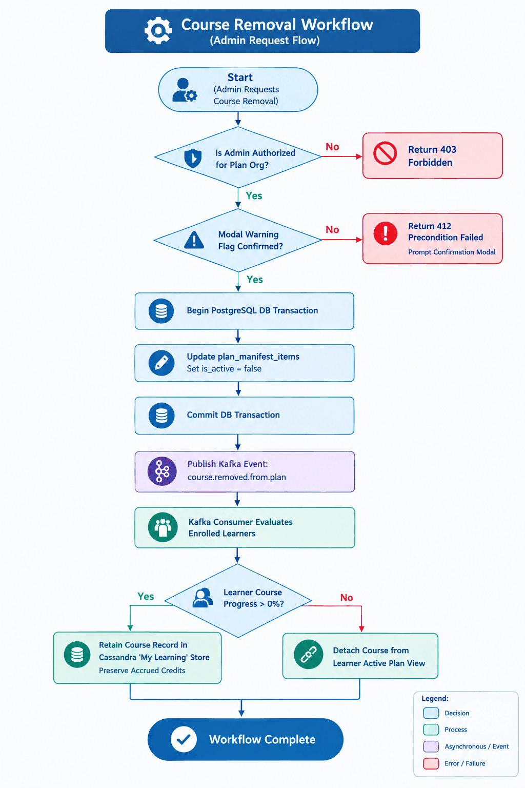
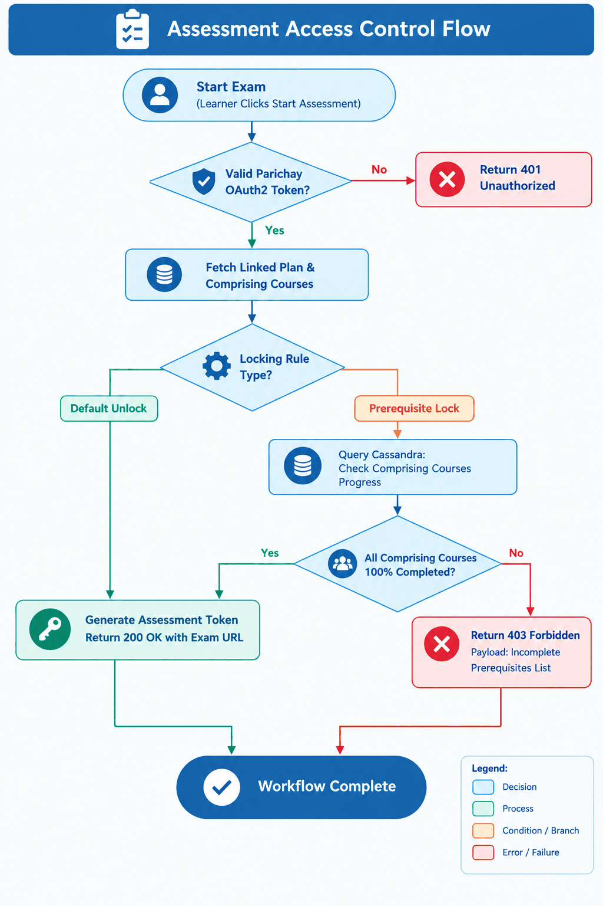
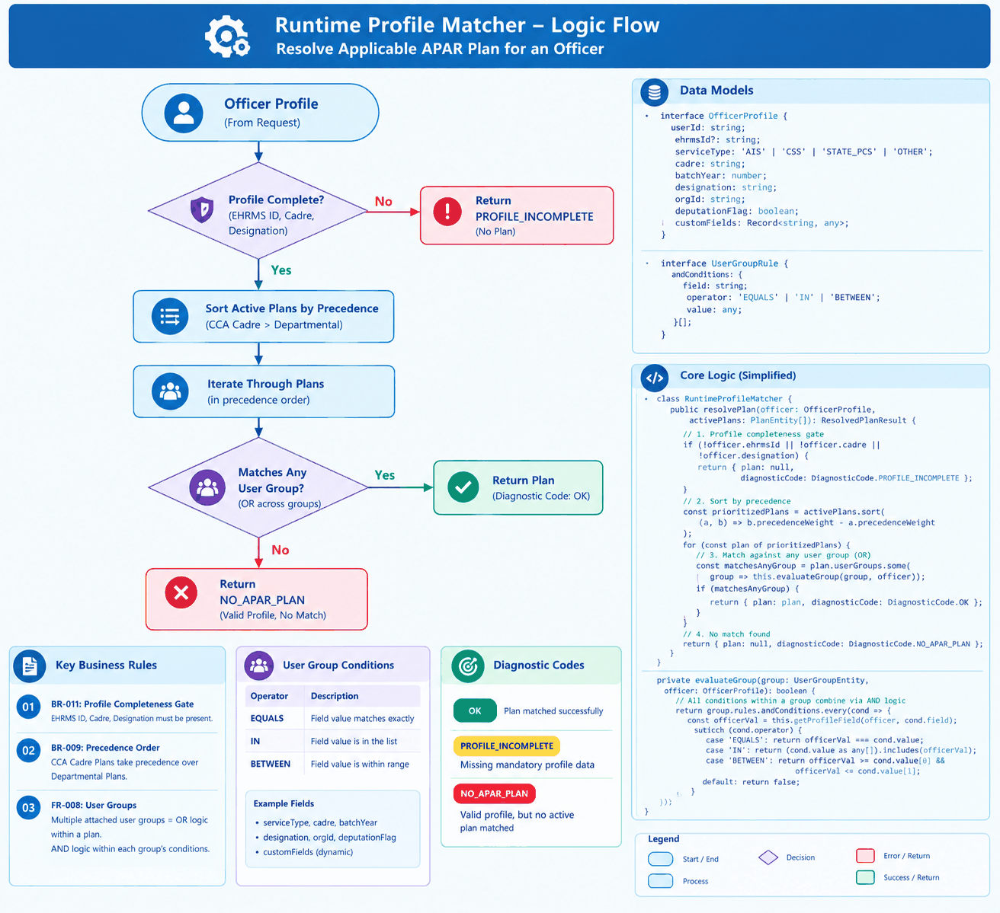
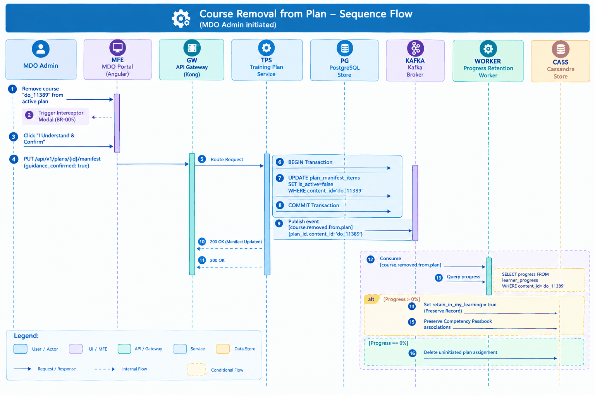
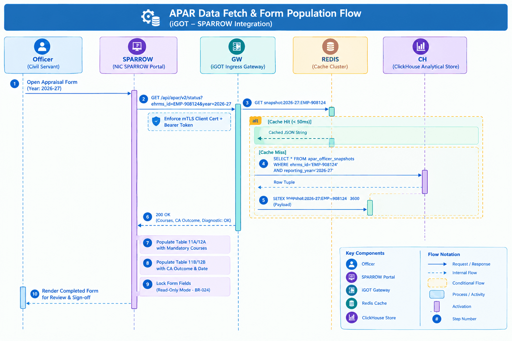

# Low-Level Design (LLD) — Capacity Building Plan, Training Plans, and APAR Framework

## 1. Introduction

### 1.1 Purpose

This Low-Level Design (LLD) provides the concrete software component specifications, class/module structures, procedural business logic, exact API schemas, relational and analytical database DDLs, state machines, and unit/integration test specifications for the **Capacity Building Plan (CBP), Training Plans, and Annual Performance Appraisal Report (APAR) Framework** on **iGOT Karmayogi**. It operationalizes the functional requirements from `iGOT-SRS-CBP-APAR-2026-V1.0` and the architectural decisions from `iGOT-HLD-CBP-APAR-2026-V1.0` and `iGOT-SDD-CBP-APAR-2026-V1.0`.

### 1.2 Scope

The detailed design specifies runtime implementations across:

1. **Administrative Services:** Plan CRUD lifecycle, draft concurrency, and in-flight course manifest modifications with progress-retention handlers (`TPS`).
2. **Targeting & Evaluation:** Compound Boolean rule compilation (`AND`/`OR`) and sub-millisecond runtime profile matching across Central, AIS, and State Cadres (`CRE`).
3. **Assessment & Media Controls:** Level-2 Comprehensive Assessment enforcement, prerequisite evaluation gates, and media player linear scrub validators (`AE`).
4. **Channel & Content Operations:** Departmental branding, FIFO announcement buffers (max 15), and dynamic PDF manifest streaming (`MCS`).
5. **Appraisal Ingestion & Querying:** Asynchronous Flink progress consolidation pipelines, materialization into ClickHouse, Redis multi-tier caching, low-latency REST endpoints (`/api/apar/v2/*`), and deterministic diagnostic state classifiers.

### 1.3 Intended Audience

- **Backend & Frontend Developers:** Direct implementation of service controllers, domain entities, database repositories, and Angular components.
- **QA Automation Engineers:** Implementation of parameterized unit test suites, integration mocks, and performance benchmarks.
- **Technical Leads & Code Reviewers:** Verification of PRs against documented exception paths, transaction boundaries, and security filters.

### 1.4 References

- `iGOT-SRS-CBP-APAR-2026-V1.0`: Software Requirements Specification (`FR-001` through `FR-023`).
- `iGOT-HLD-CBP-APAR-2026-V1.0`: High-Level Design (System Context, Component Models, ADRs).
- `iGOT-SDD-CBP-APAR-2026-V1.0`: Software Design Document (CQRS Patterns, Relational & ClickHouse Schemas).
- Confluence Source Specifications: `BRD CBP` (6750611), `FRS CBP Creation` (16679094), `BRD/FRS MDO Channels` (77955254, 85197083), `KB-8065 L2 BRD` (373850243), `KB-10686 APAR BRD/FRS` (430964819, 432963599), `BRD Training Plan Enhancements` (693698562), `Q13 APAR BRD/PRD` (1031307285).

### 1.5 Design Assumptions & Constraints

- **Verified Constraint:** SPARROW auto-populated form fields are strictly immutable; external systems must not recompute iGOT completion logic.
- **Design Assumption:** Core transactional entities are stored in PostgreSQL; learner telemetry is stored in Cassandra; analytical read-models are stored in ClickHouse.
- **Labeling:** Unverified implementation details are marked as `[Implementation Validation Required]`; proposed components are labeled as `[Proposed Design]`.

## 2. Component Breakdown

### CMP-01: TrainingPlanManager

- **Responsibility:** Implements plan authoring, metadata validation, draft saving, and state transitions (`FR-002`, `FR-003`).
- **Inputs/Outputs:** In: `CreatePlanCommand`, `PublishPlanCommand`. Out: `PlanEntity`, `PlanPublishedEvent`.
- **Dependencies:** PostgreSQL `training_plans` table, Spring Data JPA / Node.js TypeORM.
- **Error Conditions:** Throws `DuplicatePlanException` (HTTP 409) if an active plan with identical `(org_id, plan_year, title)` exists; throws `InvalidDateException` (HTTP 400) if `end_date <= current_date`.

### CMP-02: ManifestLifecycleHandler

- **Responsibility:** Handles in-flight course additions and removals from published plans; coordinates the progress retention safeguard (`FR-004`, `FR-005`, `FR-006`).
- **Inputs/Outputs:** In: `UpdateManifestCommand` (with `guidanceConfirmed=true`). Out: `ManifestUpdatedEvent`, Kafka topic `course.removed.from.plan`.
- **Dependencies:** Kafka Producer, Cassandra Learner Progress Store.
- **Error Conditions:** Throws `GuidanceConfirmationRequiredException` (HTTP 412) if client omits modal confirmation flag.

### CMP-03: BooleanCohortCompiler

- **Responsibility:** Compiles Reusable User Group targeting definitions into executable Boolean rule trees (`FR-007`, `FR-008`).
- **Inputs/Outputs:** In: JSONB rule definition (`AND` array within groups, `OR` across groups). Out: Compiled AST rule predicate.
- **Dependencies:** PostgreSQL `reusable_user_groups` table.
- **Error Conditions:** Throws `MalformedRuleException` (HTTP 400) if required cadre attributes contain invalid enumerations.

### CMP-04: RuntimeProfileMatcher

- **Responsibility:** Evaluates an authenticated officer's profile attributes against compiled active plan predicates at login or query time (`FR-009`).
- **Inputs/Outputs:** In: `OfficerProfileDTO`. Out: `ResolvedPlanDTO` (or `null` with diagnostic code).
- **Dependencies:** In-memory rule cache, Core Profile Service.
- **Error Conditions:** Returns `PROFILE_INCOMPLETE` if mandatory cadre fields (`ehrms_id`, `cadre`, `designation`) are missing.

### CMP-05: AssessmentPrerequisiteGate

- **Responsibility:** Evaluates whether a learner has satisfied course completion prerequisites before issuing an assessment launch authorization token (`FR-013`, `FR-014`).
- **Inputs/Outputs:** In: `user_id`, `assessment_id`. Out: `AuthorizationToken` (or HTTP 403 with incomplete courses list).
- **Dependencies:** Cassandra `learner_course_progress`, PostgreSQL `comprehensive_assessments`.
- **Error Conditions:** Throws `PrerequisitesUnmetException` if course completion percentage is (or configured threshold).

### CMP-06: PlaybackTelemetryValidator

- **Responsibility:** Validates media heartbeat payloads from client players, enforcing forward scrub restrictions on recorded lectures (`FR-015`).
- **Inputs/Outputs:** In: `TelemetryHeartbeatDTO` (`current_pos`, `last_pos`, `media_duration`). Out: `ValidationStatus` (`VALID` / `REJECTED`).
- **Dependencies:** Cassandra `playback_telemetry`.
- **Error Conditions:** Drops progress increments and emits security audit log if `current_pos - last_pos > threshold` (scrubbing detected).

### CMP-07: ChannelContentBroker

- **Responsibility:** Manages MDO Channel carousels, PDF manifest generation, and FIFO announcement buffers limited to 15 items (`FR-010`, `FR-011`, `FR-012`).
- **Inputs/Outputs:** In: `AnnouncementCommand`. Out: `AnnouncementEntity` (triggers auto-purge of 16th oldest item).
- **Dependencies:** PostgreSQL `mdo_channels`, `channel_announcements`.
- **Error Conditions:** Throws `ValidationException` if description or announcement .

### CMP-08: FlinkConsolidationProcessor

- **Responsibility:** Stateful Apache Flink streaming pipeline performing daily consolidation of course completions and assessment scores into annual snapshots (`FR-019`).
- **Inputs/Outputs:** In: Kafka events (`course.progress.updated`, `assessment.completed`). Out: ClickHouse JDBC batch inserts into `apar_officer_snapshots`.
- **Dependencies:** Kafka, ClickHouse cluster.
- **Error Conditions:** Unrecoverable deserialization errors routed to `apar.consolidation.dlq`.

### CMP-09: DiagnosticStateClassifier

- **Responsibility:** Attaches exactly one deterministic diagnostic code to each materialized officer record (`FR-023`).
- **Inputs/Outputs:** In: `OfficerSnapshotContext`. Out: Enum (`OK`, `NO_APAR_PLAN`, `PROFILE_INCOMPLETE`, `CA_WINDOW_CLOSED`, `IDENTIFIER_MISMATCH`).
- **Dependencies:** Analytical processing rules.
- **Error Conditions:** Defaults to `PROFILE_INCOMPLETE` if profile validation fails.

### CMP-10: APARGatewayController

- **Responsibility:** High-throughput, low-latency REST controller serving external appraisal queries for SPARROW and State e-PAR (`FR-020`, `FR-021`, `FR-022`).
- **Inputs/Outputs:** In: `GET /api/apar/v2/status`, `POST /api/apar/v2/bulk-status`. Out: Serialized JSON mapped to Tables 11 & 12.
- **Dependencies:** Redis Cache Cluster, ClickHouse Read Replica.
- **Error Conditions:** Returns HTTP 404 with diagnostic `IDENTIFIER_MISMATCH` if identifier cannot be resolved.

## 3. Detailed Workflow Design

### 3.1 Workflow: Plan In-Flight Course Manifest Modification (`CMP-02`)



#### Decision Table: In-Flight Course Manifest Modification

| Rule ID | Admin Scope Valid | Modal Confirmed | Learner Progress State | DB Manifest Action | Kafka Event Emitted | Learner "My Learning" State | HTTP Response Code |
|---|---|---|---|---|---|---|---|
| **DT-01** | False | N/A | N/A | None | False | Unchanged | `403 Forbidden` |
| **DT-02** | True | False | N/A | None | False | Unchanged | `412 Precondition Failed` |
| **DT-03** | True | True | Progress | Soft Deleted | True | Unlinked Cleanly | `200 OK` |
| **DT-04** | True | True | Progress | Soft Deleted | True | **Retained Permanently** | `200 OK` |
| **DT-05** | True | True | Course Completed | Soft Deleted | True | **Retained with Certificate** | `200 OK` |

### 3.2 Workflow: Assessment Authorization & Prerequisite Verification (`CMP-05`)



## 4. API and Interface Specifications

### 4.1 Single-Officer Status Endpoint (`GET /api/apar/v2/status`)

- **Endpoint Identifier:** `API-APAR-01`
- **HTTP Method:** `GET`
- **URI:** `/api/apar/v2/status`
- **Maturity Status:** Confirmed Proposed API (`Q13 BRD/PRD`, Section 6.1).
- **Caller:** External Appraisal Consumer (NIC SPARROW, State e-PAR).
- **Target:** `APARGatewayController` (`CMP-10`).
- **Authentication:** Mutual TLS (X.509 Client Cert) + OAuth2 Bearer Token (`Authorization: Bearer <token>`).
- **Authorization:** Verified caller scope `apar:read`.
- **Idempotency:** Strictly Idempotent (Read-only query).
- **Timeout & Retry Policy:** Client timeout ; max 2 retries with exponential backoff.

#### Request Parameters (Query String)

| Parameter Name | Data Type | Mandatory | Constraints | Description |
|---|---|---|---|---|
| `ehrms_id` | String | Conditional | Max 64 chars. Required if `parichay_id` absent. | Central Government employee identifier. |
| `parichay_id` | String | Conditional | Email format. Required if `ehrms_id` absent. | NIC Parichay Single Sign-On username. |
| `year` | String | **Mandatory** | Regex: `^[0-9]{4}-[0-9]{2}$` (e.g., `"2026-27"`). | Statutory reporting year cycle. |

#### Request Headers

- `Accept: application/json`
- `X-Consumer-ID: NIC-SPARROW-PROD`
- `X-Request-ID: UUIDv4` (Propagated correlation token)

#### Response Schema (HTTP 200 OK)

```json
{
  "$schema": "http://json-schema.org/draft-07/schema#",
  "type": "object",
  "required": [
    "status",
    "data"
  ],
  "properties": {
    "status": {
      "type": "string",
      "enum": [
        "SUCCESS",
        "FAILED"
      ]
    },
    "data": {
      "type": "object",
      "required": [
        "officer",
        "reporting_year",
        "mandatory_courses",
        "comprehensive_assessment",
        "diagnostic_telemetry"
      ],
      "properties": {
        "officer": {
          "type": "object",
          "required": [
            "ehrms_id",
            "cadre",
            "batch"
          ],
          "properties": {
            "ehrms_id": {
              "type": "string"
            },
            "parichay_id": {
              "type": "string"
            },
            "cadre": {
              "type": "string"
            },
            "batch": {
              "type": "string"
            }
          }
        },
        "reporting_year": {
          "type": "string"
        },
        "plan_details": {
          "type": "object",
          "properties": {
            "plan_id": {
              "type": "string",
              "format": "uuid"
            },
            "plan_name": {
              "type": "string"
            }
          }
        },
        "mandatory_courses": {
          "type": "array",
          "items": {
            "type": "object",
            "required": [
              "course_id",
              "course_name",
              "competency_type",
              "status"
            ],
            "properties": {
              "course_id": {
                "type": "string"
              },
              "course_name": {
                "type": "string"
              },
              "competency_type": {
                "type": "string",
                "enum": [
                  "Functional",
                  "Behavioral",
                  "Domain"
                ]
              },
              "status": {
                "type": "string",
                "enum": [
                  "Completed",
                  "In Progress",
                  "Not Started"
                ]
              },
              "completion_date": {
                "type": [
                  "string",
                  "null"
                ],
                "format": "date-time"
              }
            }
          }
        },
        "comprehensive_assessment": {
          "type": "object",
          "required": [
            "ca_applicable",
            "status",
            "result"
          ],
          "properties": {
            "ca_applicable": {
              "type": "boolean"
            },
            "assessment_id": {
              "type": "string"
            },
            "status": {
              "type": "string",
              "enum": [
                "Completed",
                "In Progress",
                "Not Started",
                "Not Applicable"
              ]
            },
            "result": {
              "type": "string",
              "enum": [
                "Passed",
                "Not Passed",
                "Not Attempted",
                "N/A"
              ]
            },
            "completion_date": {
              "type": [
                "string",
                "null"
              ],
              "format": "date-time"
            }
          }
        },
        "diagnostic_telemetry": {
          "type": "object",
          "required": [
            "code",
            "computed_at"
          ],
          "properties": {
            "code": {
              "type": "string",
              "enum": [
                "OK",
                "NO_APAR_PLAN",
                "PROFILE_INCOMPLETE",
                "CA_WINDOW_CLOSED",
                "IDENTIFIER_MISMATCH"
              ]
            },
            "computed_at": {
              "type": "string",
              "format": "date-time"
            }
          }
        }
      }
    }
  }
}
```

#### Status and Error Codes

- `200 OK`: Successful snapshot return (carries diagnostic `OK`, `NO_APAR_PLAN`, or `PROFILE_INCOMPLETE`).
- `400 Bad Request`: Parameter validation failure (invalid year format, both IDs missing).
- `401 Unauthorized`: Client certificate missing or expired OAuth2 bearer token.
- `403 Forbidden`: Client certificate valid, but IP not in government gateway whitelist.
- `404 Not Found`: Supplied identifier cannot be matched to any user record (`IDENTIFIER_MISMATCH`).
- `500 Internal Error`: Database read failure; triggers automated alert.

### 4.2 Bulk Cadre Export Endpoint (`POST /api/apar/v2/bulk-status`)

- **Endpoint Identifier:** `API-APAR-02`
- **HTTP Method:** `POST`
- **URI:** `/api/apar/v2/bulk-status`
- **Caller:** State e-PAR Platforms / Scheduled Batch Synchronizer.
- **Target:** `APARGatewayController` (`CMP-10`).
- **Request Schema:**

```json
{
  "cadre": "BAS",
  "reporting_year": "2026-27",
  "limit": 500,
  "cursor": "eyJvZmZzZXQiOjUwMCwibGFzdF9pZCI6IjkwOTEyNCJ9"
}
```

- **Response Payload:** Paginated JSON array containing up to `limit` single-officer status blocks with an opaque `next_cursor` string for continuation.

### 4.3 In-Flight Course Modification Endpoint (`PUT /api/v1/plans/{id}/manifest`)

- **Endpoint Identifier:** `API-TPS-01`
- **HTTP Method:** `PUT`
- **URI:** `/api/v1/plans/{id}/manifest`
- **Caller:** MDO Portal UI (`UI_MP`).
- **Target:** `ManifestLifecycleHandler` (`CMP-02`).
- **Request Headers:** `Authorization: Bearer <JWT>`, `Content-Type: application/json`
- **Request Payload:**

```json
{
  "plan_id": "81c3e1e2-b112-4d1a-8f6a-93108c49e102",
  "guidance_confirmed": true,
  "active_course_ids": [
    "do_113892019",
    "do_113892044",
    "do_113892088"
  ]
}
```

- **Response Codes:**
  - `200 OK`: Manifest updated; asynchronous persistence events queued.
  - `412 Precondition Failed`: `guidance_confirmed` was `false` or missing; returns mandatory modal warning string.

## 5. Internal Processing and Business Logic

### 5.1 Runtime Cohort Matching Logic (`CMP-04`)

The Cohort Rule Engine resolves an officer's plan dynamically at runtime using the following procedural algorithm:



## 8. Sequence Diagrams

### 8.1 Plan In-Flight Modification with Persistence Guard



### 8.2 External SPARROW Appraisal Auto-Population Sequence



## 9. Error Handling

### 9.1 Component Error Handling Matrix

| Component | Error Condition | Detection Point | Expected Response / Status | Logging Level | Recovery & User Impact |
|---|---|---|---|---|---|
| `CMP-01` | Duplicate Plan compound key. | `PlanController` | HTTP `409 Conflict` | `WARN` | Modal displays: *"A plan for this cohort and year already exists."* |
| `CMP-02` | Guidance modal flag omitted on plan manifest modification. | `ManifestLifecycleHandler` | HTTP `412 Precondition Failed` | `WARN` | Frontend renders mandatory warning modal interceptor. |
| `CMP-04` | Profile missing mandatory `ehrms_id` or `cadre`. | `RuntimeProfileMatcher` | Set diagnostic `PROFILE_INCOMPLETE` | `INFO` | Learner dashboard prompts profile update; appraisal sync omitted. |
| `CMP-05` | Assessment launch with incomplete prerequisite courses. | `AssessmentPrerequisiteGate` | HTTP `403 Forbidden` | `INFO` | Modal displays list of incomplete prerequisite courses with direct links. |
| `CMP-06` | Forward video scrubbing detected. | `PlaybackTelemetryValidator` | Discard progress heartbeat | `WARN` | Player reverts seekhead to last valid playback position. |
| `CMP-08` | Unparseable Kafka progress message. | `FlinkConsolidationProcessor` | Route to `apar.progress.dlq` | `ERROR` | Pipeline continues processing; DLQ analyzed by SRE team. |
| `CMP-10` | Unmapped officer queried by SPARROW. | `APARGatewayController` | HTTP `404 Not Found` (`IDENTIFIER_MISMATCH`) | `WARN` | SPARROW renders fallback notice: *"Training data not available from iGOT"*. |

## 10. Security Implementation Details

### 10.1 Input Validation & Regex Boundaries

- **Reporting Year Format:** Validated at ingress via regex: `^[0-9]{4}-[0-9]{2}$` (e.g., `2026-27`).
- **eHRMS Identifier Format:** Alphanumeric whitelist: `^[A-Za-z0-9\-_]{4,64}$`.
- **MDO Channel Description:** Strictly truncated and bounded at 250 characters (`BR-012`).
- **Announcements Length:** Bounded at 500 characters (`BR-013`).

### 10.2 Authentication Context & Token Propagation

- Ingress gateway validates Parichay Keycloak tokens, extracting claims into downstream HTTP headers:
  - `X-User-ID`: Internal iGOT UUID.
  - `X-User-Roles`: Comma-separated roles (`RL-01`, `RL-02`, etc.).
  - `X-User-Org`: Administrative organization UUID.

- Downstream services inspect `X-User-Org` to enforce strict organizational hierarchy isolation, preventing cross-ministry data leakage.

### 10.3 Cryptographic Controls

- **Transport:** TLS 1.3 enforced with cipher `TLS_AES_256_GCM_SHA384`.
- **Storage Encryption:** PostgreSQL and Cassandra volumes encrypted using AES-256 block-level keys managed via HashiCorp Vault / Cloud KMS.

## 11. Logging, Monitoring, and Performance

### 11.1 Observability Standards & Correlation Tokens

- **Trace Context:** Every incoming API call is assigned a unique `X-Correlation-ID: UUIDv4` header, propagated across Kafka headers and ClickHouse rows.
- **Structured Logs:** Emitted as JSON to `stdout`, ingested by Fluentbit into Elasticsearch:

```json
{
  "timestamp": "2026-10-23T06:12:01.102Z",
  "level": "INFO",
  "service": "apar-gateway-svc",
  "correlation_id": "81c3e1e2-b112-4d1a-8f6a-93108c49e102",
  "action": "GET_OFFICER_STATUS",
  "ehrms_id": "EMP-908124",
  "diagnostic_code": "OK",
  "latency_ms": 38.2
}
```

### 11.2 Prometheus Operational Metrics

| Metric Name | Type | Labels | Description |
|---|---|---|---|
| `apar_status_requests_total` | Counter | `status_code`, `diagnostic_code` | Total appraisal status queries served. |
| `apar_status_latency_seconds` | Histogram | `endpoint`, `cache_hit` | Latency distribution of status queries. |
| `course_in_flight_removals_tota``l` | Counter | `org_id` | Count of course removals from active plans. |
| `daily_consolidation_records_processed` | Gauge | `reporting_year` | Number of officer snapshots computed daily. |

## 12. Configuration and Deployment Dependencies

### 12.1 Environment Configuration Keys

| Config Property Key | Type | Default Value | Sensitivity | Description |
|---|---|---|---|---|
| `spring.datasource.url` | String | `jdbc:postgresql://pg-cluster:5432/igot_cbp` | Standard | Relational database connection string. |
| `spring.datasource.password` | String | `[VAULT_MANAGED_SECRET]` | **Secret** | Database master credential. |
| `clickhouse.jdbc.url` | String | `jdbc:clickhouse://ch-cluster:8123/igot_analytics` | Standard | Analytical database endpoint. |
| `redis.cluster.nodes` | String | `redis-node-1:6379,redis-node-2:6379` | Standard | Redis cluster node topology. |
| `apar.sparrow.mtls.ca-cert` | String | `[VAULT_MANAGED_CERT]` | **Secret** | NIC DoPT CA certificate bundle. |
| `apar.consolidation.cron` | String | `0 2 * * *` | Standard | Nightly rollup schedule (02:00 AM IST). |
| `assessment.l2.min-questions` | Integer | `50` | Standard | Minimum questions enforced on L2 CAs. |

## 14. Requirement-to-Implementation Traceability

| SRS ID | HLD Component | LLD Component ID | Implementation Class / Method | Database Table | Test Scenario |
|---|---|---|---|---|---|
| **FR-001** | Core Taxonomy Service | Master Data Ingestion | `KcmTaxonomyLoader.ingest()` | `competency_taxonomy` | DB Schema Inspection |
| **FR-002** | Training Plan Service | `CMP-01` | `PlanController.createDraft()` | `training_plans` | `TC-01` |
| **FR-003** | Training Plan Service | `CMP-01` | `PlanLifecycleManager.publish()` | `training_plans` | Role Execution Test |
| **FR-004** | Training Plan Service | `CMP-02` | `ManifestLifecycleHandler.update()` | `plan_manifest_items` | `TC-02` |
| **FR-005** | Training Plan Service | `CMP-02` | `KafkaProgressRetentionListener.on()` | `learner_progress` (CASS) | `TC-03` |
| **FR-006** | Content Lifecycle Service | `CMP-02` | `RetiredContentCleaner.purge()` | `plan_manifest_items` | Scheduled Job Test |
| **FR-007** | Cohort Rule Engine | `CMP-03` | `BooleanCohortCompiler.compile()` | `reusable_user_groups` | `TC-04` |
| **FR-008** | Cohort Rule Engine | `CMP-03` | `RulePredicateParser.parse()` | `plan_user_group_mappings` | `TC-04` |
| **FR-009** | Cohort Rule Engine | `CMP-04` | `RuntimeProfileMatcher.resolvePlan()` | In-Memory Rule Cache | Runtime Mutation Test |
| **FR-010** | MDO Channel Service | `CMP-07` | `ChannelController.getChannel()` | `mdo_channels` | Responsive UI Test |
| **FR-011** | MDO Channel Service | `CMP-07` | `AnnouncementBuffer.insertFifo()` | `channel_announcements` | FIFO Buffer Test |
| **FR-012** | MDO Channel Service | `CMP-07` | `PdfManifestGenerator.stream()` | Cloud Storage Bucket | PDF Stream Verification |
| **FR-013** | Assessment Engine | `CMP-05` | `AssessmentController.create()` | `comprehensive_assessments` | Boundary Check () |
| **FR-014** | Assessment Engine | `CMP-05` | `PrerequisiteGate.verifyLock()` | `learner_course_progress` | `TC-06` |
| **FR-015** | Assessment Engine | `CMP-06` | `PlaybackValidator.validate()` | `playback_telemetry` | `TC-07` |
| **FR-016** | Learner Portal MFE | Angular MFE | `StatusStripComponent.render()` | Client Session Store | Status Rendering Test |
| **FR-017** | Learner Portal MFE | Angular MFE | `AparCardComponent.selectYear()` | `apar_officer_snapshots` | Multi-Year UI Test |
| **FR-018** | Profile Sync Listener | Core Sync | `OrgTransferHandler.onTransfer()` | `training_plans` / CASS | Transfer Simulation |
| **FR-019** | Flink Consolidation Engine | `CMP-08` | `FlinkConsolidationJob.process()` | `apar_officer_snapshots` | Synthetic Freshness Test |
| **FR-020** | APAR Gateway Service | `CMP-10` | `APARGatewayController.getStatus()` | Redis / ClickHouse | `TC-05`, `TC-10` |
| **FR-021** | APAR Gateway Service | `CMP-10` | `APARGatewayController.bulkExport()` | ClickHouse Analytical Store | Bulk Stress Test |
| **FR-022** | APAR Gateway Adapter | `CMP-10` | `SparrowPayloadSerializer.map()` | SPARROW Tables 11 & 12 | SPARROW Contract Test |
| **FR-023** | Diagnostic Classifier | `CMP-09` | `DiagnosticClassifier.classify()` | `apar_officer_snapshots` | Diagnostic Permutations |

## 15. Technical Debt and Open Questions

| Item ID | Category | Description & Technical Context | Impact | Recommended Action | Owner Role |
|---|---|---|---|---|---|
| **TD-01** | **Technical Debt** | Legacy CBP creation routes execute raw SQL queries lacking ORM connection pool backpressure controls. | Database connection pool exhaustion during peak administrative authoring. | Refactor legacy data layer to use Spring Data JPA / TypeORM connection pool sizing. | Backend Tech Lead |
| **TD-02** | **Technical Debt** | Assessment Engine stores media scrubbing heartbeats in wide Cassandra partitions, risking tombstone accumulation. | Read latency degradation during completion lookups. | Implement Cassandra TTL compaction tuning and bucketing by media chunk ID. | SRE / Database Lead |
| **OQ-01** | **Open Question** | What exact criteria govern Part-APAR status generation when an officer serves under multiple reporting authorities within a single cycle? | Risk of overwriting earlier in-year appraisal training credits. | Agree on sub-period snapshot schema (`2026-27-P1`, `2026-27-P2`) with DoPT and NIC SPARROW. | Senior Business Analyst |
| **OQ-02** | **Open Question** | Are State Civil Service e-PAR platforms capable of ingesting streaming JSON chunks, or do they require static CSV exports? | May require building an asynchronous SFTP batch fallback export module. | Engage State IT teams (e.g., Bihar Data Centre) to benchmark REST connectivity. | Integration Lead |

*This document establishes the official Low-Level Design engineering baseline for the Capacity Building Plan, Training Plans, and APAR Framework on iGOT Karmayogi.*
