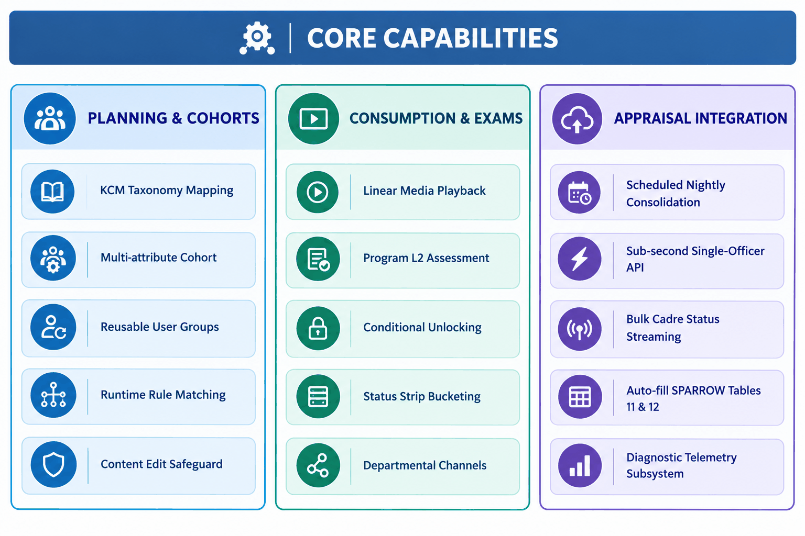
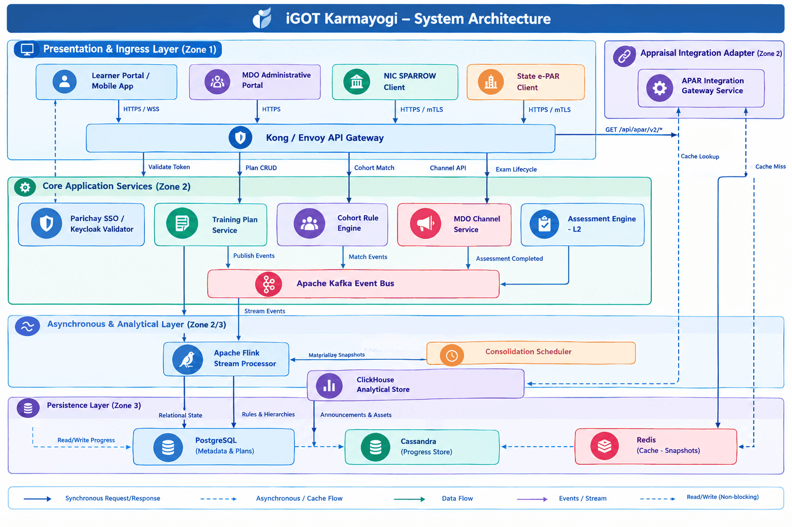
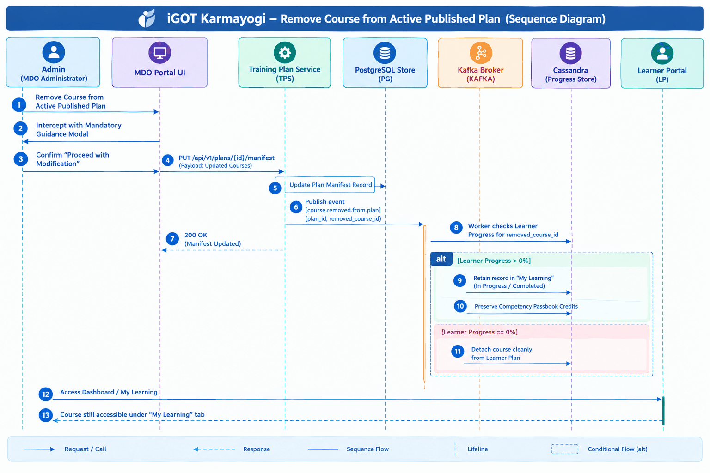
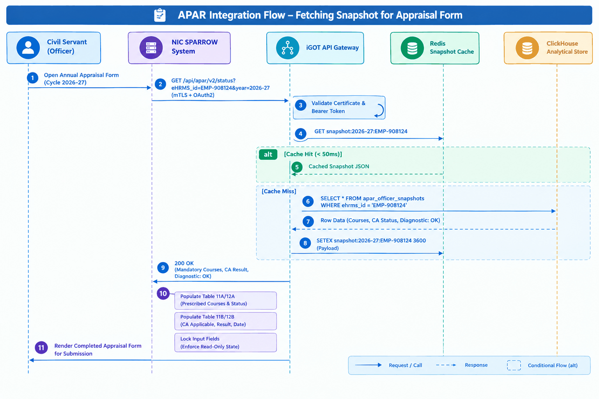
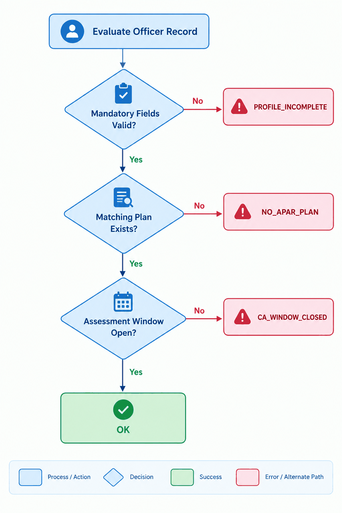

# Software Design Document (SDD) — Capacity Building Plan, Training Plans, and APAR Framework

## 1. Document Overview

### 1.1 Purpose

This Software Design Document (SDD) defines the consolidated software architecture, component models, data designs, API specifications, and operational behaviors for the **Capacity Building Plan (CBP), Training Plans, and Annual Performance Appraisal Report (APAR) Framework** on the **iGOT Karmayogi** digital platform. It translates the requirements specified in the Software Requirements Specification (`iGOT-SRS-CBP-APAR-2026-V1.0`) into a concrete, implementation-ready engineering architecture.

### 1.2 Scope

The design scope covers the end-to-end technical realization across web/mobile presentation layers, core administrative microservices, asynchronous stream processing pipelines, analytical data stores, and external gateway integration adapters supporting Q2 through Q14 product capabilities:

- **Taxonomy & Ingestion:** Backend ingestion and relational storage of the Karmayogi Competency Model (KCM).
- **Planning & Manifests:** MDO Portal plan authoring, versioning, draft states, and the "Edit Content" in-flight progress retention mechanism.
- **Targeting & Cohorts:** Boolean evaluation engine (`AND`/`OR`) executing dynamic runtime profile matching across Central, All India Services (AIS), and State Civil Services (e.g., BAS/BSS).
- **Broadcast & Engagement:** MDO Channels, dynamic announcements FIFO cache, and PDF manifest generation.
- **Assessment Engine:** Level-2 (L2) Comprehensive Assessment (CA) execution, anti-skipping linear playback enforcement, and conditional unlocking logic.
- **Statutory Appraisal Pipeline:** Nightly Flink/ClickHouse consolidation pipelines, low-latency REST endpoints (`/api/apar/v2/*`), and deterministic diagnostic telemetry subsystems.

### 1.3 Intended Audience

- **Principal Software Engineers & Developers:** Microservice implementation, domain modeling, and data layer development.
- **Solution & Integration Architects:** API contracts, security trust boundaries, and interface verification with external agencies (NIC SPARROW, State IT).
- **DevOps & Site Reliability Engineers (SRE):** Container deployment topologies, database replication, caching, and synthetic monitoring.
- **Quality Assurance Engineers:** Automated integration, chaos, performance, and contract test design.
- **Architecture Governance Board:** Design sign-off, compliance auditing, and technical debt tracking.

### 1.4 References

1. `iGOT-SRS-CBP-APAR-2026-V1.0`: Software Requirements Specification — Capacity Building Plan, Training Plans, and APAR Framework.
2. `BRD_Capacity_building_plan` (Confluence Page ID: 6750611).
3. `FRS_Capacity_building_plan_creation` (Confluence Page ID: 16679094).
4. `BRD MDO Channels` (Confluence Page ID: 77955254) & `FRS MDO Channels` (Confluence Page ID: 85197083).
5. `KB-8065 | Q8 | BRD | L2 Assessments` (Confluence Page ID: 373850243).
6. `KB-10686 | APAR | BRD / FRS` (Confluence Page IDs: 430964819, 432963599).
7. `BRD_TrainingPlanEnhancements_v1.0_r2025_Q4` (Confluence Page ID: 693698562).
8. `Q13 | APAR and CA 2026-27 | BRD/PRD` (Confluence Page ID: 1031307285).
9. Jira Issues: `KB-752`, `KB-796`, `KB-2479`, `KB-3837`, `KB-5794`, `KB-5811`, `KB-8064`, `KB-10518`, `KB-10685`, `KB-12756`, `KB-13866`.

### 1.5 Definitions and Abbreviations

*(Refer to Section 1.5 of* `iGOT-SRS-CBP-APAR-2026-V1.0` for full domain glossary: ACBP, AIS, APAR, BAS, BSS, CA, CBP, CCA, CSS, DoPT, e-HRMS, e-PAR, FBD, KCM, L2 Assessment, MDO, NRC, Parichay, SPARROW, SPV).

### 1.6 Document Conventions

- **Documented Decision:** Architecture patterns explicitly grounded in source PRDs, Jira tickets, or verified repository code.
- **Design Recommendation:** Architectural enhancements formulated to satisfy documented non-functional targets; labeled as `[Design Recommendation]`.
- **Pending Approval / Open:** Parameters requiring cross-agency policy or technical sign-off; labeled as `[TBD - Pending Approval]`.

### 1.7 Revision History

| Version | Date | Author / Role | Description |
|---|---|---|---|
| **0.1** | 18-Oct-2026 | Technical Documentation Lead | Initial structural draft and component mapping. |
| **1.0** | 23-Oct-2026 | Principal Software Architect | Consolidated baseline incorporating Q2–Q14 requirements, ClickHouse read-model, and SPARROW v2 API contracts. |

## 2. System Overview

### 2.1 Business Context & Purpose

The Capacity Building Plan and APAR Framework coordinates the governance, allocation, consumption, and performance evaluation of civil servants across the Republic of India. The system bridges transactional digital learning with formal statutory civil service appraisals, operationalizing the National Programme for Civil Services Capacity Building (Mission Karmayogi).

### 2.2 Main Capabilities



### 2.3 User Roles & External Dependencies

- **Roles:** Learner (`RL-01`), MDO Admin (`RL-02`), CCA Admin (`RL-03`), SPV Admin (`RL-04`), External Client (`RL-05`), Support Analyst (`RL-06`).
- **External Dependencies:** NIC SPARROW (Appraisal Consumer), NIC Parichay (OAuth2 IdP), e-HRMS (Employee Master Data), State Data Centres (State e-PAR endpoints).

### 2.4 Major Constraints

- **Immutability:** Finalized annual appraisal records on SPARROW cannot be altered retroactively.
- **Authority:** iGOT Karmayogi is the sole system of record for course completion; external systems must not recompute training status.
- **Strict Privacy:** Personal Identifiable Information (PII) must be encrypted and masked in support telemetry.

### 2.5 Design Objectives

- **Sub-Second Low Latency:** query latency for single-officer status checks.
- **Data Freshness:** Daily snapshot materialized before 10:00 AM IST daily.
- **Zero Progress Loss:** Guaranteed persistence of in-flight course progress during plan modifications and organizational transfers.
- **Deterministic Supportability:** Binary diagnostic error codes (`OK`, `NO_APAR_PLAN`, `PROFILE_INCOMPLETE`, `CA_WINDOW_CLOSED`, `IDENTIFIER_MISMATCH`).

## 3. Design Principles and Constraints

### 3.1 Established Architectural Decisions (Source Verified)

1. **CQRS Pattern (Command Query Responsibility Segregation):** Transactional course progress and plan authoring are decoupled from high-throughput analytical appraisal queries. Transactional writes execute against Cassandra and PostgreSQL; external reads query a denormalized ClickHouse read model.
2. **Event-Driven Asynchronous Aggregation:** Learner interactions emit immutable domain events into Apache Kafka, processed asynchronously via Apache Flink stream pipelines to eliminate batch-window connection contention.
3. **Deterministic Diagnostic Telemetry:** Every evaluation record carries exactly one diagnostic code to allow zero-ambiguity operational triage during peak appraisal windows.
4. **Defensive Progress Persistence:** Learner achievements are treated as permanent civil service credentials. Course removals from plans decouple assignment manifests without invalidating user progress records.

### 3.2 Design Recommendations

1. **Multi-Tier Distributed Caching** `[Design Recommendation]`: Deployment of an in-memory Redis cluster fronting `/api/apar/v2/status` to absorb repeated appraisal form opening requests during peak submission weeks.
2. **Outbox Pattern for Reliable Event Dispatch** `[Design Recommendation]`: Transactional outbox table on PostgreSQL to guarantee atomic plan publication and Kafka event dispatch.

## 4. Architectural Design

### 4.1 System Context & Trust Boundaries

The system is partitioned into three distinct network and security trust zones:

- **Zone 1: DMZ / Ingress Zone:** Public-facing API Gateways, SSL termination, and OAuth2/Keycloak token validation.
- **Zone 2: Internal Core Microservices Zone:** Application containers operating in a private Kubernetes overlay network, accessible only via internal service discovery.
- **Zone 3: Persistent Data & Analytical Zone:** Dedicated database clusters (PostgreSQL, Cassandra, ClickHouse, Kafka) isolated in non-routable private subnets.

### 4.2 High-Level Architecture Diagram



### 4.3 Service Responsibilities & Data Ownership

| Service Name | Primary Responsibilities | Data Store Ownership | Primary Communication |
|---|---|---|---|
| **Training Plan Service (TPS)** | Authoring, drafting, lifecycle state transitions, course manifest editing, guidance modal verification. | PostgreSQL (`training_plans`, `plan_manifests`) | Synchronous REST / Async Kafka Producer |
| **Cohort Rule Engine (CRE)** | Reusable user groups, Boolean condition parsing (`AND`/`OR`), dynamic runtime officer profile matching. | PostgreSQL (`user_groups`, `cadre_schemas`) | Synchronous gRPC / Async Kafka Listener |
| **Assessment Engine (AE)** | Level-2 Comprehensive Assessment delivery, anti-skipping playback telemetry, cutoff evaluations. | PostgreSQL (`assessments`), Cassandra (`attempts`) | Synchronous REST / Async Kafka Producer |
| **MDO Channel** **Service (MCS)** | Carousel banners, announcements management (FIFO max 15), telemetry counters, PDF export. | PostgreSQL (`mdo_channels`, `announcements`) | Synchronous REST |
| **Consolidation & Analytics Engine** | Stream processing of progress events, period-bound validation, snapshot computation by 10:00 AM IST. | ClickHouse (`apar_officer_snapshots`), Kafka | Async Kafka Consumer / ClickHouse Batch |
| **APAR Integration Gateway** | External API endpoints (`/api/apar/v2/*`), mTLS termination, payload serialization, diagnostic code attachment. | Redis (`snapshot_cache`), ClickHouse (Read-only) | Synchronous REST (HTTPS) |

## 5. Detailed Component Design

### 5.1 Training Plan Service (TPS)

- **Responsibilities:** Implements the complete lifecycle of ACBP and APAR training plans (`FR-002`, `FR-003`, `FR-004`, `FR-005`, `FR-006`).
- **Internal Structure:**
  - `PlanController`: REST API endpoints for plan authoring and queries.
  - `PlanLifecycleManager`: State machine governing transitions (`DRAFT` `PUBLISHED` `ARCHIVED`).
  - `ManifestModificationHandler`: Executes the in-flight course modification workflow, enforcing guidance modal verification and dispatching course-removal events to Kafka topic `course.removed.from.plan`.

- **Dependencies:** PostgreSQL database, Kafka broker, Core Identity Service.
- **Error Handling:** Emits HTTP 409 Conflict upon duplicate plan keys (`Assignee * Content`). Rolls back transactions atomically upon persistence failure.

### 5.2 Cohort Rule Engine (CRE)

- **Responsibilities:** Compiles and evaluates dynamic user group targeting rules (`FR-007`, `FR-008`, `FR-009`).
- **Internal Structure:**
  - `RuleCompiler`: Parses JSONB Boolean expressions (`AND` sets combined via `OR` blocks).
  - `RuntimeMatcher`: In-memory evaluation worker executing officer profile matching against active plans within .
  - `CadreSchemaAdapter`: Normalizes service-specific schemas, including Central Civil Services, AIS, and State Cadres (BAS/BSS).

- **Dependencies:** User Profile Store, Org Hierarchy Service.
- **Error Handling:** Officers missing mandatory cadre attributes are assigned diagnostic state `PROFILE_INCOMPLETE`.

### 5.3 Assessment Engine (AE) — L2 Subsystem

- **Responsibilities:** Manages L2 assessment configurations, locking rules, and anti-skipping telemetry (`FR-013`, `FR-014`, `FR-015`).
- **Internal Structure:**
  - `PrerequisiteGate`: Verifies completion percentages across linked courses prior to issuing assessment authorization tokens.
  - `PlaybackTelemetryValidator`: Ingests video player heartbeats; rejects forward scrubbing attempts.
  - `ScoringWorker`: Calculates overall percentage () and evaluates sectional cutoffs.

- **Dependencies:** Cassandra Progress Store, Kafka broker.

### 5.4 Consolidation & Analytics Engine (Stream Pipeline)

- **Responsibilities:** Executes nightly materialization of annual training snapshots (`FR-019`, `FR-023`).
- **Internal Structure:**
  - `FlinkConsolidationJob`: Stateful streaming job consuming from `course.progress.updated` and `assessment.completed`.
  - `PeriodFilter`: Filters out completion events outside statutory plan dates (`start_date` to `end_date`).
  - `DiagnosticClassifier`: Assigns deterministically computed diagnostic codes (`OK`, `NO_APAR_PLAN`, `PROFILE_INCOMPLETE`, `CA_WINDOW_CLOSED`, `IDENTIFIER_MISMATCH`).

- **Outputs:** Materialized denormalized rows inserted into ClickHouse table `apar_officer_snapshots`.

### 5.5 APAR Integration Gateway Service

- **Responsibilities:** Serves external API queries from SPARROW and state appraisal platforms (`FR-020`, `FR-021`, `FR-022`).
- **Internal Structure:**
  - `SecurityInterceptor`: Validates mTLS client certificates and OAuth2 bearer tokens.
  - `CacheManager`: Queries Redis cache for pre-computed snapshots.
  - `SnapshotSerializer`: Formats JSON payload mapped directly to SPARROW Tables 11A/12A and 11B/12B.

## 6. Functional Design

### 6.1 Plan In-Flight Modification & Progress Retention Sequence



### 6.2 End-to-End Annual APAR Auto-Population Sequence



## 7. Interface and API Design

### 7.1 Existing vs. Proposed APIs

| API Route | Method | Maturity State | Description |
|---|---|---|---|
| `/api/v1/cbp/plan` | POST/PUT | **Existing** | Transactional CRUD for CBP plans on MDO Portal. |
| `/api/v1/mdo/channel` | GET/POST | **Existing** | MDO Channel setup, banner carousel, and announcements. |
| `/api/v1/reporting/apar` | GET | **Existing (v1)** | Flat CSV/JSON reporting dump containing `is_apar` flags. |
| `/api/apar/v2/status` | GET | **Proposed / In Dev** | Sub-second single-officer structured appraisal endpoint. |
| `/api/apar/v2/bulk-status` | POST | **Proposed / In Dev** | Chunked streaming endpoint for cadre-level synchronization. |

### 7.2 Single-Officer Status Contract (`GET /api/apar/v2/status`)

- **Endpoint:** `GET /api/apar/v2/status`
- **Transport:** HTTPS (TLS ) with mandatory client mTLS.
- **Headers:**
  - `Authorization: Bearer <JWT>`
  - `X-Consumer-ID: NIC-SPARROW-PROD`

- **Query Parameters:**
  - `eHRMS_id` (String, Optional if `parichay_id` supplied)
  - `parichay_id` (String, Optional)
  - `year` (String, Mandatory, Regex: `^[0-9]{4}-[0-9]{2}$`, e.g., `"2026-27"`)

- **Response Status Codes:**
  - `200 OK`: Valid snapshot resolved (contains diagnostic `OK` or `NO_APAR_PLAN`).
  - `400 Bad Request`: Malformed parameters or unsupported reporting year.
  - `401 Unauthorized`: Missing or expired OAuth2 token.
  - `403 Forbidden`: Client certificate not whitelisted.
  - `404 Not Found`: Officer identifier unmatched in system (diagnostic `IDENTIFIER_MISMATCH`).
  - `500 Internal Error`: Backend snapshot query failure.

### 7.3 Bulk Cadre Export Contract (`POST /api/apar/v2/bulk-status`)

- **Endpoint:** `POST /api/apar/v2/bulk-status`
- **Request Schema:**

```json
{
  "type": "object",
  "required": [
    "reporting_year"
  ],
  "properties": {
    "cadre": {
      "type": "string",
      "enum": [
        "IAS",
        "IPS",
        "IFS",
        "CSS",
        "BAS",
        "BSS"
      ]
    },
    "org_id": {
      "type": "string",
      "format": "uuid"
    },
    "reporting_year": {
      "type": "string",
      "pattern": "^[0-9]{4}-[0-9]{2}$"
    },
    "limit": {
      "type": "integer",
      "minimum": 1,
      "maximum": 5000,
      "default": 1000
    },
    "cursor": {
      "type": "string"
    }
  }
}
```

- **Response Payload (Chunked Transfer):**

```json
{
  "status": "SUCCESS",
  "data": {
    "records": [
      /* Array of Single-Officer Data Objects */
    ],
    "pagination": {
      "limit": 1000,
      "returned_count": 1000,
      "has_more": true,
      "next_cursor": "eyJvZmZzZXQiOjIwMDB9"
    }
  }
}
```

## 8. Data Design

### 8.1 Conceptual vs. Logical Data Model

- **Conceptual Layer:** Models high-level business entities: *Officers*, *Cadres*, *Competency Dictionary (KCM)*, *Training Plans*, *Assessments*, and *Annual Appraisal Snapshots*.
- **Logical Layer:** Normalizes transactional authoring entities in PostgreSQL while establishing an append-only time-series analytical schema in ClickHouse.

## 9. Security Design

### 9.1 Authentication & Authorization Flow

- **Learner & Administrator Authentication:** Enforced via Parichay Keycloak OAuth2 / OpenID Connect. Access tokens are passed as signed JWTs bearing role and organizational hierarchy scopes.
- **External Appraisal Gateway Security:** Mutual TLS (mTLS) certificate exchange is mandatory for all inbound connections from NIC SPARROW and state data centers. Gateway reverse proxies validate client certificates against a pre-whitelisted DoPT Certificate Authority (CA) bundle.

### 9.3 Data Protection & Sensitive Fields

- **At Rest:** AES-256 transparent database encryption across all storage volumes.
- **In Transit:** Enforced TLS with ephemeral cipher suites (`ECDHE-RSA-AES256-GCM-SHA384`).
- **PII Masking:** Civil servant phone numbers and personal email addresses are masked dynamically in operational log aggregations (e.g., `v.b*****@gov.in`).

### 9.4 Security Verification Checklist

- [x] Mutual TLS enforced on `/api/apar/v2/*`.
- [x] Authorization rules verify organizational scope boundary to prevent lateral cross-ministry data access.
- [ ] Third-party penetration testing on Assessment Engine anti-skipping playback API `[Pending Security Team Validation]`.

## 10. Error Handling and Resilience

### 10.1 Diagnostic Status Subsystem

The framework maps runtime operational conditions to five deterministic diagnostic states:



### 10.2 Resilience & Retry Policies

- **Consolidation Job Idempotency:** The ClickHouse `apar_officer_snapshots` table utilizes the `ReplacingMergeTree` engine indexed on `computed_at`. Retrying or re-running the consolidation job overwrites prior daily snapshots idempotently without creating duplicate records.
- **Dead Letter Queues (DLQ):** Kafka consumers processing progress updates route unparseable messages to `apar.progress.dlq` after 3 failed retries with exponential backoff ().
- **Circuit Breakers:** Gateway calls to ClickHouse are wrapped in an Envoy circuit breaker configured to trip if 50% of requests fail over a 10-second rolling window, falling back to serving stale Redis-cached data.

## 11. Non-Functional Design

### 11.1 Performance Optimization

- **Analytical In-Memory Caching:** Redis caches single-officer JSON responses with a Time-To-Live (TTL) of 3,600 seconds, enabling sub-50ms query returns during high-concurrency appraisal filing cycles.
- **Pre-Aggregation Strategy:** Rather than computing course progress joins dynamically upon external API request, snapshots are completely pre-computed overnight, ensuring zero join overhead on read paths.

### 11.2 High Availability & Disaster Recovery

- **Microservices Multi-AZ Deployment:** Core pods replicated across a minimum of 3 availability zones in Kubernetes, configured with Horizontal Pod Autoscalers (HPA) targeting CPU utilization.
- **RPO & RTO Objectives:** Recovery Point Objective () ; Recovery Time Objective () for core appraisal query services.

### 11.3 Observability & Telemetry

- **Prometheus Metrics:** Exposes `apar_api_requests_total`, `apar_api_latency_seconds_bucket`, `daily_consolidation_processed_count`, and `diagnostic_codes_issued_total`.
- **Structured Audit Logging:** Every administrative action (plan publishing, course removal, access rule update) logs a structured JSON audit event dispatched to Elasticsearch.

## 12. Deployment and Configuration Design

### 12.1 Container Topologies & Infrastructure

- **Container Runtime:** Docker OCI-compliant containers running on Kubernetes (v1.28+).
- **Ingress:** Kong Enterprise API Gateway handling TLS termination, rate limiting, and mTLS verification.

### 12.2 Environment Configuration Parameters

| Configuration Key | Data Type | Default / Recommended Value | Description |
|---|---|---|---|
| `APAR_SNAPSHOT_CRON_SCHEDULE` | String | `0 2 * * *` | Cron schedule (02:00 AM IST) for nightly consolidation pipeline. |
| `APAR_API_RATE_LIMIT_PER_MINUTE` | Integer | `3000` | Gateway rate limit threshold per external agency consumer. |
| `REDIS_SNAPSHOT_CACHE_TTL_SEC` | Integer | `3600` | Cache expiration time (1 hour) for snapshot responses. |
| `L2_ASSESSMENT_MIN_QUESTIONS` | Integer | `50` | Enforcement boundary for Comprehensive Assessment question banks. |
| `L2_ASSESSMENT_PASS_PERCENTAGE` | Float | `50.0` | Mandatory cutoff percentage for achieving "Passed" status on CA. |
| `MDO_ANNOUNCEMENTS_MAX_CAPACITY` | Integer | `15` | Maximum active announcements allowed per MDO Channel before FIFO purge. |

## 13. Design Decisions and Alternatives

| Decision ID | Design Concern | Context & Problem | Alternatives Considered | Selected Approach | Rationale & Trade-offs | Status |
|---|---|---|---|---|---|---|
| **DD-01** | **Analytical Query Architecture** | Serving high-concurrency external appraisal status queries without degrading transactional learning tables. | 1. Direct query joins on transactional PostgreSQL/Cassandra. 2. Nightly pre-computed denormalized analytical table in ClickHouse. | **ClickHouse Pre-Computed Snapshots (Alternative 2)** | Decouples read traffic completely from learner database writes; ensures sub-second latency SLA () at the cost of slight data latency (daily refresh). | **Approved** |
| **DD-02** | **Cohort Assignment Execution** | Determining how officers are mapped to newly published or modified training plans. | 1. Static pre-assignment upon plan publication. 2. Dynamic runtime profile evaluation at login/query time. | **Dynamic Runtime Evaluation (Alternative 2)** | Eliminates static population drift; transferred officers immediately receive correct plans without manual admin reassignment. | **Approved** |
| **DD-03** | **Course Removal Safeguard** | Handling in-flight learner progress when an admin removes a course from an active plan. | 1. Hard purge from all learner profiles. 2. Decouple from plan but retain in "My Learning" if progress . | **Progress Persistence in My Learning (Alternative 2)** | Prevents learner friction and loss of completed training hours; preserves auditability of earned Karma Points and certificates. | **Approved** |
| **DD-04** | **Diagnostic Error Reporting** | Communicating reasons for missing training records to external integration clients and support teams. | 1. Generic HTTP 404 / 500 error messages. 2. Deterministic diagnostic codes (`OK`, `NO_APAR_PLAN`, `PROFILE_INCOMPLETE`, etc.). | **Deterministic Diagnostic Telemetry (Alternative 2)** | Enables instant, automated triage during high-volume statutory filing windows without exposing technical database errors to users. | **Approved** |

## 14. Requirements and Design Traceability Matrix

| Business Objective | PRD/BRD Requirement | SRS Requirement ID | HLD / SDD Component | SDD Functional Section | Verification Scenario |
|---|---|---|---|---|---|
| **Taxonomy Standardization** | `BRD CBP` (p. 6750611, s. 6) | `FR-001` | Taxonomy Data Model | Section 5.1 & 8.2 | Ingestion script execution test validating four-tier hierarchy integrity. |
| **Autonomous MDO Planning** | `FRS CBP Creation` (p. 16679094, s. 2) | `FR-002`, `FR-003` | Training Plan Service (TPS) | Section 5.1 & 6.1 | Authoring lifecycle test verifying draft to published state machine. |
| **Progress Retention Safeguard** | `BRD Training Plan` (p. 693698562, s. 4) | `FR-004`, `FR-005` | Manifest Handler / Kafka Worker | Section 5.1 & 6.1 | E2E course deletion test verifying persistence in "My Learning". |
| **Dynamic Cadre Targeting** | `Q13 BRD/PRD` (p. 1031307285, s. 5) | `FR-007`, `FR-008` | Cohort Rule Engine (CRE) | Section 5.2 | Boolean parser unit tests evaluating compound AND/OR rules (BAS/BSS). |
| **Runtime Plan Matching** | `Q13 BRD/PRD` (p. 1031307285, s. 5) | `FR-009` | CRE Runtime Matcher | Section 5.2 | Simulated user transfer test verifying immediate new plan reflection. |
| **MDO Channels & FIFO News** | `FRS MDO Channels` (p. 85197083) | `FR-010`, `FR-011` | MDO Channel Service (MCS) | Section 5.1 & 8.2 | 16-announcement FIFO boundary purge test. |
| **L2 Assessment Enforcement** | `KB-8065 \| BRD` (p. 373850243, s. 2) | `FR-013`, `FR-014` | Assessment Engine (AE) | Section 5.3 | Locked assessment API call verification attempting unauthorized bypass. |
| **Anti-Skipping Media Controls** | Jira Issue Details `KB-8064` | `FR-015` | AE Telemetry Validator | Section 5.3 | Client video player scrub interceptor test. |
| **Overdue Display Correction** | Jira Issue Details `KB-3837` | `FR-016` | Learner Portal Component | Section 5.1 | Status rendering test ensuring completed courses never show Overdue badge. |
| **Scheduled Snapshot Rollup** | `Q13 BRD/PRD` (p. 1031307285, s. 7) | `FR-019` | Flink Consolidation Pipeline | Section 5.4 & 8.3 | Synthetic monitor verifying ClickHouse table materialization prior to 10:00 AM IST. |
| **Low-Latency APAR Sync API** | `Q13 BRD/PRD` (p. 1031307285, s. 6) | `FR-020` | APAR Integration Gateway | Section 5.5 & 7.2 | Performance benchmark test measuring 95th percentile latency under load. |
| **Bulk Cadre Extraction API** | `Q13 BRD/PRD` (p. 1031307285, s. 6) | `FR-021` | APAR Integration Gateway | Section 5.5 & 7.3 | 50,000-record chunked streaming integration test. |
| **SPARROW Tables Auto-fill** | `KB-10686 \| BRD` (p. 430964819, s. 8) | `FR-022` | Gateway Serialization Adapter | Section 5.5 & 6.2 | Staging contract test verifying auto-fill and read-only field locking. |
| **Diagnostic Code Telemetry** | `Q13 BRD/PRD` (p. 1031307285, s. 5) | `FR-023` | Diagnostic Classifier | Section 5.4 & 10.1 | Unit test verifying binary assignment of all five diagnostic enumerations. |

## 15. Risks and Technical Debt

| Item ID | Category | Description | Technical Impact | Recommended Remediation | Responsible Team |
|---|---|---|---|---|---|
| **TD-01** | **Technical Debt** | Legacy v1 reporting endpoints query Cassandra directly, creating potential read contention during bulk exports. | Increased database CPU load during business hours. | Deprecate v1 reporting endpoints; migrate all downstream Looker reports to ClickHouse read models. | Data Engineering |
| **TD-02** | **Technical Debt** | Hardcoded organization scoping rules in legacy CBP creation services rather than generalized hierarchy path traversals. | Difficulties supporting complex multi-tier state departmental sub-units. | Refactor organizational tree checks to utilize PostgreSQL `ltree` hierarchical path indexing. | Core Backend Team |
| **RSK-01** | **Design Risk** | Eventual consistency window between midnight course completions and 10:00 AM IST snapshot availability. | Officers completing courses in the early morning do not see instant reflection on SPARROW. | Expose a real-time single-officer fallback query path for active appraisal windows. | Solution Architecture |
| **RSK-02** | **Integration Risk** | State e-PAR platforms lack standardized mTLS certificate management capabilities. | Integration delays during state-wide civil service rollouts. | Implement secure API token fallback with IP whitelisting for authorized state data centers. | Security & Integration |

## 16. Design Verification Checklist

| Review Domain | Verification Item | Assessment | Evidence / Verification Method |
|---|---|---|---|
| **Requirements Coverage** | Are all 23 Functional Requirements from the SRS accounted for? | **Verified** | Traceability Matrix in Section 14 maps 100% of requirements. |
| **Architecture Consistency** | Does the design preserve the separation between transactional and analytical stores? | **Verified** | CQRS pattern separating Cassandra/Postgres from ClickHouse (Section 4.2). |
| **Data Integrity** | Is learner progress guaranteed against data loss during in-flight plan updates? | **Verified** | Manifest Modification Handler and Kafka event sequence in Section 6.1. |
| **API Contract Rigor** | Are single-officer and bulk API schemas formally defined with error statuses? | **Verified** | Complete JSON schemas and response codes documented in Section 7.2 and 7.3. |
| **Security &** **Authorization** | Are external integration endpoints protected via mTLS and scoped tokens? | **Verified** | Gateway security design and trust boundaries documented in Section 9. |
| **Resilience & DR** | Are failure modes mapped to deterministic diagnostic error codes? | **Verified** | Diagnostic error decision tree documented in Section 10.1. |
| **Scalability & Latency** | Is the sub-second latency SLA supported by architectural evidence? | **Verified** | Pre-aggregated ClickHouse analytical store and Redis caching layer (Section 11.1). |
| **Testability** | Can each component be tested in isolation using mock gateways? | **Verified** | Traceability matrix links components to automated test scenarios (Section 14). |

## 17. Appendices

### 17.1 Source References

- Confluence: `BRD_Capacity_building_plan` (6750611), `FRS_Capacity_building_plan_creation` (16679094), `BRD MDO Channels` (77955254), `FRS MDO Channels` (85197083), `KB-8065 BRD` (373850243), `KB-10686 BRD/FRS` (430964819, 432963599), `BRD Training Plan Enhancements` (693698562), `Q13 APAR BRD/PRD` (1031307285).
- Jira Epics & Issues: `KB-752`, `KB-796`, `KB-2479`, `KB-3837`, `KB-5794`, `KB-5811`, `KB-8064`, `KB-10518`, `KB-10685`, `KB-12756`, `KB-13866`.

### 17.2 Diagram Index

1. High-Level Architecture Diagram (Section 4.2)
2. Plan In-Flight Modification & Progress Retention Sequence (Section 6.1)
3. End-to-End Annual APAR Auto-Population Sequence (Section 6.2)
4. Entity Relationship Diagram — Logical Relational Schema (Section 8.2)
5. Trust Boundaries & Network Security Zones (Section 9.2)
6. Diagnostic Status Subsystem Decision Tree (Section 10.1)
7. Kubernetes Deployment Topology (Section 12.1)

### 17.3 API Index

- `GET /api/v1/cbp/plan` — Query active plans by MDO.
- `POST /api/v1/cbp/plan` — Create plan draft.
- `PUT /api/v1/plans/{id}/manifest` — Update plan course manifest (with warning interceptor).
- `GET /api/v1/mdo/channel` — Retrieve channel branding and playlists.
- `POST /api/v1/mdo/channel/announcement` — Publish channel announcement (FIFO max 15).
- `GET /api/apar/v2/status` — Single-officer sub-second appraisal status endpoint.
- `POST /api/apar/v2/bulk-status` — Chunked bulk export endpoint for cadres and organizations.

### 17.4 Data Entity Index

- `COMPETENCY_TAXONOMY` (PostgreSQL)
- `MDO_ORGANIZATION` (PostgreSQL)
- `TRAINING_PLANS` (PostgreSQL)
- `PLAN_MANIFEST_ITEMS` (PostgreSQL)
- `COMPREHENSIVE_ASSESSMENTS` (PostgreSQL)
- `REUSABLE_USER_GROUPS` (PostgreSQL)
- `MDO_CHANNELS` (PostgreSQL)
- `CHANNEL_ANNOUNCEMENTS` (PostgreSQL)
- `apar_officer_snapshots` (ClickHouse)
- `snapshot_cache` (Redis)

### 17.5 Open Issues Register

- **ISS-01:** Detailed calculation specification for multi-designation Part-APAR cycles resulting from mid-year transfers `[P1 - Senior Business Analyst / DoPT]`.
- **ISS-02:** Formalization of platform cut-off dates for post-deadline assessment attempts `[P2 - Product Manager / DoPT Policy]`.
- **ISS-03:** Standardized integration SDK deployment for state data center e-PAR gateways `[P2 - Integration Architect]`.
