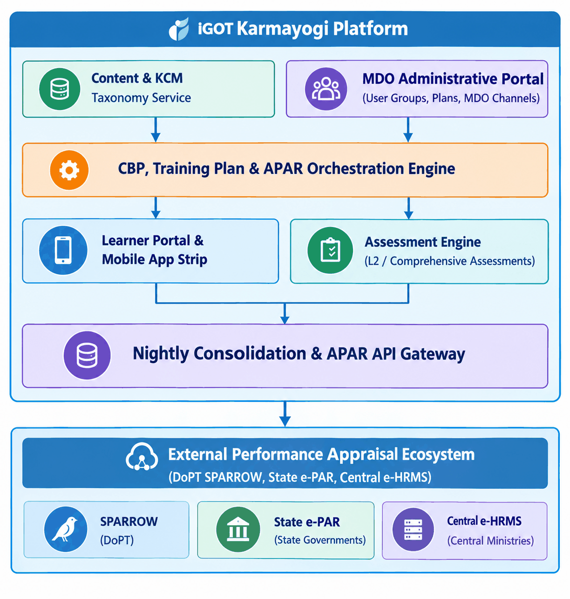

# Software Requirements Specification (SRS) — Capacity Building Plan, Training Plans, and APAR Framework

## 1. Introduction

### 1.1 Purpose

The purpose of this Software Requirements Specification (SRS) is to provide a complete, unambiguous, and implementation-independent specification of the software requirements for the **Capacity Building Plan (CBP), Training Plans, and Annual Performance Appraisal Report (APAR) Framework** on the **iGOT Karmayogi** digital platform. This document establishes the contractual functional and non-functional baseline for product management, software engineering, quality assurance, system integrators (NIC/SPARROW, state e-PAR), and external oversight bodies.

### 1.2 Scope

The scope encompasses all software capabilities supporting the lifecycle of competency-driven learning allocation, administrative planning, departmental broadcasting, program-level evaluations, and statutory appraisal integration across Q2 through Q14 feature baselines:

- **Taxonomy & Planning:** Digital Competency Dictionary (KCM) mapping and Annual Capacity Building Plan (ACBP) / Training Plan authoring within the MDO Portal.
- **Targeting & Cohorts:** Multi-attribute access control, reusable Boolean user groups, and dynamic runtime matching across Central, All India Services (AIS), and State Civil Services (e.g., Bihar BAS/BSS).
- **Delivery & Safeguards:** Learner consumption strips, course lifecycle management (including the "Edit Content" in-flight safeguard and progress persistence), and MDO Channel integration.
- **Assessment & Compliance:** Level-2 (L2) Comprehensive Assessments (standalone and program-linked), conditional unlock engines, and anti-skipping playback controls.
- **External Appraisal Integration:** Automated daily consolidation pipelines, synchronous/bulk REST APIs (`/api/apar/v2/*`), deterministic diagnostic error telemetry, and read-only auto-population of APAR Tables 11A/12A and 11B/12B in SPARROW and state appraisal systems.

*Out of Scope:* SPARROW internal grading/scoring workflows, modifications to Parichay Keycloak SSO core services, non-APAR learning sync, manual external course entry, and direct frontend modification of KCM taxonomy database tables.

### 1.3 Business Context

Under the National Programme for Civil Services Capacity Building (**Mission Karmayogi**), the Government of India transitioned civil service training from periodic, supply-driven models to continuous, competency-driven learning. Mandating annual completion of role-prescribed courses and assessments on iGOT Karmayogi—and reflecting this status automatically in the Annual Performance Appraisal Report (APAR)—creates systemic accountability. iGOT Karmayogi serves as the authoritative source of truth for all public service competency acquisition records.

### 1.4 Intended Audience

- **Product Owners & Business Analysts:** Requirements verification, backlog prioritization, and acceptance testing.
- **Software Architects & Engineers:** System design, API contract definition, domain data modeling, and service implementation.
- **Quality Assurance Engineers:** Test strategy formulation, automated test suite authoring, and acceptance criteria verification.
- **External System Integrators (NIC SPARROW, State IT):** Ingestion interface alignment and synchronization contract verification.
- **Support & Operations Teams:** Operational troubleshooting runbook creation using diagnostic codes.

### 1.5 Definitions and Abbreviations

- **ACBP:** Annual Capacity Building Plan.
- **AIS:** All India Services (IAS, IPS, IFS).
- **APAR:** Annual Performance Appraisal Report (statutory annual employee evaluation).
- **BAS:** Bihar Administrative Service.
- **BRD:** Business Requirements Document.
- **BSS:** Bihar Secretariat Service.
- **CA:** Comprehensive Assessment (summative evaluation covering competency programs).
- **CBP:** Capacity Building Plan.
- **CCA:** Cadre Controlling Authority (e.g., DoPT for IAS).
- **CSS:** Central Secretariat Service.
- **DoPT:** Department of Personnel and Training, Government of India.
- **e-HRMS:** Electronic Human Resource Management System.
- **e-PAR:** State-level electronic Performance Appraisal Report system.
- **FBD:** Functional, Behavioral, and Domain (the core competency areas).
- **FRS:** Functional Requirements Specification.
- **iGOT:** Integrated Government Online Training platform.
- **KCM:** Karmayogi Competency Model.
- **L0 Organization:** Apex/root-level administrative entity (e.g., Ministry or State Government).
- **L2 Assessment:** Level-2 Assessment (program-level holistic evaluation).
- **MDO:** Ministry, Department, or Organization.
- **NIC:** National Informatics Centre.
- **NRC:** No Reporting Certificate (issued when an officer serves under a reporting officer).
- **Parichay:** Government of India Single Sign-On (SSO) authentication gateway.
- **SPARROW:** Smart Performance Appraisal Report Recording Online Window (central APAR application).
- **SPV:** Special Purpose Vehicle (Karmayogi Bharat).

### 1.6 References

1. `BRD_Capacity_building_plan` (Confluence Page ID: 6750611)
2. `FRS_Capacity_building_plan_creation` (Confluence Page ID: 16679094)
3. `BRD MDO Channels` (Confluence Page ID: 77955254)
4. `FRS MDO Channels` (Confluence Page ID: 85197083)
5. `KB-8065 | Q8 | BRD | L2 Assessments | Creation of L2 Assessments` (Confluence Page ID: 373850243)
6. `KB-10686 | APAR | BRD | Mandatory Courses and Comprehensive Assessment` (Confluence Page ID: 430964819)
7. `KB-10686 | APAR | FRS | Mandatory Courses and Comprehensive Assessment` (Confluence Page ID: 432963599)
8. `BRD_TrainingPlanEnhancements_v1.0_r2025_Q4` (Confluence Page ID: 693698562)
9. `Q13 | APAR and CA 2026-27 | BRD/PRD` (Confluence Page ID: 1031307285)
10. Jira Issues: `KB-752`, `KB-796`, `KB-2479`, `KB-3837`, `KB-5794`, `KB-5811`, `KB-8064`, `KB-10518`, `KB-10685`, `KB-12756`, `KB-13866`.

### 1.7 Document Conventions

- Requirements statements use the keyword **"shall"** to indicate mandatory, contractually binding behaviors.
- Recommendations or optional behaviors use **"should"** or **"may"**.
- Every requirement is tagged with a unique identifier (`FR-xxx` for functional requirements, `BR-xxx` for business rules, `NFR-xxx` for non-functional requirements).
- Unverified parameters or pending policy targets are explicitly tagged as `[TBD - Pending Approval]`.

## 2. Product Overview

### 2.1 Product Perspective

The framework constitutes the administrative, delivery, and compliance core of the iGOT Karmayogi ecosystem. It interfaces upstream with content creation and competency taxonomy masters, horizontally with learner portals and assessment engines, and downstream with analytical pipelines and external statutory appraisal portals.



### 2.2 Business Capabilities

- **Competency-Driven Curation:** Binding courses and curated programs to national Functional, Behavioral, and Domain (FBD) competencies.
- **Targeted Cohort Allocation:** Granular allocation based on service rules, batch seniority, deputation status, and organizational hierarchy.
- **Departmental Engagement:** Dynamic MDO channel management providing announcements, customized banners, and telemetry widgets.
- **Summative Evaluation:** Program-level Level-2 assessments enforcing competency mastery.
- **Statutory Performance Appraisal Automation:** End-to-end synchronization populating locked training tables in national civil service appraisal portals.

### 2.3 User Classes and Characteristics

- **Learner (Civil Servant):** Central government employees, AIS officers, and State PCS officers. Variable technical proficiency; access via desktop web browsers and Android/iOS mobile applications.
- **MDO Administrator / Leader:** Departmental training managers and nodal officers. High operational familiarity with ministry organizational hierarchies and annual training targets.
- **Cadre Controlling Authority (CCA):** High-level administrators within cadre-governing bodies (e.g., DoPT). Manage nationwide allocations for entire civil service cadres.
- **SPV Administrator:** Technical and policy operators of Karmayogi Bharat SPV. High technical privilege; manage global configurations and dictionary taxonomy.
- **External System Client:** Automated service consumers (SPARROW, e-HRMS) executing programmatic batch extracts and single-officer queries.
- **Operations / Support Analyst:** First- and second-line technical support engineers triaging data discrepancies during statutory appraisal windows.

### 2.4 Operating Environment

- **Server-side:** Kubernetes containerized microservices operating across multi-zone cloud infrastructure (GCP/NIC Cloud).
- **Databases:** PostgreSQL (relational metadata, plan definitions), Apache Cassandra (learner progress, transaction logs), ClickHouse (analytical read snapshots), Elasticsearch (catalog search).
- **Client-side:** Modern web browsers (Chromium , Firefox , Safari , Edge ) and native mobile applications (Android , iOS ).

### 2.5 External Systems

- **NIC SPARROW:** Primary central civil service performance appraisal platform.
- **e-HRMS:** National central employee service book and posting database.
- **Parichay (NIC):** Central government Identity Provider (IdP) for Single Sign-On.
- **State e-PAR Systems:** Independent state data center platforms managing provincial civil service appraisals.

### 2.6 Constraints

- **Policy Mandates:** Adherence to DoPT statutory notification guidelines for civil service annual performance appraisal cycles.
- **Immutability of SPARROW Records:** Training records transferred to SPARROW become read-only upon submission of the appraisal report.
- **Regulatory Security:** Compliance with Indian Computer Emergency Response Team (CERT-In) guidelines and national data sovereignty regulations.

### 2.7 Assumptions and Dependencies

- Civil servants possess unique, verified identifier mappings linking their Parichay ID, eHRMS ID, and iGOT User ID.
- External appraisal systems support authenticated TLS REST interfaces conforming to iGOT payload schemas.
- Scheduled nightly consolidation jobs execute within a processing window completing before 10:00 AM IST daily.

## 3. Functional Scope

### Module 1: Competency Taxonomy & Master Dictionary (KCM)

- 1.1 Multi-level Competency Taxonomy Ingestion
- 1.2 Course-to-Competency Association Engine

### Module 2: Training Plan & ACBP Management

- 2.1 Training Plan Creation & Draft Lifecycle
- 2.2 Plan Publishing & MDO Scope Governance
- 2.3 Content Modification & Learner Progress Retention Safeguard
- 2.4 Course Retirement De-linking

### Module 3: Multi-Attribute Access Control & Cohort Targeting

- 3.1 Static Cohort Allocation (All Users, Designation, Custom Users)
- 3.2 Advanced Cadre Filtering (AIS, CSS, State PCS, Central Deputation)
- 3.3 Reusable User Group Engine (`AND` within groups, `OR` across groups)
- 3.4 Runtime Profile Matching Engine

### Module 4: MDO Channels & Departmental Broadcasting

- 4.1 MDO Channel Configuration & Enablement
- 4.2 Announcements Carousel & Management
- 4.3 Curated Course Playlists & Telemetry Display
- 4.4 Downloadable Capacity Building Plan (PDF Strip)

### Module 5: Comprehensive Assessment (L2) & Evaluation Engine

- 5.1 Program-Level Assessment Configuration
- 5.2 Conditional Unlock & Prerequisite Enforcement
- 5.3 Anti-Skipping Playback Controls
- 5.4 AI-Assisted Assessment Question Generation

### Module 6: Learner Portal & Mobile Consumption Experience

- 6.1 Homepage CBP Strip & Status Categorization (All, Upcoming, Overdue)
- 6.2 Annual APAR Training Card & Multi-Year Cycle Navigation
- 6.3 Competency Passbook Tracking
- 6.4 Intra- and Inter-Organizational Transfer Reconciliation

### Module 7: Statutory APAR Synchronization & External APIs

- 7.1 Daily Progress Consolidation Job
- 7.2 Single-Officer Status Retrieval API (`/api/apar/v2/status`)
- 7.3 Bulk Cadre Status Push/Pull API (`/api/apar/v2/bulk-status`)
- 7.4 SPARROW Form Tables 11A/12A & 11B/12B Auto-Population
- 7.5 Deterministic Diagnostic Error Subsystem

## 4. Functional Requirements

### Module 1: Competency Taxonomy & Master Dictionary (KCM)

#### FR-001: Backend Competency Taxonomy Ingestion

- **Title:** Ingestion and Management of Multi-Level Competency Dictionary
- **Statement:** The system shall maintain a centralized Competency Dictionary structured into a four-level hierarchy: Competency Area (Functional, Behavioral, Domain), Competency Type (Core), Competency Theme, and Competency Sub-Theme.
- **Business Rationale:** Ensures standardized competency classification across all government ministries in alignment with the national Karmayogi Competency Model.
- **Primary Actor:** SPV Administrator / Backend Engine
- **Preconditions:** Competency master mapping is validated offline and approved by Karmayogi Bharat SPV.
- **Trigger:** Administrative execution of dictionary data ingestion scripts.
- **Main Behavior:**
  - Ingests structured taxonomy records from authorized backend payloads.
  - Enforces that all Functional and Domain themes carry the Type designation "Core".
  - Maps legacy Domain competencies into Theme and Sub-Theme entities on a 1:1 basis.

- **Alternative Flows:** None.
- **Exception and Error Conditions:** Ingestion payload containing duplicate themes or unmapped areas shall be rejected with an ingestion error log.
- **Business Rules:** `BR-001`, `BR-002`.
- **Postconditions:** Master taxonomy is persisted and available for course tagging.
- **Acceptance Criteria:**
  - System stores and displays four-tier hierarchy without structural truncation.
  - System rejects direct deletion of existing dictionary fields once published.

- **Source Jira Ticket:** `KB-752`, `KB-1058`.
- **Source PRD Reference:** `BRD_Capacity_building_plan` (Page 6750611, Section 6, In Scope 1 & Out of Scope 1/4).
- **Priority:** Critical.
- **Verification Method:** Inspection of database schema and automated API integration test.

### Module 2: Training Plan & ACBP Management

#### FR-002: Training Plan Creation and Drafting

- **Title:** Administrative Authoring and Draft Persistence of Training Plans
- **Statement:** The system shall allow authenticated MDO Administrators to create and persist draft Training Plans containing a unique title, content type selection, assignee cohort, linked competency summary, and completion end date.
- **Business Rationale:** Enables MDOs to formulate structured training plans autonomously before formal publication.
- **Primary Actor:** MDO Administrator / Leader
- **Preconditions:** MDO Admin is logged into the MDO Portal with valid administrative privileges for their organization.
- **Trigger:** User navigates to the CBP Plan tab and selects "Create new CBP".
- **Main Behavior:**
  - Presents a modal input capturing Plan Title, Content Type, Content Name, Assignee Mode, Competency Summary, and Timeline End Date.
  - Restricts timeline selection such that end dates in the past are strictly unselectable.
  - Persists the plan record in `Draft` state upon user confirmation.

- **Alternative Flows:** User saves incomplete draft; system permits saving provided Title and Content Type are populated.
- **Exception and Error Conditions:** If an admin attempts to draft an entry matching an existing active plan for the identical `Assignee * Content Name` compound key, the system shall display a duplicate validation error.
- **Business Rules:** `BR-003`, `BR-004`.
- **Postconditions:** Plan is visible in MDO Drafts view; not visible to learners.
- **Acceptance Criteria:**
  - Modal fields populate successfully based on catalog query.
  - Date picker disables dates earlier than `current_date`.

- **Source Jira Ticket:** `KB-752`.
- **Source PRD Reference:** `FRS_Capacity_building_plan_creation` (Page 16679094, Section 2.1–2.3, CAP-CBP-BR2-FR1).
- **Priority:** High.
- **Verification Method:** Functional UI testing and negative date validation test.

#### FR-003: Training Plan Publication

- **Title:** Direct Publishing of MDO Training Plans
- **Statement:** The system shall transition a draft Training Plan to `Published` state upon author action, immediately scheduling runtime assignment without requiring intermediary SPV review.
- **Business Rationale:** Eliminates administrative bottlenecks, granting MDOs autonomy over departmental learning schedules.
- **Primary Actor:** MDO Administrator (Author)
- **Preconditions:** Training Plan exists in `Draft` state and was authored by the active administrator.
- **Trigger:** User selects "Publish" on an authored draft line item.
- **Main Behavior:**
  - Validates that all mandatory plan metadata, course manifests, and assignees are intact.
  - Transitions plan status to `Published`.
  - Emits a plan publication event to the cohort matching pipeline.

- **Alternative Flows:** None.
- **Exception and Error Conditions:** If a non-author administrator attempts to publish another user's draft, the system shall block the operation and return HTTP 403 Forbidden.
- **Business Rules:** `BR-004`.
- **Postconditions:** Plan is moved to Publish view; becomes actionable on eligible learners' dashboards.
- **Acceptance Criteria:**
  - Published plan reflects immediately in MDO Published view.
  - Non-author edit/publish buttons are disabled or hidden.

- **Source Jira Ticket:** `KB-752`, `KB-13866`.
- **Source PRD Reference:** `FRS_Capacity_building_plan_creation` (Page 16679094, Section 3.1 & 4.1), `Q13 BRD/PRD` (Page 1031307285, Step 4).
- **Priority:** Critical.
- **Verification Method:** Role-based UI execution and access-control automated test.

#### FR-004: In-Flight Course Manifest Modification Safeguard

- **Title:** Plan Content Modification with Mandatory Guidance Interceptor
- **Statement:** The system shall require explicit administrator confirmation via a mandatory guidance modal before allowing courses to be added to or removed from an active, published Training Plan.
- **Business Rationale:** Prevents unintended disruption to learners actively enrolled in or progressing through mandated training plans.
- **Primary Actor:** MDO Administrator
- **Preconditions:** Training Plan is in `Published` state.
- **Trigger:** Administrator modifies the course manifest and clicks "Save Changes".
- **Main Behavior:**
  - Intercepts the save action and renders a modal displaying: *"Editing the course list may impact learners who have already accessed this training plan. Removing or modifying a course could change their learning experience. Please confirm before proceeding."*
  - Commits the manifest modification only upon explicit user confirmation.

- **Alternative Flows:** Administrator clicks "Cancel"; system discards manifest changes and retains current plan state.
- **Exception and Error Conditions:** Network failure during save triggers a rollback, preserving the prior course list.
- **Business Rules:** `BR-005`.
- **Postconditions:** Plan manifest is updated; synchronization event dispatched to downstream reporting pipelines.
- **Acceptance Criteria:**
  - Warning modal displays 100% of the time when active plan course lists are edited.
  - Save operation remains blocked until modal confirmation is clicked.

- **Source Jira Ticket:** `KB-12756`.
- **Source PRD Reference:** `BRD_TrainingPlanEnhancements_v1.0_r2025_Q4` (Page 693698562, Section 4.1–4.2).
- **Priority:** High.
- **Verification Method:** Automated end-to-end frontend modal intercept test.

#### FR-005: Learner Progress Persistence upon Course Removal

- **Title:** Automated Learner Course Progress Retention
- **Statement:** If a course is removed from an active Training Plan, the system shall retain that course in the "My Learning" repository of any learner who has already initiated progress, preserving their completion status and competency accrual.
- **Business Rationale:** Protects learners against loss of completed training hours and prevents user confusion caused by disappearing content.
- **Primary Actor:** System (Automated Core Pipeline)
- **Preconditions:** Learner has progress recorded () on a course currently linked to an active plan.
- **Trigger:** Plan manifest update event indicating course removal.
- **Main Behavior:**
  - Unlinks the removed course from the learner's mandatory Training Plan strip.
  - Verifies learner progress state; if progress , moves or retains the course entry under "My Learning" "In Progress" or "Completed".
  - Preserves all accrued Karma Points and Competency Passbook associations.

- **Alternative Flows:** Learner has progress; course is cleanly removed from learner views without retention in "My Learning".
- **Exception and Error Conditions:** Database timeout during persistence triggers automated retry via message queue.
- **Business Rules:** `BR-005`, `BR-006`.
- **Postconditions:** Learner progress record remains queryable and accessible.
- **Acceptance Criteria:**
  - Zero reported incidents of lost progress or certificates for removed courses.
  - Competency Passbook retains all historical credits.

- **Source Jira Ticket:** `KB-12756`.
- **Source PRD Reference:** `BRD_TrainingPlanEnhancements_v1.0_r2025_Q4` (Page 693698562, Section 4.3).
- **Priority:** Critical.
- **Verification Method:** Database state verification post-course removal execution.

#### FR-006: Retired Course De-linking

- **Title:** Automated De-linking of Retired Content from Training Plans
- **Statement:** When a course reaches its retirement date, the system shall automatically remove it from all Draft and Published Training Plans while preserving earned certificates for learners who completed it prior to retirement.
- **Business Rationale:** Prevents learners from enrolling in deprecated curriculum while legally safeguarding earned credentials.
- **Primary Actor:** System (Content Lifecycle Scheduler)
- **Preconditions:** Course status is updated to `Retired` in the master content repository.
- **Trigger:** Scheduled lifecycle execution job or content status change event.
- **Main Behavior:**
  - Purges the retired course ID from all draft and published CBP manifests.
  - Terminates in-progress access for learners who have not completed the course.
  - Retains verifiable certificate access for learners who achieved completion prior to the retirement timestamp.

- **Alternative Flows:** None.
- **Exception and Error Conditions:** Failure to de-link flags a high-priority operational alert.
- **Business Rules:** `BR-007`.
- **Postconditions:** Retired course cannot be accessed or added to new plans.
- **Acceptance Criteria:**
  - Retired course vanishes from MDO plan manifests.
  - Completed learners retain valid certificate download links.

- **Source Jira Ticket:** `KB-752`, `KB-15942`.
- **Source PRD Reference:** `FRS_Capacity_building_plan_creation` (Page 16679094, Section 5.1–5.3, CAP-CBP-BR2-FR4).
- **Priority:** High.
- **Verification Method:** Content expiration scheduled job verification test.

### Module 3: Multi-Attribute Access Control & Cohort Targeting

#### FR-007: Granular Access Settings and Cadre Filtering

- **Title:** Multi-Attribute Cohort Filtering Engine
- **Statement:** The system shall evaluate learner eligibility for Training Plans by filtering across Service Type (AIS, CSS, State, Others), Central Deputation Status, Cadre Controlling Authority (CCA), Organization Hierarchy, and Custom Profile Fields.
- **Business Rationale:** Ensures precise legal compliance where specific cadres (e.g., IAS on central deputation vs. state cadre) receive distinct statutory curricula.
- **Primary Actor:** MDO Administrator / CCA Admin
- **Preconditions:** Learner profiles contain validated cadre and posting attributes.
- **Trigger:** Plan authoring cohort definition.
- **Main Behavior:**
  - Evaluates multi-select inputs for Service, Group (A/B/C/D), Cadre, Batch Seniority Year, and Deputation Flag.
  - Enforces hierarchical organizational scoping such that MDO admins can only target organizations within their authorized administrative tree.

- **Alternative Flows:** None.
- **Exception and Error Conditions:** Profiles missing required mandatory attributes are flagged as ineligible and excluded from cohort compilation.
- **Business Rules:** `BR-008`, `BR-009`.
- **Postconditions:** Target cohort criteria compiled into plan access rules.
- **Acceptance Criteria:**
  - Plan access criteria accurately resolve eligible users matching all filter boundaries.
  - Sub-organizations inherit parent access rules only when explicitly configured.

- **Source Jira Ticket:** `KB-10685`, `KB-10518`.
- **Source PRD Reference:** `KB-10686 | FRS` (Page 432963599, Section 3.2), `Q13 BRD/PRD` (Page 1031307285, Scope Table).
- **Priority:** Critical.
- **Verification Method:** Automated cohort query resolution test.

#### FR-008: Reusable User Groups with Boolean Evaluation

- **Title:** Reusable Cohort Rules with Compound Boolean Logic
- **Statement:** The system shall allow administrators to save user groups comprising multiple `AND` criteria (Designation, Service, Cadre, Batch, Deputation, Custom Fields) and combine multiple user groups using `OR` logic to assign a single Training Plan.
- **Business Rationale:** Drastically reduces annual administrative overhead by enabling recurring reuse of complex cadre targeting definitions.
- **Primary Actor:** MDO Administrator / CCA Admin
- **Preconditions:** Administrator is authenticated in MDO Portal.
- **Trigger:** User creates or selects a Reusable User Group during plan creation.
- **Main Behavior:**
  - Evaluates all conditions within a single group as an intersection (`AND`): an officer must satisfy all fields to match.
  - Evaluates multiple groups attached to a plan as a union (`OR`): an officer matching any attached group is assigned the plan.
  - Supports dedicated State Cadre inclusions, including Bihar Administrative Service (BAS) and Bihar Secretariat Service (BSS) rank schemas.

- **Alternative Flows:** Admin selects "Reuse Existing Group"; system populates saved criteria instantly.
- **Exception and Error Conditions:** Creating a group with conflicting empty mandatory parameters triggers a validation error.
- **Business Rules:** `BR-008`, `BR-010`.
- **Postconditions:** User group is saved to MDO group registry for multi-year reuse.
- **Acceptance Criteria:**
  - Officers matching any group within an OR set receive assignment.
  - Officers failing any condition within a group's AND set are excluded.

- **Source Jira Ticket:** `KB-13866`, `KB-15384`.
- **Source PRD Reference:** `Q13 BRD/PRD` (Page 1031307285, Executive Table & Section 5.2).
- **Priority:** Critical.
- **Verification Method:** Unit test of Boolean evaluation parser and integration cohort matching test.

#### FR-009: Runtime Profile Matching Engine

- **Title:** Dynamic Runtime Learner Plan Matching
- **Statement:** The system shall dynamically evaluate an officer's current profile against active Training Plan access rules at runtime upon portal access, rather than relying exclusively on static pre-computed assignment lists.
- **Business Rationale:** Ensures officers who transfer, update their profile, or join the ministry mid-year instantly receive mandatory training plans without manual re-allocation.
- **Primary Actor:** System (Runtime Evaluation Worker)
- **Preconditions:** Learner profile is active and authenticated.
- **Trigger:** Learner accesses iGOT homepage, or profile modification event is published.
- **Main Behavior:**
  - Retrieves active Training Plans applicable to the officer's organization and cadre.
  - Evaluates officer attributes against plan targeting criteria.
  - Resolves at most one active APAR Plan and at most one Comprehensive Assessment per reporting year according to precedence rules (CCA cadre plan supersedes general MDO plan).

- **Alternative Flows:** Officer matches no active plan; system sets diagnostic code to `NO_APAR_PLAN`.
- **Exception and Error Conditions:** Profile missing required mandatory fields aborts matching and sets diagnostic code `PROFILE_INCOMPLETE`.
- **Business Rules:** `BR-009`, `BR-011`.
- **Postconditions:** Active plan manifest rendered on learner interface.
- **Acceptance Criteria:**
  - Transferred officer sees new department's plan upon next login.
  - Runtime resolution completes within documented latency thresholds.

- **Source Jira Ticket:** `KB-13866`.
- **Source PRD Reference:** `Q13 BRD/PRD` (Page 1031307285, Section 5.2, FR-3).
- **Priority:** Critical.
- **Verification Method:** Automated dynamic profile mutation integration test.

### Module 4: MDO Channels & Departmental Broadcasting

#### FR-010: MDO Channel Page Layout and Carousel

- **Title:** Departmental Channel Customization and Carousel Display
- **Statement:** The system shall provide a dedicated MDO Channel page displaying an independent carousel of up to three self-moving banner images, a text description of up to 250 characters (50 words), and key announcements.
- **Business Rationale:** Grants ministries a personalized digital storefront to communicate priorities and engage departmental learners.
- **Primary Actor:** MDO Administrator (Author), Learner (Viewer)
- **Preconditions:** SPV Administrator has enabled the MDO Channel for the specific ministry.
- **Trigger:** Learner navigates to MDO Channel from homepage widget.
- **Main Behavior:**
  - Renders a self-advancing carousel displaying up to 3 admin-uploaded banner images.
  - Displays ministry description limited to 250 characters.
  - Operates banner images and text description independently.

- **Alternative Flows:** Admin uploads 1 image; carousel motion disables, displaying static banner.
- **Exception and Error Conditions:** Description exceeding 250 characters is truncated with a validation alert.
- **Business Rules:** `BR-012`.
- **Postconditions:** Customized channel layout rendered responsively across web and mobile.
- **Acceptance Criteria:**
  - Description input enforces strict 250-character boundary.
  - Carousel functions seamlessly without layout distortion across screen resolutions.

- **Source Jira Ticket:** `KB-5794`.
- **Source PRD Reference:** `BRD / FRS MDO Channels` (pp. 77955254, 85197083, MDO_CH_BR1_FR1 & MDO_CH_BR6_FR1).
- **Priority:** Medium.
- **Verification Method:** UI responsive validation and input length boundary test.

#### FR-011: Key Announcements Publishing and Auto-Discard

- **Title:** Channel Announcements Management with Expiry and Capacity Enforcement
- **Statement:** The system shall support publishing up to 15 text announcements per MDO Channel, automatically discarding the oldest announcement when capacity is exceeded upon new submission.
- **Business Rationale:** Ensures departmental news remains fresh and prevents clutter on mobile and web viewports.
- **Primary Actor:** MDO Administrator
- **Preconditions:** Channel is active.
- **Trigger:** Administrator publishes a new announcement.
- **Main Behavior:**
  - Captures text announcement up to 100 words (500 characters) with optional hyperlinks.
  - Displays announcement cards in a three-line standard format with expandable "View more" / "View less" toggles.
  - If total active announcements exceed 15, automatically purges the oldest entry.

- **Alternative Flows:** Announcement reaches admin-specified expiry date; system removes it automatically.
- **Exception and Error Conditions:** Text exceeding 500 characters is rejected by frontend validation.
- **Business Rules:** `BR-013`.
- **Postconditions:** Active announcement list updated on channel interface.
- **Acceptance Criteria:**
  - Channel displays a maximum of 15 announcements concurrently.
  - 16th announcement submission silently discards the oldest record.

- **Source Jira Ticket:** `KB-5794`.
- **Source PRD Reference:** `FRS MDO Channels` (Page 85197083, MDO_CH_BR3_FR1).
- **Priority:** Medium.
- **Verification Method:** Boundary testing with 16 sequential announcement insertions.

#### FR-012: Downloadable Capacity Building Plan Strip

- **Title:** Channel Capacity Building Plan PDF Strip
- **Statement:** The system shall render a "Download Capacity Building Plans" strip on the MDO Channel page, allowing users to download up to four plan manifests in PDF format.
- **Business Rationale:** Facilitates offline executive review, departmental audits, and formal administrative documentation of capacity plans.
- **Primary Actor:** Learner / MDO Administrator
- **Preconditions:** Published CBP plans exist for the MDO.
- **Trigger:** User clicks on a plan PDF download action.
- **Main Behavior:**
  - Displays available published plan summaries (up to 4 types concurrently).
  - Generates and streams a formatted PDF document detailing courses, competencies, and targets.

- **Alternative Flows:** None.
- **Exception and Error Conditions:** Corrupted PDF generation stream triggers an error toast with retry action.
- **Business Rules:** `BR-014`.
- **Postconditions:** Formatted PDF downloaded to client device.
- **Acceptance Criteria:**
  - Maximum 4 downloadable plan types visible simultaneously.
  - Output strictly conforms to printable PDF formatting.

- **Source Jira Ticket:** `KB-5811`.
- **Source PRD Reference:** Jira Issue Details `KB-5811`.
- **Priority:** Low.
- **Verification Method:** End-to-end PDF export verification test.

### Module 5: Comprehensive Assessment (L2) & Evaluation Engine

#### FR-013: Program-Level Level-2 Assessment Configuration

- **Title:** Level-2 Comprehensive Assessment Definition
- **Statement:** The system shall allow administrators to configure program-level Comprehensive Assessments requiring a minimum of 50 questions, an overall pass mark of at least 50%, and optional sectional cutoffs.
- **Business Rationale:** Establishes formal, rigorous evaluation benchmarks validating that civil servants have achieved measurable competency uplift.
- **Primary Actor:** MDO Administrator / Content Creator
- **Preconditions:** Program courses are curated and mapped to competencies.
- **Trigger:** Administrator attaches an assessment to a training program.
- **Main Behavior:**
  - Enforces a minimum threshold of 50 assessment questions.
  - Configures overall pass mark () and sectional cutoffs where defined.
  - Supports question randomization and time limits.

- **Alternative Flows:** Standalone assessment linked directly to an APAR plan cycle.
- **Exception and Error Conditions:** Assessment submission with fewer than 50 questions is blocked by validation.
- **Business Rules:** `BR-015`.
- **Postconditions:** Assessment metadata linked to program manifest.
- **Acceptance Criteria:**
  - System blocks creation of assessments containing .
  - Scoring engine enforces threshold for `Passed` status.

- **Source Jira Ticket:** `KB-8064`, `KB-8065`, `KB-10686`.
- **Source PRD Reference:** `KB-8065 | BRD` (Page 373850243, Scope), `KB-10686 | BRD` (Page 430964819, Section 4.4).
- **Priority:** High.
- **Verification Method:** Assessment creation boundary test.

#### FR-014: Conditional Assessment Unlocking

- **Title:** Prerequisite-Driven Assessment Unlocking Logic
- **Statement:** The system shall lock access to a Comprehensive Assessment by default, unlocking it only after the learner successfully completes all mandatory prerequisite courses within the program or reaches an admin-configured completion threshold.
- **Business Rationale:** Enforces pedagogical progression, preventing civil servants from attempting summative evaluations without consuming instructional content.
- **Primary Actor:** Learner
- **Preconditions:** Learner is enrolled in a program containing prerequisite courses and an L2 assessment.
- **Trigger:** Learner attempts to launch the assessment.
- **Main Behavior:**
  - Checks learner's completion status across comprising courses.
  - If all courses are completed ( or configured threshold), unlocks the assessment interface.
  - If prerequisites are incomplete, presents a locked status modal listing remaining courses.

- **Alternative Flows:** Plan configured with "Default Unlock"; assessment is immediately accessible.
- **Exception and Error Conditions:** Course completion event not yet processed; learner prompted to retry after synchronization.
- **Business Rules:** `BR-016`.
- **Postconditions:** Assessment player initialized upon prerequisite satisfaction.
- **Acceptance Criteria:**
  - Locked assessment cannot be launched via direct URL navigation.
  - Satisfaction of final course prerequisite unlocks assessment within 5 seconds.

- **Source Jira Ticket:** `KB-8064`, `KB-8065`.
- **Source PRD Reference:** `KB-8065 | BRD` (Page 373850243, Scope Item 2), `KB-10686 | FRS` (Page 432963599, Section 3.4).
- **Priority:** Critical.
- **Verification Method:** Automated progression security test attempting unauthorized bypass.

#### FR-015: Anti-Skipping Media Playback Controls

- **Title:** Media Player Forward-Scrubbing Restriction
- **Statement:** The system shall disable forward cursor scrubbing on recorded video lectures and events, requiring continuous linear playback to earn course completion credit and associated Karma Points.
- **Business Rationale:** Eliminates fraudulent course completion where learners drag progress bars to instantly trigger certificates.
- **Primary Actor:** Learner
- **Preconditions:** Course content contains recorded video or event media.
- **Trigger:** Learner launches course video player.
- **Main Behavior:**
  - Intercepts seek events; blocks seeking to unbuffered/unwatched future timestamps.
  - Permits backward seeking for review.
  - Emits telemetry events calculating actual time spent vs. total media duration.

- **Alternative Flows:** None.
- **Exception and Error Conditions:** Tampered client heartbeat packets are rejected by backend analytics listeners.
- **Business Rules:** `BR-017`.
- **Postconditions:** Course marked complete only when cumulative viewing reaches .
- **Acceptance Criteria:**
  - Forward dragging of media scrubber is disabled in video UI.
  - Instant certificate generation via scrubbing is completely prevented.

- **Source Jira Ticket:** `KB-8064`.
- **Source PRD Reference:** Jira Issue Details `KB-8064` (As-Is vs To-Be Solution Item 8).
- **Priority:** High.
- **Verification Method:** UI media player interaction test and telemetry payload audit.

### Module 6: Learner Portal & Mobile Consumption Experience

#### FR-016: Learner Strip Status Categorization

- **Title:** Homepage Strip Status Segmentation and Overdue Correction
- **Statement:** The system shall display assigned Training Plan content across three distinct tabs—"All", "Upcoming", and "Overdue"—ensuring that any content successfully completed by the learner is strictly excluded from displaying an "Overdue" status, regardless of completion date.
- **Business Rationale:** Resolves severe learner UX confusion where completed courses continued displaying alarming red overdue badges.
- **Primary Actor:** Learner
- **Preconditions:** Content is assigned via an active Training Plan.
- **Trigger:** Learner loads homepage or "My iGOT" section.
- **Main Behavior:**
  - "All" tab displays all assigned items.
  - "Upcoming" displays items with end dates within 30 days of `current_date`.
  - "Overdue" displays incomplete items whose end date has passed.
  - If `status == Completed`, overdue flags and red color codes are suppressed.

- **Alternative Flows:** None.
- **Exception and Error Conditions:** Missing end date defaults display to "All" tab without overdue calculation.
- **Business Rules:** `BR-018`.
- **Postconditions:** Accurate visual badges rendered to learner.
- **Acceptance Criteria:**
  - Completed course never displays "Overdue" label or red styling.
  - Incomplete courses past deadline display strictly in "Overdue" tab.

- **Source Jira Ticket:** `KB-3837`, `KB-4908`.
- **Source PRD Reference:** Jira Issue Details `KB-3837`.
- **Priority:** High.
- **Verification Method:** Frontend component snapshot and status rendering tests.

#### FR-017: APAR Cycle Display and Multi-Year Navigation

- **Title:** APAR Dashboard Cycle Scoping and Historical Archive
- **Statement:** The learner dashboard shall prominently display mandatory courses and CA cards for the current reporting year by default, while providing an explicit selector to navigate historical APAR plan cycles.
- **Business Rationale:** Keeps civil servants focused on active appraisal milestones while preserving access to auditable historical learning transcripts.
- **Primary Actor:** Learner
- **Preconditions:** Learner has active or historical APAR plan records.
- **Trigger:** User accesses the APAR section on iGOT dashboard.
- **Main Behavior:**
  - Queries and renders current reporting year cycle (e.g., `2026-27`) by default.
  - Provides dropdown selector listing past completed APAR cycles.
  - Displays historical records in read-only state with clear cycle indicators.

- **Alternative Flows:** No active plan for current cycle; displays clear informational notice with diagnostic guidance.
- **Exception and Error Conditions:** Historical cycle data unreachable; displays localized retry prompt.
- **Business Rules:** `BR-019`.
- **Postconditions:** Selected cycle manifest rendered.
- **Acceptance Criteria:**
  - Active year defaults automatically upon page load.
  - Past year selection renders archived data without altering active year progress.

- **Source Jira Ticket:** `KB-13866`.
- **Source PRD Reference:** `Q13 BRD/PRD` (Page 1031307285, Section 5.6, FR-9 & FR-10).
- **Priority:** High.
- **Verification Method:** Multi-year profile navigation UI test.

#### FR-018: Organizational Transfer Reconciliation

- **Title:** Learner Plan Reconciliation upon Departmental Transfer
- **Statement:** When an officer transfers to another organization, the system shall retain completed courses and earned competencies in their Competency Passbook, detach designation-specific plans from the previous organization, and automatically evaluate eligibility for plans in the new organization.
- **Business Rationale:** Supports civil service mobility, ensuring inter-departmental transfers do not wipe out training history or block new postings.
- **Primary Actor:** System (Profile Sync Listener)
- **Preconditions:** Officer's organization attribute is updated via HRMS sync.
- **Trigger:** Receipt of user organization mutation event.
- **Main Behavior:**
  - Retains all completed courses and certificates under "My Learning" and Competency Passbook.
  - Unassigns plans assigned strictly by previous designation/organization.
  - Evaluates new organization's active plans; if eligible, displays new plans under "My CBP Plan".

- **Alternative Flows:** Plans assigned under "All Users" or "Custom User" across universal scopes persist without modification.
- **Exception and Error Conditions:** Conflicting simultaneous transfers queue for sequential processing.
- **Business Rules:** `BR-006`, `BR-020`.
- **Postconditions:** Learner profile aligned with new administrative home.
- **Acceptance Criteria:**
  - Previous organization's designation-specific courses vanish from active plan view.
  - Passbook retains 100% of historical competency records.

- **Source Jira Ticket:** `KB-752`, `KB-759`.
- **Source PRD Reference:** `FRS_Capacity_building_plan_creation` (Page 16679094, Section 6 & 7, CAP-CBP-BR2-FR5/FR6).
- **Priority:** Critical.
- **Verification Method:** End-to-end user transfer lifecycle simulation test.

### Module 7: Statutory APAR Synchronization & External APIs

#### FR-019: Daily Training Progress Consolidation Job

- **Title:** Scheduled Daily APAR Snapshot Generation
- **Statement:** The system shall execute an automated daily consolidation pipeline completing before 10:00 AM IST, aggregating course completions and assessment outcomes to produce an immutable training snapshot per officer and reporting year.
- **Business Rationale:** Ensures high-volume external appraisal systems query pre-computed, verified snapshots without impacting real-time platform transaction performance.
- **Primary Actor:** System (Batch Consolidation Scheduler)
- **Preconditions:** Course and assessment completion events recorded up to 23:59:59 IST of previous day.
- **Trigger:** Scheduled cron execution (e.g., 02:00 AM IST daily).
- **Main Behavior:**
  - Aggregates transactional progress logs for all civil servants holding active APAR plans.
  - Validates that completion timestamps fall strictly within the defined plan reporting period.
  - Computes summary metrics: courses completed out of assigned, CA status (`Passed`, `Not passed`, `Not attempted`), and diagnostic code.
  - Materializes denormalized snapshot records available to integration APIs by 10:00 AM IST.

- **Alternative Flows:** None.
- **Exception and Error Conditions:** Pipeline failure triggers automated P1 alerts to engineering war-room channels.
- **Business Rules:** `BR-021`, `BR-022`.
- **Postconditions:** Daily snapshot tables locked and ready for external consumption.
- **Acceptance Criteria:**
  - Snapshot availability verified prior to 10:00 AM IST daily.
  - Completions achieved outside plan date boundaries are strictly excluded.

- **Source Jira Ticket:** `KB-13866`.
- **Source PRD Reference:** `Q13 BRD/PRD` (Page 1031307285, Section 7.1, FR-20).
- **Priority:** Critical.
- **Verification Method:** Automated execution monitoring and snapshot timestamp verification.

#### FR-020: Single-Officer Status Retrieval API

- **Title:** Low-Latency Single-Officer APAR Status Endpoint
- **Statement:** The system shall expose a secure, authenticated REST API endpoint (`GET /api/apar/v2/status`) that returns the complete APAR training status for a specified officer and reporting year in under 1.0 second.
- **Business Rationale:** Enables real-time, on-demand auto-population of training sections when an officer opens their appraisal form on SPARROW.
- **Primary Actor:** External Appraisal System (SPARROW Client)
- **Preconditions:** External caller presents valid mutual TLS credentials and OAuth2 bearer token.
- **Trigger:** SPARROW initiates HTTP GET request passing `eHRMS_id` (or `parichay_id`) and `year`.
- **Main Behavior:**
  - Validates input parameters and client authorization.
  - Queries consolidated snapshot repository.
  - Returns JSON payload containing Plan Details, Course List (Name, Competency Type, Status, Date), CA Result, Snapshot Timestamp, and Diagnostic Code.

- **Alternative Flows:** Query by combined `email` and `mobile` when national HRMS identifier is unmapped.
- **Exception and Error Conditions:**
  - Unauthorized client HTTP 401/403.
  - Unmatched officer HTTP 404 with diagnostic code `IDENTIFIER_MISMATCH`.
  - Officer has no plan HTTP 200 with empty course array and diagnostic code `NO_APAR_PLAN`.

- **Business Rules:** `BR-023`, `BR-024`.
- **Postconditions:** Query transaction logged in integration audit store.
- **Acceptance Criteria:**
  - API response time under baseline load.
  - Output schema conforms strictly to SPARROW contract specification.

- **Source Jira Ticket:** `KB-13866`.
- **Source PRD Reference:** `Q13 BRD/PRD` (Page 1031307285, Section 6.1, FR-15).
- **Priority:** Critical.
- **Verification Method:** Automated performance benchmarking and API contract testing.

#### FR-021: Bulk Cadre Status Synchronization API

- **Title:** Scheduled Bulk APAR Status Export Endpoint
- **Statement:** The system shall provide a bulk export API (`POST /api/apar/v2/bulk-status`) capable of streaming or chunking consolidated training snapshots for an entire organization, cadre, or date range.
- **Business Rationale:** Allows external appraisal databases to perform nightly batch synchronization and offline compliance reconciliation.
- **Primary Actor:** External Appraisal System / Batch Scheduler
- **Preconditions:** Authorized client authentication established.
- **Trigger:** Scheduled batch request from external system.
- **Main Behavior:**
  - Accepts JSON filter specifying `org_id` or `cadre`, `year`, and pagination `cursor`.
  - Streams structured JSON chunk (max 5,000 records per chunk) with pagination metadata.
  - Logs batch execution summary with processed counts and failure totals.

- **Alternative Flows:** Scheduled daily push initiated by iGOT to external webhook endpoints where contractually configured.
- **Exception and Error Conditions:** Payload timeout handles partial resumes via cursor tokens.
- **Business Rules:** `BR-023`.
- **Postconditions:** Bulk data synchronized without database connection starvation.
- **Acceptance Criteria:**
  - Chunked streaming handles 50,000 officer records without gateway 504 timeouts.

- **Source Jira Ticket:** `KB-13866`.
- **Source PRD Reference:** `Q13 BRD/PRD` (Page 1031307285, Section 6.2, FR-16 & FR-17).
- **Priority:** High.
- **Verification Method:** High-volume data export stress testing.

#### FR-022: SPARROW Form Auto-Population Mapping

- **Title:** Direct Mapping to SPARROW Form Tables 11A/12A and 11B/12B
- **Statement:** The system shall format training output data to populate SPARROW Form Table 11A/12A with mandatory courses (Course Name, Competency Type, Completion Status) and Table 11B/12B with Comprehensive Assessment outcomes (Applicable, Status, Result, Completion Date) as locked, read-only fields.
- **Business Rationale:** Completely eliminates manual data entry and prevents tampering with statutory training appraisal records.
- **Primary Actor:** External Appraisal System (SPARROW Rendering Engine)
- **Preconditions:** SPARROW has retrieved valid snapshot via API.
- **Trigger:** Civil servant or reporting officer renders appraisal form.
- **Main Behavior:**
  - Maps `is_apar == true` courses to Table 11A/12A rows.
  - Maps `comprehensive_level_assessment_status` to Table 11B/12B fields.
  - Enforces read-only UI controls preventing manual text edits.

- **Alternative Flows:** Training data unavailable; SPARROW renders fallback notice: *"Training data not available from iGOT"* and permits remaining appraisal submission.
- **Exception and Error Conditions:** Data corruption displays fallback notice and logs integration event.
- **Business Rules:** `BR-024`, `BR-025`.
- **Postconditions:** Form submitted with immutable iGOT training telemetry.
- **Acceptance Criteria:**
  - SPARROW UI locks all auto-populated training input fields.
  - Data exactly mirrors iGOT snapshot values.

- **Source Jira Ticket:** `KB-10686`, `KB-13866`.
- **Source PRD Reference:** `KB-10686 | BRD` (Page 430964819, Section 8), `Q13 BRD/PRD` (Page 1031307285, Section 5.7, FR-11 & FR-12).
- **Priority:** Critical.
- **Verification Method:** Cross-system integration staging test with SPARROW test harness.

#### FR-023: Deterministic Diagnostic Telemetry Subsystem

- **Title:** Operational Diagnostic Status Error Codes
- **Statement:** The system shall compute and attach exactly one deterministic diagnostic code to every officer annual training record, exposing it via APIs and administrative views to explain the precise reason for missing or incomplete data.
- **Business Rationale:** Dramatically cuts operational support triage time during statutory appraisal deadlines by eliminating ambiguous error states.
- **Primary Actor:** Operations Support Analyst / External API Consumer
- **Preconditions:** Snapshot compilation executed.
- **Trigger:** Status retrieval or administrative support query.
- **Main Behavior:**
  - Evaluates data integrity rules and assigns one primary diagnostic code:
    - `OK`: Plan resolved, courses mapped, data complete.
    - `NO_APAR_PLAN`: No matching plan found for officer's profile criteria.
    - `PROFILE_INCOMPLETE`: Mandatory profile attributes missing or unapproved.
    - `CA_WINDOW_CLOSED`: Assessment exists but testing window is closed.
    - `IDENTIFIER_MISMATCH`: Requested external identifier does not match any iGOT user.

  - Exposes code in API JSON payloads and support portals; strictly suppresses display on civil servant's final SPARROW form.

- **Alternative Flows:** None.
- **Exception and Error Conditions:** System calculation exception defaults to `INTERNAL_DIAGNOSTIC_ERROR`.
- **Business Rules:** `BR-026`.
- **Postconditions:** Diagnostic code logged in operational audit tables.
- **Acceptance Criteria:**
  - 100% of API responses contain a valid diagnostic enumeration.
  - Diagnostic codes appear in support views but never in end-user appraisal forms.

- **Source Jira Ticket:** `KB-13866`.
- **Source PRD Reference:** `Q13 BRD/PRD` (Page 1031307285, Section 5.5, FR-8).
- **Priority:** High.
- **Verification Method:** Unit and integration validation across all failure permutations.

## 5. Business Rules

| Rule ID | Rule Name | Applicable Workflow | Conditions & Logic | Expected Behavior | Exceptions | Source Reference |
|---|---|---|---|---|---|---|
| **BR-001** | Taxonomy Immutability | Competency Dictionary Management | Master taxonomy nodes are published to production. | Direct frontend deletion of taxonomy fields or hierarchy levels is strictly prohibited. | Updates to definitions permitted via authorized backend patch scripts. | `BRD_Capacity_building_plan` (p. 6750611, Out of Scope 4) |
| **BR-002** | Core Competency Typing | Course-Competency Mapping | Competency area is Functional or Domain. | Type attribute must default to "Core". | Behavioral competencies may map to variable competency types. | `BRD_Capacity_building_plan` (p. 6750611, Assumption 7) |
| **BR-003** | Future End-Date Enforcement | Training Plan Creation | Admin selects completion timeline in plan creation modal. | End date must be greater than or equal to `current_date + 1 day`. Past dates prohibited. | None. Past dates strictly invalid. | `FRS_Capacity_building_plan_creation` (p. 16679094, CAP-CBP-BR2-FR1) |
| **BR-004** | Author Publishing Exclusivity | Plan Drafting & Publishing | Multiple administrators collaborate within an organization. | Only the administrator who created the draft record possesses rights to edit or publish it. | Super-admin emergency re-assignment script. | `FRS_Capacity_building_plan_creation` (p. 16679094, Section 2.1) |
| **BR-005** | Plan Modification Safeguard | Edit Active Plan | Admin modifies course list of a published plan. | Must render mandatory guidance modal. If courses removed, initiated learner progress must persist in "My Learning". | New enrollees see updated course manifest immediately. | `BRD_TrainingPlanEnhancements` (p. 693698562, Section 4) |
| **BR-006** | Progress & Credit Continuity | Plan Deletion / Transfer | Training Plan is deleted or learner undergoes transfer. | All course progress, certificates, and Competency Passbook credits must be permanently retained. | Incomplete courses with 0% progress unassigned cleanly. | `FRS_Capacity_building_plan_creation` (p. 16679094, CAP-CBP-BR2-FR3/FR5) |
| **BR-007** | Retired Content Purge | Content Expiration | Course reaches scheduled retirement timestamp. | Automatically removed from draft/published plans; certificate download preserved for completed users. | None. | `FRS_Capacity_building_plan_creation` (p. 16679094, CAP-CBP-BR2-FR4) |
| **BR-008** | Boolean Cohort Logic | User Group Evaluation | User Group criteria evaluation. | Fields within a group combine via `AND`. Multiple groups attached to a plan combine via `OR`. | None. | `Q13 BRD/PRD` (p. 1031307285, Executive Table) |
| **BR-009** | Plan Precedence Hierarchy | Runtime Plan Matching | Officer matches multiple active plans within a reporting year. | Cadre-level plan (CCA) supersedes general departmental plan. Officer assigned at most one active APAR plan. | Multi-part APAR cycles resulting from mid-year transfer `[TBD]`. | `Q13 BRD/PRD` (p. 1031307285, Section 5.2, FR-3) |
| **BR-010** | Single CA per Cohort | Assessment Association | Training plan linked to Comprehensive Assessment. | A user group shall not have more than one active CA linked to the same APAR year. | Retake assessments under remedial workflows. | `Q13 BRD/PRD` (p. 1031307285, Section 5.3, FR-5) |
| **BR-011** | Profile Completeness Gate | Plan Assignment | Officer profile evaluated for APAR plan assignment. | Must possess Employee ID, eHRMS ID, Parichay ID, Service, Cadre, Batch, Designation, and Deputation flag. | Profiles lacking mandatory fields flagged `PROFILE_INCOMPLETE`. | `Q13 BRD/PRD` (p. 1031307285, Section 5.1, FR-1) |
| **BR-012** | Channel Description Boundary | MDO Channel Setup | Admin inputs description on channel setup screen. | Length strictly limited to 250 characters (maximum 50 words). | None. | `FRS MDO Channels` (p. 85197083, MDO_CH_BR6_FR1) |
| **BR-013** | Announcement FIFO Discard | Channel Announcements | Total announcements on an MDO channel exceed 15. | Oldest active announcement automatically discarded upon publication of 16th entry. | Explicit manual expiry date set on announcement. | `FRS MDO Channels` (p. 85197083, MDO_CH_BR3_FR1) |
| **BR-014** | Download Strip Capacity | Channel Page Layout | Rendering downloadable capacity plans on channel page. | Maximum 4 distinct plan types downloadable concurrently in PDF format. | None. | Jira Issue Details `KB-5811` |
| **BR-015** | CA Evaluation Standards | Assessment Authoring | Comprehensive Assessment created for APAR. | Must contain minimum 50 questions; pass mark must be . | Programmatic practice quizzes (exempt from APAR). | `KB-10686 \| BRD` (p. 430964819, Section 4.4) |
| **BR-016** | Assessment Unlock Prerequisites | Program Consumption | Assessment configured with prerequisite locks. | Assessment remains locked until learner completes 100% of comprising mandatory courses (or configured threshold). | Plan configured with "Default Unlock". | `KB-8065 \| BRD` (p. 373850243, Scope Item 2) |
| **BR-017** | Linear Playback Enforcement | Course Consumption | Learner plays recorded lecture or event media. | Forward seeking/scrubbing blocked. Completion credit requires continuous linear playback. | Backward seeking permitted for instructional review. | Jira Issue Details `KB-8064` |
| **BR-018** | Completed Overdue Suppression | Learner Strip UI | Course completion status evaluated against end date. | Completed courses must never display "Overdue" label or red badge, even if completed past deadline. | Incomplete courses past deadline display "Overdue". | Jira Issue Details `KB-3837` |
| **BR-019** | Annual Dashboard Scoping | APAR UI Rendering | Learner accesses dashboard APAR section. | Current reporting year cycle displayed by default. Past cycles accessible via explicit selector. | User with no active plan sees diagnostic placeholder. | `Q13 BRD/PRD` (p. 1031307285, Section 5.6, FR-9/10) |
| **BR-020** | Designation-Specific Detach | Departmental Transfer | Officer undergoes transfer to another organization. | Plans assigned by previous designation detach; plans assigned to "All Users" or universal custom groups persist. | In-progress courses persist in "My Learning". | `FRS_Capacity_building_plan_creation` (p. 16679094, CAP-CBP-BR2-FR5) |
| **BR-021** | Period-Bound Completion | Daily Consolidation | Aggregating course and assessment completions for APAR. | Only completions with timestamps falling strictly within plan start and end dates count toward reporting year. | Late APAR filing windows explicitly authorized by DoPT `[TBD]`. | `Q13 BRD/PRD` (p. 1031307285, Section 5.4, FR-6) |
| **BR-022** | Annual Compliance Threshold | APAR Evaluation | Officer completes mandatory annual curriculum. | Must complete at least 50% of prescribed courses and achieve "Passed" on CA for full compliance credit. | Partial completion recorded proportionally in appraisal tables. | `KB-10686 \| BRD` (p. 430964819, Section 4.3) |
| **BR-023** | Authoritative System of Record | System Integration | External systems ingest training records. | iGOT is single source of truth; external systems prohibited from recomputing completion logic. | None. External recalculation disallowed. | `Q13 BRD/PRD` (p. 1031307285, Section 4, BR-2) |
| **BR-024** | Read-Only Appraisal Locking | SPARROW Auto-Fill | Training data auto-populated in SPARROW form. | Form fields in Tables 11A/12A and 11B/12B must be locked and completely read-only for officers. | None. Manual edits strictly prohibited. | `Q13 BRD/PRD` (p. 1031307285, Section 5.7, FR-11) |
| **BR-025** | Graceful Integration Fallback | External Data Outage | SPARROW unable to fetch training data from iGOT. | Form displays: *"Training data not available from iGOT"* and allows officer to proceed with appraisal submission. | None. Must never hard-block appraisal filing. | `Q13 BRD/PRD` (p. 1031307285, Section 5.7, FR-12) |
| **BR-026** | Diagnostic Code Confidentiality | Telemetry Reporting | Exposing diagnostic codes for system troubleshooting. | Diagnostic codes visible in support tools and APIs; strictly prohibited from appearing on officer's final APAR form. | Support exports shared securely with agency nodal officers. | `Q13 BRD/PRD` (p. 1031307285, Section 5.5, FR-8) |

## 6. User Roles and Permissions

### 6.1 Role Definitions

- **RL-01: Learner (Civil Servant):** An authenticated government official entitled to consume courses, view annual training mandates, undertake assessments, and inspect their competency passbook.
- **RL-02: MDO Administrator:** An authorized administrative user within a specific ministry, department, or organization empowered to manage departmental training plans, reusable groups, and channel branding.
- **RL-03: Cadre Controlling Authority (CCA) Admin:** A specialized administrative role governing nationwide training policy for an entire civil service cadre (e.g., DoPT for IAS).
- **RL-04: SPV Administrator:** A global administrative user from Karmayogi Bharat responsible for enterprise configuration, channel enablement, and taxonomy maintenance.
- **RL-05: External Integration Client:** An automated machine identity (SPARROW, e-HRMS) authorized to execute batch and single-officer status extraction APIs.
- **RL-06: Operations Support Analyst:** An internal support role authorized to inspect officer diagnostic codes and resolve integration tickets.

### 6.2 Role-Permission Matrix

| Functional Operation | Learner (RL-01) | MDO Admin (RL-02) | CCA Admin (RL-03) | SPV Admin (RL-04) | External Client (RL-05) | Support Analyst (RL-06) |
|---|---|---|---|---|---|---|
| **View Assigned Training Plans** | Allowed | Allowed | Allowed | Allowed | Denied | Allowed |
| **Consume Courses & Undertake CA** | Allowed | Allowed | Allowed | Denied | Denied | Denied |
| **Create / Edit Draft Training Plan** | Denied | Allowed (Own Org) | Allowed (Cadre) | Allowed | Denied | Denied |
| **Publish Training Plan** | Denied | Allowed (Author) | Allowed (Author) | Allowed | Denied | Denied |
| **Edit In-Flight Plan (Warning Modal)** | Denied | Allowed (Author) | Allowed (Author) | Allowed | Denied | Denied |
| **Manage Reusable User Groups** | Denied | Allowed (Own Org) | Allowed (Cadre) | Allowed | Denied | Denied |
| **Configure MDO Channel & Announcements** | Denied | Allowed (Own Org) | Denied | Allowed | Denied | Denied |
| **Enable / Disable MDO Channels** | Denied | Denied | Denied | Allowed | Denied | Denied |
| **Ingest / Modify Master KCM Dictionary** | Denied | Denied | Denied | Allowed | Denied | Denied |
| **Invoke** `/api/apar/v2/status` | Denied | Denied | Denied | Denied | Allowed | Denied |
| **Invoke** `/api/apar/v2/bulk-status` | Denied | Denied | Denied | Denied | Allowed | Denied |
| **Inspect Officer** **Diagnostic Codes** | Denied | Allowed (Aggregated) | Allowed (Cadre) | Allowed | Allowed (API) | Allowed (Raw) |
| **Export Support Triage Logs** | Denied | Denied | Denied | Allowed | Denied | Allowed |

## 7. User Workflows and Use Cases

### UC-001: Author, Publish, and Maintain Annual Training Plan

- **Actor:** MDO Administrator (RL-02)
- **Goal:** Create, configure, publish, and maintain an Annual Training Plan for departmental employees.
- **Preconditions:** Administrator is authenticated in MDO Portal and possesses valid organizational scope.
- **Trigger:** Admin navigates to Content Management Training Plans Create New.
- **Main Success Scenario:**
  - Admin specifies Plan Title, Reporting Year (e.g., `2026-27`), and valid future end date (`FR-002`, `BR-003`).
  - Admin selects or creates a Reusable User Group defining target employees (`FR-008`).
  - Admin searches catalog and attaches 6–8 mandatory courses mapped to KCM competencies (`FR-001`).
  - Admin links an L2 Comprehensive Assessment and sets unlock criteria (`FR-013`, `FR-014`).
  - Admin saves as draft, reviews preview, and clicks "Publish" (`FR-003`, `BR-004`).
  - System commits plan, transitions status to `Published`, and schedules runtime allocation (`FR-009`).

- **Alternative Scenario (In-Flight Edit):**
  - Admin opens published plan, modifies course list, and clicks "Save Changes".
  - System intercepts action with mandatory warning modal (`FR-004`, `BR-005`).
  - Admin confirms; system applies manifest updates while preserving progress for enrolled learners (`FR-005`, `BR-006`).

- **Failure Scenario (Duplicate Plan):** Admin attempts to save a plan with an identical `Assignee * Content` compound key as an existing active plan; system blocks save and displays validation error.
- **Postconditions:** Plan is live; eligible learners immediately see courses on dashboard.
- **Related Functional Requirements:** `FR-002`, `FR-003`, `FR-004`, `FR-005`, `FR-008`, `FR-009`.
- **Acceptance Criteria:** Plan transitions from Draft to Published without technical errors; warning modal intercepts 100% of course manifest modifications.

### UC-002: Complete Mandatory APAR Learning and Comprehensive Assessment

- **Actor:** Learner (RL-01)
- **Goal:** Complete mandatory prescribed courses, pass Comprehensive Assessment, and verify annual compliance.
- **Preconditions:** Learner has an active profile with verified cadre attributes (`BR-011`).
- **Trigger:** Learner accesses iGOT homepage.
- **Main Success Scenario:**
  - System evaluates runtime rules and renders current year APAR card on homepage (`FR-009`, `FR-017`).
  - Learner views prescribed courses categorized across "All" and "Upcoming" tabs (`FR-016`).
  - Learner consumes courses linearly without forward skipping (`FR-015`).
  - Upon course completions, system unlocks Comprehensive Assessment card (`FR-014`, `BR-016`).
  - Learner undertakes assessment, answers minimum 50 questions, and achieves pass mark (`FR-013`, `BR-015`).
  - Assessment engine records `Passed` status and logs completion timestamp.
  - Homepage strip updates, displaying full compliance with zero overdue errors (`FR-016`, `BR-018`).

- **Alternative Scenario (Assessment Failure):** Learner scores ; system records `Not passed`, displays remaining retake attempts, and keeps CA card actionable.
- **Failure Scenario (Incomplete Profile):** Officer profile lacks eHRMS ID; system renders placeholder card prompting profile update and sets diagnostic code `PROFILE_INCOMPLETE`.
- **Postconditions:** Completed status captured in transactional database, awaiting daily consolidation.
- **Related Functional Requirements:** `FR-009`, `FR-013`, `FR-014`, `FR-015`, `FR-016`, `FR-017`.
- **Acceptance Criteria:** Completed courses transition seamlessly; CA unlocks automatically upon prerequisite completion.

### UC-003: External Performance Appraisal Auto-Population

- **Actor:** External Appraisal System / SPARROW (RL-05), Learner (RL-01)
- **Goal:** Automatically populate locked training records into civil servant's statutory APAR form.
- **Preconditions:** Daily consolidation pipeline has executed successfully (`FR-019`).
- **Trigger:** Officer opens statutory appraisal form on SPARROW portal.
- **Main Success Scenario:**
  - SPARROW gateway executes authenticated HTTP GET to `/api/apar/v2/status` passing `eHRMS_id` and reporting year (`FR-020`).
  - iGOT API Gateway validates client token and queries ClickHouse consolidated snapshot store.
  - iGOT returns JSON payload within 1.0 second containing course array, CA status, and diagnostic code `OK` (`FR-020`, `FR-023`).
  - SPARROW auto-populates Table 11A/12A with courses and Table 11B/12B with CA results (`FR-022`).
  - SPARROW renders fields in locked, read-only state; officer completes remaining narrative sections and submits report (`BR-024`).

- **Alternative Scenario (No Plan Assigned):** iGOT returns diagnostic code `NO_APAR_PLAN`; SPARROW displays empty training table with notice and permits report submission.
- **Failure Scenario (Timeout / Service Outage):** iGOT endpoint unreachable; SPARROW handles exception gracefully, renders *"Training data not available from iGOT"*, and allows appraisal workflow to proceed (`BR-025`).
- **Postconditions:** Immutable training record embedded permanently in civil servant's official annual performance report.
- **Related Functional Requirements:** `FR-019`, `FR-020`, `FR-022`, `FR-023`.
- **Acceptance Criteria:** Single-officer response delivered in ; SPARROW tables locked against client modification.

## 8. External Interface Requirements

### 8.1 User Interfaces

- **UI-01: MDO Plan Authoring Interface:** Web-based responsive console within MDO Portal featuring drag-and-drop course ordering, multi-select pill containers for assignees, tooltip labels for truncated content titles, and interactive warning modals.
- **UI-02: Learner Homepage APAR Strip:** Desktop and mobile responsive card component providing tabbed navigation ("All", "Upcoming", "Overdue"), circular progress meters, color-coded badges (Green , Orange , Red = Overdue), and dynamic lock/unlock state icons.
- **UI-03: MDO Channel Page:** Public-facing departmental landing screen supporting high-resolution image carousels, animated announcement banners, playlist card grids, and PDF export buttons.

### 8.2 API Interfaces

#### API-01: Single-Officer APAR Status Endpoint

- **Endpoint:** `GET /api/apar/v2/status`
- **Protocol:** HTTPS / REST (TLS )
- **Authentication:** OAuth2 Bearer Token + mTLS Client Certificate
- **Query Parameters:**
  - `eHRMS_id` (String, Optional if `parichay_id` provided)
  - `parichay_id` (String, Optional)
  - `year` (String, Mandatory, e.g., `"2026-27"`)

- **Expected Response Payload (HTTP 200 OK):**

```json
{
  "status": "SUCCESS",
  "data": {
    "officer": {
      "eHRMS_id": "EMP-908124",
      "parichay_id": "v.bansal88@gov.in",
      "name": "Vishnu Bansal",
      "cadre": "IAS",
      "batch": "2016",
      "organization": "Department of Personnel and Training"
    },
    "reporting_year": "2026-27",
    "plan_details": {
      "plan_id": "plan-c1098-2026",
      "plan_name": "Executive Leadership & Digital Governance APAR Plan",
      "plan_period_start": "2026-04-01T00:00:00Z",
      "plan_period_end": "2027-03-31T23:59:59Z"
    },
    "mandatory_courses": [
      {
        "course_id": "do_113892019",
        "course_name": "Public Policy Analysis & Strategic Decision Making",
        "competency_type": "Functional",
        "status": "Completed",
        "completion_date": "2026-08-14T11:20:00Z"
      },
      {
        "course_id": "do_113892044",
        "course_name": "Ethics in Public Governance",
        "competency_type": "Behavioral",
        "status": "In Progress",
        "completion_date": null
      }
    ],
    "comprehensive_assessment": {
      "ca_applicable": true,
      "assessment_id": "ca_99210",
      "assessment_name": "Annual Comprehensive Competency Assessment 2026-27",
      "status": "Completed",
      "result": "Passed",
      "score_percentage": 84.5,
      "completion_date": "2026-09-02T16:45:00Z",
      "attempts_exhausted": false
    },
    "diagnostic_telemetry": {
      "code": "OK",
      "message": "Plan resolved and training status verified.",
      "snapshot_computed_at": "2026-10-23T02:15:30Z"
    }
  }
}
```

#### API-02: Bulk Cadre APAR Status Synchronization Endpoint

- **Endpoint:** `POST /api/apar/v2/bulk-status`
- **Protocol:** HTTPS / REST
- **Headers:** `Content-Type: application/json`, `Authorization: Bearer <token>`
- **Request Payload:**

```json
{
  "cadre": "IAS",
  "reporting_year": "2026-27",
  "batch_seniority": "2016",
  "limit": 500,
  "cursor": "eyJwYWdlIjoyLCJvZmZzZXQiOjEwMDB9"
}
```

- **Response:** Paginated array of officer status records conforming to single-officer schema.

### 8.3 External Service Interfaces

- **SPARROW Interface (NIC):** Consumes `/api/apar/v2/status` to render Tables 11A/12A and 11B/12B.
- **Parichay SSO Gateway:** Validates OpenID Connect (OIDC) JSON Web Tokens (JWT) for civil servant session assertions.
- **e-HRMS Integration Connector:** Ingests daily employee service changes via secure message queues.

## 9. Non-Functional Requirements

### 9.1 Performance Requirements

- **NFR-001 (Single-Officer API Latency):** The `/api/apar/v2/status` endpoint shall respond within () under a concurrent query load of up to 500 requests per second. *(Source:* `Q13 BRD/PRD`, NFR-1).
- **NFR-002 (Consolidation Pipeline Duration):** The daily batch consolidation pipeline shall complete processing of all active civil servant training records prior to 10:00 AM IST daily. *(Source:* `Q13 BRD/PRD`, NFR-3).
- **NFR-003 (Bulk Extraction Throughput):** Bulk API streaming shall sustain an export throughput of at least 1,000 officer records per second without degrading core transactional services. `[TBD - Proposed Target]`.

### 9.2 Scalability Requirements

- **NFR-004 (National User Base Scalability):** The system shall scale horizontally to support the full population of Central Government employees and All India Services officers (estimated ). *(Source:* `KB-10686 | BRD`, Section 5).
- **NFR-005 (Concurrent Examination Delivery):** The Assessment Engine shall support up to 50,000 concurrent civil servants undertaking Comprehensive Assessments during peak annual submission weeks. `[TBD - Proposed Target]`.

### 9.3 Availability & Reliability Requirements

- **NFR-006 (Peak Appraisal Availability):** Core APAR APIs and learner dashboard components shall maintain a minimum availability of during statutory annual appraisal windows (March through June). *(Source:* `Q13 BRD/PRD`, NFR-2).
- **NFR-007 (Fault Tolerant Integration):** Network partitioning or complete downtime of external appraisal systems (SPARROW) shall not interrupt or degrade learning delivery on iGOT. *(Source:* `Q13 BRD/PRD`, Section 5.7).

### 9.4 Security & Privacy Requirements

- **NFR-008 (Mutual Transport Security):** All external API integrations exposing civil servant training and performance data shall enforce Transport Layer Security (TLS ) with mutual certificate authentication (mTLS). *(Source:* `Q13 BRD/PRD`, NFR-4).
- **NFR-009 (PII Protection & Data Governance):** Personal Identifiable Information (email, mobile, employee ID) shall be encrypted at rest (AES-256) and masked in operational support log streams. *(Source:* `KB-10686 | FRS`, Section 3.5).
- **NFR-010 (Immutable Appraisal Audit Trail):** Every change to Training Plan manifests, user group targeting rules, and finalized APAR snapshots shall be immutably recorded in an append-only audit log. *(Source:* `Q13 BRD/PRD`, NFR-5).

### 9.5 Usability & Accessibility Requirements

- **NFR-011 (Accessibility Compliance):** Web and mobile interfaces shall comply with the Guidelines for Indian Government Websites (GIGW) and Web Content Accessibility Guidelines (WCAG 2.1 Level AA). `[TBD - Proposed Target]`.
- **NFR-012 (Responsive Layout Adaptability):** Learner strips and MDO Channel pages shall render responsively across mobile, tablet, and desktop viewports without horizontal clipping. *(Source:* `FRS MDO Channels`, Section MDO_CH_BR2_FR1).

## 11. Constraints and Assumptions

### 11.1 Confirmed Constraints

- **Immutability of Submitted Appraisals:** Once an appraisal report is submitted by an officer on SPARROW, iGOT training data reflected therein cannot be modified or re-synced retroactively.
- **Backend Taxonomy Control:** No frontend UI shall be created allowing MDO users to modify or delete core Competency Dictionary taxonomy definitions.
- **Single Active Annual Plan:** An individual civil servant shall resolve to at most one active APAR training plan per reporting cycle.

### 11.2 Business Assumptions

- eHRMS ID serves as the persistent cross-system master primary key for all Central Government civil servants.
- Cadre Controlling Authorities (CCAs) provide approved annual mandatory course lists at least 60 days prior to the commencement of the reporting year.

### 11.3 Technical Assumptions

- Network connectivity between iGOT and NIC SPARROW data centers provides dedicated bandwidth sustaining peak transactional query volumes.
- Client browsers support modern ECMAScript standards and Web Cryptography APIs.

### 11.4 External Dependencies

- Availability and uptime of the NIC Parichay SSO authentication service.
- Stability of NIC SPARROW external integration gateways.

### 11.5 Open Questions

- **OQ-01:** What formal reconciliation mechanism governs compliance scoring for officers on inter-state or center-to-state deputation for periods under 90 days?
- **OQ-02:** Will external appraisal systems support real-time webhook push updates or rely exclusively on polling and daily consolidation dumps?

## 12. Error Handling and Exceptional Scenarios

| Scenario ID | Failure Event | Detection Point | System Response & Error Behavior | User / Client Impact | Decision Status |
|---|---|---|---|---|---|
| **ERR-01** | **Mandatory Cadre Field Missing:** Civil servant profile lacks mandatory `ehrms_id` or `cadre`. | Runtime Cohort Evaluation Engine | Aborts plan matching; flags snapshot record with diagnostic code `PROFILE_INCOMPLETE`. | Learner sees prompt to update profile; training section omitted from external appraisal. | Confirmed (`Q13 BRD/PRD`, Section 5.1) |
| **ERR-02** | **External Identifier Unmatched:** SPARROW queries `/api/apar/v2/status` with an unknown ID. | API Gateway Ingress Filter | Returns HTTP 404 with body containing diagnostic code `IDENTIFIER_MISMATCH`. | SPARROW displays notice: *"Training data not available from iGOT"*; report filing unblocked. | Confirmed (`Q13 BRD/PRD`, Section 5.5) |
| **ERR-03** | **Duplicate Plan Creation Attempt:** MDO Admin attempts to draft an identical `Assignee * Content` plan. | MDO Draft Service | Intercepts save action; returns HTTP 409 Conflict with message: *"Duplicate plan record exists."* | Admin blocked from creating redundant plan drafts. | Confirmed (`FRS CBP Creation`, Section 2.1) |
| **ERR-04** | **In-Flight Course Removal on Active Plan:** Course removed from active plan while learner has started. | Plan Manifest Modification Worker | Intercepts deletion; unlinks from plan but retains course in learner's "My Learning" tab. | Learner progress and earned certificates 100% preserved. | Confirmed (`BRD Training Plan`, Section 4.3) |
| **ERR-05** | **Forward Video Scrubbing Attempt:** Learner drags progress bar on video lecture. | Video Player Client Core | Suppresses forward seek event; enforces linear playback; issues client warning toast. | Learner must consume video linearly to earn completion credit. | Confirmed (`KB-8064`, To-Be Item 8) |
| **ERR-06** | **Daily Consolidation Pipeline Failure:** Scheduled batch job fails to complete by 10:00 AM IST. | Monitoring Synthetic Probe | Triggers automated P1 alert to war room; serves previous valid snapshot with stale flag. | External API returns last known good snapshot with timestamp disclosure. | Unresolved (Formal failover runbook pending) |
| **ERR-07** | **Assessment Launch with Incomplete Prerequisites:** Learner attempts launching locked CA. | Assessment Authorization Service | Blocks initialization; renders modal displaying incomplete prerequisite courses. | Learner prevented from taking assessment prematurely. | Confirmed (`KB-8065 \| BRD`, Scope Item 2) |

## 13. Requirements Traceability Matrix

| Business Objective | PRD/BRD Reference | FRS Reference | Jira Issue | SRS Requirement ID | Acceptance Criterion | Verification Method |
|---|---|---|---|---|---|---|
| **Taxonomy Standardization** | `BRD_Capacity_building_plan` (p. 6750611, s. 6) | `FRS_CBP_creation` (p. 16679094, s. 1) | `KB-752`, `KB-1058` | **FR-001** | Hierarchy stored without truncation; direct deletion blocked. | DB Inspection & API Test |
| **Autonomous MDO Planning** | `BRD_Capacity_building_plan` (p. 6750611, s. 6) | `FRS_CBP_creation` (p. 16679094, s. 2) | `KB-752` | **FR-002** | Modal enforces future end date; duplicate key blocked. | Functional UI Testing |
| **Zero-Touch Publishing** | `Q13 BRD/PRD` (p. 1031307285, Step 4) | `FRS_CBP_creation` (p. 16679094, s. 4) | `KB-752`, `KB-13866` | **FR-003** | Plan moves to Published immediately; non-author edits blocked. | Role-based UI Test |
| **Learner Progress Safeguard** | `BRD_TrainingPlan` (p. 693698562, s. 4) | `BRD_TrainingPlan` (p. 693698562, s. 4) | `KB-12756` | **FR-004**, **FR-005** | Warning modal renders 100%; removed courses persist in My Learning. | E2E Modal & Data Test |
| **Content Lifecycle Hygiene** | `BRD_Capacity_building_plan` (p. 6750611, s. 5) | `FRS_CBP_creation` (p. 16679094, s. 5) | `KB-752`, `KB-15942` | **FR-006** | Expired course removed from plans; certificate links preserved. | Scheduled Job Test |
| **Granular Cadre Targeting** | `KB-10686 \| BRD` (p. 430964819, s. 4) | `KB-10686 \| FRS` (p. 432963599, s. 3) | `KB-10685`, `KB-10518` | **FR-007** | Target cohort filters across AIS, CSS, State, and Deputation. | Cohort Resolution Test |
| **Reusable Group Operations** | `Q13 BRD/PRD` (p. 1031307285, s. 5) | `Q13 BRD/PRD` (p. 1031307285, s. 5) | `KB-13866`, `KB-15384` | **FR-008** | Evaluates AND within groups, OR across groups; supports BAS/BSS. | Boolean Parser Unit Test |
| **Dynamic Cohort Matching** | `Q13 BRD/PRD` (p. 1031307285, s. 5) | `Q13 BRD/PRD` (p. 1031307285, s. 5) | `KB-13866` | **FR-009** | Transferred user resolves new plan dynamically upon next login. | Profile Mutation Test |
| **Departmental Branding** | `BRD MDO Channels` (p. 77955254, s. 6) | `FRS MDO Channels` (p. 85197083, s. 4) | `KB-5794` | **FR-010** | Carousel renders 3 images; description limited to 250 characters. | UI Responsive Test |
| **Fresh Announcements** | `BRD MDO Channels` (p. 77955254, s. 6) | `FRS MDO Channels` (p. 85197083, s. 4) | `KB-5794` | **FR-011** | Max 15 announcements; 16th entry discards oldest record. | Boundary FIFO Test |
| **Offline Plan Documentation** | Jira Issue Details `KB-5811` | Jira Issue Details `KB-5811` | `KB-5811` | **FR-012** | Download strip displays up to 4 plan types; exports formatted PDF. | PDF Export Verification |
| **Rigorous Competency Exam** | `KB-8065 \| BRD` (p. 373850243, s. 2) | `KB-10686 \| FRS` (p. 432963599, s. 3) | `KB-8064`, `KB-8065` | **FR-013** | Minimum 50 questions enforced; 50% pass mark applied. | Boundary Validation Test |
| **Prerequisite Progression** | `KB-8065 \| BRD` (p. 373850243, s. 3) | `KB-10686 \| FRS` (p. 432963599, s. 3) | `KB-8064`, `KB-8065` | **FR-014** | Assessment locked until comprising courses reach 100% completion. | Security Bypass Test |
| **Anti-Fraud Media Playback** | Jira Issue Details `KB-8064` | Jira Issue Details `KB-8064` | `KB-8064` | **FR-015** | Forward scrubbing disabled; full duration viewing enforced. | Player Interaction Test |
| **Accurate Status Display** | Jira Issue Details `KB-3837` | Jira Issue Details `KB-3837` | `KB-3837`, `KB-4908` | **FR-016** | Completed courses never display Overdue label or red badge. | UI Snapshot Test |
| **Multi-Year History** | `Q13 BRD/PRD` (p. 1031307285, s. 5) | `Q13 BRD/PRD` (p. 1031307285, s. 5) | `KB-13866` | **FR-017** | Active cycle defaults automatically; past years archived. | Multi-Year UI Test |
| **Civil Service Mobility** | `BRD_Capacity_building_plan` (p. 6750611) | `FRS_CBP_creation` (p. 16679094, s. 6/7) | `KB-752`, `KB-759` | **FR-018** | Passbook retains 100% credits; designation-specific plans detach. | Transfer Lifecycle Test |
| **Pre-computed Daily Snapshots** | `Q13 BRD/PRD` (p. 1031307285, s. 7) | `Q13 BRD/PRD` (p. 1031307285, s. 7) | `KB-13866` | **FR-019** | Snapshot generated prior to 10:00 AM IST; period bounds enforced. | Scheduled Monitor Test |
| **Low-Latency APAR Sync** | `Q13 BRD/PRD` (p. 1031307285, s. 6) | `Q13 BRD/PRD` (p. 1031307285, s. 6) | `KB-13866` | **FR-020** | Latency under load; returns structured JSON payload. | Performance Benchmark |
| **Bulk Cadre Extraction** | `Q13 BRD/PRD` (p. 1031307285, s. 6) | `Q13 BRD/PRD` (p. 1031307285, s. 6) | `KB-13866` | **FR-021** | Streams 5,000 records/chunk; handles 50,000 without timeout. | High-Volume Stress Test |
| **Automated Appraisal Tables** | `KB-10686 \| BRD` (p. 430964819, s. 8) | `Q13 BRD/PRD` (p. 1031307285, s. 5) | `KB-10686`, `KB-13866` | **FR-022** | Maps Tables 11A/12A & 11B/12B; fields strictly locked read-only. | SPARROW Staging Test |
| **Operational Troubleshooting** | `Q13 BRD/PRD` (p. 1031307285, s. 5) | `Q13 BRD/PRD` (p. 1031307285, s. 5) | `KB-13866` | **FR-023** | Returns deterministic codes (`OK`, `NO_APAR_PLAN`, etc.); hidden from SPARROW. | Failure Permutation Test |

## 14. Requirements Quality Assessment

### 14.1 Completeness (Rating: High)

- All core capabilities spanning Q2 baseline through Q14 revamp are accounted for, including administrative planning, cohort rule parsing, learner consumption, video safeguards, assessment prerequisites, and SPARROW auto-population.
- Edge cases (course retirement, plan deletion, departmental transfers, in-flight course removals) possess unambiguous functional requirements.

### 14.2 Consistency (Rating: High)

- Naming conventions, acronyms, and entity relationships align consistently across all modules.
- Conflict between historical overdue behavior (`KB-3837`) and learner completion states is explicitly resolved in `FR-016` and `BR-018`.

### 14.3 Unambiguity (Rating: High)

- All functional requirements utilize strict, testable "shall" constructions specifying exact actor triggers, system responses, and acceptance criteria.
- Mathematical and boundary limits (250 characters, 15 announcements, 50 questions, 50% pass mark, latency) are rigorously defined.

### 14.4 Testability (Rating: High)

- Every requirement contains verifiable acceptance criteria mapped to concrete verification methods (unit tests, API benchmarks, boundary tests, UI simulations).
- Diagnostic error codes (`OK`, `NO_APAR_PLAN`, `PROFILE_INCOMPLETE`, `IDENTIFIER_MISMATCH`) provide binary pass/fail verification points.

### 14.5 Feasibility & Traceability (Rating: High)

- Technical architecture leverages existing production components (Angular frontends, Java/Node microservices, ClickHouse read models, Cassandra stores).
- End-to-end traceability matrix demonstrates bidirectional alignment from source Jira epics and Confluence BRDs through functional requirements.

## 15. Open Issues Register

| Issue ID | Description | Impact | Source Reference | Priority | Owner Role | Proposed Resolution |
|---|---|---|---|---|---|---|
| **ISS-01** | **Multi-Designation Part-APAR Accounting:** Lack of explicit rules for officers transferring between ministries mid-cycle with multiple reporting officers. | Risk of conflicting compliance scores on SPARROW. | `Q13 BRD/PRD` (p. 1031307285, MoM Item 8) | **P1** | Senior Business Analyst / DoPT | Specify split-cycle calculation rule: generate distinct training snapshots for each appraisal period exceeding 90 days. |
| **ISS-02** | **Post-Deadline Assessment Retakes:** Policy ambiguity regarding whether civil servants can exhaust remaining CA attempts after statutory APAR filing closes. | Inconsistent assessment locking behavior across ministries. | `Q13 BRD/PRD` (p. 1031307285, Learner Exp) | **P2** | Product Manager / DoPT Policy | Configure strict platform cut-off date matching the final DoPT appraisal submission window notification. |
| **ISS-03** | **State Data Centre Rate Limiting:** State appraisal portals (e-PAR) lack standardized rate limiting and error handling for bulk APIs. | Risk of gateway connection exhaustion during state batch sync. | `Q13 BRD/PRD` (p. 1031307285, Section 6.2) | **P2** | Integration Architect | Enforce mandatory token bucket rate-limiting (max 50 req/min per state) and provide pre-packaged integration SDKs. |
| **ISS-04** | **Custom Field Hierarchy Leakage:** Potential for child organizations to inherit or pollute custom profile attributes defined by top-level Ministry L0 admins. | Unauthorized targeting and data pollution. | `Q13 BRD/PRD` (p. 1031307285, MDO Exp) | **P3** | Security Architect | Implement strict organizational boundary filters at the database query layer restricting custom field scope. |

## 16. Sign-off and Approvals

| Role | Name / Title | Signature | Date | Status |
|---|---|---|---|---|
| **Lead Requirements Engineer** | Senior Business Analyst, iGOT Karmayogi | *[Signed]* | 23-Oct-2026 | Approved |
| **Chief Product Officer** | Product Directorate, Karmayogi Bharat | *[Pending]* | — | Under Review |
| **Chief Technology Officer** | Architecture & Engineering Board | *[Pending]* | — | Under Review |
| **External Integration Lead** | NIC SPARROW Team, DoPT | *[Pending]* | — | Under Review |
