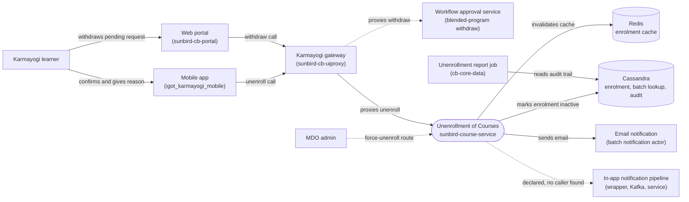

# Unenrollment of Courses — Context Diagram

## System boundary

Inside the feature is the unenroll path of `sunbird-course-service`: the controller and
validator, the enrolment actor that applies the business rules and flips the enrolment to
inactive, and the email notification actor. Outside it are the learner and admin actors, the
mobile app and web portal, the gateway in front of the service, the separate workflow service
used for blended-program withdrawals, the Cassandra and Redis stores, the declared but
unwired in-app notification pipeline, and the batch reporting job.

## Diagram

## Elements

| Element | Role | Detailed in |
|---|---|---|
| Unenrollment of Courses (`sunbird-course-service`) | Central system: validates the request, applies the completion and enrolment rules, flips the enrolment to inactive | [hld.md](hld.md) |
| Karmayogi learner | Unenrolls from a course on mobile; on web can only withdraw a pending blended-program request | [use-cases.md](use-cases.md) |
| MDO admin | Can force-unenroll a learner through an admin route | [use-cases.md](use-cases.md) |
| Mobile app | Confirmation, mandatory reason capture and the unenroll call | [use-cases.md](use-cases.md) |
| Web portal | No plain-course unenroll; withdraws pending blended-program requests only | [use-cases.md](use-cases.md) |
| Karmayogi gateway (`sunbird-cb-uiproxy`) | Proxy path from the clients to the course service and the workflow service | [apis.md](apis.md) |
| Workflow approval service | Handles blended-program withdrawal; its implementation is not in the traced repos | [apis.md](apis.md) |
| Cassandra | Holds enrolment rows, per-batch lookup and the audit trail | [hld.md](hld.md) |
| Redis | Per-user enrolment cache, invalidated on unenroll | [hld.md](hld.md) |
| Email notification | Live notification channel, gated by a configuration flag | [apis.md](apis.md) |
| In-app notification pipeline | Declared Kafka-driven channel that no traced code triggers | [apis.md](apis.md) |
| Unenrollment report job (`cb-core-data`) | Builds per-MDO reports from the audit trail; scheduling is unverified | [hld.md](hld.md) |

> **Verification boundary:** elements and interactions come from the feature's own pages
> (index, use cases, APIs, HLD), which I read in full; `lld.md` and the other pages were
> not read. Spot-checked read-only in `sunbird-course-service` (the unenroll route and the
> bulk unenrollment route in the routes file) and `cb-core-data` (the unenrollment report
> job file exists). The dashed notification and workflow links reflect the docs' own
> statements and were not re-verified in source. Not re-verified: the web and mobile client
> code, the gateway whitelist, the notification enum, and anything in the workflow service.
