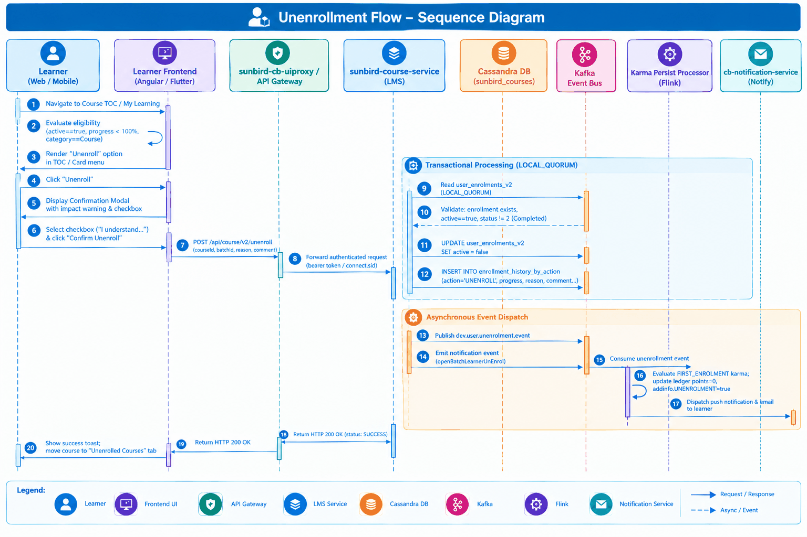

## 1. Executive Summary

The **Unenrollment Feature** enables civil servants and government learners on the iGOT Karmayogi platform to voluntarily self-unenroll from eligible, active, in-progress, or accidentally enrolled courses across the Web Portal, Android, and iOS mobile applications, and subsequently re-enroll without losing historical learning progress, assessment scores, or earned certificates.

The fundamental architectural principle governing this feature is that **unenrollment is a reversible state change, not a destructive data deletion**. Prior to this implementation, enrollments were permanent; learners who enrolled in courses out of curiosity or by error had those courses permanently pinned in their active "In Progress" learning views. This distorted platform drop-off rates and skewed Ministry, Department, and Organization (MDO) reporting metrics.

The Unenrollment feature resolves this challenge via a **Cassandra soft-delete design pattern** (`active: true → false` in `sunbird_course.user_enrolments_v2`), accompanied by an immutable audit trail (`sunbird_courses.enrollment_history_by_action`), temporary reversal of transient `FIRST_ENROLMENT` Karma points, real-time UI segregation into a dedicated `My Learning > Unenrolled Courses` tab, and asynchronous nightly (T+1) recalculation of organizational DSR and analytics reports.

## 3. Business Context and Problem Statement

- **The Business Need:** Modern adult digital learning requires autonomy. Learners explore the course catalog, previewing courses before committing time. Without the ability to self-unenroll, learners felt constrained and disengaged as uncompleted courses accumulated indefinitely.
- **Existing Limitations:** In the legacy platform architecture, enrollment was a one-way state transition: `Enroll → Consume Content → Complete Course`. A course could never be moved out of active tracking without backend database interventions.
- **Intended Outcome:** Give learners complete control over their active learning queue while maintaining historical data integrity, ensuring that MDO administrators receive accurate drop-off and active-learner metrics.
- **Impact on Course Enrollment Management:** Eliminates orphaned and stale enrollments in active dashboards, standardizes the API lifecycle for batch-based learning, and prevents duplicate enrollment rows in Cassandra when learners re-engage with previously dropped content.
- **Documented vs. Anticipated Benefits:**
  - *Documented:* Reduction in support tickets requesting manual unenrollment; elimination of duplicate Cassandra records; 100% data preservation on re-enrollment; T+1 reporting synchronization.
  - *Anticipated:* Improved learner satisfaction ratings, higher course completion percentages per active enrolled cohort, and cleaner learner competency profiling.

## 4. Objectives and Success Criteria

### Core Objectives

1. **Self-Service Autonomy:** Empower learners to self-unenroll from eligible courses across Web, Android, and iOS without administrative assistance.
2. **Lossless Resumption:** Retain 100% of learner module progress, video watch times, assessment scores, and completion artifacts during the unenrolled interval.
3. **Downstream Metric Integrity:** Adjust Karma point balances, leaderboard rankings, and DSR reporting contributions cleanly without leaving orphaned records.
4. **Auditability and Governance:** Record every unenrollment and re-enrollment action in an immutable audit ledger capturing timestamps, progress states, user identifiers, platforms, and reasons.

### Success Criteria (Documented vs. Recommended)

- **Documented Success Criteria (from BRD §16 / FRS §8):**
  - Reduction in user support requests for accidental enrollments.
  - 100% consistency between enrollment state and analytics/reports.
  - Next-day (T+1) synchronization of learning hours and achievements.
  - Successful restoration of progress on re-enrollment with zero progress data loss.

- **Recommended Architecture Verification Targets (Derived):**
  - API response time `< 500 ms` for `/v2/unenroll` and `/v1/reenroll` at peak platform concurrency (25,000 active sessions).
  - Zero orphaned records in Cassandra `user_enrolments_v2`.
  - Cassandra `LOCAL_QUORUM` read/write consistency to eliminate race conditions between immediate unenroll and re-enroll cycles.

## 5. Scope

### In Scope (Phase 1)

- **Content Types:** Content items whose `primaryCategory` is `Course` or `Moderated Course` (configured via `course_unenroll_allowed_primary_category`).
- **Enrollment Types:** Self-enrolled courses, mandatory courses, and organization-assigned courses (Training Plan / CBP courses).
- **Course States:** Courses currently in `Enrolled` state where completion progress is strictly `< 100%` (both 0% progress and in-progress).
- **Platforms:** Web Portal (Angular UI via UI-Proxy), Mobile Apps (Native Android & iOS).
- **Core Capabilities:**
  - Contextual Unenroll CTA on Course Table of Contents (TOC) and Course Cards (overflow menu).
  - Confirmation modal with mandatory impact acknowledgment checkbox.
  - Soft-delete state toggle (`active: false`) in Cassandra.
  - Reversal of first-enrollment Karma points via Kafka event streaming.
  - Dedicated "Unenrolled Courses" tab in `My Learning`.
  - Unlimited manual re-enrollment and automated re-enrollment upon accessing a course through an enrolled Program.
  - Immutable audit logging and transactional learner notifications (Email / Push).
  - Daily Status Report (DSR) enhancements and MDO Portal Unenrollment Report.

### Out of Scope (Phase 1)

- **Completed Courses:** Any course reaching 100% progress or having issued certificates (Unenroll action strictly hidden/blocked).
- **Non-Course Content Types:** Programs (Blended Programs, Curated Programs), Standalone Assessments, Events, Case Studies, Marketplace Content, Learning Paths, and Certification Programs.
- **External Provider Courses:** External-provider content lacking native unenrollment API integration.
- **Administrative Unenrollment:** Force-unenrollment executed by MDO Administrators or SPV Platform Admins on behalf of users.
- **Direct Notifications to MDOs:** Transactional notifications on unenrollment/re-enrollment are sent exclusively to the learner, not MDO supervisors.
- **Hard Deletes:** Physical deletion of rows from Cassandra `user_enrolments_v2` or progress tables.

## 6. Stakeholders and User Roles

| Actor / Entity | Type | Role & Responsibilities | Permissions & Actions | Applied Restrictions |
|---|---|---|---|---|
| **Learner** | Human Actor | Civil servant consuming learning content on Web or Mobile. | Can view enrolled courses, initiate unenrollment on eligible courses, review unenrolled courses, and re-enroll. | Strictly restricted to own enrollments; cannot unenroll from completed courses or out-of-scope content types. |
| **MDO Administrator** | Human Actor | Administrative user overseeing ministry/departmental training compliance. | Views organizational aggregated consumption, DSR reports, and the dedicated MDO Unenrollment Report. | Cannot force-unenroll learners; does not receive transactional notifications when learners unenroll. |
| **SPV Platform Admin** | Human Actor | System administrator managing global platform configuration and infrastructure. | Configures eligible categories, manages Kafka pipelines, monitors Cassandra health, and triggers reconciliation scripts. | Governed by platform configuration parameters; cannot bypass audit trail logging. |
| **sunbird-course-service** | System Component | Core backend LMS microservice managing enrollment lifecycles. | Validates eligibility, updates Cassandra `active` flag with `LOCAL_QUORUM`, writes audit records, and emits Kafka events. | Enforces course completion locks, batch validity, and category eligibility. |
| **cb-notification-service** | System Component | Asynchronous notification engine. | Consumes Kafka unenroll/re-enroll events and dispatches emails and mobile push notifications to learners. | Dispatches only to the affected learner; suppresses notifications to organizational managers. |
| **Karma Persist Processor (Flink)** | System Component | Asynchronous ledger stream processor. | Consumes `dev.user.unenrolment.event`, adjusts `FIRST_ENROLMENT` ledger points, and updates Redis totals. | Reversal applies only to `FIRST_ENROLMENT` points; completion points remain untouched. |

## 7. Feature Overview and Key Capabilities

1. **Contextual Action Exposure:** The Unenroll action is dynamically evaluated and displayed on the Course TOC page and Course Card kebab (⋮) menu across Web and Mobile.
2. **Impact-Aware Confirmation Flow:** Mandatory confirmation dialogue educating the learner on the consequences (removal from active tracking, metric adjustment) with an explicit consent checkbox before submission.
3. **Reversible Soft-Delete Lifecycle:** Toggles `active: true → false` in Cassandra `user_enrolments_v2`. Historical learning nodes, leaf node statuses, assessment scores, and time spent are preserved in full.
4. **Transient Karma Points Reversal:** Kafka-driven reversal of `FIRST_ENROLMENT` karma points (ledger marked `addinfo.UNENROLMENT = true`), dynamically restored upon re-enrollment (`addinfo.REENROLMENT = true`).
5. **My Learning Segregation:** The unenrolled course is removed from `My Learning > In Progress` and moved to `My Learning > Content > Unenrolled Courses`.
6. **Unlimited, Cooldown-Free Re-Enrollment:** Learners can re-enroll at any time. The system reactivates the existing Cassandra record (`active: false → true`) and resumes learning from the exact saved state.
7. **Automated Program Re-Enrollment:** If a learner accesses an unenrolled course that forms part of an active enrolled Program, the system auto-triggers re-enrollment behind the scenes before loading the content player.
8. **Immutable Audit Trail:** Dedicated Cassandra audit table `enrollment_history_by_action` capturing user ID, course ID, batch ID, progress percentage, action (`UNENROLL`/`REENROLL`), reasons, comments, and timestamps.
9. **Next-Day (T+1) Analytics & DSR Sync:** Asynchronous nightly batch processing recalculates organizational metrics, leaderboards, and MDO compliance dashboards without degrading daytime transactional performance.

## 8. End-to-End Functional Workflow



## 9. Functional Requirements Summary

| Requirement ID | Requirement Description | User / Actor | Source Reference | Expected Outcome | Verification Status |
|---|---|---|---|---|---|
| **UNEN-FR-001** | Show Unenroll action only for courses currently in the `Enrolled` state (`active: true`). | Learner | FRS §4.1 (FR-1.1), KB-14518 | Unenroll option appears on active enrollments; hidden for unenrolled courses. | Implemented — Verified |
| **UNEN-FR-002** | Hide Unenroll action for completed courses (`progress = 100%`, `status = 2`). | Learner | FRS §4.1 (FR-1.2), KB-14518 | Completed courses cannot be unenrolled under any circumstance. | Implemented — Verified |
| **UNEN-FR-003** | Display Unenroll action for mandatory courses and training plan assigned courses without exception. | Learner | FRS §4.1 (FR-1.3, FR-1.4), KB-14518 | Civil servants can self-unenroll from organization-mandated courses. | Implemented — Verified |
| **UNEN-FR-004** | Expose Unenroll action from the course overflow (⋮) menu on course details, TOC, and cards across Web and Mobile. | Learner | FRS §4.1 (FR-1.5), KB-14518, KB-14519 | Consistent entry point across all responsive interfaces. | Implemented — Verified |
| **UNEN-FR-005** | Restrict unenrollment to eligible content types (`Course`, `Moderated Course`); hide for Programs, Events, etc. | Learner / System | FRS §4.1 (FR-1.6), Deployment Guide ID: `1113882645` | Unenroll action strictly suppressed on unsupported content categories. | Implemented — Verified |
| **UNEN-FR-006** | Present confirmation modal displaying impact and mandatory acknowledgment checkbox before processing. | Learner | FRS §4.2 (FR-2.1 to FR-2.5), KB-14518 | Confirm button is disabled until checkbox is explicitly ticked. | Implemented — Verified |
| **UNEN-FR-007** | Update Cassandra enrollment record state to `active: false` without purging progress records. | System / Backend | FRS §4.3 (FR-3.1, FR-3.2), Design Doc ID: `1081016400` | Course marked inactive; historical progress retained. | Implemented — Verified |
| **UNEN-FR-008** | Preserve learner module progress, video watch times, and assessment scores during unenrolled state. | Learner / System | FRS §4.3 (FR-3.3, FR-3.4), BR-7, KB-14524 | Zero loss of learner consumption data; nodes remain intact in Cassandra. | Implemented — Verified |
| **UNEN-FR-009** | Reversible Karma Points adjustment: Reverse `FIRST_ENROLMENT` points if no other qualifying enrolled course exists. | System / Backend | FRS §4.3 (FR-3.5), Design Doc ID: `1081016400`, KB-14539 | Ledger entry updated with `points=0, addinfo.UNENROLMENT=true`. | Implemented — Verified |
| **UNEN-FR-010** | Do not alter completion badges or weekly claps on unenrollment. | System / Backend | FRS §4.3 (FR-3.7), BR-12, BR-13 | Badges (completion-linked) and claps (platform time-linked) stay unaffected. | Implemented — Verified |
| **UNEN-FR-011** | Create an immutable audit record of type `UNENROLL` in Cassandra `enrollment_history_by_action`. | System / Backend | FRS §4.3 (FR-3.9), FRS §4.9, Deployment Guide ID: `1113882645` | Complete governance record stored with user, batch, course, progress, reason. | Implemented — Verified |
| **UNEN-FR-012** | Remove course from `My Learning > In Progress` and place into `My Learning > Content > Unenrolled Courses`. | Learner | FRS §4.4 (FR-4.1 to FR-4.4), KB-14453, KB-14454 | Dashboard uncluttered; course accessible in Unenrolled view. | Implemented — Verified |
| **UNEN-FR-013** | Change primary CTA from "Enroll" to "Re-enroll" on course TOC and unenrolled course cards. | Learner | FRS §4.5 (FR-5.1), BR-21, KB-14520 | Visual CTA clearly indicates previous enrollment context. | Implemented — Verified |
| **UNEN-FR-014** | Allow unlimited re-enrollment attempts with zero cooldown period between unenrollment and re-enrollment. | Learner | FRS §4.5 (FR-5.2), BR-2, BR-3 | Immediate, frictionless re-enrollment permitted. | Implemented — Verified |
| **UNEN-FR-015** | On re-enrollment, reactivate existing record (`active: true`), restore progress, and move to "In Progress". | Learner / System | FRS §4.5 (FR-5.3 to FR-5.7), KB-14525 | No duplicate rows created; progress resumes seamlessly. | Implemented — Verified |
| **UNEN-FR-016** | Auto Re-enrollment: Automatically re-enroll user if unenrolled course is accessed via an enrolled Program. | Learner / System | Design Doc §4, KB-14520 | Seamless programmatic resumption without blocking the content player. | Implemented — Verified |
| **UNEN-FR-017** | Dispatch transactional push notifications and emails (`openBatchLearnerUnEnrol` / `ReEnrol`) to learner. | Learner | FRS §4.6, Design Doc §7, KB-14526 | Timely communication to learner; MDO managers excluded. | Implemented — Verified |
| **UNEN-FR-018** | Native Mobile Parity: Provide native Android/iOS modals, cards, and offline handling ("Unable to process..."). | Learner | FRS §4.7 (FR-7.1 to FR-7.5), KB-14519, KB-14521 | Identical business logic and validation rules on mobile devices. | Implemented — Verified |
| **UNEN-FR-019** | Enhance DSR and MDO reporting with unenroll/re-enroll timestamps, counts, and hours removed via T+1 nightly jobs. | MDO Admin / SPV | FRS §4.8, FRS §10, BR-18, KB-14527, KB-14436 | Daily organizational sync reflecting current enrollment metrics. | Implemented — Verified |

## 10. Business Rules and Eligibility Conditions

- **BR-01 (Eligible Content Type):** Self-unenrollment is restricted exclusively to content items of `primaryCategory: Course` or `Moderated Course` in Phase 1. Programs, Assessments, Events, Case Studies, and Marketplace content are excluded. *(Source: FRS §5 BR-1, Deployment Guide ID: 1113882645)*.
- **BR-02 (Re-enrollment Frequency):** Learners may re-enroll in a course an unlimited number of times. *(Source: FRS §5 BR-2)*.
- **BR-03 (Cooldown Period):** Zero cooldown period applies between unenrollment and re-enrollment. A learner may re-enroll immediately after unenrolling. *(Source: FRS §5 BR-3)*.
- **BR-04 (Mandatory Courses):** Learners may unenroll from mandatory courses without exceptions. *(Source: FRS §5 BR-4)*.
- **BR-05 (Training-Plan Courses):** Learners may unenroll from organization-assigned courses without exceptions. *(Source: FRS §5 BR-5)*.
- **BR-06 (Completed Course Ineligibility):** Courses with 100% progress or issued certificates cannot be unenrolled. The Unenroll option is hidden on the UI and rejected by the API. *(Source: FRS §5 BR-6, Design Doc ID: 1081016400)*.
- **BR-07 (Progress Retention):** Course progress, leaf node statuses, and time spent are never deleted; they are retained and hidden from active metrics. *(Source: FRS §5 BR-7)*.
- **BR-08 (State Change Principle):** Unenrollment is a temporary exclusion from active learning dashboards, not a data deletion. *(Source: FRS §5 BR-8)*.
- **BR-09 (Snapshot / Source of Truth):** The pre-unenrollment state stored in Cassandra is the authoritative source of truth for restoration. *(Source: FRS §5 BR-9)*.
- **BR-10 (Karma Points on Unenrollment):** Karma points awarded for `FIRST_ENROLMENT` are reversed only if the learner unenrolls from all courses that contributed to that awarded balance. If enrolled in at least one other qualifying course, points are retained. *(Source: FRS §5 BR-10, Design Doc ID: 1081016400)*.
- **BR-11 (Karma Points on Re-enrollment):** Previously reversed karma points are automatically restored upon re-enrollment without creating duplicate ledger records. *(Source: FRS §5 BR-11)*.
- **BR-12 (Completion Badges):** Badges awarded upon completion are unaffected since completed courses cannot be unenrolled. *(Source: FRS §5 BR-12)*.
- **BR-13 (Weekly Claps):** Weekly claps reflect time spent on the platform and are not deducted on unenrollment. *(Source: FRS §5 BR-13)*.
- **BR-14 (Leaderboard & Rankings):** Ranking contributions linked to the course are reversed on unenrollment and restored on re-enrollment. *(Source: FRS §5 BR-14)*.
- **BR-15 (DSR Contribution):** DSR learning hours and active counts are decremented on unenrollment and restored on re-enrollment. *(Source: FRS §5 BR-15)*.
- **BR-16 (Analytics Recalculation):** Organizational metrics are recalculated via nightly batch runs (T+1). *(Source: FRS §5 BR-16, BR-18)*.
- **BR-17 (CTA Dynamic Toggle):** After unenrollment, the primary call-to-action dynamically changes from "Enroll" to "Re-enroll". *(Source: FRS §5 BR-21)*.
- **BR-18 (Notification Target Boundary):** Push/email notifications are delivered exclusively to the learner; MDO managers receive no direct unenrollment alerts. *(Source: FRS §5 BR-25)*.
- **BR-19 (Reason Capture Status):** Capturing unenrollment reason codes and optional comments is supported by the API payload; the UI displays these fields, but submission is optional. *(Source: FRS §5 BR-26, API Doc ID: 1080983553)*.

## 11. System Components and Dependencies

| Component | Responsibility | Interaction with Unenrollment | Evidence Source | Verification Status |
|---|---|---|---|---|
| **sunbird-cb-portal / Learner Portal** | Web UI client (Angular) | Displays TOC unenrollment CTA, confirmation modal with checkbox, and "Unenrolled Courses" section. | Confluence Page ID: `1175027713`, `1150713857` | Implemented — Verified |
| **Mobile App (Android / iOS)** | Native mobile client (Flutter / Native) | Provides native overflow menu, modal confirmation, and offline error feedback. | FRS §4.7, API Doc ID: `1080983553` | Implemented — Verified |
| **sunbird-cb-uiproxy** | API Proxy & Gateway | Terminates browser sessions (`connect.sid`), injects authentication tokens, and proxies requests to LMS. | Deployment Guide ID: `1113882645` | Implemented — Verified |
| **sunbird-course-service (LMS)** | Core backend microservice | Validates eligibility, updates Cassandra `active` flag with `LOCAL_QUORUM`, writes audit log, emits Kafka events. | Design Doc ID: `1081016400`, Deployment Guide ID: `1113882645` | Implemented — Verified |
| **Cassandra DB** (`sunbird_courses`) | Primary distributed NoSQL datastore | Stores `user_enrolments_v2` (`active` boolean) and new table `enrollment_history_by_action`. | Design Doc ID: `1081016400`, Deployment Guide ID: `1113882645` | Implemented — Verified |
| **Kafka Event Bus** | Asynchronous event streaming | Dispatches `dev.user.unenrolment.event` to Flink and notification service topics. | Deployment Guide ID: `1113882645` | Implemented — Verified |
| **Karma Points Persist Processor (Flink)** | Stream processing job | Consumes unenrollment events, updates `user_karma_points` (`points=0`), and updates Redis summaries. | Design Doc §6, Jira KB-14539 | Implemented — Verified |
| **cb-notification-service** | Notification dispatcher | Consumes unenroll/re-enroll events and triggers transactional emails and push notifications. | Design Doc §7, Deployment Guide ID: `1113882645` | Implemented — Verified |
| **Data Pipeline / Nightly Batch Jobs** | Data warehousing & reporting | Aggregates unenrollment counts, decrements DSR learning hours, and populates MDO reports on T+1 schedule. | FRS §4.8, Jira KB-14436 | Implemented — Verified |

## 12. API and Data Flow Summary

### 1. Course Unenrollment API

- **Endpoint (Web Portal Proxy):** `POST /apis/proxies/v8/course/v2/unenroll`
- **Endpoint (Mobile App Gateway):** `POST /api/course/v2/unenroll`
- **HTTP Method:** `POST`
- **Headers:**
  - Portal: `Cookie: connect.sid={{cookie}}`, `Content-Type: application/json`
  - Mobile: `Authorization: Bearer {{API-Key}}`, `x-authenticated-user-token: {{authToken}}`

- **Request Payload:**
  ```json
  {
    "request": {
      "courseId": "do_1141906404169482241138",
      "batchId": "0141952037191598081",
      "reason": [
        "Content is not relevant to my role",
        "Poor Content Quality"
      ],
      "comment": "Course is not relevant"
    }
  }
  ```
- **Success Response (HTTP 200 OK):**
  ```json
  {
    "id": "user.v1.course.unenroll",
    "ver": "1.0",
    "ts": "2026-06-23 07:31:06:204+0000",
    "params": {
      "resmsgid": "431df4de202def56432d0857f56b6d7c",
      "msgid": "431df4de202def56432d0857f56b6d7c",
      "err": null,
      "status": "SUCCESS",
      "errmsg": null
    },
    "responseCode": "OK",
    "result": {}
  }
  ```

### 2. Course Re-enrollment API

- **Endpoint (Web Portal Proxy):** `POST /apis/proxies/v8/course/v1/reenroll`
- **Endpoint (Mobile App Gateway):** `POST /api/course/v1/reenroll`
- **HTTP Method:** `POST`
- **Request Payload:**
  ```json
  {
    "request": {
      "courseId": "do_1141906404169482241138",
      "batchId": "0141952037191598081",
      "recent_language": "english"
    }
  }
  ```
- **Success Response (HTTP 200 OK):** `responseCode: "OK"`, `status: "SUCCESS"`, `result: {}`.

### 3. Unenrolled Courses Listing API

- **Endpoint (Web Portal Proxy):** `POST /apis/proxies/v8/learner/course/v4/user/enrollment/list`
- **Endpoint (Mobile App Gateway):** `POST /api/course/v4/user/enrollment/list`
- **HTTP Method:** `POST`
- **Request Payload:**
  ```json
  {
    "request": {
      "retiredCoursesEnabled": false,
      "status": "Unenrolled",
      "limit": 10
    }
  }
  ```
- **Response Details:** Returns inactive enrollment objects (`active: false`, `status: 0` or previous numeric status) with full course metadata and preserved `lrcProgressDetails`.

### 4. Cassandra Database Persistence & DDL

The implementation utilizes two tables in the `sunbird_courses` keyspace:

#### A. Existing Table Update (`sunbird_course.user_enrolments_v2`)

- Column `active` (`boolean`) is toggled:
  - On Unenrollment: `UPDATE sunbird_course.user_enrolments_v2 SET active = false WHERE userid = ? AND courseid = ? AND batchid = ?;`
  - On Re-enrollment: `UPDATE sunbird_course.user_enrolments_v2 SET active = true WHERE userid = ? AND courseid = ? AND batchid = ?;`

## 13. User Experience and Expected Outcomes

- **Action Placement:** Contextual button displayed on the Course TOC page and in the three-dots (⋮) context menu on course cards.
- **Confirmation Modal Interaction:**
  - Modal Heading: "Confirm Un-enrollment"
  - Warning Copy: "Are you sure you want to un-enroll from this course? Unenrolling will remove the course from My Learning, deduct Karma Points (if applicable), and update your Reports and Organization Dashboard."
  - Consent Checkbox: "☐ I understand the impact of un-enrolling and wish to continue." (Mandatory).
  - Action Buttons: "Cancel" (dismisses modal) | "Confirm Unenroll" (disabled until checkbox is selected).

- **Feedback & Visual Transitions:**
  - Upon confirmation, the UI displays a green success alert.
  - The course card is immediately removed from `My Learning > In Progress`.
  - The course is moved to the new tab: `My Learning > Content > Unenrolled Courses`.

- **Unenrolled Tab Card Presentation:** Displays course thumbnail, title, provider name, last progress percentage, and an active "Re-enroll" button.
- **Course Search Presentation:** In Explore/Search results, courses previously unenrolled display an "Unenrolled" badge to inform the learner of their previous engagement.
- **Re-enrollment Flow:** Clicking "Re-enroll" redirects the learner to the course TOC page with primary CTA labelled "Re-enroll", clicking which reactivates the course with 100% restored progress.

## 14. Exception Handling and Edge Cases

| Scenario | Expected Behavior | Source Reference | Status / Verification |
|---|---|---|---|
| **Course Already Completed (100% Progress / Certified)** | Unenroll action is hidden in UI. Direct API call returns error; operation rejected. | FRS §4.1 / BR-6, Design Doc ID: `1081016400` | Confirmed & Verified |
| **Unenrollment on Non-Existent or Inactive** **Enrollment** | LMS validates active status; returns `400 Bad Request` or specific error code. | Design Doc §2, API Doc ID: `1080983553` | Confirmed & Verified |
| **Rapid Concurrent Unenroll and Re-enroll** | Handled via Cassandra `LOCAL_QUORUM` reads and writes to guarantee immediate consistency and prevent race conditions. | Design Doc §5 | Implemented — Verified |
| **Unenrolled Course Accessed via Enrolled Program** | UI triggers auto re-enrollment transparently before loading content player; restores active state. | Design Doc §4, Jira KB-14520 | Implemented — Verified |
| **Batch Expired or Retired Prior to Re-enrollment** | System prevents reactivating an expired batch; prompts learner to select an active batch. | Design Doc §2, Jira KB-15880 | Implemented — Verified |
| **Mobile Client Offline During Action** | Mobile app surfaces toast: *"Unable to process unenrollment. Please try again later."* Makes no local state change. | FRS §4.7 (FR-7.5), KB-14519 | Implemented — Verified |
| **Unauthenticated / Unauthorized Request** | Gateway rejects request with `401 Unauthorized` or `403 Forbidden`. | SRS §9.3, API Doc ID: `1080983553` | Confirmed & Verified |

## 15. Security, Privacy, and Data Integrity

- **Authentication:** Enforces valid Keycloak JWT session tokens via `connect.sid` cookie (Web) or Bearer authorization headers (Mobile).
- **Authorization & Ownership:** Backend strictly enforces that the requesting authenticated user (`userId` from token context) matches the enrollment partition key being modified. Users cannot unenroll peers.
- **Data Consistency:** Uses Cassandra `LOCAL_QUORUM` on all read and write queries, eliminating split-brain anomalies and race conditions during rapid state transitions.
- **Data Loss Prevention:** Hard deletes are prohibited across all LMS services; all module leaf node statuses, quiz attempts, and time spent remain preserved.
- **Audit Trail Immutability:** Write-once records inserted into `enrollment_history_by_action`, with clustering keys configured for chronological governance inspection.

## 16. Acceptance Criteria and Validation Approach

### Happy-Path Scenarios

- **AC-HP-01:** Learner with 0% progress can successfully unenroll from a course; course disappears from "In Progress" and appears under "Unenrolled Courses". *(Verified in Sprint 39)*.
- **AC-HP-02:** Learner with partial progress (e.g., 45%) can unenroll; progress is retained and hidden from active metrics. *(Verified in Sprint 39)*.
- **AC-HP-03:** Learner can re-enroll in an unenrolled course; course returns to "In Progress" with exact saved 45% progress intact. *(Verified in Sprint 39)*.

### Eligibility & Validation Scenarios

- **AC-EV-01:** Course with 100% completion hides the Unenroll button on TOC and card menus. *(Verified in Sprint 39)*.
- **AC-EV-02:** Confirmation popup requires explicit checkbox selection before the "Confirm Unenroll" button becomes clickable. *(Verified in Sprint 39)*.
- **AC-EV-03:** Non-course content types (Programs, Standalone Assessments, Events) do not expose unenrollment options. *(Verified in Sprint 39)*.

### Regression & Downstream Scenarios

- **AC-RD-01:** First-enrollment Karma points are deducted upon unenrollment and restored upon re-completion. *(Verified in Sprint 39)*.
- **AC-RD-02:** Cassandra `enrollment_history_by_action` receives an exact, timestamped record on every unenroll and re-enroll operation. *(Verified in Sprint 39)*.
- **AC-RD-03:** Transactional notification email (`openBatchLearnerUnEnrol`) is received by the learner. *(Verified in Sprint 39)*.

## 17. Implementation Status

| Feature Capability | Implementation Category | Evidence Source | Notes / Findings |
|---|---|---|---|
| **Web Portal Unenrollment UI** | Implemented — Verified | Jira [KB-14518: Q12 \| Unenrollment from Courses \| Web Portal](https://karmayogibharat.atlassian.net/browse/KB-14518) (Prod Deployed), Confluence Page ID: `1150713857` | Deployed to Production; verified in Sprint 39 sign-off. |
| **Mobile App** **Unenrollment UI** | Implemented — Verified | Jira [KB-14519: Q12 \|](https://karmayogibharat.atlassian.net/browse/KB-14519)[Unenrollment from Courses \| Mobile App](https://karmayogibharat.atlassian.net/browse/KB-14519) (Prod Deployed), Confluence Page ID: `1150713857` | Native modals and cards deployed for Android and iOS. |
| **Web Portal Re-enrollment UI** | Implemented — Verified | Jira [KB-14520: Q12 \|](https://karmayogibharat.atlassian.net/browse/KB-14520)[Reenrollment in Courses \| Web Portal](https://karmayogibharat.atlassian.net/browse/KB-14520) (Prod Deployed), Confluence Page ID: `1150713857` | Re-enroll CTA and auto-resumption verified. |
| **Mobile App Re-enrollment UI** | Implemented — Verified | Jira [KB-14521: Q12 \| Reenrollment in Courses \| Mobile App](https://karmayogibharat.atlassian.net/browse/KB-14521) (Prod Deployed), Confluence Page ID: `1150713857` | Re-enroll flow verified in mobile test suite. |
| **LMS Unenroll API** (`/course/v2/unenroll`) | Implemented — Verified | Confluence Page ID: `1080983553`, Jira [KB-14441: Q12 \| BE \|Implementing Unenrolement wrapper API](https://karmayogibharat.atlassian.net/browse/KB-14441) (Prod Deployed) | Live in `sunbird-course-service`. |
| **LMS Re-enroll API** (`/course/v1/reenroll`) | Implemented — Verified | Confluence Page ID: `1080983553`, Jira [KB-14650: FE \| Integrate re-enrol api and one step resume](https://karmayogibharat.atlassian.net/browse/KB-14650) (Closed) | Live in `sunbird-course-service`. |
| **Cassandra Schema & DDL** | Implemented — Verified | Confluence Page ID: `1113882645` (Deployment Guide) | Table `enrollment_history_by_action` active in production. |
| **Karma Points Flink Reversal Job** | Implemented — Verified | Jira [KB-14539: Q12 \| BE \|Enhancing Karma Points Flink Job](https://karmayogibharat.atlassian.net/browse/KB-14539) (Prod Deployed), Confluence Page ID: `1081016400` | Flink processor handles `dev.user.unenrolment.event`. |
| **Email & Push Notification Engine** | Implemented — Verified | Confluence Page ID: `1113882645`, Jira [KB-14553: Q12 \| FE \| Telemetry and in app Notifications](https://karmayogibharat.atlassian.net/browse/KB-14553) (Grooming Completed) | Templates `openBatchLearnerUnEnrol` / `ReEnrol` active. |
| **MDO Unenrollment & DSR Reports** | Implemented — Verified | Jira [KB-14436: Q12 \| Changes in MDO report](https://karmayogibharat.atlassian.net/browse/KB-14436) (Prod Deployed), Jira [KB-14527: Q12 \| Reporting Enhancements](https://karmayogibharat.atlassian.net/browse/KB-14527) (Prod Deployed) | T+1 nightly ETL jobs populated. |
