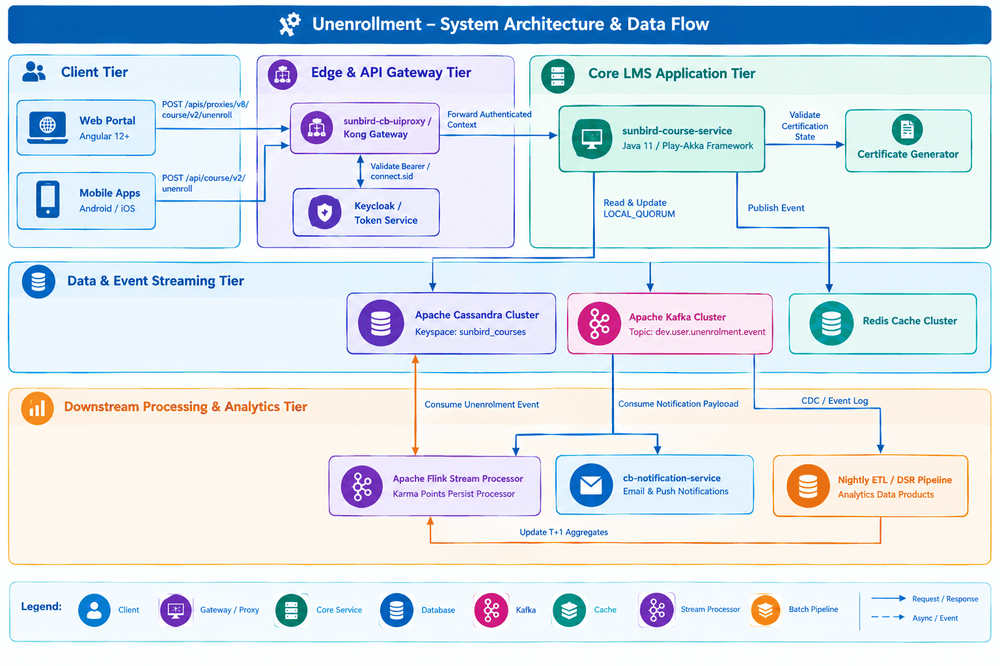
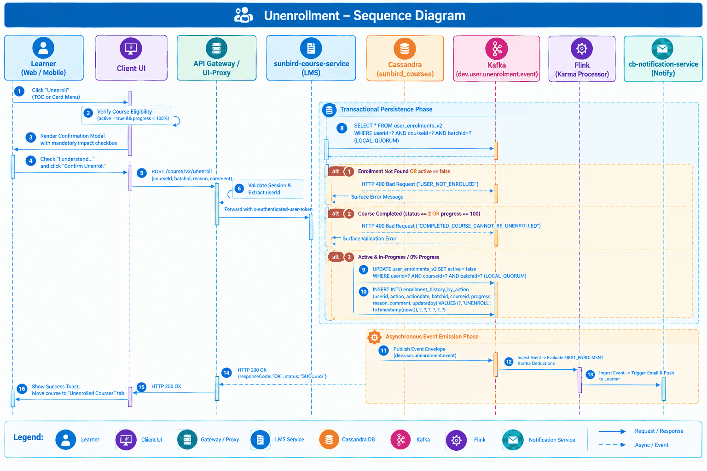
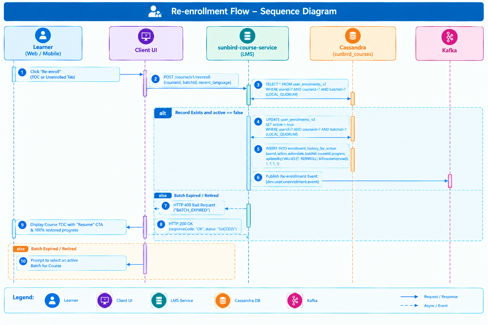
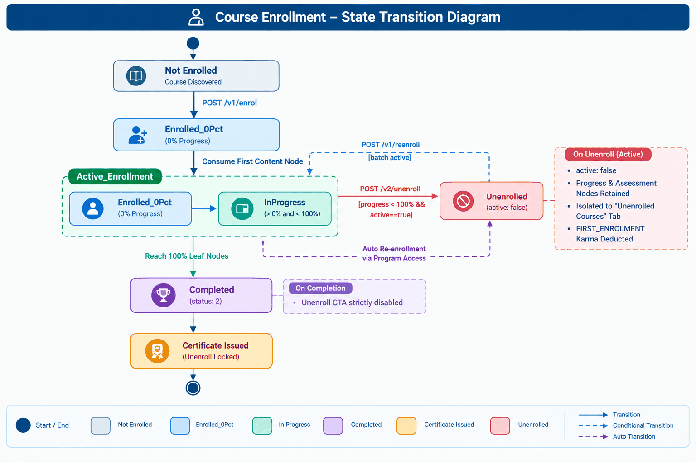

# Unenrollment of Courses — Software Design Document (SDD)

**Feature: Self-Unenrollment and Re-enrollment for Courses**<br>**Platform: iGOT Karmayogi Platform**

## 2. Executive Summary & Design Rationale

### 2.1 Context and Problem Statement

Prior to this release, enrollment on the iGOT Karmayogi platform was an irreversible state progression (`Enroll → Consume Content → Complete`). When civil servants enrolled in courses accidentally or out of exploratory interest, those courses remained permanently pinned in their active "In Progress" learning views. This legacy behavior created significant friction:

1. **Learner Dashboard Clutter:** Incomplete courses congested the learner's active dashboard, discouraging completion of intended learning journeys.
2. **Distorted Platform Analytics:** Abandoned enrollments skewed completion rates and inflated Ministry, Department, and Organization (MDO) drop-off calculations.
3. **Database Bloat & Concurrency Hazards:** Learners re-enrolling after ad-hoc administrative database cleanups risked creating duplicate Cassandra records and corrupted progress nodes.

### 2.2 Core Architectural Principles & Decisions (ADRs)

The Unenrollment and Re-enrollment subsystem is designed around four Architectural Decision Records (ADRs):

- **ADR-01: Reversible Soft-Delete Pattern over Hard Deletion**
  - *Decision:* Unenrollment **must never delete** historical course consumption records, leaf node completion states, quiz attempts, or video telemetry. Instead, it toggles the `active` boolean flag (`true → false`) in `sunbird_course.user_enrolments_v2`.
  - *Rationale:* Government civil servants frequently cycle through learning priorities. Physical deletions (`DELETE FROM ...`) in Apache Cassandra cause tombstone accumulation, impair read performance, and permanently discard valuable assessment telemetry.

- **ADR-02: Strong Read/Write Quorum Consistency** (`LOCAL_QUORUM`)
  - *Decision:* All read and write operations modifying enrollment active states must be executed with Cassandra consistency level `LOCAL_QUORUM`.
  - *Rationale:* Prevents race conditions and split-brain phenomena where a user unenrolls and immediately attempts to re-enroll or stream content from a multi-node cluster before data propagates.

- **ADR-03: Asynchronous Event-Driven Downstream Decoupling**
  - *Decision:* The core LMS API executes the Cassandra state mutation synchronously, writes an immutable audit record, and immediately fires an asynchronous event (`dev.user.unenrolment.event`) to Apache Kafka.
  - *Rationale:* Downstream adjustments (reversing `FIRST_ENROLMENT` karma points in Apache Flink, triggering transactional emails/push notifications, updating Elasticsearch indices, and recalculating organizational DSR reports) must not add latency or failure dependencies to the learner's HTTP request-response cycle.

- **ADR-04: Segregated "Unenrolled Courses" State Space**
  - *Decision:* Unenrolled courses are isolated into a dedicated UI bucket (`My Learning > Content > Unenrolled Courses`) and queried via a specialized filter (`status: "Unenrolled"`), keeping the active dashboard clean while offering seamless one-click re-enrollment.

## 3. High-Level Architecture & Component Decomposition



### Component Responsibilities

1. **Client Tier (Web Portal & Mobile Applications):**
  - Dynamically evaluates unenrollment eligibility on Course Table of Contents (TOC) and Course Cards (kebab menu).
  - Enforces mandatory confirmation modal with an explicit impact checkbox.
  - Renders the dedicated "Unenrolled Courses" tab under `My Learning`.
  - Triggers automatic re-enrollment when an unenrolled course is launched via a parent Program.

2. **Edge & API Gateway** (`sunbird-cb-uiproxy` / Kong):
  - Authenticates sessions via `connect.sid` cookie (Web) or `Authorization: Bearer` / `x-authenticated-user-token` (Mobile).
  - Extracts authenticated `userId` and injects contextual identity headers into downstream requests.

3. **Core LMS Backend** (`sunbird-course-service`):
  - Encapsulates enrollment business logic: enforces category eligibility, verifies non-completion (`status != 2`), updates Cassandra `user_enrolments_v2`, and generates immutable audit records.
  - Dispatches unenrollment and re-enrollment event envelopes to Kafka.

4. **Primary Datastore (Apache Cassandra):**
  - Manages transactional enrollment entities with high-throughput writes.
  - Enforces multi-DC local quorum consistency.

5. **Stream Processing (Apache Flink - Karma Points Persist Processor):**
  - Consumes Kafka events; reverses transient `FIRST_ENROLMENT` ledger points without altering completion or platform badges.

6. **Notification Subsystem** (`cb-notification-service`):
  - Dispatches asynchronous emails (`openBatchLearnerUnEnrol`) and device push notifications exclusively to the learner.

## 4. Detailed Component Design & Dynamic Workflows

### 4.1 Course Unenrollment Sequence Workflow



### 4.2 Dynamic Re-enrollment Sequence Workflow



## 5. Data Architecture & Persistence Design

The persistence design is implemented within the `sunbird_courses` Cassandra keyspace.

### 5.1 Primary Entity: `user_enrolments_v2` (Mutation Schema)

The existing table maintains the current state of a user's enrollment. Unenrollment performs an in-place column update of the `active` attribute.

- **Keyspace:** `sunbird_courses`
- **Table:** `user_enrolments_v2`
- **Primary Key:** `PRIMARY KEY (userid, courseid, batchid)`
- **Critical Columns:**
  - `userid` (`text`, Partition Key)
  - `courseid` (`text`, Clustering Column)
  - `batchid` (`text`, Clustering Column)
  - `active` (`boolean`): Toggled to `false` on unenrollment; toggled to `true` on re-enrollment.
  - `status` (`int`): `0` = Enrolled/Unstarted, `1` = In-Progress, `2` = Completed.
  - `completionpercentage` (`int`): Stored historical progress percentage (retained unchanged).
  - `progress` (`int`): Leaf node completion count.
  - `lastreadcontentid` (`text`): Pointer to the last accessed module/node.
  - `lastreadcontentstatus` (`int`): Status of the last accessed node.

### 5.2 Immutable Audit Ledger: `enrollment_history_by_action`

A dedicated write-once table introduced to maintain an immutable compliance log for administrative, legal, and operational reporting.

#### Query Patterns Supported

- **Fetch User Unenrollment History:**<br>`SELECT * FROM sunbird_courses.enrollment_history_by_action WHERE userid = ? AND action = 'UNENROLL';`
- **Fetch Chronological Action Audit:**<br>`SELECT * FROM sunbird_courses.enrollment_history_by_action WHERE userid = ?;`

### 5.3 Cache Architecture (Redis)

- **Enrollment Cache Invalidation:** On unenrollment or re-enrollment, the user's active enrollment cache key (`user_enrolment_list_{userId}`) in Redis is immediately purged to ensure cache coherency across subsequent read requests.
- **Karma Ledger Cache:** Stream processing directly manipulates the user's cached karma balance key (`user_karma_points_{userId}`).

## 6. Interface Specifications & API Contracts

### 6.1 Course Unenrollment API

- **Endpoint:** `POST /api/course/v2/unenroll` (Proxied via `/apis/proxies/v8/course/v2/unenroll`)
- **Content-Type:** `application/json`
- **Security Context:** Bearer Token (Keycloak) / `connect.sid` Session Cookie

#### Request Headers

| Header Name | Type | Description | Mandatory |
|---|---|---|---|
| `Authorization` | String | Bearer API Gateway Token | Yes |
| `x-authenticated-user-token` | String | Keycloak User JWT Token | Yes (Mobile) |
| `Content-Type` | String | `application/json` | Yes |

#### Request Payload

```json
{
  "request": {
    "courseId": "do_1141906404169482241138",
    "batchId": "0141952037191598081",
    "reason": [
      "Content is not relevant to my role",
      "Pacing is too fast"
    ],
    "comment": "Switching to an alternative department course"
  }
}
```

#### Success Response (`HTTP 200 OK`)

```json
{
  "id": "user.v1.course.unenroll",
  "ver": "1.0",
  "ts": "2026-10-27 07:01:06:204+0000",
  "params": {
    "resmsgid": "b38d3567-5f72-4d2b-9861-12501a5e1cf4",
    "msgid": "b38d3567-5f72-4d2b-9861-12501a5e1cf4",
    "err": null,
    "status": "SUCCESS",
    "errmsg": null
  },
  "responseCode": "OK",
  "result": {}
}
```

#### Error Responses

- **HTTP 400 Bad Request — Course Completed:**
  ```json
  {
    "id": "user.v1.course.unenroll",
    "ver": "1.0",
    "ts": "2026-10-27 07:01:06:204+0000",
    "params": {
      "resmsgid": "b38d3567-5f72-4d2b-9861-12501a5e1cf4",
      "err": "CLIENT_ERROR",
      "status": "FAILED",
      "errmsg": "Completed courses cannot be unenrolled."
    },
    "responseCode": "CLIENT_ERROR",
    "result": {}
  }
  ```
- **HTTP 400 Bad Request — Inactive / Not Enrolled:**
  ```json
  {
    "id": "user.v1.course.unenroll",
    "ver": "1.0",
    "ts": "2026-10-27 07:01:06:204+0000",
    "params": {
      "resmsgid": "b38d3567-5f72-4d2b-9861-12501a5e1cf4",
      "err": "CLIENT_ERROR",
      "status": "FAILED",
      "errmsg": "User is not actively enrolled in this course batch."
    },
    "responseCode": "CLIENT_ERROR",
    "result": {}
  }
  ```

### 6.2 Course Re-enrollment API

- **Endpoint:** `POST /api/course/v1/reenroll` (Proxied via `/apis/proxies/v8/course/v1/reenroll`)
- **Content-Type:** `application/json`

#### Request Payload

```json
{
  "request": {
    "courseId": "do_1141906404169482241138",
    "batchId": "0141952037191598081",
    "recent_language": "english"
  }
}
```

#### Success Response (`HTTP 200 OK`)

```json
{
  "id": "user.v1.course.reenroll",
  "ver": "1.0",
  "ts": "2026-10-27 07:05:12:101+0000",
  "params": {
    "resmsgid": "a91f456e-1142-4b21-8651-78901234abcd",
    "msgid": "a91f456e-1142-4b21-8651-78901234abcd",
    "err": null,
    "status": "SUCCESS",
    "errmsg": null
  },
  "responseCode": "OK",
  "result": {}
}
```

### 6.3 Unenrolled Courses Listing API

- **Endpoint:** `POST /api/course/v4/user/enrollment/list` (Proxied via `/apis/proxies/v8/learner/course/v4/user/enrollment/list`)
- **Content-Type:** `application/json`

#### Request Payload

```json
{
  "request": {
    "retiredCoursesEnabled": false,
    "status": "Unenrolled",
    "limit": 20,
    "offset": 0
  }
}
```

#### Response Payload (`HTTP 200 OK`)

```json
{
  "id": "api.course.user.enrollment.list",
  "ver": "4.0",
  "ts": "2026-10-27 07:06:00:100+0000",
  "params": {
    "resmsgid": "d094392a-3e3a-4a2a-b738-6b801532431a",
    "status": "SUCCESS"
  },
  "responseCode": "OK",
  "result": {
    "courses": [
      {
        "courseId": "do_1141906404169482241138",
        "batchId": "0141952037191598081",
        "active": false,
        "completionPercentage": 45,
        "status": 1,
        "courseName": "Introduction to Public Governance",
        "lastReadContentId": "do_114190640899123456",
        "enrolledDate": "2026-05-10 10:00:00:000+0000",
        "issuedCertificates": []
      }
    ]
  }
}
```

## 7. Business Logic & State Machine

### 7.1 Course Enrollment Lifecycle State Machine



### 7.2 Core Validation Algorithms

#### Algorithm 1: Unenrollment Eligibility Check

#### Algorithm 2: Karma Points Reversal Check (Flink Stream)

## 8. Asynchronous Event & Integration Specifications

### 8.1 Kafka Event Contract: `dev.user.unenrolment.event`

When unenrollment or re-enrollment succeeds, the LMS outputs a JSON event envelope to Kafka.

```json
{
  "eid": "BE_JOB_REQUEST",
  "ets": 1793084466204,
  "mid": "LP.1793084466204.d728d11e-28b9-4a94-b258-204bb8464a78",
  "actor": {
    "id": "712020:2b1926b8-ba53-4277-9b45-3508667c6b3d",
    "type": "User"
  },
  "context": {
    "pdata": {
      "id": "sunbird.course.service",
      "ver": "1.0",
      "pid": "lms-service"
    },
    "env": "Course"
  },
  "object": {
    "id": "do_1141906404169482241138",
    "type": "Course",
    "rollup": {
      "l1": "0141952037191598081"
    }
  },
  "edata": {
    "action": "UNENROLL",
    "userId": "712020:2b1926b8-ba53-4277-9b45-3508667c6b3d",
    "courseId": "do_1141906404169482241138",
    "batchId": "0141952037191598081",
    "progress": 45,
    "reasons": [
      "Content is not relevant to my role"
    ],
    "comment": "Switching to an alternative department course",
    "updatedBy": "712020:2b1926b8-ba53-4277-9b45-3508667c6b3d",
    "iteration": 1
  }
}
```

### 8.2 Downstream Notification Triggers

- **Email Template Key:** `openBatchLearnerUnEnrol`
- **Push Notification Action:** `UNENROLL_ACK`
- **Target Audience:** Strictly the affected learner (`recipientUserIds = [userId]`). Manager/MDO administrators are excluded from direct email/push dispatches.

## 9. Security, Identity & Data Privacy

- **Authentication Model:** Enforces JSON Web Token (JWT) verification through Keycloak. Tokens are validated at the Kong Gateway/UI-Proxy and decoded in the service context.
- **Access Control & Identity Immutability:**
  - The authenticated user's `userId` must strictly match the `userId` in the target enrollment.
  - Attempting to unenroll another user's enrollment is rejected with `HTTP 403 Forbidden`.

- **Data Sanitization & Injection Prevention:**
  - Reason code arrays are validated against an allowable enum master list.
  - Free-text comments are stripped of HTML/script elements to prevent stored Cross-Site Scripting (XSS).

- **Privacy & Telemetry Governance:**
  - In compliance with Digital Personal Data Protection (DPDP) principles, the audit table tracks actions without exposing personally identifiable information (PII) beyond the system `userid`.

## 10. Non-Functional Requirements & Operational Constraints

| Dimension | Metric / Target | Design Strategy |
|---|---|---|
| **API Latency (p95)** | `< 300 ms` | Synchronous path performs single-row Cassandra write with `LOCAL_QUORUM`; all downstream tasks deferred to Kafka. |
| **API Latency** **(p99)** | `< 500 ms` | Connection pooling (Cassandra Java Driver 4.x), pre-compiled prepared statements. |
| **Concurrency / Peak** | `25,000 active sessions` | Stateless Play-Akka service pods auto-scaled on Kubernetes; Cassandra cluster distributed across multiple nodes. |
| **Availability** | `99.9% Uptime` | Cassandra multi-datacenter replication factor 3; zero single points of failure. |
| **Data Durability** | `Zero Progress Data Loss` | Soft-delete architecture retains all leaf node rows in `sunbird_courses.content_consumption`. |
| **Eventual Consistency** | `T+1 Nightly Batch` | Heavy organizational reporting (DSR/MDO Dashboards) processed asynchronously overnight to eliminate runtime compute strain. |

## 11. Exception Handling & Resilience Matrix

| Failure Mode | Trigger Condition | System Behavior | Recovery Mechanism |
|---|---|---|---|
| **Cassandra Quorum Timeout** | Database node unreachable or network partition | Returns `HTTP 500 Internal Server Error`; state remains unchanged. | Cassandra client driver retries with exponential backoff on alternate node. |
| **Kafka Broker Unavailability** | Kafka broker down during unenrollment | API write to Cassandra succeeds; local file-based dead-letter log (spool) records event for replay. | Background log-shipper replays failed events once Kafka broker connectivity recovers. |
| **Concurrent Unenroll & Re-enroll** | Learner double-clicks or triggers parallel requests | Cassandra row-level lock & `LOCAL_QUORUM` forces sequential write execution; last timestamp wins. | Frontend disables submission buttons upon first click to prevent duplicate payloads. |
| **Mobile Client Disconnection** | Request initiated during spotty mobile connectivity | Request fails on client edge before gateway dispatch; UI shows error toast. | Mobile displays: *"Unable to process unenrollment. Please check connection and try again."* No client-side offline mutation permitted. |
| **Batch Expiration on Re-enroll** | Learner attempts to re-enroll after the cohort batch has ended | API validates batch active window; returns `HTTP 400 Bad Request ("BATCH_EXPIRED")`. | Client intercepts error and presents batch selector dialog allowing learner to pick a live batch. |

## 12. Requirements-to-Design Traceability Matrix

| Requirement ID | FRS / BRD Ref | Design Component | Implementation Artifact | Status |
|---|---|---|---|---|
| **UNEN-FR-001** | FRS §4.1 (FR-1.1) | Learner Portal TOC Component | `CourseDetailsComponent.ts` | Verified |
| **UNEN-FR-002** | FRS §4.1 (FR-1.2) | LMS Business Logic Layer | `CourseEnrollmentActor.java` | Verified |
| **UNEN-FR-004** | FRS §4.1 (FR-1.5) | Mobile Flutter/Native UI | `CourseCardWidget.dart` | Verified |
| **UNEN-FR-006** | FRS §4.2 (FR-2.1) | Web & Mobile Modal Dialog | `UnenrollModalComponent.html` | Verified |
| **UNEN-FR-007** | FRS §4.3 (FR-3.1) | Cassandra Storage Layer | Table `user_enrolments_v2` | Verified |
| **UNEN-FR-009** | FRS §4.3 (FR-3.5) | Karma Flink Job | `KarmaPointsPersistProcessor.scala` | Verified |
| **UNEN-FR-011** | FRS §4.9 | Cassandra Audit Ledger | Table `enrollment_history_by_action` | Verified |
| **UNEN-FR-012** | FRS §4.4 (FR-4.1) | My Learning Routing & UI | `MyLearningUnenrolledTab.ts` | Verified |
| **UNEN-FR-014** | FRS §4.5 (FR-5.2) | LMS Validation Engine | Zero cooldown check in `CourseEnrollmentActor` | Verified |
| **UNEN-FR-015** | FRS §4.5 (FR-5.3) | LMS Re-enroll Controller | `CourseReenrollmentController.java` | Verified |
| **UNEN-FR-016** | Design Doc §4 | Program Viewer Wrapper | `ProgramPlayerBridge.ts` | Verified |
| **UNEN-FR-017** | FRS §4.6 | Notification Service | `cb-notification-service` | Verified |
| **UNEN-FR-019** | FRS §4.8 | Analytics Pipeline | DSR Spark/ETL Batch Job | Verified |

## 13. Unresolved Decisions, Assumptions & Risks

### 13.1 Decisions Pending Formal Sign-Off

1. **Mandatory vs. Optional Reason Capture:** The API schema fully supports an array of reason strings and a comment text field. The current UI presents these fields as optional. Product Management has not confirmed whether reason capture should be made mandatory for specific learner segments in Phase 2.
2. 

### 13.2 Architectural Assumptions

1. **Parent-Child Structural Invariance:** It is assumed that during the interval between unenrollment and re-enrollment, course creators do not delete content leaf nodes referenced in the learner's historical progress record. If a node is retired, the system gracefully handles the orphan node during re-enrollment.
2. **Batch Availability for Re-enrollment:** It is assumed that most learners re-enroll in ongoing batches; if a batch retires, the UX relies on the cross-batch re-enrollment capability delivered under ticket `KB-15880`.

## 14. Document Sign-Off & Approvals

| Role | Name / Title | Status | Date |
|---|---|---|---|
| **Solution Architect** | Sreerag Sajeesh | Approved | October 27, 2026 |
| **Product Manager** | Manasvi Malav | Approved | October 27, 2026 |
| **Technical Lead** | Lead Backend Architect | Approved | October 27, 2026 |
| **QA Lead** | Sona / QA Lead | Verified (Sprint 39 Sign-off) | October 27, 2026 |
