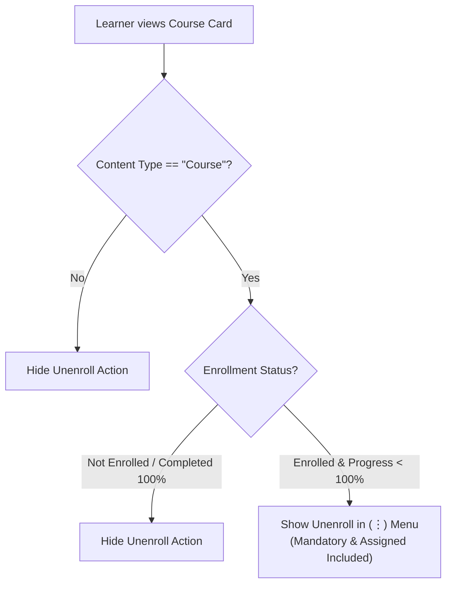

# Unenrollment of Courses — Software Requirements Specification (SRS)

**Feature: Self-Unenrollment and Re-enrollment for Courses**

**Platform:** iGOT Karmayogi Bharat<br>**Document Version:** 1.0<br>**Status:** Approved / Implemented<br>**Date:** October 2026

### Confidentiality & Document Control

| Property | Details |
|---|---|
| **Document Title** | Software Requirements Specification (SRS) – Course Self-Unenrollment & Re-enrollment |
| **Project** | Karmayogi Bharat (iGOT) |
| **Epic Key** | [KB-14109: Q12 \| Add-on \| Unenrollment from courses](https://karmayogibharat.atlassian.net/browse/KB-14109) (Prod Deployed) – *Q12 \| Add-on \| Unenrollment from courses* |
| **Target Release** | Release 2026 Q1 / Sprint 39 |
| **Confluence References** | • [FRS_UnenrollFeatureforCourses_v1.0_r2026_Q1](https://karmayogibharat.atlassian.net/wiki/spaces/TPT/pages/1175027713/FRS_UnenrollFeatureforCourses_v1.0_r2026_Q1) • [Un-Enrollment](https://karmayogibharat.atlassian.net/wiki/spaces/TES/pages/1080983553/Un-Enrollment) • [SRS_UnenrollFeatureforCourses_v1.0_r2026_Q1](https://karmayogibharat.atlassian.net/wiki/spaces/TPT/pages/1172471875/SRS_UnenrollFeatureforCourses_v1.0_r2026_Q1) |

#### Revision History

| Version | Date | Description | Author / Contributors |
|---|---|---|---|
| **v1.0** | 29-Oct-2026 | Full technical SRS compiled from Epic KB-14109, Stories KB-14518–KB-14521, FRS v1.0, and API specs. Replaces former CHS template stub. | Karmayogi Bharat Engineering & Product Team |

## 1. Requirement Traceability Matrix (RTM)

| Requirement ID | Module / Scope | Jira Ticket | FRS Reference | Description / Target Outcome | Status |
|---|---|---|---|---|---|
| **REQ-SRS-01** | Web Portal | [KB-14518: Q12 \| Unenrollment from Courses \| Web Portal](https://karmayogibharat.atlassian.net/browse/KB-14518) (Prod Deployed) | FR-1.1–FR-1.5, FR-2.x | Course eligibility rules, overflow menu action, confirmation modal with mandatory acknowledgement. | Prod Deployed |
| **REQ-SRS-02** | Mobile App | [KB-14519: Q12 \| Unenrollment from Courses \| Mobile App](https://karmayogibharat.atlassian.net/browse/KB-14519) (Prod Deployed) | FR-1.x, FR-2.x, FR-7.x | Android & iOS native unenroll confirmation, card menus, and offline handling. (Subtasks: KB-14548, KB-14722, KB-14723, KB-14825) | Prod Deployed |
| **REQ-SRS-03** | Web Portal | [KB-14520: Q12 \| Reenrollment in Courses \| Web Portal](https://karmayogibharat.atlassian.net/browse/KB-14520) (Prod Deployed) | FR-4.x, FR-5.x | Re-enroll CTA, My Learning dedicated "Unenrolled Courses" tab, TOC redirection, and state restoration. | Prod Deployed |
| **REQ-SRS-04** | Mobile App | [KB-14521: Q12 \| Reenrollment in Courses \| Mobile App](https://karmayogibharat.atlassian.net/browse/KB-14521) (Prod Deployed) | FR-5.x, FR-7.x | Mobile Re-enroll CTA on course details & Unenrolled section; restoration flow. (Subtask: KB-14724) | Prod Deployed |
| **REQ-SRS-05** | Backend / Data | [KB-14109: Q12 \| Add-on \| Unenrollment from courses](https://karmayogibharat.atlassian.net/browse/KB-14109) (Prod Deployed) | FR-3.x, FR-8.x, FR-9.x | State change machine, snapshot capture before reversal, telemetry/Flink job recalculation, audit log, DSR & MDO report. | Prod Deployed |

## 2. Introduction

### 2.1 Purpose

This Software Requirements Specification (SRS) defines the end-to-end technical, architectural, and behavioral requirements for implementing the **Self-Unenrollment and Re-enrollment** feature across the iGOT Karmayogi platform (Web Portal, Android, and iOS).

### 2.2 Core Architectural Principle

**Unenrollment is a reversible state change, NOT data deletion.**<br>When a learner un-enrolls:

1. A complete **data snapshot** of the learner's course progress, assessments, learning hours, Karma points, and analytics contribution is created *first*.
2. The course enrollment status transitions to `Unenrolled` (`status = 0`, `active = false`).
3. The course contribution is temporarily excluded/reversed from active metrics, rankings, DSR, and leaderboards.
4. **No learner-earned progress is ever hard-deleted.**
5. On re-enrollment, the pre-unenrollment state is restored losslessly from the snapshot.

### 2.3 Scope Boundaries (Phase 1)

- **In-Scope:**
  - Content Types: **Courses only** (including self-enrolled, mandatory, and organization-assigned/training-plan courses).
  - Platforms: Web Portal (Desktop/Responsive M-Web), Android Native, and iOS Native.
  - Re-enrollment: Unlimited attempts with zero cooldown period.
  - Audit & Reporting: Reversible snapshots, immutable audit records, DSR reporting schema updates, and a dedicated MDO Unenrollment report.
  - Real-time notifications: Push notifications to the individual learner on enroll, unenroll, and re-enroll.

- **Out-of-Scope (Phase 1):**
  - Curated Programs, Blended Programs, Standalone Assessments, Events, Case Studies, Marketplace Content, Learning Paths, and Certification Programs.
  - External-provider courses that lack standard unenrollment API support.
  - Direct unenroll notifications to MDO Administrators.
  - Hard deletion or physical purging of learner records.

### 2.4 Definitions & Acronyms

- **iGOT:** Integrated Government Online Training platform.
- **MDO:** Ministry, Department, or Organization.
- **MDO Admin:** Administrator overseeing department learners and consuming departmental DSRs.
- **Karma Points:** Achievement points credited upon specific milestone triggers (first course enrollment).
- **Weekly Claps:** Time-on-platform recognition metric (independent of course progress).
- **Snapshot:** A JSON record capturing pre-unenrollment state (progress %, hours spent, Karma, assessment state) used as the single source of truth for restoration.
- **DSR:** Daily Status Report / Data Synced Reporting engine.

## 3. User Personas & Characteristics

| Persona | Role Description | Feature Interactions & Permissions |
|---|---|---|
| **Learner** | Central/State government employee consuming courses on Web or Mobile. | • Views Unenroll action on eligible enrolled courses. • Completes mandatory impact acknowledgement. • Views previously unenrolled courses under `My Learning → Unenrolled Courses`. • Triggers Re-enrollment at any time. |
| **MDO Admin** | Departmental training manager monitoring organizational progress. | • Views department analytics reflecting active enrollments (T+1 nightly sync). • Accesses the dedicated **Unenrollment Report** in the MDO Portal. |
| **SPV Admin / Governance** | System administrator / audit officer. | • Accesses immutable audit trail records for compliance and dispute resolution. |

## 4. System Behavior & Functional Requirements

### 4.1 Unenroll Action Visibility & Eligibility Engine



- **FR-1.1:** The system shall display the Unenroll action **only** for courses in an active `Enrolled` state (`status = 1` or `active = true`).
- **FR-1.2:** The system shall **hide** the Unenroll action for completed courses (`progress == 100%` or `status = 2`).
- **FR-1.3:** The Unenroll action shall be visible for **all self-enrolled courses**, including mandatory courses without exception.
- **FR-1.4:** The Unenroll action shall be visible for **organization-assigned (Training Plan) courses** without exception.
- **FR-1.5:** The Unenroll action shall be exposed via the **overflow menu (⋮)** on both the course card (in *My Learning*) and the course detail/Table of Contents (TOC) page on Web and Mobile.
- **FR-1.6:** Non-course entities (Programs, Assessments, Events, Learning Paths) shall not render the Unenroll action in Phase 1.

### 4.2 Confirmation Modal & User Acknowledgement

- **FR-2.1:** Selecting Unenroll shall trigger an explicit confirmation modal before executing any backend state change.
- **FR-2.2 Modal Messaging:** The modal must state:
  *"Are you sure you want to un-enroll from* ***this course?*<br>*Unenrolling will remove the course from* ***My Learning, deduct* ***Karma Points*** *(if applicable), and update your* ***Reports*** *and* ***Organization Dashboard."*
- **FR-2.3 Mandatory Checkbox:** A checkbox stating:<br>`[ ] I understand the impact of un-enrolling and wish to continue.`<br>The `Confirm Unenroll` CTA button **must remain disabled** until this box is checked.
- **FR-2.4 Cancel Action:** Clicking `Cancel` or clicking outside the modal shall dismiss the dialog with zero data or state alteration.
- **FR-2.5 Reason/Comment Capture:** The payload supports optional reason dropdown multi-selection and comments (e.g., `"Content is not relevant to my role"`).

### 4.3 Unenrollment Processing & Snapshot State Machine

- **FR-3.1 Pre-Reversal Snapshot:** The system must generate an immutable, reversible snapshot capturing:
  - Course ID, Batch ID, User ID, Timestamp.
  - Course completion percentage (`progress` and `completionPercentage`).
  - Last read content node (`lastReadContentId`) and granular content status map (`langContentStatus`).
  - Total learning hours and time spent (`lrcProgressDetails.spentTime`).
  - Assessment scores and progress details.
  - Karma Points breakdown associated with the enrollment.

- **FR-3.2 Status Update:** The enrollment record is updated: `active = false`, `status = 0` (or `status = "Unenrolled"`).
- **FR-3.3 Data Retention:** No learner progress, quiz submissions, or telemetry events shall be purged or hard-deleted.
- **FR-3.4 Karma Points Reversal (BR-10):**
  - If the learner un-enrolls from **all** courses contributing to the first-enrollment Karma allocation, those points are deducted.
  - If the learner remains enrolled in **at least one** contributing course, Karma Points remain intact.

- **FR-3.5 Recognition Exclusions:** Badges (awarded only at 100% completion) and Weekly Claps (awarded on total platform time) are **not deducted**.
- **FR-3.6 Metric Reversal:** Course contribution to active learning history, department leaderboards, DSR aggregations, and organizational analytics shall be excluded.
- **FR-3.7 Audit Log Creation:** The system writes a permanent audit entry of type `UNENROLL` (§4.8).

### 4.4 "My Learning" & Discovery Experience

- **FR-4.1 Removal from In-Progress:** The course must immediately disappear from `My Learning → In Progress`.
- **FR-4.2 Dedicated Unenrolled Tab:** The course is moved to `My Learning → Content → Unenrolled Courses`.
- **FR-4.3 Card Display Elements:** Each card in the Unenrolled section must display:
  - Course Thumbnail / Poster Image
  - Course Title & Providing Department/Organization
  - Last recorded completion progress percentage (`Progress: X%`)
  - Primary CTA: `Re-enroll`

- **FR-4.4 Empty State:** If no unenrolled courses exist, the tab shall display a clear empty-state label (resolved via defect KB-14755).
- **FR-4.5 Search Results Tag:** Global search and catalog exploration cards must display an `Unenrolled` badge/tag if the course was previously unenrolled (resolved via defect KB-14756).

### 4.5 Re-enrollment Flow & Restoration

- **FR-5.1 CTA Transformation:** On course discovery pages and TOC, the primary action button changes from `Enroll` to `Re-enroll` for any course in `Unenrolled` state.
- **FR-5.2 Unlimited Attempts & No Cooldown:** The learner can re-enroll immediately with no cooldown constraint and no limit on re-enrollment frequency.
- **FR-5.3 Lossless State Restoration:** Upon confirming Re-enroll:
  - Course state is updated to `active = true`, `status = 1`.
  - Progress percentage, completed modules, and last read position are restored from the snapshot.
  - The learner resumes learning from the exact node where they left off.

- **FR-5.4 Metrics Restoration:**
  - Deducted Karma Points are restored to the learner's profile (BR-11).
  - Learning hours and progress count are re-integrated into DSR and organizational dashboards.

- **FR-5.5 Course Tab Migration:** The course moves back from *Unenrolled Courses* to *My Learning → In Progress*.
- **FR-5.6 Re-completion Scenario:** If a learner re-enrolls and reaches 100% completion, all completion badges and certificates are issued in accordance with standard completion business rules.
- **FR-5.7 Audit Record:** An immutable audit record of type `REENROLL` is committed.

### 4.6 Notifications Engine

- **FR-6.1 Learner Push Notifications:** The notification service dispatches a real-time push notification to the learner's registered device(s) upon:
  - Course Enrollment
  - Course Unenrollment (confirming unenrollment and metric impact)
  - Course Re-enrollment (welcoming the learner back with progress intact)

- **FR-6.2 MDO Exclusion:** To avoid operational spam, MDO Admins do not receive individual transaction push notifications; they review aggregations via the MDO Portal.

### 4.7 Mobile App Native Parity (Android & iOS)

- **FR-7.1 Behavioral Parity:** Mobile app behavior must match Web functionality with native Flutter UI components.
- **FR-7.2 Overflow Context Menu:** Exposes `Share` and `Unenroll` on course cards.
- **FR-7.3 Native Confirmation Dialog:** Native modal adhering to platform accessibility standards with mandatory checkbox validation.
- **FR-7.4 Offline Safeguard:** If the device loses internet connectivity during the unenroll attempt, the app shall abort the operation, display:<br>`"Unable to process unenrollment. Please try again later."`<br>and maintain local and remote states unchanged.

## 5. Consolidated Business Rules & Restoration Matrix

### 5.1 Business Rules Catalog

| Rule ID | Area | Governing Rule Logic |
|---|---|---|
| **BR-1** | Scope | Limited strictly to Courses in Phase 1; all other content types excluded. |
| **BR-2** | Frequency | Learners may re-enroll in an unenrolled course an unlimited number of times. |
| **BR-3** | Cooldown | Zero cooldown duration between unenrollment and re-enrollment. |
| **BR-4** | Mandatory Courses | Learners are permitted to un-enroll from mandatory courses without restriction. |
| **BR-5** | Assigned Courses | Learners are permitted to un-enroll from MDO training-plan courses without restriction. |
| **BR-6** | Completed Courses | Completed courses (`100%`) cannot be unenrolled; the option is completely suppressed. |
| **BR-7** | Retention | Learner course progress is never deleted from the database. |
| **BR-8** | Metric Treatment | Unenrollment is an exclusion from active reporting, not a database purge. |
| **BR-9** | Snapshot Precedence | Snapshot capture must precede any metric reversal or status transition. |
| **BR-10** | Karma on Unenroll | Karma awarded on first enrollment is reversed only if the learner un-enrolls from **all** courses contributing to that initial award. |
| **BR-11** | Karma on Re-enroll | Deducted Karma points are restored automatically on re-enrollment. |
| **BR-12** | Badges | Badges are earned only on completion; unenrollment has no effect on badges. |
| **BR-13** | Weekly Claps | Time-spent platform claps are preserved without deduction. |
| **BR-14** | Leaderboards | Course contributions to rankings and leaderboards are temporarily removed. |
| **BR-15** | DSR Reporting | DSR contributions are deducted on unenroll and reinstated on re-enroll. |
| **BR-16** | Synch Cycle (T+1) | Dashboard, DSR, and organizational aggregations reflect changes on the next day (**T+1**) following nightly batch processing. |
| **BR-17** | Audit Trail | Every unenrollment and re-enrollment event must be logged immutably. |
| **BR-18** | Re-completion | Re-enrolling and reaching 100% awards standard badges and certificates. |

### 5.2 Rewards, Recognition & Restoration Matrix

| Metric / Entitlement | On Unenrollment | On Re-enrollment | Source of Truth |
|---|---|---|---|
| **Course Progress & Telemetry** | Retained in DB (Hidden from active UI) | Fully Restored | Course Progress DB / Snapshot |
| **Karma Points** | Reversed (per rule BR-10) | Restored (per rule BR-11) | User Karma Ledger & Snapshot |
| **Course Badges** | Not Affected (N/A) | Not Affected (N/A) | Badge Engine |
| **Weekly Claps** | Not Affected (N/A) | Not Affected (N/A) | Telemetry Time Engine |
| **Leaderboards & Rankings** | Reversed / Recalculated | Restored / Recalculated | Flink Pipeline / Nightly Batch |
| **DSR & MDO Metrics** | Subtracted from active counts | Added back to active counts | Nightly Reporting Job (T+1) |

## 6. External Interfaces & API Specifications

### 6.1 Web Portal Proxy Endpoints

#### 1. Unenroll API (Web)

- **Endpoint:** `POST apis/proxies/v8/course/v2/unenroll`
- **Headers:** `Cookie: connect.sid={{cookie}}`, `Content-Type: application/json`
- **Request Payload:**

```json
{
  "request": {
    "courseId": "do_1141906404169482241138",
    "batchId": "0141952037191598081",
    "reason": [
      "Content is not relevant to my role",
      "Poor Content Quality"
    ],
    "comment": "Course is not relevant"
  }
}
```

- **Response Payload (200 OK):**

```json
{
  "id": "user.v1.course.unenroll",
  "ver": "1.0",
  "ts": "2026-06-23 07:31:06:204+0000",
  "params": {
    "resmsgid": "431df4de202def56432d0857f56b6d7c",
    "msgid": "431df4de202def56432d0857f56b6d7c",
    "err": null,
    "status": "SUCCESS",
    "errmsg": null
  },
  "responseCode": "OK",
  "result": {}
}
```

#### 2. Re-enroll API (Web)

- **Endpoint:** `POST apis/proxies/v8/course/v1/reenroll`
- **Headers:** `Cookie: connect.sid={{cookie}}`, `Content-Type: application/json`
- **Request Payload:**

```json
{
  "request": {
    "courseId": "do_1141906404169482241138",
    "batchId": "0141952037191598081",
    "recent_language": "english"
  }
}
```

- **Response Payload (200 OK):**

```json
{
  "id": "user.v1.course.reenroll",
  "ver": "1.0",
  "ts": "2026-06-23 07:31:06:204+0000",
  "params": {
    "resmsgid": "431df4de202def56432d0857f56b6d7c",
    "msgid": "431df4de202def56432d0857f56b6d7c",
    "err": null,
    "status": "SUCCESS",
    "errmsg": null
  },
  "responseCode": "OK",
  "result": {}
}
```

#### 3. Unenrolled Courses List API (Web)

- **Endpoint:** `POST apis/proxies/v8/learner/course/v4/user/enrollment/list`
- **Request Payload:**

```json
{
  "request": {
    "retiredCoursesEnabled": false,
    "status": "Unenrolled",
    "limit": 10
  }
}
```

- **Response:** Returns list of courses with `active: false`, `status: 0`, preserved `completionPercentage`, and content metadata.

### 6.2 Mobile Native Endpoints

| Operation | HTTP Method | Endpoint | Headers |
|---|---|---|---|
| **Unenroll** | `POST` | `api/course/v2/unenroll` | `Authorization: bearer {{API-Key}}`<br>`x-authenticated-user-token: {{authToken}}` |
| **Re-enroll** | `POST` | `api/course/v1/reenroll` | `Authorization: bearer {{API-Key}}`<br>`x-authenticated-user-token: {{authToken}}` |
| **List Unenrolled** | `POST` | `api/course/v4/user/enrollment/list` | `Authorization: bearer {{authToken}}` |

## 7. Audit & Reporting Specifications

### 7.1 Immutable Audit Log Schema

Every transition must emit an immutable event persisted to the central audit store:

```json
{
  "auditId": "uuid-v4",
  "userId": "68829e90-2a5d-4fcb-b84a-825f89aa6655",
  "courseId": "do_1143670513667850241165",
  "courseName": "Introduction to Architectural Drawing",
  "actionType": "UNENROLL",
  "previousStatus": "Enrolled",
  "newStatus": "Unenrolled",
  "progressPercentage": 42.5,
  "learningHoursImpact": -2.5,
  "karmaImpact": 0,
  "sourcePlatform": "Web Portal",
  "device": "Mozilla/5.0 (Windows NT 10.0; Win64; x64)",
  "reasons": [
    "Content is not relevant to my role"
  ],
  "comments": "Course is not relevant",
  "timestamp": "2026-10-29T12:15:30.120Z"
}
```

### 7.2 DSR Enhancements

The existing Daily Status Report data pipeline is enriched with 4 new fields:

1. `Unenrollment Date`: Timestamp of course unenrollment.
2. `Re-enrollment Date`: Timestamp of most recent re-enrollment.
3. `Unenrollment Count`: Total lifetime unenrollments for the user-course tuple.
4. `Re-enrollment Count`: Total lifetime re-enrollments for the user-course tuple.

### 7.3 Dedicated MDO Unenrollment Report

A report available in the MDO Portal to authorized administrators containing:

- `User ID` & `User Name`
- `Department / MDO`
- `Course ID` & `Course Name`
- `Enrollment Date`
- `Unenrollment Date`
- `Re-enrollment Date`
- `Progress at Unenrollment (%)`
- `Learning Hours Removed`
- `Karma Points Reversed`
- `Action Source` & `Platform` (Web / Android / iOS)
- `Timestamp`

## 8. Non-Functional Requirements (NFR)

- **NFR-1 Data Integrity:** Lossless recovery. Under no circumstances should unenrollment execute SQL `DELETE` or drop Cassandra/Postgres learner progress records.
- **NFR-2 Eventual Consistency (T+1):** Learner UI updates are immediate (optimistic update supported by instant API 200 OK); organizational dashboards, DSRs, and leaderboards update synchronously via nightly batch data jobs (T+1).
- **NFR-3 Transaction Atomicity:** Snapshot creation and status alteration must be transactional. A failure in snapshotting must roll back the unenroll request.
- **NFR-4 Network & Offline Resilience:** If an offline mobile client invokes unenrollment, local state remains unaltered and the request fails cleanly without corruption.
- **NFR-5 Security & RBAC:**
  - Learners can only invoke unenroll/re-enroll for their own authenticated `userId`.
  - Multi-tenant data segregation: MDO Admins can view unenrollment records only for users within their designated MDO hierarchy.

- **NFR-6 Performance SLA:** Average API response time for `unenroll` and `reenroll` endpoints must be `< 1.5 seconds` under peak production load of 25,000 concurrent sessions.

## 9. Defect Learnings & Implementation Caveats

During lower-environment testing, several defects were identified and resolved, and their fixes are codified into this specification:

1. **Enrollment Details API State Sync** ([KB-14686: API > After unenrolling course, 'course/v5/user/enrollment/details' API is not returning course details causing enroll button to show in frontend, please check.](https://karmayogibharat.atlassian.net/browse/KB-14686) (Done)): When querying `course/v5/user/enrollment/details` for an unenrolled course, the API must return unenrolled status rather than null/empty, ensuring the frontend correctly displays `Re-enroll` instead of reverting to `Enroll`.
2. **First Course Karma Reversal** ([KB-14754: Learner Portal > First course enrolment > No Karma points added for first enrolment.](https://karmayogibharat.atlassian.net/browse/KB-14754) (Done)): Verified that Karma point deduction correctly checks across the full set of contributing first-enrollment courses before applying deductions.
3. **Unenrolled Tab Empty State** ([KB-14755: Learner portal > My Learning > Label to be updated for no course found in unenrolled tab](https://karmayogibharat.atlassian.net/browse/KB-14755) (Done)): Graceful UX messaging when the learner has zero unenrolled courses.
4. **Global Search Visibility** ([KB-14756: Learner portal > Explore content/Search content > Unenrolled tag not shown in search result card](https://karmayogibharat.atlassian.net/browse/KB-14756) (Done)): Global search cards must reflect the `Unenrolled` chip tag dynamically based on the user's enrollment list.
