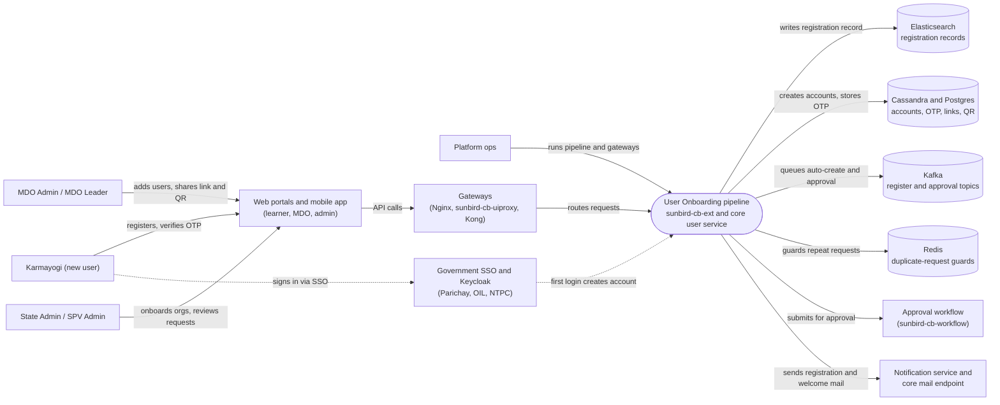

# User Onboarding — Context Diagram

## System boundary

Inside the feature is the registration pipeline: the register endpoint and its
background consumer in `sunbird-cb-ext`, custom registration link and QR
generation, and the account-creation and OTP routes of the core user service.
Outside it are the people who register or administer, the web and mobile
clients, the gateways (Nginx, uiproxy, Kong), the separate approval workflow,
Keycloak and government single sign-on, the mail path, and the Elasticsearch,
Cassandra, Postgres, Kafka and Redis stores.

## Diagram

## Elements

| Element | Role | Detailed in |
|---|---|---|
| User Onboarding pipeline (`sunbird-cb-ext`, `sunbird-lms-service`) | Central system: register endpoint and consumer, link/QR generation, account creation, OTP | [hld.md](hld.md) |
| Karmayogi (new user) | Self-registers by public sign-up, department link or QR, or SSO | [use-cases.md](use-cases.md) |
| MDO Admin / MDO Leader | Adds individual users; generates and shares the registration link and QR | [use-cases.md](use-cases.md) |
| State Admin / SPV Admin | Onboards organisations and reviews requests (documented in the sibling feature) | [use-cases.md](use-cases.md) |
| Platform ops | Keeps the registration pipeline and gateways running | [operations-manual.md](operations-manual.md) |
| Web portals and mobile app | Learner, MDO and admin front ends that call the APIs | [hld.md](hld.md) |
| Gateways (Nginx, uiproxy, Kong) | Two front doors: `/apis` via uiproxy, `/api` via Nginx straight to Kong | [apis.md](apis.md) |
| Government SSO and Keycloak | Parichay, OIL and NTPC first login; Keycloak login and realm | [hld.md](hld.md) |
| Approval workflow (`sunbird-cb-workflow`) | `user_registration` approval; state machine loaded at runtime | [hld.md](hld.md) |
| Notification service and core mail endpoint | Registration-code and welcome emails | [hld.md](hld.md) |
| Elasticsearch | Registration records, org onboarding profile | [hld.md](hld.md) |
| Cassandra and Postgres | User, OTP and master data; QR codes, org hierarchy, workflow tables | [hld.md](hld.md) |
| Kafka | Auto-create and approval topics consumed by the pipeline | [use-cases.md](use-cases.md) |
| Redis | Short-lived duplicate-request guards for SSO and creation | [use-cases.md](use-cases.md) |

> **Verification boundary:** elements and interactions come from the feature's own
> pages, read in full: index, use cases, APIs and HLD (the LLD, operations manual
> and as-built requirements were not read for this diagram). Spot-checked read-only
> in source: the register route's presence in the Kong route definitions of
> `sunbird-devops`. A search of `sunbird-cb-ext` for the Kafka register topic name
> found no match, so topic names are taken from the docs only. Not re-verified:
> the approval workflow state machine, Keycloak federation and realm internals,
> and notification-service internals. Dashed arrows show the SSO first-login path.
