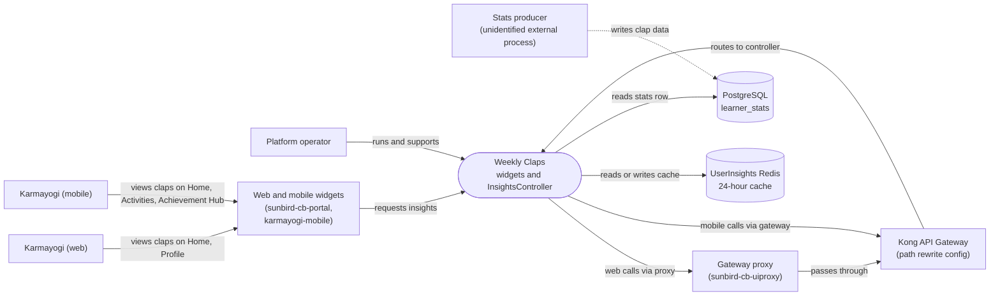

# Weekly Claps — Context Diagram

## System boundary

Inside the feature is the read path for the claps widget: the web and mobile widgets that
render a running total and a four-week strip, and the `InsightsController` in
`sunbird-cb-ext` that reads a cached or stored stats row and returns it. Outside it are the
Karmayogi who views the widget, the gateway proxy and Kong in front of the backend, the
Redis cache and Postgres table the controller reads, and the unidentified external process
that actually computes and writes the clap data.

## Diagram

## Elements

| Element | Role | Detailed in |
|---|---|---|
| Weekly Claps (widgets and `InsightsController`) | Central system: read-only claps widgets plus the one backend endpoint that assembles the response | [hld.md](hld.md) |
| Karmayogi (web) | Sees the widget on the Home and Profile pages | [use-cases.md](use-cases.md) |
| Karmayogi (mobile) | Sees the widget on Home, Your Activities and the Achievement Hub | [use-cases.md](use-cases.md) |
| Web and mobile widgets | Independent client implementations that fetch insights and render total plus week strip | [hld.md](hld.md) |
| Platform operator | Runs and supports the feature day to day | [index.md](index.md) |
| Gateway proxy (`sunbird-cb-uiproxy`) | Role-gated fixed-target passthrough for the web insights route | [apis.md](apis.md) |
| Kong API Gateway | Rewrites client insights paths onto the backend controller route; config is outside the traced repos | [apis.md](apis.md) |
| UserInsights Redis | Separate 24-hour cache keyed per user, checked before Postgres | [apis.md](apis.md) |
| PostgreSQL (`learner_stats`) | Stored per-user clap totals and weekly breakdown; read-only for this feature | [apis.md](apis.md) |
| Stats producer (unidentified) | Computes and writes the clap data; not found in the traced repos | [index.md](index.md) |

> **Verification boundary:** elements and interactions come from the feature's own pages
> (index, use cases, APIs, HLD), each read in full; the LLD and the operations manual were
> not read. Spot-checked read-only against `sunbird-cb-uiproxy`, where the
> `/proxies/v8/read/user/insights` route is present, and the mobile repo directory
> exists in the workspace as `igot_karmayogi_mobile`. The `sunbird-cb-ext` controller route and the mobile
> `/api/insights` call were not independently re-found in this pass. The dashed producer
> link reflects the documented gap: no writer of `learner_stats` was identified. The Kong
> routing between client paths and the controller is documented but not verifiable from the
> traced repos.
