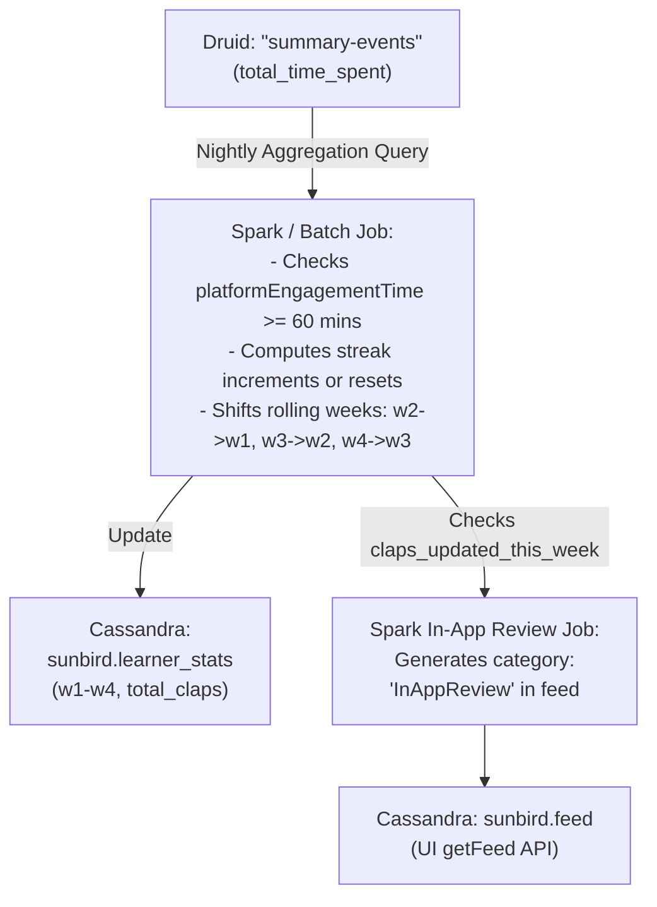

## 1. Executive Summary & Objective

**Weekly Claps** is a core gamification and learner-retention feature on the **iGOT Karmayogi** platform. Designed to encourage habit-building, self-monitoring, and consistent weekly engagement, it tracks active time spent by civil service learners and rewards them with a cumulative "claps streak."

The feature visualizes a 4-week rolling engagement window on the learner's homepage and maintains an overall streak counter, incentivizing learners to return each week.

## 2. Core Business Logic & Feature Rules

| Rule / Parameter | Specification | Reference |
|---|---|---|
| **Weekly Cycle** | **Monday 00:00:00 to Sunday 23:59:59** | [KB-384: Q2 \| Activity sidebar \| Weekly Claps/Engagement streak](https://karmayogibharat.atlassian.net/browse/KB-384)[Prod Deployed](https://karmayogibharat.atlassian.net/browse/KB-384), [Weekly Claps - Data](https://karmayogibharat.atlassian.net/wiki/spaces/TES/pages/15499739/Weekly+Claps+-+Data) |
| **Engagement Cutoff** | **60 minutes** per week minimum (time spent is configurable) | [KB-384: Q2 \| Activity sidebar \| Weekly Claps/Engagement streak](https://karmayogibharat.atlassian.net/browse/KB-384)[Prod Deployed](https://karmayogibharat.atlassian.net/browse/KB-384), [KY_FRS_LEA_LH_Learner_Home_page](https://karmayogibharat.atlassian.net/wiki/spaces/TPT/pages/6194373/KY_FRS_LEA_LH_Learner_Home_page) |
| **Batch Verification** | Nightly batch job evaluates whether the user has met the 60-minute threshold in the current week. | [KB-384: Q2 \| Activity sidebar \| Weekly Claps/Engagement streak](https://karmayogibharat.atlassian.net/browse/KB-384)[Prod Deployed](https://karmayogibharat.atlassian.net/browse/KB-384) |
| **4-Week View** | Displays engagement status across the last 4 calendar weeks (W1–W4) indicating completion status (tick / cross). | [KB-384: Q2 \| Activity sidebar \| Weekly Claps/Engagement streak](https://karmayogibharat.atlassian.net/browse/KB-384)[Prod Deployed](https://karmayogibharat.atlassian.net/browse/KB-384), [KY_FRS_LEA_LH_Learner_Home_page](https://karmayogibharat.atlassian.net/wiki/spaces/TPT/pages/6194373/KY_FRS_LEA_LH_Learner_Home_page) |
| **Streak Maintenance** | Each consecutive week meeting the ≥60-minute threshold increments the total weekly claps streak counter by 1. | [KB-384: Q2 \| Activity sidebar \| Weekly Claps/Engagement streak](https://karmayogibharat.atlassian.net/browse/KB-384)[Prod Deployed](https://karmayogibharat.atlassian.net/browse/KB-384) |
| **Streak Reset Rule** | If a learner fails to meet the 60-minute criteria in any given week, their **total streak count resets to 0**, encouraging them to start a fresh streak. The 4-week historical display still shows actual completion ticks/crosses. | [KB-384: Q2 \| Activity sidebar \| Weekly Claps/Engagement streak](https://karmayogibharat.atlassian.net/browse/KB-384)[Prod Deployed](https://karmayogibharat.atlassian.net/browse/KB-384) |
| **User Onboarding** | First-time learners start with **0 weeks** claps count. | [KB-384: Q2 \| Activity sidebar \| Weekly Claps/Engagement streak](https://karmayogibharat.atlassian.net/browse/KB-384)[Prod Deployed](https://karmayogibharat.atlassian.net/browse/KB-384) |
| **Help / Information** | An info icon redirects to an informational explanation modal/view. | [KB-384: Q2 \| Activity sidebar \| Weekly Claps/Engagement streak](https://karmayogibharat.atlassian.net/browse/KB-384)[Prod Deployed](https://karmayogibharat.atlassian.net/browse/KB-384) |

## 3. UI/UX Placement & Cross-Platform Evolution

- **Homepage Placement (Insights Sidebar / Activities Card)**:
  - Placed within the **Insights Sidebar** (on Desktop) and within the **Show My Activities** card on M-site / Mobile App ([KY_FRS_LEA_LH_Learner_Home_page](https://karmayogibharat.atlassian.net/wiki/spaces/TPT/pages/6194373/KY_FRS_LEA_LH_Learner_Home_page), [KB-3757: Q4 | Learner Homepage enhancements | Homepage enhancements](https://karmayogibharat.atlassian.net/browse/KB-3757)[In Progress](https://karmayogibharat.atlassian.net/browse/KB-3757)).
  - Subsequent homepage layout iterations placed the *Tips for Learners* section directly below the Weekly Claps block ([KB-3757: Q4 | Learner Homepage enhancements | Homepage enhancements](https://karmayogibharat.atlassian.net/browse/KB-3757)[In Progress](https://karmayogibharat.atlassian.net/browse/KB-3757)).

- **Navigation & Quick Linking**:
  - In updated Profile Card designs, clicking on **Weekly Claps** in the left profile card triggers auto-scrolling directly to the Weekly Claps section across Web, M-Web, and Mobile App platforms ([KB-7862: Q7 | Ad-Hoc | Landing Page UI Update | Learner Portal](https://karmayogibharat.atlassian.net/browse/KB-7862)[KB Approved](https://karmayogibharat.atlassian.net/browse/KB-7862), [KB-7900: Q7 | Ad-Hoc | Landing Page UI Fixes | Learner Portal](https://karmayogibharat.atlassian.net/browse/KB-7900)[QA Deployed](https://karmayogibharat.atlassian.net/browse/KB-7900), [KB-8973: Q7 | Ad-Hoc | Landing Page UI Fixes | Mobile APP](https://karmayogibharat.atlassian.net/browse/KB-8973)[Open](https://karmayogibharat.atlassian.net/browse/KB-8973)).

- **Telemetry & Tracking**:
  - Telemetry impressions are tracked for the Weekly Clap pop-up and "Rate Now" interactions to monitor user engagement and feature reach ([KB-4569: Q4 | Ad-Hoc Requests | Telemetry enhancements | Telemetry Impression implementation for Weekly Clap pop-up and Platform Rating pop-up.](https://karmayogibharat.atlassian.net/browse/KB-4569)[In-Progress](https://karmayogibharat.atlassian.net/browse/KB-4569)).

## 4. Technical Architecture & Data Pipeline



### 1. Telemetry Aggregation (Druid)

A batch job queries the `summary-events` datasource in Druid to aggregate app engagement for each user across the current week boundary:

```sql
SELECT
    uid AS userid,
    SUM(total_time_spent) / 60.0 AS platformEngagementTime,
    COUNT(*) AS sessionCount
FROM "summary-events"
WHERE dimensions_type = 'app'
  AND __time >= TIMESTAMP '${weekStart}'
  AND __time < TIMESTAMP '${weekEnd}'
GROUP BY 1;
```

### 2. Primary Storage (Cassandra: `sunbird.learner_stats`)

User-level statistics and rolling week metrics are stored in `sunbird.learner_stats`:

- **Columns**:
  - `userid` (text, PRIMARY KEY)
  - `total_claps` (int) – Cumulative streak count.
  - `claps_updated_this_week` (boolean) – Flag indicating if claps were earned in the current cycle.
  - `last_updated_on` / `last_claps_updated_on` (text)
  - `w1`, `w2`, `w3`, `w4` (`map<text, float>`) – Stores `{ "timespent": <minutes>, "numberOfSessions": <count> }`.

- **Week Shifting**: At week transitions, previous week values shift forward using alias mapping (`w2 -> w1`, `w3 -> w2`, `w4 -> w3`, and the latest completed week becomes `w4`).

### 3. Downstream In-App Review & Rating Trigger

- A downstream Spark job inspects `claps_updated_this_week` in `sunbird.learner_stats`.
- When a clap is earned, an entry with category `InAppReview` (created by `weekly_claps`) is written to the Cassandra `feed` table (`PRIMARY KEY (userid, id)`).
- The front-end fetches active feeds via the `getFeed` API to trigger prompts for app reviews or NPS ratings ([In-app Review Trigger based on weekly claps](https://karmayogibharat.atlassian.net/wiki/spaces/~5e9d528aeb50310c17bf543e/pages/55312431/In-app+Review+Trigger+based+on+weekly+claps)).

### 4. Operational Support & Discrepancy Verification (NOC SOP)

When learners report streak or time-spent discrepancies, IT Support / NOC performs a two-step validation ([Total time spent by user or check the data on weekly clap table](https://karmayogibharat.atlassian.net/wiki/spaces/KBNOC/pages/359792697/Total+time+spent+by+user+or+check+the+data+on+weekly+clap+table)):

1. Run the aggregation query on Druid (`summary-events`) for the user ID and week range to get actual engagement in minutes.
2. Query `SELECT * FROM sunbird.learner_stats WHERE userid = '<userid>';` in Cassandra to verify `w4` / `w3` values and `total_claps`.
3. If Druid and Cassandra data differ, the issue escalates to the Data Engineering team.

## 5. Traceability Matrix

| Artifact Type | Reference / ID | Title / Role | Key Scope |
|---|---|---|---|
| **BRD** | [KY_BRD_LEA_LH_Learner_home_page](https://karmayogibharat.atlassian.net/wiki/spaces/TPT/pages/6258968/KY_BRD_LEA_LH_Learner_home_page) | Learner Home Page BRD | Defines engagement streak gamification drivers and retention metrics. |
| **FRS** | [KY_FRS_LEA_LH_Learner_Home_page](https://karmayogibharat.atlassian.net/wiki/spaces/TPT/pages/6194373/KY_FRS_LEA_LH_Learner_Home_page) | Learner Home Page FRS (Sec 2.1 & LEA-LH-BR6-FR2) | Functional specification for the Insights sidebar, 4-week distribution, and streak counter. |
| **SRS** | [Weekly Claps - Data](https://karmayogibharat.atlassian.net/wiki/spaces/TES/pages/15499739/Weekly+Claps+-+Data) | Data Pipeline & Schema Design | `learner_stats` Cassandra schema, Druid aggregation query, weekly column shifts. |
| **SRS** | [In-app Review Trigger based on weekly claps](https://karmayogibharat.atlassian.net/wiki/spaces/~5e9d528aeb50310c17bf543e/pages/55312431/In-app+Review+Trigger+based+on+weekly+claps) | In-app Review Trigger Spec | Spark job and `feed` table schema triggered off `claps_updated_this_week`. |
| **SOP** | [Total time spent by user or check the data on weekly clap table](https://karmayogibharat.atlassian.net/wiki/spaces/KBNOC/pages/359792697/Total+time+spent+by+user+or+check+the+data+on+weekly+clap+table) | KBNOC Operational Guide | Verification workflow between Druid summary events and Cassandra tables. |
| **Jira Story** | [KB-384: Q2 \| Activity sidebar \| Weekly Claps/Engagement streak](https://karmayogibharat.atlassian.net/browse/KB-384)[Prod Deployed](https://karmayogibharat.atlassian.net/browse/KB-384) | Weekly Claps / Engagement streak | Primary core delivery ticket with detailed acceptance criteria and reset rules. |
| **Jira Epic** | [KB-7862: Q7 \| Ad-Hoc \| Landing Page UI Update \| Learner Portal](https://karmayogibharat.atlassian.net/browse/KB-7862)[KB Approved](https://karmayogibharat.atlassian.net/browse/KB-7862) | Landing Page UI Update | Profile card reorganization, auto-scroll to Weekly Claps on click. |
| **Jira Epic** | [KB-3757: Q4 \| Learner Homepage enhancements \| Homepage enhancements](https://karmayogibharat.atlassian.net/browse/KB-3757)[In Progress](https://karmayogibharat.atlassian.net/browse/KB-3757) | Homepage enhancements | Placement of tips and layout structure relative to weekly claps. |
| **Jira Story** | [KB-7900: Q7 \| Ad-Hoc \| Landing Page UI Fixes \| Learner Portal](https://karmayogibharat.atlassian.net/browse/KB-7900)[QA Deployed](https://karmayogibharat.atlassian.net/browse/KB-7900) | Landing Page UI Fixes (Portal / M-Web) | Auto-scroll link to Weekly Claps from the Profile Card on web platforms. |
| **Jira Story** | [KB-8973: Q7 \| Ad-Hoc \| Landing Page UI Fixes \| Mobile APP](https://karmayogibharat.atlassian.net/browse/KB-8973)[Open](https://karmayogibharat.atlassian.net/browse/KB-8973) | Landing Page UI Fixes (Mobile App) | Aligning Mobile App profile card navigation to Weekly Claps. |
| **Jira Story** | [KB-4569: Q4 \| Ad-Hoc Requests \| Telemetry enhancements \| Telemetry Impression implementation for Weekly Clap](https://karmayogibharat.atlassian.net/browse/KB-4569)[pop-up and Platform Rating pop-up.](https://karmayogibharat.atlassian.net/browse/KB-4569)[In-Progress](https://karmayogibharat.atlassian.net/browse/KB-4569) | Telemetry Enhancements | Telemetry impression tracking for Weekly Clap modal. |
| **Jira Story** | [KB-2973: Q3 \| Ad-Hoc Requests \| Weekly Claps \| Data request for users and their Weekly Claps.](https://karmayogibharat.atlassian.net/browse/KB-2973)[In-Progress](https://karmayogibharat.atlassian.net/browse/KB-2973) | Weekly Claps Data Egestion | Analytics egestion request for streak distributions (2 to 10+ weeks). |
