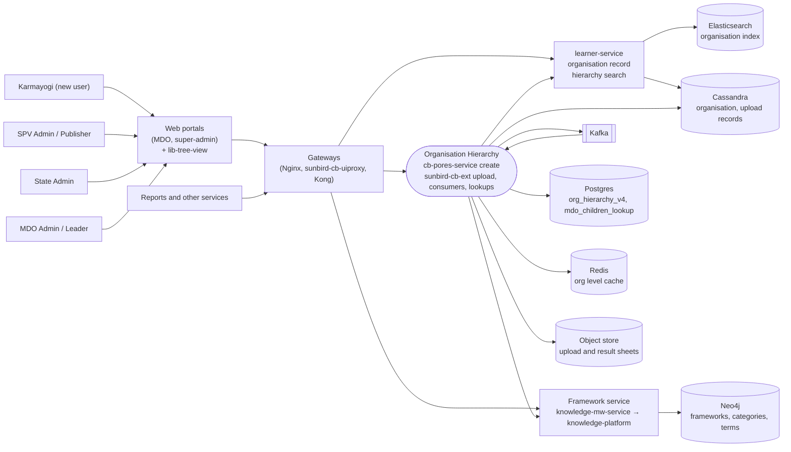

# Organisation Hierarchy — Context Diagram

## System boundary

Inside the feature are the hierarchy page and tree component in the MDO and
super-admin portals, the hierarchy-creation endpoint in `cb-pores-service`,
and the bulk-upload API, the two Kafka consumers and the lookup endpoints in
`sunbird-cb-ext`. Outside it are the admins who use it, the gateways, the
generic framework service (`knowledge-mw-service` → `knowledge-platform`) that
actually stores the tree, the learner-service that owns the organisation
record, and the Cassandra, Postgres, Redis, Neo4j and object-store backends.

## Diagram

## Interfaces at the boundary

| Direction | Interface | Notes |
|---|---|---|
| In | `org/framework/v1/create`, `organisation/v1/hierarchy/*`, `organisation/v1/getMappingFile/sample/*`, `org/level/hierarchy`, `org/v1|v2/list*` | from portals and reporting callers through Kong |
| In | `org/hierarchy/{ministry,state,}/search` | public sign-up pickers, through uiproxy `/apis/public/v8` and Kong to learner-service |
| In | `org/ext/v1/create` | trigger for the new-org consumer (feature owned by registration, documented under [SPV & Admin Registration](../learning-hub/spv-admin-registration/index.md)) |
| Out | `framework/v1/copy|read|publish|term/create|term/update|term/retire|term/search` | knowledge-mw-service |
| Out | `framework/v3/retire` | learning-service (VM) |
| Out | `v1/org/update`, `v1/org/search` | learner-service |
| Out / In | Kafka `org.hierarchy.bulk.upload`, `org.hierarchy.new.org` | produced and consumed inside `sunbird-cb-ext` |
