# Organisation Hierarchy — System Context Diagram Document

## 1. Document Control & Executive Summary

### 1.1 Document Purpose

This System Context Diagram Document establishes the enterprise boundary models, external interfaces, actor roles, communication channels, and data flow topologies for the **Organisation Hierarchy** capability across the iGOT Karmayogi digital learning and civil service governance platform.

It captures the complete lifecycle across both **Creation/Curation** and **Platform-Wide Consumption**, tracing its evolution from the initial relational, single-table model in **Quarter** **2 (Q2 2023)** to the distributed, multi-tenant taxonomy engine ( to ) operating across four distinct portals in **Quarter 13 (Q13 2026)**.

### 1.2 Target Audience

- **Enterprise & System Architects:** Blueprint for system boundaries, microservice trust zones, and external data exchange contracts.
- **Product Managers & Business Analysts:** Reference for actor roles, portal responsibilities, and administrative boundaries.
- **Engineering Teams (Frontend, Backend, SRE):** Operational overview of gateways, streaming buses, and data lakes.
- **Government Stakeholders (Karmayogi Bharat SPV, CBC, DoPT):** Overview of data ownership, tenancy isolation, and ministerial reporting lines.

## 2. Global System Context Diagram (Level 1 — C4 Model)

The global system context diagram illustrates the boundary of the iGOT Karmayogi Organisation Hierarchy subsystem, its external human actors, consuming portals, and supporting enterprise platforms.

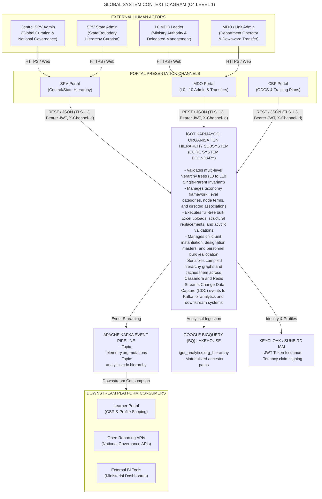

## 3. Evolutionary Context Diagrams (Q2 to Q13 Progression)

The boundary and integration context progressed through five distinct evolutionary phases between Q2 2023 and Q13 2026:

### 3.1 Phase I: Flat Entity Relational Context (Q2–Q4 2023–2024)

- **Architecture State:** Organizations existed as isolated rows in a relational PostgreSQL table with basic text tags (`ministry_name`, `dept_name`).
- **Context Boundary:** All changes were manual or handled via ad-hoc SQL scripts ([KB-838: Q2 | Ad-Hoc Requests | Cleaning up MDO Hierarchy.](https://karmayogibharat.atlassian.net/browse/KB-838) (Open), [KB-1312: Org Hierarchy | Hierarchy cleanup activity and corresponding access to Orgs.](https://karmayogibharat.atlassian.net/browse/KB-1312) (Open)). A flat data warehouse table was updated via nightly batch ETL jobs ([KB-428: Q2 l Data Warehousing l Org hierarchy fields](https://karmayogibharat.atlassian.net/browse/KB-428) (Prod Deployed), [KB-5057: Q4 | Ad-Hoc Requests | Data Warehouse, Operational Reports and Full exhausts enhancements | Org Hierarchy Table.](https://karmayogibharat.atlassian.net/browse/KB-5057) (Open)).

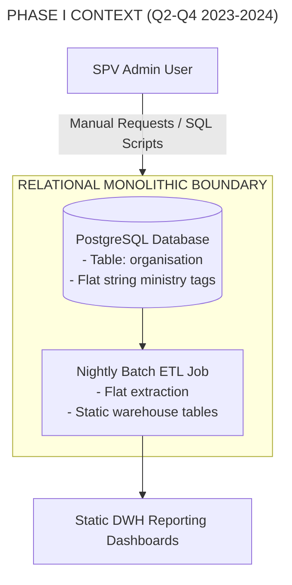

### 3.2 Phase II: Graph Exploration Context (Q7 Early 2025)

- **Architecture State:** Proof-of-concept testing Neo4J property graphs to evaluate recursive tree traversal up to 10 levels deep ([KB-8441: Q7 | Tech Debt | Org Hierarchy Enhancements](https://karmayogibharat.atlassian.net/browse/KB-8441) (In Progress), [KB-8442: Explore Neo4J to store org hierarchy](https://karmayogibharat.atlassian.net/browse/KB-8442) (Internal Review)).
- **Context Boundary:** An external graph database was evaluated alongside the transactional store. Due to operational and synchronization overhead, the team decided to standardize on Sunbird’s native Framework Taxonomy Service.

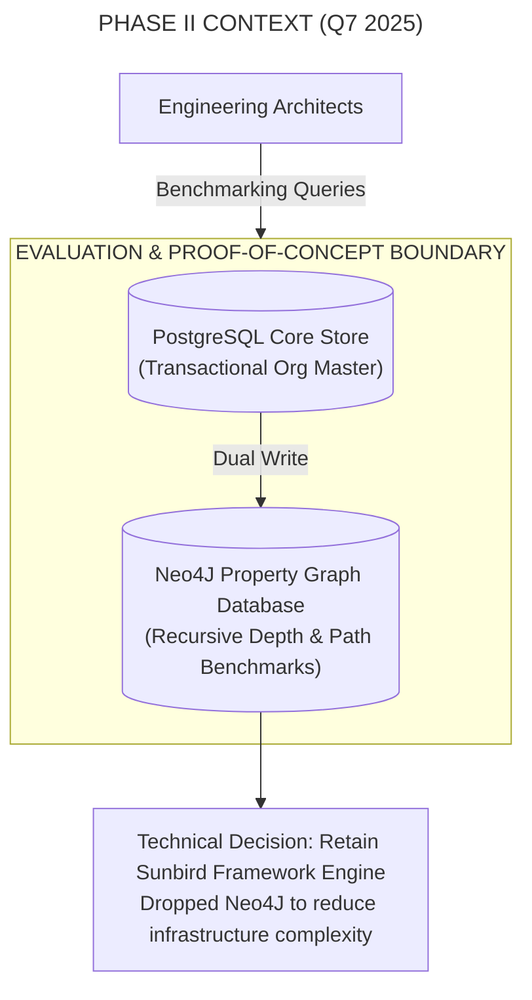

### 3.3 Phase III: Centralized SPV Framework Taxonomy Context (Q8 Mid 2025)

- **Architecture State:** Introduced the multi-tier Sunbird Framework Service over Cassandra and Elasticsearch ([KB-8018: Q8 | Organisation Hierarchy Update | SPV Admin & SPV State | AdminSPV Portal](https://karmayogibharat.atlassian.net/browse/KB-8018) (KB Approved), [KB-8975: Q8 | Organization Hierarchy management](https://karmayogibharat.atlassian.net/browse/KB-8975) (Open)).
- **Context Boundary:** The SPV Portal served as the central point for building hierarchies, supporting full-tree Excel bulk imports ([KB-9737: Q8 | Bulk Upload & Download | Org Hierarchy Management | SPV Portal](https://karmayogibharat.atlassian.net/browse/KB-9737) (Prod Deployed)), card-based UI browsing ([KB-9033: Q8 | Organisation Hierarchy Management | SPV Admin | SPV Portal](https://karmayogibharat.atlassian.net/browse/KB-9033) (Prod Deployed)), and SPV State Admin regional scoping ([KB-9197: Q8 | Organisation Hierarchy Access Management | SPV & State Admin | SPV Portal](https://karmayogibharat.atlassian.net/browse/KB-9197) (Prod Deployed)).

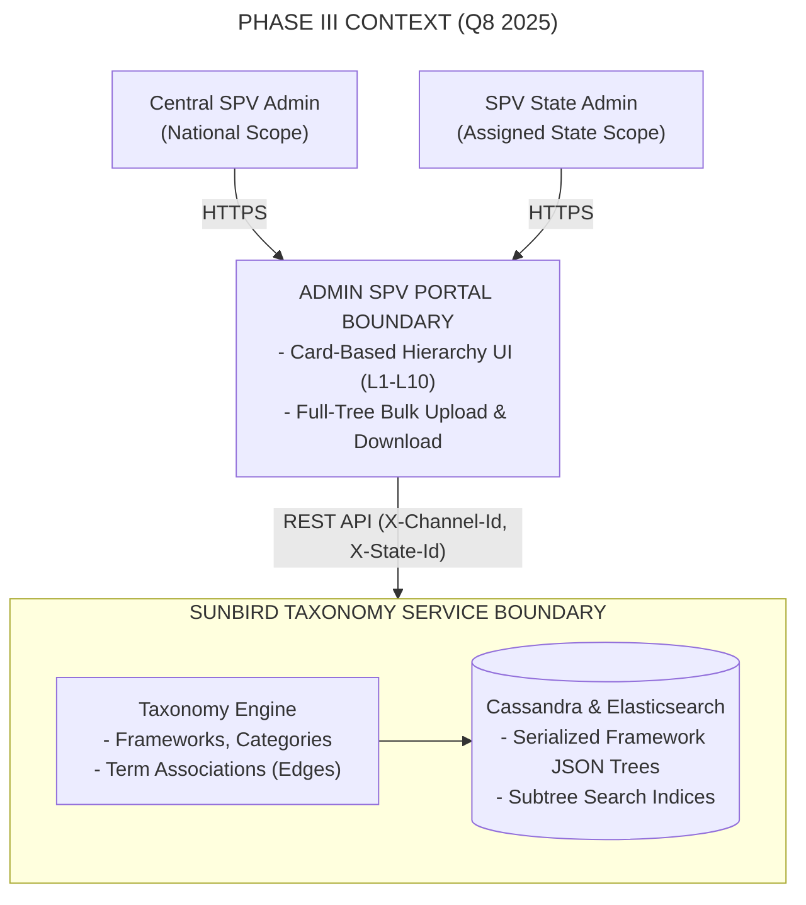

### 3.4 Phase IV: Decentralized MDO Delegation Context (Q9 Late 2025)

- **Architecture State:** Administrative tools were added directly to the MDO Portal ([KB-10500: Q9 | Org hierarchy Management & Impacted Areas](https://karmayogibharat.atlassian.net/browse/KB-10500) (KB Review), [KB-10501: Q9 | L0 hierarchy Management | MDO Portal](https://karmayogibharat.atlassian.net/browse/KB-10501) (KB Review)).
- **Context Boundary:** MDO Leaders gained self-service capabilities to create child organizations () ([KB-10512: Q9 | Child Organization Creation Capability Dev Completed](https://karmayogibharat.atlassian.net/browse/KB-10512)), configure child unit designation masters ([KB-10515: Q9 | Enable Child Org Data Management | MDO Portal Code](https://karmayogibharat.atlassian.net/browse/KB-10515) (Review)), manage bulk user transfers via CSV ([KB-10514: Q9 | Create Bulk User Transfer Feature (Add/Update) | MDO Portal](https://karmayogibharat.atlassian.net/browse/KB-10514) (DEV IN PROGRESS)), and run MDO-scoped Excel uploads ([KB-10533: Q9 | Bulk Upload | Organisation Hierarchy Management Dev Completed](https://karmayogibharat.atlassian.net/browse/KB-10533)), with all changes tracked via Kafka telemetry ([KB-10535: Q9 | Data Tracking | Org Hierarchy Management | MDO Portal](https://karmayogibharat.atlassian.net/browse/KB-10535) (DEV IN PROGRESS)).

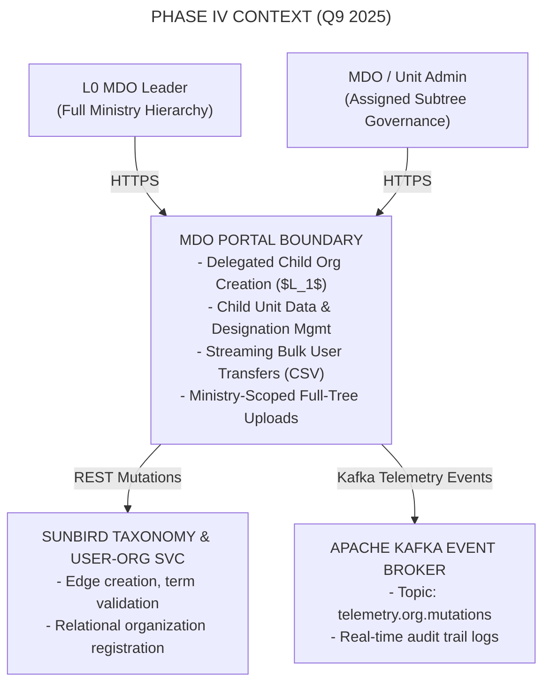

### 3.5 Phase V: Platform-Wide Consumption & Analytics Context (Q10–Q13 2025–2026)

- **Architecture State:** Enterprise-scale consumption architecture connecting all platform surfaces to the compiled hierarchy engine.
- **Context Boundary:** Synchronizes changes to BigQuery via Kafka CDC pipelines ([KB-9801: Q8 | Organisation Hierarchy Sync with BQ for reporting | Organisation Hierarchy Management](https://karmayogibharat.atlassian.net/browse/KB-9801) (Open), [KB-10534: Q9 | Organisation Hierarchy Sync with BQ for reporting | Organisation Hierarchy Management](https://karmayogibharat.atlassian.net/browse/KB-10534) (In-Progress)), supports Custom Self-Registration landing URLs ([KB-10574: Q9 | Custom Self registration Functionality | Org Hierarchy Management](https://karmayogibharat.atlassian.net/browse/KB-10574) (Open)), powers Open Reporting APIs ([KB-10576: Q9 | Open APIs for reporting](https://karmayogibharat.atlassian.net/browse/KB-10576) (Prod Deployed)), enables multi-tier Annual Training Plan targeting ([KB-10577: Q11 | Ad-Hoc | CA and APAR Enhancements |Org Hierarchy in Training Plan Creation | MDO Portal](https://karmayogibharat.atlassian.net/browse/KB-10577) (Open)), and drives top-down ODCS competency cascading ([KB-10578: Q9 | ODCS effectiveness for Child Organisations | MDO Portal](https://karmayogibharat.atlassian.net/browse/KB-10578) (Open)).

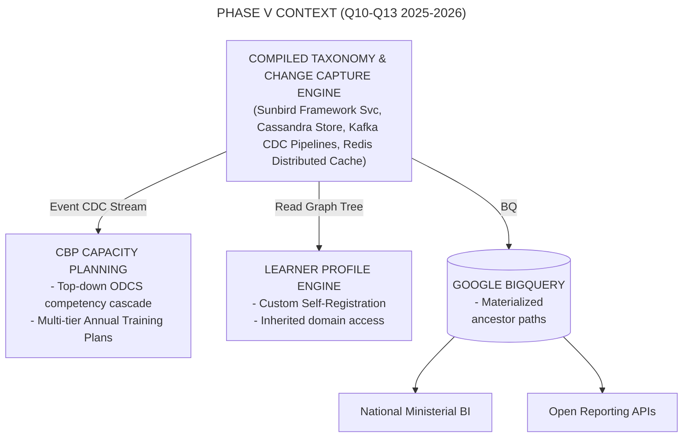

## 4. Frontend-to-Backend Structural Context Diagram (C4 Level 2)

This container context diagram illustrates the boundary between the browser presentation layer, gateway routing filters, backend microservices, caching layers, and persistence tiers.

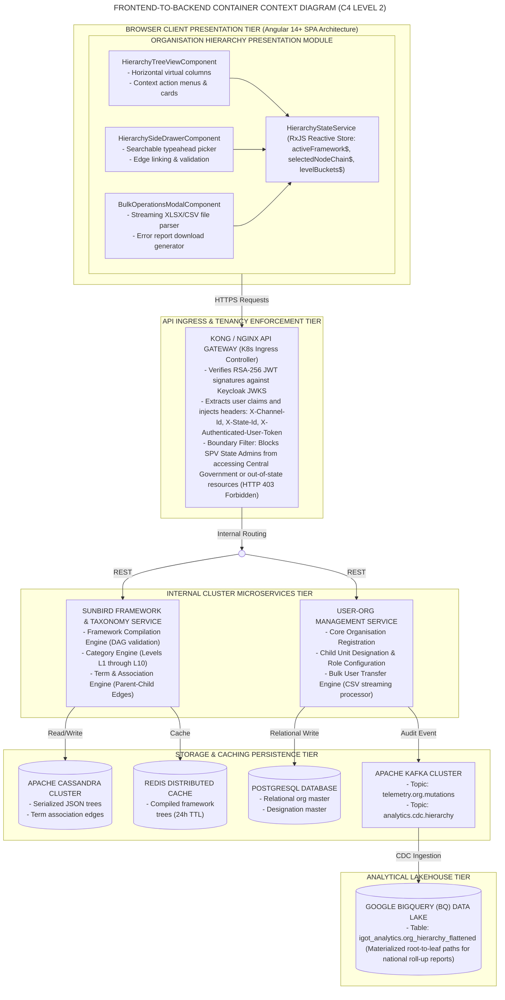

## 5. Actor & Boundary Context Diagram

This diagram maps human administrative roles to permitted boundary operations, gateway enforcement rules, and restricted portal functions.

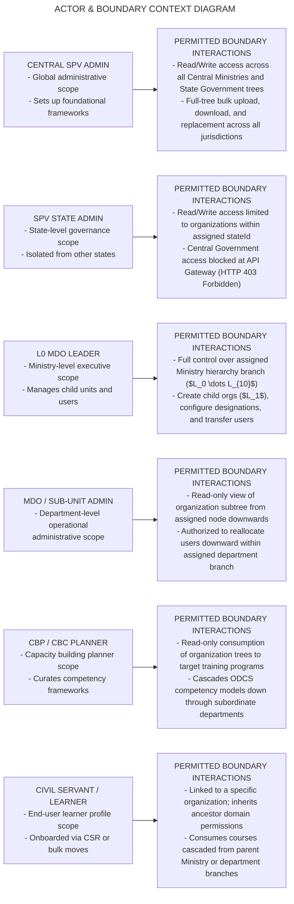

## 6. End-to-End Creation & Management Context Diagram

This diagram details the components and data flows involved in creating, modifying, and replacing organizational structures, child departments, and user assignments.

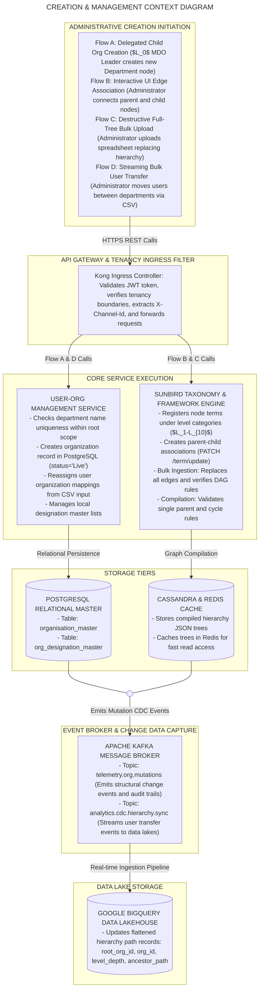

## 7. End-to-End Consumption Context Diagram

This diagram illustrates how compiled hierarchy data flows downstream into capacity planning, learner onboarding, training plans, and national analytics.

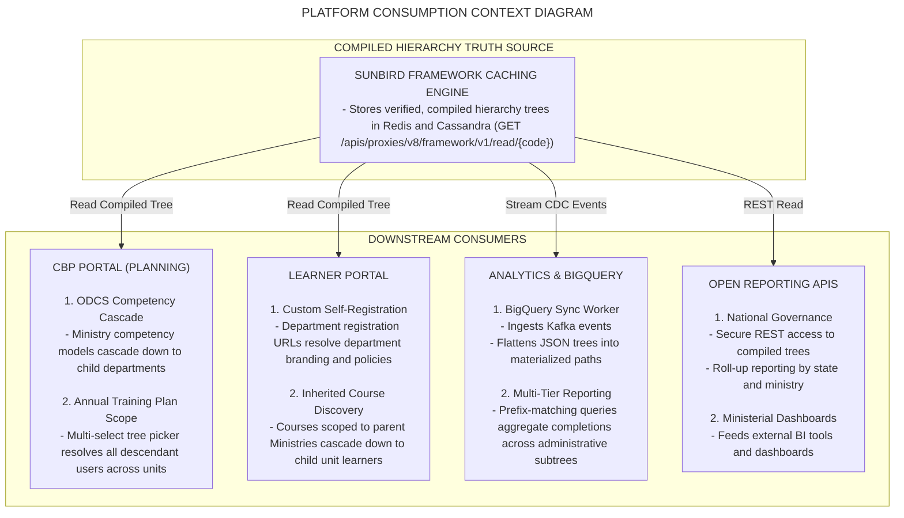

## 8. Data Flow & Integration Context Matrix

This matrix defines all data flows between subsystems, identifying source and destination boundaries, protocols, data payloads, and synchronization schedules.

| Flow ID | Source Component | Destination Component | Protocol / API / Event | Exchanged Data Payload | Cadence / Trigger | Architectural Intent |
|---|---|---|---|---|---|---|
| **DF-01** | MDO / SPV Portal | Kong API Gateway | HTTPS / TLS 1.3 (REST) | Framework mutation payload with Bearer JWT token | User-initiated on tree edit | Secure ingress routing with tenant claims |
| **DF-02** | Kong API Gateway | Framework Service | HTTP / REST (Internal) | Term association definitions and level categories | Synchronous proxy forward | Internal cluster routing for graph updates |
| **DF-03** | MDO Portal | User-Org Service | HTTPS / Multipart Form | Excel/CSV file streams (up to 100 MB) | User-initiated bulk upload | Full-tree uploads and bulk user transfers |
| **DF-04** | User-Org Service | PostgreSQL Database | TCP / JDBC (Port 5432) | Relational SQL parameters (`organisation_master`) | Transactional write | Persists organization profiles and designations |
| **DF-05** | Framework Service | Cassandra Cluster | TCP / CQL (Port 9042) | Serialized compiled framework JSON structures | On framework publication | Stores compiled hierarchy trees |
| **DF-06** | Framework Service | Redis Cache Cluster | TCP / RESP (Port 6379) | Serialized compiled framework JSON (24h TTL) | On publication / cache miss | In-memory caching for sub-500ms tree reads |
| **DF-07** | Framework Service | Kafka Event Bus | TCP / Kafka Protocol | Event envelope on `telemetry.org.mutations` topic | Asynchronous on tree change | Broadcasts structural change notifications |
| **DF-08** | User-Org Service | Kafka Event Bus | TCP / Kafka Protocol | User movement records on `analytics.cdc.hierarchy` | Asynchronous on user move | Broadcasts user reassignment events |
| **DF-09** | Kafka Event Bus | BigQuery Sink Worker | TCP / Kafka Consumer | Consumes compiled tree and user transfer events | Continuous stream processing | Ingests change events for analytical processing |
| **DF-10** | BigQuery Worker | Google BigQuery | HTTPS / Google Cloud API | Insert rows into `org_hierarchy_flattened` | Micro-batch (target min) | Maintains flattened paths for analytics |
| **DF-11** | CBP Portal | Framework Service | HTTPS / REST (Internal) | `GET /framework/v1/read/{frameworkCode}` | On training plan creation | Resolves descendant units for training plans |
| **DF-12** | Learner Portal | Org Master Service | HTTPS / REST (Internal) | Custom slug lookup (`/api/org/resolve/{slug}`) | On CSR landing page load | Resolves department branding and domain rules |
| **DF-13** | External Consumers | Open Reporting APIs | HTTPS / REST (TLS 1.3) | `GET /open/reports/v1/org-tree` with Bearer token | Scheduled / On-demand | Provides external access for national reporting |

## 9. Security, Multi-Tenancy & External Boundary Context

This section outlines the platform's multi-tenant boundary model and security controls.

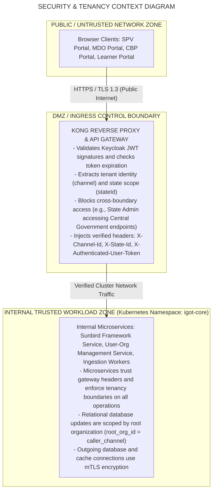

### 9.1 Boundary Enforcement Rules

1. **Zero-Trust Ingress Verification:** No client can communicate directly with internal microservices; all traffic must pass through the Kong API Gateway.
2. **State Administrative Boundary Isolation:** An SPV State Admin cannot view, create, or modify organizations outside their assigned state jurisdiction (`X-State-Id`). The gateway intercepts out-of-scope requests and returns `HTTP 403 Forbidden`.
3. **Ministry Tenancy Scoping:** An MDO Leader cannot perform operations outside their Ministry's channel boundary (`X-Channel-Id`). Attempts to link nodes to another ministry's framework are rejected by the validation engine.
4. **Audit Logging:** All administrative operations (node creation, edge links, delinking, bulk uploads, user transfers) generate immutable audit logs sent to Kafka and stored in PostgreSQL.

## 10. Requirement-to-Context Traceability (Q2 – Q13)

This matrix maps system context elements to Jira delivery tickets, Confluence functional specifications, and verified platform behaviors across all project quarters:

**REQUIREMENT-TO-CONTEXT TRACEABILITY MATRIX**

| Requirement ID | Context Capability | Jira Source Reference | Implementing Boundary | Target Data & Integration Channel |
|---|---|---|---|---|
| REQ-CTX-ORG-001 | Delegated Child Org Create | KB-10512 | User-Org Service | PostgreSQL organisation_master |
| REQ-CTX-ORG-002 | Duplicate Name Check | KB-10512 | Relational Master DB | Case-insensitive unique constraint index |
| REQ-CTX-ORG-003 | Subtree Delinking Workflow | KB-9033, KB-10513 | Sunbird Framework Svc | Cascading term association cleanup |
| REQ-CTX-HIER-001 | Cascading Card UI View | KB-9033, KB-10513 | Angular Presentation | Dynamic virtual columns ($L_1-L_{10}$) |
| REQ-CTX-HIER-002 | Parent-Child Edge Linking | KB-9033, KB-10513 | Sunbird Framework Svc | Directed edges in term_association |
| REQ-CTX-HIER-004 | Max Depth ($L_{10}$) Limit | KB-9740, KB-10501 | Taxonomy Validation Eng | Graph validation schema ($\le 10$ levels) |
| REQ-CTX-BULK-001 | Template Export with Masters | KB-9737, KB-10533 | Bulk Operations Worker | Dynamic Excel workbook generation |
| REQ-CTX-BULK-003 | Full-Tree Bulk Overwrite | KB-9737, KB-10533 | Taxonomy Compilation Eng | Complete graph replacement workflow |
| REQ-CTX-USER-001 | Bulk User Reallocation CSV | KB-10514 | User-Org Service | Streaming CSV processor & profile updates |
| REQ-CTX-SEC-001 | State Admin Boundary Guard | KB-9197 | Kong Gateway Ingress | Cryptographic token claims validation |
| REQ-CTX-INT-001 | BigQuery Analytics Sync | KB-9801, KB-10534 | Analytics Pipeline | Kafka CDC stream: analytics.cdc.sync |
| REQ-CTX-INT-002 | Open Reporting REST APIs | KB-10576 | Reporting Service | REST API: /open/reports/v1/org-tree |
| REQ-CTX-INT-003 | Training Plan Tree Scoping | KB-10577 | CBP Module | Hierarchical multi-select tree picker |
| REQ-CTX-INT-004 | ODCS Competency Cascading | KB-10578 | Competency Service | Event-driven competency model cascading |
| REQ-CTX-INT-005 | Custom Self-Registration | KB-10574 | Learner Ingress Proxy | Slug-to-organization resolution mapping |

## 11. Appendices & References

### 11.1 Primary Confluence Requirements & Technical Documents

- [SRS - Organisation Hierarchy | MDO Admin & MDO Leader | MDO Portal](https://karmayogibharat.atlassian.net/wiki/spaces/TES/pages/517931009/SRS+-+Organisation+Hierarchy+MDO+Admin+MDO+Leader+MDO+Portal)
- [SRS - Organisation Hierarchy Update | SPV Admin & SPV State | AdminSPV Portal](https://karmayogibharat.atlassian.net/wiki/spaces/TES/pages/416317441/SRS+-+Organisation+Hierarchy+Update+SPV+Admin+SPV+State+AdminSPV+Portal)
- [Organisation Hierarchy View](https://karmayogibharat.atlassian.net/wiki/spaces/TES/pages/396328967/Organisation+Hierarchy+View)
- [L0 Hierarchy Management- MDO Portal](https://karmayogibharat.atlassian.net/wiki/spaces/KQAS/pages/503612134/L0+Hierarchy+Management-+MDO+Portal)
- [Organization Hierarchy update SPV Admin](https://karmayogibharat.atlassian.net/wiki/spaces/KQAS/pages/417071170/Organization+Hierarchy+update+SPV+Admin)

### 11.2 Jira Reference Inventory

- **Initiatives & Epics:** [KB-8975: Q8 | Organization Hierarchy management](https://karmayogibharat.atlassian.net/browse/KB-8975) (Open), [KB-8018: Q8 | Organisation Hierarchy Update | SPV Admin & SPV State | AdminSPV Portal](https://karmayogibharat.atlassian.net/browse/KB-8018) (KB Approved), [KB-10500: Q9 | Org hierarchy Management & Impacted Areas](https://karmayogibharat.atlassian.net/browse/KB-10500) (KB Review), [KB-10501: Q9 | L0 hierarchy Management | MDO Portal](https://karmayogibharat.atlassian.net/browse/KB-10501) (KB Review), [KB-10502: Q9 | Org hierarchy Impacted areas](https://karmayogibharat.atlassian.net/browse/KB-10502) (KB Review), [KB-8441: Q7 | Tech Debt | Org Hierarchy Enhancements](https://karmayogibharat.atlassian.net/browse/KB-8441) (In Progress), [KB-4441: Q4 | Ad-Hoc Requests | Organisation rename and Hierarchy cleanup.](https://karmayogibharat.atlassian.net/browse/KB-4441) (In Progress).
- **Delivery Stories:** [KB-9033: Q8 | Organisation Hierarchy Management | SPV Admin | SPV Portal](https://karmayogibharat.atlassian.net/browse/KB-9033) (Prod Deployed), [KB-9197: Q8 | Organisation Hierarchy Access Management | SPV & State Admin | SPV Portal](https://karmayogibharat.atlassian.net/browse/KB-9197) (Prod Deployed), [KB-9737: Q8 | Bulk Upload & Download | Org Hierarchy Management | SPV Portal](https://karmayogibharat.atlassian.net/browse/KB-9737) (Prod Deployed), [KB-9738: Q8 | Org Search Funcationality | Organisation Hierarchy Management](https://karmayogibharat.atlassian.net/browse/KB-9738) (Prod Deployed), [KB-9740: Q8 | Manage Hierarchy Levels/Layers & Renaming | SPV Portal](https://karmayogibharat.atlassian.net/browse/KB-9740) (To Do), [KB-9790: Q8 | Organisation Hierarchy View | SPV & State Admin | SPV Portal](https://karmayogibharat.atlassian.net/browse/KB-9790) (To Do), [KB-9795: Q8 | Organisation Specific Page Redirection | Organisation Hierarchy Management | SPV Portal](https://karmayogibharat.atlassian.net/browse/KB-9795) (Prod Deployed), [KB-9801: Q8 | Organisation Hierarchy Sync with BQ for reporting | Organisation Hierarchy Management](https://karmayogibharat.atlassian.net/browse/KB-9801) (Open), [KB-10512: Q9 | Child Organization Creation Capability Dev Completed](https://karmayogibharat.atlassian.net/browse/KB-10512), [KB-10513: Q9 | Implement Org-Specific Hierarchy Management | MDO Portal Dev Completed](https://karmayogibharat.atlassian.net/browse/KB-10513), [KB-10514: Q9 | Create Bulk User Transfer Feature (Add/Update) | MDO Portal](https://karmayogibharat.atlassian.net/browse/KB-10514) (DEV IN PROGRESS), [KB-10515: Q9 | Enable Child Org Data Management | MDO Portal Code](https://karmayogibharat.atlassian.net/browse/KB-10515) (Review), [KB-10533: Q9 | Bulk Upload | Organisation Hierarchy Management Dev Completed](https://karmayogibharat.atlassian.net/browse/KB-10533), [KB-10534: Q9 | Organisation Hierarchy Sync with BQ for reporting | Organisation Hierarchy Management](https://karmayogibharat.atlassian.net/browse/KB-10534) (In-Progress), [KB-10535: Q9 | Data Tracking | Org Hierarchy Management | MDO Portal](https://karmayogibharat.atlassian.net/browse/KB-10535) (DEV IN PROGRESS), [KB-10574: Q9 | Custom Self registration Functionality | Org Hierarchy Management](https://karmayogibharat.atlassian.net/browse/KB-10574) (Open), [KB-10575: Q9 | MDO Reports | MDO Portal](https://karmayogibharat.atlassian.net/browse/KB-10575) (In-Progress), [KB-10576: Q9 | Open APIs for reporting](https://karmayogibharat.atlassian.net/browse/KB-10576) (Prod Deployed), [KB-10577: Q11 | Ad-Hoc | CA and APAR Enhancements |Org Hierarchy in Training Plan Creation | MDO Portal](https://karmayogibharat.atlassian.net/browse/KB-10577) (Open), [KB-10578: Q9 | ODCS effectiveness for Child Organisations | MDO Portal](https://karmayogibharat.atlassian.net/browse/KB-10578) (Open), [KB-15967: Tech Debt | Org Hierarchy Enhancements](https://karmayogibharat.atlassian.net/browse/KB-15967) (Open).
- **Ad-Hoc & Infrastructure Tickets:** [KB-428: Q2 l Data Warehousing l Org hierarchy fields](https://karmayogibharat.atlassian.net/browse/KB-428) (Prod Deployed), [KB-838: Q2 | Ad-Hoc Requests | Cleaning up MDO Hierarchy.](https://karmayogibharat.atlassian.net/browse/KB-838) (Open), [KB-1312: Org Hierarchy | Hierarchy cleanup activity and corresponding access to Orgs.](https://karmayogibharat.atlassian.net/browse/KB-1312) (Open), [KB-5057: Q4 | Ad-Hoc Requests | Data Warehouse, Operational Reports and Full exhausts enhancements | Org Hierarchy Table.](https://karmayogibharat.atlassian.net/browse/KB-5057) (Open), [KB-8442: Explore Neo4J to store org hierarchy](https://karmayogibharat.atlassian.net/browse/KB-8442) (Internal Review).

### 11.3 Technical Glossary

- **C4 Model:** A standard software architecture modeling framework that visualizes systems at four levels: Context, Containers, Components, and Code.
- **CDC (Change Data Capture):** An architectural pattern that tracks database mutations and streams them to downstream data lakes or caches.
- **DAG (Directed Acyclic Graph):** A directed graph with no closed loops or cycles. In this platform, hierarchies are constrained to DAGs where each node has at most one parent.
- **Materialized Path:** A hierarchical data pattern where a node stores its entire ancestor path as a delimited string (e.g., `/L0/L1/L2`), enabling fast subtree queries without recursive joins.
- **Sunbird Framework:** The master taxonomy container representing an organization tree (`<channelId>_org_hierarchy`).
- **Sunbird Category:** An administrative level () within a taxonomy framework.
- **Sunbird Term:** An individual administrative organization node within a category.
- **Sunbird Term Association:** A directed parent-child edge linking two terms within a framework.
- **MDO:** Ministry, Department, and Organisation.
- **SPV:** Special Purpose Vehicle (Karmayogi Bharat central governance team).
- **ODCS:** Organizational Development & Competency Sub-framework.
- **CSR:** Custom Self-Registration.
