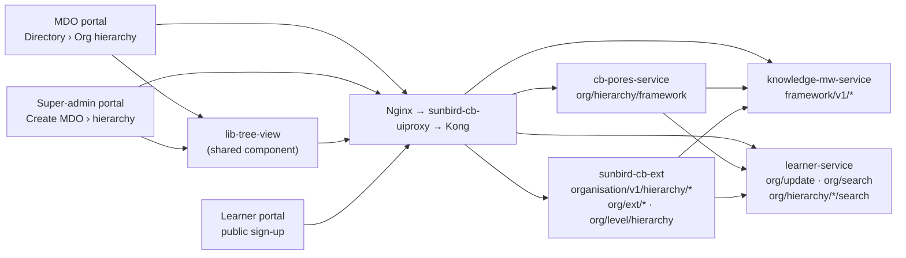
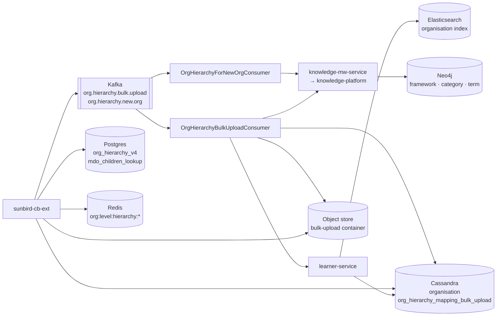

# Organisation Hierarchy — High-Level Design

## Topology

Two views: the synchronous request path (who calls whom), then what each
service touches asynchronously and in storage. The Responsibilities table
below is the authoritative list.

### Request path — clients to services

Which client reaches which service: the hierarchy page and tree view use
`cb-pores` (create), `sunbird-cb-ext` (bulk upload, org update) and
`knowledge-mw` (tree read/edit); the public sign-up uses only
`learner-service`.

### Services — async work and stores

## Responsibilities

| Component | Owns | Repo |
|---|---|---|
| Org hierarchy page + bulk-upload UI | Resolve root org, create hierarchy, template download, upload, progress, result download, export | `sunbird-cb-orgportal` (`routes/home/routes/directory/org-hierarchy-mapping/`), `sunbird-cb-adminportal` (`head/ui-admin-table/…`, `routes/home/services/create-mdo.services.ts`) |
| `lib-tree-view` | Render the framework as a level-per-column tree; add/rename/retire/publish terms; per-node org record and user count | `sb-cb-ui-components/sb-cb-ui-tree-hierarchy` |
| Hierarchy creation | Copy master `org_hierarchy` → `<orgId>_org_hierarchy`, publish, stamp the org | `cb-pores-service` (`org/service/impl/OrgServiceImpl.java`) |
| Bulk upload API | Validate, store file, write upload record, enqueue job | `sunbird-cb-ext` (`org/controller/OrgHierarchyController.java`, `org/service/OrgHierarchyServiceImpl.java`) |
| Bulk upload consumer | Build a new framework from the sheet, publish, retire the old, re-point the org, annotate the sheet | `sunbird-cb-ext` (`org/consumer/OrgHierarchyBulkUploadConsumer.java`) |
| New-org consumer | Add each newly created org as an L1 term in its root's framework | `sunbird-cb-ext` (`org/consumer/OrgHierarchyForNewOrgConsumer.java`) |
| Extended org API family (`/org/ext/*`, `/org/v1|v2/list*`, `/org/v2/ext/signup/search`, `/getNodalOfficer`) | Org create (Sunbird org + Postgres `org_hierarchy_v4` row with `mapid`/`parentmapid`/L1-L2 snapshot + new-org Kafka event), the two update variants that forward `orgName/description/logo/parentPathId` to learner-service, and the Postgres-backed listings | `sunbird-cb-ext` (`org/controller/ExtendedOrgController.java`, `org/service/ExtendedOrgServiceImpl.java`, `org/repository/OrgHierarchyRepository.java`) |
| MDO children lookup | `org/level/hierarchy` from `mdo_children_lookup` + Redis | `sunbird-cb-ext` (`orghierarchyreport/`) |
| Framework / category / term model | Generic Sunbird framework APIs over Neo4j; `copy`, `read`, `term/create|update|retire`, `publish` | `knowledge-mw-service` → `knowledge-platform` |
| Org record | `orgHierarchyFrameworkId`, `orgHierarchyFrameworkStatus` on the organisation; `org/v1/read`, `org/v1/search`, `org/v1/update` | `sunbird-lms-service` (learner-service) |
| Sign-up pickers | `org/hierarchy/{ministry,state,}/search` — ES search on the organisation index using `hierarchyLevel` and a `parentPathId` wildcard; default filter sets per endpoint from config | `sunbird-lms-service` (`controller/…/OrgController.java`, `actor/search/SearchHandlerActor.java`, `es-utils/…/ElasticSearchHelper.java`) |
| Public sign-up form | Ministry / state / department / organisation pickers, paginated and searchable | `sunbird-cb-portal` (`src/app/routes/public/public-signup/`) |
| Gateway | `/organisation/v1/hierarchy/*` and `/org/level/hierarchy` → cb-ext; `/org/framework/v1/create` → cb-pores; `/framework/*` → knowledge-mw | `sunbird-cb-uiproxy`, `sunbird-devops/ansible/roles/kong-api` |

## Key design decisions

**The hierarchy is a Sunbird *framework*, not a table.** Each root
organisation's tree is a copy of the master framework `org_hierarchy`
(`org.hierarchy.master.framework`), whose categories are the ten levels
(`org.hierarchy.headers.references = L1 - Districts, L2 - Tehsil, L3 -
Offices, L4 … L10`). An organisation is a *term* in the category for its
level, carrying `additionalProperties.orgId`; parent→child is the parent
term's `associations` list. This reuses the knowledge-platform's existing
framework machinery (read/publish/retire, Neo4j storage, the same tree
component already used for designations) instead of a new service.

**Bulk upload replaces, never merges.** The consumer copies the master into a
fresh `<orgId>_org_hierarchy_<epochMillis>` framework for every upload,
loads the sheet into that, and only on ≥1 successful row retires the
framework ID from the request and re-points the organisation. This makes an
upload idempotent with respect to the sheet's content and keeps a failed upload
from half-editing a live tree — at the cost that anything added by hand in the
tree view since the last export is lost unless it is in the sheet.

**Async by construction.** The upload endpoint returns as soon as the file is
in object storage and the `INITIATED` row is in Cassandra; everything that
touches knowledge-platform (potentially hundreds of term create/update calls
plus two publishes) happens in the Kafka consumer, keyed by root org so one
org's uploads are processed in order. Progress is a Cassandra record the UI
polls; the audit trail is the annotated sheet written back to the same
container.

**Config-not-code for shape and limits.** Level count
(`org.hierarchy.level.count=10`), cell format
(`org.hierarchy.identifier.regex.pattern=<([^>]+)>`), master framework name,
retry count/delay for reading a freshly published framework
(`org.hierarchy.bulk.upload.max.retries=10`, `retry.delay.ms=5000`), the
Kafka topics and the storage container are all properties.

**Four stores answer "who is under whom", for four different consumers.**
The framework (Neo4j) is the editable tree admins see; Postgres
`org_hierarchy_v4` is the older flat `mapid`/`parentmapid` table still written
on every org create and read by the admin portals' `org/v1|v2/list*` pickers;
Postgres `mdo_children_lookup` + Redis serves `org/level/hierarchy` for
reports; and the **organisation search index** (Elasticsearch) carries
`hierarchyLevel` and a materialised `parentPathId` (`<L0>_<L1>`) that the
public sign-up form queries through learner-service. None are reconciled with
each other — see [As-Built Requirements](as-built-requirements.md).

**Sign-up reads the index, not the framework.** A new user picking their
organisation hits learner-service's hierarchy search (an ES wildcard on
`parentPathId.raw`) rather than `framework/v1/read`. That keeps the public,
unauthenticated path off knowledge-platform and gives paging + free-text
search for free, at the cost that the picker only sees what has a
`parentPathId` on the index — which the tree view and bulk upload do not
write.

## Non-functional notes

- **Authorisation**: hierarchy creation is role-gated in cb-pores
  (`org.hierarchy.required.roles`); upload/progress/download in cb-ext require
  the caller's root org to match the path org, or the caller to be on the SPV
  channel (`validateUserOrgId`). Kong ACL groups: `contentAccess` (create),
  `dataAccess` (upload family).
- **Size**: upload is bounded by `medium_request_size_limit` at Kong and by
  the shared designation-upload row cap in cb-ext.
- **Caching**: only `org/level/hierarchy` is cached (Redis, 4 h). The tree
  itself is re-read from knowledge-mw on every page load.
