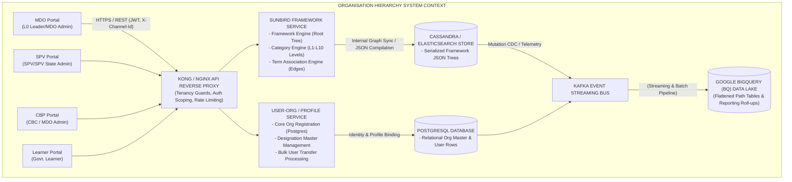
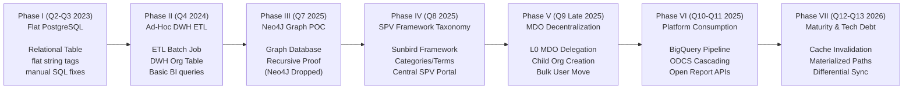
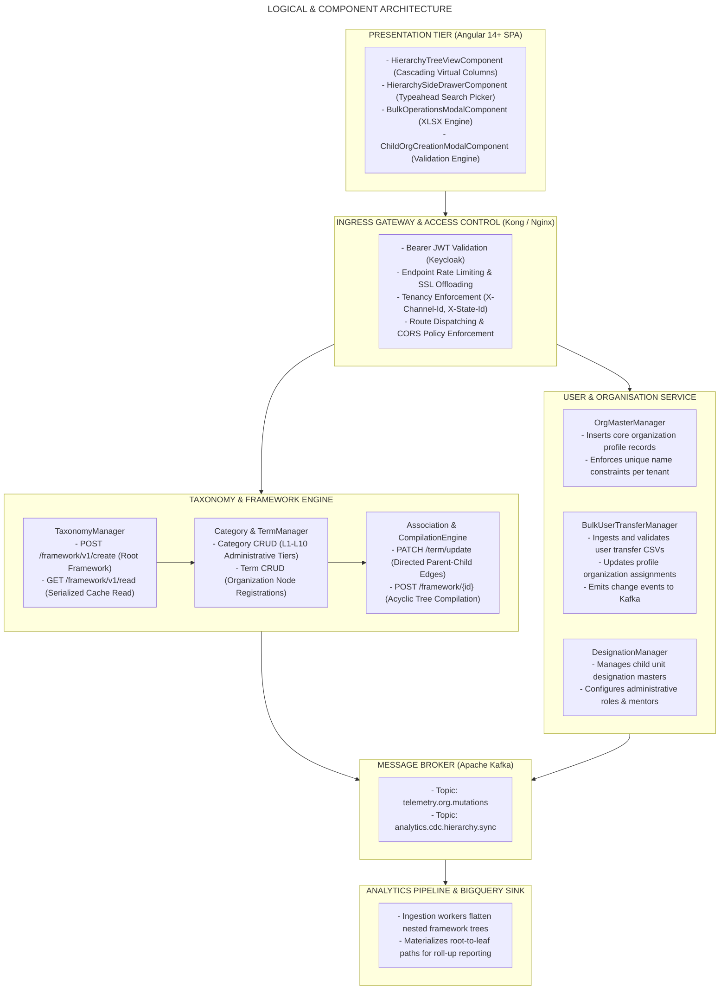
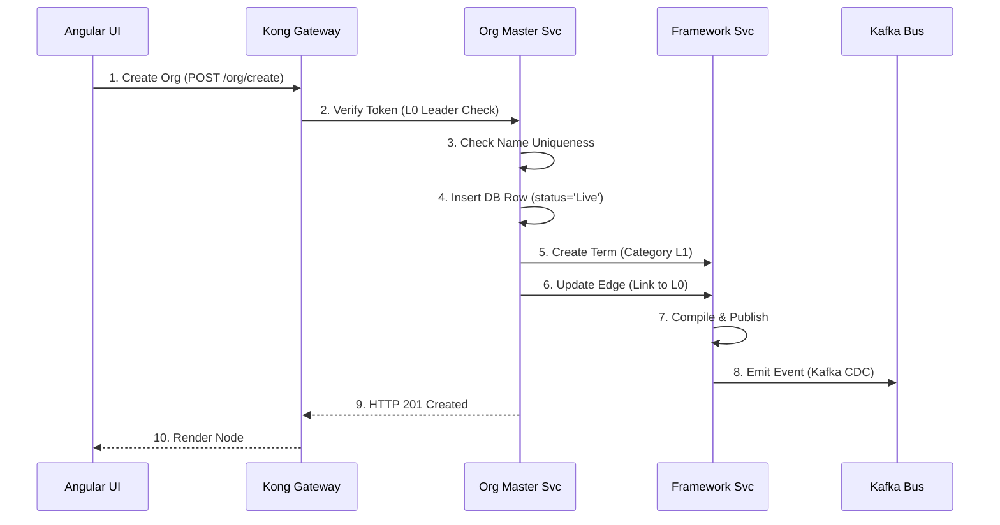
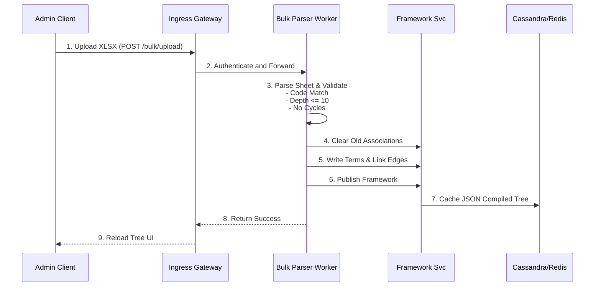
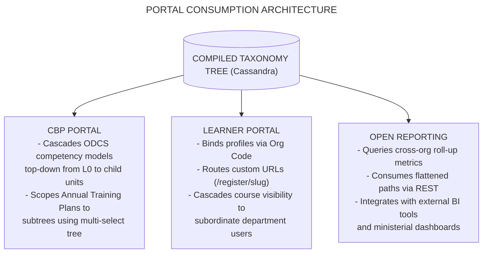
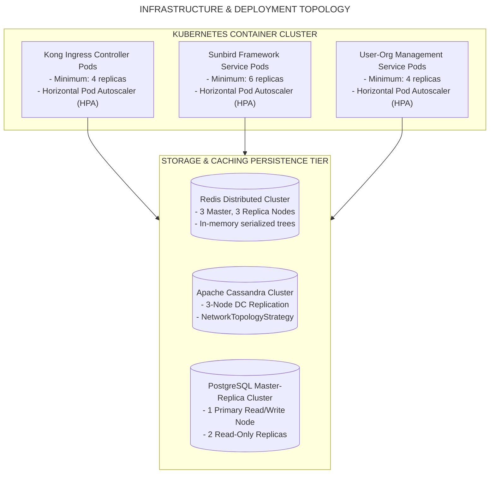

# Organisation Hierarchy — High-Level Design (HLD) Document

## 1. Executive Summary & Document Control

### 1.1 Purpose

This High-Level Design (HLD) document defines the enterprise architecture for the **Organisation Hierarchy** capability within the iGOT Karmayogi public administration learning and governance ecosystem. It details the structural evolution of the platform from a flat organization table in **Quarter 2 (Q2 2023)** to an enterprise-scale distributed taxonomy service supporting up to **10 administrative levels ( to )** in **Quarter 13 (Q13 2026)**.

The document establishes architectural standards for:

- **Structural Creation & Curation:** Managing rooted Directed Acyclic Graphs (DAGs) constrained to single-parent trees across Ministries, Departments, Attached Offices, and Field Commissionerates.
- **Delegated Governance:** Segregating operational boundaries across Special Purpose Vehicle (SPV) Administrators, SPV State Administrators, and Ministry/Department () Leaders.
- **Platform-Wide Consumption:** Supporting multi-portal workflows across the MDO Portal, SPV Portal, Competency-Based Planning (CBP) Portal, and Learner Portal.
- **Data Flow & Telemetry:** End-to-end data processing across Angular single-page applications, Kong/Nginx API gateways, Sunbird Framework/Taxonomy microservices, Cassandra/Elasticsearch caching tiers, PostgreSQL master records, Kafka event streams, and Google BigQuery (BQ) analytical data lakes.

### 1.2 Target Audience

- **Enterprise & Solution Architects:** Reference for microservice topologies, storage engines, and cross-cutting security patterns.
- **Technical Leads & Engineering Teams:** Implementation baseline for API gateways, taxonomy compilation, and change data capture (CDC) pipelines.
- **Product Managers & Business Analysts:** Mapping of business capabilities to technical architecture.
- **Operations & DevOps Teams:** Blueprint for cluster topologies, caching configurations, and infrastructure dependencies.

## 2. Architecture Drivers, Principles & Quality Attributes

### 2.1 Architectural Drivers

1. **Administrative Topography Realism:** Accurately represent the bureaucratic reporting lines of the Government of India and State Governments across Central Ministries, Directorates, Collectorates, Sub-divisions, and Tehsils ().
2. **Decentralization of Administrative Load:** Shift child organization creation, user transfers, role assignments, and designation management from central SPV administrators to decentralized Ministry Leaders.
3. **Targeted Capacity Building (CBC/CBP):** Enable apex ministries to cascade Organizational Development & Competency Sub-frameworks (ODCS) and Annual Training Plans down through subordinate administrative units.
4. **Analytical Roll-Up Reporting:** Support real-time and historical training metrics aggregated across multi-tier administrative boundaries.

### 2.2 Core Architectural Principles

- **Single Source of Truth for Topology:** Organizational structures are owned and maintained by the Sunbird Framework/Taxonomy Service; consuming portals read compiled trees without maintaining duplicate relationship graphs.
- **Strict Single-Parent Invariant ( Hierarchy):** To avoid split-governance ambiguities, each organization node must have exactly one parent ().
- **Tenant & Boundary Isolation:** Multi-tenancy is enforced at the API gateway layer using cryptographically signed JWT tokens, preventing cross-state or unauthorized cross-ministry structural mutations.
- **Event-Driven Asynchronous Propagation:** Structural mutations trigger event streams via Apache Kafka to synchronize downstream data consumers (e.g., BigQuery, search indices, and reporting tables) without blocking transactional workflows.

### 2.3 Quality Attribute Workshop (QAW) Requirements

**QUALITY ATTRIBUTE REQUIREMENTS**

| Attribute | Architectural Requirement & Constraint |
|---|---|
| Performance | Tree retrieval (GET /framework/v1/read) must respond in <= 500 ms (p95) for trees containing up to 2,500 nodes and 10 levels deep. |
| Scalability | Support concurrent read access for over 25,000 active production users during peak hours without database degradation. |
| Data Integrity | Acyclic tree structure guaranteed; circular relationships or skipped levels (e.g., L1 -> L3) are blocked by the schema validator. |
| Security | Zero-trust tenancy verification; SPV State Admins strictly limited to their state jurisdiction via gateway-level token inspection. |

## 3. System Context & External Interfaces

The Organisation Hierarchy service operates at the core of the iGOT Karmayogi platform, routing structural metadata to various administrative and consumer-facing portals:



## 4. Evolutionary Architecture (Q2 to Q13)

The architectural roadmap evolved over seven phases:



### 4.1 Chronological Evolution Breakdown

- **Phase I: Flat Database Model (Q2–Q3 2023):** Core organizations were maintained in PostgreSQL with simple Ministry string labels. The lack of parent-child relationships led to data duplication and required recurring manual SQL cleanup scripts ([KB-838: Q2 | Ad-Hoc Requests | Cleaning up MDO Hierarchy.](https://karmayogibharat.atlassian.net/browse/KB-838) (Open), [KB-1312: Org Hierarchy | Hierarchy cleanup activity and corresponding access to Orgs.](https://karmayogibharat.atlassian.net/browse/KB-1312) (Open)).
- **Phase II: Data Warehouse Hierarchy Integration (Q4 2024):** A dedicated `org_hierarchy` table was added to the data warehouse, populated via batch ETL jobs ([KB-428: Q2 l Data Warehousing l Org hierarchy fields](https://karmayogibharat.atlassian.net/browse/KB-428) (Prod Deployed), [KB-5057: Q4 | Ad-Hoc Requests | Data Warehouse, Operational Reports and Full exhausts enhancements | Org Hierarchy Table.](https://karmayogibharat.atlassian.net/browse/KB-5057) (Open)). Transactional production systems remained flat.
- **Phase III: Graph Storage Evaluation (Q7 Early 2025):** The engineering team evaluated a dedicated Neo4J property graph database for multi-level recursive queries ([KB-8441: Q7 | Tech Debt | Org Hierarchy Enhancements](https://karmayogibharat.atlassian.net/browse/KB-8441) (In Progress), [KB-8442: Explore Neo4J to store org hierarchy](https://karmayogibharat.atlassian.net/browse/KB-8442) (Internal Review)). Due to infrastructure operational overhead, the platform opted to use Sunbird's native Taxonomy Framework Service.
- **Phase IV: Centralized SPV Framework Taxonomy (Q8 Mid 2025):** Deployed the Sunbird Framework engine across Cassandra and Elasticsearch. Established Category and Term associations (), full-tree bulk upload/download ([KB-9737: Q8 | Bulk Upload & Download | Org Hierarchy Management | SPV Portal](https://karmayogibharat.atlassian.net/browse/KB-9737) (Prod Deployed)), card-based UI navigation ([KB-9033: Q8 | Organisation Hierarchy Management | SPV Admin | SPV Portal](https://karmayogibharat.atlassian.net/browse/KB-9033) (Prod Deployed)), and SPV State Admin boundary controls ([KB-9197: Q8 | Organisation Hierarchy Access Management | SPV & State Admin | SPV Portal](https://karmayogibharat.atlassian.net/browse/KB-9197) (Prod Deployed)).
- **Phase V: Decentralized MDO Management (Q9 Late 2025):** Extended hierarchy management tools to the MDO Portal ([KB-10500: Q9 | Org hierarchy Management & Impacted Areas](https://karmayogibharat.atlassian.net/browse/KB-10500) (KB Review), [KB-10501: Q9 | L0 hierarchy Management | MDO Portal](https://karmayogibharat.atlassian.net/browse/KB-10501) (KB Review)), allowing Ministry Leaders to create child organizations () ([KB-10512: Q9 | Child Organization Creation Capability Dev Completed](https://karmayogibharat.atlassian.net/browse/KB-10512)), manage child units ([KB-10515: Q9 | Enable Child Org Data Management | MDO Portal Code](https://karmayogibharat.atlassian.net/browse/KB-10515) (Review)), and perform bulk user transfers via CSV ([KB-10514: Q9 | Create Bulk User Transfer Feature (Add/Update) | MDO Portal](https://karmayogibharat.atlassian.net/browse/KB-10514) (DEV IN PROGRESS)).
- **Phase VI: Cross-Portal Integration & Analytics (Q10–Q11 2025–2026):** Deployed Kafka-to-BigQuery pipelines for analytics synchronization ([KB-9801: Q8 | Organisation Hierarchy Sync with BQ for reporting | Organisation Hierarchy Management](https://karmayogibharat.atlassian.net/browse/KB-9801) (Open), [KB-10534: Q9 | Organisation Hierarchy Sync with BQ for reporting | Organisation Hierarchy Management](https://karmayogibharat.atlassian.net/browse/KB-10534) (In-Progress)), Custom Self-Registration landing links ([KB-10574: Q9 | Custom Self registration Functionality | Org Hierarchy Management](https://karmayogibharat.atlassian.net/browse/KB-10574) (Open)), Open Reporting APIs ([KB-10576: Q9 | Open APIs for reporting](https://karmayogibharat.atlassian.net/browse/KB-10576) (Prod Deployed)), Annual Training Plan hierarchical targeting ([KB-10577: Q11 | Ad-Hoc | CA and APAR Enhancements |Org Hierarchy in Training Plan Creation | MDO Portal](https://karmayogibharat.atlassian.net/browse/KB-10577) (Open)), and automated ODCS competency cascading ([KB-10578: Q9 | ODCS effectiveness for Child Organisations | MDO Portal](https://karmayogibharat.atlassian.net/browse/KB-10578) (Open)).
- **Phase VII: Operational Maturity & Tech Debt (Q12–Q13 2026):** Refined Redis cache invalidation strategies and evaluated relational materialized paths ([KB-15967: Tech Debt | Org Hierarchy Enhancements](https://karmayogibharat.atlassian.net/browse/KB-15967) (Open)) to mitigate the operational risks of full-tree bulk overwrites.

## 5. Logical & Component Architecture



### 5.1 Component Details

1. **Presentation Tier (Angular SPA):**
  - Built as an Angular module featuring reactive RxJS state management (`HierarchyStateService`).
  - Renders dynamic cascading columns for levels to using Angular CDK Virtual Scrolling to handle large trees smoothly.
  - Provides client-side validation for file uploads (MIME type whitelisting, file size limits: 100 MB for bulk sheets, 500 KB for logos).

2. **Ingress Gateway (Kong / Nginx):**
  - Terminates TLS, validates Keycloak JWT tokens, and maps identity claims into downstream microservice headers (`X-Channel-Id`, `X-State-Id`, `X-Authenticated-User-Token`).
  - Enforces tenancy boundaries by blocking cross-state and out-of-scope administrative requests.

3. **Taxonomy & Framework Engine (Sunbird Framework Service):**
  - Represents root administrative units (Central Ministries or State Governments) as isolated Framework entities (`<channelId>_org_hierarchy`).
  - Categorizes organizational tiers () as Categories.
  - Represents organization nodes as Terms, and parent-child links as Term Associations.
  - Compiles and publishes the hierarchy, generating a complete nested JSON tree that is cached in Redis and stored in Cassandra for fast retrieval.

4. **User & Organisation Service:**
  - Manages relational organization records and designation master tables in PostgreSQL.
  - Processes bulk user transfer CSVs, reallocates user records, and publishes change events to Kafka.

5. **Analytics Pipeline & BigQuery Sink:**
  - Listens for published framework change events, flattens the nested tree into materialized path strings (e.g., `/ORG-001/ORG-045/ORG-099`), and streams updates into Google BigQuery.

## 6. Administrative & Governance Workflows

### 6.1 Child Organisation Creation & Automatic Hierarchy Linking ( Leader)

This workflow allows an MDO Leader to create a subordinate organization and link it into the active hierarchy:



### 6.2 Full-Tree Bulk Upload Validation & Tree Overwrite

This workflow illustrates how the system processes full-tree bulk uploads, replacing the existing hierarchy structure:



## 7. Portal Integration & Consumption Architecture

The compiled taxonomy tree powers several platform workflows:



### 7.1 Cross-Portal Functional Consumption Matrix

| Consuming Surface | User Role | Operations Supported | Data Elements Consumed | Underlying Services | Core Business Purpose |
|---|---|---|---|---|---|
| **MDO Portal** | MDO Leader | Read / Write | Full Ministry Tree (), User Rosters, Designations | Framework Service, User-Org Service | Ministry-level self-governance and structure maintenance |
| **MDO Portal** | MDO Admin | Read (Write for users) | Subtree from Assigned Node Downwards | Framework Read API, User Service | Local department user management and downward transfers |
| **SPV Portal** | Central SPV Admin | Read / Write | All Central Ministries and State Trees | Framework Service, Org Master Service | Platform-wide administrative governance and framework setup |
| **SPV Portal** | SPV State Admin | Read / Write | Assigned State Subtree () | Framework Service, State Filter Proxy | State-specific administrative governance |
| **CBP Portal** | CBP Admin / Planner | Read-Only | Hierarchy Trees and Subordinate Organization IDs | Framework Read API, CBP Service | Cascading ODCS competencies and scoping training plans |
| **Learner Portal** | Civil Servant | Read-Only | Mapped Organization ID and Ancestor Chain | User Profile Service, CSR Proxy | Scoped course discovery and organization profile mapping |
| **Reporting / BI** | Stakeholders | Read-Only | Flattened Paths and Aggregated Hierarchy Tables | BigQuery Connector, Open Reporting APIs | Cross-department roll-up reporting and administrative KPIs |

## 8. Data, Storage & Analytics Architecture

The system uses a polyglot storage architecture to support transactional integrity, fast read access, and large-scale analytical queries:

**DATA PERSISTENCE ARCHITECTURE**

| Cassandra & Elasticsearch | PostgreSQL Relational Store | Google BigQuery Lakehouse |
|---|---|---|
| Serialized Framework JSON Trees | Relational Org Master Table | Flattened Ancestor Paths |
| Taxonomy Categories & Terms | User Profile Mappings | Analytical Roll-Up Views |
| Fast read-heavy tree caching | Designation Masters & Roles | Cross-Department Reports |

### 8.1 Schema Design Specifications

#### PostgreSQL Relational Master Schema

```sql
CREATE TABLE igot_user_org.organisation_master (
    org_id VARCHAR(64) PRIMARY KEY,
    org_code VARCHAR(64) UNIQUE NOT NULL,
    org_name VARCHAR(128) NOT NULL,
    description TEXT,
    logo_url VARCHAR(256),
    status VARCHAR(32) DEFAULT 'Live',  -- Live, Inactive, Blocked
    root_org_id VARCHAR(64) NOT NULL,  -- Self-referential for L0; references L0 for L1..L10
    parent_org_id VARCHAR(64),
    -- Direct parent node ID
    hierarchy_level INT NOT NULL,  -- 0 for L0, up to 10
    state_id VARCHAR(64),
    -- NULL for Central Ministries; State Code for States
    created_by VARCHAR(64) NOT NULL,
    created_at TIMESTAMP WITH TIME ZONE DEFAULT CURRENT_TIMESTAMP,
    updated_at TIMESTAMP WITH TIME ZONE DEFAULT CURRENT_TIMESTAMP
);
CREATE INDEX idx_org_root_level ON igot_user_org.organisation_master(root_org_id, hierarchy_level);
CREATE INDEX idx_org_state ON igot_user_org.organisation_master(state_id);
CREATE TABLE igot_user_org.org_designation_master (
    designation_id VARCHAR(64) PRIMARY KEY,
    org_id VARCHAR(64) NOT NULL REFERENCES igot_user_org.organisation_master(org_id),
    designation_name VARCHAR(128) NOT NULL,
    status VARCHAR(32) DEFAULT 'Active',
    created_at TIMESTAMP WITH TIME ZONE DEFAULT CURRENT_TIMESTAMP,
    CONSTRAINT uk_org_designation UNIQUE (org_id, designation_name)
);
```

#### Cassandra Framework Storage Schema

```sql
CREATE KEYSPACE IF NOT EXISTS sunbird_framework WITH replication = {'class': 'NetworkTopologyStrategy', 'datacenter1': 3};
CREATE TABLE sunbird_framework.framework_hierarchy (
    framework_id text,
    compiled_tree text,  -- Serialized JSON tree representing the complete hierarchy
    last_published_on timestamp,
    version text,
    PRIMARY KEY (framework_id)
);
```

#### Google BigQuery Analytical Lakehouse Schema

```sql
CREATE TABLE igot_analytics.org_hierarchy_flattened (
    snapshot_date DATE,
    root_org_id STRING NOT NULL,
    root_org_name STRING NOT NULL,
    org_id STRING NOT NULL,
    org_code STRING NOT NULL,
    org_name STRING NOT NULL,
    level_depth INT64 NOT NULL,
    -- Level depth: 0 to 10 parent_org_id STRING, parent_org_name STRING, ancestor_path STRING,
    -- e.g., "/ORG-001/ORG-045/ORG-099" assigned_user_count INT64, state_id STRING,
    is_active BOOLEAN,
    last_sync_timestamp TIMESTAMP
) PARTITION BY snapshot_date CLUSTER BY root_org_id, level_depth;
```

## 9. Integration Architecture

### 9.1 Synchronous REST API Catalog

**ORGANISATION HIERARCHY REST API CATALOG**

| API ID | Method | Endpoint Pattern | Target Backend Service | Auth / Scope Header | Functional Intent |
|---|---|---|---|---|---|
| API-001 | POST | /api/framework/v1/create | Sunbird Framework Svc | Bearer JWT, X-Channel | Initialize master hierarchy framework |
| API-002 | POST | /apis/proxies/v8/action/framework/v3/category/create?framework={frameworkCode} | Sunbird Category Svc | Bearer JWT, X-Channel | Define hierarchy levels (L1-L10) |
| API-003 | POST | /apis/proxies/v8/action/framework/v3/term/create?framework={frameworkCode}&category={catCode} | Sunbird Term Svc | Bearer JWT, X-Channel | Register org node as taxonomy term |
| API-004 | PATCH | /apis/proxies/v8/framework/v1/term/update/{termCode}?framework={frameworkCode}&category={cat} | Sunbird Term Svc | Bearer JWT, X-Channel | Create parent-child associations (edges) |
| API-005 | POST | /apis/proxies/v8/framework/{frameworkCode} | Sunbird Framework Svc | Bearer JWT, X-Channel | Publish & compile live framework JSON |
| API-006 | GET | /apis/proxies/v8/framework/v1/read/{frameworkCode} | Cassandra/Elastic Cache | Bearer JWT, X-Channel | Retrieve serialized hierarchy graph |
| API-007 | POST | /apis/proxies/v8/user/v1/bulk/transfer | User-Org Service | Bearer JWT, AdminRole | Bulk transfer users across org nodes |
| API-008 | POST | /apis/proxies/v8/org/v1/create | Relational Org Master | Bearer JWT, L0_Leader | Create new child org profile in DB |

### 9.2 Asynchronous Event Specifications (Apache Kafka)

#### Topic: `telemetry.org.mutations`

Published when an administrator compiles or publishes a framework:

```json
{
  "eventId": "EVT-ORG-MUT-1029384",
  "traceId": "a92b3c4d-5e6f-7a8b-9c0d-1e2f3a4b5c6d",
  "timestamp": 1793521200000,
  "actor": {
    "userId": "usr-admin-0012",
    "role": "L0_MDO_LEADER",
    "channel": "01358912293839667241"
  },
  "action": "FRAMEWORK_PUBLISHED",
  "target": {
    "frameworkId": "01358912293839667241_org_hierarchy",
    "affectedNodesCount": 38,
    "maxDepth": 4
  }
}
```

#### Topic: `analytics.cdc.hierarchy.sync`

Published by the User-Org service to synchronize user profile moves with data lakes:

```json
{
  "eventType": "BULK_USER_TRANSFER",
  "batchId": "BATCH-TRF-2026-11-01",
  "sourceOrgId": "org-dept-health-01",
  "destinationOrgId": "org-field-hospital-04",
  "transferredUserCount": 420,
  "executedBy": "usr-leader-health",
  "timestamp": "2026-11-01T08:20:00Z"
}
```

## 10. Security, Multi-Tenancy & Access Control Architecture

### 10.1 Tenancy Enforcement Layers

The platform uses a layered security model to enforce administrative boundaries:

**SECURITY ENFORCEMENT LAYERS**

| 1. API Reverse Proxy Layer | 2. Framework Service Engine | 3. Relational Database |
|---|---|---|
| Inspects JWT claims | Validates Framework Ownership | Row-Level Tenant Checks |
| Extracts stateId & channel | Matches caller channel against framework owner before mutation | Queries scoped by root_org_id = caller_root |
| Blocks cross-state mutation | | |

1. **API Reverse Proxy (Kong / Nginx):**
  - Inspects incoming JWT claims (`roles`, `organisations`, `stateId`).
  - **Boundary Enforcement:** Blocks SPV State Admins from accessing Central Government endpoints or modifying organizations belonging to other states, returning `HTTP 403 Forbidden`.

2. **Framework Ownership Validation:**
  - Verifies that the caller's `X-Channel-Id` matches the registered owner (`framework.owner`) before committing taxonomy modifications.

3. **Database Row Scoping:**
  - Scopes relational database operations by root organization:

```sql
UPDATE igot_user_org.organisation_master SET parent_org_id = :newParentId WHERE org_id = :targetOrgId AND root_org_id = :callerRootOrgId;
```

### 10.2 Role-Based Access Control (RBAC) Matrix

| System Privilege | Central SPV Admin | SPV State Admin | MDO Leader | MDO Admin () | CBP Planner | Learner |
|---|---|---|---|---|---|---|
| **Create Root Framework ()** | **Yes** | **Yes** (State) | No | No | No | No |
| **Create Child Org ()** | **Yes** | **Yes** (State) | **Yes** | No | No | No |
| **Modify Hierarchy Tree** | **Yes** | **Yes** (State) | **Yes** (Ministry) | No | No | No |
| **Bulk Upload Entire Tree** | **Yes** | **Yes** (State) | **Yes** (Ministry) | No | No | No |
| **Bulk User Transfer** | **Yes** | **Yes** (State) | **Yes** (Ministry) | **Yes** (Downward) | No | No |
| **View Full Ministry Tree** | **Yes** | No | **Yes** | **Yes** (Subtree) | **Yes** | No |
| **Cascade ODCS Competencies** | No | No | **Yes** | No | **Yes** | No |

## 11. Infrastructure, Deployment & Operational Architecture



### 11.1 Deployment Specifications

- **Container Orchestration:** Microservices run as containerized deployments on Kubernetes (EKS/On-Premise), configured with Horizontal Pod Autoscalers (HPA) triggered at 70% CPU and memory utilization thresholds.
- **Distributed In-Memory Caching:** Serialized framework trees are cached in a 6-node Redis cluster (`framework:<id>:compiled`). Updates invalidate the cache and use distributed mutex locks (`Redlock`) to prevent cache stampedes during tree recompilation.
- **Database Resiliency:** PostgreSQL runs in a primary-replica configuration with automated failover; Cassandra nodes use `NetworkTopologyStrategy` with a replication factor of 3.

## 12. Traceability, Gap Analysis & Future Architectural Roadmap (Q14+)

### 12.1 Requirement-to-Architecture Traceability

**REQUIREMENT-TO-ARCHITECTURE TRACEABILITY**

| Requirement ID | Requirement Description | Jira Source Reference | Design Component | Architectural Pattern / Technology |
|---|---|---|---|---|
| REQ-FUNC-ORG-001 | Child Org Creation (L0) | KB-10512 | OrgMasterManager | REST API / PostgreSQL Transaction |
| REQ-FUNC-ORG-002 | Duplicate Org Validation | KB-10512 | Relational Database | Case-Insensitive Unique Constraint Index |
| REQ-FUNC-ORG-003 | Subtree Delinking Rules | KB-9033, KB-10513 | TaxonomyManager | Cascading Term Association Purge |
| REQ-FUNC-HIER-001 | Interactive Card UI Tree | KB-9033, KB-10513 | Angular Frontend Shell | CDK Virtual Scroll Dynamic Columns |
| REQ-FUNC-HIER-002 | Parent-Child Edge Link | KB-9033, KB-10513 | TermAssociationManager | Directed Graph Edges in Framework Service |
| REQ-FUNC-HIER-004 | Max Depth (L10) Limit | KB-9740, KB-10501 | FrameworkCompilationEng | Schema Validator (Categories <= 10) |
| REQ-FUNC-BULK-001 | Template Export | KB-9737, KB-10533 | BulkParserWorker | Streaming Dynamic Excel Generator |
| REQ-FUNC-BULK-003 | Full Tree Overwrite | KB-9737, KB-10533 | FrameworkCompilationEng | Complete Tree Replacement Strategy |
| REQ-FUNC-USER-001 | Bulk User Transfer CSV | KB-10514 | BulkUserTransferManager | Asynchronous Streaming Batch Processor |
| REQ-FUNC-SEC-001 | State Admin Isolation | KB-9197 | Kong Gateway Ingress | Cryptographic JWT Claims Interceptor |
| REQ-FUNC-INT-001 | BigQuery Hierarchy Sync | KB-9801, KB-10534 | Analytics Pipeline | Kafka CDC Streaming Pipeline |
| REQ-FUNC-INT-002 | Open Reporting Hierarchy API | KB-10576 | OpenReportingController | Read-Only Flattened Path Cache REST API |
| REQ-FUNC-INT-003 | Training Plan Scoping (CBP) | KB-10577 | CBP Module | Hierarchical Multi-Select Tree Picker |
| REQ-FUNC-INT-004 | ODCS Competency Cascade | KB-10578 | CompetencyMappingService | Event-Driven Reactive Competency Sink |
| REQ-FUNC-INT-005 | Custom Self-Registration | KB-10574 | CSR Proxy Controller | Slug-to-Organization Ingress Resolver |

### 12.2 Gap Analysis & Q14+ Architectural Roadmap

**GAP ANALYSIS & Q14+ ROADMAP**

| Gap ID | Current Limitation | Operational / Business Risk | Target Architecture (Q14+) | Architecture Strategy |
|---|---|---|---|---|
| GAP-01 | Full-Tree Overwrite on Bulk Upload Ingestion | Accidental unlinking of omitted child departments. | Differential JSON Patch Delta API (/term/patch) | Transition to idempotent patch operations. |
| GAP-02 | Recursive Joins for Relational Hierarchy Reads | Increased query latency for deep ancestor lookups. | Relational Materialized Path (/01/45/99) in PostgreSQL | Store ancestor strings (e.g., path LIKE '/01/%'). |
| GAP-03 | Analytics Pipeline Latency on Large Tree Updates | BigQuery reports lag behind real-time hierarchy changes. | Micro-Chunked Streaming Ingestion Pipeline | Stream micro-batches to reduce BQ sync lag to <5 min. |

## 13. Appendices & References

### 13.1 Primary Confluence Specifications

- [SRS - Organisation Hierarchy | MDO Admin & MDO Leader | MDO Portal](https://karmayogibharat.atlassian.net/wiki/spaces/TES/pages/517931009/SRS+-+Organisation+Hierarchy+MDO+Admin+MDO+Leader+MDO+Portal)
- [SRS - Organisation Hierarchy Update | SPV Admin & SPV State | AdminSPV Portal](https://karmayogibharat.atlassian.net/wiki/spaces/TES/pages/416317441/SRS+-+Organisation+Hierarchy+Update+SPV+Admin+SPV+State+AdminSPV+Portal)
- [Organisation Hierarchy View](https://karmayogibharat.atlassian.net/wiki/spaces/TES/pages/396328967/Organisation+Hierarchy+View)
- [L0 Hierarchy Management- MDO Portal](https://karmayogibharat.atlassian.net/wiki/spaces/KQAS/pages/503612134/L0+Hierarchy+Management-+MDO+Portal)
- [Organization Hierarchy update SPV Admin](https://karmayogibharat.atlassian.net/wiki/spaces/KQAS/pages/417071170/Organization+Hierarchy+update+SPV+Admin)

### 13.2 Jira References

- **Initiatives & Epics:** [KB-8975: Q8 | Organization Hierarchy management](https://karmayogibharat.atlassian.net/browse/KB-8975) (Open), [KB-8018: Q8 | Organisation Hierarchy Update | SPV Admin & SPV State | AdminSPV Portal](https://karmayogibharat.atlassian.net/browse/KB-8018) (KB Approved), [KB-10500: Q9 | Org hierarchy Management & Impacted Areas](https://karmayogibharat.atlassian.net/browse/KB-10500) (KB Review), [KB-10501: Q9 | L0 hierarchy Management | MDO Portal](https://karmayogibharat.atlassian.net/browse/KB-10501) (KB Review), [KB-10502: Q9 | Org hierarchy Impacted areas](https://karmayogibharat.atlassian.net/browse/KB-10502) (KB Review), [KB-8441: Q7 | Tech Debt | Org Hierarchy Enhancements](https://karmayogibharat.atlassian.net/browse/KB-8441) (In Progress), [KB-4441: Q4 | Ad-Hoc Requests | Organisation rename and Hierarchy cleanup.](https://karmayogibharat.atlassian.net/browse/KB-4441) (In Progress).
- **Delivery Stories:** [KB-9033: Q8 | Organisation Hierarchy Management | SPV Admin | SPV Portal](https://karmayogibharat.atlassian.net/browse/KB-9033) (Prod Deployed), [KB-9197: Q8 | Organisation Hierarchy Access Management | SPV & State Admin | SPV Portal](https://karmayogibharat.atlassian.net/browse/KB-9197) (Prod Deployed), [KB-9737: Q8 | Bulk Upload & Download | Org Hierarchy Management | SPV Portal](https://karmayogibharat.atlassian.net/browse/KB-9737) (Prod Deployed), [KB-9738: Q8 | Org Search Funcationality | Organisation Hierarchy Management](https://karmayogibharat.atlassian.net/browse/KB-9738) (Prod Deployed), [KB-9740: Q8 | Manage Hierarchy Levels/Layers & Renaming | SPV Portal](https://karmayogibharat.atlassian.net/browse/KB-9740) (To Do), [KB-9790: Q8 | Organisation Hierarchy View | SPV & State Admin | SPV Portal](https://karmayogibharat.atlassian.net/browse/KB-9790) (To Do), [KB-9795: Q8 | Organisation Specific Page Redirection | Organisation Hierarchy Management | SPV Portal](https://karmayogibharat.atlassian.net/browse/KB-9795) (Prod Deployed), [KB-9801: Q8 | Organisation Hierarchy Sync with BQ for reporting | Organisation Hierarchy Management](https://karmayogibharat.atlassian.net/browse/KB-9801) (Open), [KB-10512: Q9 | Child Organization Creation Capability Dev Completed](https://karmayogibharat.atlassian.net/browse/KB-10512), [KB-10513: Q9 | Implement Org-Specific Hierarchy Management | MDO Portal Dev Completed](https://karmayogibharat.atlassian.net/browse/KB-10513), [KB-10514: Q9 | Create Bulk User Transfer Feature (Add/Update) | MDO Portal](https://karmayogibharat.atlassian.net/browse/KB-10514) (DEV IN PROGRESS), [KB-10515: Q9 | Enable Child Org Data Management | MDO Portal Code](https://karmayogibharat.atlassian.net/browse/KB-10515) (Review), [KB-10533: Q9 | Bulk Upload | Organisation Hierarchy Management Dev Completed](https://karmayogibharat.atlassian.net/browse/KB-10533), [KB-10534: Q9 | Organisation Hierarchy Sync with BQ for reporting | Organisation Hierarchy Management](https://karmayogibharat.atlassian.net/browse/KB-10534) (In-Progress), [KB-10535: Q9 | Data Tracking | Org Hierarchy Management | MDO Portal](https://karmayogibharat.atlassian.net/browse/KB-10535) (DEV IN PROGRESS), [KB-10574: Q9 | Custom Self registration Functionality | Org Hierarchy Management](https://karmayogibharat.atlassian.net/browse/KB-10574) (Open), [KB-10575: Q9 | MDO Reports | MDO Portal](https://karmayogibharat.atlassian.net/browse/KB-10575) (In-Progress), [KB-10576: Q9 | Open APIs for reporting](https://karmayogibharat.atlassian.net/browse/KB-10576) (Prod Deployed), [KB-10577: Q11 | Ad-Hoc | CA and APAR Enhancements |Org Hierarchy in Training Plan Creation | MDO Portal](https://karmayogibharat.atlassian.net/browse/KB-10577) (Open), [KB-10578: Q9 | ODCS effectiveness for Child Organisations | MDO Portal](https://karmayogibharat.atlassian.net/browse/KB-10578) (Open), [KB-15967: Tech Debt | Org Hierarchy Enhancements](https://karmayogibharat.atlassian.net/browse/KB-15967) (Open).
- **Ad-Hoc & Infrastructure Tickets:** [KB-428: Q2 l Data Warehousing l Org hierarchy fields](https://karmayogibharat.atlassian.net/browse/KB-428) (Prod Deployed), [KB-838: Q2 | Ad-Hoc Requests | Cleaning up MDO Hierarchy.](https://karmayogibharat.atlassian.net/browse/KB-838) (Open), [KB-1312: Org Hierarchy | Hierarchy cleanup activity and corresponding access to Orgs.](https://karmayogibharat.atlassian.net/browse/KB-1312) (Open), [KB-5057: Q4 | Ad-Hoc Requests | Data Warehouse, Operational Reports and Full exhausts enhancements | Org Hierarchy Table.](https://karmayogibharat.atlassian.net/browse/KB-5057) (Open), [KB-8442: Explore Neo4J to store org hierarchy](https://karmayogibharat.atlassian.net/browse/KB-8442) (Internal Review).

### 13.2 Glossary of Terms

- **DAG:** Directed Acyclic Graph (a directed graph with no cycles)
- **Framework:** Master taxonomy entity representing an organizational hierarchy tree
- **Category:** An administrative tier () within a framework
- **Term:** An individual administrative node within a category
- **Term Association:** A directed edge linking a parent term to a child term
- **MDO:** Ministry, Department, and Organisation
- **SPV:** Special Purpose Vehicle (Karmayogi Bharat central governance team)
- **ODCS:** Organizational Development & Competency Sub-framework
- **CDC:** Change Data Capture
