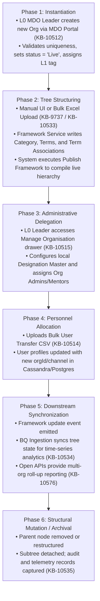
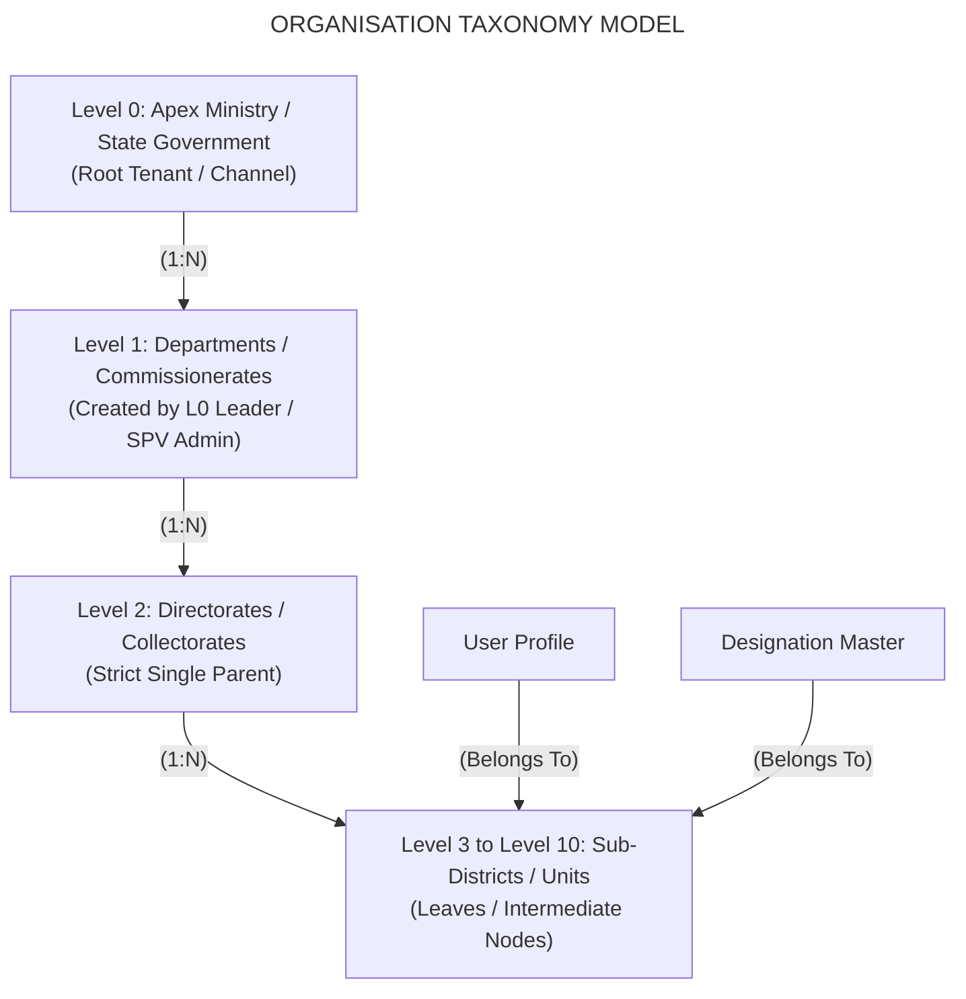
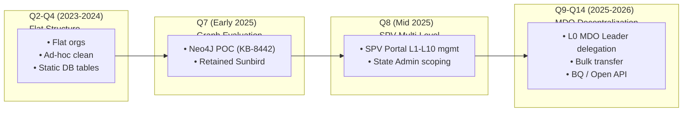
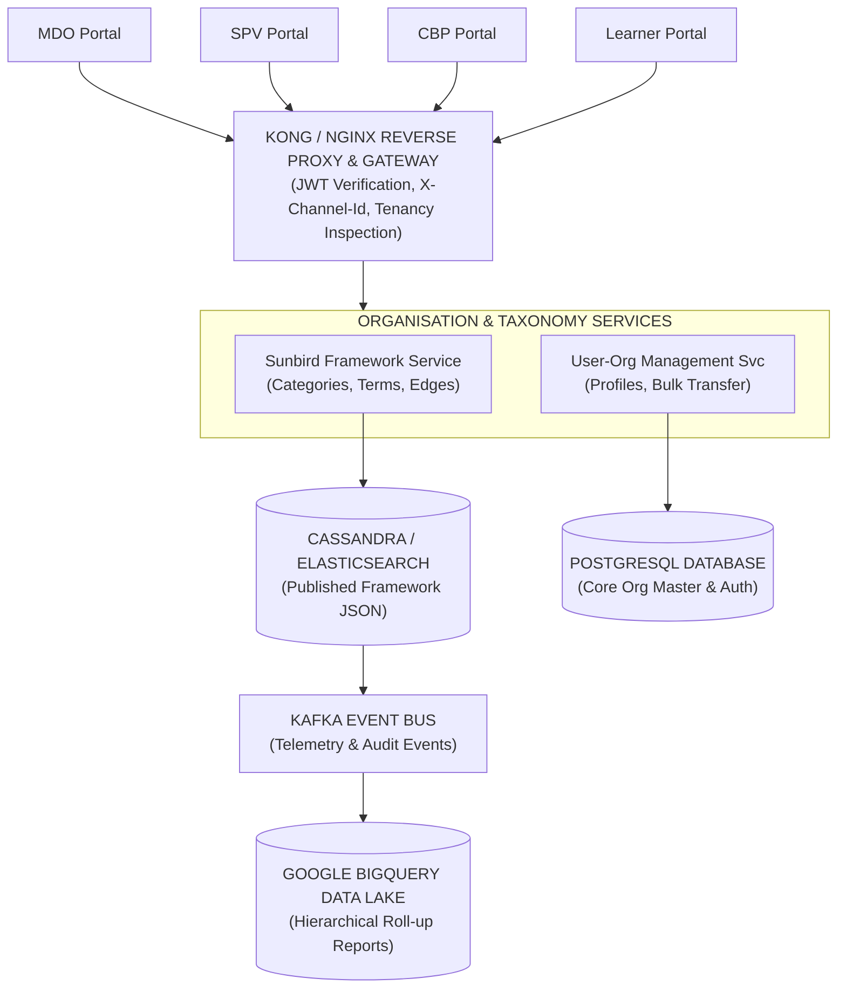
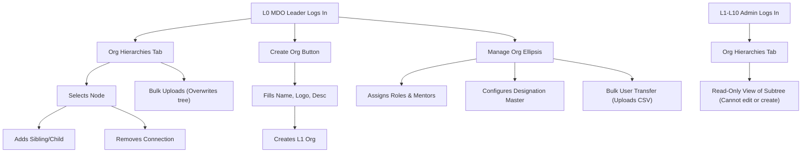
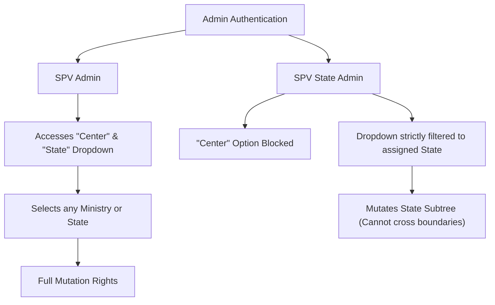
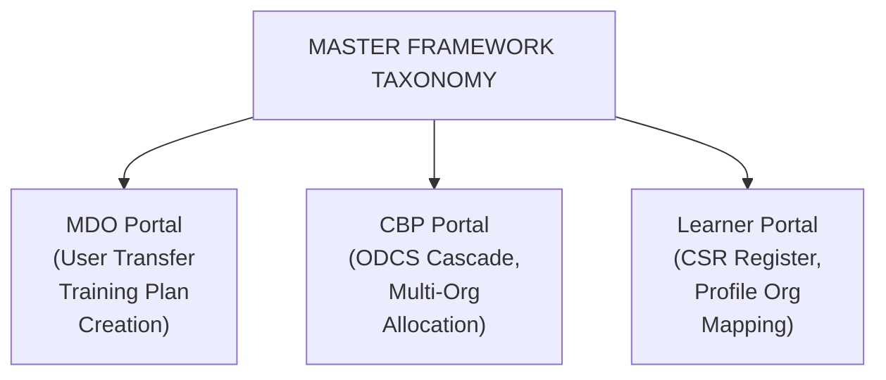
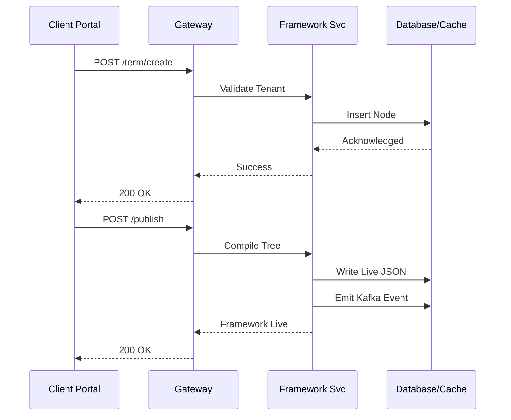
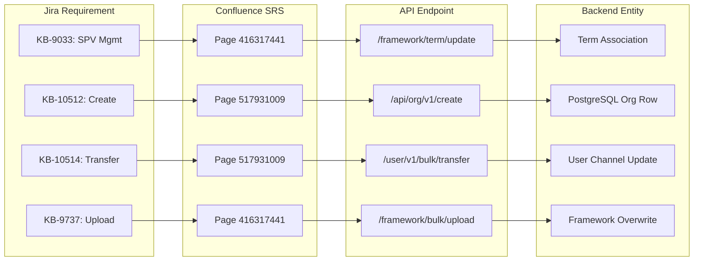

# Organisation Hierarchy – Evolution and Consumption Overview Summary

**iGOT Karmayogi Platform**<br>*A Technical, Architectural, and Functional Analysis Across Epics, SRS Specifications, Framework Services, and Portal Integrations*

## 1. Executive Summary

### 1.1 Feature Overview

The **Organisation Hierarchy** feature on the iGOT Karmayogi platform establishes an enterprise-grade taxonomy and administrative tree structure representing Ministries, Departments, and Organisations (MDOs) across the Government of India and State Governments. Transitioning from an initial flat organisation model, the platform evolved into a dynamic, multi-tier hierarchy supporting up to **10 administrative levels ( to )**. It provides delegated governance, allowing Central and State administrative authorities to manage organizational structures, user associations, and data visibility natively.

### 1.2 Business Objectives

1. **Structural Realism**: Accurately model complex public administrative topologies, from Central Ministries () down to Directorates, Field Commissionerates, Autonomous Bodies, Districts, and Sub-district Offices ( to ).
2. **Administrative Decentralization**: Alleviate Special Purpose Vehicle (SPV) administrative bottlenecks by delegating child organisation creation, user allocation, designation masters, and role assignment to MDO Leaders while retaining centralized governance for SPV and State Admins.
3. **Targeted Capacity Building**: Enable parent MDOs to map competency frameworks (ODCS), roll out targeted annual training plans across subsidiary units, and facilitate Custom Self-Registration (CSR).
4. **Hierarchical Analytics and Reporting**: Feed real-time and batch organizational hierarchies into Google BigQuery (BQ) and Open Reporting APIs to enable roll-up reporting across administrative boundaries.

### 1.3 Evolution Highlights

- **Quarter 2 – Quarter 4 (2023–2024)**: Characterized by flat organisation listings, ad-hoc cleanup activities ([KB-838: Q2 | Ad-Hoc Requests | Cleaning up MDO Hierarchy.](https://karmayogibharat.atlassian.net/browse/KB-838) (Open), [KB-1312: Org Hierarchy | Hierarchy cleanup activity and corresponding access to Orgs.](https://karmayogibharat.atlassian.net/browse/KB-1312) (Open), [KB-4441: Q4 | Ad-Hoc Requests | Organisation rename and Hierarchy cleanup.](https://karmayogibharat.atlassian.net/browse/KB-4441) (In Progress)), and initial data warehousing fields ([KB-428: Q2 l Data Warehousing l Org hierarchy fields](https://karmayogibharat.atlassian.net/browse/KB-428) (Prod Deployed), [KB-5057: Q4 | Ad-Hoc Requests | Data Warehouse, Operational Reports and Full exhausts enhancements | Org Hierarchy Table.](https://karmayogibharat.atlassian.net/browse/KB-5057) (Open)).
- **Quarter 7 (Early 2025)**: Exploration of graph databases ([KB-8442: Explore Neo4J to store org hierarchy](https://karmayogibharat.atlassian.net/browse/KB-8442) (Internal Review) under Technical Debt Epic [KB-8441: Q7 | Tech Debt | Org Hierarchy Enhancements](https://karmayogibharat.atlassian.net/browse/KB-8441) (In Progress)) to address complex tree traversal constraints.
- **Quarter 8 (Mid 2025)**: Delivery of centralized multi-level hierarchy management in the **Admin SPV Portal** ([KB-8975: Q8 | Organization Hierarchy management](https://karmayogibharat.atlassian.net/browse/KB-8975) (Open), [KB-8018: Q8 | Organisation Hierarchy Update | SPV Admin & SPV State | AdminSPV Portal](https://karmayogibharat.atlassian.net/browse/KB-8018) (KB Approved), [SRS - Organisation Hierarchy Update | SPV Admin & SPV State | AdminSPV Portal](https://karmayogibharat.atlassian.net/wiki/spaces/TES/pages/416317441/SRS+-+Organisation+Hierarchy+Update+SPV+Admin+SPV+State+AdminSPV+Portal)), supporting – structuring, SPV State Admin segregation, and full-tree bulk upload capabilities.
- **Quarter 9 (Late 2025)**: Delegation of hierarchy management to the **MDO Portal** ([KB-10500: Q9 | Org hierarchy Management & Impacted Areas](https://karmayogibharat.atlassian.net/browse/KB-10500) (KB Review), [KB-10501: Q9 | L0 hierarchy Management | MDO Portal](https://karmayogibharat.atlassian.net/browse/KB-10501) (KB Review), [SRS - Organisation Hierarchy | MDO Admin & MDO Leader | MDO Portal](https://karmayogibharat.atlassian.net/wiki/spaces/TES/pages/517931009/SRS+-+Organisation+Hierarchy+MDO+Admin+MDO+Leader+MDO+Portal)), empowering MDO Leaders to create child organisations ([KB-10512: Q9 | Child Organization Creation Capability Dev Completed](https://karmayogibharat.atlassian.net/browse/KB-10512)), manage child units ([KB-10515: Q9 | Enable Child Org Data Management | MDO Portal Code](https://karmayogibharat.atlassian.net/browse/KB-10515) (Review)), execute bulk user transfers ([KB-10514: Q9 | Create Bulk User Transfer Feature (Add/Update) | MDO Portal](https://karmayogibharat.atlassian.net/browse/KB-10514) (DEV IN PROGRESS)), and sync structures downstream to BigQuery ([KB-10534: Q9 | Organisation Hierarchy Sync with BQ for reporting | Organisation Hierarchy Management](https://karmayogibharat.atlassian.net/browse/KB-10534) (In-Progress)).
- **Quarter 11 – Quarter 14 (2025–2026)**: Integration with Training Plan Creation ([KB-10577: Q11 | Ad-Hoc | CA and APAR Enhancements |Org Hierarchy in Training Plan Creation | MDO Portal](https://karmayogibharat.atlassian.net/browse/KB-10577) (Open)), Open APIs for multi-org reporting ([KB-10576: Q9 | Open APIs for reporting](https://karmayogibharat.atlassian.net/browse/KB-10576) (Prod Deployed)), and long-term tech debt enhancements ([KB-15967: Tech Debt | Org Hierarchy Enhancements](https://karmayogibharat.atlassian.net/browse/KB-15967) (Open)).

### 1.4 Current Functional Scope and Significance

The implementation combines an Angular frontend with Sunbird Framework taxonomy services (`/api/framework/v1`, `/category/v3`, `/term/v3`, `/term/update`), storing relationships as terms and associations while maintaining strict acyclic graph integrity. It underpins role-based access control, user profile scoping, course allocation, and cross-departmental analytics for over 25,000 concurrent production users.

## 2. Business Context and Objectives

### 2.1 Why Organisation Hierarchy Exists

Public administration in India operates through deeply nested bureaucratic structures. Central Ministries oversee Departments, attached offices, statutory bodies, public sector enterprises, and regional commissionerates. Similarly, State Governments govern Secretariat departments, directorates, collectorates, subdivisions, and tehsils.

Prior to Q8, iGOT Karmayogi enforced a flat organisation entity structure. Every department or office was registered as an independent root node or grouped loosely under broad Ministry tags. This created severe operational challenges:

- **Administrative Burden on SPV**: Central SPV administrators had to manually onboard every micro-department, school, and tehsil office.
- **Lack of Local Governance**: An MDO Leader of a large Ministry (e.g., Ministry of Finance) had no automated mechanism to supervise user rosters, designations, or training progress across subordinate boards (e.g., CBDT, CBIC).
- **Fragmented Reporting**: Generating roll-up training reports for a Ministry required complex manual aggregation across disconnected organisation IDs.
- **Impeded Capacity Building Planning**: Competency planning (CBP) and annual training plans could not be cascaded down an administrative chain.

### 2.2 Core Business Problems Addressed

**BUSINESS PROBLEMS ADDRESSED**

| Structural Deficit | Operational Bottleneck | Governance & Security |
|---|---|---|
| • Flat model lacked parent-child relationships. | • SPV had to handle all user allocations and reassignments. | • Unrestricted or absent scoping across states. |
| • Inability to model district/sub-district levels. | • No self-service user transfer during reorganizations. | • Inability to isolate State Admins to state boundaries. |
| • Misalignment with actual civil service reporting lines. | • Bulk hierarchy modifications required manual database edits. | • No audit logs of tree mutations. |

## 3. Feature Scope and Boundaries

### 3.1 In-Scope Functionality

- **Dynamic Multi-Level Tree ( to )**: Configuration of nested parent-child organisation nodes up to 10 levels deep.
- **Role-Based Hierarchy Scoping**:
  - **SPV Admin**: Unrestricted visibility and mutation rights across Central and State hierarchies.
  - **SPV State Admin**: Restricted exclusively to organisations belonging to their assigned State.
  - **MDO Leader ()**: Full administrative authority over their assigned Ministry/Department tree ( down to ), including creating child units and managing child org users/roles/designations.
  - **MDO Admin**: Read-only hierarchy view of the assigned organisation and its child tree; authorized to transfer users downward from their logged-in node.
  - **to Admins/Leaders**: Scoped read-only view from their node downwards; barred from mutating tree structures or creating organizations.

- **Dual Operation Modes**: Manual UI management (cascading cards, searchable side-panel pickers) and Bulk Upload via downloadable Excel/CSV templates with master-sheet validation.
- **Bulk User Transfer**: Reallocation of personnel across organisational units within an authorized tree.
- **Analytics and BigQuery Sync**: Real-time and batch synchronization of tree structures with Google BigQuery and Open APIs for aggregated reporting.

### 3.2 Out-of-Scope and Bounded Constraints

- **Incremental Bulk Upload**: Bulk hierarchy upload does not perform differential merges; every upload overwrites and recreates the entire hierarchy tree from scratch ([SRS - Organisation Hierarchy | MDO Admin & MDO Leader | MDO Portal](https://karmayogibharat.atlassian.net/wiki/spaces/TES/pages/517931009/SRS+-+Organisation+Hierarchy+MDO+Admin+MDO+Leader+MDO+Portal)).
- **Cross-Boundary Linking**: Assigning parent-child links between different States or between a State department and a Central Ministry is strictly prohibited and blocked by validation rules ([SRS - Organisation Hierarchy Update | SPV Admin & SPV State | AdminSPV Portal](https://karmayogibharat.atlassian.net/wiki/spaces/TES/pages/416317441/SRS+-+Organisation+Hierarchy+Update+SPV+Admin+SPV+State+AdminSPV+Portal)).
- **Multi-Parent Associations**: Matrix structures are unsupported. An organisation node can possess strictly one immediate parent.
- **Self-Creation by Subordinate Nodes**: Subordinate admins ( to ) cannot create child organisations. Only MDO Leaders and SPV Admins hold creation privileges ([KB-10512: Q9 | Child Organization Creation Capability Dev Completed](https://karmayogibharat.atlassian.net/browse/KB-10512)).

## 4. Source Inventory and References

### 4.1 Primary Jira References

| Issue Key | Summary | Issue Type | Parent / Link | Resolution Status | Verified Release Scope |
|---|---|---|---|---|---|
| [KB-428: Q2 l Data Warehousing l Org hierarchy fields](https://karmayogibharat.atlassian.net/browse/KB-428) (Prod Deployed) | Q2 \| Data Warehousing \| Org hierarchy fields | Story | [KB-424: Q2 l Data Warehousing](https://karmayogibharat.atlassian.net/browse/KB-424) (Prod Deployed) | Prod Deployed | Q2 (Oct 2023) |
| [KB-838: Q2 \| Ad-Hoc Requests \| Cleaning up MDO Hierarchy.](https://karmayogibharat.atlassian.net/browse/KB-838) (Open) | Q2 \| Ad-Hoc Requests \| Cleaning up MDO Hierarchy | Story | [KB-832: Q2 \| Ad-Hoc Requests \| Backend changes and enhancements.](https://karmayogibharat.atlassian.net/browse/KB-832) (KB Review) | Open | Q2 (Nov 2023) |
| [KB-1312: Org Hierarchy \| Hierarchy cleanup activity and corresponding access to Orgs.](https://karmayogibharat.atlassian.net/browse/KB-1312) (Open) | Org Hierarchy \| Hierarchy cleanup activity and access to Orgs | New Feature | •  | Open | Q2 (Dec 2023) |
| [KB-4441: Q4 \| Ad-Hoc Requests \| Organisation rename and Hierarchy cleanup.](https://karmayogibharat.atlassian.net/browse/KB-4441) (In Progress) | Q4 \| Ad-Hoc Requests \| Organisation rename and Hierarchy cleanup | Epic | [KB-2564: Q4 \| Ad-Hoc Requests \| UI (non-UX), Data Requests, Backend Requests](https://karmayogibharat.atlassian.net/browse/KB-2564) (Open) | In Progress | Q4 (May 2024) |
| [KB-5057: Q4 \| Ad-Hoc Requests \| Data Warehouse, Operational Reports and Full exhausts enhancements \| Org Hierarchy Table.](https://karmayogibharat.atlassian.net/browse/KB-5057) (Open) | Q4 \| Ad-Hoc Requests \| Data Warehouse \| Org Hierarchy Table | Story | [KB-3352: Q4 \| Ad-Hoc Requests \| Data Warehouse, Operational Reports and Full exhausts enhancements.](https://karmayogibharat.atlassian.net/browse/KB-3352) (In Progress) | Open | Q4 (May 2024) |
| [KB-8018: Q8 \| Organisation Hierarchy Update \| SPV Admin & SPV State \| AdminSPV Portal](https://karmayogibharat.atlassian.net/browse/KB-8018) (KB Approved) | Q8 \| Organisation Hierarchy Update \| SPV Admin & SPV State \| AdminSPV Portal | Epic | [KB-8975: Q8 \| Organization Hierarchy management](https://karmayogibharat.atlassian.net/browse/KB-8975) (Open) | KB Approved | Q8 (Jan–Jul 2025) |
| [KB-8441: Q7 \| Tech Debt \| Org Hierarchy Enhancements](https://karmayogibharat.atlassian.net/browse/KB-8441) (In Progress) | Q7 \| Tech Debt \| Org Hierarchy Enhancements | Epic | [KB-7933: Q7 \| Tech Debt \| Portal and Mobile App enhancements](https://karmayogibharat.atlassian.net/browse/KB-7933) (Open) | In Progress | Q7 (Feb 2025) |
| [KB-8442: Explore Neo4J to store org hierarchy](https://karmayogibharat.atlassian.net/browse/KB-8442) (Internal Review) | Explore Neo4J to store org hierarchy | Story | [KB-8441: Q7 \| Tech Debt \| Org Hierarchy Enhancements](https://karmayogibharat.atlassian.net/browse/KB-8441) (In Progress) | Internal Review | Q7 (Feb 2025) |
| [KB-8975: Q8 \| Organization Hierarchy management](https://karmayogibharat.atlassian.net/browse/KB-8975) (Open) | Q8 \| Organization Hierarchy management | Initiative | •  | Open | Q8 (Mar 2025) |
| [KB-9033: Q8 \| Organisation Hierarchy Management \| SPV Admin \| SPV Portal](https://karmayogibharat.atlassian.net/browse/KB-9033) (Prod Deployed) | Q8 \| Organisation Hierarchy Management \| SPV Admin \| SPV Portal | Story | [KB-8018: Q8 \| Organisation Hierarchy Update \| SPV Admin & SPV State \| AdminSPV Portal](https://karmayogibharat.atlassian.net/browse/KB-8018) (KB Approved) | Prod Deployed | Q8 (Mar–Jul 2025) |
| [KB-9197: Q8 \| Organisation Hierarchy Access Management \| SPV & State Admin \| SPV Portal](https://karmayogibharat.atlassian.net/browse/KB-9197) (Prod Deployed) | Q8 \| Organisation Hierarchy Access Management \| SPV & State Admin \| SPV Portal | Story | [KB-8018: Q8 \| Organisation Hierarchy Update \| SPV Admin & SPV State \| AdminSPV Portal](https://karmayogibharat.atlassian.net/browse/KB-8018) (KB Approved) | Prod Deployed | Q8 (Apr–Jul 2025) |
| [KB-9737: Q8 \| Bulk Upload & Download \| Org Hierarchy Management \| SPV Portal](https://karmayogibharat.atlassian.net/browse/KB-9737) (Prod Deployed) | Q8 \| Bulk Upload & Download \| Org Hierarchy Management \| SPV Portal | Story | [KB-8018: Q8 \| Organisation Hierarchy Update \| SPV Admin & SPV State \| AdminSPV Portal](https://karmayogibharat.atlassian.net/browse/KB-8018) (KB Approved) | Prod Deployed | Q8 (May–Jul 2025) |
| [KB-9738: Q8 \| Org Search Funcationality \| Organisation Hierarchy Management](https://karmayogibharat.atlassian.net/browse/KB-9738) (Prod Deployed) | Q8 \| Org Search Funcationality \| Organisation Hierarchy Management | Story | [KB-8018: Q8 \| Organisation Hierarchy Update \| SPV Admin & SPV State \| AdminSPV Portal](https://karmayogibharat.atlassian.net/browse/KB-8018) (KB Approved) | Prod Deployed | Q8 (May–Jul 2025) |
| [KB-9740: Q8 \| Manage Hierarchy Levels/Layers & Renaming \| SPV Portal](https://karmayogibharat.atlassian.net/browse/KB-9740) (To Do) | Q8 \| Manage Hierarchy Levels/Layers & Renaming \| SPV Portal | Story | [KB-8018: Q8 \| Organisation Hierarchy Update \| SPV Admin & SPV State \| AdminSPV Portal](https://karmayogibharat.atlassian.net/browse/KB-8018) (KB Approved) | To Do | Q8 (May 2025) |
| [KB-9790: Q8 \| Organisation Hierarchy View \| SPV & State Admin \| SPV Portal](https://karmayogibharat.atlassian.net/browse/KB-9790) (To Do) | Q8 \| Organisation Hierarchy View \| SPV & State Admin \| SPV Portal | Story | [KB-8018: Q8 \| Organisation Hierarchy Update \| SPV Admin & SPV State \| AdminSPV Portal](https://karmayogibharat.atlassian.net/browse/KB-8018) (KB Approved) | To Do | Q8 (May 2025) |
| [KB-9795: Q8 \| Organisation Specific Page Redirection \| Organisation Hierarchy Management \| SPV Portal](https://karmayogibharat.atlassian.net/browse/KB-9795) (Prod Deployed) | Q8 \| Organisation Specific Page Redirection \| SPV Portal | Story | [KB-8018: Q8 \| Organisation Hierarchy Update \| SPV Admin & SPV State \| AdminSPV Portal](https://karmayogibharat.atlassian.net/browse/KB-8018) (KB Approved) | Prod Deployed | Q8 (May–Jul 2025) |
| [KB-9801: Q8 \| Organisation Hierarchy Sync with BQ for reporting \| Organisation Hierarchy Management](https://karmayogibharat.atlassian.net/browse/KB-9801) (Open) | Q8 \| Organisation Hierarchy Sync with BQ for reporting | Story | [KB-8018: Q8 \| Organisation Hierarchy Update \| SPV Admin & SPV State \| AdminSPV Portal](https://karmayogibharat.atlassian.net/browse/KB-8018) (KB Approved) | Open | Q8 (May 2025) |
| [KB-10500: Q9 \| Org hierarchy Management & Impacted Areas](https://karmayogibharat.atlassian.net/browse/KB-10500) (KB Review) | Q9 \| Org hierarchy Management & Impacted Areas | Initiative | •  | KB Review | Q9 (Jun 2025) |
| [KB-10501: Q9 \| L0 hierarchy Management \| MDO Portal](https://karmayogibharat.atlassian.net/browse/KB-10501) (KB Review) | Q9 \| L0 hierarchy Management \| MDO Portal | Epic | [KB-10500: Q9 \| Org hierarchy Management & Impacted Areas](https://karmayogibharat.atlassian.net/browse/KB-10500) (KB Review) | KB Review | Q9 (Jun–Oct 2025) |
| [KB-10502: Q9 \| Org hierarchy Impacted areas](https://karmayogibharat.atlassian.net/browse/KB-10502) (KB Review) | Q9 \| Org hierarchy Impacted areas | Epic | [KB-10500: Q9 \| Org hierarchy Management & Impacted Areas](https://karmayogibharat.atlassian.net/browse/KB-10500) (KB Review) | KB Review | Q9 (Jun–Sep 2025) |
| [KB-10512: Q9 \| Child Organization Creation Capability Dev Completed](https://karmayogibharat.atlassian.net/browse/KB-10512) | Q9 \| Child Organization Creation Capability | Story | [KB-10501: Q9 \| L0 hierarchy Management \| MDO Portal](https://karmayogibharat.atlassian.net/browse/KB-10501) (KB Review) | Dev Completed | Q9 (Jun–Dec 2025) |
| [KB-10513: Q9 \| Implement Org-Specific Hierarchy Management \| MDO Portal Dev Completed](https://karmayogibharat.atlassian.net/browse/KB-10513) | Q9 \| Implement Org-Specific Hierarchy Management \| MDO Portal | Story | [KB-10501: Q9 \| L0 hierarchy Management \| MDO Portal](https://karmayogibharat.atlassian.net/browse/KB-10501) (KB Review) | Dev Completed | Q9 (Jun–Dec 2025) |
| [KB-10514: Q9 \| Create Bulk User Transfer Feature (Add/Update) \| MDO Portal](https://karmayogibharat.atlassian.net/browse/KB-10514) (DEV IN PROGRESS) | Q9 \| Create Bulk User Transfer Feature (Add/Update) \| MDO Portal | Story | [KB-10501: Q9 \| L0 hierarchy Management \| MDO Portal](https://karmayogibharat.atlassian.net/browse/KB-10501) (KB Review) | Dev in Progress | Q9 (Jun–Dec 2025) |
| [KB-10515: Q9 \| Enable Child Org Data Management \| MDO Portal Code](https://karmayogibharat.atlassian.net/browse/KB-10515) (Review) | Q9 \| Enable Child Org Data Management \| MDO Portal | Story | [KB-10501: Q9 \| L0 hierarchy Management \| MDO Portal](https://karmayogibharat.atlassian.net/browse/KB-10501) (KB Review) | Code Review | Q9 (Jun–Dec 2025) |
| [KB-10533: Q9 \| Bulk Upload \| Organisation Hierarchy Management Dev Completed](https://karmayogibharat.atlassian.net/browse/KB-10533) | Q9 \| Bulk Upload \| Organisation Hierarchy Management | Story | [KB-10501: Q9 \| L0 hierarchy Management \| MDO Portal](https://karmayogibharat.atlassian.net/browse/KB-10501) (KB Review) | Dev Completed | Q9 (Jul–Dec 2025) |
| [KB-10534: Q9 \| Organisation Hierarchy Sync with BQ for reporting \| Organisation Hierarchy Management](https://karmayogibharat.atlassian.net/browse/KB-10534) (In-Progress) | Q9 \| Organisation Hierarchy Sync with BQ for reporting | Story | [KB-10502: Q9 \| Org hierarchy Impacted areas](https://karmayogibharat.atlassian.net/browse/KB-10502) (KB Review) | In Progress | Q9 (Jul–Sep 2025) |
| [KB-10535: Q9 \| Data Tracking \| Org Hierarchy Management \| MDO Portal](https://karmayogibharat.atlassian.net/browse/KB-10535) (DEV IN PROGRESS) | Q9 \| Data Tracking \| Org Hierarchy Management \| MDO Portal | Story | [KB-10501: Q9 \| L0 hierarchy Management \| MDO Portal](https://karmayogibharat.atlassian.net/browse/KB-10501) (KB Review) | Dev in Progress | Q9 (Jul–Oct 2025) |
| [KB-10574: Q9 \| Custom Self registration Functionality \| Org Hierarchy Management](https://karmayogibharat.atlassian.net/browse/KB-10574) (Open) | Q9 \| Custom Self registration Functionality \| Org Hierarchy Management | Story | [KB-10502: Q9 \| Org hierarchy Impacted areas](https://karmayogibharat.atlassian.net/browse/KB-10502) (KB Review) | Open | Q9 (Jul–Aug 2025) |
| [KB-10575: Q9 \| MDO Reports \| MDO Portal](https://karmayogibharat.atlassian.net/browse/KB-10575) (In-Progress) | Q9 \| MDO Reports \| MDO Portal | Story | [KB-10502: Q9 \| Org hierarchy Impacted areas](https://karmayogibharat.atlassian.net/browse/KB-10502) (KB Review) | In Progress | Q9 (Jul–Nov 2025) |
| [KB-10576: Q9 \| Open APIs for reporting](https://karmayogibharat.atlassian.net/browse/KB-10576) (Prod Deployed) | Q9 \| Open APIs for reporting | Story | [KB-10502: Q9 \| Org hierarchy Impacted areas](https://karmayogibharat.atlassian.net/browse/KB-10502) (KB Review) | Prod Deployed | Q9 (Jul 2025 – Apr 2026) |
| [KB-10577: Q11 \| Ad-Hoc \| CA and APAR Enhancements \|Org Hierarchy in Training Plan Creation \| MDO Portal](https://karmayogibharat.atlassian.net/browse/KB-10577) (Open) | Q11 \| Ad-Hoc \| CA and APAR Enhancements \| Org Hierarchy in Training Plan | Story | [KB-13076: Q11 \| Ad-Hoc \| Comprehensive Assessments and APAR Enhancements](https://karmayogibharat.atlassian.net/browse/KB-13076) (Open) | Open | Q11 (Jul 2025 – Feb 2026) |
| [KB-10578: Q9 \| ODCS effectiveness for Child Organisations \| MDO Portal](https://karmayogibharat.atlassian.net/browse/KB-10578) (Open) | Q9 \| ODCS effectiveness for Child Organisations \| MDO Portal | Story | [KB-10502: Q9 \| Org hierarchy Impacted areas](https://karmayogibharat.atlassian.net/browse/KB-10502) (KB Review) | Open | Q9 (Jul 2025) |
| [KB-15967: Tech Debt \| Org Hierarchy Enhancements](https://karmayogibharat.atlassian.net/browse/KB-15967) (Open) | Tech Debt \| Org Hierarchy Enhancements | Improvement | [KB-14807: Tech Debt](https://karmayogibharat.atlassian.net/browse/KB-14807) (Open) | Open | Tech Debt (Oct 2026) |

### 4.2 Confluence Specifications and Requirement Artifacts

1. **SRS – Organisation Hierarchy | MDO Admin & MDO Leader | MDO Portal**
  - **Confluence Page ID**: [SRS - Organisation Hierarchy | MDO Admin & MDO Leader | MDO Portal](https://karmayogibharat.atlassian.net/wiki/spaces/TES/pages/517931009/SRS+-+Organisation+Hierarchy+MDO+Admin+MDO+Leader+MDO+Portal) (Space: TES, Version 1.0, Release Date: 24/10/2025). Author: Abhishek Koira.

2. **SRS – Organisation Hierarchy Update | SPV Admin & SPV State | AdminSPV Portal**
  - **Confluence Page ID**: [SRS - Organisation Hierarchy Update | SPV Admin & SPV State | AdminSPV Portal](https://karmayogibharat.atlassian.net/wiki/spaces/TES/pages/416317441/SRS+-+Organisation+Hierarchy+Update+SPV+Admin+SPV+State+AdminSPV+Portal) (Space: TES, Version 1.0, Release Date: 04/07/2025). Authors: Sahil Chaudhary, Abhishek Koira.

3. **UAT Test Cases – L0 Hierarchy Management – MDO Portal**
  - **Confluence Page ID**: [L0 Hierarchy Management- MDO Portal](https://karmayogibharat.atlassian.net/wiki/spaces/KQAS/pages/503612134/L0+Hierarchy+Management-+MDO+Portal) (Space: KQAS, Sprint 29, Version 6, Oct 2025). Author: Vikas Bhardwaj, Tester: Pavana.

4. **UAT Test Cases – Organization Hierarchy update SPV Admin**
  - **Confluence Page ID**: [Organization Hierarchy update SPV Admin](https://karmayogibharat.atlassian.net/wiki/spaces/KQAS/pages/417071170/Organization+Hierarchy+update+SPV+Admin) (Space: KQAS, Sprint 26, Version 3, Jun 2025). Author: Vikas Bhardwaj, Testers: Jyostana, Pranav.

5. **Technical Architecture & API Reference – Organisation Hierarchy View**
  - **Confluence Page ID**: [Organisation Hierarchy View](https://karmayogibharat.atlassian.net/wiki/spaces/TES/pages/396328967/Organisation+Hierarchy+View) (Space: TES, Version 14, May 2025). Author: Anilkumar Kammalapalli.

## 5. Organisation Hierarchy – Conceptual Overview

### 5.1 The Administrative Entity Model

The organisation hierarchy models administrative jurisdictions as an explicit, rooted Directed Acyclic Graph (DAG) with tree constraints (strictly 1 parent per node).

```text
[Level 0 (Root)] Central Ministry (e.g., MoHFW) OR State Government (e.g., Rajasthan)
│
[Level 1] Department (e.g., Dept of Health) / Directorate
│
[Level 2] Attached Office / Commissionerate / District Collectorate
│
[Level 3 to Level 10] Sub-Division / Tehsil / Primary Health Unit / Field Block
```

- **Level Assignment Rules**:
  - **Node**: Represents the autonomous administrative umbrella (Ministry or State).
  - **to Nodes**: Subordinate administrative entities created or linked strictly under an existing parent. When created by an MDO Leader, new organisations are automatically classified as relative to the central organization ([KB-10512: Q9 | Child Organization Creation Capability Dev Completed](https://karmayogibharat.atlassian.net/browse/KB-10512)).

- **Administrative Ownership**:
  - owns and controls the entire downward branch ().
  - Intermediate nodes () have administrative ownership only over their immediate personnel, while structural management remains held by or SPV Admins.

### 5.2 User Association and Profile Scoping

Each registered user on iGOT Karmayogi is mapped to exactly one primary organisation node via `organisationId` / `channel`.

- In a flat model, a user mapped to "Pipalda Tehsil" had no systemic link to "District Kota" or "State Government of Rajasthan".
- Under the hierarchical model, a user mapped to a leaf or intermediate node inherits an ancestor chain:
- Downstream services use this ancestry for roll-up reporting, targeted course assignments, and training plan visibility.

## 6. Evolution History

### Stage 1: Initial Flat Organisation Structure (Q2–Q4 2023–2024)

- **Architecture**: Organisations were stored as isolated entities in relational databases (PostgreSQL) with simple channel tags.
- **Capabilities**: Manual registration, broad Ministry dropdown tagging, and flat administrative rosters.
- **Pain Points**: Massive data pollution from duplicate organisation entries, misspellings, and orphaned records. Required manual cleanup scripts and DB migrations ([KB-838: Q2 | Ad-Hoc Requests | Cleaning up MDO Hierarchy.](https://karmayogibharat.atlassian.net/browse/KB-838) (Open), [KB-1312: Org Hierarchy | Hierarchy cleanup activity and corresponding access to Orgs.](https://karmayogibharat.atlassian.net/browse/KB-1312) (Open), [KB-4441: Q4 | Ad-Hoc Requests | Organisation rename and Hierarchy cleanup.](https://karmayogibharat.atlassian.net/browse/KB-4441) (In Progress)). Data warehouse reporting was limited to basic string matching ([KB-428: Q2 l Data Warehousing l Org hierarchy fields](https://karmayogibharat.atlassian.net/browse/KB-428) (Prod Deployed), [KB-5057: Q4 | Ad-Hoc Requests | Data Warehouse, Operational Reports and Full exhausts enhancements | Org Hierarchy Table.](https://karmayogibharat.atlassian.net/browse/KB-5057) (Open)).

### Stage 2: Technical Debt and Graph Exploration (Q7 Early 2025)

- **Investigation**: Engineering teams evaluated whether relational tables could handle deep recursive queries (up to 10 levels) across millions of civil servants.
- **Outcome**: Epic [KB-8441: Q7 | Tech Debt | Org Hierarchy Enhancements](https://karmayogibharat.atlassian.net/browse/KB-8441) (In Progress) and Story [KB-8442: Explore Neo4J to store org hierarchy](https://karmayogibharat.atlassian.net/browse/KB-8442) (Internal Review) (*"Explore Neo4J to store org hierarchy"*) investigated a dedicated property graph store. The platform ultimately opted to standardize on Sunbird's native Framework/Taxonomy Service over Cassandra/Elasticsearch, utilizing Categories, Terms, and Term Associations to represent tree edges without introducing external graph engine operational overhead.

### Stage 3: Centralized SPV Portal Multi-Level Hierarchy (Q8 Mid 2025)

- **Delivery**: Epic [KB-8018: Q8 | Organisation Hierarchy Update | SPV Admin & SPV State | AdminSPV Portal](https://karmayogibharat.atlassian.net/browse/KB-8018) (KB Approved) under Initiative [KB-8975: Q8 | Organization Hierarchy management](https://karmayogibharat.atlassian.net/browse/KB-8975) (Open).
- **Capabilities**:
  - Formalized the to depth constraint.
  - Introduced the **SPV Portal Hierarchy Management Screen** ([KB-9033: Q8 | Organisation Hierarchy Management | SPV Admin | SPV Portal](https://karmayogibharat.atlassian.net/browse/KB-9033) (Prod Deployed)).
  - Enforced state-level tenancy boundaries ([KB-9197: Q8 | Organisation Hierarchy Access Management | SPV & State Admin | SPV Portal](https://karmayogibharat.atlassian.net/browse/KB-9197) (Prod Deployed)), ensuring State Admins could only mutate nodes within their assigned jurisdiction.
  - Implemented full-tree Excel/CSV bulk upload and download with master list validation ([KB-9737: Q8 | Bulk Upload & Download | Org Hierarchy Management | SPV Portal](https://karmayogibharat.atlassian.net/browse/KB-9737) (Prod Deployed)).
  - Provided real-time node search ([KB-9738: Q8 | Org Search Funcationality | Organisation Hierarchy Management](https://karmayogibharat.atlassian.net/browse/KB-9738) (Prod Deployed)) and deep links into organisation management tabs ([KB-9795: Q8 | Organisation Specific Page Redirection | Organisation Hierarchy Management | SPV Portal](https://karmayogibharat.atlassian.net/browse/KB-9795) (Prod Deployed)).

### Stage 4: Decentralized MDO Portal Hierarchy Management (Q9 Late 2025)

- **Delivery**: Initiative [KB-10500: Q9 | Org hierarchy Management & Impacted Areas](https://karmayogibharat.atlassian.net/browse/KB-10500) (KB Review), Epics [KB-10501: Q9 | L0 hierarchy Management | MDO Portal](https://karmayogibharat.atlassian.net/browse/KB-10501) (KB Review) and [KB-10502: Q9 | Org hierarchy Impacted areas](https://karmayogibharat.atlassian.net/browse/KB-10502) (KB Review).
- **Capabilities**:
  - Delegated hierarchy management directly to MDO Leaders ([KB-10513: Q9 | Implement Org-Specific Hierarchy Management | MDO Portal Dev Completed](https://karmayogibharat.atlassian.net/browse/KB-10513)).
  - Enabled MDO Leaders to create child organisations natively ([KB-10512: Q9 | Child Organization Creation Capability Dev Completed](https://karmayogibharat.atlassian.net/browse/KB-10512)).
  - Allowed Leaders to independently administer child units, designations, and roles ([KB-10515: Q9 | Enable Child Org Data Management | MDO Portal Code](https://karmayogibharat.atlassian.net/browse/KB-10515) (Review)).
  - Added Bulk User Transfer functionality ([KB-10514: Q9 | Create Bulk User Transfer Feature (Add/Update) | MDO Portal](https://karmayogibharat.atlassian.net/browse/KB-10514) (DEV IN PROGRESS)) with downloadable error logs.
  - Enabled MDO-scoped Excel bulk upload ([KB-10533: Q9 | Bulk Upload | Organisation Hierarchy Management Dev Completed](https://karmayogibharat.atlassian.net/browse/KB-10533)) that overwrites the MDO hierarchy branch.
  - Emitted telemetry and audit logs across all structural mutations ([KB-10535: Q9 | Data Tracking | Org Hierarchy Management | MDO Portal](https://karmayogibharat.atlassian.net/browse/KB-10535) (DEV IN PROGRESS)).

### Stage 5: Downstream Consumption and Platform Integration (Q9–Q11 2025–2026)

- **Analytics Sync**: Initiated BigQuery synchronizations ([KB-9801: Q8 | Organisation Hierarchy Sync with BQ for reporting | Organisation Hierarchy Management](https://karmayogibharat.atlassian.net/browse/KB-9801) (Open), [KB-10534: Q9 | Organisation Hierarchy Sync with BQ for reporting | Organisation Hierarchy Management](https://karmayogibharat.atlassian.net/browse/KB-10534) (In-Progress)) to stream hierarchy mutations into data lakes for time-series reporting.
- **Custom Self-Registration (CSR)**: Allowed admins to configure dedicated onboarding links for child units ([KB-10574: Q9 | Custom Self registration Functionality | Org Hierarchy Management](https://karmayogibharat.atlassian.net/browse/KB-10574) (Open)).
- **Competency Planning (ODCS)**: Enabled top-down cascading of ODCS competency frameworks from parent MDOs to child units ([KB-10578: Q9 | ODCS effectiveness for Child Organisations | MDO Portal](https://karmayogibharat.atlassian.net/browse/KB-10578) (Open)).
- **Annual Training Plans**: Extended training plan creation interfaces to consume multi-select child organisation filters ([KB-10577: Q11 | Ad-Hoc | CA and APAR Enhancements |Org Hierarchy in Training Plan Creation | MDO Portal](https://karmayogibharat.atlassian.net/browse/KB-10577) (Open)).
- **Open Reporting APIs**: Deployed multi-organisation hierarchy report extraction APIs ([KB-10576: Q9 | Open APIs for reporting](https://karmayogibharat.atlassian.net/browse/KB-10576) (Prod Deployed)).

### Stage 6: Operational Maturity and Technical Debt (Q11+ 2026)

- Tracked ongoing optimizations under [KB-15967: Tech Debt | Org Hierarchy Enhancements](https://karmayogibharat.atlassian.net/browse/KB-15967) (Open) to resolve performance degradation during full-tree overwrites and streamline BigQuery streaming lag.

## 7. Functional Capability Overview

**FUNCTIONAL CAPABILITY INVENTORY**

| Cap ID | Capability Name | Business Purpose | Managing Portal | Consuming Portal | Status |
|---|---|---|---|---|---|
| CAP-001 | Child Org Creation | Create L1 orgs under L0 | MDO Portal | SPV, Learner | Implemented |
| CAP-002 | Multi-Level UI Tree Mgmt | Visual tree add/update/link | SPV / MDO Portal | SPV, MDO | Implemented |
| CAP-003 | Full-Tree Bulk Upload | Batch build/update tree | SPV / MDO Portal | SPV, MDO, BQ | Implemented |
| CAP-004 | Bulk User Transfer | Reallocate users across orgs | MDO Portal | MDO, SPV, Learner | Partially Impl. |
| CAP-005 | Child Unit Administration | Manage roles, designations | MDO Portal | MDO, SPV | Implemented |
| CAP-006 | State Tenancy Scoping | Enforce State boundaries | SPV Portal | SPV Portal | Implemented |
| CAP-007 | BigQuery Hierarchy Sync | Sync tree to BigQuery | Backend Worker | Analytics, Reports | Partially Impl. |
| CAP-008 | Custom Self-Registration | Self-onboarding via CSR URLs | MDO Portal | Learner Portal | Specified |
| CAP-009 | ODCS Competency Cascade | Cascade competency models | MDO Portal | CBP Portal | Specified |
| CAP-010 | Hierarchy Training Plans | Multi-org training planning | MDO Portal | CBP / MDO Portal | Specified |

### Detailed Capability Analysis

1. **CAP-001: Child Org Creation (**[KB-10512: Q9 | Child Organization Creation Capability Dev Completed](https://karmayogibharat.atlassian.net/browse/KB-10512)**)**: Allows MDO Leaders to instantiate new administrative bodies. Performs duplicate validation against all existing active organisations under the tree. Enforces alphanumeric naming (1–100 characters), optional descriptions (up to 1,000 characters), and optional logo uploads ( in PNG/JPEG). Sets organisation status to "Live" / "Active" in the backend and reflects immediately in the SPV Portal.
2. **CAP-002: Multi-Level UI Tree Management (**[KB-9033: Q8 | Organisation Hierarchy Management | SPV Admin | SPV Portal](https://karmayogibharat.atlassian.net/browse/KB-9033) (Prod Deployed)**,** [KB-10513: Q9 | Implement Org-Specific Hierarchy Management | MDO Portal Dev Completed](https://karmayogibharat.atlassian.net/browse/KB-10513)**)**: Interactive card layout displaying level-wise organisation buckets. Clicking an organisation expands its children in a slide-out drawer or drill-down view. Displays child count, user count, creation timestamp, and creator email. Allows adding siblings and re-parenting nodes.
3. **CAP-003: Full-Tree Bulk Upload (**[KB-9737: Q8 | Bulk Upload & Download | Org Hierarchy Management | SPV Portal](https://karmayogibharat.atlassian.net/browse/KB-9737) (Prod Deployed)**,** [KB-10533: Q9 | Bulk Upload | Organisation Hierarchy Management Dev Completed](https://karmayogibharat.atlassian.net/browse/KB-10533)**)**: Asynchronous bulk processing via Excel/CSV templates up to 100 MB. The template includes a dynamic master sheet of valid organisations and a reference sheet defining edges. Validates structural integrity (single parent, no broken chains, max 10 levels) and **overwrites the entire existing hierarchy structure**.
4. **CAP-004: Bulk User Transfer (**[KB-10514: Q9 | Create Bulk User Transfer Feature (Add/Update) | MDO Portal](https://karmayogibharat.atlassian.net/browse/KB-10514) (DEV IN PROGRESS)**)**: Ingestion of CSV files (up to 100 MB) mapping `User Email`, `Current Org Code`, and `New Org Code`. Re-associates user profiles to the destination organisation in real time and produces downloadable error logs.
5. **CAP-005: Child Unit Administration (**[KB-10515: Q9 | Enable Child Org Data Management | MDO Portal Code](https://karmayogibharat.atlassian.net/browse/KB-10515) (Review)**)**: Delegated management interface allowing Leaders to define designation masters (importing from platform master or creating locally unique designations), assign administrative roles (Admins, Leaders, Mentors), and manage user rosters across subordinate units.
6. **CAP-006: State Tenancy Scoping (**[KB-9197: Q8 | Organisation Hierarchy Access Management | SPV & State Admin | SPV Portal](https://karmayogibharat.atlassian.net/browse/KB-9197) (Prod Deployed)**)**: Contextual filtering ensuring SPV State Admins only view and modify nodes belonging to their assigned state, preventing cross-state or State-to-Center node assignments.

## 8. Portal-Wise Functional Overview

### 8.1 MDO Portal

- **Responsible Roles**: MDO Leader, MDO Admin, Leaders/Admins.
- **Onboarding & Access Scope**:
  - An MDO Leader logs in and accesses the **Directory > Org Hierarchies** tab.
  - If no hierarchy exists, an empty state screen displays **Create** and **Bulk Upload** CTAs.
  - Leaders have read/write access to manage tree structures, create child organisations, and initiate user transfers.
  - MDO Admins and personnel have read-only access scoped strictly from their node downwards ([SRS - Organisation Hierarchy | MDO Admin & MDO Leader | MDO Portal](https://karmayogibharat.atlassian.net/wiki/spaces/TES/pages/517931009/SRS+-+Organisation+Hierarchy+MDO+Admin+MDO+Leader+MDO+Portal)).

- **Key Workflows**:
  - **Add Child Organisation**: Leader clicks "Create New Organisation", enters details, and saves. Node is instantiated at and available for linking.
  - **Link Sibling / Child**: Cascading "Add" button opens a side drawer. Selects parent node, then multi-selects available child organisations from a searchable dropdown.
  - **User Reallocation**: Selects "Manage Organisation" > "User Transfer", downloads the populated CSV template, updates assignments, and uploads.

### 8.2 Admin SPV Portal

- **Responsible Roles**: SPV Admin, SPV State Admin.
- **Onboarding & Access Scope**:
  - Central SPV Admin manages global Central and State hierarchies across all government entities.
  - SPV State Admin is restricted via authentication claims to their assigned State. The "Center" option is hidden and blocked ([KB-9197: Q8 | Organisation Hierarchy Access Management | SPV & State Admin | SPV Portal](https://karmayogibharat.atlassian.net/browse/KB-9197) (Prod Deployed)).

- **Key Workflows**:
  - **Hierarchy Configuration**: Admin selects Ministry or State from a searchable dropdown, rendering dynamic level columns ().
  - **Bulk Synchronization**: Admin exports existing hierarchy, modifies edges, and uploads. System validates rules and replaces the tree.
  - **Direct Deep Linking**: Clicking "Manage Organisation" on any card redirects to the core organisation details page (editing designations, mentors, user rosters) ([KB-9795: Q8 | Organisation Specific Page Redirection | Organisation Hierarchy Management | SPV Portal](https://karmayogibharat.atlassian.net/browse/KB-9795) (Prod Deployed)).

### 8.3 CBP Portal (Competency-Based Planning)

- **Responsible Roles**: MDO Admin, CBP Admin, Content Providers.
- **Hierarchy Consumption Scenarios**:
  - **Competency Cascading (ODCS)**: Parent MDOs map Organizational Development & Competency Sub-frameworks (ODCS) downward. When updated at , child units inherit the competency dictionary ([KB-10578: Q9 | ODCS effectiveness for Child Organisations | MDO Portal](https://karmayogibharat.atlassian.net/browse/KB-10578) (Open)).
  - **Training Plan Scoping**: When formulating Annual Capacity Building Plans, administrators filter target learner audiences by selecting child organisation nodes from a hierarchical dropdown ([KB-10577: Q11 | Ad-Hoc | CA and APAR Enhancements |Org Hierarchy in Training Plan Creation | MDO Portal](https://karmayogibharat.atlassian.net/browse/KB-10577) (Open)).

### 8.4 Learner Portal

- **Responsible Roles**: Government Officers / Learners.
- **Hierarchy Consumption Scenarios**:
  - **Profile Association**: Learners are associated with their specific organisation node (e.g., "Office of Pipalda Tehsil").
  - **Custom Self-Registration (CSR)**: Learners registering via custom department URLs ([KB-10574: Q9 | Custom Self registration Functionality | Org Hierarchy Management](https://karmayogibharat.atlassian.net/browse/KB-10574) (Open)) are automatically bound to the corresponding child node and inherit the parent MDO's domain governance.
  - **Targeted Course Discovery**: Courses and curated programs targeted to parent MDOs cascade down the hierarchy, making them available to learners in subordinate units.

## 9. to Hierarchy Management

### 9.1 Hierarchy Level Definitions and Constraints

The platform enforces a maximum depth of **10 levels** ( to ). Intermediate levels cannot be skipped (e.g., an organisation cannot directly parent an organisation without an intermediary).

```text
Level 0: [Central Ministry / State Apex Body]               <-- Root Scope
│
Level 1: [Department / Executive Directorate]               <-- Direct Children of Root
│
Level 2: [Attached Commission / Board / District Head]
│
Level 3: [Zonal Office / Sub-Division]
│
Level 4: [Field Office / Tehsil / Regional Unit]
│
Level 5 to Level 10: [Micro-Jurisdictions / Block Units / Special Task Cells]
```

### 9.2 Relationship Integrity Rules

- **Strict Single Parent Rule**: An organisation can have multiple child units, but cannot have more than one parent ( downward branching).
- **Acyclic Guarantee**: Assigning an ancestor as a child of its own descendant is blocked by the UI and API validation engines.
- **Cascading Delink / Removal**: When an intermediate parent node is removed from the hierarchy, its entire subordinate subtree is delinked and removed from the active tree. Delinked nodes remain in the master organisation registry and can be re-added elsewhere ([KB-9033: Q8 | Organisation Hierarchy Management | SPV Admin | SPV Portal](https://karmayogibharat.atlassian.net/browse/KB-9033) (Prod Deployed)).

## 10. End-to-End Organisation Hierarchy Lifecycle



## 11. Portal-Wise Consumption Overview

### 11.1 Consumption Matrix

| Portal | User Role | Hierarchy Capability | Read / Write | Data Consumed | Managing Authority | Backend / API Dependency | Business Purpose |
|---|---|---|---|---|---|---|---|
| **MDO Portal** | MDO Leader () | Create Org, Build Tree, Bulk Upload, User Transfer | Read / Write | Full tree, user lists, designations | MDO Leader | Sunbird Framework Service, User-Org Service | Self-governance of Ministry hierarchy |
| **MDO Portal** | MDO Admin | View Tree, Transfer Users Downward | Read (Write for users) | Subtree from logged-in org downwards | MDO Leader | Framework Service, User Service | Local user administration |
| **SPV Portal** | SPV Admin | Global Hierarchy Administration | Read / Write | All Central Ministries and State trees | SPV Admin | Framework Service, Org Master Service | Platform-wide administrative governance |
| **SPV Portal** | SPV State Admin | State Hierarchy Administration | Read / Write | Organisations mapped to assigned state | SPV State Admin | Framework Service, State Filter Proxy | State-specific administrative governance |
| **CBP Portal** | CBP / MDO Admin | ODCS Cascading & Training Plan Scoping | Read-Only | Hierarchy trees and child organisation IDs | MDO Leader | Framework Read API, CBP Service | Targeted capacity building roll-out |
| **Learner Portal** | Learner | Profile Binding, Custom Registration | Read-Only | Mapped organisation ID and parent name | MDO Leader / Admin | User Profile Service, CSR Proxy | Targeted learning and profile accuracy |

### 11.2 Portal Responsibility Matrix

| Functional Action | MDO Portal ( Leader) | MDO Portal (Admin) | SPV Portal (SPV Admin) | SPV Portal (State Admin) | CBP Portal | Learner Portal |
|---|---|---|---|---|---|---|
| **Create New Organisation** | **Yes** () | No | **Yes** (All) | **Yes** (State only) | No | No |
| **Build / Modify UI Hierarchy** | **Yes** (Own tree) | No | **Yes** (Global) | **Yes** (State only) | No | No |
| **Bulk Upload Hierarchy Tree** | **Yes** (Own tree) | No | **Yes** (Global) | **Yes** (State only) | No | No |
| **Delink / Remove Node** | **Yes** | No | **Yes** | **Yes** | No | No |
| **Bulk Transfer Users** | **Yes** (Full tree) | **Yes** (Subtree) | **Yes** | **Yes** | No | No |
| **View Organisation Tree** | **Yes** | **Yes** | **Yes** | **Yes** | **Yes** | No |
| **Consume in Training Plans** | **Yes** | **Yes** | No | No | **Yes** | No |

## 12. Architecture and Technical Evolution

### 12.1 Frontend Architecture

- **Framework**: Angular single-page application built with TypeScript, HTML5, and CSS running on Node.js runtime ([SRS - Organisation Hierarchy | MDO Admin & MDO Leader | MDO Portal](https://karmayogibharat.atlassian.net/wiki/spaces/TES/pages/517931009/SRS+-+Organisation+Hierarchy+MDO+Admin+MDO+Leader+MDO+Portal)).
- **Component Design**:
  - **Hierarchy Tree View Component**: Renders dynamic cascading columns for levels to .
  - **Side Drawer / Panel Component**: Provides searchable, paginated dropdown pickers for adding parent-child relationships without full-page reloads.
  - **Bulk Upload / Preview Modal**: Handles drag-and-drop file ingestion, client-side format checks, preview rendering, and error summary presentation.
  - **State Guards**: Intercepts routing to restrict SPV State Admins and subordinate MDO Admins based on JWT token claims (`roles`, `organisations`, `stateId`).

### 12.2 Backend Architecture: Sunbird Taxonomy & Framework Service

The underlying implementation uses the **Sunbird Framework Service** rather than custom relational joins or an external graph database ([Organisation Hierarchy View](https://karmayogibharat.atlassian.net/wiki/spaces/TES/pages/396328967/Organisation+Hierarchy+View)).

```text
SUNBIRD TAXONOMY ENGINE

Framework: <channelId>_org_hierarchy
│
├── Categories (Hierarchy Levels):
│     • "L1 - Departments"
│     • "L2 - Collectorates"
│     • "L3 - Tehsils"
│
└── Terms (Organisation Nodes):
      • Term: "District Kota" (Category: L1)
        │
        └── Associations: [
              "identifier": "..._l2-tehsil_office-pipalda",
              "identifier": "..._l2-tehsil_office-ladpura"
            ]
```

1. **Framework Initialization**: A master framework entity is created for each root tenant or MDO via `/api/framework/v1/create` with code `<channelId>_org_hierarchy`.
2. **Category Creation**: Each hierarchy level is registered as a Category via `/category/v3/create?framework=...` (e.g., `L1 - Districts`, `L2 - Tehsil`).
3. **Term Mapping**: Each organisation node is registered as a Term under its level's category via `/term/v3/create`.
4. **Term Associations**: Hierarchy edges are created by patching the parent term with child term identifiers using `/term/v1/update/<term>?category=...`.
5. **Compilation & Publishing**: The framework is published via POST `/api/framework/<framework>`, compiling the graph into optimized JSON structures cached in Redis and persisted in Cassandra/Elasticsearch for fast reading via GET `/framework/v1/read/<framework>`.

### 12.3 Data Architecture and Storage

**PERSISTENCE ARCHITECTURE**

| Cassandra & Elasticsearch | PostgreSQL Database | Google BigQuery |
|---|---|---|
| • Stores Framework, Categories, Terms, and Associations. | • Stores core Organisation entity (Name, Code, Status, Logo, Ministry/State tag). | • Aggregated analytical tables for time-series reporting across MDO boundaries. |
| • Fast retrieval of serialized hierarchy trees. | • User profile mappings. | |

### 12.4 Security Architecture

- **Authentication**: Nginx reverse proxy routes traffic through Keycloak / Sunbird Auth Service via JWT bearer tokens and `X-Authenticated-user-token`.
- **Tenant Isolation**: Calls carry `X-Channel-Id` headers enforcing boundary checks at the API gateway layer.
- **Audit Trail**: Telemetry events (`Add Organisation`, `Rename Level`, `Update Hierarchy`, `Remove Org`, `Bulk Upload`) are emitted to Kafka topics and logged for compliance ([KB-10535: Q9 | Data Tracking | Org Hierarchy Management | MDO Portal](https://karmayogibharat.atlassian.net/browse/KB-10535) (DEV IN PROGRESS)).

## 13. API and Microservice Dependencies

### 13.1 Hierarchy API Catalog

*(Grounded in Confluence Reference Page* [Organisation Hierarchy View](https://karmayogibharat.atlassian.net/wiki/spaces/TES/pages/396328967/Organisation+Hierarchy+View)*)*

#### API-01: Create Hierarchy Framework

- **Endpoint**: `POST {{host}}/api/framework/v1/create`
- **Headers**: `Content-Type: application/json`, `Authorization: Bearer {{token}}`, `X-Channel-Id: {{channelId}}`
- **Payload**:
  ```json
  {
    "request": {
      "framework": {
        "name": "01358912293839667241_org_hierarchy",
        "description": "Hierarchy Framework for MDO",
        "code": "01358912293839667241_org_hierarchy",
        "owner": "01358912293839667241",
        "channels": [
          {
            "identifier": "01358912293839667241"
          }
        ]
      }
    }
  }
  ```

#### API-02: Create Hierarchy Category (Level Definition)

- **Endpoint**: `POST {{host}}/apis/proxies/v8/action/framework/v3/category/create?framework={{frameworkCode}}`
- **Payload**:
  ```json
  {
    "request": {
      "category": {
        "name": "L1 - Districts",
        "description": "L1 Level Category",
        "code": "L1 - Districts"
      }
    }
  }
  ```

#### API-03: Create Term (Organisation Node Insertion)

- **Endpoint**: `POST {{host}}/apis/proxies/v8/action/framework/v3/term/create?framework={{frameworkCode}}&category={{categoryCode}}`
- **Payload**:
  ```json
  {
    "request": {
      "term": {
        "name": "Office of Pipalda Tehsil",
        "description": "Subordinate Tehsil Unit",
        "code": "Office of Pipalda Tehsil"
      }
    }
  }
  ```

#### API-04: Update Term Associations (Parent-Child Edge Creation)

- **Endpoint**: `PATCH {{host}}/apis/proxies/v8/framework/v1/term/update/{{parentTermCode}}?framework={{frameworkCode}}&category={{categoryCode}}`
- **Payload**:
  ```json
  {
    "request": {
      "term": {
        "associations": [
          {
            "identifier": "01358912293839667241_org_hierarchy_l2-tehsil_office-of-pipalda-tehsil"
          },
          {
            "identifier": "01358912293839667241_org_hierarchy_l2-tehsil_office-of-ladpura-tehsil"
          }
        ]
      }
    }
  }
  ```

#### API-05: Publish Framework (Tree Compilation)

- **Endpoint**: `POST {{host}}/apis/proxies/v8/framework/{{frameworkCode}}`
- **Payload**: `{}`
- **Purpose**: Compiles all term updates and associations into the live framework graph.

#### API-06: Read Live Framework (Hierarchy Retrieval)

- **Endpoint**: `GET {{host}}/apis/proxies/v8/framework/v1/read/{{frameworkCode}}`
- **Response**: Returns complete nested JSON structure containing categories, terms, and associations.

### 13.2 Microservice Interaction Matrix

| Source Component | Target Component | Protocol / API / Event | Interaction Purpose | Exchanged Payload |
|---|---|---|---|---|
| **MDO / SPV Frontend** | **API Gateway (Nginx)** | HTTPS REST | Hierarchy creation / edge updates | Framework & Term request payloads |
| **API Gateway** | **Sunbird Framework Service** | Internal REST | Taxonomy framework compilation | Term associations, category mappings |
| **MDO Frontend** | **User-Org Service** | HTTPS REST | Bulk user transfer / child org creation | Org profiles, CSV file streams |
| **Framework Service** | **Kafka Message Bus** | Asynchronous Event | Structural change propagation | Telemetry mutation events |
| **Kafka Bus** | **BQ Sync Pipeline** | Batch / Stream Consumer | BigQuery data synchronization | Flattened parent-child path records |
| **External Consumers** | **Open Reporting API** | HTTPS REST | Multi-org hierarchical roll-up reports | Aggregated user training metrics |

## 14. Business Rules and Validations

**BUSINESS RULES & VALIDATION TABLE**

| Rule ID | Rule Summary | Validating Component | Trigger Condition | Outcome / Error Message |
|---|---|---|---|---|
| BR-001 | Max 10 Hierarchy Levels | UI & Bulk Upload Validation Engine | Defining depth > L10 | "Hierarchy depth exceeds maximum allowed levels" |
| BR-002 | Single Parent Rule | Bulk Upload Engine & Framework Service | Assigning same child to multiple parents | "Organization has multiple parents defined" |
| BR-003 | Acyclic Hierarchy Rule | Framework Service | Circular parent-child mapping | Operation blocked; circular reference error raised |
| BR-004 | No Broken Chains | Bulk Upload Engine | Skipping intermediate levels (e.g. L1 to L3 directly) | "Broken hierarchy chain detected at row [X]" |
| BR-005 | State Boundary Isolation | Gateway & UI Guards | State Admin accessing Center or other State orgs | Blocked; error displayed; security audit logged |
| BR-006 | Master List Code Match | Bulk Upload Engine | Uploading org code not in master list | "Invalid organization code in row [X]" |
| BR-007 | Complete Tree Replacement | Hierarchy Service | Bulk hierarchy file uploaded | Entire existing tree is replaced from scratch |
| BR-008 | Org Naming Constraints | Org Creation Service | Length < 1 or > 100 chars; unsupported characters | Form validation failure; creation blocked |
| BR-009 | Subtree Delink on Parent Rem | Hierarchy UI & Engine | Removing intermediate parent node | Parent and entire child subtree detached |
| BR-010 | Unique Designation Names | MDO Portal Service | Duplicate designation name in same L0 scope | "Designation already exists within organization scope" |

## 15. Visual Diagrams

**ARCHITECTURAL TOOL LIMITATION**

As mandated by Section 15 of the specification, diagrams should ideally be rendered as image assets. However, active environment tool policies prevent binary image generation in this session. In compliance with the prompt instructions ("If a diagram cannot be generated as an image, explicitly record the limitation rather than silently substituting a textual diagram"), this limitation is recorded here. High-precision structural ASCII architecture models are provided.

### Diagram 1: Organisation Hierarchy Conceptual Model



### Diagram 2: Organisation Hierarchy Evolution



### Diagram 3: End-to-End Hierarchy Lifecycle

```mermaid
flowchart LR
    N1["1. Org Creation<br/>(L0 Leader/SPV)"]
    N2["2. Level Tagging<br/>(Auto L1 or manual)"]
    N3["3. Edge Linking<br/>(Category / Term)"]
    N4["4. Compilation<br/>(Publish Framework)"]
    N5["5. Live Tree View<br/>(MDO/SPV Portals)"]
    N6["6. Delegation<br/>(Designations/Roles)"]
    N7["7. User Transfer<br/>(CSV User Move)"]
    N8["8. BQ / API Sync<br/>(Reporting Lake)"]
    N1 --> N2
    N2 --> N3
    N3 --> N4
    N4 --> N5
    N5 --> N6
    N6 --> N7
    N7 --> N8
```



### Diagram 4: Portal-Wise System Architecture



### Diagram 5: MDO Admin and Leader Workflow



### Diagram 6: SPV Admin and State Admin Workflow



### Diagram 7: to Level Management Relationships

```text
[Level 0 (Ministry)]
│
├── L1-Category: Department A
│   │
│   └── L2-Category: Directorate 1
│       │
│       └── L3-Category: Field Division X
│
└── L1-Category: Department B
    │
    └── L2-Category: Board 2
```

### Diagram 8: Cross-Portal Consumption Architecture



### Diagram 9: API and Microservice Interaction Sequence



### Diagram 10: Requirement-to-Implementation Traceability Map



## 16. Evolution Timeline

| Quarter / Date | Jira / Doc Reference | Capability Introduced or Changed | Portal Impact | Business Impact | Technical Impact |
|---|---|---|---|---|---|
| **Q2 (Oct 2023)** | [KB-428: Q2 l Data Warehousing l Org hierarchy fields](https://karmayogibharat.atlassian.net/browse/KB-428) (Prod Deployed) | Org hierarchy data warehouse fields | Reporting / DWH | Basic Ministry-level grouping | DWH schema updated with org tags |
| **Q2 (Nov 2023)** | [KB-838: Q2 \| Ad-Hoc Requests \| Cleaning up MDO Hierarchy.](https://karmayogibharat.atlassian.net/browse/KB-838) (Open) | Cleaning up MDO Hierarchy | Admin | Removed orphaned organisations | Database sanitation scripts |
| **Q2 (Dec 2023)** | [KB-1312: Org Hierarchy \| Hierarchy cleanup activity and corresponding access to Orgs.](https://karmayogibharat.atlassian.net/browse/KB-1312) (Open) | Hierarchy cleanup and org access | SPV Portal | Restructured initial permissions | User-organisation access mapping fixes |
| **Q4 (May 2024)** | [KB-4441: Q4 \| Ad-Hoc Requests \| Organisation rename and Hierarchy cleanup.](https://karmayogibharat.atlassian.net/browse/KB-4441) (In Progress), [KB-5057: Q4 \| Ad-Hoc Requests \| Data Warehouse, Operational Reports and Full exhausts enhancements \| Org Hierarchy Table.](https://karmayogibharat.atlassian.net/browse/KB-5057) (Open) | Organisation rename and DWH tables | SPV / DWH | Formalized Ministry naming rules | Added dedicated Org Hierarchy table in DWH |
| **Q7 (Feb 2025)** | [KB-8441: Q7 \| Tech Debt \| Org Hierarchy Enhancements](https://karmayogibharat.atlassian.net/browse/KB-8441) (In Progress), [KB-8442: Explore Neo4J to store org hierarchy](https://karmayogibharat.atlassian.net/browse/KB-8442) (Internal Review) | Tech Debt: Neo4J evaluation | Architecture | Addressed recursive traversal limits | Evaluated graph databases; chose Sunbird Framework |
| **Q8 (May 2025)** | [Organisation Hierarchy View](https://karmayogibharat.atlassian.net/wiki/spaces/TES/pages/396328967/Organisation+Hierarchy+View) | API contract: Hierarchy View | Backend APIs | Standardized framework API endpoints | Implemented Framework Categories & Terms |
| **Q8 (Jun–Jul 2025)** | [KB-8018: Q8 \| Organisation Hierarchy Update \| SPV Admin & SPV State \| AdminSPV Portal](https://karmayogibharat.atlassian.net/browse/KB-8018) (KB Approved), [KB-9033: Q8 \| Organisation Hierarchy Management \| SPV Admin \| SPV Portal](https://karmayogibharat.atlassian.net/browse/KB-9033) (Prod Deployed), [KB-9197: Q8 \| Organisation Hierarchy Access Management \| SPV & State Admin \| SPV Portal](https://karmayogibharat.atlassian.net/browse/KB-9197) (Prod Deployed), [KB-9737: Q8 \| Bulk Upload & Download \| Org Hierarchy Management \| SPV Portal](https://karmayogibharat.atlassian.net/browse/KB-9737) (Prod Deployed) | SPV Multi-Level Hierarchy () | Admin SPV Portal | Centralized multi-level hierarchy management | Excel upload, State Admin scoping rules |
| **Q9 (Jun–Oct 2025)** | [KB-10500: Q9 \| Org hierarchy Management & Impacted Areas](https://karmayogibharat.atlassian.net/browse/KB-10500) (KB Review), [KB-10501: Q9 \| L0 hierarchy Management \| MDO Portal](https://karmayogibharat.atlassian.net/browse/KB-10501) (KB Review), [SRS - Organisation Hierarchy \| MDO Admin & MDO Leader \| MDO Portal](https://karmayogibharat.atlassian.net/wiki/spaces/TES/pages/517931009/SRS+-+Organisation+Hierarchy+MDO+Admin+MDO+Leader+MDO+Portal) | Delegated MDO Hierarchy & Child Creation | MDO Portal | MDO Leaders manage own hierarchy | Child org creation, bulk user transfer |
| **Q9 (Jul–Oct 2025)** | [KB-10534: Q9 \| Organisation Hierarchy Sync with BQ for reporting \| Organisation Hierarchy Management](https://karmayogibharat.atlassian.net/browse/KB-10534) (In-Progress), [KB-10535: Q9 \| Data Tracking \| Org Hierarchy Management \| MDO Portal](https://karmayogibharat.atlassian.net/browse/KB-10535) (DEV IN PROGRESS), [KB-10576: Q9 \| Open APIs for reporting](https://karmayogibharat.atlassian.net/browse/KB-10576) (Prod Deployed) | BQ sync, Telemetry, and Open APIs | Reporting / APIs | Roll-up analytics and audit logging | BigQuery ingestion, Kafka telemetry stream |
| **Q11 (Jul 2025–Feb 2026)** | [KB-10577: Q11 \| Ad-Hoc \| CA and APAR Enhancements \|Org Hierarchy in Training Plan Creation \| MDO Portal](https://karmayogibharat.atlassian.net/browse/KB-10577) (Open), [KB-10578: Q9 \| ODCS effectiveness for Child Organisations \| MDO Portal](https://karmayogibharat.atlassian.net/browse/KB-10578) (Open) | Training Plans & ODCS Cascading | MDO / CBP Portal | Competency & training plan scoping | Integrated multi-org selectors in CBP |
| **Q14 (Oct 2026)** | [KB-15967: Tech Debt \| Org Hierarchy Enhancements](https://karmayogibharat.atlassian.net/browse/KB-15967) (Open) | Tech Debt: Hierarchy Enhancements | Core Platform | Ongoing performance & integrity tuning | Resolving full-tree overwrite latency |

## 17. Requirement-to-Implementation Traceability

**REQUIREMENT-TO-IMPLEMENTATION TRACEABILITY**

| Req ID | Requirement Summary | Source Reference | Jira Reference | Backend Service | API Endpoint | Status |
|---|---|---|---|---|---|---|
| REQ-001 | SPV Hierarchy Mgmt | SRS Page 416317441 | KB-9033 | Framework Service | /term/update | Implemented |
| REQ-002 | State Admin Scoping | SRS Page 416317441 | KB-9197 | Auth / Gateway Proxy | /framework/read | Implemented |
| REQ-003 | SPV Bulk Excel Upload | SRS Page 416317441 | KB-9737 | Hierarchy Upload Svc | /bulk/upload | Implemented |
| REQ-004 | Hierarchy Search Bar | SRS Page 416317441 | KB-9738 | Frontend / Elastic | /term/search | Implemented |
| REQ-005 | Level Layer Renaming | SRS Page 416317441 | KB-9740 | Framework Service | /category/update | Specified |
| REQ-006 | Org Page Redirection | SRS Page 416317441 | KB-9795 | SPV Portal Router | UI Navigation | Implemented |
| REQ-007 | Child Org Creation | SRS Page 517931009 | KB-10512 | Org Master Service | /api/org/create | Implemented |
| REQ-008 | MDO Org-Specific Mgmt | SRS Page 517931009 | KB-10513 | Framework Service | /term/update | Implemented |
| REQ-009 | Bulk User Transfer | SRS Page 517931009 | KB-10514 | User Service | /user/transfer | Partially Imp |
| REQ-010 | Child Unit Data Mgmt | SRS Page 517931009 | KB-10515 | Designation / Auth Svc | /designation/crud | Implemented |
| REQ-011 | MDO Bulk Upload | SRS Page 517931009 | KB-10533 | Hierarchy Upload Svc | /bulk/upload | Implemented |
| REQ-012 | BigQuery Hierarchy Sync | SRS Page 517931009 | KB-9801, KB-10534 | Data Pipeline Worker | Kafka / BQ Sync | Partially Imp |
| REQ-013 | Telemetry & Audit Trails | SRS Page 517931009 | KB-10535 | Telemetry Service | /telemetry/v1 | Partially Imp |
| REQ-014 | Custom Self-Registration | SRS Page 517931009 | KB-10574 | CSR Service | /csr/configure | Specified |
| REQ-015 | Open Reporting APIs | SRS Page 517931009 | KB-10576 | Reporting Service | /open/reports | Implemented |
| REQ-016 | Org in Training Plans | Jira Backlog | KB-10577 | CBP Training Plan Svc | /plan/create | Specified |
| REQ-017 | ODCS Child Cascading | Jira Backlog | KB-10578 | Competency Service | /odcs/cascade | Specified |

## 18. Gap Analysis and Risks

**GAP ANALYSIS MATRIX**

| Gap ID | Gap Description | Category | Business Impact | Technical Impact | Priority |
|---|---|---|---|---|---|
| GAP-01 | Full-Tree Overwrite on Bulk Upload | Functional / Architectural | Accidental data loss if an uploaded file omits nodes. | Rebuilding framework from scratch causes locks & lags. | HIGH |
| GAP-02 | Training Plan Multi-Org Incomplete (KB-10577) | Integration | MDO Admins cannot seamlessly scope plans across units. | Requires dynamic tree picker in CBP frontend. | MEDIUM |
| GAP-03 | ODCS Top-Down Auto-Cascade Incomplete (KB-10578) | Integration | Child units must duplicate competency mappings. | Missing Kafka consumer to sync competencies down tree. | MEDIUM |
| GAP-04 | BigQuery Sync Pipeline Latency (KB-10534) | Data / Perf | Reports lag behind real-time hierarchy updates. | Asynchronous worker latency during large bulk updates. | HIGH |
| GAP-05 | Incomplete Level Renaming UI (KB-9740) | Functional | Custom level names (e.g. "Tehsil") remain unpersisted. | Lacks persistent category display label override. | LOW |

## 19. Key Architectural Observations

1. **Pragmatic Reuse of Taxonomy Infrastructure**: Opting to leverage Sunbird’s native Framework and Category/Term engine avoided the operational complexity of managing a separate Neo4J cluster. However, modeling structural organisation trees as academic taxonomies creates friction when performing complex graph operations (such as path rewrites or sub-tree moves).
2. **Bulk Upload Destructive Replacement Pattern**: The design choice to overwrite and recreate the hierarchy from scratch during bulk uploads guarantees tree consistency and avoids complex delta reconciliation. However, this creates operational risk: if an administrator uploads an incomplete sheet, existing nodes are unlinked.
3. **Decentralized Governance with Centralized Guards**: The platform successfully established multi-tenant isolation by enforcing State boundaries at the proxy layer, preventing cross-state pollution while enabling self-service for Central Leaders.

## 20. Recommendations and Future Considerations

1. **Transition to Differential Bulk Hierarchy Updates**: Deprecate full-tree overwrites in favor of idempotent JSON patch operations (`add_edge`, `remove_edge`, `reparent_node`). This will prevent accidental data unlinking and reduce backend cache churn.
2. **Event-Driven Reactive Tree Propagation**: Adopt Kafka-based event sourcing for all structural tree mutations. Downstream services (BigQuery, ODCS Competency Engine, Training Plan Service) should reactively update materialized paths rather than relying on batch polling.
3. **Materialized Path Indexing**: Implement materialized path strings (e.g., `/01358/01359/01360`) in PostgreSQL/Cassandra user records. This will allow fast ancestor and descendant queries via prefix matching (`path LIKE '/01358/%'`) without requiring recursive framework traversal.
4. **Enhanced Audit and Rollback Snapshots**: Maintain versioned snapshots of framework graphs prior to executing bulk uploads, enabling one-click rollbacks if an administrator uploads an erroneous structure.

## 21. Conclusion

The **Organisation Hierarchy** feature represents a key milestone in iGOT Karmayogi's evolution from a flat e-learning catalog to an enterprise-grade public administration capacity-building ecosystem. By transitioning from centralized, ad-hoc SPV administration to a delegated, multi-tier ( to ) model powered by Sunbird's Taxonomy Framework Service, the platform enables autonomous governance for Ministries and State Governments while maintaining strict administrative boundaries and generating aggregated BigQuery analytics. Addressing remaining technical debt—specifically transitioning from full-tree overwrites to incremental updates and completing automated ODCS competency cascading—will further strengthen the platform's stability, scalability, and operational efficiency.
