# Organisation Hierarchy — Low-Level Design (LLD) Document

## 1. Document Control & Design Scope

### 1.1 Purpose

This Low-Level Design (LLD) document provides the implementation specifications for the **Organisation Hierarchy** subsystem across the iGOT Karmayogi platform. It translates higher-level architectural models into implementation blueprints, detailing:

- **Frontend Modules & State Handlers:** Angular 14+ component design, reactive state pipelines, UI component hierarchy, and route isolation guards.
- **Ingress & Security Interceptors:** Gateway-level tenancy boundary enforcement, JWT claims extraction, and proxy header injection.
- **Backend Microservice Topology:** Controller definitions, service contracts, data access layers, and taxonomy compilation engines.
- **Storage & Index Models:** Structural data dictionaries for PostgreSQL, Cassandra, Elasticsearch, and Google BigQuery.
- **Algorithmic Flow Specifications:** Logic designs for cycle detection, single-parent constraint validation, full-tree bulk spreadsheet ingestion, and recursive materialized path generation.
- **Cross-Portal Consumption Architecture:** Downstream consumption patterns across the SPV Portal, MDO Portal, Competency-Based Planning (CBP) Portal, and Learner Portal.

### 1.2 Evolution Scope (Q2 to Q13)

The design reflects thirteen quarters of iterative architectural evolution:

1. **Q2–Q4 (Relational Tables & DWH Extraction):** Relational tables with manual database cleanup scripts ([KB-838: Q2 | Ad-Hoc Requests | Cleaning up MDO Hierarchy.](https://karmayogibharat.atlassian.net/browse/KB-838) (Open), [KB-1312: Org Hierarchy | Hierarchy cleanup activity and corresponding access to Orgs.](https://karmayogibharat.atlassian.net/browse/KB-1312) (Open), [KB-4441: Q4 | Ad-Hoc Requests | Organisation rename and Hierarchy cleanup.](https://karmayogibharat.atlassian.net/browse/KB-4441) (In Progress)); flat organization tables in the Data Warehouse ([KB-428: Q2 l Data Warehousing l Org hierarchy fields](https://karmayogibharat.atlassian.net/browse/KB-428) (Prod Deployed), [KB-5057: Q4 | Ad-Hoc Requests | Data Warehouse, Operational Reports and Full exhausts enhancements | Org Hierarchy Table.](https://karmayogibharat.atlassian.net/browse/KB-5057) (Open)).
2. **Q7 (Technical Debt & Graph Store Evaluation):** Exploration of Neo4J property graphs ([KB-8441: Q7 | Tech Debt | Org Hierarchy Enhancements](https://karmayogibharat.atlassian.net/browse/KB-8441) (In Progress), [KB-8442: Explore Neo4J to store org hierarchy](https://karmayogibharat.atlassian.net/browse/KB-8442) (Internal Review)); standardized on Sunbird Taxonomy Framework Services over Cassandra and Elasticsearch.
3. **Q8 (Centralized SPV Portal Engine):** Delivery of multi-level hierarchy management () via Sunbird Framework APIs ([KB-8018: Q8 | Organisation Hierarchy Update | SPV Admin & SPV State | AdminSPV Portal](https://karmayogibharat.atlassian.net/browse/KB-8018) (KB Approved), [KB-8975: Q8 | Organization Hierarchy management](https://karmayogibharat.atlassian.net/browse/KB-8975) (Open), [KB-9033: Q8 | Organisation Hierarchy Management | SPV Admin | SPV Portal](https://karmayogibharat.atlassian.net/browse/KB-9033) (Prod Deployed)); SPV State Admin tenancy isolation ([KB-9197: Q8 | Organisation Hierarchy Access Management | SPV & State Admin | SPV Portal](https://karmayogibharat.atlassian.net/browse/KB-9197) (Prod Deployed)); Excel streaming bulk ingestion ([KB-9737: Q8 | Bulk Upload & Download | Org Hierarchy Management | SPV Portal](https://karmayogibharat.atlassian.net/browse/KB-9737) (Prod Deployed)); live drill-down card UI ([KB-9790: Q8 | Organisation Hierarchy View | SPV & State Admin | SPV Portal](https://karmayogibharat.atlassian.net/browse/KB-9790) (To Do), [KB-9795: Q8 | Organisation Specific Page Redirection | Organisation Hierarchy Management | SPV Portal](https://karmayogibharat.atlassian.net/browse/KB-9795) (Prod Deployed)).
4. **Q9 (Decentralized MDO Portal Management):** MDO Leader administrative capabilities ([KB-10500: Q9 | Org hierarchy Management & Impacted Areas](https://karmayogibharat.atlassian.net/browse/KB-10500) (KB Review), [KB-10501: Q9 | L0 hierarchy Management | MDO Portal](https://karmayogibharat.atlassian.net/browse/KB-10501) (KB Review)); child organization creation and edge linking ([KB-10512: Q9 | Child Organization Creation Capability Dev Completed](https://karmayogibharat.atlassian.net/browse/KB-10512)); child unit role and designation configuration ([KB-10515: Q9 | Enable Child Org Data Management | MDO Portal Code](https://karmayogibharat.atlassian.net/browse/KB-10515) (Review)); CSV bulk user transfers ([KB-10514: Q9 | Create Bulk User Transfer Feature (Add/Update) | MDO Portal](https://karmayogibharat.atlassian.net/browse/KB-10514) (DEV IN PROGRESS)); MDO-scoped Excel bulk replacement ([KB-10533: Q9 | Bulk Upload | Organisation Hierarchy Management Dev Completed](https://karmayogibharat.atlassian.net/browse/KB-10533)); Kafka telemetry capture ([KB-10535: Q9 | Data Tracking | Org Hierarchy Management | MDO Portal](https://karmayogibharat.atlassian.net/browse/KB-10535) (DEV IN PROGRESS)).
5. **Q10–Q11 (Cross-Portal Integration & Streaming BI):** Kafka-to-BigQuery Change Data Capture (CDC) streaming ([KB-9801: Q8 | Organisation Hierarchy Sync with BQ for reporting | Organisation Hierarchy Management](https://karmayogibharat.atlassian.net/browse/KB-9801) (Open), [KB-10534: Q9 | Organisation Hierarchy Sync with BQ for reporting | Organisation Hierarchy Management](https://karmayogibharat.atlassian.net/browse/KB-10534) (In-Progress)); Custom Self-Registration (CSR) URL routing ([KB-10574: Q9 | Custom Self registration Functionality | Org Hierarchy Management](https://karmayogibharat.atlassian.net/browse/KB-10574) (Open)); Open Reporting REST APIs ([KB-10576: Q9 | Open APIs for reporting](https://karmayogibharat.atlassian.net/browse/KB-10576) (Prod Deployed)); Annual Training Plan multi-tier target resolution ([KB-10577: Q11 | Ad-Hoc | CA and APAR Enhancements |Org Hierarchy in Training Plan Creation | MDO Portal](https://karmayogibharat.atlassian.net/browse/KB-10577) (Open)); top-down ODCS competency cascading ([KB-10578: Q9 | ODCS effectiveness for Child Organisations | MDO Portal](https://karmayogibharat.atlassian.net/browse/KB-10578) (Open)).
6. **Q12–Q13 (Operational Maturity & Performance Optimization):** Redis caching improvements, distributed cache locks, and relational materialized path models ([KB-15967: Tech Debt | Org Hierarchy Enhancements](https://karmayogibharat.atlassian.net/browse/KB-15967) (Open)).

## 2. Low-Level Component Design: Frontend (Angular 14+)

### 2.1 State Store Architecture & Component Tree

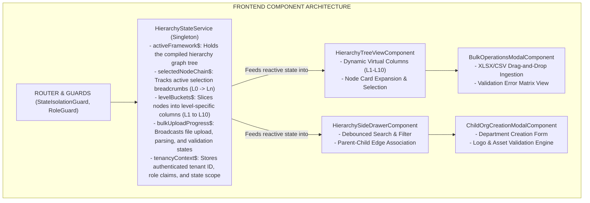

### 2.2 Frontend Component & Service Specifications

#### 1. `HierarchyStateService` (State Store)

- **Scope:** Root-level Angular singleton service managing reactive state for organizational hierarchies.
- **State Properties:**
  - `activeFramework$`: Observable stream emitting the published hierarchy tree.
  - `selectedNodeChain$`: Observable stream tracking selected parent-to-child navigation paths.
  - `levelBuckets$`: Derived stream organizing nodes into level-indexed arrays ().
  - `bulkUploadProgress$`: Stream broadcasting file parsing percentages and validation states.
  - `tenancyContext$`: Stores the active user's channel identifier, administrative roles, and state scope.

- **Core Operations:**
  - `loadFramework(frameworkCode)`: Calls the Framework API, updates `activeFramework$`, and organizes nodes into level buckets.
  - `updateSelectionChain(nodes)`: Prunes or extends the active selection path and resolves child nodes for the next column.
  - `resolveDirectChildren(nodeId)`: Filters cached term associations to return immediate child nodes.
  - `purgeSelectionDownstream(level)`: Clears active column selections below the specified level.

#### 2. `HierarchyTreeViewComponent`

- **Template Architecture:** Renders horizontal cascading columns representing levels to using Angular CDK Virtual Scrolling to handle large trees efficiently.
- **Inputs & Configuration:** Receives `frameworkCode` as an input parameter; binds to `levelBuckets$` for dynamic column rendering.
- **UI Interactions:**
  - Node click events trigger `onNodeSelected()`, expanding subordinate units in the adjacent column.
  - Context menu actions trigger dialog workflows for adding child units, adding siblings, editing unit details, or delinking nodes.

#### 3. `HierarchySideDrawerComponent`

- **Template Architecture:** Slide-out configuration drawer for linking unassociated organizations into the active hierarchy.
- **Search Engine Integration:** Uses debounced input handlers to query Elasticsearch through the API gateway, returning active organizations scoped to the user's state or ministry.
- **Validation Guards:** Checks candidate nodes against the active hierarchy to prevent duplicate parent assignments and cyclical references before dispatching link requests.

#### 4. `BulkOperationsModalComponent`

- **Template Architecture:** Modal interface handling full-tree spreadsheet uploads and downloads.
- **File Handling:** Validates file formats (`.xlsx`, `.csv`) and enforces a 100 MB upload limit.
- **Error Display:** When validation errors occur (`HTTP 422`), it parses the returned error payload and renders an issue table displaying affected rows, invalid organization codes, and failure descriptions.

#### 5. `ChildOrgCreationModalComponent`

- **Template Architecture:** Form dialog allowing MDO Leaders to instantiate new administrative bodies.
- **Field Validations:** Enforces character limits (1–100 characters), alphanumeric naming rules, and image restrictions for department logos (, PNG/JPEG format).
- **Processing:** On submission, it creates the organization record in the master database and automatically registers it as an node under the parent Ministry.

### 2.3 Route Guards & Interceptor Specifications

- `StateIsolationGuard`: Route protection guard that inspects JWT token claims. For `SPV_STATE_ADMIN` users, it verifies that the requested `stateId` parameter matches their assigned jurisdiction; unauthorized requests are redirected to access-denied pages.
- `TenancyHeaderInterceptor`: HTTP interceptor that captures outgoing API requests to hierarchy endpoints and injects required tenancy headers (`X-Channel-Id`, `X-State-Id`, and `X-Authenticated-User-Token`).

## 3. Ingress & Gateway Layer (Kong / Nginx Ingress Rules)

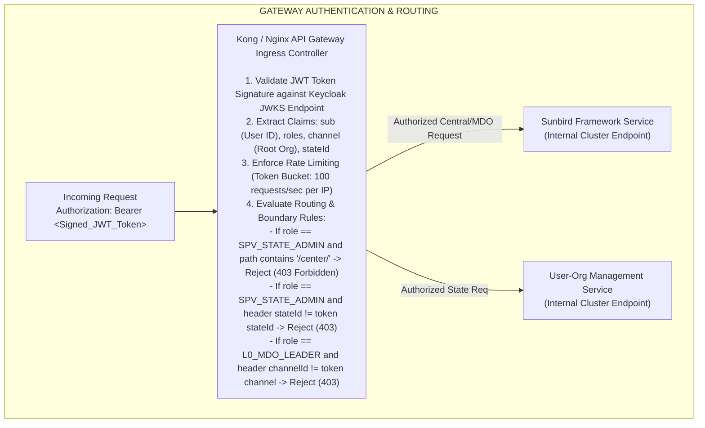

## 4. Backend Microservice Class & Interface Topology

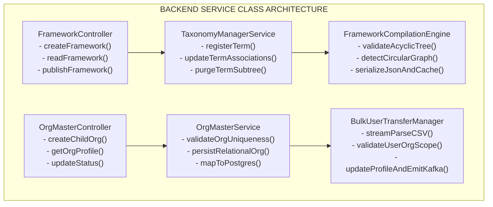

### 4.1 Sunbird Framework & Taxonomy Engine Specifications

#### 1. `FrameworkController`

- **Responsibilities:** Exposes external HTTP endpoints for taxonomy framework administration.
- **Key Operations:**
  - `createFramework(request)`: Initializes root framework definitions for Ministries or States.
  - `readFramework(frameworkId)`: Serves serialized hierarchy trees from Redis or Cassandra.
  - `publishFramework(frameworkId)`: Initiates graph validation, compiles tree structures, and flushes cache tiers.

#### 2. `TaxonomyManagerService`

- **Responsibilities:** Manages granular updates to categories, terms, and directed relationship edges.
- **Key Operations:**
  - `registerTerm(categoryCode, termData)`: Registers an organization node as a taxonomy term within a level category ().
  - `updateTermAssociations(parentTermCode, childIdentifiers)`: Links child organizations to a parent node within the active framework.
  - `purgeTermSubtree(termCode)`: Removes a parent node and cleans up associated relationship edges.

#### 3. `FrameworkCompilationEngine`

- **Responsibilities:** Enforces graph validation rules, compiles the nested JSON hierarchy, updates distributed caches, and publishes change events.
- **Key Operations:**
  - Validates single-parent constraints and checks for cyclic references across all nodes.
  - Generates nested JSON representations of the hierarchy tree.
  - Stores compiled structures in Cassandra and updates distributed Redis caches.
  - Publishes change notifications to Apache Kafka for downstream analytics consumers.

### 4.2 User-Org Management Service Specifications

#### 1. `OrgMasterController` & `OrgMasterService`

- **Responsibilities:** Manages organization master records, verifies name uniqueness within administrative branches, and handles department metadata.
- **Key Operations:**
  - Validates department names for duplicates within the parent Ministry's namespace.
  - Stores organization profiles in PostgreSQL with appropriate status flags (`status = 'Live'`).
  - Manages designation master lists and administrative role assignments for subordinate departments.

#### 2. `BulkUserTransferManager`

- **Responsibilities:** Asynchronously processes user reassignment spreadsheets, updates profile mappings, and emits synchronization events.
- **Key Operations:**
  - Streams and validates uploaded user transfer CSV files.
  - Verifies that target organizations belong to the administrator's authorized hierarchy branch.
  - Reassigns user records to target organizations and logs transfer activities.
  - Emits user movement events to Kafka for data lake synchronization.

## 5. Algorithmic Logic & Flow Specifications

### 5.1 Directed Acyclic Graph (DAG) Cycle Detection & Tree Validation Flow

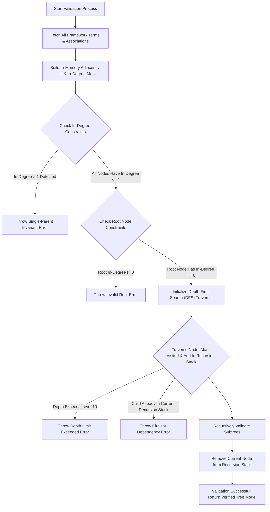

### 5.2 Full-Tree Overwrite Bulk Processing Flow

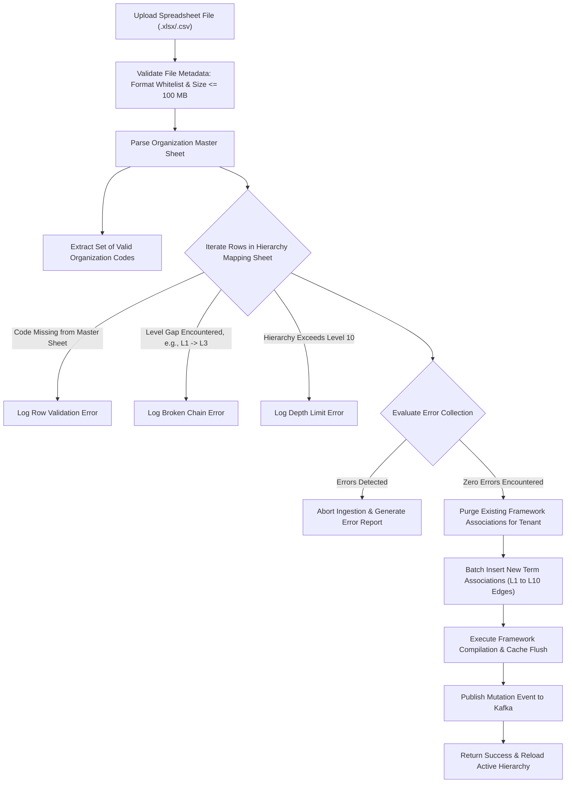

### 5.3 Cascading Delink & Re-Parenting Flow

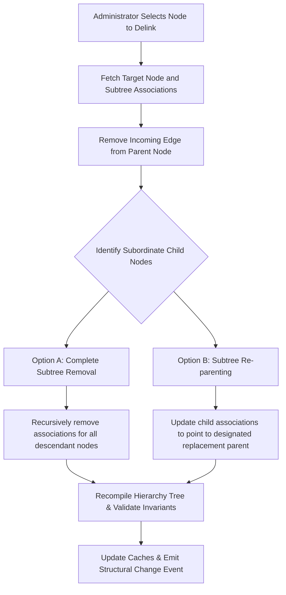

## 6. Detailed Physical Data Design & Schemas

### 6.1 PostgreSQL Relational Data Dictionary

#### Table Name: `organisation_master`

- **Schema:** `igot_user_org`
- **Description:** Primary registry for all platform administrative entities, recording identity metadata and parent relationships.

| Column Name | Data Type | Nullable | Constraints & Defaults | Functional Description |
|---|---|---|---|---|
| `org_id` | `VARCHAR(64)` | No | `PRIMARY KEY` | Unique internal system identifier for the organization |
| `org_code` | `VARCHAR(64)` | No | `UNIQUE` | Human-readable business organization code |
| `org_name` | `VARCHAR(128)` | No | Indexed per root | Display name of the administrative entity |
| `description` | `TEXT` | Yes | Max 1000 characters | Department description and responsibilities |
| `logo_url` | `VARCHAR(256)` | Yes | Valid URI format | Public URL path for the department emblem or logo |
| `status` | `VARCHAR(32)` | No | Default: `'Live'` | Operational status (`Live`, `Inactive`, `Blocked`) |
| `root_org_id` | `VARCHAR(64)` | No | Foreign reference | Identifies the root Ministry or State Government () |
| `parent_org_id` | `VARCHAR(64)` | Yes | Foreign reference | Immediate parent organization identifier |
| `hierarchy_level` | `INT` | No | Check: `0 <= level <= 10` | Level depth (0 for root, up to 10 for field units) |
| `state_id` | `VARCHAR(64)` | Yes | Indexed | State identifier; null for Central Ministries |
| `created_by` | `VARCHAR(64)` | No | Audit reference | Identifier of user who created the record |
| `created_at` | `TIMESTAMPTZ` | No | Default: `CURRENT_TIMESTAMP` | Initial record creation timestamp |
| `updated_at` | `TIMESTAMPTZ` | No | Default: `CURRENT_TIMESTAMP` | Last record modification timestamp |

#### Table Name: `org_designation_master`

- **Schema:** `igot_user_org`
- **Description:** Stores designation masters configured for specific departments.

| Column Name | Data Type | Nullable | Constraints & Defaults | Functional Description |
|---|---|---|---|---|
| `designation_id` | `VARCHAR(64)` | No | `PRIMARY KEY` | Unique internal identifier for the designation record |
| `org_id` | `VARCHAR(64)` | No | `FK -> organisation_master` | Target organization unit identifier |
| `designation_name` | `VARCHAR(128)` | No | Unique per organization | Official designation title |
| `status` | `VARCHAR(32)` | No | Default: `'Active'` | Operational status (`Active`, `Deprecated`) |
| `created_at` | `TIMESTAMPTZ` | No | Default: `CURRENT_TIMESTAMP` | Designation creation timestamp |

### 6.2 Apache Cassandra Taxonomy Data Dictionary

#### Keyspace: `sunbird_framework`

- **Replication Strategy:** `NetworkTopologyStrategy` (Data Center factor: 3)

#### Table Name: `framework_hierarchy`

- **Description:** Stores compiled, serialized JSON hierarchy trees for fast read operations.

| Column Name | CQL Data Type | Key Category | Functional Description |
|---|---|---|---|
| `framework_id` | `text` | Partition Key | Unique framework code (`<channel>_org_hierarchy`) |
| `compiled_tree` | `text` | Regular Column | Serialized nested JSON containing the full hierarchy tree |
| `last_published_on` | `timestamp` | Regular Column | Compilation timestamp |
| `version` | `text` | Regular Column | Optimistic concurrency version identifier |

#### Table Name: `term_association`

- **Description:** Stores directed edges linking parent and child organization terms.

| Column Name | CQL Data Type | Key Category | Functional Description |
|---|---|---|---|
| `framework_id` | `text` | Composite Partition Key | Associated framework identifier |
| `category_code` | `text` | Composite Partition Key | Level tier category (e.g., `L1 - Departments`) |
| `term_code` | `text` | Clustering Key (ASC) | Parent organization term code |
| `associated_term_code` | `text` | Clustering Key (ASC) | Child organization term code |
| `association_type` | `text` | Regular Column | Edge relationship type (`hasSubUnit`) |
| `created_on` | `timestamp` | Regular Column | Relationship creation timestamp |

### 6.3 Elasticsearch Index Specification

#### Index Alias: `idx_organisation_terms`

- **Primary Shards:** 3 | **Replica Factor:** 2
- **Field Mapping Definitions:**
  - `identifier` (`keyword`): Exact term identifier used for direct filtering.
  - `code` (`keyword`): Organization business code used for exact term lookups.
  - `name` (`text` with custom Edge-Ngram Analyzer): Analyzed organization title supporting typeahead searches.
  - `name.raw` (`keyword`): Unanalyzed string used for sorting and aggregations.
  - `category` (`keyword`): Associated level category code ().
  - `level` (`integer`): Numeric level depth indicator.
  - `rootOrgId` (`keyword`): Channel scope identifier used for tenant isolation.
  - `stateId` (`keyword`): State identifier used for regional boundary filtering.
  - `status` (`keyword`): Operational state (`Live`, `Inactive`).

### 6.4 Google BigQuery Data Lakehouse Schema

#### Table Identifier: `igot_analytics.org_hierarchy_flattened`

- **Partition Strategy:** Daily partitioning by `snapshot_date`
- **Clustering Fields:** `root_org_id`, `level_depth`, `state_id`

| Field Identifier | Data Type | Mode | Description |
|---|---|---|---|
| `snapshot_date` | `DATE` | Required | Partition date reflecting state snapshot |
| `root_org_id` | `STRING` | Required | Root Ministry or State identifier () |
| `root_org_name` | `STRING` | Required | Display name of the root organization |
| `org_id` | `STRING` | Required | Current organization node identifier |
| `org_code` | `STRING` | Required | Business organization code |
| `org_name` | `STRING` | Required | Official organization name |
| `level_depth` | `INT64` | Required | Hierarchy depth (0 for root, up to 10) |
| `parent_org_id` | `STRING` | Nullable | Immediate parent organization identifier |
| `parent_org_name` | `STRING` | Nullable | Immediate parent display name |
| `ancestor_path` | `STRING` | Required | Materialized path string (e.g., `/L0/L1/L2`) |
| `assigned_user_count` | `INT64` | Required | Active users assigned to this organization |
| `state_id` | `STRING` | Nullable | State code; null for Central Ministries |
| `is_active` | `BOOLEAN` | Required | Status flag indicating if organization is active |
| `last_sync_timestamp` | `TIMESTAMP` | Required | Timestamp when record was synced from Kafka |

## 7. REST API Interface Contracts

### 7.1 Contract Specifications

#### 1. Term Association Update (Link Parent-Child Edges)

- **HTTP Method & Route:** `PATCH /apis/proxies/v8/framework/v1/term/update/{termCode}`
- **Query Parameters:** `framework={frameworkCode}&category={categoryCode}`
- **Mandatory Headers:** `Authorization: Bearer <Token>`, `X-Channel-Id: <Channel>`, `Content-Type: application/json`
- **Request Fields:**
  - `request.term.associations`: Array of child term identifier objects (`identifier: string`).

- **Expected Responses:**
  - `200 OK`: Association successfully created; returns updated `node_id` and `versionKey`.
  - `400 Bad Request`: Malformed payload or missing association identifiers.
  - `403 Forbidden`: Tenant mismatch between caller channel and framework owner.
  - `422 Unprocessable Entity`: Operation would violate acyclic tree or single-parent constraints.

#### 2. Framework Publication (Tree Compilation)

- **HTTP Method & Route:** `POST /apis/proxies/v8/framework/{frameworkCode}`
- **Mandatory Headers:** `Authorization: Bearer <Token>`, `X-Channel-Id: <Channel>`
- **Request Payload:** Empty JSON object (`{}`).
- **Processing:** Validates the hierarchy structure, compiles the nested JSON tree, updates Redis and Cassandra caches, and emits change events to Kafka.
- **Expected Responses:**
  - `200 OK`: Framework compiled and published; returns compilation status and timestamp.
  - `422 Unprocessable Entity`: Validation failure (circular references detected or depth exceeds 10 levels).

#### 3. Hierarchy Retrieval (Read Live Tree)

- **HTTP Method & Route:** `GET /apis/proxies/v8/framework/v1/read/{frameworkCode}`
- **Headers:** `Authorization: Bearer <Token>`, `X-Channel-Id: <Channel>`
- **Response Structure:** Returns compiled hierarchy details, category definitions, and nested term trees containing child node lists and user counts.

#### 4. Bulk User Transfer

- **HTTP Method & Route:** `POST /apis/proxies/v8/user/v1/bulk/transfer`
- **Headers:** `Authorization: Bearer <Token>`, `Content-Type: multipart/form-data`
- **Request Payload:** Multipart file stream containing user reassignment CSV data.
- **Response Structure:** Returns batch summary metrics (`totalProcessed`, `successCount`, `failureCount`) along with an array of any row-level validation errors encountered.

## 8. Event Streaming Design (Kafka Message Contracts)

### 8.1 Mutation Event Specifications

#### Topic: `telemetry.org.mutations`

- **Publishing Component:** Sunbird Framework Service
- **Trigger Event:** Framework publication, bulk hierarchy replacement, or node delinking.
- **Message Properties:**
  - `eventId`: Unique UUID identifying the mutation event.
  - `traceId`: Distributed tracing identifier.
  - `timestamp`: Epoch millisecond timestamp of the operation.
  - `actor.userId`: Identifier of the executing administrator.
  - `actor.role`: Administrative role used during execution (`L0_MDO_LEADER`, `SPV_ADMIN`).
  - `actor.channel`: Administrative channel scope.
  - `action`: Action descriptor (`NODE_CREATED`, `EDGE_LINKED`, `EDGE_DELINKED`, `FULL_TREE_REPLACED`, `FRAMEWORK_PUBLISHED`).
  - `target.frameworkId`: Identifier of the modified framework.
  - `target.rootOrgId`: Root Ministry or State identifier.
  - `target.affectedNodeCount`: Total nodes affected by the mutation.

#### Topic: `analytics.cdc.hierarchy.sync`

- **Publishing Component:** User-Org Management Service
- **Trigger Event:** Bulk user transfer execution or individual organization reassignment.
- **Message Properties:**
  - `eventType`: Event identifier (`BULK_USER_TRANSFER`).
  - `batchId`: Batch processing identifier.
  - `sourceOrgId`: Source organization identifier.
  - `destinationOrgId`: Destination organization identifier.
  - `transferredUserIds`: Array of user identifiers included in the transfer.
  - `executedBy`: User identifier of the administrator who performed the transfer.
  - `timestamp`: ISO-8601 timestamp of execution.

## 9. Dynamic Interaction & Sequence Designs

### 9.1 Sequence: Child Org Creation & Tree Edge Binding

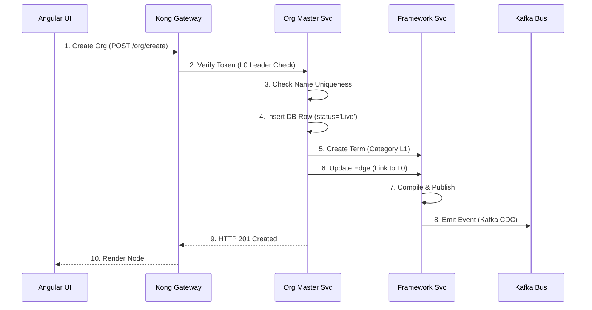

### 9.2 Sequence: Full-Tree Bulk Upload Validation & Replacement

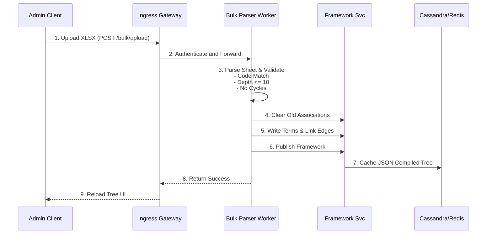

### 9.3 Sequence: Bulk User Reallocation & Profile Mutation

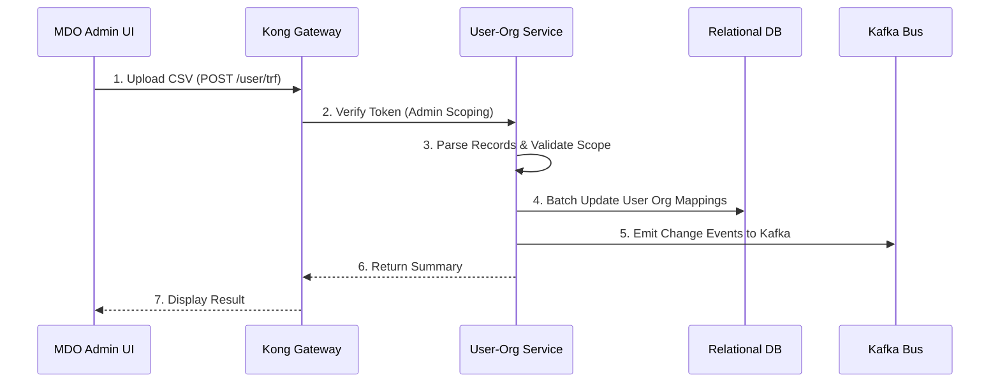

### 9.4 State Transition Model: Organization Hierarchy Node

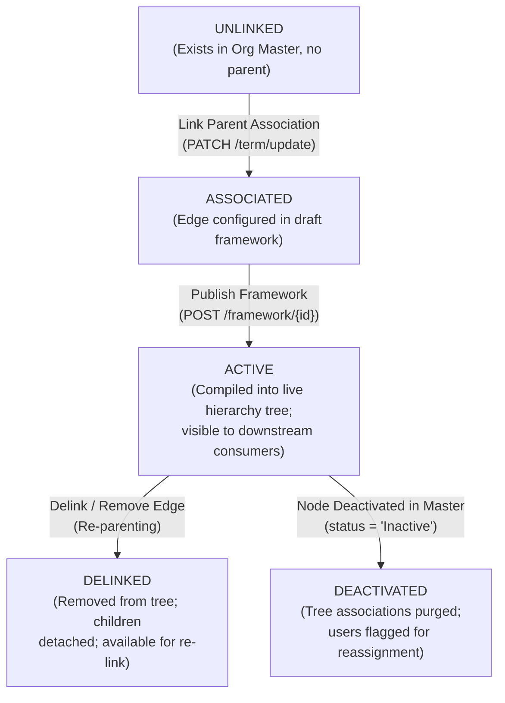

## 10. Cross-Portal Consumption Engine Designs

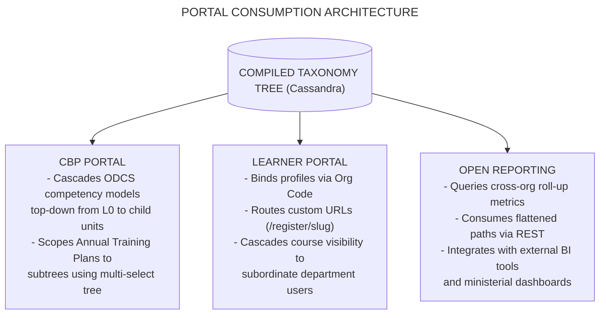

### 10.1 CBP Portal: Multi-Tier Training Plan Target Audience Resolver

- **Functional Purpose:** Resolves target audiences when a training planner selects an intermediate organizational unit (e.g., an Directorate), including all personnel in subordinate departments ().
- **Execution Logic:**
  - Retrieves the compiled framework tree (`GET /framework/v1/read`) for the relevant Ministry.
  - Traverses the hierarchy downward from the selected target node using Depth-First Search (DFS).
  - Collects all subordinate organization identifiers into a resolution list.
  - Queries the User-Org service to retrieve user rosters for the collected organization IDs.
  - Dynamically links the resolved users to the training plan's target audience.

### 10.2 Learner Portal: Custom Self-Registration (CSR) Route Resolver

- **Functional Purpose:** Resolves department context when an unauthenticated learner accesses a custom department onboarding link (`/register/{customOrgSlug}`).
- **Execution Logic:**
  - Extracts the organization slug from the active route URL.
  - Resolves the slug against the organization master service to fetch department details.
  - Validates that the organization is active (`status = 'Live'`).
  - Retrieves the department's position in the hierarchy along with parent Ministry branding details.
  - Renders the onboarding interface with department-specific branding and enforces email domain restrictions.

### 10.3 Open Reporting & BigQuery Path Analytics Engine

- **Materialized Path Aggregation:** Uses materialized path strings (e.g., `/L0-MOF/L1-REV/L2-DIR`) to aggregate training metrics across nested organizational branches using prefix-matching queries.
- **REST Integration:** Open Reporting APIs expose aggregated training metrics by level depth, state jurisdiction, and ministry branch for external reporting systems.

## 11. Exception Handling, Error Dictionary & Testing Design

### 11.1 Error Code Dictionary

| Internal Error Code | HTTP Status | Originating Component | Root Cause Condition | User Error Message |
|---|---|---|---|---|
| `ERR_ORG_NAME_DUPLICATE` | `409 Conflict` | `OrgMasterService` | Name matches an existing child under the same tree | An organization with this name already exists in your administrative hierarchy. |
| `ERR_HIERARCHY_MAX_DEPTH` | `422 Unproc` | `FrameworkCompilationEngine` | Attempt to link a child node below Level 10 () | Hierarchy depth limit reached. The platform allows a maximum of 10 levels. |
| `ERR_SINGLE_PARENT_BREACH` | `422 Unproc` | `FrameworkCompilationEngine` | Attempt to link an organization that already has a parent | Node already has an assigned parent; multiple parent links are not supported. |
| `ERR_GRAPH_CYCLE_DETECTED` | `422 Unproc` | `FrameworkCompilationEngine` | Circular reference detected in hierarchy | Cycle detected in organization hierarchy definition. |
| `ERR_BROKEN_CHAIN_LEVEL` | `422 Unproc` | `BulkParserWorker` | Skipped level in bulk upload (e.g., without ) | Broken hierarchy chain detected: Skipped intermediate levels. |
| `ERR_STATE_BOUNDARY_BREACH` | `403 Forbidden` | `Kong Ingress / Gateway` | State Admin attempting to mutate Center or another state | Unauthorized cross-boundary modification blocked. |

### 11.2 Verification Test Matrix

| Test Identifier | Test Target | Execution Scenario | Expected System Behavior |
|---|---|---|---|
| `TC-LLD-001` | Single Parent Rule | Attempt to link an organization to a second parent node | Operation rejected (`HTTP 422`); single-parent error returned |
| `TC-LLD-002` | Max Depth Limit | Attempt to link a child node beneath Level 10 () | Operation blocked (`HTTP 422`); depth limit error returned |
| `TC-LLD-003` | Cycle Detection | Attempt to create circular parent-child links | Validation engine detects cycle; operation aborted |
| `TC-LLD-004` | State Tenancy Check | State Admin attempts to modify Central Ministry records | Gateway blocks request (`HTTP 403 Forbidden`); security alert logged |
| `TC-LLD-005` | Bulk Broken Chain | Upload spreadsheet with and nodes, omitting | Ingestion rejected; error report highlights broken chain at row |
| `TC-LLD-006` | Downward User Transfer | MDO Admin transfers users downward to a child department | User profile updated; change event emitted to Kafka |

## 12. Requirement-to-Design Traceability Matrix (Q2 – Q13)

**REQUIREMENT-TO-DESIGN TRACEABILITY MATRIX**

| Requirement ID | Functional Capability | Jira Reference | Design Component | Architectural Pattern / Technology |
|---|---|---|---|---|
| REQ-FUNC-ORG-001 | Child Org Creation (L0) | KB-10512 | OrgMasterManager | REST API / PostgreSQL Transaction |
| REQ-FUNC-ORG-002 | Duplicate Org Validation | KB-10512 | Relational Database | Case-Insensitive Unique Constraint Index |
| REQ-FUNC-ORG-003 | Subtree Delinking Rules | KB-9033, KB-10513 | TaxonomyManager | Cascading Term Association Purge |
| REQ-FUNC-HIER-001 | Interactive Card UI Tree | KB-9033, KB-10513 | Angular Frontend Shell | CDK Virtual Scroll Dynamic Columns |
| REQ-FUNC-HIER-002 | Parent-Child Edge Link | KB-9033, KB-10513 | TermAssociationManager | Directed Graph Edges in Framework Service |
| REQ-FUNC-HIER-004 | Max Depth (L10) Limit | KB-9740, KB-10501 | FrameworkCompilationEng | Schema Validator (Categories <= 10) |
| REQ-FUNC-BULK-001 | Template Export | KB-9737, KB-10533 | BulkParserWorker | Streaming Dynamic Excel Generator |
| REQ-FUNC-BULK-003 | Full Tree Overwrite | KB-9737, KB-10533 | FrameworkCompilationEng | Complete Tree Replacement Strategy |
| REQ-FUNC-USER-001 | Bulk User Transfer CSV | KB-10514 | BulkUserTransferManager | Asynchronous Streaming Batch Processor |
| REQ-FUNC-SEC-001 | State Admin Isolation | KB-9197 | Kong Gateway Ingress | Cryptographic JWT Claims Interceptor |
| REQ-FUNC-INT-001 | BigQuery Hierarchy Sync | KB-9801, KB-10534 | Analytics Pipeline | Kafka CDC Streaming Pipeline |
| REQ-FUNC-INT-002 | Open Reporting Hierarchy API | KB-10576 | OpenReportingController | Read-Only Flattened Path Cache REST API |
| REQ-FUNC-INT-003 | Training Plan Scoping (CBP) | KB-10577 | CBP Module | Hierarchical Multi-Select Tree Picker |
| REQ-FUNC-INT-004 | ODCS Competency Cascade | KB-10578 | CompetencyMappingService | Event-Driven Reactive Competency Sink |
| REQ-FUNC-INT-005 | Custom Self-Registration | KB-10574 | CSR Proxy Controller | Slug-to-Organization Ingress Resolver |

## 13. References & Technical Glossary

### 13.1 Authoritative Requirement & Architecture References

- **Confluence Specifications:**
  - [SRS - Organisation Hierarchy | MDO Admin & MDO Leader | MDO Portal](https://karmayogibharat.atlassian.net/wiki/spaces/TES/pages/517931009/SRS+-+Organisation+Hierarchy+MDO+Admin+MDO+Leader+MDO+Portal)
  - [SRS - Organisation Hierarchy Update | SPV Admin & SPV State | AdminSPV Portal](https://karmayogibharat.atlassian.net/wiki/spaces/TES/pages/416317441/SRS+-+Organisation+Hierarchy+Update+SPV+Admin+SPV+State+AdminSPV+Portal)
  - [Organisation Hierarchy View](https://karmayogibharat.atlassian.net/wiki/spaces/TES/pages/396328967/Organisation+Hierarchy+View)
  - [L0 Hierarchy Management- MDO Portal](https://karmayogibharat.atlassian.net/wiki/spaces/KQAS/pages/503612134/L0+Hierarchy+Management-+MDO+Portal)
  - [Organization Hierarchy update SPV Admin](https://karmayogibharat.atlassian.net/wiki/spaces/KQAS/pages/417071170/Organization+Hierarchy+update+SPV+Admin)

- **Jira Initiatives & Epics:** [KB-8975: Q8 | Organization Hierarchy management](https://karmayogibharat.atlassian.net/browse/KB-8975) (Open), [KB-8018: Q8 | Organisation Hierarchy Update | SPV Admin & SPV State | AdminSPV Portal](https://karmayogibharat.atlassian.net/browse/KB-8018) (KB Approved), [KB-10500: Q9 | Org hierarchy Management & Impacted Areas](https://karmayogibharat.atlassian.net/browse/KB-10500) (KB Review), [KB-10501: Q9 | L0 hierarchy Management | MDO Portal](https://karmayogibharat.atlassian.net/browse/KB-10501) (KB Review), [KB-10502: Q9 | Org hierarchy Impacted areas](https://karmayogibharat.atlassian.net/browse/KB-10502) (KB Review), [KB-8441: Q7 | Tech Debt | Org Hierarchy Enhancements](https://karmayogibharat.atlassian.net/browse/KB-8441) (In Progress), [KB-4441: Q4 | Ad-Hoc Requests | Organisation rename and Hierarchy cleanup.](https://karmayogibharat.atlassian.net/browse/KB-4441) (In Progress).
- **Delivery Stories:** [KB-9033: Q8 | Organisation Hierarchy Management | SPV Admin | SPV Portal](https://karmayogibharat.atlassian.net/browse/KB-9033) (Prod Deployed), [KB-9197: Q8 | Organisation Hierarchy Access Management | SPV & State Admin | SPV Portal](https://karmayogibharat.atlassian.net/browse/KB-9197) (Prod Deployed), [KB-9737: Q8 | Bulk Upload & Download | Org Hierarchy Management | SPV Portal](https://karmayogibharat.atlassian.net/browse/KB-9737) (Prod Deployed), [KB-9738: Q8 | Org Search Funcationality | Organisation Hierarchy Management](https://karmayogibharat.atlassian.net/browse/KB-9738) (Prod Deployed), [KB-9740: Q8 | Manage Hierarchy Levels/Layers & Renaming | SPV Portal](https://karmayogibharat.atlassian.net/browse/KB-9740) (To Do), [KB-9790: Q8 | Organisation Hierarchy View | SPV & State Admin | SPV Portal](https://karmayogibharat.atlassian.net/browse/KB-9790) (To Do), [KB-9795: Q8 | Organisation Specific Page Redirection | Organisation Hierarchy Management | SPV Portal](https://karmayogibharat.atlassian.net/browse/KB-9795) (Prod Deployed), [KB-9801: Q8 | Organisation Hierarchy Sync with BQ for reporting | Organisation Hierarchy Management](https://karmayogibharat.atlassian.net/browse/KB-9801) (Open), [KB-10512: Q9 | Child Organization Creation Capability Dev Completed](https://karmayogibharat.atlassian.net/browse/KB-10512), [KB-10513: Q9 | Implement Org-Specific Hierarchy Management | MDO Portal Dev Completed](https://karmayogibharat.atlassian.net/browse/KB-10513), [KB-10514: Q9 | Create Bulk User Transfer Feature (Add/Update) | MDO Portal](https://karmayogibharat.atlassian.net/browse/KB-10514) (DEV IN PROGRESS), [KB-10515: Q9 | Enable Child Org Data Management | MDO Portal Code](https://karmayogibharat.atlassian.net/browse/KB-10515) (Review), [KB-10533: Q9 | Bulk Upload | Organisation Hierarchy Management Dev Completed](https://karmayogibharat.atlassian.net/browse/KB-10533), [KB-10534: Q9 | Organisation Hierarchy Sync with BQ for reporting | Organisation Hierarchy Management](https://karmayogibharat.atlassian.net/browse/KB-10534) (In-Progress), [KB-10535: Q9 | Data Tracking | Org Hierarchy Management | MDO Portal](https://karmayogibharat.atlassian.net/browse/KB-10535) (DEV IN PROGRESS), [KB-10574: Q9 | Custom Self registration Functionality | Org Hierarchy Management](https://karmayogibharat.atlassian.net/browse/KB-10574) (Open), [KB-10575: Q9 | MDO Reports | MDO Portal](https://karmayogibharat.atlassian.net/browse/KB-10575) (In-Progress), [KB-10576: Q9 | Open APIs for reporting](https://karmayogibharat.atlassian.net/browse/KB-10576) (Prod Deployed), [KB-10577: Q11 | Ad-Hoc | CA and APAR Enhancements |Org Hierarchy in Training Plan Creation | MDO Portal](https://karmayogibharat.atlassian.net/browse/KB-10577) (Open), [KB-10578: Q9 | ODCS effectiveness for Child Organisations | MDO Portal](https://karmayogibharat.atlassian.net/browse/KB-10578) (Open), [KB-15967: Tech Debt | Org Hierarchy Enhancements](https://karmayogibharat.atlassian.net/browse/KB-15967) (Open).
- **Ad-Hoc & Infrastructure Tickets:** [KB-428: Q2 l Data Warehousing l Org hierarchy fields](https://karmayogibharat.atlassian.net/browse/KB-428) (Prod Deployed), [KB-838: Q2 | Ad-Hoc Requests | Cleaning up MDO Hierarchy.](https://karmayogibharat.atlassian.net/browse/KB-838) (Open), [KB-1312: Org Hierarchy | Hierarchy cleanup activity and corresponding access to Orgs.](https://karmayogibharat.atlassian.net/browse/KB-1312) (Open), [KB-5057: Q4 | Ad-Hoc Requests | Data Warehouse, Operational Reports and Full exhausts enhancements | Org Hierarchy Table.](https://karmayogibharat.atlassian.net/browse/KB-5057) (Open), [KB-8442: Explore Neo4J to store org hierarchy](https://karmayogibharat.atlassian.net/browse/KB-8442) (Internal Review).

### 13.2 Technical Glossary

- **Adjacency Map:** An in-memory graph representation mapping each parent identifier to a list of direct child identifiers.
- **In-Degree:** The count of incoming directed edges arriving at a node in a directed graph. In a strict single-parent tree, the in-degree must be exactly 1 for all nodes except the root (which must have in-degree 0).
- **Materialized Path:** A hierarchical encoding pattern where a node stores its full ancestor chain as a formatted string (e.g., `/L0-ID/L1-ID/L2-ID`), allowing fast subtree querying without recursive joins.
- **Sunbird Framework:** The master taxonomy container representing an organization tree (`<channelId>_org_hierarchy`).
- **Sunbird Category:** An administrative level () within a taxonomy framework.
- **Sunbird Term:** An individual administrative organization node within a category.
- **Sunbird Term Association:** A directed parent-child edge linking two terms within a framework.
- **MDO:** Ministry, Department, and Organisation.
- **SPV:** Special Purpose Vehicle (Karmayogi Bharat central governance team).
- **ODCS:** Organizational Development & Competency Sub-framework.
- **CSR:** Custom Self-Registration.
