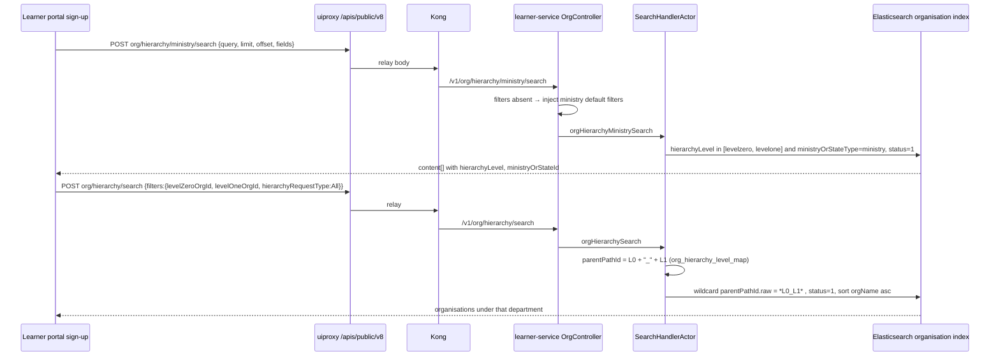
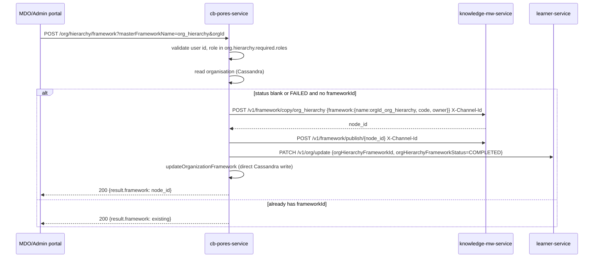
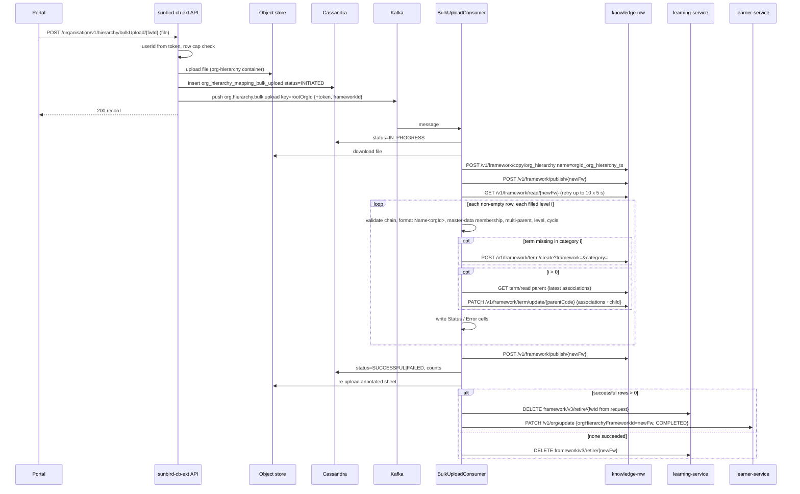
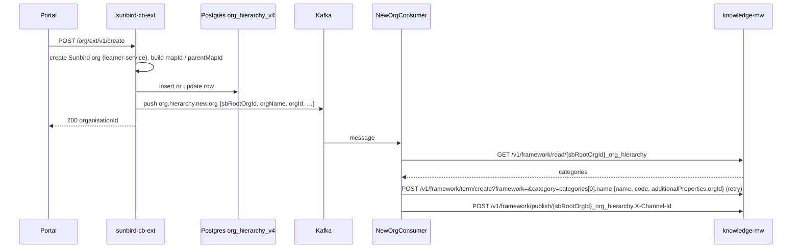
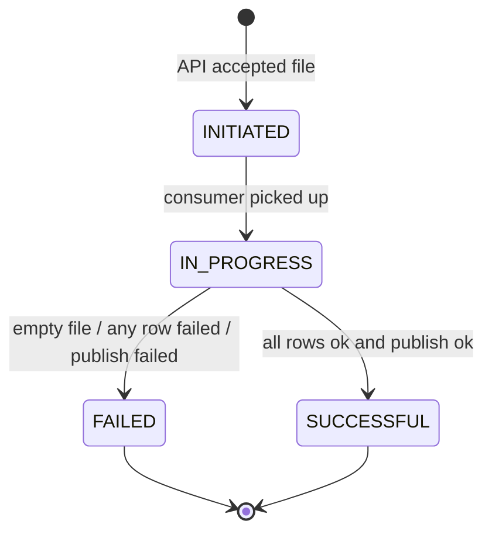

# Organisation Hierarchy — Low-Level Design

## Data model

### The framework (knowledge-platform, Neo4j)

| Object | Identity | Carries | Notes |
|---|---|---|---|
| Master framework | `org_hierarchy` | 10 categories | Property `org.hierarchy.master.framework`; category names/codes are the level headers (`org.hierarchy.headers.references`) |
| Per-org framework | `<rootOrgId>_org_hierarchy` (created by cb-pores) or `<rootOrgId>_org_hierarchy_<epochMillis>` (created by each bulk upload) | `name`, `code` = same string, `owner` = rootOrgId, `description` "Framework for Channel … customized copy derived from the Master Framework" | `cb-pores › OrgServiceImpl.createFramework:247-255`; `cb-ext › OrgHierarchyBulkUploadConsumer.createFramework:730-745` |
| Category | one per level, index 0 = L1 | `name`, `code`, `terms[]` | Bulk consumer maps sheet column *i* → `categories.get(i)` by header name |
| Term | `identifier` (KP node id), `code` = time-based UUID | `name` (org display name), `description`, `additionalProperties{orgId, parentOrgName}`, `associations[{identifier}]` (children) | `buildCreateTermRequest:164-186`; `OrgHierarchyForNewOrgConsumer:119-126` |

### Organisation record (Cassandra `sunbird.organisation`, via learner-service)

| Field | Set by | Values |
|---|---|---|
| `orgHierarchyFrameworkId` | cb-pores create; cb-ext bulk consumer (on ≥1 success) | framework id above |
| `orgHierarchyFrameworkStatus` | same, plus cb-pores `updateStatusToFailed` | `COMPLETED` / `FAILED` |

Written through `PATCH {learner-service}/v1/org/update` with
`{request:{organisationId, orgHierarchyFrameworkId, orgHierarchyFrameworkStatus}}`
(`createOrgHierarchyRequestMap:747-756`) and, in cb-pores, additionally by a
direct Cassandra update (`updateOrganizationFramework`). The portals read both
fields via `org/v1/read` (`org-hierarchy-mapping.component.ts:146-147`).

### Upload record (Cassandra `sunbird.org_hierarchy_mapping_bulk_upload`)

Columns as written/read in code (`bulkUploadOrgHierarchyMapping:213-224`,
`updateOrgHierarchyMappingBulkUploadStatus:112-137`,
`bulk.upload.status.fields`):

| Column | Type (as used) | Notes |
|---|---|---|
| `rootorgid` | text, partition key | `frameworkId.split("_")[0]` |
| `identifier` | text, clustering | random UUID returned to the UI |
| `filename`, `filepath` | text | from storage upload result |
| `datecreatedon`, `dateupdatedon` | timestamp | |
| `status` | text | `INITIATED` → `IN_PROGRESS` → `SUCCESSFUL` \| `FAILED` |
| `totalrecords`, `successfulrecordscount`, `failedrecordscount` | int | written at completion (`0,0,0` on empty file) |
| `createdby` | text | user id from token |
| `comment` | text | in the status-fields list; not written by this feature |

### Legacy flat hierarchy (Postgres `org_hierarchy_v4`)

Entity `sunbird-cb-ext › org/model/OrgHierarchy.java`:

| Column | Purpose |
|---|---|
| `id` (PK), `orgname`, `channel`, `orgcode` | |
| `mapid` | the org's own hierarchy key; generated by `createMapId` when absent |
| `parentmapid` | parent's `mapid`; `SPV` for State/Ministry roots |
| `sborgid`, `sbrootorgid`, `sborgtype`, `sborgsubtype` | link to the Sunbird org once created |
| `l1mapid`, `l2mapid`, `l1orgname`, `l2orgname` | denormalised top two ancestors |

Written in `ExtendedOrgServiceImpl.createOrg:154-209` (insert, or
`updateOrgIdForChannel` / `updateSbOrgIdAndSbOrgRootIdForChannel` when the row
pre-exists) and renamed by `update`/`updateV2`. Identity rules
(`createMapId:539-600`, `prepareChannelName:809-828`):

| Thing | Rule |
|---|---|
| `mapid` for a state / ministry | `S_<n>` / `M_<n>`; `parentmapid` = `SPV` |
| `mapid` for a child | `<parentMapId>_D_<n>` (department), `_O_<n>` (board), `_T_<n>` (training institute), `_X_<n>` (other); `n` = next counter among siblings with that prefix when `mapid.counter.enabled` |
| `channel` for a child created under an existing channel | `<L1 channel>_<L2 channel>_…_<requested channel>` (delimiter `org.channel.delimitter`) — walked up the Postgres tree, which also fills `l1mapid/l1orgname/l2mapid/l2orgname` |
| `sbrootorgid` | from the request, else `fetchRootOrgId(parentMapId)` |

`org/ext/v2/update` accepts only keys in `org.updatable.fields`
(`logo,orgName,orgId,description` in the repo;
`…,parentPathId` in the deployed Helm env — `sb-cb-ext-service-env.j2:578`).
`org/ext/v1/update` additionally refuses any row whose `sborgsubtype` is not
`board`. Read by `org/v1/list*`,
`orgExtSearch*`, sign-up search. Repository queries also reference an
`l3MapId` column (`isChildOrgPresent`, `findAllOrgByParentMapId`) that the
entity does not map — see [As-Built Requirements](as-built-requirements.md)
DEV-005.

### MDO children lookup (Postgres `public.mdo_children_lookup`)

`mdo_id`, `children_id` (comma-separated org ids), `created_at`, `updated_at`
(`orghierarchyreport/entity/MdoChildrenLookupEntity.java`). Read-only from
cb-ext; populated outside this feature (boundary below).

### Organisation search index (Elasticsearch, via learner-service)

Fields the sign-up pickers depend on (`sunbird-lms-service › service/…/model/organisation/Organisation.java:65-66`, `ElasticSearchHelper.java:190-245, 975-1030`):

| Field | Meaning | Used as |
|---|---|---|
| `hierarchyLevel` | `levelZero` (ministry/state root) / `levelOne` (department) / … — indexed lowercased on `.raw` | `advancedFilters.includeHierarchyLevels` term filter |
| `parentPathId` | ancestor ids joined by `_`, e.g. `<ministryId>_<deptId>` | wildcard `*<L0>_<L1>` (direct path) or `*<L0>_<L1>*` (`hierarchyRequestType=All`, all descendants) on `parentPathId.raw` |
| `ministryOrStateId`, `ministryOrStateType` | root org id / `ministry` \| `state` | returned to the form; `ministryOrStateType` term filter for `levelOne` rows |
| `sbOrgType` | `state`, `ministry`, … | term filter for `levelZero` rows |

Config (`core/platform-common/src/main/resources/externalresource.properties`):

| Key | Value |
|---|---|
| `org_hierarchy_level_map` | `levelZeroOrgId,levelOneOrgId` — order in which filter keys are joined into `parentPathId` |
| `org_hierarchy_search_filters_allowed_fields` | `levelZeroOrgId,levelOneOrgId,status,sbOrgType,hierarchyRequestType,advancedFilters` |
| `org_hierarchy_search_filter_criteria_ministry` | `{"status":1,"advancedFilters":{"includeHierarchyLevels":["levelZero","levelOne"],"ministryOrStateType":"ministry"}}` |
| `org_hierarchy_search_filter_criteria_state` | `{"status":1,"sbOrgType":"state"}` |

### Who writes the hierarchy attributes on the organisation record

Cassandra `sunbird.organisation` carries all of them as columns
(`sunbird-lms-service › core/cassandra-utils/src/main/resources/cassandratablecolumn.properties:164-175`):
`ministryorstateid`, `ministryorstatename`, `ministryorstatetype`,
`orghierarchyframeworkid`, `orghierarchyframeworkstatus`, `parentpathid`,
`hierarchylevel`. learner-service's `org/update` is a **generic
pass-through**: `updateOrgDao.putAll(request)` minus `rootOrgId`,
`contactDetails` and (outside bulk upload) `status`, then written to Cassandra
and synced to the organisation index
(`OrganisationManagementActor.updateOrgData:224-330`). So any client that
PATCHes these keys sets them; nothing in learner-service derives them.

What actually writes each attribute, traced through the portals' calls
*around* the framework APIs:

| Attribute | Written by | When | Source |
|---|---|---|---|
| `orgHierarchyFrameworkId`, `orgHierarchyFrameworkStatus` | cb-pores (create) · cb-ext bulk consumer (after ≥1 successful row) | hierarchy created / bulk upload replaces the framework | `OrgServiceImpl:436-445`, `OrgHierarchyBulkUploadConsumer:334-343` |
| `ministryOrStateId`, `ministryOrStateName`, `ministryOrStateType` | cb-ext at **org create** — looked up from Postgres `org_hierarchy_v4` by `parentMapId` when `organisationSubType=board` (department → its ministry/state), then sent to learner-service create | create-MDO / create-organisation screens | `ExtendedOrgServiceImpl.fetchStateOrMinistryDetails:1066-1098` |
| `parentPathId` | cb-ext `org/ext/v2/update` passes it through when present (`updateOrgDetailsToDB:1008-1009`). The **only portal write** is the tree view clearing it to `""` for each org whose connection is retired | after `framework/v1/term/retire`, before `publish` | `tree-view.component.ts:779-786` |
| `hierarchyLevel` | **no writer found** in any attached repo or remote branch (`sb-cb-ui-components`, `sunbird-cb-orgportal`, `sunbird-cb-adminportal`, `sunbird-cb-ext`, `cb-pores-service`, `sunbird-lms-service`) | — | `git grep` across `refs/remotes/*` |

The tree view's framework edits do **not** update the organisation record
(verified call order, `tree-view.component.ts`):

| Action | Calls, in order | Org record touched? |
|---|---|---|
| Add orgs under a node (`createTerms:580-617`) | `org/v1/search` (pick) → `framework/v1/term/create` × n → `framework/v1/term/update/{parentCode}` with merged `associations` (only when `column.index > 1`) → `framework/v1/publish` → re-read | **No** |
| Remove connection (`retire…:740-800`) | `framework/v1/term/retire` → **`PATCH org/ext/v2/update {orgId, parentPathId: ""}`** per removed org → `framework/v1/publish` | Yes — clears `parentPathId` only |
| Rename / re-link (`updateFrameworkAssociation:959`, `updateCategory:904`) | `framework/v1/term/update` / `framework/v1/category/update` → publish | **No** |

Bulk upload likewise writes only the framework pointer on the org, never
`parentPathId`/`hierarchyLevel` (`createOrgHierarchyRequestMap:747-756`).

Consequence: the sign-up pickers filter on `parentPathId.raw` and
`hierarchyLevel.raw`, but neither the tree view nor the bulk upload nor org
create populates those two fields in the attached code. Either they are set by
a process outside these repos (a migration/one-off script, or a newer
portal build than `cbrelease-4.8.41.x`), or the sign-up picker only ever sees
organisations that were back-filled. Recorded as DEV-011 / DEV-012.

## Sequence — public sign-up pickers

## Sequence — create hierarchy

## Sequence — bulk upload

Row-processing rules (`processHierarchyRow:353-489`), in order of evaluation
per cell at level *i*:

1. L1 blank → error, stop row. Cell filled but previous level blank → error.
   Blank then filled later → "Missing intermediate level".
2. Cell must match `Name<orgId>`; `identifier` = regex group 1
   (`org.hierarchy.identifier.regex.pattern`), `name` = text before `<`.
3. Multi-parent check against an in-memory `childToParentMap` (whole sheet);
   cycle check by walking that map.
4. If the term was already placed by an earlier row (`termPositionMap`), it
   must be at the same category and level; otherwise reuse it and continue.
5. `orgId` *or* name must exist in `frameworkUtil.getMasterData(rootOrgId)`
   (fetched per cell — see as-built NFR note).
6. `findTermInFramework` by name in the cached framework data; create if
   absent; keep the in-memory framework in sync.
7. For *i* > 0: read the parent's latest `associations` from KM, append the
   child if absent, PATCH the parent.

## Sequence — new organisation auto-added

## State — upload record

Note that `FAILED` does not mean nothing changed: with ≥1 successful row the
org is already re-pointed to the new framework.

## Configuration (sunbird-cb-ext `application.properties`)

| Property | Default | Used for |
|---|---|---|
| `org.hierarchy.master.framework` | `org_hierarchy` | copy source |
| `org.hierarchy.level.count` | `10` | columns read per row |
| `org.hierarchy.headers.references` | `L1 - Districts,L2 - Tehsil,L3 - Offices,L4,…,L10` | template dropdown headers |
| `org.hierarchy.headers.master.data` | `orgId,orgName,DisplayName` | master sheet headers |
| `org.hierarchy.bulk.upload.file.name` | `orgHierarchyBulkMasterData.xlsx` | download name |
| `org.hierarchy.identifier.regex.pattern` | `<([^>]+)>` | cell parsing |
| `org.hierarchy.bulk.upload.max.retries` / `retry.delay.ms` | `10` / `5000` | wait for a just-published framework to be readable |
| `kafka.topics.org.hierarchy.bulk.upload.event` (+`.group`) | `dev.org.hierarchy.bulk.upload` / `orgHierarchyBulkUpload` | upload job |
| `kafka.topics.org.hierarchy.framework.new.org.event` (+`.group`) | `dev.org.hierarchy.new.org` / `orgHierarchyNewOrg` | new-org job |
| `org.hierarchy.bulk.upload.container.name` | *(blank in repo)* | object-store container |
| `framework.copy`, `km.framework.publish.path`, `km.framework.term.create.path`, `km.framework.term.update.path`, `framework.retire.endpoint.url` | `v1/framework/copy`, `v1/framework/publish`, `v1/framework/term/create`, `v1/framework/term/update`, `framework/v3/retire` | KM / learning-service paths |
| `org.level.hierarchy.cache.key.ttl` | `14400` | Redis TTL (s) for `org:level:hierarchy:<id>` |
| `org.level.hierarchy.es.limit` / `.offset` | `0` / `2000` | passed to org search as `limit`/`offset` (values look swapped — DEV-006) |

cb-pores: `org.hierarchy.required.roles=MDO_ADMIN,MDO_LEADER,SPV_ADMIN,SPV_PUBLISHER,STATE_ADMIN`,
`framework.copy=v1/framework/copy`, `framework.publish=v1/framework/publish`.

> **Verification boundary:** facts above are read from `sunbird-cb-ext`
> (5baf0ecc), `cb-pores-service` (b580b9d), `sunbird-cb-portal`,
> `sunbird-cb-orgportal` (591f6954), `sunbird-cb-adminportal` (11929c45),
> `sb-cb-ui-components` (e4ff22c43), `sunbird-cb-uiproxy` (9cae1dc),
> `sunbird-devops` (57687ef9b) and, for the sign-up search path only,
> `sunbird-lms-service` (0cf65885). Not analysed from source:
> `knowledge-mw-service` / `knowledge-platform` (framework copy/publish/term
> semantics, Neo4j schema), **whatever populates `parentPathId` /
> `hierarchyLevel`** — learner-service's `org/update` and the Cassandra
> columns were traced and are a pass-through; the portals' calls around every
> framework API were traced and only clear `parentPathId`; no populating
> code was found in `sunbird-cb-ext`, `cb-pores-service`, `data-pipeline`,
> `knowledge-platform-jobs` or any remote branch of the portal repos — `sunbird-learning-platform`
> (`framework/v3/retire`), and the job that populates
> `mdo_children_lookup`. `sunbird-cb-creationportal` was not attached.
> Attach those repos to close the gaps.
