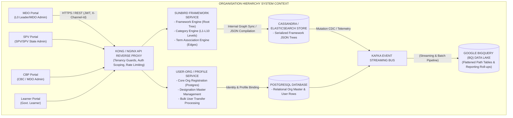
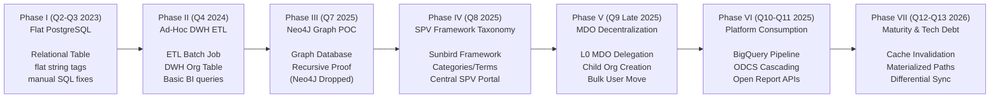
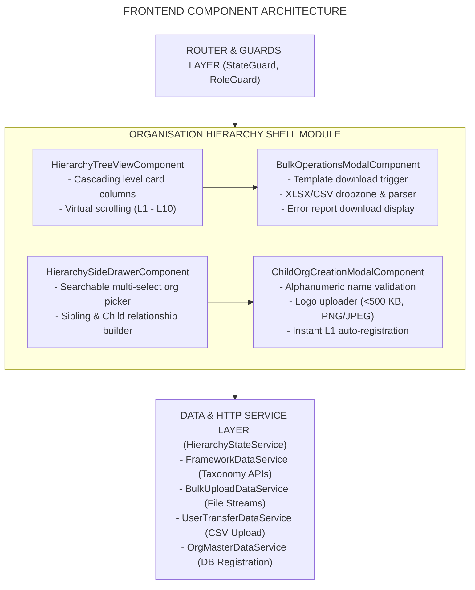
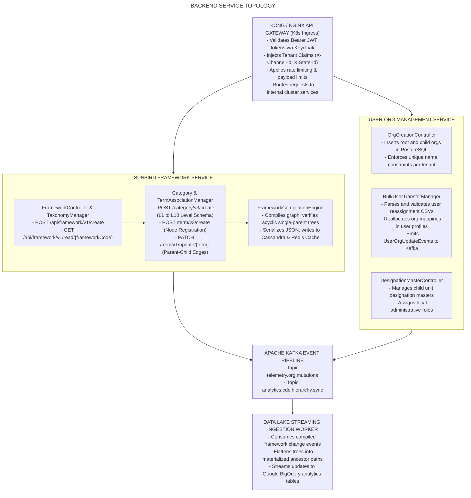
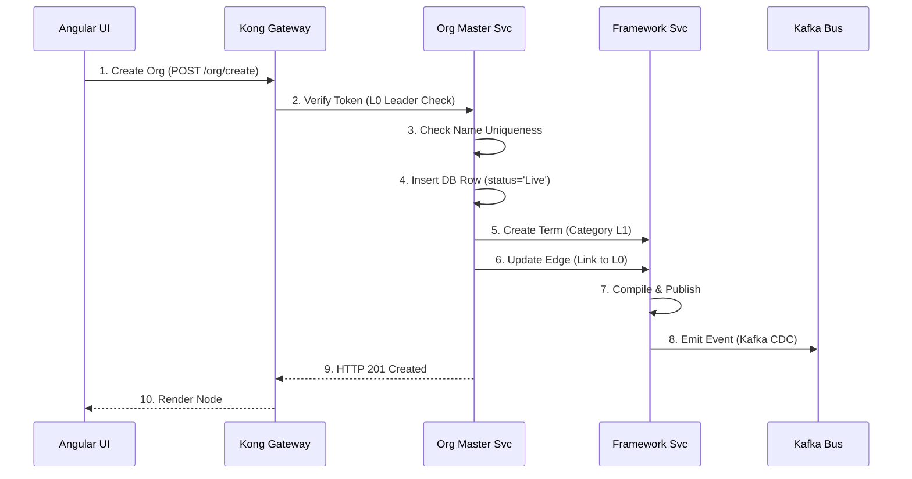
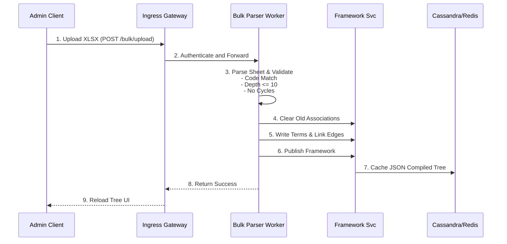
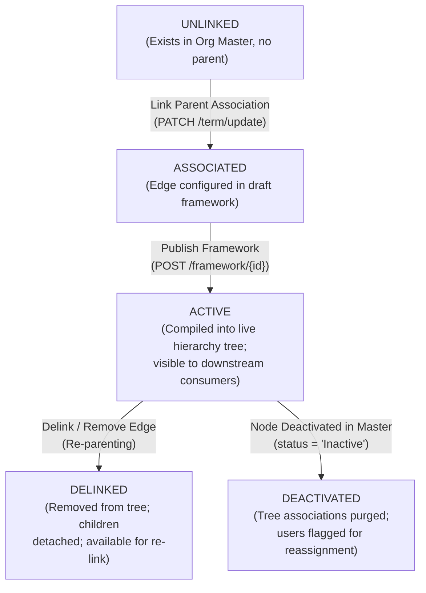
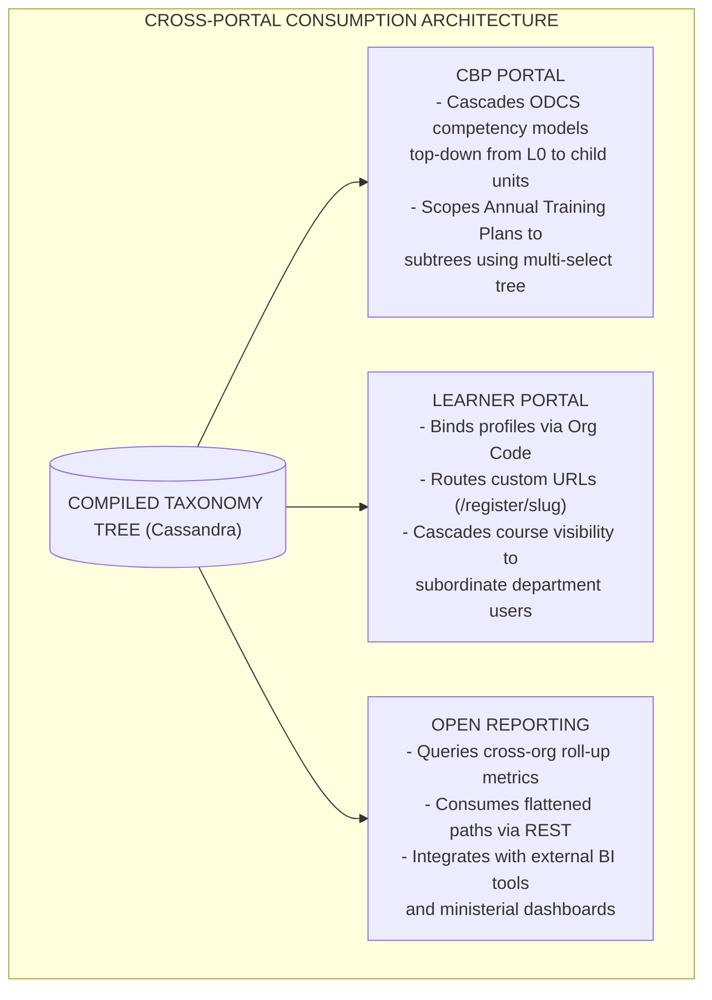

# Organisation Hierarchy — Software Design Description (SDD)

## 1. Document Overview & Administrative Control

### 1.1 Purpose

This Software Design Description (SDD) provides the complete architectural, structural, interface, data, and behavioral design of the **Organisation Hierarchy** capability across the iGOT Karmayogi ecosystem. It establishes the technical blueprint for how multi-tier bureaucratic structures ( to ) are **created, linked, persisted, compiled, governed, and consumed** across all platform microservices, gateways, portals, and data lakes. It synthesizes architectural evolution from the initial relational model in **Quarter 2 (Q2 2023)** through the mature distributed taxonomy and delegated governance design in **Quarter 13 (Q13 2026)**.

### 1.2 Scope

- **Design Subjects:** Frontend Single Page Applications (Angular), API Gateway routing (Kong/Nginx), Sunbird Framework/Taxonomy Service (`api/framework/v1`, `category/v3`, `term/v3`), User-Org Microservices, Apache Kafka event streams, Google BigQuery change data capture (CDC) pipelines, and persistence tiers (Cassandra, Elasticsearch, PostgreSQL, Redis).
- **Portals Addressed:** Admin SPV Portal, MDO Portal, CBP (Capacity Building Planning) Portal, and Learner Portal.
- **Evolutionary Boundaries:** Tracks transitions from static SQL schemas (Q2–Q4), graph traversal evaluations such as Neo4J (Q7), centralized SPV taxonomy configuration (Q8), delegated MDO management (Q9), through to platform-wide consumption, Open APIs, BigQuery synchronization, and technical debt optimizations (Q10–Q13).

### 1.3 Design Viewpoints (IEEE 1016)

To satisfy multi-stakeholder governance, this SDD defines:

1. **Context & Evolution Viewpoint:** High-level system integration and Q2–Q13 technical milestones.
2. **Composition & Component Viewpoint:** Frontend components, backend microservices, and taxonomy engines.
3. **Data & Persistence Viewpoint:** Logical schemas across PostgreSQL, Cassandra, Elasticsearch, and Google BigQuery.
4. **Interface & Communication Viewpoint:** REST contracts, gateway headers, and Kafka event envelopes.
5. **Behavioral & Interaction Viewpoint:** Execution sequences for tree mutations, bulk ingestion, and consumption.
6. **Security & Governance Viewpoint:** JWT claims inspection, tenant isolation, and audit logging.

## 2. System Overview & Architectural Context

### 2.1 System Context Diagram

The Organisation Hierarchy subsystem functions as the foundational organizational topology provider for the iGOT Karmayogi platform.



## 3. Q2 to Q13 Architectural Evolution

The architecture evolved through seven distinct structural phases:



1. **Phase I — Flat Entity Model (Q2–Q3 2023):**
  - *Architecture:* Single PostgreSQL relational table (`organisation`) with flat string fields (`ministry_name`, `dept_name`).
  - *Limitations:* No parent-child relations, high data duplication, and manual SQL scripts needed for cleanup ([KB-838: Q2 | Ad-Hoc Requests | Cleaning up MDO Hierarchy.](https://karmayogibharat.atlassian.net/browse/KB-838) (Open), [KB-1312: Org Hierarchy | Hierarchy cleanup activity and corresponding access to Orgs.](https://karmayogibharat.atlassian.net/browse/KB-1312) (Open)).

2. **Phase II — Ad-Hoc Sanitization & DWH Tables (Q4 2024):**
  - *Architecture:* Dedicated Data Warehouse table (`org_hierarchy`) populated via daily batch ETL jobs ([KB-428: Q2 l Data Warehousing l Org hierarchy fields](https://karmayogibharat.atlassian.net/browse/KB-428) (Prod Deployed), [KB-5057: Q4 | Ad-Hoc Requests | Data Warehouse, Operational Reports and Full exhausts enhancements | Org Hierarchy Table.](https://karmayogibharat.atlassian.net/browse/KB-5057) (Open)).
  - *Limitations:* Transactional operational systems remained flat; deep tree queries were impossible at runtime.

3. **Phase III — Graph Database Evaluation (Q7 Early 2025):**
  - *Architecture:* Proof-of-concept testing Neo4J property graph database against recursive depth requirements ([KB-8441: Q7 | Tech Debt | Org Hierarchy Enhancements](https://karmayogibharat.atlassian.net/browse/KB-8441) (In Progress), [KB-8442: Explore Neo4J to store org hierarchy](https://karmayogibharat.atlassian.net/browse/KB-8442) (Internal Review)).
  - *Design Decision:* External graph engine rejected due to infrastructure overhead. The team decided to adopt the native Sunbird Taxonomy Framework engine.

4. **Phase IV — Centralized SPV Framework Taxonomy (Q8 Mid 2025):**
  - *Architecture:* Sunbird Framework Service deployed across Cassandra and Elasticsearch. Hierarchies modeled using Categories (), Terms (Nodes), and Term Associations (Directed Edges) ([KB-8018: Q8 | Organisation Hierarchy Update | SPV Admin & SPV State | AdminSPV Portal](https://karmayogibharat.atlassian.net/browse/KB-8018) (KB Approved), [KB-8975: Q8 | Organization Hierarchy management](https://karmayogibharat.atlassian.net/browse/KB-8975) (Open)).
  - *Key Deliverables:* Full-tree Excel bulk upload/download ([KB-9737: Q8 | Bulk Upload & Download | Org Hierarchy Management | SPV Portal](https://karmayogibharat.atlassian.net/browse/KB-9737) (Prod Deployed)), dynamic card UI ([KB-9033: Q8 | Organisation Hierarchy Management | SPV Admin | SPV Portal](https://karmayogibharat.atlassian.net/browse/KB-9033) (Prod Deployed)), and State Admin boundary isolation ([KB-9197: Q8 | Organisation Hierarchy Access Management | SPV & State Admin | SPV Portal](https://karmayogibharat.atlassian.net/browse/KB-9197) (Prod Deployed)).

5. **Phase V — Decentralized MDO Self-Governance (Q9 Late 2025):**
  - *Architecture:* MDO Portal integrated directly with Framework APIs and User-Org mutation services ([KB-10500: Q9 | Org hierarchy Management & Impacted Areas](https://karmayogibharat.atlassian.net/browse/KB-10500) (KB Review), [KB-10501: Q9 | L0 hierarchy Management | MDO Portal](https://karmayogibharat.atlassian.net/browse/KB-10501) (KB Review)).
  - *Key Deliverables:* MDO Leaders granted authority to create child organisations () ([KB-10512: Q9 | Child Organization Creation Capability Dev Completed](https://karmayogibharat.atlassian.net/browse/KB-10512)), manage child units ([KB-10515: Q9 | Enable Child Org Data Management | MDO Portal Code](https://karmayogibharat.atlassian.net/browse/KB-10515) (Review)), execute bulk user transfers via CSV ([KB-10514: Q9 | Create Bulk User Transfer Feature (Add/Update) | MDO Portal](https://karmayogibharat.atlassian.net/browse/KB-10514) (DEV IN PROGRESS)), and run MDO-scoped bulk uploads ([KB-10533: Q9 | Bulk Upload | Organisation Hierarchy Management Dev Completed](https://karmayogibharat.atlassian.net/browse/KB-10533)).

6. **Phase VI — Platform-Wide Consumption & Analytics (Q10–Q11 2025–2026):**
  - *Architecture:* Kafka-driven CDC pipelines streaming framework events into Google BigQuery ([KB-9801: Q8 | Organisation Hierarchy Sync with BQ for reporting | Organisation Hierarchy Management](https://karmayogibharat.atlassian.net/browse/KB-9801) (Open), [KB-10534: Q9 | Organisation Hierarchy Sync with BQ for reporting | Organisation Hierarchy Management](https://karmayogibharat.atlassian.net/browse/KB-10534) (In-Progress)).
  - *Key Deliverables:* Open Reporting APIs ([KB-10576: Q9 | Open APIs for reporting](https://karmayogibharat.atlassian.net/browse/KB-10576) (Prod Deployed)), Custom Self-Registration landing URLs ([KB-10574: Q9 | Custom Self registration Functionality | Org Hierarchy Management](https://karmayogibharat.atlassian.net/browse/KB-10574) (Open)), Annual Training Plan hierarchical targeting ([KB-10577: Q11 | Ad-Hoc | CA and APAR Enhancements |Org Hierarchy in Training Plan Creation | MDO Portal](https://karmayogibharat.atlassian.net/browse/KB-10577) (Open)), and top-down ODCS competency cascading ([KB-10578: Q9 | ODCS effectiveness for Child Organisations | MDO Portal](https://karmayogibharat.atlassian.net/browse/KB-10578) (Open)).

7. **Phase VII — Operational Maturity & Technical Debt Optimization (Q12–Q13 2026):**
  - *Architecture:* Redis cache invalidation tuning and materialized path evaluations in PostgreSQL ([KB-15967: Tech Debt | Org Hierarchy Enhancements](https://karmayogibharat.atlassian.net/browse/KB-15967) (Open)).
  - *Focus:* Addressing BigQuery streaming pipeline lag and mitigating the operational risks of full-tree bulk overwrites.

## 4. Component Design: Frontend Architecture

The user interface layer is built as an Angular 14+ Single Page Application (SPA) utilizing RxJS for reactive state streams and Angular Material/Custom Design System components.



### 4.1 Component Breakdown

1. `HierarchyTreeViewComponent`:
  - *Role:* Renders dynamic, horizontal cascading card columns representing levels to .
  - *State Management:* Subscribes to `HierarchyStateService.selectedNode$`. When a node is selected, child nodes are fetched from the cached framework model and rendered in the adjacent column using Angular CDK Virtual Scrolling.
  - *Actions:* Provides context action triggers ("Add Child", "Add Sibling", "Manage Organisation", "Delink").

2. `HierarchySideDrawerComponent`:
  - *Role:* Slide-out configuration panel for adding hierarchy links.
  - *Features:* Features a debounced typeahead input connecting to Elasticsearch via the API gateway to search available unlinked or sibling organizations, enforcing state and ministry tenancy boundaries.

3. `BulkOperationsModalComponent`:
  - *Role:* Manages full-tree bulk upload workflows.
  - *Capabilities:* Provides template download links, handles file drag-and-drop, validates MIME types, shows upload progress, and renders error tables when validation fails.

4. `ChildOrgCreationModalComponent`:
  - *Role:* Modal used by MDO Leaders to create new child units.
  - *Validations:* Enforces character constraints (1–100 chars, alphanumeric with permitted symbols), validates image payloads, and handles duplicate naming errors returned by the backend.

## 5. Component Design: Backend Microservices & Taxonomy Engine

The backend architecture uses a distributed microservice topology running in Kubernetes, utilizing the **Sunbird Taxonomy & Framework Service** as its graph representation engine.



### 5.1 Service Functional Breakdown

1. **Kong/Nginx Gateway & Ingress Filter:**
  - Validates JWT signatures and inspects claims (`roles`, `organisations`, `stateId`).
  - Strips insecure headers and sets `X-Channel-Id` and `X-Authenticated-User-Token`.
  - Blocks SPV State Admins from accessing Central Government resources or out-of-state endpoints.

2. **Sunbird Framework & Taxonomy Engine:**
  - Treats each Ministry or State as an isolated Framework (`<channelId>_org_hierarchy`).
  - Categories model hierarchy levels (`L1 - Departments`, `L2 - Directorates`, etc.).
  - Terms represent organization nodes, and Term Associations represent directed edges between parent and child nodes.
  - `FrameworkCompilationEngine` publishes the framework, generating a complete nested JSON tree that is cached in Redis and persisted in Cassandra.

3. **User-Org Management Service:**
  - Manages relational organization entities, user-to-organization mappings, and designation masters in PostgreSQL.
  - Processes bulk user transfer CSV files, reallocates user records, and emits change events to Kafka.

4. **Data Lake Streaming Ingestion Worker:**
  - Listens to Kafka mutation topics, flattens the nested framework JSON into root-to-leaf paths, and streams the records to Google BigQuery.

## 6. Data Design & Persistence Architecture

The data architecture uses a hybrid storage model to satisfy high-throughput transactional reads, relational consistency, and analytical roll-up queries:

**DATA PERSISTENCE ARCHITECTURE**

| Cassandra & Elasticsearch | PostgreSQL Relational Store | Google BigQuery Lakehouse |
|---|---|---|
| Serialized Framework JSON Trees | Relational Org Master Table | Flattened Ancestor Paths |
| Taxonomy Categories & Terms | User Profile Mappings | Analytical Roll-Up Views |
| Fast read-heavy tree caching | Designation Masters & Roles | Cross-Department Reports |

### 6.1 PostgreSQL Relational Schema (User-Org Service)

```sql
-- Core Organisation Master Record
CREATE TABLE igot_user_org.organisation_master (
    org_id VARCHAR(64) PRIMARY KEY,
    org_code VARCHAR(64) UNIQUE NOT NULL,
    org_name VARCHAR(128) NOT NULL,
    description TEXT,
    logo_url VARCHAR(256),
    status VARCHAR(32) DEFAULT 'Live',  -- Live, Inactive, Blocked
    root_org_id VARCHAR(64) NOT NULL,  -- Self-referential for L0; points to L0 for L1..L10
    parent_org_id VARCHAR(64),
    -- Immediate parent
    hierarchy_level INT NOT NULL,  -- 0 for L0, 1 for L1, up to 10
    state_id VARCHAR(64),
    -- NULL for Central Ministries; State Code for States
    created_by VARCHAR(64) NOT NULL,
    created_at TIMESTAMP WITH TIME ZONE DEFAULT CURRENT_TIMESTAMP,
    updated_at TIMESTAMP WITH TIME ZONE DEFAULT CURRENT_TIMESTAMP
);
CREATE INDEX idx_org_root_level ON igot_user_org.organisation_master(root_org_id, hierarchy_level);
CREATE INDEX idx_org_state ON igot_user_org.organisation_master(state_id);

-- Organisation Local Designation Master
CREATE TABLE igot_user_org.org_designation_master (
    designation_id VARCHAR(64) PRIMARY KEY,
    org_id VARCHAR(64) NOT NULL REFERENCES igot_user_org.organisation_master(org_id),
    designation_name VARCHAR(128) NOT NULL,
    status VARCHAR(32) DEFAULT 'Active',
    created_at TIMESTAMP WITH TIME ZONE DEFAULT CURRENT_TIMESTAMP,
    CONSTRAINT uk_org_designation UNIQUE (org_id, designation_name)
);
```

### 6.2 Cassandra NoSQL Schema (Sunbird Framework Service)

```sql
CREATE KEYSPACE IF NOT EXISTS sunbird_framework WITH replication = {'class': 'NetworkTopologyStrategy', 'datacenter1': 3};

-- Serialized Compiled Framework Cache
CREATE TABLE sunbird_framework.framework_hierarchy (
    framework_id text,
    compiled_tree text,
    -- Serialized deep JSON representing L0 through L10 hierarchy
    last_published_on timestamp,
    version text,
    PRIMARY KEY (framework_id)
);

-- Term Association Relational Cache
CREATE TABLE sunbird_framework.term_association (
    framework_id text,
    category_id text,
    term_code text,
    associated_term_code text,
    association_type text,  -- "hasSubUnit", "parentUnit"
    PRIMARY KEY ((framework_id, category_id), term_code, associated_term_code)
);
```

### 6.3 Google BigQuery Analytical Schema

CDC workers stream compiled framework trees into BigQuery to support time-series reporting:

```sql
CREATE TABLE igot_analytics.org_hierarchy_flattened (
    snapshot_date DATE,
    root_org_id STRING NOT NULL,
    root_org_name STRING NOT NULL,
    org_id STRING NOT NULL,
    org_code STRING NOT NULL,
    org_name STRING NOT NULL,
    level_depth INT64 NOT NULL,  -- 0 (Root) through 10 parent_org_id STRING, parent_org_name STRING, ancestor_path STRING,
    -- e.g., "/ORG-001/ORG-045/ORG-099" assigned_user_count INT64, state_id STRING,
    is_active BOOLEAN,
    last_sync_timestamp TIMESTAMP
) PARTITION BY snapshot_date CLUSTER BY root_org_id, level_depth;
```

## 7. Interface Design: REST APIs & Event Streams

### 7.1 Key REST API Specifications

#### API-01: Create Organisation Hierarchy Framework

- **Method & Path:** `POST /api/framework/v1/create`
- **Headers:** `Content-Type: application/json`, `Authorization: Bearer <token>`, `X-Channel-Id: <channelId>`
- **Request Payload:**
  ```json
  {
    "request": {
      "framework": {
        "name": "01358912293839667241_org_hierarchy",
        "description": "Hierarchy Framework for Ministry of Finance",
        "code": "01358912293839667241_org_hierarchy",
        "owner": "01358912293839667241",
        "channels": [
          {
            "identifier": "01358912293839667241"
          }
        ]
      }
    }
  }
  ```
- **Response (200 OK):**
  ```json
  {
    "id": "api.framework.create",
    "ver": "1.0",
    "ts": "2026-11-01T08:15:00Z",
    "responseCode": "OK",
    "result": {
      "node_id": "01358912293839667241_org_hierarchy"
    }
  }
  ```

#### API-02: Link Parent-Child Relationship (Term Association Update)

- **Method & Path:** `PATCH /apis/proxies/v8/framework/v1/term/update/{parentTermCode}?framework={frameworkCode}&category={categoryCode}`
- **Headers:** `Content-Type: application/json`, `Authorization: Bearer <token>`, `X-Channel-Id: <channelId>`
- **Request Payload:**
  ```json
  {
    "request": {
      "term": {
        "associations": [
          {
            "identifier": "01358912293839667241_org_hierarchy_l2-directorate_directorate-of-revenue"
          },
          {
            "identifier": "01358912293839667241_org_hierarchy_l2-directorate_central-economic-intelligence"
          }
        ]
      }
    }
  }
  ```
- **Response (200 OK):**
  ```json
  {
    "id": "api.framework.term.update",
    "ver": "1.0",
    "ts": "2026-11-01T08:15:10Z",
    "responseCode": "OK",
    "result": {
      "node_id": "01358912293839667241_org_hierarchy_l1-department_department-of-revenue"
    }
  }
  ```

#### API-03: Publish & Compile Framework Tree

- **Method & Path:** `POST /apis/proxies/v8/framework/{frameworkCode}`
- **Payload:** `{}`
- **Processing:** Validates that the hierarchy forms an acyclic tree with no broken chains, compiles the complete nested JSON structure, updates Redis and Cassandra caches, and emits an update event to Kafka.

#### API-04: Retrieve Live Hierarchy Tree

- **Method & Path:** `GET /apis/proxies/v8/framework/v1/read/{frameworkCode}`
- **Response (200 OK):** Returns the compiled nested JSON hierarchy containing all categories, terms, and associations.

### 7.2 Event Streaming Message Contracts (Kafka)

#### Producer: Sunbird Framework Service

- **Topic:** `telemetry.org.mutations`
- **Schema Definition:**
  ```json
  {
    "eventId": "EVT-ORG-MUT-92019482",
    "traceId": "c83b4a22-3a0c-4ef2-b054-9382103f8472",
    "timestamp": 1793520920000,
    "actor": {
      "userId": "usr-admin-82910",
      "role": "L0_MDO_LEADER",
      "channel": "01358912293839667241"
    },
    "action": "FRAMEWORK_PUBLISHED",
    "target": {
      "frameworkId": "01358912293839667241_org_hierarchy",
      "affectedNodesCount": 42,
      "maxDepthEncountered": 4
    }
  }
  ```

#### Producer: User-Org Service

- **Topic:** `analytics.cdc.hierarchy.sync`
- **Payload Content:**
  ```json
  {
    "eventType": "BULK_USER_TRANSFER",
    "batchId": "BATCH-USR-TRF-00129",
    "sourceOrgId": "org-dept-rev-01",
    "destinationOrgId": "org-dir-enf-02",
    "transferredUserIds": [
      "usr-001",
      "usr-002",
      "usr-003"
    ],
    "executedBy": "usr-leader-mof",
    "timestamp": "2026-11-01T08:16:00Z"
  }
  ```

## 8. Dynamic & Behavioral Design

### 8.1 Sequence: Delegated Child Organisation Creation and Tree Association ( MDO Leader)

This diagram illustrates an MDO Leader creating a new child organization and linking it into the active hierarchy:



### 8.2 Sequence: Full-Tree Bulk Upload Validation & Destructive Overwrite

This diagram illustrates how the system processes an Excel bulk upload, overwriting the existing hierarchy tree:



### 8.3 State Transition Model: Organisation Hierarchy Node



## 9. Cross-Portal Consumption Engine



### 9.1 CBP Portal: Competency & Annual Plan Targeting

- **ODCS Cascading** ([KB-10578: Q9 | ODCS effectiveness for Child Organisations | MDO Portal](https://karmayogibharat.atlassian.net/browse/KB-10578) (Open)):<br>When an Ministry updates an Organizational Development & Competency Sub-framework (ODCS), the CBP service queries the hierarchy framework (`GET /framework/v1/read`) to retrieve all child organizational IDs and automatically links the competency dictionary to each subordinate unit.
- **Annual Capacity Building Plan Targeting** ([KB-10577: Q11 | Ad-Hoc | CA and APAR Enhancements |Org Hierarchy in Training Plan Creation | MDO Portal](https://karmayogibharat.atlassian.net/browse/KB-10577) (Open)):<br>The Training Plan creation interface uses a multi-select tree component. Selecting an intermediate node (e.g., a Directorate at ) automatically resolves all descendant organizations (), dynamically adding their assigned personnel to the training plan's target audience.

### 9.2 Learner Portal: Profile Association & Custom Onboarding

- **Custom Self-Registration (CSR) Ingestion** ([KB-10574: Q9 | Custom Self registration Functionality | Org Hierarchy Management](https://karmayogibharat.atlassian.net/browse/KB-10574) (Open)):<br>When a user registers through a department-specific URL (`/register/directorate-of-revenue`), the system maps the user to that organization node and links them to the parent ministry's domain governance policies.
- **Scoped Course Discovery:**<br>The search and discovery indexing pipeline tags courses with the creator's organizational channel. Search queries from authenticated learners use their organization's ancestor path string (e.g., `/ORG-MOF/ORG-REV/ORG-DIR`) to make parent-ministry courses discoverable to subordinate department users.

### 9.3 Open Reporting & BigQuery Lakehouse Engine

- **Open Reporting REST Endpoints** ([KB-10576: Q9 | Open APIs for reporting](https://karmayogibharat.atlassian.net/browse/KB-10576) (Prod Deployed)):<br>Provides external administrative systems with read access to compiled organization structures and aggregate completion metrics.
- **BigQuery Materialized Path Analytics (**[KB-9801: Q8 | Organisation Hierarchy Sync with BQ for reporting | Organisation Hierarchy Management](https://karmayogibharat.atlassian.net/browse/KB-9801) (Open)**,** [KB-10534: Q9 | Organisation Hierarchy Sync with BQ for reporting | Organisation Hierarchy Management](https://karmayogibharat.atlassian.net/browse/KB-10534) (In-Progress)**):**<br>Aggregates user metrics across multi-tier hierarchies using prefix-matching queries:
  ```sql
  SELECT root_org_name, COUNT(DISTINCT user_id) AS total_officers, SUM(course_completions) AS aggregate_completions
  FROM igot_analytics.user_progress_summary u JOIN igot_analytics.org_hierarchy_flattened h ON u.org_id = h.org_id
  WHERE h.ancestor_path LIKE '/01358912293839667241%' -- Target entire Ministry of Finance subtree
  GROUP BY root_org_name;
  ```

## 10. Security, Multi-Tenancy & Governance Design

### 10.1 Multi-Tenant Isolation Model

The system enforces multi-tenant boundary checks across three distinct layers:

**SECURITY ENFORCEMENT LAYERS**

| 1. API Reverse Proxy Layer | 2. Framework Service Engine | 3. Relational Database |
|---|---|---|
| Inspects JWT claims | Validates Framework Ownership | Row-Level Tenant Checks |
| Extracts stateId & channel | Matches caller channel against framework owner before mutation | Queries scoped by root_org_id = caller_root |
| Blocks cross-state mutation | | |

1. **Proxy Layer Boundary Enforcement:**
  - Kong Gateway intercepts all requests, extracts JWT claims (`roles`, `organisations`, `stateId`), and sets secure headers (`X-Channel-Id`, `X-State-Id`).
  - **SPV State Admin Isolation Rule:** If an SPV State Admin attempts to query or modify Central Government organizations or departments belonging to another state, the gateway immediately returns `HTTP 403 Forbidden`.

2. **Framework Ownership Verification:**
  - Before committing term updates or associations, the Framework Service verifies that the request's `X-Channel-Id` matches the framework's registered owner (`framework.owner`).

3. **Database-Level Row Scoping:**
  - The User-Org service scopes relational updates using explicit root organization filters:

```sql
UPDATE igot_user_org.organisation_master SET parent_org_id = :newParentId WHERE org_id = :targetOrgId AND root_org_id = :callerRootOrgId;
```

### 10.2 Role-Based Access Control (RBAC) Matrix

| User Role | View Global Tree | Mutate Global Tree | View State Subtree | Mutate State Subtree | View Ministry Subtree | Mutate Ministry Subtree | Create Child Org () | Bulk User Transfer |
|---|---|---|---|---|---|---|---|---|
| **SPV Admin** | **Yes** | **Yes** | **Yes** | **Yes** | **Yes** | **Yes** | **Yes** | **Yes** |
| **SPV State Admin** | No | No | **Yes** | **Yes** | No | No | **Yes** (State) | **Yes** (State) |
| **MDO Leader** | No | No | No | No | **Yes** | **Yes** | **Yes** () | **Yes** (Ministry) |
| **MDO Admin ()** | No | No | No | No | **Yes** (Subtree) | No | No | **Yes** (Downward) |
| **CBP Admin** | No | No | No | No | **Yes** (Read) | No | No | No |
| **Learner** | No | No | No | No | No | No | No | No |

## 11. Non-Functional, Reliability & Operational Design

### 11.1 Caching and High-Throughput Read Strategy

- **Redis Multi-Tier Cache:** Serialized framework trees are cached in Redis under key `framework:<frameworkId>:compiled`. The cache is invalidated immediately whenever a framework publication event occurs.
- **Cache Stampede Prevention:** The system uses distributed mutex locking (`Redlock`) to ensure only one worker recompiles and re-caches the framework JSON tree when a cache miss occurs.

### 11.2 Reliability & Fault-Tolerant Bulk Ingestion

- **Transactional Upload Validation:** Bulk uploads are validated in memory before any database or taxonomy modifications are committed. If validation fails, the process aborts and the live hierarchy remains unchanged.
- **Backpressure Controls:** Bulk user transfers and hierarchy imports are throttled using Kafka worker queues to protect relational databases from connection pool exhaustion during peak hours.

## 12. Requirement-to-Design Traceability Matrix (Q2 – Q13)

**REQUIREMENT-TO-DESIGN TRACEABILITY MATRIX**

| Requirement ID | Requirement Description | Jira Source Reference | Design Component | Implementation Contract |
|---|---|---|---|---|
| REQ-FUNC-ORG-001 | Child Org Creation (L0) | KB-10512 | OrgMasterController | POST /apis/proxies/v8/org/v1/create |
| REQ-FUNC-ORG-002 | Duplicate Org Check | KB-10512 | PostgreSQL Constraint | UNIQUE (root_org_id, org_name) |
| REQ-FUNC-ORG-003 | Org Deactivation / Subtree | KB-9033, KB-10513 | TaxonomyManager | PATCH /framework/v1/term/update |
| REQ-FUNC-HIER-001 | Interactive Card UI Tree | KB-9033, KB-10513 | HierarchyTreeViewComp | Angular CDK Virtual Scroll Component |
| REQ-FUNC-HIER-002 | Parent-Child Edge Link | KB-9033, KB-10513 | TermAssociationManager | PATCH /term/update {associations: []} |
| REQ-FUNC-HIER-003 | Subtree Delinking Rules | KB-9033, KB-10513 | FrameworkCompilationEng | Cascading association purge |
| REQ-FUNC-HIER-004 | Max Depth (L10) Limit | KB-9740, KB-10501 | HierarchyValidator | Max Category Depth <= 10 |
| REQ-FUNC-BULK-001 | Template Export | KB-9737, KB-10533 | BulkOperationsService | Excel Streaming Dynamic Generator |
| REQ-FUNC-BULK-002 | Bulk Validation Engine | KB-9737, KB-10533 | BulkParserWorker | Code Matching & Cycle Detector |
| REQ-FUNC-BULK-003 | Destructive Tree Overwrite | KB-9737, KB-10533 | FrameworkCompiler | Complete graph replacement |
| REQ-FUNC-BULK-004 | Bulk Error Reporting | KB-9737, KB-10533 | BulkOperationsModalComp | Downloadable error XLSX builder |
| REQ-FUNC-USER-001 | Bulk User Transfer CSV | KB-10514 | BulkUserTransferManager | POST /user/v1/bulk/transfer |
| REQ-FUNC-USER-002 | Scoped Transfer Delegation | KB-10514 | Gateway Tenancy Guard | Subtree check before update |
| REQ-FUNC-MGMT-001 | Child Unit Admin Delegation | KB-10515, KB-9795 | DesignationMasterCtrl | Role Mapping Proxy |
| REQ-FUNC-MGMT-002 | Local Designation Master | KB-10515 | PostgreSQL Unique Index | UNIQUE (org_id, designation_name) |
| REQ-FUNC-SEC-001 | State Admin Isolation | KB-9197 | Kong State Guard Plugin | HTTP 403 on out-of-state access |
| REQ-FUNC-INT-001 | BigQuery Hierarchy Sync | KB-9801, KB-10534 | DataLakeStreamingWorker | Kafka topic: analytics.cdc.hierarchy |
| REQ-FUNC-INT-002 | Open Reporting Hierarchy API | KB-10576 | OpenReportController | GET /open/reports/v1/org-tree |
| REQ-FUNC-INT-003 | Training Plan Scoping (CBP) | KB-10577 | CBPTrainingPlanService | Multi-org selector tree component |
| REQ-FUNC-INT-004 | ODCS Competency Cascade | KB-10578 | CompetencyMappingService | Reactive Kafka consumer for ODCS |
| REQ-FUNC-INT-005 | Custom Self-Registration | KB-10574 | CSRController | Slug-to-Org resolver mapping |

## 13. Design Gaps, Technical Debt & Q14+ Roadmap

1. **Mitigating Full-Tree Bulk Upload Overwrites:**
  - *Current State:* Every bulk upload completely replaces the hierarchy tree, creating operational risk if an uploaded file omits active departments.
  - *Target Architecture (Q14):* Transition to an idempotent JSON Patch model (`/framework/v1/patch`) supporting delta operations (`add_edge`, `remove_edge`, `reparent_node`).

2. **Materialized Path Acceleration in Relational Storage:**
  - *Current State:* Ancestor and descendant queries require evaluating the compiled JSON tree or performing recursive joins.
  - *Target Architecture (Q14):* Store materialized path strings (e.g., `/ORG-001/ORG-045/ORG-099`) directly in PostgreSQL and Cassandra tables to enable fast prefix queries (`WHERE path LIKE '/ORG-001/%'`).

3. **Decoupling CDC Ingestion from Large Upload Latency:**
  - *Current State:* Large bulk uploads can cause ingestion lag in downstream BigQuery streaming tables.
  - *Target Architecture (Q14):* Implement batch micro-chunking in the Kafka pipeline to keep analytics data synchronized within five minutes of hierarchy publication.

## 14. Appendices & References

### 14.1 Primary Source References

- **Confluence Specifications:**
  - [SRS - Organisation Hierarchy | MDO Admin & MDO Leader | MDO Portal](https://karmayogibharat.atlassian.net/wiki/spaces/TES/pages/517931009/SRS+-+Organisation+Hierarchy+MDO+Admin+MDO+Leader+MDO+Portal)
  - [SRS - Organisation Hierarchy Update | SPV Admin & SPV State | AdminSPV Portal](https://karmayogibharat.atlassian.net/wiki/spaces/TES/pages/416317441/SRS+-+Organisation+Hierarchy+Update+SPV+Admin+SPV+State+AdminSPV+Portal)
  - [Organisation Hierarchy View](https://karmayogibharat.atlassian.net/wiki/spaces/TES/pages/396328967/Organisation+Hierarchy+View)
  - [L0 Hierarchy Management- MDO Portal](https://karmayogibharat.atlassian.net/wiki/spaces/KQAS/pages/503612134/L0+Hierarchy+Management-+MDO+Portal)
  - [Organization Hierarchy update SPV Admin](https://karmayogibharat.atlassian.net/wiki/spaces/KQAS/pages/417071170/Organization+Hierarchy+update+SPV+Admin)

- **Jira Initiatives & Epics:** [KB-8975: Q8 | Organization Hierarchy management](https://karmayogibharat.atlassian.net/browse/KB-8975) (Open), [KB-8018: Q8 | Organisation Hierarchy Update | SPV Admin & SPV State | AdminSPV Portal](https://karmayogibharat.atlassian.net/browse/KB-8018) (KB Approved), [KB-10500: Q9 | Org hierarchy Management & Impacted Areas](https://karmayogibharat.atlassian.net/browse/KB-10500) (KB Review), [KB-10501: Q9 | L0 hierarchy Management | MDO Portal](https://karmayogibharat.atlassian.net/browse/KB-10501) (KB Review), [KB-10502: Q9 | Org hierarchy Impacted areas](https://karmayogibharat.atlassian.net/browse/KB-10502) (KB Review), [KB-8441: Q7 | Tech Debt | Org Hierarchy Enhancements](https://karmayogibharat.atlassian.net/browse/KB-8441) (In Progress), [KB-4441: Q4 | Ad-Hoc Requests | Organisation rename and Hierarchy cleanup.](https://karmayogibharat.atlassian.net/browse/KB-4441) (In Progress).
- **Key Delivery Stories:** [KB-9033: Q8 | Organisation Hierarchy Management | SPV Admin | SPV Portal](https://karmayogibharat.atlassian.net/browse/KB-9033) (Prod Deployed), [KB-9197: Q8 | Organisation Hierarchy Access Management | SPV & State Admin | SPV Portal](https://karmayogibharat.atlassian.net/browse/KB-9197) (Prod Deployed), [KB-9737: Q8 | Bulk Upload & Download | Org Hierarchy Management | SPV Portal](https://karmayogibharat.atlassian.net/browse/KB-9737) (Prod Deployed), [KB-9795: Q8 | Organisation Specific Page Redirection | Organisation Hierarchy Management | SPV Portal](https://karmayogibharat.atlassian.net/browse/KB-9795) (Prod Deployed), [KB-10512: Q9 | Child Organization Creation Capability Dev Completed](https://karmayogibharat.atlassian.net/browse/KB-10512), [KB-10513: Q9 | Implement Org-Specific Hierarchy Management | MDO Portal Dev Completed](https://karmayogibharat.atlassian.net/browse/KB-10513), [KB-10514: Q9 | Create Bulk User Transfer Feature (Add/Update) | MDO Portal](https://karmayogibharat.atlassian.net/browse/KB-10514) (DEV IN PROGRESS), [KB-10515: Q9 | Enable Child Org Data Management | MDO Portal Code](https://karmayogibharat.atlassian.net/browse/KB-10515) (Review), [KB-10533: Q9 | Bulk Upload | Organisation Hierarchy Management Dev Completed](https://karmayogibharat.atlassian.net/browse/KB-10533), [KB-10534: Q9 | Organisation Hierarchy Sync with BQ for reporting | Organisation Hierarchy Management](https://karmayogibharat.atlassian.net/browse/KB-10534) (In-Progress), [KB-10574: Q9 | Custom Self registration Functionality | Org Hierarchy Management](https://karmayogibharat.atlassian.net/browse/KB-10574) (Open), [KB-10576: Q9 | Open APIs for reporting](https://karmayogibharat.atlassian.net/browse/KB-10576) (Prod Deployed), [KB-10577: Q11 | Ad-Hoc | CA and APAR Enhancements |Org Hierarchy in Training Plan Creation | MDO Portal](https://karmayogibharat.atlassian.net/browse/KB-10577) (Open), [KB-10578: Q9 | ODCS effectiveness for Child Organisations | MDO Portal](https://karmayogibharat.atlassian.net/browse/KB-10578) (Open), [KB-15967: Tech Debt | Org Hierarchy Enhancements](https://karmayogibharat.atlassian.net/browse/KB-15967) (Open).

### 14.2 Glossary of Terms

- **CDC:** Change Data Capture
- **DAG:** Directed Acyclic Graph (acyclic graph with directed edges)
- **Framework:** Master taxonomy entity representing an organizational hierarchy
- **Category:** A distinct administrative tier ( to ) within a framework
- **Term:** An individual administrative node within a category
- **Term Association:** A directed edge linking a parent term to a child term
- **MDO:** Ministry, Department, and Organisation
- **SPV:** Special Purpose Vehicle (Karmayogi Bharat central governance team)
- **ODCS:** Organizational Development & Competency Sub-framework
- **CSR:** Custom Self-Registration
