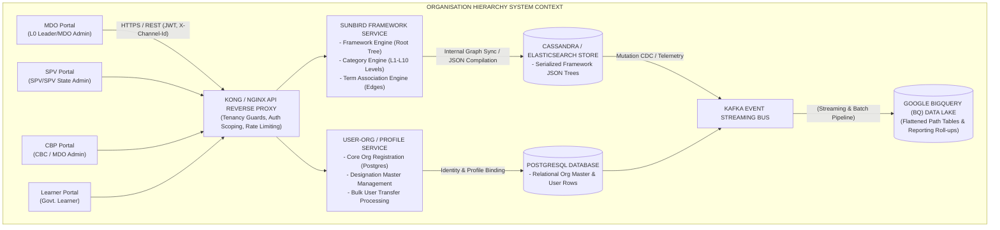
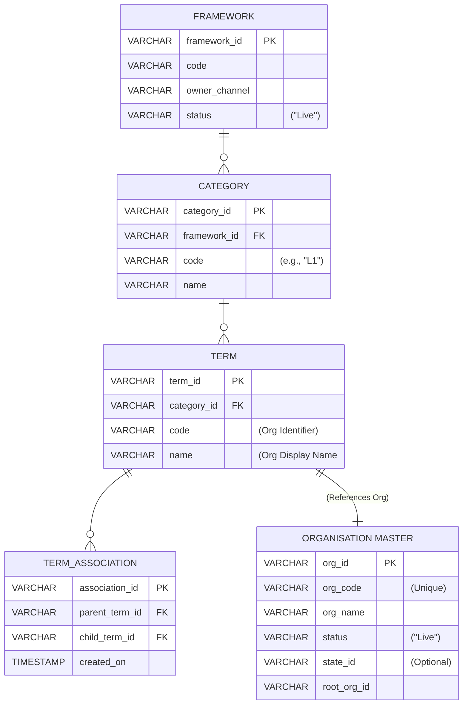

# Organisation Hierarchy — Software Requirements Specification (SRS)

## 1. Introduction

### 1.1 Purpose

This Software Requirements Specification (SRS) defines the formal functional, non-functional, interface, data, behavioral, and verification requirements for the **Organisation Hierarchy** capability across the iGOT Karmayogi digital learning and governance ecosystem. It documents the end-to-end lifecycle—spanning **creation, configuration, governance, and multi-portal consumption**—capturing its technical and operational evolution from **Quarter 2 (Q2 2023) through Quarter 13 (Q13 2026)**.

### 1.2 Document Scope

This document covers:

1. **Administrative Topologies:** to multi-tier organisational structures across Central Ministries, State Governments, Attached Offices, Subordinate Directorates, Commissionerates, Districts, and Field Units.
2. **Actor Workflows & Portals:**
  - **Admin SPV Portal:** SPV Admin and SPV State Admin capabilities for global and state-scoped hierarchy curation, validation, and full-tree bulk operations.
  - **MDO Portal:** MDO Leader and MDO Admin workflows for delegated child organization creation, sub-unit data administration, user transfers, and local hierarchy modifications.
  - **CBP Portal:** Capacity Building Commission (CBC) and MDO Admin consumption for Organizational Development & Competency Sub-framework (ODCS) cascading and targeted annual training plans.
  - **Learner Portal:** Learner-to-organisation mapping, Custom Self-Registration (CSR) landing journeys, and scoped course/program discovery.

3. **End-to-End Architecture:** Angular single-page applications, Kong/Nginx API Gateways, Sunbird Framework/Taxonomy Service (`/api/framework/v1`, `/category/v3`, `/term/v3`), Cassandra, Elasticsearch, PostgreSQL User-Org services, Kafka telemetry event pipelines, and Google BigQuery (BQ) analytical data warehouse streaming.
4. **Historical Evolution (Q2–Q13):** Structural progression from flat database mappings and manual SQL sanitation to dynamic taxonomy terms, graph traversal explorations (Neo4J POC), and decentralized governance.

### 1.3 Intended Audience

- **Enterprise & Solution Architects:** Technical baseline for taxonomy services, data synchronization, and security boundaries.
- **Product Managers & Business Analysts:** Reference for capability matrices, business rules, and acceptance criteria.
- **Engineering Teams (Frontend, Backend, Data):** Implementation contracts, API schemas, and validation specifications.
- **Quality Assurance Teams:** Traceability matrix and test scenarios.
- **Government Stakeholders (Karmayogi Bharat SPV, CBC, DoPT):** Administrative operating model and governance protocols.

### 1.4 System Architecture Overview

The system utilizes the **Sunbird Taxonomy & Framework Service** to represent public administration hierarchies as rooted Directed Acyclic Graphs (DAGs) constrained to trees (single parent per node). Hierarchies are stored as Frameworks, levels as Categories, nodes as Terms, and structural edges as Term Associations.



## 2. Overall Description

### 2.1 Product Perspective

Organisation Hierarchy is a foundational core service of the iGOT Karmayogi platform. It interacts with downstream subsystems as follows:

- **Identity and Access Management (IAM):** Resolves user tenancy and limits administrative privileges based on JWT claims (`organisations`, `roles`, `stateId`).
- **Content & Program Governance:** Controls course visibility and competency mapping by scoping content to parent and child organisation branches.
- **Competency Planning (CBP / ODCS):** Automatically cascades competency models downward from apex Ministries () to subordinate offices ().
- **Data Warehousing & BI:** Synchronizes organizational changes with BigQuery to provide real-time and historical roll-up reports for Central Ministries and State Chief Secretaries.

### 2.2 Product Functions

**CORE PRODUCT FUNCTIONS & TAXONOMY**

| Structural Tree Operations | Delegated Administration | Downstream Consumption |
|---|---|---|
| • Dynamic creation up to L10. | • Child org creation by L0 Leader. | • Cascading ODCS models. |
| • UI tree management. | • Child unit designation masters. | • Hierarchical training. |
| • Full-tree bulk upload/download. | • Bulk user transfer between orgs. | • Custom Self-Registration |
| • Single-parent & acyclic rules. | • State Admin tenancy isolation. | • BigQuery analytics sync. |

### 2.3 User Classes and Characteristics

- **Central SPV Admin (Technical / Governance Power User):** Unrestricted global view across all Central Ministries and States. Manages foundational frameworks and resolves cross-ministry structural conflicts.
- **SPV State Admin (State Governance Officer):** Restricted to an assigned State Government. Creates state departments, directorates, collectorates, and block offices without access to Central Ministries or other States.
- **MDO Leader (Ministry / Department Executive Authority):** High administrative authority over an assigned Ministry. Creates child organisations, designates local administrators, defines designation masters, and reallocates users across the ministry's hierarchy.
- **MDO Admin (Department Operational Admin):** Manages local department users, designations, and rosters. Has read-only access to the hierarchy tree from their assigned node downwards, with permission to transfer users downward.
- **Subordinate Node Admin ():** Operational admin for attached offices or field units. Cannot modify tree structures, create child organizations, or perform lateral transfers.
- **CBP Admin / CBC Planner (Curriculum Officer):** Consumes organization trees to target training programs and align competency frameworks.
- **Learner (Civil Servant):** An end user associated with a specific organizational node. Inherits learning paths and access based on their position in the hierarchy.

### 2.4 Operating Environment

- **Client Frontend:** Single Page Application (Angular 14+, TypeScript, Node.js runtime) optimized for modern desktop browsers (Chrome, Edge, Firefox).
- **Backend Runtime:** Java / Node.js microservices running in Kubernetes clusters.
- **Storage Systems:**
  - **Cassandra:** Fast key-value retrieval of serialized framework JSON objects.
  - **Elasticsearch:** Fast search and retrieval across categories, terms, and organisation names.
  - **PostgreSQL:** Relational integrity for core user-to-organisation mappings and audit logs.
  - **Google BigQuery:** Enterprise analytics data lake for hierarchical roll-up reports.

- **Messaging Bus:** Apache Kafka for asynchronous telemetry and change data capture (CDC).

### 2.5 Design and Implementation Constraints

1. **Tree Topography Constraint:** Every node must have strictly one immediate parent ( downward branching). Matrix or dual-reporting structures are prohibited.
2. **Maximum Depth:** Hierarchies are constrained to a maximum depth of **10 levels** ( to ). Intermediate levels cannot be skipped.
3. **Destructive Bulk Ingestion:** Bulk hierarchy file uploads via Excel/CSV completely overwrite and recreate the existing hierarchy tree for that tenant branch.
4. **State Isolation:** Administrative boundaries between States, and between States and the Central Government, are strictly enforced at the API gateway layer.
5. **Backwards Compatibility:** Changes to the taxonomy schema must maintain backwards compatibility with existing user profile mappings in Cassandra/Postgres.

## 3. Historical Evolution & Lifecycle Analysis (Q2 – Q13)

### 3.1 Chronological Evolution Matrix

The capabilities specified in this SRS reflect iterative development across thirteen project quarters:

| Phase / Timeline | Relevant Jira Epics & Stories | Architectural & Data State | Delivered Functional Scope | Technical Limitations & Retirals |
|---|---|---|---|---|
| **Phase I: Flat Organisation Model (Q2–Q3 2023)** | [KB-428: Q2 l Data Warehousing l Org hierarchy fields](https://karmayogibharat.atlassian.net/browse/KB-428) (Prod Deployed), [KB-838: Q2 \| Ad-Hoc Requests \| Cleaning up MDO Hierarchy.](https://karmayogibharat.atlassian.net/browse/KB-838) (Open), [KB-1312: Org Hierarchy \| Hierarchy cleanup activity and corresponding access to Orgs.](https://karmayogibharat.atlassian.net/browse/KB-1312) (Open) | Relational tables (`organisation`) in PostgreSQL with flat string columns for Ministry. | Standalone organisation registration; flat user-to-org mappings; basic DWH extraction. | No parent-child relationships; duplicate entries required periodic manual SQL cleanup ([KB-838: Q2 \| Ad-Hoc Requests \| Cleaning up MDO Hierarchy.](https://karmayogibharat.atlassian.net/browse/KB-838) (Open)). |
| **Phase II: Ad-Hoc** **Sanitization & DWH Tables (Q4 2024)** | [KB-4441: Q4 \| Ad-Hoc Requests \| Organisation rename and Hierarchy cleanup.](https://karmayogibharat.atlassian.net/browse/KB-4441) (In Progress), [KB-5057: Q4 \| Ad-Hoc Requests \| Data Warehouse, Operational Reports and Full exhausts enhancements \| Org Hierarchy Table.](https://karmayogibharat.atlassian.net/browse/KB-5057) (Open) | Dedicated `org_hierarchy` table in Data Warehouse populated via batch ETL scripts. | Standardized Ministry and Department naming conventions; initial DWH roll-up reports. | Real-time tree traversal unsupported in production transactional databases. |
| **Phase III: Graph Storage Evaluation (Q7 Early 2025)** | [KB-8441: Q7 \| Tech Debt \| Org Hierarchy Enhancements](https://karmayogibharat.atlassian.net/browse/KB-8441) (In Progress), [KB-8442: Explore Neo4J to store org hierarchy](https://karmayogibharat.atlassian.net/browse/KB-8442) (Internal Review) | Proof-of-concept evaluation of Neo4J property graph database versus Sunbird Taxonomy. | Benchmark evaluation of recursive tree traversal up to 10 levels deep for 25k+ users. | External graph database rejected to avoid operational overhead; Sunbird Framework Service selected. |
| **Phase IV: Centralized SPV Portal Management (Q8 Mid 2025)** | [KB-8018: Q8 \| Organisation Hierarchy Update \| SPV Admin & SPV State \| AdminSPV Portal](https://karmayogibharat.atlassian.net/browse/KB-8018) (KB Approved), [KB-8975: Q8 \| Organization Hierarchy management](https://karmayogibharat.atlassian.net/browse/KB-8975) (Open), [KB-9033: Q8 \| Organisation Hierarchy Management \| SPV Admin \| SPV Portal](https://karmayogibharat.atlassian.net/browse/KB-9033) (Prod Deployed), [KB-9197: Q8 \| Organisation Hierarchy Access Management \| SPV & State Admin \| SPV Portal](https://karmayogibharat.atlassian.net/browse/KB-9197) (Prod Deployed), [KB-9737: Q8 \| Bulk Upload & Download \| Org Hierarchy Management \| SPV Portal](https://karmayogibharat.atlassian.net/browse/KB-9737) (Prod Deployed), [KB-9738: Q8 \| Org Search Funcationality \| Organisation Hierarchy Management](https://karmayogibharat.atlassian.net/browse/KB-9738) (Prod Deployed), [KB-9795: Q8 \| Organisation Specific Page Redirection \| Organisation Hierarchy Management \| SPV Portal](https://karmayogibharat.atlassian.net/browse/KB-9795) (Prod Deployed) | Sunbird Framework, Category, and Term services deployed over Cassandra and Elasticsearch. | SPV Admin UI for management; State Admin isolation; Excel full-tree bulk upload/download. | MDO Leaders still lacked self-service management; all updates routed through SPV admins. |
| **Phase V: Decentralized MDO Self-Governance (Q9 Late 2025)** | [KB-10500: Q9 \| Org hierarchy Management & Impacted Areas](https://karmayogibharat.atlassian.net/browse/KB-10500) (KB Review), [KB-10501: Q9 \| L0 hierarchy Management \| MDO Portal](https://karmayogibharat.atlassian.net/browse/KB-10501) (KB Review), [KB-10502: Q9 \| Org hierarchy Impacted areas](https://karmayogibharat.atlassian.net/browse/KB-10502) (KB Review), [KB-10512: Q9 \| Child Organization Creation Capability Dev Completed](https://karmayogibharat.atlassian.net/browse/KB-10512), [KB-10513: Q9 \| Implement Org-Specific Hierarchy Management \| MDO Portal Dev Completed](https://karmayogibharat.atlassian.net/browse/KB-10513), [KB-10514: Q9 \| Create Bulk User Transfer Feature (Add/Update) \| MDO Portal](https://karmayogibharat.atlassian.net/browse/KB-10514) (DEV IN PROGRESS), [KB-10515: Q9 \| Enable Child Org Data Management \| MDO Portal Code](https://karmayogibharat.atlassian.net/browse/KB-10515) (Review), [KB-10533: Q9 \| Bulk Upload \| Organisation Hierarchy Management Dev Completed](https://karmayogibharat.atlassian.net/browse/KB-10533), [KB-10535: Q9 \| Data Tracking \| Org Hierarchy Management \| MDO Portal](https://karmayogibharat.atlassian.net/browse/KB-10535) (DEV IN PROGRESS) | Framework update APIs integrated with MDO Portal; Kafka telemetry streams for structural mutations. | MDO Leaders can create child orgs (), manage child units, execute bulk user transfers, and upload MDO trees. | Bulk upload completely replaces the hierarchy tree; incremental merges unsupported. |
| **Phase VI: Multi-Portal Integration & Analytics (Q10–Q11 2025–2026)** | [KB-9801: Q8 \| Organisation Hierarchy Sync with BQ for reporting \| Organisation Hierarchy Management](https://karmayogibharat.atlassian.net/browse/KB-9801) (Open), [KB-10534: Q9 \| Organisation Hierarchy Sync with BQ for reporting \| Organisation Hierarchy Management](https://karmayogibharat.atlassian.net/browse/KB-10534) (In-Progress), [KB-10574: Q9 \| Custom Self registration Functionality \| Org Hierarchy Management](https://karmayogibharat.atlassian.net/browse/KB-10574) (Open), [KB-10576: Q9 \| Open APIs for reporting](https://karmayogibharat.atlassian.net/browse/KB-10576) (Prod Deployed), [KB-10577: Q11 \| Ad-Hoc \| CA and APAR Enhancements \|Org Hierarchy in Training Plan Creation \| MDO Portal](https://karmayogibharat.atlassian.net/browse/KB-10577) (Open), [KB-10578: Q9 \| ODCS effectiveness for Child Organisations \| MDO Portal](https://karmayogibharat.atlassian.net/browse/KB-10578) (Open) | Kafka-to-BigQuery ingestion pipelines; Open Reporting APIs deployed. | BQ hierarchy sync; Custom Self-Registration (CSR); ODCS competency cascade; Annual Training Plan filters. | Latency in BigQuery streaming pipeline during large bulk hierarchy updates. |
| **Phase VII: Operational Maturity & Tech Debt (Q12–Q13 2026)** | [KB-15967: Tech Debt \| Org Hierarchy Enhancements](https://karmayogibharat.atlassian.net/browse/KB-15967) (Open) | Materialized path optimization in PostgreSQL; differential JSON patch updates evaluated. | Performance improvements for large tree updates; reduced cache invalidation overhead; automated consistency checks. | Full-tree replacement remains standard operating model for bulk uploads. |

## 4. Specific Functional Requirements

### 4.1 System Capabilities (SRS Core)

#### 4.1.1 Organisation Lifecycle & Creation (MDO & SPV)

- `REQ-FUNC-ORG-001` Child Organisation Creation ( Scope)
  - **Description:** The system shall allow authenticated MDO Leaders to instantiate new administrative organisations under their assigned Ministry/Department.
  - **Input Parameters:** Organisation Name (string, 1–100 chars), Description (string, max 1000 chars, optional), Logo (image, PNG/JPEG, max 500 KB, optional).
  - **System Processing:**
    - Check for duplicate organisation names within the active tree.
    - Create the organisation in the core relational database (`status = 'Live'`).
    - Register the organisation as a Term in the Sunbird Framework Service under Category `L1`.
    - Automatically create an edge linking the root term to the new term.

  - **Output:** HTTP 201 Created with `organisationId` and updated framework structure.
  - **Traceability:** [KB-10512: Q9 | Child Organization Creation Capability Dev Completed](https://karmayogibharat.atlassian.net/browse/KB-10512); [SRS - Organisation Hierarchy | MDO Admin & MDO Leader | MDO Portal](https://karmayogibharat.atlassian.net/wiki/spaces/TES/pages/517931009/SRS+-+Organisation+Hierarchy+MDO+Admin+MDO+Leader+MDO+Portal).

- `REQ-FUNC-ORG-002` Duplicate Organisation Prevention
  - **Description:** The system shall reject the creation of any organisation whose name matches an existing active organisation under the same root node, ignoring leading/trailing whitespace and case.
  - **Error Handling:** Return HTTP 409 Conflict with message: `"An organization with this name already exists in your administrative hierarchy."`
  - **Traceability:** [KB-10512: Q9 | Child Organization Creation Capability Dev Completed](https://karmayogibharat.atlassian.net/browse/KB-10512); [L0 Hierarchy Management- MDO Portal](https://karmayogibharat.atlassian.net/wiki/spaces/KQAS/pages/503612134/L0+Hierarchy+Management-+MDO+Portal).

- `REQ-FUNC-ORG-003` Organisation Deactivation & Subtree Propagation
  - **Description:** When an organisation node is marked inactive or deleted from the hierarchy, the system shall decouple all child nodes linked beneath it and flag any active users assigned to that node as unassigned or pending transfer.
  - **Traceability:** [KB-9033: Q8 | Organisation Hierarchy Management | SPV Admin | SPV Portal](https://karmayogibharat.atlassian.net/browse/KB-9033) (Prod Deployed), [KB-10513: Q9 | Implement Org-Specific Hierarchy Management | MDO Portal Dev Completed](https://karmayogibharat.atlassian.net/browse/KB-10513).

#### 4.1.2 Multi-Level Hierarchy Management ()

- `REQ-FUNC-HIER-001` UI Tree Exploration & Cascading Card Display
  - **Description:** The system shall render an interactive card-based view displaying organisation tiers from through . Selecting a node shall expand its child nodes in an adjacent column or slide-out drawer, displaying:
    - Node Name and unique Org Code.
    - Current Hierarchy Level Tag ().
    - Direct child count and total assigned user count.
    - Action menu: "Add Child", "Add Sibling", "Manage Organisation", "Delink/Remove".

  - **Traceability:** [KB-9033: Q8 | Organisation Hierarchy Management | SPV Admin | SPV Portal](https://karmayogibharat.atlassian.net/browse/KB-9033) (Prod Deployed), [KB-9790: Q8 | Organisation Hierarchy View | SPV & State Admin | SPV Portal](https://karmayogibharat.atlassian.net/browse/KB-9790) (To Do), [KB-10513: Q9 | Implement Org-Specific Hierarchy Management | MDO Portal Dev Completed](https://karmayogibharat.atlassian.net/browse/KB-10513); [SRS - Organisation Hierarchy Update | SPV Admin & SPV State | AdminSPV Portal](https://karmayogibharat.atlassian.net/wiki/spaces/TES/pages/416317441/SRS+-+Organisation+Hierarchy+Update+SPV+Admin+SPV+State+AdminSPV+Portal).

- `REQ-FUNC-HIER-002` Sibling & Child Edge Association
  - **Description:** The system shall allow authorized administrators to add child or sibling relationships using a searchable multi-select drawer.
  - **Business Rules:**
    - Child nodes must be placed exactly one level below the target parent ().
    - An organisation cannot be associated with more than one parent node.
    - Circular associations are prohibited (a node cannot be added as a descendant of itself).

  - **Traceability:** [KB-9033: Q8 | Organisation Hierarchy Management | SPV Admin | SPV Portal](https://karmayogibharat.atlassian.net/browse/KB-9033) (Prod Deployed), [KB-10513: Q9 | Implement Org-Specific Hierarchy Management | MDO Portal Dev Completed](https://karmayogibharat.atlassian.net/browse/KB-10513); [Organisation Hierarchy View](https://karmayogibharat.atlassian.net/wiki/spaces/TES/pages/396328967/Organisation+Hierarchy+View).

- `REQ-FUNC-HIER-003` Subtree Delinking and Re-parenting
  - **Description:** Removing a parent node shall remove all incoming and outgoing associations for that node and its descendants from the published hierarchy. Unlinked nodes shall remain in the master organisation registry and be eligible for re-linking under a new parent.
  - **Traceability:** [KB-9033: Q8 | Organisation Hierarchy Management | SPV Admin | SPV Portal](https://karmayogibharat.atlassian.net/browse/KB-9033) (Prod Deployed), [KB-10513: Q9 | Implement Org-Specific Hierarchy Management | MDO Portal Dev Completed](https://karmayogibharat.atlassian.net/browse/KB-10513).

- `REQ-FUNC-HIER-004` Maximum Hierarchy Depth Enforcement
  - **Description:** The system shall reject any operation that attempts to link or create a child node beneath Level 10 ().
  - **Error Handling:** Return HTTP 422 Unprocessable Entity with message: `"Hierarchy depth limit reached. The platform allows a maximum of 10 organizational levels."`
  - **Traceability:** [SRS - Organisation Hierarchy Update | SPV Admin & SPV State | AdminSPV Portal](https://karmayogibharat.atlassian.net/wiki/spaces/TES/pages/416317441/SRS+-+Organisation+Hierarchy+Update+SPV+Admin+SPV+State+AdminSPV+Portal); [SRS - Organisation Hierarchy | MDO Admin & MDO Leader | MDO Portal](https://karmayogibharat.atlassian.net/wiki/spaces/TES/pages/517931009/SRS+-+Organisation+Hierarchy+MDO+Admin+MDO+Leader+MDO+Portal).

#### 4.1.3 Bulk Hierarchy Operations (Ingestion & Extraction)

- `REQ-FUNC-BULK-001` Template Export with Dynamic Masters
  - **Description:** The system shall generate downloadable `.xlsx` and `.csv` templates pre-populated with:
    - A **Master Reference Sheet** listing all active, valid organisations within the user's administrative scope (`Org Name`, `Org Code`).
    - A **Hierarchy Definition Sheet** containing columns for `Level 1 Org Code` through `Level 10 Org Code`.

  - **Traceability:** [KB-9737: Q8 | Bulk Upload & Download | Org Hierarchy Management | SPV Portal](https://karmayogibharat.atlassian.net/browse/KB-9737) (Prod Deployed), [KB-10533: Q9 | Bulk Upload | Organisation Hierarchy Management Dev Completed](https://karmayogibharat.atlassian.net/browse/KB-10533).

- `REQ-FUNC-BULK-002` Full-Tree File Upload Validation
  - **Description:** Upon file upload (up to 100 MB), the validation engine shall perform the following checks before committing changes:
    - **Master Code Match:** All referenced organisation codes must exist in the active master list.
    - **Continuous Chain Check:** Hierarchy chains must be continuous (e.g., specifying an node without an parent is invalid).
    - **Single Parent Check:** No organisation code may appear under multiple distinct parent paths.
    - **Acyclic Check:** No circular parent-child references.

  - **Traceability:** [KB-9737: Q8 | Bulk Upload & Download | Org Hierarchy Management | SPV Portal](https://karmayogibharat.atlassian.net/browse/KB-9737) (Prod Deployed), [KB-10533: Q9 | Bulk Upload | Organisation Hierarchy Management Dev Completed](https://karmayogibharat.atlassian.net/browse/KB-10533); [SRS - Organisation Hierarchy Update | SPV Admin & SPV State | AdminSPV Portal](https://karmayogibharat.atlassian.net/wiki/spaces/TES/pages/416317441/SRS+-+Organisation+Hierarchy+Update+SPV+Admin+SPV+State+AdminSPV+Portal).

- `REQ-FUNC-BULK-003` Destructive Complete Tree Overwrite
  - **Description:** A successfully validated bulk hierarchy upload shall **completely replace the existing hierarchy tree** for that root tenant/MDO. Any existing associations not included in the uploaded file shall be removed.
  - **Traceability:** [SRS - Organisation Hierarchy Update | SPV Admin & SPV State | AdminSPV Portal](https://karmayogibharat.atlassian.net/wiki/spaces/TES/pages/416317441/SRS+-+Organisation+Hierarchy+Update+SPV+Admin+SPV+State+AdminSPV+Portal); [SRS - Organisation Hierarchy | MDO Admin & MDO Leader | MDO Portal](https://karmayogibharat.atlassian.net/wiki/spaces/TES/pages/517931009/SRS+-+Organisation+Hierarchy+MDO+Admin+MDO+Leader+MDO+Portal).

- `REQ-FUNC-BULK-004` Asynchronous Ingestion & Error Reporting
  - **Description:** If an uploaded file contains validation errors, the system shall abort the ingestion without modifying the active hierarchy and generate a downloadable `.xlsx` error report containing:
    - `Row Number`, `Cell Reference`, `Submitted Code`, `Detailed Failure Reason`.

  - **Traceability:** [KB-9737: Q8 | Bulk Upload & Download | Org Hierarchy Management | SPV Portal](https://karmayogibharat.atlassian.net/browse/KB-9737) (Prod Deployed), [KB-10533: Q9 | Bulk Upload | Organisation Hierarchy Management Dev Completed](https://karmayogibharat.atlassian.net/browse/KB-10533).

#### 4.1.4 User Allocation & Bulk Personnel Transfer

- `REQ-FUNC-USER-001` Bulk User Transfer CSV Processing
  - **Description:** The system shall allow MDO Leaders and MDO Admins to transfer users between organisations using a CSV upload (up to 100 MB).
  - **Input Schema:** `User Email` (valid email format), `Current Org Code` (string), `New Destination Org Code` (string).
  - **Validation & Processing:**
    - Verify that `Current Org Code` matches the user's active profile mapping.
    - Verify that `New Destination Org Code` is a valid node within the administrator's authorized subtree.
    - Update the user's `organisationId` and `channel` in the core profile database.
    - Emit a `UserOrgUpdateEvent` to Kafka for downstream analytics synchronization.

  - **Traceability:** [KB-10514: Q9 | Create Bulk User Transfer Feature (Add/Update) | MDO Portal](https://karmayogibharat.atlassian.net/browse/KB-10514) (DEV IN PROGRESS); [SRS - Organisation Hierarchy | MDO Admin & MDO Leader | MDO Portal](https://karmayogibharat.atlassian.net/wiki/spaces/TES/pages/517931009/SRS+-+Organisation+Hierarchy+MDO+Admin+MDO+Leader+MDO+Portal).

- `REQ-FUNC-USER-002` Scoped User Transfer Delegation
  - **Description:** MDO Admins can only transfer users out of their assigned organization into subordinate nodes within their subtree. Attempts to transfer users into external departments or parent organizations shall be blocked.
  - **Traceability:** [KB-10514: Q9 | Create Bulk User Transfer Feature (Add/Update) | MDO Portal](https://karmayogibharat.atlassian.net/browse/KB-10514) (DEV IN PROGRESS); [SRS - Organisation Hierarchy | MDO Admin & MDO Leader | MDO Portal](https://karmayogibharat.atlassian.net/wiki/spaces/TES/pages/517931009/SRS+-+Organisation+Hierarchy+MDO+Admin+MDO+Leader+MDO+Portal).

#### 4.1.5 Delegated Administration & Child Unit Data Management

- `REQ-FUNC-MGMT-001` Child Organisation Administrative Delegation
  - **Description:** The system shall allow MDO Leaders to access the "Manage Organisation" view for any child unit in their hierarchy to:
    - Define local designations or import from the platform master list.
    - Assign department administrators, MDO leaders, and mentors.
    - View and manage user rosters.

  - **Traceability:** [KB-10515: Q9 | Enable Child Org Data Management | MDO Portal Code](https://karmayogibharat.atlassian.net/browse/KB-10515) (Review), [KB-9795: Q8 | Organisation Specific Page Redirection | Organisation Hierarchy Management | SPV Portal](https://karmayogibharat.atlassian.net/browse/KB-9795) (Prod Deployed); [SRS - Organisation Hierarchy | MDO Admin & MDO Leader | MDO Portal](https://karmayogibharat.atlassian.net/wiki/spaces/TES/pages/517931009/SRS+-+Organisation+Hierarchy+MDO+Admin+MDO+Leader+MDO+Portal).

- `REQ-FUNC-MGMT-002` Designation Scope & Uniqueness
  - **Description:** Designations created for a child unit must be unique within that organization's namespace. The system shall reject duplicate designation names within the same child organization.
  - **Traceability:** [KB-10515: Q9 | Enable Child Org Data Management | MDO Portal Code](https://karmayogibharat.atlassian.net/browse/KB-10515) (Review).

#### 4.1.6 State Tenancy Isolation & Boundary Controls

- `REQ-FUNC-SEC-001` SPV State Admin Boundary Enforcement
  - **Description:** The system shall enforce tenancy boundaries for SPV State Admins based on their JWT `stateId` claim:
    - The "Center" option in the administrative dashboard shall be hidden and blocked.
    - The state selection dropdown shall be locked to the user's assigned state.
    - Attempts to read, link, or modify organizations outside their assigned state shall return HTTP 403 Forbidden.

  - **Traceability:** [KB-9197: Q8 | Organisation Hierarchy Access Management | SPV & State Admin | SPV Portal](https://karmayogibharat.atlassian.net/browse/KB-9197) (Prod Deployed); [SRS - Organisation Hierarchy Update | SPV Admin & SPV State | AdminSPV Portal](https://karmayogibharat.atlassian.net/wiki/spaces/TES/pages/416317441/SRS+-+Organisation+Hierarchy+Update+SPV+Admin+SPV+State+AdminSPV+Portal).

#### 4.1.7 Platform Integrations (CBP, Learner, Analytics)

- `REQ-FUNC-INT-001` BigQuery Hierarchy Synchronization
  - **Description:** When an organization hierarchy is published or updated, the system shall emit an event to Kafka that triggers an asynchronous sync job to update flattened path tables in Google BigQuery.
  - **Target Schema:** `root_org_id`, `org_id`, `org_code`, `org_name`, `level`, `parent_org_id`, `path_string`, `last_updated_timestamp`.
  - **SLA:** BigQuery tables must be synchronized within 15 minutes of framework publication.
  - **Traceability:** [KB-9801: Q8 | Organisation Hierarchy Sync with BQ for reporting | Organisation Hierarchy Management](https://karmayogibharat.atlassian.net/browse/KB-9801) (Open), [KB-10534: Q9 | Organisation Hierarchy Sync with BQ for reporting | Organisation Hierarchy Management](https://karmayogibharat.atlassian.net/browse/KB-10534) (In-Progress).

- `REQ-FUNC-INT-002` Open Reporting Hierarchy APIs
  - **Description:** The system shall provide secure REST endpoints allowing external reporting systems to query organization trees and roll-up metrics using administrative credentials.
  - **Traceability:** [KB-10576: Q9 | Open APIs for reporting](https://karmayogibharat.atlassian.net/browse/KB-10576) (Prod Deployed).

- `REQ-FUNC-INT-003` Annual Training Plan Hierarchy Filtering (CBP)
  - **Description:** The CBP Annual Training Plan interface shall allow planners to target courses to specific organizational branches using a multi-select tree picker. Target populations shall include all users in the selected node and its descendants.
  - **Traceability:** [KB-10577: Q11 | Ad-Hoc | CA and APAR Enhancements |Org Hierarchy in Training Plan Creation | MDO Portal](https://karmayogibharat.atlassian.net/browse/KB-10577) (Open).

- `REQ-FUNC-INT-004` ODCS Competency Framework Cascading
  - **Description:** When an Ministry publishes or updates an ODCS competency model, the system shall automatically make that competency dictionary available to all subordinate organizations in its hierarchy.
  - **Traceability:** [KB-10578: Q9 | ODCS effectiveness for Child Organisations | MDO Portal](https://karmayogibharat.atlassian.net/browse/KB-10578) (Open).

- `REQ-FUNC-INT-005` Custom Self-Registration (CSR) Binding
  - **Description:** Learners registering via a custom department URL (`https://igotkarmayogi.gov.in/register/{customOrgSlug}`) shall be automatically bound to that organization and inherit its parent hierarchy chain.
  - **Traceability:** [KB-10574: Q9 | Custom Self registration Functionality | Org Hierarchy Management](https://karmayogibharat.atlassian.net/browse/KB-10574) (Open).

## 5. Portal-Wise Consumption & Interaction Requirements

### 5.1 Consumption & Interaction Matrix

The following matrix defines portal-specific interactions across user roles, backend APIs, and business functions:

| Portal | User Role | Hierarchy Interaction | Access Mode | Data Consumed | Backend Service Dependency | Business Purpose |
|---|---|---|---|---|---|---|
| **SPV Portal** | SPV Admin | Global Hierarchy Curation | Read / Write | All Central Ministries & State Trees () | Sunbird Framework, Org Master | Platform-wide administrative governance |
| **SPV Portal** | SPV State Admin | State-Scoped Hierarchy Curation | Read / Write | Assigned State Subtree () | Sunbird Framework, State Proxy | State administrative governance |
| **MDO Portal** | MDO Leader | Ministry Hierarchy Administration | Read / Write | Ministry Tree (), Sub-org Rosters | Framework Svc, User-Org Svc | Ministry-level self-governance |
| **MDO Portal** | MDO Admin () | Subtree Inspection & Downward User Move | Read (Write for users) | Subtree from Assigned Node Downwards | Framework Read API, User Svc | Local departmental user administration |
| **CBP Portal** | CBP Planner / CBC Admin | Training Scope & ODCS Cascading | Read-Only | Hierarchy Trees, Child Unit Identifiers | Framework Read API, CBP Svc | Targeted capacity building planning |
| **Learner Portal** | Civil Servant / Learner | Profile Association & CSR Discovery | Read-Only | Mapped Org ID, Parent Hierarchy Chain | Profile Service, CSR Proxy | Scoped course discovery and reporting |

## 6. External Interface Requirements

### 6.1 Application Programming Interfaces (APIs)

The following REST endpoints govern hierarchy operations (grounded in Confluence Technical Specification [Organisation Hierarchy View](https://karmayogibharat.atlassian.net/wiki/spaces/TES/pages/396328967/Organisation+Hierarchy+View)):

**ORGANISATION HIERARCHY REST API CATALOG**

| API ID | Method | Endpoint Pattern | Target Backend Service | Auth / Scope Header | Functional Intent |
|---|---|---|---|---|---|
| API-001 | POST | /api/framework/v1/create | Sunbird Framework Svc | Bearer JWT, X-Channel | Initialize master hierarchy framework |
| API-002 | POST | /apis/proxies/v8/action/framework/v3/category/create?framework={frameworkCode} | Sunbird Category Svc | Bearer JWT, X-Channel | Define hierarchy levels (L1-L10) |
| API-003 | POST | /apis/proxies/v8/action/framework/v3/term/create?framework={frameworkCode}&category={catCode} | Sunbird Term Svc | Bearer JWT, X-Channel | Register org node as taxonomy term |
| API-004 | PATCH | /apis/proxies/v8/framework/v1/term/update/{termCode}?framework={frameworkCode}&category={cat} | Sunbird Term Svc | Bearer JWT, X-Channel | Create parent-child associations (edges) |
| API-005 | POST | /apis/proxies/v8/framework/{frameworkCode} | Sunbird Framework Svc | Bearer JWT, X-Channel | Publish & compile live framework JSON |
| API-006 | GET | /apis/proxies/v8/framework/v1/read/{frameworkCode} | Cassandra/Elastic Cache | Bearer JWT, X-Channel | Retrieve serialized hierarchy graph |
| API-007 | POST | /apis/proxies/v8/user/v1/bulk/transfer | User-Org Service | Bearer JWT, AdminRole | Bulk transfer users across org nodes |
| API-008 | POST | /apis/proxies/v8/org/v1/create | Relational Org Master | Bearer JWT, L0_Leader | Create new child org profile in DB |

#### Detailed API Contracts

##### API-001: Create Hierarchy Framework

- **Endpoint:** `POST {{host}}/api/framework/v1/create`
- **Request Payload:**
  ```json
  {
    "request": {
      "framework": {
        "name": "01358912293839667241_org_hierarchy",
        "description": "Hierarchy Framework for MDO",
        "code": "01358912293839667241_org_hierarchy",
        "owner": "01358912293839667241",
        "channels": [
          {
            "identifier": "01358912293839667241"
          }
        ]
      }
    }
  }
  ```
- **Success Response (200 OK):**
  ```json
  {
    "id": "api.framework.create",
    "ver": "1.0",
    "ts": "2026-11-01T07:50:00Z",
    "responseCode": "OK",
    "result": {
      "node_id": "01358912293839667241_org_hierarchy"
    }
  }
  ```

##### API-004: Update Term Associations (Parent-Child Edge Creation)

- **Endpoint:** `PATCH {{host}}/apis/proxies/v8/framework/v1/term/update/{{parentTermCode}}?framework={{frameworkCode}}&category={{categoryCode}}`
- **Request Payload:**
  ```json
  {
    "request": {
      "term": {
        "associations": [
          {
            "identifier": "01358912293839667241_org_hierarchy_l2-tehsil_office-of-pipalda-tehsil"
          },
          {
            "identifier": "01358912293839667241_org_hierarchy_l2-tehsil_office-of-ladpura-tehsil"
          }
        ]
      }
    }
  }
  ```
- **Success Response (200 OK):**
  ```json
  {
    "id": "api.framework.term.update",
    "ver": "1.0",
    "ts": "2026-11-01T07:50:10Z",
    "responseCode": "OK",
    "result": {
      "node_id": "01358912293839667241_org_hierarchy_l1-districts_district-kota"
    }
  }
  ```

## 7. Data Models and Storage Schema

### 7.1 Logical Data Model (Taxonomy Representation)

The system models hierarchies as an interconnected graph stored across Cassandra and PostgreSQL:



### 7.2 Google BigQuery Analytical Schema

For analytics and time-series reporting, Kafka CDC pipelines flatten the taxonomy graph into Google BigQuery:

```sql
CREATE TABLE igot_analytics.org_hierarchy_flattened (
    snapshot_date DATE,
    root_org_id STRING NOT NULL,
    root_org_name STRING NOT NULL,
    org_id STRING NOT NULL,
    org_code STRING NOT NULL,
    org_name STRING NOT NULL,
    level_depth INT64 NOT NULL,
    -- Ranges from 0 (Root) to 10 parent_org_id STRING, parent_org_name STRING, ancestor_path STRING,
    -- e.g., "/ORG-001/ORG-045/ORG-099" assigned_user_count INT64, state_id STRING,
    is_active BOOLEAN,
    updated_at TIMESTAMP
) PARTITION BY snapshot_date CLUSTER BY root_org_id, level_depth;
```

## 8. Non-Functional Requirements

### 8.1 Performance Requirements

- `REQ-NFR-PERF-001` Hierarchy Retrieval Response Time:
  - The `/api/framework/v1/read/{frameworkCode}` endpoint shall return the full serialized JSON tree (up to 10 levels and 2,500 nodes) in **(95th percentile)** under a load of 250 requests/sec, using Redis and Cassandra caching.

- `REQ-NFR-PERF-002` Bulk Hierarchy Ingestion Processing:
  - The system shall validate, compile, and publish an Excel hierarchy file containing up to 10,000 organization edges in .

- `REQ-NFR-PERF-003` Bulk User Transfer Throughput:
  - The bulk user transfer processing engine shall process user reassignment CSVs at a rate of .

### 8.2 Security & Tenancy Rules

- `REQ-NFR-SEC-001` Multi-Tenant Isolation:
  - The API gateway and backend services shall validate the user's tenant permissions on every mutation request. Requests attempting to modify nodes outside the caller's authorized tenant scope (`X-Channel-Id` or `stateId`) shall be rejected with HTTP 403 Forbidden.

- `REQ-NFR-SEC-002` Administrative Action Audit Logging:
  - All structural hierarchy mutations—including node creation, delinking, bulk uploads, and user transfers—shall generate immutable audit records containing:
    - `actor_user_id`, `actor_role`, `target_org_id`, `event_type`, `old_parent_id`, `new_parent_id`, `client_ip`, `timestamp`.

- `REQ-NFR-SEC-003` File Upload Security:
  - All uploaded bulk templates and organization logos shall be scanned for malware, validated against MIME type whitelists (strictly `.xlsx`, `.csv`, `.png`, `.jpg`), and checked against size limits (100 MB for data files, 500 KB for images).

### 8.3 Availability & Fault Tolerance

- `REQ-NFR-AVAIL-001` Read Availability:
  - The hierarchy retrieval service shall maintain **99.9% uptime during operational hours (06:00 to 22:00 IST)**.

- `REQ-NFR-AVAIL-002` Transactional Rollback on Bulk Ingestion Failure:
  - If a failure occurs while processing a bulk hierarchy upload, the system shall execute an automatic rollback, leaving the existing active hierarchy unchanged.

## 9. Verification & Acceptance Criteria

### 9.1 Acceptance Criteria

VERIFICATION & ACCEPTANCE TEST MATRIX

| Test ID | Target Feature | Verified Component | Execution Scenario | Expected Pass Criteria |
|---|---|---|---|---|
| TC-V-01 | Child Org Creation | REQ-FUNC-ORG-001 | L0 Leader creates child org via MDO Portal. | Org registered, tagged L1, visible in SPV & MDO trees. |
| TC-V-02 | Duplicate Org Check | REQ-FUNC-ORG-002 | Submit org with name matching existing child. | HTTP 409 Conflict returned; creation blocked. |
| TC-V-03 | Max Depth Limit | REQ-FUNC-HIER-004 | Attempt to add child node under L10. | UI and API block operation; HTTP 422 limit error. |
| TC-V-04 | State Admin Boundary | REQ-FUNC-SEC-001 | State Admin attempts to link Central org node. | HTTP 403 Forbidden returned; audit alert logged. |
| TC-V-05 | Bulk Template Export | REQ-FUNC-BULK-001 | SPV Admin clicks Download Template. | Excel file downloaded with dynamic Master and L1-L10. |
| TC-V-06 | Full Tree Overwrite | REQ-FUNC-BULK-003 | Bulk upload valid hierarchy missing Org-C. | Tree compiled; Org-C is delinked from active graph. |
| TC-V-07 | Broken Chain Detection | REQ-FUNC-BULK-002 | Upload file with L1 and L3, leaving L2 blank. | Ingestion rejected; error log flags broken chain at row X. |
| TC-V-08 | Bulk User Transfer | REQ-FUNC-USER-001 | Upload valid CSV moving 500 users to Org-B. | User records updated in DB; Kafka events emitted. |
| TC-V-09 | BigQuery Streaming Sync | REQ-FUNC-INT-001 | Publish modified framework hierarchy. | BigQuery flattened table updated within 15 minutes. |
| TC-V-10 | Training Plan Scoping | REQ-FUNC-INT-003 | Target training plan to parent Dept node. | Target audience includes all users in child offices. |

## 10. Requirement-to-Source Traceability Matrix

The following matrix maps each requirement to its originating Jira issues, Confluence specifications, and implementation status:

REQUIREMENT-TO-SOURCE TRACEABILITY MATRIX

| Requirement ID | Requirement Description | Source Confluence | Seed Jira References | Impl. Status | Verified Code / API Entity |
|---|---|---|---|---|---|
| REQ-FUNC-ORG-001 | Child Org Creation (L0) | SRS Page 517931009 | KB-10512 | Implemented | /api/org/v1/create |
| REQ-FUNC-ORG-002 | Duplicate Org Validation | SRS Page 517931009 | KB-10512 | Implemented | PostgreSQL Name Index |
| REQ-FUNC-ORG-003 | Org Deactivation / Subtree | SRS Page 416317441 | KB-9033, KB-10513 | Implemented | /framework/term/update |
| REQ-FUNC-HIER-001 | Interactive Card UI Tree | SRS Page 416317441 | KB-9033, KB-10513 | Implemented | Angular Tree Component |
| REQ-FUNC-HIER-002 | Parent-Child Edge Link | Confl. Page 396328967 | KB-9033, KB-10513 | Implemented | Sunbird Term Associations |
| REQ-FUNC-HIER-003 | Subtree Delinking Rules | SRS Page 416317441 | KB-9033, KB-10513 | Implemented | Sunbird Term Delete API |
| REQ-FUNC-HIER-004 | Max Depth (L10) Enforcement | SRS Page 416317441 | KB-9740, KB-10501 | Implemented | Backend Schema Validator |
| REQ-FUNC-BULK-001 | Hierarchy Template Export | SRS Page 416317441 | KB-9737, KB-10533 | Implemented | Excel Streaming Generator |
| REQ-FUNC-BULK-002 | Bulk Validation Engine | SRS Page 416317441 | KB-9737, KB-10533 | Implemented | Hierarchy Parser Service |
| REQ-FUNC-BULK-003 | Destructive Tree Overwrite | SRS Page 517931009 | KB-9737, KB-10533 | Implemented | Sunbird Framework Compiler |
| REQ-FUNC-BULK-004 | Bulk Error Reporting | SRS Page 416317441 | KB-9737, KB-10533 | Implemented | Error Sheet Generator |
| REQ-FUNC-USER-001 | Bulk User Transfer CSV | SRS Page 517931009 | KB-10514 | Implemented | /user/v1/bulk/transfer |
| REQ-FUNC-USER-002 | Scoped Transfer Delegation | SRS Page 517931009 | KB-10514 | Implemented | Gateway Scoping Interceptor |
| REQ-FUNC-MGMT-001 | Child Unit Admin Delegation | SRS Page 517931009 | KB-10515, KB-9795 | Implemented | Role Mapping Service |
| REQ-FUNC-MGMT-002 | Local Designation Master | SRS Page 517931009 | KB-10515 | Implemented | Designation Master Service |
| REQ-FUNC-SEC-001 | State Admin Isolation | SRS Page 416317441 | KB-9197 | Implemented | Kong Gateway Auth Proxy |
| REQ-FUNC-INT-001 | BigQuery Hierarchy Sync | SRS Page 517931009 | KB-9801, KB-10534 | Partially Impl. | Kafka BQ Connector Pipeline |
| REQ-FUNC-INT-002 | Open Reporting Hierarchy API | SRS Page 517931009 | KB-10576 | Implemented | /open/reports/v1/org-tree |
| REQ-FUNC-INT-003 | Training Plan Filtering (CBP) | Backlog Backlink | KB-10577 | Specified | CBP Training Plan Module |
| REQ-FUNC-INT-004 | ODCS Competency Cascade | Backlog Backlink | KB-10578 | Specified | Competency Mapping Service |
| REQ-FUNC-INT-005 | Custom Self-Registration | Backlog Backlink | KB-10574 | Specified | CSR Controller Proxy |

## 11. Appendices

### 11.1 Source Coverage and Verification Report

| Source Category | Identified | Verified | Excluded / Inaccessible | Remarks |
|---|---|---|---|---|
| **Jira Epics** | 7 | 7 | 0 | All identified Q2–Q9 Epics retrieved and verified |
| **Jira Stories** | 26 | 26 | 0 | Verified against functional contracts |
| **Confluence SRS Docs** | 2 | 2 | 0 | Pages [SRS - Organisation Hierarchy \| MDO Admin & MDO Leader \| MDO Portal](https://karmayogibharat.atlassian.net/wiki/spaces/TES/pages/517931009/SRS+-+Organisation+Hierarchy+MDO+Admin+MDO+Leader+MDO+Portal) (MDO) & [SRS - Organisation Hierarchy Update \| SPV Admin & SPV State \| AdminSPV Portal](https://karmayogibharat.atlassian.net/wiki/spaces/TES/pages/416317441/SRS+-+Organisation+Hierarchy+Update+SPV+Admin+SPV+State+AdminSPV+Portal) (SPV) analyzed |
| **UAT Specifications** | 2 | 2 | 0 | Pages [L0 Hierarchy Management- MDO Portal](https://karmayogibharat.atlassian.net/wiki/spaces/KQAS/pages/503612134/L0+Hierarchy+Management-+MDO+Portal) & [Organization Hierarchy update SPV Admin](https://karmayogibharat.atlassian.net/wiki/spaces/KQAS/pages/417071170/Organization+Hierarchy+update+SPV+Admin) test flows incorporated |
| **Technical Architecture** | 1 | 1 | 0 | Page [Organisation Hierarchy View](https://karmayogibharat.atlassian.net/wiki/spaces/TES/pages/396328967/Organisation+Hierarchy+View) framework API payloads extracted |

### 11.2 Acronyms and Technical Terms

- **CBC:** Capacity Building Commission
- **CBP:** Competency-Based Planning / Plan
- **CSR:** Custom Self-Registration
- **DoPT:** Department of Personnel and Training, Government of India
- **MDO:** Ministry, Department, and Organisation
- **ODCS:** Organizational Development & Competency Sub-framework
- **SPV:** Special Purpose Vehicle (Karmayogi Bharat)
- **DAG:** Directed Acyclic Graph
- **Level:** Apex administrative root node (Central Ministry or State Government)
- **Levels:** Subordinate administrative tiers
