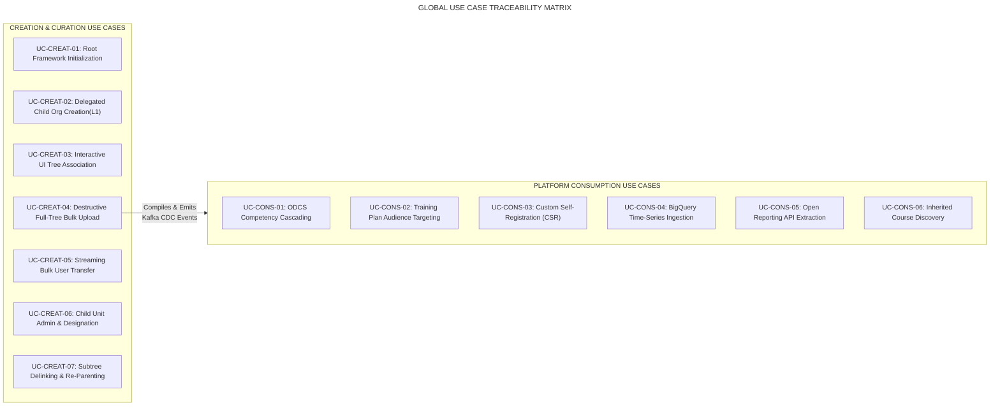
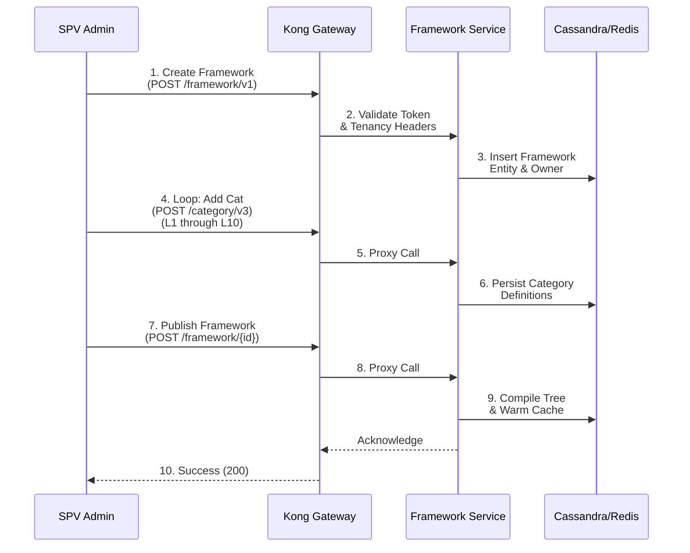
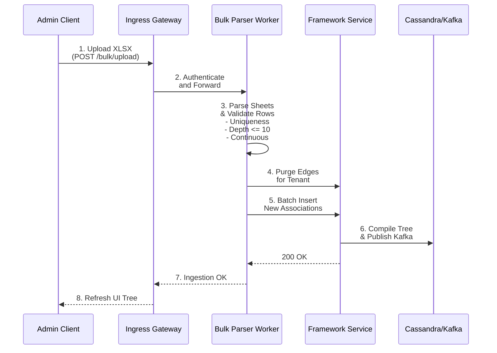
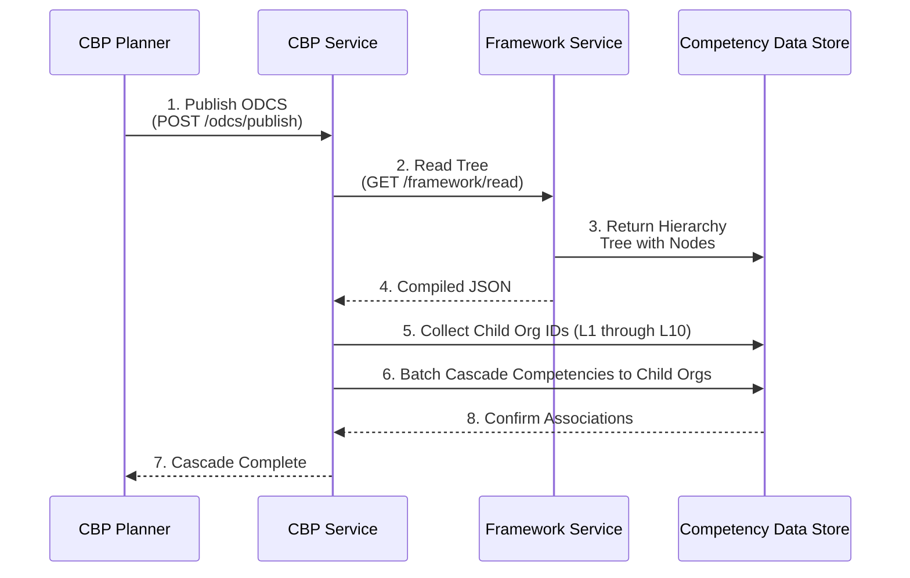
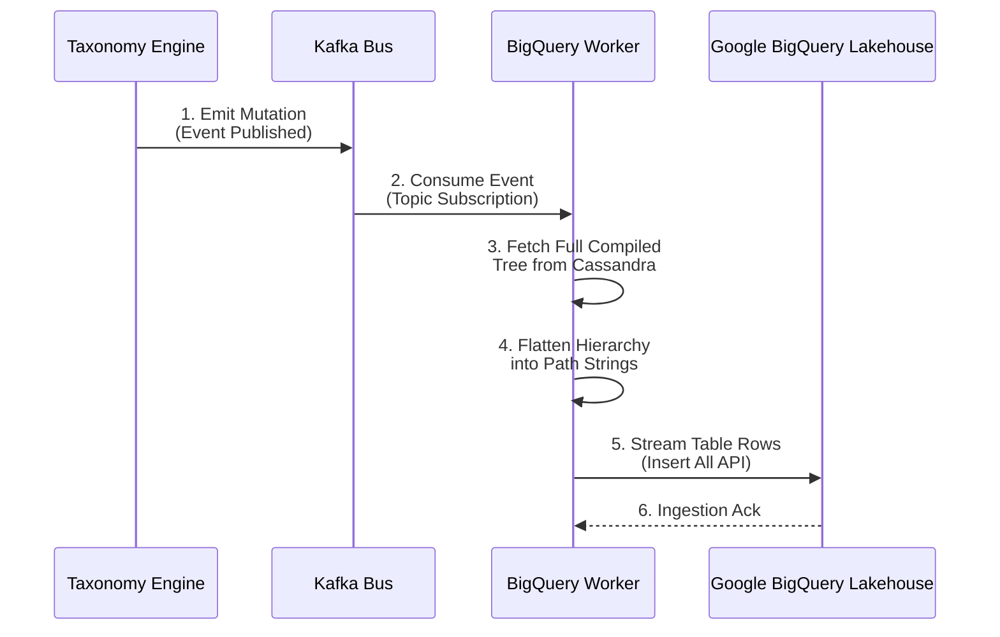

# Organisation Hierarchy — Generic Use Cases Document

## 1. Document Control & Scope

### 1.1 Purpose

This document provides a comprehensive catalog of formal **Generic Use Cases** for the **Organisation Hierarchy** capability across the iGOT Karmayogi digital learning and civil service governance platform. It captures both **Creation & Administrative Curation** and **Platform-Wide Downstream Consumption**, modeling the technical and operational evolution from **Quarter 2 (Q2 2023) through Quarter 13 (Q13 2026)**.

### 1.2 System Scope & Functional Boundaries

Each use case covers the end-to-end transaction path across:

- **Frontend Presentation Surfaces:** Angular 14+ Single Page Applications (SPV Portal, MDO Portal, CBP Portal, Learner Portal).
- **Ingress & Tenancy Interceptors:** Kong/Nginx API reverse proxy, Keycloak JWT claims inspection, and tenancy boundaries.
- **Microservices & Processing Engines:** Sunbird Framework/Taxonomy Engine (`/api/framework/v1`, `/category/v3`, `/term/v3`), User-Org Microservices, and Batch Ingestion Workers.
- **Storage & Event Sinks:** PostgreSQL (relational master/roles), Cassandra (compiled hierarchy JSON), Redis (caching), Elasticsearch (typeahead), Apache Kafka (event bus), and Google BigQuery (analytical data lake).

## 2. Actor Catalog & Persona Definitions

| Actor Profile | Description & System Permissions | Typical User Persona |
|---|---|---|
| **ACT-01: Central SPV Admin** | Super-administrative operator of Karmayogi Bharat SPV. Possesses unrestricted global authority across all Central Ministries, State Governments, and Autonomous Bodies. Can initialize root frameworks, perform full-tree bulk replacements, and resolve cross-tenant structural discrepancies. | Karmayogi Bharat Operations Lead |
| **ACT-02: SPV State Admin** | State-level governance administrator. Bound to a specific state (`stateId`). Authorized to curate departments, directorates, collectorates, and block offices within their assigned state. Blocked from central or out-of-state resources. | State Administrative Reforms Department Admin |
| **ACT-03: MDO Leader** | Executive administrative authority for an apex Central Ministry or State Apex Department (). Authorized to create child units (), link sub-units (), assign administrative roles, configure local designations, and execute bulk user transfers. | Ministry Joint Secretary / IT Director |
| **ACT-04: MDO / Sub-Unit Admin** | Operational administrator for an intermediate or leaf department (). Has read-only access to the hierarchy tree from their assigned node downwards; permitted to transfer users downward within their branch. | District Collector / Tehsil Officer |
| **ACT-05: CBP / CBC Planner** | Capacity Building Commission (CBC) planner or department training manager. Consumes hierarchy structures to cascade competency frameworks (ODCS) and select target audiences for Annual Training Plans. | Training Division Officer |
| **ACT-06: Civil Servant / Learner** | Government officer registered on the platform. Associated with a specific node in the hierarchy; inherits competency profiles and domain-scoped courses. | Assistant Section Officer / Field Officer |
| **ACT-07: External BI / Reporting Consumer** | Automated reporting systems and ministerial data lakes that extract structured hierarchy roll-up metrics via Open Reporting APIs. | DoPT Analytics Pipeline / CM Dashboard |

## 3. Global Use Case Dependency & Matrix

## 4. Creation & Management Use Cases

### 4.1 UC-CREAT-01: Root Framework Initialization & Category Level Setup

- **Use Case ID:** `UC-CREAT-01`
- **Primary Actor:** Central SPV Admin (`ACT-01`)
- **Supporting Actors:** Sunbird Framework Service, Keycloak IAM
- **Evolutionary Context:** Introduced in **Q8 (Mid 2025)** ([KB-8018: Q8 | Organisation Hierarchy Update | SPV Admin & SPV State | AdminSPV Portal](https://karmayogibharat.atlassian.net/browse/KB-8018) (KB Approved), [KB-8975: Q8 | Organization Hierarchy management](https://karmayogibharat.atlassian.net/browse/KB-8975) (Open)) to replace flat PostgreSQL database records with formal Sunbird Taxonomy frameworks.
- **Pre-conditions:** The Central SPV Admin is authenticated; the apex Ministry or State Government exists as an organization record in PostgreSQL.
- **Post-conditions:** A master taxonomy framework (`<channelId>_org_hierarchy`) and categories () are provisioned and published in Cassandra.
- **Trigger:** An SPV Admin activates an onboarded Ministry or State on the platform.

#### Main Success Scenario (MSS)

1. SPV Admin navigates to the **Admin SPV Portal > Framework Management** screen.
2. SPV Admin selects the root tenant (e.g., "Ministry of Finance", Channel ID: `01358912293839667241`).
3. Frontend issues `POST /api/framework/v1/create` containing the framework code `<channelId>_org_hierarchy` and owner channel.
4. Kong Gateway inspects the token, confirms `SPV_ADMIN` privileges, and forwards the request to the Sunbird Framework Service.
5. Sunbird Framework Service persists the framework record to Cassandra and Elasticsearch.
6. Frontend executes sequential calls to `POST /apis/proxies/v8/action/framework/v3/category/create`, creating Categories `L1` through `L10`.
7. Framework Service verifies category sequences and writes them to the taxonomy keyspace.
8. SPV Admin clicks "Initialize Hierarchy"; frontend dispatches `POST /apis/proxies/v8/framework/{frameworkCode}`.
9. Backend validates that the root framework is initialized, compiles the default tree, and returns `HTTP 200 OK`.

#### Extensions & Exceptions

- **4a. Framework Code Collision:** If a framework with code `<channelId>_org_hierarchy` already exists, the Framework Service returns `HTTP 409 Conflict`. Frontend alerts the user: *"Framework already initialized for this tenant."*
- **6a. Skipped Level Creation:** If categories are registered out of order (e.g., created without ), the schema validator raises `HTTP 422 Unprocessable Entity` with error `ERR_BROKEN_CATEGORY_CHAIN`.

### 4.2 UC-CREAT-02: Delegated Child Organisation Creation ( Instantiation)

- **Use Case ID:** `UC-CREAT-02`
- **Primary Actor:** MDO Leader (`ACT-03`)
- **Supporting Actors:** User-Org Management Service, Sunbird Framework Service, PostgreSQL, Kafka
- **Evolutionary Context:** Introduced in **Q9 (Late 2025)** ([KB-10501: Q9 | L0 hierarchy Management | MDO Portal](https://karmayogibharat.atlassian.net/browse/KB-10501) (KB Review), [KB-10512: Q9 | Child Organization Creation Capability Dev Completed](https://karmayogibharat.atlassian.net/browse/KB-10512)) to eliminate SPV bottlenecks by decentralizing child organization creation.
- **Pre-conditions:** The MDO Leader is authenticated; their JWT contains `L0_MDO_LEADER` role and valid `channel`.
- **Post-conditions:** A new organization is created in PostgreSQL (`status = 'Live'`), registered as an Term, linked to the root, and recompiled.
- **Trigger:** An MDO Leader clicks "Create New Organisation" in the MDO Portal Directory tab.

#### Main Success Scenario (MSS)

1. MDO Leader opens the **MDO Portal > Directory > Org Hierarchies** tab and clicks **Create New Organisation**.
2. Frontend presents a modal form requesting: *Organisation Name*, *Description (Optional)*, and *Emblem / Logo File (Optional)*.
3. MDO Leader enters details (e.g., "Department of Revenue") and attaches a valid logo file (`< 500 KB`, PNG format).
4. Frontend validates character limits (1–100 chars, alphanumeric with permitted symbols) and uploads the logo asset to CDN storage.
5. Frontend dispatches `POST /apis/proxies/v8/org/v1/create` containing the payload and JWT headers.
6. Kong Gateway verifies that the caller's channel matches `root_org_id` and forwards the payload to the User-Org Service.
7. User-Org Service verifies that no active organization with this name exists within this Ministry's tree.
8. User-Org Service inserts the organization into PostgreSQL `organisation_master` with `hierarchy_level = 1` and `parent_org_id = root_org_id`.
9. User-Org Service invokes Sunbird Framework Service:
  - Registers a new Term under Category `L1 - Departments` via `POST /term/v3/create`.
  - Appends the new term identifier to the root term's associations via `PATCH /term/update`.

10. Framework Service triggers `compileAndPublish()`, persists the serialized tree in Cassandra, flushes Redis, and emits a Kafka change event.
11. Gateway returns `HTTP 201 Created` with the new organization identifier; MDO Portal displays the new card at Level 1.

#### Extensions & Exceptions

- **7a. Duplicate Department Name:** If an active organization with the same name exists under the root Ministry, PostgreSQL raises a unique constraint violation (`uk_org_name_per_root`). The service maps this to `HTTP 409 Conflict` with error code `ERR_ORG_NAME_DUPLICATE`. The UI alerts: *"An organization with this name already exists in your administrative hierarchy."*
- **8a. Logo File Constraint Violation:** If the uploaded logo exceeds 500 KB or is an unsupported MIME type, the frontend upload filter halts submission and displays: *"Invalid file. Upload PNG or JPEG smaller than 500 KB."*

### 4.3 UC-CREAT-03: Interactive UI Tree Association & Edge Linking

- **Use Case ID:** `UC-CREAT-03`
- **Primary Actor:** MDO Leader (`ACT-03`) or Central SPV Admin (`ACT-01`)
- **Supporting Actors:** Sunbird Framework Service, Elasticsearch, Cassandra
- **Evolutionary Context:** Delivered in **Q8** for SPV Portal ([KB-9033: Q8 | Organisation Hierarchy Management | SPV Admin | SPV Portal](https://karmayogibharat.atlassian.net/browse/KB-9033) (Prod Deployed)) and extended in **Q9** to MDO Portal ([KB-10513: Q9 | Implement Org-Specific Hierarchy Management | MDO Portal Dev Completed](https://karmayogibharat.atlassian.net/browse/KB-10513)).
- **Pre-conditions:** Both parent and candidate child organizations exist as active records.
- **Post-conditions:** A directed relationship edge links the parent and child terms; tree compilation succeeds with verified acyclic checks.
- **Trigger:** An administrator clicks "Add Child" or "Add Sibling" on an organization card in the hierarchy view.

#### Main Success Scenario (MSS)

1. Administrator navigates the card columns and clicks **Add Child** on a Level 1 card (e.g., "Department of Revenue").
2. The UI opens `HierarchySideDrawerComponent`, displaying target level and a searchable dropdown.
3. Administrator types search text (e.g., "Directorate of Enforcement").
4. Debounced typeahead queries Elasticsearch via `GET /apis/proxies/v8/framework/term/search`, returning candidate unlinked organizations scoped to the caller's tenancy.
5. Administrator selects the organization and clicks **Save Link**.
6. Frontend dispatches `PATCH /apis/proxies/v8/framework/v1/term/update/{parentTermCode}?framework={code}&category={cat}` containing the child term identifier in the association array.
7. Gateway validates tenancy and forwards the request to the Sunbird Framework Service.
8. Framework Service reads the child's current edges to verify it does not already have an assigned parent (single-parent invariant check).
9. Framework Service updates Cassandra `term_association` and executes internal DFS traversal to ensure no circular references are introduced.
10. Framework Service publishes the updated tree, updates Redis cache, and returns `HTTP 200 OK`.
11. UI column for Level 2 refreshes, rendering the child organization under its parent.

#### Extensions & Exceptions

- **8a. Single-Parent Invariant Violation:** If the selected child is already associated with another parent, the Framework Service rejects the request with `HTTP 422 Unprocessable Entity` and error `ERR_SINGLE_PARENT_BREACH`. The UI displays: *"Node already has an assigned parent; multiple parent links are not supported."*
- **9a. Circular Reference Detected:** If linking the node introduces a cycle, the compilation engine raises `ERR_GRAPH_CYCLE_DETECTED` (`HTTP 422`). The association is rolled back.

### 4.4 UC-CREAT-04: Full-Tree Spreadsheet Ingestion (Destructive Overwrite)

- **Use Case ID:** `UC-CREAT-04`
- **Primary Actor:** Central SPV Admin (`ACT-01`), SPV State Admin (`ACT-02`), or MDO Leader (`ACT-03`)
- **Supporting Actors:** Bulk Parser Worker, Sunbird Framework Service, Kafka, Cassandra
- **Evolutionary Context:** Delivered in **Q8** ([KB-9737: Q8 | Bulk Upload & Download | Org Hierarchy Management | SPV Portal](https://karmayogibharat.atlassian.net/browse/KB-9737) (Prod Deployed)) and enhanced in **Q9** ([KB-10533: Q9 | Bulk Upload | Organisation Hierarchy Management Dev Completed](https://karmayogibharat.atlassian.net/browse/KB-10533)).
- **Pre-conditions:** Administrator has downloaded the template containing the pre-populated "Organization Master" sheet.
- **Post-conditions:** All existing framework edges for this root tenant are replaced by the associations defined in the spreadsheet.
- **Trigger:** Administrator uploads an `.xlsx` or `.csv` hierarchy definition workbook.

#### Main Success Scenario (MSS)

1. Administrator accesses the hierarchy view and clicks **Bulk Upload**.
2. Frontend opens `BulkOperationsModalComponent`; administrator drags and drops the populated `.xlsx` file.
3. Client-side checks confirm file extension (`.xlsx`/`.csv`) and verify size is under 100 MB.
4. File is submitted via `POST /apis/proxies/v8/framework/v1/bulk/upload` as multipart form data.
5. Bulk Parser Worker processes the file:
  - Reads "Organization Master" and collects all valid organization codes into a lookup set.
  - Parses "Hierarchy Mapping" row by row, validating that parent-child pairs are continuous across columns to .
  - Confirms every organization code exists in the master set and checks for broken hierarchy chains.
  - Verifies that no single organization appears under multiple distinct parent chains.

6. Validation passes with zero errors. The worker begins a database transaction.
7. Worker calls Framework Service to remove all existing associations for this tenant.
8. Worker batch-inserts all parent-child associations defined in the spreadsheet.
9. Framework Compilation Engine verifies graph acyclicity, compiles the full nested JSON structure, caches it in Cassandra and Redis, and publishes a change event to Kafka topic `telemetry.org.mutations`.
10. Backend returns `HTTP 200 OK` with summary metrics (`nodesProcessed`, `associationsCreated`).
11. UI displays an upload success notification and reloads the hierarchy tree view.

#### Extensions & Exceptions

- **5a. Broken Level Chain Detected:** If a row defines an and node while leaving blank, validation fails with `ERR_BROKEN_CHAIN_LEVEL`. Ingestion aborts; no changes are made.
- **5b. Invalid Organization Code:** If a row references an organization code not found in the master sheet, the parser records the error row and code.
- **10a. Error Report Generation:** When validation errors are encountered, the backend returns `HTTP 422 Unprocessable Entity` along with an error array. The UI generates a downloadable `.xlsx` report detailing the affected row numbers, column keys, submitted values, and error messages.

### 4.5 UC-CREAT-05: Streaming Bulk Personnel Reallocation (User Transfer)

- **Use Case ID:** `UC-CREAT-05`
- **Primary Actor:** MDO Leader (`ACT-03`) or MDO Admin (`ACT-04`)
- **Supporting Actors:** BulkUserTransferProcessor, User-Org Service, PostgreSQL, Kafka
- **Evolutionary Context:** Introduced in **Q9** ([KB-10514: Q9 | Create Bulk User Transfer Feature (Add/Update) | MDO Portal](https://karmayogibharat.atlassian.net/browse/KB-10514) (DEV IN PROGRESS)) to support restructuring and self-service personnel moves.
- **Pre-conditions:** Source users and target organizations exist; caller has administrative authority over the source organization.
- **Post-conditions:** User profile records in PostgreSQL reflect the destination organization ID; Kafka change events are published.
- **Trigger:** Administrator uploads a populated User Transfer CSV file.

#### Main Success Scenario (MSS)

1. Administrator navigates to **Manage Organisation > User Transfer** and clicks **Upload Transfer CSV**.
2. Frontend presents a template upload dialog; administrator selects a CSV file with columns: `User Email`, `Current Org Code`, and `New Destination Org Code`.
3. Client validates that file size is under 100 MB and dispatches `POST /apis/proxies/v8/user/v1/bulk/transfer`.
4. Kong Gateway inspects the caller's JWT claims:
  - For MDO Leaders, verifies that both source and destination organizations belong to their Ministry branch.
  - For MDO Admins, verifies that the source organization is their assigned unit and destination is a subordinate node within their branch.

5. User-Org Service streams the CSV, validating each record against the database:
  - Confirms `User Email` exists and is currently mapped to `Current Org Code`.
  - Confirms `New Destination Org Code` is active and within the allowed administrative scope.

6. Service batch-updates user records in PostgreSQL (`UPDATE user_profile SET org_id = :newOrgId, channel = :newChannel`).
7. For each transferred user, the service emits an event to Kafka topic `analytics.cdc.hierarchy.sync`.
8. Backend returns `HTTP 200 OK` with counts for processed and transferred users.
9. UI displays a success confirmation and provides a downloadable summary log.

#### Extensions & Exceptions

- **4a. Unauthorized Lateral/Upward Transfer Attempt:** If an MDO Admin attempts to transfer users to an external department or higher-level organization, the gateway returns `HTTP 403 Forbidden` with error `ERR_USER_TRANSFER_SCOPE_BREACH`.
- **5a. User Email Not Found or Mismatched:** If a row references an email that does not exist or whose current organization does not match `Current Org Code`, that specific row is flagged in the error log while valid rows continue processing.

### 4.6 UC-CREAT-06: Child Unit Administration & Designation Master Setup

- **Use Case ID:** `UC-CREAT-06`
- **Primary Actor:** MDO Leader (`ACT-03`)
- **Supporting Actors:** DesignationMasterService, User-Org Service, PostgreSQL
- **Evolutionary Context:** Delivered in **Q9** ([KB-10515: Q9 | Enable Child Org Data Management | MDO Portal Code](https://karmayogibharat.atlassian.net/browse/KB-10515) (Review)) to delegate administrative role assignment and designation curation.
- **Pre-conditions:** The child organization exists and is linked within the Leader's hierarchy branch.
- **Post-conditions:** Local designations are saved in PostgreSQL; administrative roles are updated in Keycloak and the local database.
- **Trigger:** Leader clicks "Manage Organisation" from an organization card menu.

#### Main Success Scenario (MSS)

1. MDO Leader clicks the action menu on a subordinate organization card and selects **Manage Organisation**.
2. Frontend opens the management view, displaying tabs for *Roles & Permissions*, *Designation Master*, and *User Roster*.
3. MDO Leader selects the **Designation Master** tab and clicks **Add Designation**.
4. Leader enters a title (e.g., "Deputy Director of Enforcement") and clicks **Save**.
5. Frontend calls `POST /apis/proxies/v8/org/v1/designation/create`.
6. DesignationMasterService verifies that the title is unique within this department's records in PostgreSQL.
7. Record is saved to `org_designation_master`.
8. Leader switches to the **Roles & Permissions** tab, selects an active user, assigns the role `MDO_ADMIN`, and saves.
9. System updates role records in PostgreSQL and synchronizes claims with Keycloak IAM.
10. UI displays a success notification; updated designations appear in department dropdown lists.

#### Extensions & Exceptions

- **6a. Duplicate Designation Name:** If the designation title already exists within this department, the service returns `HTTP 409 Conflict`. The UI alerts: *"Designation already exists within organization scope."*

### 4.7 UC-CREAT-07: Subtree Delinking, Pruning & Re-Parenting

- **Use Case ID:** `UC-CREAT-07`
- **Primary Actor:** Central SPV Admin (`ACT-01`) or MDO Leader (`ACT-03`)
- **Supporting Actors:** Sunbird Framework Service, Cassandra, Kafka
- **Evolutionary Context:** Delivered in **Q8** ([KB-9033: Q8 | Organisation Hierarchy Management | SPV Admin | SPV Portal](https://karmayogibharat.atlassian.net/browse/KB-9033) (Prod Deployed)) and refined in **Q9** ([KB-10513: Q9 | Implement Org-Specific Hierarchy Management | MDO Portal Dev Completed](https://karmayogibharat.atlassian.net/browse/KB-10513)).
- **Pre-conditions:** Target node is currently linked within an active hierarchy tree.
- **Post-conditions:** The node and its descendants are removed from the active framework tree; raw organization master records remain available for future re-linking.
- **Trigger:** Administrator clicks "Delink" on an organization card.

#### Main Success Scenario (MSS)

1. Administrator locates the target node on the hierarchy canvas and clicks **Delink / Remove**.
2. Frontend displays a confirmation dialog warning that all subordinate child organizations will also be detached from the active hierarchy.
3. Administrator confirms the action.
4. Frontend dispatches `DELETE /apis/proxies/v8/framework/v1/term/association/{parentCode}/{targetCode}`.
5. Framework Service removes the association between the parent and target terms from Cassandra.
6. The service recursively traverses downward from the target node, removing outgoing associations for all descendants.
7. Framework Compilation Engine re-validates the remaining tree, compiles the updated JSON structure, flushes Redis cache, and emits a Kafka mutation event.
8. API returns `HTTP 200 OK`; the UI removes the target branch from the hierarchy view.

## 5. Platform-Wide Consumption Use Cases

### 5.1 UC-CONS-01: ODCS Competency Dictionary Cascading

- **Use Case ID:** `UC-CONS-01`
- **Primary Actor:** CBP / CBC Planner (`ACT-05`)
- **Supporting Actors:** Competency Service, Sunbird Framework Service, CBP Portal
- **Evolutionary Context:** Specified in **Q9** and implemented across **Q10–Q11** ([KB-10578: Q9 | ODCS effectiveness for Child Organisations | MDO Portal](https://karmayogibharat.atlassian.net/browse/KB-10578) (Open)) to support top-down competency cascading across Ministries.
- **Pre-conditions:** An Ministry has curated an Organizational Development & Competency Sub-framework (ODCS) dictionary; subordinate organizations are linked within its hierarchy.
- **Post-conditions:** Competencies configured at the Ministry level are inherited by and visible to all subordinate departments.
- **Trigger:** Ministry training manager publishes an updated ODCS competency dictionary.

#### Main Success Scenario (MSS)

1. Training planner accesses the **CBP Portal > Competency Frameworks (ODCS)** interface for their Ministry.
2. Planner updates the ministerial competency dictionary and clicks **Publish Framework**.
3. CBP Service receives the update and queries the Framework Service via `GET /apis/proxies/v8/framework/v1/read/{code}` to retrieve the Ministry's compiled hierarchy tree.
4. CBP Service traverses the tree using DFS, collecting all descendant organization identifiers ().
5. Service batch-associates the published competency dictionary with all collected child organization IDs.
6. Subordinate department administrators opening their local CBP dashboard can immediately see and use inherited competency models.
7. CBP Service returns `HTTP 200 OK` confirming the cascade update.

### 5.2 UC-CONS-02: Annual Capacity Building Plan (CBP) Hierarchical Audience Targeting

- **Use Case ID:** `UC-CONS-02`
- **Primary Actor:** CBP / CBC Planner (`ACT-05`)
- **Supporting Actors:** CBPTargetAudienceResolver, User-Org Service, CBP Portal
- **Evolutionary Context:** Introduced in **Q11** ([KB-10577: Q11 | Ad-Hoc | CA and APAR Enhancements |Org Hierarchy in Training Plan Creation | MDO Portal](https://karmayogibharat.atlassian.net/browse/KB-10577) (Open)) to support hierarchical audience scoping for training plans.
- **Pre-conditions:** Annual Training Plan creation form is open; organization hierarchy is published.
- **Post-conditions:** Training plan target audience includes all active personnel in the selected organization and its subordinate units.
- **Trigger:** Planner selects an organizational unit in the Annual Training Plan audience picker.

#### Main Success Scenario (MSS)

1. Planner accesses **CBP Portal > Annual Training Plans > Create New Plan**.
2. On the **Target Audience** step, the planner opens the multi-select organization tree dropdown.
3. UI loads the compiled hierarchy tree and renders an interactive checkbox tree view.
4. Planner selects an intermediate node (e.g., "Directorate General of Health Services" at ).
5. The UI automatically marks all child and descendant departments () as selected.
6. Planner clicks **Calculate Target Audience Size**.
7. Frontend calls `CBPTargetAudienceResolver`, which traverses the subtree, extracts all descendant organization IDs, and queries the User-Org Service: `POST /apis/proxies/v8/user/v1/count-by-orgs { orgIds: [...] }`.
8. User-Org Service returns the total active user count across those organizations.
9. UI displays the aggregate target audience size (e.g., *"14,250 civil servants across 18 attached offices"*).
10. Planner saves the plan, scoping course enrollments to that organizational subtree.

### 5.3 UC-CONS-03: Custom Self-Registration (CSR) Domain Mapping & Profile Association

- **Use Case ID:** `UC-CONS-03`
- **Primary Actor:** Civil Servant / Learner (`ACT-06`)
- **Supporting Actors:** CSRRouteResolver, OrgMasterService, Keycloak IAM, Learner Portal
- **Evolutionary Context:** Delivered across **Q9–Q10** ([KB-10574: Q9 | Custom Self registration Functionality | Org Hierarchy Management](https://karmayogibharat.atlassian.net/browse/KB-10574) (Open)) to support self-onboarding via department-specific URLs.
- **Pre-conditions:** Subordinate department is active; email domain whitelist rules are configured.
- **Post-conditions:** Learner account is created, associated with the department, and linked to the parent Ministry's domain.
- **Trigger:** Learner navigates to a department onboarding URL (`https://igotkarmayogi.gov.in/register/{customOrgSlug}`).

#### Main Success Scenario (MSS)

1. Learner opens a department registration link (e.g., `/register/directorate-of-revenue-intelligence`).
2. Learner Portal router activates `CSRRouteResolver`, which calls `GET /apis/proxies/v8/org/v1/resolve/{customOrgSlug}`.
3. OrgMasterService verifies the department is active and returns its details along with parent Ministry branding.
4. Registration page displays department emblems, parent Ministry context, and allowed email domains (e.g., `@gov.in`, `@nic.in`).
5. Learner fills in their details (Name, Government Email, Mobile Number, Designation) and submits the form.
6. Backend verifies that the email domain matches the department's allowed domains list.
7. System provisions the user account in Keycloak and writes their profile to PostgreSQL with `org_id = resolvedOrgId` and `channel = rootMinistryId`.
8. Learner completes OTP verification, logs in, and sees a dashboard personalized with their department and parent Ministry branding.

#### Extensions & Exceptions

- **2a. Inactive Registration Link:** If the department is marked inactive, the resolver redirects to an error page: *"This department registration link is currently inactive."*
- **6a. Email Domain Mismatch:** If the submitted email domain does not match the department's whitelist, registration halts with message: *"Email domain not permitted for this department. Use your designated official government email."*

### 5.4 UC-CONS-04: BigQuery Streaming Sync & Time-Series Data Lake Ingestion

- **Use Case ID:** `UC-CONS-04`
- **Primary Actor:** System Change Data Capture (CDC) Engine
- **Supporting Actors:** Kafka Event Pipeline, Data Lake Streaming Worker, Google BigQuery
- **Evolutionary Context:** Delivered in **Q8–Q9** ([KB-9801: Q8 | Organisation Hierarchy Sync with BQ for reporting | Organisation Hierarchy Management](https://karmayogibharat.atlassian.net/browse/KB-9801) (Open), [KB-10534: Q9 | Organisation Hierarchy Sync with BQ for reporting | Organisation Hierarchy Management](https://karmayogibharat.atlassian.net/browse/KB-10534) (In-Progress)) to support cross-ministry analytical reporting.
- **Pre-conditions:** Framework compilation engine has published changes to Kafka topic `telemetry.org.mutations`.
- **Post-conditions:** BigQuery table `igot_analytics.org_hierarchy_flattened` is updated with flattened root-to-leaf paths within 15 minutes.
- **Trigger:** A Kafka consumer receives a structural change event.

#### Main Success Scenario (MSS)

1. Framework Compilation Engine publishes a structural change message to Kafka topic `telemetry.org.mutations`.
2. Data Lake Streaming Worker consumes the event from Kafka.
3. Worker retrieves the latest compiled hierarchy tree for that tenant from Cassandra.
4. Worker traverses the tree and flattens it into structured row records:
  - Calculates `level_depth` for each node ( to ).
  - Generates materialized path strings (e.g., `/L0-MOF/L1-REV/L2-DIR`).
  - Counts active users assigned to each node.

5. Worker streams the rows into Google BigQuery using the streaming insert API targeting `igot_analytics.org_hierarchy_flattened`.
6. BigQuery acknowledges the insert; worker commits its Kafka consumer offset.
7. National reporting queries can immediately aggregate training completion metrics using prefix-matching filters on `ancestor_path`.

### 5.5 UC-CONS-05: Open Reporting Hierarchy API Extraction

- **Use Case ID:** `UC-CONS-05`
- **Primary Actor:** External BI / Reporting Consumer (`ACT-07`)
- **Supporting Actors:** OpenReportingController, API Gateway, Redis Cache
- **Evolutionary Context:** Delivered in **Q9–Q11** ([KB-10576: Q9 | Open APIs for reporting](https://karmayogibharat.atlassian.net/browse/KB-10576) (Prod Deployed)) to enable automated data sharing with external ministerial dashboards.
- **Pre-conditions:** External system holds valid machine-to-machine API credentials.
- **Post-conditions:** Returns a structured JSON payload containing the organization tree and aggregate counts.
- **Trigger:** An external reporting system issues an HTTP request for organization metrics.

#### Main Success Scenario (MSS)

1. An external analytics service sends `GET /apis/proxies/v8/open/reports/v1/org-tree?rootOrgId={channelId}` with an OAuth bearer token.
2. Kong Gateway validates the client credentials, verifies reporting permissions, and routes the request to `OpenReportingController`.
3. Controller checks Redis for the compiled reporting tree snapshot.
4. On cache hit, the controller returns the cached JSON structure; on cache miss, it reads the compiled tree from Cassandra, transforms it into the public reporting format, caches it, and returns the response.
5. Client receives `HTTP 200 OK` containing the full organization tree, node identifiers, level tags, and user totals.

### 5.6 UC-CONS-06: Scoped Learner Course Discovery & Inherited Content Visibility

- **Use Case ID:** `UC-CONS-06`
- **Primary Actor:** Civil Servant / Learner (`ACT-06`)
- **Supporting Actors:** Course Search Engine, Elasticsearch, Learner Portal
- **Evolutionary Context:** Progressed across **Q2–Q11** from basic public course listings to hierarchy-aware content discovery.
- **Pre-conditions:** Learner is logged in; their profile contains valid organization and channel mappings.
- **Post-conditions:** Learner search results include both public courses and private content targeted to their department or parent Ministry.
- **Trigger:** Learner opens the Learner Portal course search catalog.

#### Main Success Scenario (MSS)

1. Learner logs in and opens the course discovery catalog.
2. Learner Portal dispatches a search query including the user's organizational context.
3. Gateway injects the user's organization path into the request payload: `ancestorPath: "/ORG-MOHFW/ORG-HEALTH/ORG-HOSP-01"`.
4. Search engine queries Elasticsearch, applying visibility filters:
  - Courses marked public.
  - Courses explicitly targeted to the learner's department (`targetOrg = 'ORG-HOSP-01'`).
  - Courses targeted to any ancestor organization along the user's hierarchy path (e.g., `targetOrg IN ['ORG-MOHFW', 'ORG-HEALTH']`).

5. Search engine returns matching courses; the portal displays both department-specific programs and ministerial training initiatives.

## 6. End-to-End Verification & Testing Traceability

VERIFICATION & TEST SCENARIO MATRIX

| Use Case ID | Test Scenario Name | Target Test Conditions | Expected Operational Outcome |
|---|---|---|---|
| UC-CREAT-01 | Root Framework Init | SPV Admin initializes new tenant tree | Master framework & categories L1-L10 created in DB |
| UC-CREAT-02 | Child Org Uniqueness | Create child org with duplicate name | HTTP 409 Conflict returned; creation blocked |
| UC-CREAT-03 | Single-Parent Check | Link node that already has a parent | HTTP 422 Unprocessable Entity; link blocked |
| UC-CREAT-03 | Cycle Detection Check | Introduce circular parent-child link | DFS validation catches cycle; HTTP 422 error returned |
| UC-CREAT-04 | Bulk Broken Chain | Upload XLSX with L1 and L3, omitting intermediate L2 | Ingestion rejected; error report highlights missing L2 |
| UC-CREAT-04 | Destructive Overwrite | Upload XLSX omitting previously linked nodes | Hierarchy recompiled; omitted nodes delinked from tree |
| UC-CREAT-05 | Downward User Transfer | MDO Admin transfers users to child department | User profiles updated; CDC sync event sent to Kafka |
| UC-CREAT-05 | Lateral Move Breach | MDO Admin attempts transfer to out-of-branch department | HTTP 403 Forbidden returned; operation rejected |
| UC-CONS-01 | ODCS Competency Cascade | Ministry publishes updated dictionary | Competencies inherit downward to all subordinate units |
| UC-CONS-02 | Training Plan Audience | Planner selects parent department | Audience size reflects all personnel in subtree |
| UC-CONS-03 | CSR Domain Whitelist | Register with unauthorized email | Submission blocked; domain error message displayed |
| UC-CONS-04 | BigQuery CDC Sync | Framework published | Flattened paths update in BigQuery within 15 minutes |
| UC-CONS-05 | Open Reporting Access | External system queries org tree | HTTP 200 OK returned with structured hierarchy JSON |

## 7. Requirement-to-Use-Case Traceability Matrix (Q2 – Q13)

REQUIREMENT-TO-USE-CASE TRACEABILITY MATRIX

| Requirement ID | Functional Capability | Jira Source Reference | Associated Use Case | Primary Executing Boundary |
|---|---|---|---|---|
| REQ-UC-ORG-001 | Root Framework Provision | KB-8018, KB-8975 | UC-CREAT-01 | Sunbird Framework Taxonomy Service |
| REQ-UC-ORG-002 | Child Org Creation ($L_1$) | KB-10512 | UC-CREAT-02 | User-Org Service & Relational Database |
| REQ-UC-ORG-003 | Duplicate Org Validation | KB-10512 | UC-CREAT-02 | PostgreSQL Case-Insensitive Unique Index |
| REQ-UC-HIER-001 | Interactive Card UI Linking | KB-9033, KB-10513 | UC-CREAT-03 | Angular Presentation & Elastic Search |
| REQ-UC-HIER-002 | Single-Parent Invariant | KB-9033, KB-10513 | UC-CREAT-03 | Framework Edge Validation Engine |
| REQ-UC-HIER-003 | Graph Acyclicity Check | KB-8442, KB-10501 | UC-CREAT-03, UC-CREAT-04 | In-Memory Depth-First Search Cycle Finder |
| REQ-UC-BULK-001 | Spreadsheet Template Export | KB-9737, KB-10533 | UC-CREAT-04 | Streaming Excel Generation Service |
| REQ-UC-BULK-002 | Full-Tree Bulk Overwrite | KB-9737, KB-10533 | UC-CREAT-04 | Bulk Parser & Framework Compilation Engine |
| REQ-UC-USER-001 | Streaming Bulk User Move | KB-10514 | UC-CREAT-05 | BulkUserTransferProcessor & PostgreSQL |
| REQ-UC-USER-002 | Administrative Scoping Guard | KB-10514, KB-9197 | UC-CREAT-05 | Kong API Gateway Tenancy Filter |
| REQ-UC-MGMT-001 | Child Designation Master | KB-10515 | UC-CREAT-06 | DesignationMasterService & Database |
| REQ-UC-HIER-004 | Subtree Delinking / Prune | KB-9033, KB-10513 | UC-CREAT-07 | Cascading Edge Purge Engine |
| REQ-UC-INT-001 | ODCS Competency Cascading | KB-10578 | UC-CONS-01 | Competency Service & Framework Read API |
| REQ-UC-INT-002 | Training Plan Scoping | KB-10577 | UC-CONS-02 | CBPTargetAudienceResolver & User Service |
| REQ-UC-INT-003 | Custom Self-Registration | KB-10574 | UC-CONS-03 | CSRRouteResolver & Org Master Proxy |
| REQ-UC-INT-004 | BigQuery Analytics Sync | KB-9801, KB-10534 | UC-CONS-04 | Kafka Pipeline & BigQuery Connector |
| REQ-UC-INT-005 | Open Reporting Hierarchy API | KB-10576 | UC-CONS-05 | OpenReportingController & Redis Cache |
| REQ-UC-INT-006 | Scoped Course Discovery | General Platform | UC-CONS-06 | Course Search API & Elasticsearch Engine |

## 8. References & Appendices

### 8.1 Primary Confluence Requirements & Technical Documents

- [SRS - Organisation Hierarchy | MDO Admin & MDO Leader | MDO Portal](https://karmayogibharat.atlassian.net/wiki/spaces/TES/pages/517931009/SRS+-+Organisation+Hierarchy+MDO+Admin+MDO+Leader+MDO+Portal)
- [SRS - Organisation Hierarchy Update | SPV Admin & SPV State | AdminSPV Portal](https://karmayogibharat.atlassian.net/wiki/spaces/TES/pages/416317441/SRS+-+Organisation+Hierarchy+Update+SPV+Admin+SPV+State+AdminSPV+Portal)
- [Organisation Hierarchy View](https://karmayogibharat.atlassian.net/wiki/spaces/TES/pages/396328967/Organisation+Hierarchy+View)
- [L0 Hierarchy Management- MDO Portal](https://karmayogibharat.atlassian.net/wiki/spaces/KQAS/pages/503612134/L0+Hierarchy+Management-+MDO+Portal)
- [Organization Hierarchy update SPV Admin](https://karmayogibharat.atlassian.net/wiki/spaces/KQAS/pages/417071170/Organization+Hierarchy+update+SPV+Admin)

### 8.2 Jira Reference Inventory

- **Initiatives & Epics:** [KB-8975: Q8 | Organization Hierarchy management](https://karmayogibharat.atlassian.net/browse/KB-8975) (Open), [KB-8018: Q8 | Organisation Hierarchy Update | SPV Admin & SPV State | AdminSPV Portal](https://karmayogibharat.atlassian.net/browse/KB-8018) (KB Approved), [KB-10500: Q9 | Org hierarchy Management & Impacted Areas](https://karmayogibharat.atlassian.net/browse/KB-10500) (KB Review), [KB-10501: Q9 | L0 hierarchy Management | MDO Portal](https://karmayogibharat.atlassian.net/browse/KB-10501) (KB Review), [KB-10502: Q9 | Org hierarchy Impacted areas](https://karmayogibharat.atlassian.net/browse/KB-10502) (KB Review), [KB-8441: Q7 | Tech Debt | Org Hierarchy Enhancements](https://karmayogibharat.atlassian.net/browse/KB-8441) (In Progress), [KB-4441: Q4 | Ad-Hoc Requests | Organisation rename and Hierarchy cleanup.](https://karmayogibharat.atlassian.net/browse/KB-4441) (In Progress).
- **Delivery Stories:** [KB-9033: Q8 | Organisation Hierarchy Management | SPV Admin | SPV Portal](https://karmayogibharat.atlassian.net/browse/KB-9033) (Prod Deployed), [KB-9197: Q8 | Organisation Hierarchy Access Management | SPV & State Admin | SPV Portal](https://karmayogibharat.atlassian.net/browse/KB-9197) (Prod Deployed), [KB-9737: Q8 | Bulk Upload & Download | Org Hierarchy Management | SPV Portal](https://karmayogibharat.atlassian.net/browse/KB-9737) (Prod Deployed), [KB-9738: Q8 | Org Search Funcationality | Organisation Hierarchy Management](https://karmayogibharat.atlassian.net/browse/KB-9738) (Prod Deployed), [KB-9740: Q8 | Manage Hierarchy Levels/Layers & Renaming | SPV Portal](https://karmayogibharat.atlassian.net/browse/KB-9740) (To Do), [KB-9790: Q8 | Organisation Hierarchy View | SPV & State Admin | SPV Portal](https://karmayogibharat.atlassian.net/browse/KB-9790) (To Do), [KB-9795: Q8 | Organisation Specific Page Redirection | Organisation Hierarchy Management | SPV Portal](https://karmayogibharat.atlassian.net/browse/KB-9795) (Prod Deployed), [KB-9801: Q8 | Organisation Hierarchy Sync with BQ for reporting | Organisation Hierarchy Management](https://karmayogibharat.atlassian.net/browse/KB-9801) (Open), [KB-10512: Q9 | Child Organization Creation Capability Dev Completed](https://karmayogibharat.atlassian.net/browse/KB-10512), [KB-10513: Q9 | Implement Org-Specific Hierarchy Management | MDO Portal Dev Completed](https://karmayogibharat.atlassian.net/browse/KB-10513), [KB-10514: Q9 | Create Bulk User Transfer Feature (Add/Update) | MDO Portal](https://karmayogibharat.atlassian.net/browse/KB-10514) (DEV IN PROGRESS), [KB-10515: Q9 | Enable Child Org Data Management | MDO Portal Code](https://karmayogibharat.atlassian.net/browse/KB-10515) (Review), [KB-10533: Q9 | Bulk Upload | Organisation Hierarchy Management Dev Completed](https://karmayogibharat.atlassian.net/browse/KB-10533), [KB-10534: Q9 | Organisation Hierarchy Sync with BQ for reporting | Organisation Hierarchy Management](https://karmayogibharat.atlassian.net/browse/KB-10534) (In-Progress), [KB-10535: Q9 | Data Tracking | Org Hierarchy Management | MDO Portal](https://karmayogibharat.atlassian.net/browse/KB-10535) (DEV IN PROGRESS), [KB-10574: Q9 | Custom Self registration Functionality | Org Hierarchy Management](https://karmayogibharat.atlassian.net/browse/KB-10574) (Open), [KB-10575: Q9 | MDO Reports | MDO Portal](https://karmayogibharat.atlassian.net/browse/KB-10575) (In-Progress), [KB-10576: Q9 | Open APIs for reporting](https://karmayogibharat.atlassian.net/browse/KB-10576) (Prod Deployed), [KB-10577: Q11 | Ad-Hoc | CA and APAR Enhancements |Org Hierarchy in Training Plan Creation | MDO Portal](https://karmayogibharat.atlassian.net/browse/KB-10577) (Open), [KB-10578: Q9 | ODCS effectiveness for Child Organisations | MDO Portal](https://karmayogibharat.atlassian.net/browse/KB-10578) (Open), [KB-15967: Tech Debt | Org Hierarchy Enhancements](https://karmayogibharat.atlassian.net/browse/KB-15967) (Open).
- **Ad-Hoc & Infrastructure Tickets:** [KB-428: Q2 l Data Warehousing l Org hierarchy fields](https://karmayogibharat.atlassian.net/browse/KB-428) (Prod Deployed), [KB-838: Q2 | Ad-Hoc Requests | Cleaning up MDO Hierarchy.](https://karmayogibharat.atlassian.net/browse/KB-838) (Open), [KB-1312: Org Hierarchy | Hierarchy cleanup activity and corresponding access to Orgs.](https://karmayogibharat.atlassian.net/browse/KB-1312) (Open), [KB-5057: Q4 | Ad-Hoc Requests | Data Warehouse, Operational Reports and Full exhausts enhancements | Org Hierarchy Table.](https://karmayogibharat.atlassian.net/browse/KB-5057) (Open), [KB-8442: Explore Neo4J to store org hierarchy](https://karmayogibharat.atlassian.net/browse/KB-8442) (Internal Review).

### 8.3 Technical Glossary

- **CBP:** Competency-Based Planning / Capacity Building Plan
- **CDC (Change Data Capture):** Architectural pattern that monitors database and state changes, streaming them to analytics data lakes.
- **CSR:** Custom Self-Registration
- **DAG (Directed Acyclic Graph):** A directed graph with no closed loops or cycles.
- **DFS (Depth-First Search):** Recursive graph traversal algorithm used for cycle detection and descendant node resolution.
- **MDO:** Ministry, Department, and Organisation
- **ODCS:** Organizational Development & Competency Sub-framework
- **SPV:** Special Purpose Vehicle (Karmayogi Bharat central governance team)
- **Sunbird Framework:** The master taxonomy container representing an organization tree (`<channelId>_org_hierarchy`).
- **Sunbird Category:** An administrative level () within a taxonomy framework.
- **Sunbird Term:** An individual administrative organization node within a category.
- **Sunbird Term Association:** A directed parent-child edge linking two terms within a framework.
