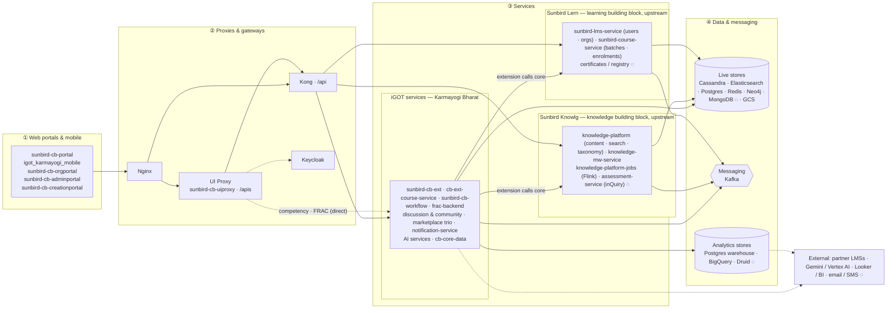

# iGOT Karmayogi — Platform Architecture (Bird's-Eye View)

**Scope.** This page is the one-screen high-level design of the whole iGOT
Karmayogi platform — the Karmayogi Bharat extension layer *and* the Sunbird building
blocks (Knowlg, Lern) it is built on — as deployed on Google Cloud (asia-south1). It names the
four layers, the major components in each, and how the four main flows cross them.
It deliberately carries **no APIs, no use cases, no data models**: those live in
each feature's `apis.md`, `use-cases.md` and `lld.md`.

**How it was built.** Every component on this page is one that at least one
feature HLD in this repo has already traced to source. Components that the doc
set reaches only through client contracts or deployment configuration are
marked **◌** and listed under *Verification boundary* at the end.

> **Read it in one line:** four portals and a mobile app reach, through two
> gateway front doors, a Karmayogi-specific service layer that *extends*
> (never forks) the Sunbird Knowlg and Lern building blocks; everything persists in a polyglot
> set of stores, talks asynchronously over Kafka, and is mined nightly into a
> BI warehouse — all running on Kubernetes in GCP.

---

## 1 · The platform in four layers

Read left to right the way a request travels: **portals and mobile app** →
**gateways** → **services** → **data**. In the services layer, iGOT services
sit **shoulder to shoulder** with the two upstream Sunbird building blocks —
**Knowlg** ([knowlg.sunbird.org](https://knowlg.sunbird.org/): content, search,
taxonomy) and **Lern** ([lern.sunbird.org](https://lern.sunbird.org/): users,
orgs, courses, certificates). Kong routes to any of the three directly, and
where iGOT needs core behaviour it calls the Sunbird blocks sideways — it
extends them, never forks them. The interactive version
(the explorer's Platform Overview page) is a colour-coded set of columns: focus a
layer to see its connections, click a component to see everything it talks to.

Legend — iGOT services are Karmayogi Bharat code; Sunbird Knowlg and Lern are
upstream building blocks, adopted as-is; **◌** marks a component documented from contracts or
deployment configuration only.

---

## 2 · What each layer is for (plain language)

| Layer | What it does for the platform | Components |
|---|---|---|
| **① Web portals & mobile** | The screens civil servants, MDO admins, SPV super-admins and content creators actually use: four web portals and the mobile app. Nothing here talks to a service directly — every call goes through layer ②. | `sunbird-cb-portal`, `igot_karmayogi_mobile`, `sunbird-cb-orgportal`, `sunbird-cb-adminportal`, `sunbird-cb-creationportal` |
| **② Proxies & gateways** | One public host. Nginx splits traffic onto **two front doors** — `/apis` (UI Proxy: browser session, Keycloak token exchange, allow-list; most requests forwarded to Kong, a few competency/FRAC routes straight to iGOT services) and `/api` (Kong: the authoritative public-URI → service route map, to iGOT and Sunbird services alike). Keycloak is the single identity provider. | Nginx, `sunbird-cb-uiproxy`, Kong, Keycloak |
| **③ Services — iGOT** (Karmayogi Bharat) | Everything that makes iGOT *iGOT* rather than a generic Sunbird deployment: registration and approvals, organisation hierarchy, competencies, karma points, communities, the partner marketplace, notifications, the nightly analytics pipeline and the AI assistants. Built beside the core; calls into it sideways where needed. | `sunbird-cb-ext`, `cb-ext-course-service`, `sunbird-cb-workflow`, `frac-backend`, `cb-discussion-service` / `cb-community-service` / `cb-comment-service`, `cb-pores-service` / `cios-content-service` / `cb_external_enrollment_service`, `notification-service`, `nlp-search`, `ai-assessment-service`, `cb-core-data` |
| **③ Services — Sunbird Knowlg** (upstream) | Sunbird's knowledge building block: content and its lifecycle, composite search, taxonomy / framework, and the Flink jobs that publish and index. Consumed as-is, never forked. | `knowledge-platform` (content-service, search-service, taxonomy), `knowledge-mw-service` (legacy middleware relay, `knowledge-mw-service:5000` in Kong), `knowledge-platform-jobs`, assessment-service (Sunbird inQuiry) ◌ |
| **③ Services — Sunbird Lern** (upstream) | Sunbird's learning building block: user and organisation management, course batches, enrolments and progress, certificates. Consumed as-is, never forked. | `sunbird-lms-service`, `sunbird-course-service`, certificates / registry ◌ |
| **④ Data & messaging** | Three kinds of state: **live stores** the services read and write (each store does one job), the **Kafka backbone** that carries their events so services react instead of calling each other, and the **analytics stores** filled nightly by `cb-core-data` and read by BI. | Live: Cassandra, Elasticsearch, Postgres, Redis, Neo4j, MongoDB ◌, GCS · Messaging: Kafka · Analytics: Postgres warehouse, BigQuery, Druid ◌ |

**Outside the layers.** External systems — partner LMSs (Coursera, Cornell, CDAC,
Harvard), Gemini / Vertex AI, Looker / BI, email / SMS providers ◌ — are drawn
alongside. Infrastructure is the ground everything stands on, not a layer:
Kubernetes (GKE) in GCP asia-south1, defined by `sunbird-devops` (Ansible, Helm,
the Kong route map), built and deployed by Jenkins ◌.

---

## 3 · The four flows that cross the layers

Each flow is shown only at layer level; the per-feature HLDs carry the
service-by-service version. (③ = services layer: iGOT, Sunbird Knowlg or Sunbird Lern.)

### Learn — a Karmayogi takes a course
① Portal / mobile → ② `/apis` UI Proxy → Kong → ③ `search-service` (discover) →
③ `sunbird-course-service` (enrol, progress) with ④ Cassandra → completion
event on ④ Kafka → ③ karma points (iGOT) / certificates (Lern) → ③ next
nightly run updates leaderboards and the ④ warehouse.

### Create & publish — content reaches learners
① Creation portal → ② gateway → ③ `knowledge-platform` content-service
(Draft → Review → Live, see [Content Lifecycle](content-lifecycle.md)) →
publish event on ④ Kafka → ③ Flink publish & indexer jobs → ④ Elasticsearch /
Neo4j / GCS → visible to ① learners.

### Onboard — a user or a department joins
① Public sign-up, admin portals or CSV upload → ② Keycloak (identity) →
③ `sunbird-cb-ext` orchestrates → ③ `sunbird-lms-service` creates the account →
③ `sunbird-cb-workflow` approvals where required → ③ `notification-service`
mails → ④ Cassandra / Elasticsearch user directory.

### Measure — the platform reports on itself
④ Live stores → ③ `cb-core-data` Stage 0 extract → Stage 1 pre-join →
Stage 2 (~46 independent jobs) → ④ Postgres warehouse + BigQuery → Looker
(external); plus ④ Redis live-dashboard keys and ④ Cassandra writes (karma,
leaderboards) read back by ①.

---

## 4 · Verification boundary

Components marked **◌** are on the diagram because the feature docs reach them
through client contracts, Kong route entries or deployment configuration — not
because their source has been traced in this doc set:

| Component | What the doc set has | What would close the gap |
|---|---|---|
| MongoDB (owner) | Read as a Stage-2 source by `cb-core-data` only | Identify the writing service from deployment inventory |
| `assessment-service` | Contracts from `sb-cb-ui-assessment` and Kong routes | Attach the assessment service repo |
| Certificate / registry services | Kafka topics (`event-cert-generator`, `user_issue_certificate_for_event`), portal contracts | Attach `sunbird-rc` / cert-service repos |
| Telemetry service | Kafka topic `sunbird-telemetry-service` only | Attach `sunbird-telemetry-service` / confirm the Druid ingestion path |
| Druid | Named as a Stage-2 source in `cb-core-data` | Confirm from deployment inventory |
| Jenkins CI/CD, monitoring | Mentions in `sunbird-devops` | Attach the pipeline definitions |
| CDN / static delivery | Not traced | Confirm from `sunbird-devops` nginx/ingress config |

Do not remove these notes when editing — tighten them by attaching the
missing repo and re-verifying.

---

*See also:* [API Gateway & Routing](api-gateway.md) ·
[Content Lifecycle](content-lifecycle.md) · per-feature `hld.md` pages under
`docs/learning-hub/`, `docs/competency-passbook/`, `docs/explore-content/`.
