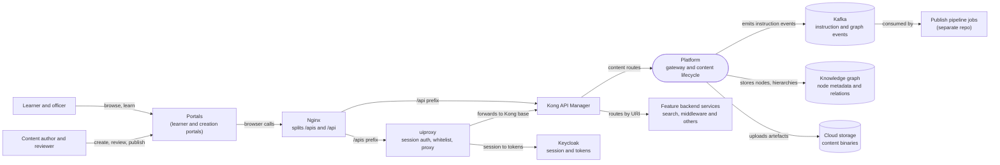

# Platform — Context Diagram

## System boundary

Inside the platform boundary are the shared layers every feature relies on: the portals
that browsers load, the gateway pair (the `sunbird-cb-uiproxy` proxy and Kong) that routes
each call, and the content lifecycle service that owns create, review, publish and retire.
Outside it are the people who author and consume content, the feature backend services
that Kong fronts, Keycloak sessions, the Kafka-driven publish pipeline jobs, and the graph
and cloud-storage stores.

## Diagram

## Elements

| Element | Role | Detailed in |
|---|---|---|
| Platform (gateway and content lifecycle) | Central shared layer: request routing plus the content status model and routes | [api-gateway.md](api-gateway.md), [content-lifecycle.md](content-lifecycle.md) |
| Learner and officer | Consume content through the learner portal across the Learning Hub features | [Learning Hub](../learning-hub/index.md) |
| Content author and reviewer | Create, review, publish and retire content from the Creation Portal | [content-lifecycle.md](content-lifecycle.md) |
| Portals | Browser front ends whose calls leave on one of two prefixes | [api-gateway.md](api-gateway.md) |
| Nginx | Splits traffic between the `/apis` and `/api` prefixes | [api-gateway.md](api-gateway.md) |
| uiproxy | Browser-facing proxy: session to tokens, route whitelist, forwards to Kong | [api-gateway.md](api-gateway.md) |
| Kong API Manager | Maps public URIs to internal services | [api-gateway.md](api-gateway.md) |
| Feature backend services | Services behind Kong routes, such as search and the legacy middleware relay | [api-gateway.md](api-gateway.md) |
| Keycloak | Source of the session that uiproxy turns into tokens | [api-gateway.md](api-gateway.md) |
| Publish pipeline jobs | Consume instruction events to carry out publish; not attached to the docs | [content-lifecycle.md](content-lifecycle.md) |
| Kafka | Carries instruction and graph lifecycle events from the content service | [content-lifecycle.md](content-lifecycle.md) |
| Knowledge graph | Holds content node metadata, relations and hierarchies | [content-lifecycle.md](content-lifecycle.md) |
| Cloud storage | Holds uploaded content binaries | [content-lifecycle.md](content-lifecycle.md) |

> **Verification boundary:** elements and interactions come from reading in full the two
> platform pages (`api-gateway.md`, `content-lifecycle.md`), the docs home page
> (`index.md`) and the Learning Hub overview (`learning-hub/index.md`). Spot-checked
> read-only in source: the uiproxy's use of a Kong base setting, and the content service's
> review and publish routes. Not re-verified: the Kong route map, the Creation Portal
> alias mapping, Keycloak internals, and the publish pipeline jobs (documented as a
> separate repo). The Kong-to-content-service arrow follows the content-lifecycle page's
> gateway aliases; the Kong route for it was not traced.
