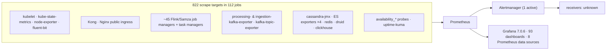

# iGOT Karmayogi — Monitoring & Observability

**Audience:** SRE / on-call / support engineers.

*Snapshot of the production monitoring estate as of 30 Oct 2026. Alert states and target health change continuously; re-check before acting on them.*

---

## 1. Observability architecture



- Grafana is **7.0.6** (build July 2020; latest is 10.2.3 per its own update check). It uses legacy alerting; **no Grafana-native alerts exist** — all alerting is Prometheus → Alertmanager.
- Eight data sources, all type Prometheus: `Prometheus` (default), `DS_PROMETHEUS`, `Flink-Prometheus`, `InfluxDB_Datapipeline` (named Influx, actually Prometheus), `Kubecost`, `PrometheusProcessExporter`, `Prometheus_DS1`, `prom-fed`. Four of them returned the same 822 targets and rule set, so they appear to point at one Prometheus or a federation of it.
- Gateway is **Kong + Nginx**. `kong_request_status_count` and `nginx_http_requests_total` are scraped. **No `envoy_*` or `istio_*` metrics exist**, so the `Envoy Global` / `Envoy Proxy` dashboards are inherited and show nothing.
- Logs: Fluent-bit (`fluent-bit-metrics`, 65 targets up, every node) → Logstash → a dedicated 3-node Elasticsearch cluster `prod-log` → **Kibana 6.8.22**. The `graylog` scrape target is **down**, so Graylog is not the working log path. See §9.
- **No tracing** found anywhere.

## 2. Dashboards — 93 live

| Question | Dashboards (live titles) |
|---|---|
| Is it up? | `NOC Dashboard 1`, `Master Dashboard`, `Health`, `Uptime - SLA and Latency`, `SSL Certificate Monitor`, `KPI Metrics`, `KPI One Dashboard` |
| Gateway | `API Manager` (+ `Aggregated Beta`, `Consumer Level`, `Request/Response Size`), `NGINX`, `Nginx Detailed`, `Nginx (Pre Computed)`, `Open Policy Agent Metrics` |
| Stream jobs | `KP Flink Jobs Metrics` (+Copy), `Data Pipeline Metrics Flink`, `Flink Lag Dashboard` (+Dev), `LP Pipeline Metrics-Lag`, `Secor Consumer Lag and kafka topics details`, `LPA Metrics` |
| Datastores | `Cassandra`, `ElasticSearch Cluster`, `Elasticsearch Exporter Quickstart…`, `Redis Dashboard…`, `Druid`, `ClickHouse Production Monitoring` (+3 variants), `Database VM Metrics` |
| Kubernetes | 25 `Kubernetes / …` dashboards (compute, networking, HPA, API server, kubelet, PVs), `CoreDNS`, `etcd`, `Deployment Info Dashboard`, `KubeCost` |
| Hosts | `Node Exporter / …` (8), `Node Exporter Full`, `Node Metrics Multi-Node` (+Copy), `Host Details` (+Copy), `Nodes`, `Process Exporter`, `One View Node Exporter Dashboard`, `Service memory usage` |
| Logs & other | `Graylog Dashboard`, `Fluent Bit`, `Alertmanager / Overview`, `Prometheus / Overview`, `Prometheus Stats`, `Grafana Overview`, `Weekly Report Dashboard`, `DSR Metrics`, `Device Register API Metrics` |
| Present but empty | `Envoy Global`, `Envoy Proxy` (no envoy metrics scraped) |

Many are duplicates/copies (`… Copy`, `New dashboard`, three ClickHouse variants); worth pruning. Dashboard **contents** were not reviewed except Envoy.

## 3. Alerting as deployed

**180 alerting rules / 37 groups.** Currently: 170 inactive, 10 firing (see §3.2).

### 3.1 What is covered

| Area | Rules | Detail |
|---|---|---|
| **Kafka consumer lag** | 41 (`alertrules.kafkalag`) | Critical/fatal per job, `for 5m`. Samza-style `samza_pipeline_metrics_consumer_lag` > 100 / > 500, plus `kafka_consumergroup_lag` rules for **15 consumer groups**: `prod-pipeline-preprocessor-group`, `prod-ingest-router-group`, `prod-druid-validator-group`, `prod-telemetry-extractor-group`, `prod-telemetry-denorm-primary/secondary-group`, `prod-summmary-denorm-group`, `prod-error-denorm-group`, `prod-rating-group`, `prod-activity-aggregate-v2-group`, `prod-program-activity-aggregate-group`, `prod-cb-preprocessor-group`, `prod-content-cache-updater-group`, `prod-user-cache-updater-consumer-group`, `prod.telemetry.unique.backup` |
| **Kafka brokers** | 7 | broker count < 3 (processing) / < 2 (ingestion), ISR ≠ partitions, rapid leader change |
| **Kong** | 5 | 5xx and 4xx ratio, critical (`for 2m`) and fatal (`for 10m`) |
| **Nginx public ingress** | 5 | 5xx/4xx ratios; `nginx_traffic_alert_fatal`: total request rate < 100/s for 30 m |
| **Nodes (VMs)** | 12 + 24 `node-exporter` mixin | CPU / memory / load / disk at warning/critical/fatal |
| **Kubernetes** | ~46 | pod not ready, crash-looping, job failed, **HPA maxed out**, deployment/statefulset mismatches, kubelet, storage, resource quotas |
| **Prometheus / Alertmanager self** | 22 + 8 + 7 | target sync failure, rule failures, notification failures |
| **Cassandra** | 1 | `cassandraRangeScanLatencyAlert` p99 range-scan > 500 ms for 5 m |
| **Elasticsearch / Redis / Postgres / Druid / Keycloak / disk probes** | **0** | no application-level rules (the chart's commented-out ES/Druid/process rules are not loaded) |

Node CPU alerts fire at **65 / 75 / 85 %**.

### 3.2 Firing right now (2026-10-30)

| Alert | Sev | What |
|---|---|---|
| `kafka_lag_limit` ×2 | critical | consumer group `prod-pipeline-preprocessor-group` lag > 100 000; `prod.telemetry.unique.backup` lag > 4 000 000 (telemetry backlog) |
| `KubePodNotReady` | critical | **`karma-points-processor-v2-taskmanager`** in namespace `flink-kp-prod` |
| `KubeJobFailed` | critical | CronJob `cb-ext-content-retirement-notify-…` (namespace `prod`) |
| `KubeHpaMaxedOut` ×10 | critical | HPAs at max replicas incl. `lms`, `cb-ext-userprofile-service`, `profanity-filter`, `profanity-moderator-admin-service` |
| `node_running_out_of_disk_space_fatal` | fatal | node `kb-prod-jumphost-p1` |
| `…_warning` ×3, `NodeMemoryHighUtilization`, `CPUThrottlingHigh`, `KubeVersionMismatch` | warn/info | disk (3 nodes), memory, throttling, K8s version skew |

These are a snapshot of one moment. Notably the Karma Points processor pod not being ready ties directly to the "no karma alerts" finding below.

### 3.3 What is **not** alerted despite metrics existing

| Gap | Evidence |
|---|---|
| Karma Points | `kafka_consumergroup_lag` series exist for karma groups (4) and the job has task/job-manager targets, but **no rule references them** |
| Workflow / community / search-indexer / certificate / competency consumers | lag series exist (45 for workflow|community|indexer groups) but none of the 15 alerted groups is one of them |
| Flink job health | job/task managers are scraped (~45 jobs) but no job-down rule; only generic `KubePodNotReady` |
| Synthetic probes | `availability_*` probe targets exist (below) but no rule alerts on `probe_success` |
| Datastores | no ES, Redis, Postgres, Neo4j, Druid or Keycloak rules |
| Warehouse / Airflow | no signal at all in Prometheus |

## 4. Scrape health — the monitoring's own blind spots

Of 822 targets, these are **down** and therefore unobserved:

| Job | Down | Meaning |
|---|---|---|
| `process-exporter` | 90 / 90 | process-down visibility is entirely missing (also why the chart's process rules are off) |
| `cassandra-exporter` | 11 / 11 | (`cassandra-external` 11 up, so some Cassandra metrics still flow) |
| `vm-node-exporter` | 12 of 90 | 12 VMs unmonitored — and the node alerts depend on this job |
| `coredns` | 5 / 5 | |
| `graylog`, `sprint-report-exporter` | 1 each | |
| `kubernetes-pods` | 1 of 38 | |
| Probes `availability_service_{content,knowledgemw,learner,learning-service,lms,search}` | 6 down | legacy probes failing; the newer `availability_{cb-ext-service,keycloak-service,learning-service,search-service}` and `availability_external-domain` (8) are up |

Because no alert watches `up == 0` for these jobs, **the alert system would not tell you.**

## 5. Stream jobs being scraped

Flink job manager + task manager targets exist for: `karma-points-processor-v2`, `search-indexer`, `content-publish`, `questionset-publish`, `post-publish-processor`, `user-competency-updater`, `user-achievement-processor`, `user-activity-analysis-updater`, `user-cache-updater-v2`, `content-cache-updater`, `relation-cache-updater`, `framework-search-indexer`, `enrolment-reconciliation`, `notification-job`, `rating`, `collection-cert-pre-processor`, `collection-certificate-generator`, `program-cert-pre-processor`, `event-cert-generator`, `assessment-public-certificate-generator`, `common-certificate-generator-utility`, `activity-aggregate-updater-v2`, `program-activity-aggregate-updater`, `asset-enrichment`, `audit-event-generator`, `audit-history-indexer`, plus the telemetry pipeline (`ingest-router`, `pipeline-preprocessor`, `druid-validator`, `telemetry-extractor`, `summary-denormalization`, `error-denormalization`).

Useful metrics (Karma Points): `…karma_points_persist_processor_{total_events_count, failed_events_count, skipped_event_count, db_update_count, db_read_count, cache_hit_cout (sic), cache_miss_count}`; `KafkaConsumer_records_lag_max`. Restart strategy for the search indexer: 3 attempts, 30 s delay — after which the job **stays down**.

## 6. Health endpoints & probes

| Service | Endpoint | Note |
|---|---|---|
| `search-service` | `GET /health`, `GET /service/health` (ES dependency) | |
| `cbp-ai-service` | `GET /api/v1/health` | |
| `nlp-search` | `GET /` only | welcome message, not liveness; Helm chart has no probes, HPA, or ServiceMonitor |
| `ai-cbp-mdo-service` | none | TCP probe only |
| others | not documented | confirm in each chart |

Blackbox/Uptime-Kuma: `uptime-kuma` target is up; probe set above.

## 7. Recommended changes

Re-ranked now that the live rules are known. Add:

| # | Alert | Condition | Why (from live data) |
|---|---|---|---|
| 1 | **Scrape target down** | `up == 0` for 10 m, per job (esp. `vm-node-exporter`, `cassandra-exporter`, `process-exporter`, `coredns`) | 90+ targets down silently |
| 2 | **Karma processor** | lag > N for 10 m; `KubePodNotReady` for `flink-kp-prod` > 10 m escalates to page; `failed_events_count` rate > 0 | pod is not ready now; no rule |
| 3 | **Feature consumers lag** | same shape as the existing `kafka_lag_limit`, for workflow, community-meta, search-indexer, notification, certificate, competency groups | series already exist; just add rules |
| 4 | **Flink job down** | job manager `up == 0` or task slots = 0 | per-job rather than pod-generic |
| 5 | **Probe failure** | `probe_success == 0` for 2 m on `availability_*` | probes exist, nothing alerts |
| 6 | **Datastores** | ES cluster red/yellow + heap; Redis evictions; Postgres connections; Cassandra read/write p99 | 0 rules today |
| 7 | **Gateway latency** | p95 per Kong route | only error ratios exist |
| 8 | **Warehouse / Airflow** | tables empty / DAG failed | no signal at all |
| 9 | **HPA maxed** | already fires (×10) — **triage the 10 firing HPAs** (`lms`, `cb-ext-userprofile-service`, …) rather than adding rules | capacity |

Housekeeping: remove dead dashboards (Envoy, duplicates), fix or drop the six failing legacy probes, upgrade Grafana 7.0.6 (end-of-life, known CVEs), and **confirm Alertmanager receivers** (cannot be seen with Viewer).

```yaml
- alert: IgotScrapeTargetDown
  expr: count by (job) (up == 0) > 0
  for: 10m
  labels: { severity: warning }
  annotations: { summary: "{{ $value }} targets down in job {{ $labels.job }}" }

- alert: IgotFeatureConsumerLagHigh
  expr: sum by (consumergroup) (kafka_consumergroup_lag{consumergroup=~".*(karma|workflow|community|indexer|cert|competency|notification).*"}) > 5000
  for: 10m
  labels: { severity: critical }
```
Tune the lag threshold per group from a 2-week baseline before paging.

## 8. Runbooks — symptom → check → action

Steps that say "no alert" mark known monitoring gaps.

| Symptom | Check in order | Action |
|---|---|---|
| Content published, not in search | node status (`Failed`/`Processing`) → `search-indexer` Flink job (§5) → lag on indexer group (no alert) → DLQ `*.learning.events.failed` → doc in `compositesearch` | restart job; re-publish (bulk child sync only logs on failure) |
| Blended-program request "sent", not pending | `wf_status` row stuck `ENROLL_IS_IN_PROGRESS` → lag on `workflowContentTopic` (no alert) | restore consumer; re-drive workflow (no admin override) |
| Approved but not enrolled | `wf_status` APPROVED vs Cassandra `user_enrolments_v2` | repair record manually |
| Seat shows full | `currentBatchSize` is a **string**; 0/empty/missing reads as full | fix attribute |
| Community counters wrong | lag on community-meta consumers (no retry/DLQ) | restart; recompute |
| Karma points missing | **`karma-points-processor-v2` pod state (currently not ready)** → lag on `prod-karma-points-processor-group` → processor failed/skipped counters → V1 vs V2 topic | fix pod; re-emit event (job dedups) |
| Wallet redeem stuck `PROCESSING` | processor running? Cassandra LWT claim, Redis dedup | poll `/redeem/status/{id}`; don't resubmit (409) |
| Dashboard stale / warehouse empty | Airflow DAG; `dashboardSync.py` vs `dataWarehouse*.py` | re-run that sync |
| Weekly claps wrong | double Stage 0 same day | check run history |
| New org missing | lag on `dev.org.hierarchy.new.org` (consumer outside repos) | escalate |
| Competency missing | in-request write ok? → `dev.user.competency.mapping.event.failed` → 3-job chain (`user-competency-updater` scraped §5) | replay failed topic |
| NLP search fails at start | missing `GOOGLE_CLOUD_*` or prompt env | fix infra config |
| Telemetry/usage numbers lag | `prod-pipeline-preprocessor-group` and `prod.telemetry.unique.backup` lag (**firing now**) | scale/restart the telemetry jobs |
| API errors spike | Kong 5xx alert → `API Manager` dashboard → upstream; check firing `KubeHpaMaxedOut` for the service | scale HPA max / fix service |

## 9. Logging

**Pipeline:** Fluent-bit → Logstash → Elasticsearch cluster `prod-log` (3 data nodes, green, 2 149 primary shards, 0 unassigned) → Kibana **6.8.22** (older than Elasticsearch/Grafana-era tooling; the 6.x line is end-of-life). Kibana pod `kibana-…` has been green since 2026-09-22.

**Index patterns (11), all time-field `@timestamp`:** `logstash*`, `learning*`, `keycloak-*`, `lms-es*`, `cassandra*`, `postgres*`, `kafka*`, `neo4j*`, `secor*`, `spark*`, `syslogs*`.

**Volume and retention :**

| Index family | Daily indices | Docs (8 days) | Size (8 days) | Content |
|---|---|---|---|---|
| `logstash-*` | 8 (23–30 Oct) | 5.3 billion | ~3.3 TB (≈400–650 GB/day) | application / container / ingress logs — the main stream |
| `keycloak-*` | 8 | 127 M | ~76 GB | Keycloak |
| `learning-*` | 8 | 38 M | ~14 GB | learning-platform logs |
| `syslogs`, `lms-es`, `cassandra`, `kafka`, `neo4j`, `secor`, `postgres` | 8 each | 0.07 M – 2.8 M | < 1 GB each | low-volume component logs |
| `.monitoring-es-6`, `.monitoring-kibana-6` | 8 | — | ~7 GB | stack self-monitoring |

- **Retention is about 8 days** (indices from 23 Oct to 30 Oct; nothing older). That caps incident forensics at roughly a week, which matters for the nightly-warehouse and karma questions in §8.
- Total ≈ **3.4 TB across 99 indices**; `logstash-*` is ~97 %. A single day is ~1.1 billion documents, so unfiltered searches are expensive — filter by service and time first.

**What the team actually uses Kibana for.** Of 263 saved searches, the names show a reactive, incident-driven pattern: 37+ Nginx searches (403, 404, 5xx, specific time windows), `lms` logs, `5xx-error-lms-spike`, `504 errors`, `cb-ext` (19), `cb-pores`, `Program_cert_generator`, `event cert`, `course-recommendation-service`, `apimanagerlogs`, plus many `New Saved Search` / one-off ids (`do_…`). Only **1 dashboard** exists — `nginx-public: Access Log Dashboard` — with 10 visualisations: request rate, status-code distribution, 4xx/5xx error rate, bandwidth, p50/p95/p99 response time, top 10 client IPs, top 20 paths, HTTP methods, plus `Top_10_Log_gen_Services` and `Total Error Count`.

**Gaps:**
- **No log-based alerting.** Kibana 6.8 here has no alert definitions among saved objects; nothing turns a log pattern into a page.
- **No dashboards for the learning features** (karma, workflow, certificates, bulk registration) — only ad hoc saved searches.
- **No-DLQ failures live only in these logs** (bulk-publish index failures, consumers without retry). Create a saved search + scheduled check for `ERROR` with `index`/`consumer` terms on the relevant services.
- No trace id correlation between logs and the Prometheus alerts.

**Recommended:** convert the recurring saved searches (`5xx-error-lms-spike`, `504 errors`, `Program_cert_generator`, `event cert`) into alerts (Elastalert/Watcher/Grafana-Loki alternative), add per-service error-rate dashboards, set an ILM policy with an agreed retention (compliance may need more than 8 days for audit logs), and upgrade Kibana/Elasticsearch off 6.x.

## 10. SLO starting points
| Journey | SLI | Starting SLO |
|---|---|---|
| Search | `v5/search` success | 99.5 % / 30 d |
| Enrol | `learner/course/v1/enrol` success | 99.5 % |
| Progress write | `content/v2/state/update` success | 99.9 % |
| Publish → searchable | Live → indexed | p95 < 5 min |
| Karma points | event → persisted | p95 < 2 min |
| Warehouse freshness | last good run | < 26 h |
Kong exposes `kong_request_status_count`, so request-success SLIs can be computed today.
