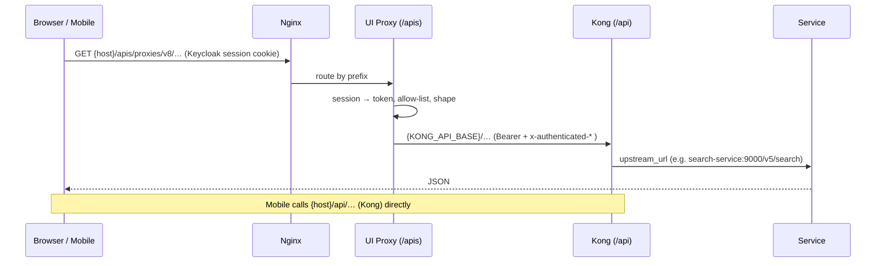
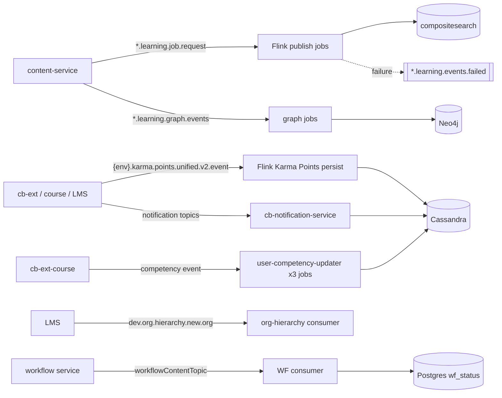
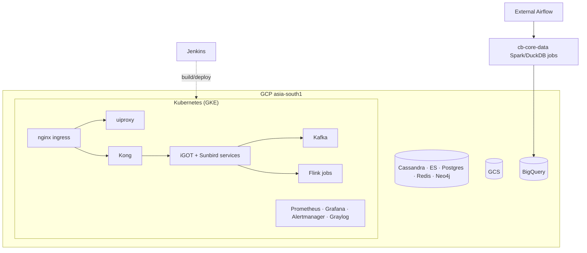

# iGOT Karmayogi — System Architecture

**Audience:** engineers, architects and SRE/ops joining or auditing the platform.
**Companion docs:** [Monitoring](#/monitoring) · Postman collection

---

## 1. Context

iGOT Karmayogi is India's national capacity-building platform for civil servants. It is the **Karmayogi Bharat (KB) extension layer built on the Sunbird-ED open-source learning core**, deployed on Kubernetes in GCP `asia-south1`.

| Actor | Uses |
|---|---|
| Karmayogi (learner) | Web portal, mobile app: discover, enrol, learn, certificates, karma points, discussions, events |
| MDO admin / CBP admin | Org portal: users, bulk registration, training plans (CB plan), reports |
| SPV super-admin | Admin portal: organisations, first administrators, registration links |
| Content creator / reviewer / publisher | Creation portal: author → review → publish |
| Program coordinator / trainer | Blended-program batches, attendance |
| Content partner (marketplace) | Self-registration, catalog upload |
| BI analyst | Looker over the warehouse |

External systems: partner LMSs (Coursera, Cornell, CDAC, Harvard), Gemini / Vertex AI, Looker/BI, email/SMS providers ◌.

## 2. Logical architecture (four layers)

<svg xmlns="http://www.w3.org/2000/svg" viewBox="0 0 1320 1010" width="100%" role="img" aria-label="iGOT Karmayogi system architecture" font-family="-apple-system,BlinkMacSystemFont,Segoe UI,Roboto,Helvetica,Arial,sans-serif">
<defs><marker id="ah" viewBox="0 0 10 10" refX="9" refY="5" markerWidth="7" markerHeight="7" orient="auto-start-reverse"><path d="M0,0 L10,5 L0,10 z" fill="#475569"/></marker><linearGradient id="hd" x1="0" x2="1"><stop offset="0" stop-color="#1e3a8a"/><stop offset="1" stop-color="#0e7490"/></linearGradient></defs>
<rect x="0" y="0" width="1320" height="1010" rx="0" fill="#f8fafc" stroke="none" stroke-width="0" />
<rect x="0" y="0" width="1320" height="64" rx="0" fill="url(#hd)" stroke="none" stroke-width="0" />
<text x="30" y="31" font-size="22" font-weight="700" fill="#fff" text-anchor="start">iGOT Karmayogi - System Architecture</text>
<text x="30" y="51" font-size="12" font-weight="400" fill="#cbd5e1" text-anchor="start">Karmayogi Bharat extension layer on the Sunbird-ED core | Kubernetes on GCP asia-south1</text>
<rect x="20" y="84" width="1000" height="64" rx="14" fill="#ffffff" stroke="#cbd5e1" stroke-width="1.2" />
<text x="40" y="108" font-size="11" font-weight="700" fill="#64748b" text-anchor="start">USERS</text>
<rect x="110" y="94" width="140" height="44" rx="8" fill="#eef2ff" stroke="#a5b4fc" stroke-width="1.2" />
<text x="180.0" y="113.0" font-size="12" font-weight="600" fill="#111827" text-anchor="middle">Karmayogi learners</text>
<text x="180.0" y="128.0" font-size="10" font-weight="400" fill="#475569" text-anchor="middle">web + mobile</text>
<rect x="260" y="94" width="140" height="44" rx="8" fill="#eef2ff" stroke="#a5b4fc" stroke-width="1.2" />
<text x="330.0" y="113.0" font-size="12" font-weight="600" fill="#111827" text-anchor="middle">MDO / CBP admins</text>
<text x="330.0" y="128.0" font-size="10" font-weight="400" fill="#475569" text-anchor="middle">org portal</text>
<rect x="410" y="94" width="140" height="44" rx="8" fill="#eef2ff" stroke="#a5b4fc" stroke-width="1.2" />
<text x="480.0" y="113.0" font-size="12" font-weight="600" fill="#111827" text-anchor="middle">SPV super-admin</text>
<text x="480.0" y="128.0" font-size="10" font-weight="400" fill="#475569" text-anchor="middle">admin portal</text>
<rect x="560" y="94" width="140" height="44" rx="8" fill="#eef2ff" stroke="#a5b4fc" stroke-width="1.2" />
<text x="630.0" y="113.0" font-size="12" font-weight="600" fill="#111827" text-anchor="middle">Creators &amp; reviewers</text>
<text x="630.0" y="128.0" font-size="10" font-weight="400" fill="#475569" text-anchor="middle">creation portal</text>
<rect x="710" y="94" width="140" height="44" rx="8" fill="#eef2ff" stroke="#a5b4fc" stroke-width="1.2" />
<text x="780.0" y="113.0" font-size="12" font-weight="600" fill="#111827" text-anchor="middle">Coordinators</text>
<text x="780.0" y="128.0" font-size="10" font-weight="400" fill="#475569" text-anchor="middle">blended programs</text>
<rect x="860" y="94" width="140" height="44" rx="8" fill="#eef2ff" stroke="#a5b4fc" stroke-width="1.2" />
<text x="930.0" y="113.0" font-size="12" font-weight="600" fill="#111827" text-anchor="middle">Content partners</text>
<text x="930.0" y="128.0" font-size="10" font-weight="400" fill="#475569" text-anchor="middle">marketplace</text>
<rect x="20" y="170" width="1000" height="82" rx="14" fill="#eff6ff" stroke="#2563eb" stroke-width="1.2" />
<circle cx="46" cy="192" r="13" fill="#2563eb"/>
<text x="46" y="197" font-size="13" font-weight="700" fill="#fff" text-anchor="middle">1</text>
<text x="68" y="197" font-size="14" font-weight="700" fill="#0f172a" text-anchor="start">Portals &amp; mobile</text>
<rect x="56" y="206" width="180" height="36" rx="8" fill="#fff" stroke="#93c5fd" stroke-width="1.2" />
<text x="146.0" y="228.0" font-size="12" font-weight="600" fill="#111827" text-anchor="middle">sunbird-cb-portal</text>
<rect x="248" y="206" width="180" height="36" rx="8" fill="#fff" stroke="#93c5fd" stroke-width="1.2" />
<text x="338.0" y="228.0" font-size="12" font-weight="600" fill="#111827" text-anchor="middle">igot_karmayogi_mobile</text>
<rect x="440" y="206" width="180" height="36" rx="8" fill="#fff" stroke="#93c5fd" stroke-width="1.2" />
<text x="530.0" y="228.0" font-size="12" font-weight="600" fill="#111827" text-anchor="middle">sunbird-cb-orgportal</text>
<rect x="632" y="206" width="180" height="36" rx="8" fill="#fff" stroke="#93c5fd" stroke-width="1.2" />
<text x="722.0" y="228.0" font-size="12" font-weight="600" fill="#111827" text-anchor="middle">sunbird-cb-adminportal</text>
<rect x="824" y="206" width="180" height="36" rx="8" fill="#fff" stroke="#93c5fd" stroke-width="1.2" />
<text x="914.0" y="228.0" font-size="12" font-weight="600" fill="#111827" text-anchor="middle">sunbird-cb-creationportal</text>
<line x1="500" y1="148" x2="500" y2="170" stroke="#475569" stroke-width="1.8" marker-end="url(#ah)"/>
<rect x="20" y="272" width="1000" height="118" rx="14" fill="#f5f3ff" stroke="#7c3aed" stroke-width="1.2" />
<circle cx="46" cy="294" r="13" fill="#7c3aed"/>
<text x="46" y="299" font-size="13" font-weight="700" fill="#fff" text-anchor="middle">2</text>
<text x="68" y="299" font-size="14" font-weight="700" fill="#0f172a" text-anchor="start">Proxies &amp; gateways</text>
<rect x="56" y="312" width="110" height="50" rx="8" fill="#fff" stroke="#c4b5fd" stroke-width="1.2" />
<text x="111.0" y="334.0" font-size="12" font-weight="600" fill="#111827" text-anchor="middle">Nginx</text>
<text x="111.0" y="349.0" font-size="10" font-weight="400" fill="#475569" text-anchor="middle">public host</text>
<rect x="236" y="302" width="300" height="38" rx="8" fill="#fff" stroke="#c4b5fd" stroke-width="1.2" />
<text x="386.0" y="318.0" font-size="12" font-weight="600" fill="#111827" text-anchor="middle">UI Proxy  /apis</text>
<text x="386.0" y="333.0" font-size="10" font-weight="400" fill="#475569" text-anchor="middle">sunbird-cb-uiproxy: session, allow-list</text>
<rect x="236" y="348" width="300" height="38" rx="8" fill="#fff" stroke="#c4b5fd" stroke-width="1.2" />
<text x="386.0" y="364.0" font-size="12" font-weight="600" fill="#111827" text-anchor="middle">Kong  /api</text>
<text x="386.0" y="379.0" font-size="10" font-weight="400" fill="#475569" text-anchor="middle">public URI -&gt; service route map</text>
<rect x="640" y="302" width="330" height="38" rx="8" fill="#fff" stroke="#c4b5fd" stroke-width="1.2" />
<text x="805.0" y="318.0" font-size="12" font-weight="600" fill="#111827" text-anchor="middle">Keycloak</text>
<text x="805.0" y="333.0" font-size="10" font-weight="400" fill="#475569" text-anchor="middle">single identity provider</text>
<rect x="640" y="348" width="330" height="38" rx="8" fill="#fff" stroke="#ddd6fe" stroke-width="1.2" />
<text x="805.0" y="364.0" font-size="12" font-weight="600" fill="#111827" text-anchor="middle">OPA / Envoy policy</text>
<text x="805.0" y="379.0" font-size="10" font-weight="400" fill="#475569" text-anchor="middle">policy checks</text>
<line x1="166" y1="327" x2="236" y2="321" stroke="#475569" stroke-width="1.8" marker-end="url(#ah)"/>
<line x1="166" y1="347" x2="236" y2="367" stroke="#475569" stroke-width="1.8" marker-end="url(#ah)"/>
<line x1="386" y1="340" x2="386" y2="348" stroke="#475569" stroke-width="1.8" marker-end="url(#ah)"/>
<text x="396" y="345" font-size="9" font-weight="500" fill="#475569" text-anchor="start">KONG_API_BASE</text>
<line x1="536" y1="321" x2="640" y2="321" stroke="#7c3aed" stroke-width="1.8" stroke-dasharray="5 4" marker-end="url(#ah)"/>
<rect x="569.0" y="312.0" width="38.0" height="16" rx="4" fill="#fff" stroke="none" stroke-width="0" opacity="0.92"/>
<text x="588.0" y="324.0" font-size="10" font-weight="500" fill="#7c3aed" text-anchor="middle">token</text>
<line x1="62" y1="252" x2="62" y2="312" stroke="#475569" stroke-width="1.8" marker-end="url(#ah)"/>
<rect x="20" y="410" width="1000" height="290" rx="14" fill="#f0fdf4" stroke="#16a34a" stroke-width="1.2" />
<circle cx="46" cy="432" r="13" fill="#16a34a"/>
<text x="46" y="437" font-size="13" font-weight="700" fill="#fff" text-anchor="middle">3</text>
<text x="68" y="437" font-size="14" font-weight="700" fill="#0f172a" text-anchor="start">Services</text>
<rect x="40" y="450" width="560" height="238" rx="12" fill="#ffffff" stroke="#86efac" stroke-width="1.2" />
<text x="60" y="472" font-size="13" font-weight="700" fill="#166534" text-anchor="start">iGOT services  -  Karmayogi Bharat</text>
<rect x="56" y="488" width="170" height="52" rx="8" fill="#f0fdf4" stroke="#86efac" stroke-width="1.2" />
<text x="141.0" y="511.0" font-size="12" font-weight="600" fill="#111827" text-anchor="middle">sunbird-cb-ext</text>
<text x="141.0" y="526.0" font-size="10" font-weight="400" fill="#475569" text-anchor="middle">orchestration - karma</text>
<rect x="236" y="488" width="170" height="52" rx="8" fill="#f0fdf4" stroke="#86efac" stroke-width="1.2" />
<text x="321.0" y="511.0" font-size="12" font-weight="600" fill="#111827" text-anchor="middle">cb-ext-course-service</text>
<text x="321.0" y="526.0" font-size="10" font-weight="400" fill="#475569" text-anchor="middle">competency - extended read</text>
<rect x="416" y="488" width="170" height="52" rx="8" fill="#f0fdf4" stroke="#86efac" stroke-width="1.2" />
<text x="501.0" y="511.0" font-size="12" font-weight="600" fill="#111827" text-anchor="middle">sunbird-cb-workflow</text>
<text x="501.0" y="526.0" font-size="10" font-weight="400" fill="#475569" text-anchor="middle">approvals - wf_status</text>
<rect x="56" y="550" width="170" height="52" rx="8" fill="#f0fdf4" stroke="#86efac" stroke-width="1.2" />
<text x="141.0" y="573.0" font-size="12" font-weight="600" fill="#111827" text-anchor="middle">frac-backend</text>
<text x="141.0" y="588.0" font-size="10" font-weight="400" fill="#475569" text-anchor="middle">competency CRUD + review</text>
<rect x="236" y="550" width="170" height="52" rx="8" fill="#f0fdf4" stroke="#86efac" stroke-width="1.2" />
<text x="321.0" y="573.0" font-size="12" font-weight="600" fill="#111827" text-anchor="middle">discussion / community</text>
<text x="321.0" y="588.0" font-size="10" font-weight="400" fill="#475569" text-anchor="middle">comment - meta-update</text>
<rect x="416" y="550" width="170" height="52" rx="8" fill="#f0fdf4" stroke="#86efac" stroke-width="1.2" />
<text x="501.0" y="573.0" font-size="12" font-weight="600" fill="#111827" text-anchor="middle">marketplace trio</text>
<text x="501.0" y="588.0" font-size="10" font-weight="400" fill="#475569" text-anchor="middle">pores - cios - external enrol</text>
<rect x="56" y="612" width="170" height="52" rx="8" fill="#f0fdf4" stroke="#86efac" stroke-width="1.2" />
<text x="141.0" y="635.0" font-size="12" font-weight="600" fill="#111827" text-anchor="middle">cb-notification</text>
<text x="141.0" y="650.0" font-size="10" font-weight="400" fill="#475569" text-anchor="middle">in-app + email</text>
<rect x="236" y="612" width="170" height="52" rx="8" fill="#f0fdf4" stroke="#86efac" stroke-width="1.2" />
<text x="321.0" y="635.0" font-size="12" font-weight="600" fill="#111827" text-anchor="middle">cb-core-data</text>
<text x="321.0" y="650.0" font-size="10" font-weight="400" fill="#475569" text-anchor="middle">nightly Spark/DuckDB</text>
<rect x="416" y="612" width="170" height="52" rx="8" fill="#f0fdf4" stroke="#86efac" stroke-width="1.2" />
<text x="501.0" y="635.0" font-size="12" font-weight="600" fill="#111827" text-anchor="middle">AI services</text>
<text x="501.0" y="650.0" font-size="10" font-weight="400" fill="#475569" text-anchor="middle">nlp-search - cbp-ai</text>
<rect x="630" y="450" width="370" height="238" rx="12" fill="#ffffff" stroke="#fcd34d" stroke-width="1.2" />
<text x="650" y="472" font-size="13" font-weight="700" fill="#92400e" text-anchor="start">Sunbird-ED core  -  upstream, as-is</text>
<rect x="646" y="488" width="165" height="52" rx="8" fill="#fffbeb" stroke="#fcd34d" stroke-width="1.2" />
<text x="728.5" y="511.0" font-size="12" font-weight="600" fill="#111827" text-anchor="middle">knowledge-platform</text>
<text x="728.5" y="526.0" font-size="10" font-weight="400" fill="#475569" text-anchor="middle">content - search - taxonomy</text>
<rect x="821" y="488" width="165" height="52" rx="8" fill="#fffbeb" stroke="#fcd34d" stroke-width="1.2" />
<text x="903.5" y="511.0" font-size="12" font-weight="600" fill="#111827" text-anchor="middle">sunbird-lms-service</text>
<text x="903.5" y="526.0" font-size="10" font-weight="400" fill="#475569" text-anchor="middle">users - orgs - batches</text>
<rect x="646" y="550" width="165" height="52" rx="8" fill="#fffbeb" stroke="#fcd34d" stroke-width="1.2" />
<text x="728.5" y="573.0" font-size="12" font-weight="600" fill="#111827" text-anchor="middle">sunbird-course-service</text>
<text x="728.5" y="588.0" font-size="10" font-weight="400" fill="#475569" text-anchor="middle">enrol - progress</text>
<rect x="821" y="550" width="165" height="52" rx="8" fill="#fffbeb" stroke="#fcd34d" stroke-width="1.2" />
<text x="903.5" y="573.0" font-size="12" font-weight="600" fill="#111827" text-anchor="middle">knowledge-platform-jobs</text>
<text x="903.5" y="588.0" font-size="10" font-weight="400" fill="#475569" text-anchor="middle">Flink publish - indexer - karma</text>
<rect x="646" y="612" width="165" height="52" rx="8" fill="#fffbeb" stroke="#fcd34d" stroke-width="1.2" />
<text x="728.5" y="635.0" font-size="12" font-weight="600" fill="#111827" text-anchor="middle">assessment + certs</text>
<text x="728.5" y="650.0" font-size="10" font-weight="400" fill="#475569" text-anchor="middle">cert registry</text>
<line x1="600" y1="570" x2="630" y2="570" stroke="#b45309" stroke-width="1.8" marker-end="url(#ah)"/>
<text x="615" y="560" font-size="9" font-weight="500" fill="#b45309" text-anchor="middle">calls</text>
<line x1="300" y1="392" x2="300" y2="450" stroke="#475569" stroke-width="1.8" marker-end="url(#ah)"/>
<rect x="269.8" y="412.0" width="60.4" height="16" rx="4" fill="#fff" stroke="none" stroke-width="0" opacity="0.92"/>
<text x="300.0" y="424.0" font-size="10" font-weight="500" fill="#475569" text-anchor="middle">routes to</text>
<line x1="815" y1="392" x2="815" y2="450" stroke="#475569" stroke-width="1.8" marker-end="url(#ah)"/>
<rect x="20" y="720" width="1000" height="150" rx="14" fill="#fff7ed" stroke="#ea580c" stroke-width="1.2" />
<circle cx="46" cy="742" r="13" fill="#ea580c"/>
<text x="46" y="747" font-size="13" font-weight="700" fill="#fff" text-anchor="middle">4</text>
<text x="68" y="747" font-size="14" font-weight="700" fill="#0f172a" text-anchor="start">Data &amp; messaging</text>
<rect x="40" y="760" width="128" height="50" rx="8" fill="#fff" stroke="#fdba74" stroke-width="1.2" />
<text x="104.0" y="782.0" font-size="12" font-weight="600" fill="#111827" text-anchor="middle">Cassandra</text>
<text x="104.0" y="797.0" font-size="10" font-weight="400" fill="#475569" text-anchor="middle">enrolments - karma</text>
<rect x="177" y="760" width="128" height="50" rx="8" fill="#fff" stroke="#fdba74" stroke-width="1.2" />
<text x="241.0" y="782.0" font-size="12" font-weight="600" fill="#111827" text-anchor="middle">Elasticsearch</text>
<text x="241.0" y="797.0" font-size="10" font-weight="400" fill="#475569" text-anchor="middle">search - users</text>
<rect x="314" y="760" width="128" height="50" rx="8" fill="#fff" stroke="#fdba74" stroke-width="1.2" />
<text x="378.0" y="782.0" font-size="12" font-weight="600" fill="#111827" text-anchor="middle">Postgres</text>
<text x="378.0" y="797.0" font-size="10" font-weight="400" fill="#475569" text-anchor="middle">workflow - warehouse</text>
<rect x="451" y="760" width="128" height="50" rx="8" fill="#fff" stroke="#fdba74" stroke-width="1.2" />
<text x="515.0" y="782.0" font-size="12" font-weight="600" fill="#111827" text-anchor="middle">Redis</text>
<text x="515.0" y="797.0" font-size="10" font-weight="400" fill="#475569" text-anchor="middle">cache - counters</text>
<rect x="588" y="760" width="128" height="50" rx="8" fill="#fff" stroke="#fdba74" stroke-width="1.2" />
<text x="652.0" y="782.0" font-size="12" font-weight="600" fill="#111827" text-anchor="middle">Neo4j</text>
<text x="652.0" y="797.0" font-size="10" font-weight="400" fill="#475569" text-anchor="middle">content graph</text>
<rect x="725" y="760" width="128" height="50" rx="8" fill="#fff" stroke="#fdba74" stroke-width="1.2" />
<text x="789.0" y="782.0" font-size="12" font-weight="600" fill="#111827" text-anchor="middle">GCS / Blob</text>
<text x="789.0" y="797.0" font-size="10" font-weight="400" fill="#475569" text-anchor="middle">files - certs</text>
<rect x="862" y="760" width="128" height="50" rx="8" fill="#fff" stroke="#fdba74" stroke-width="1.2" />
<text x="926.0" y="782.0" font-size="12" font-weight="600" fill="#111827" text-anchor="middle">BigQuery / Druid</text>
<text x="926.0" y="797.0" font-size="10" font-weight="400" fill="#475569" text-anchor="middle">analytics</text>
<rect x="40" y="820" width="960" height="38" rx="10" fill="#fed7aa" stroke="#fb923c" stroke-width="1.2" />
<text x="520" y="844" font-size="13" font-weight="700" fill="#7c2d12" text-anchor="middle">Kafka  -  event backbone  (publish - karma - workflow - notifications - competency)</text>
<line x1="320" y1="700" x2="320" y2="760" stroke="#475569" stroke-width="1.8" marker-end="url(#ah)"/>
<rect x="281.4" y="721.0" width="77.19999999999999" height="16" rx="4" fill="#fff" stroke="none" stroke-width="0" opacity="0.92"/>
<text x="320.0" y="733.0" font-size="10" font-weight="500" fill="#475569" text-anchor="middle">read / write</text>
<line x1="815" y1="700" x2="815" y2="760" stroke="#475569" stroke-width="1.8" marker-end="url(#ah)"/>
<rect x="20" y="890" width="1000" height="96" rx="14" fill="#f1f5f9" stroke="#94a3b8" stroke-width="1.2" />
<text x="40" y="914" font-size="11" font-weight="700" fill="#64748b" text-anchor="start">PLATFORM</text>
<rect x="40" y="926" width="228" height="48" rx="8" fill="#fff" stroke="#cbd5e1" stroke-width="1.2" />
<text x="154.0" y="947.0" font-size="12" font-weight="600" fill="#111827" text-anchor="middle">Kubernetes (GKE)</text>
<text x="154.0" y="962.0" font-size="10" font-weight="400" fill="#475569" text-anchor="middle">asia-south1</text>
<rect x="280" y="926" width="228" height="48" rx="8" fill="#fff" stroke="#cbd5e1" stroke-width="1.2" />
<text x="394.0" y="947.0" font-size="12" font-weight="600" fill="#111827" text-anchor="middle">sunbird-devops</text>
<text x="394.0" y="962.0" font-size="10" font-weight="400" fill="#475569" text-anchor="middle">Ansible - Helm - Kong routes</text>
<rect x="520" y="926" width="228" height="48" rx="8" fill="#fff" stroke="#cbd5e1" stroke-width="1.2" />
<text x="634.0" y="947.0" font-size="12" font-weight="600" fill="#111827" text-anchor="middle">Jenkins</text>
<text x="634.0" y="962.0" font-size="10" font-weight="400" fill="#475569" text-anchor="middle">build + deploy</text>
<rect x="760" y="926" width="228" height="48" rx="8" fill="#fff" stroke="#cbd5e1" stroke-width="1.2" />
<text x="874.0" y="947.0" font-size="12" font-weight="600" fill="#111827" text-anchor="middle">Airflow (external)</text>
<text x="874.0" y="962.0" font-size="10" font-weight="400" fill="#475569" text-anchor="middle">schedules cb-core-data</text>
<rect x="1040" y="84" width="260" height="330" rx="14" fill="#fdf2f8" stroke="#db2777" stroke-width="1.2" />
<text x="1060" y="110" font-size="12" font-weight="700" fill="#9d174d" text-anchor="start">OBSERVABILITY</text>
<rect x="1054" y="122" width="232" height="42" rx="8" fill="#fff" stroke="#f9a8d4" stroke-width="1.2" />
<text x="1170.0" y="140.0" font-size="12" font-weight="600" fill="#111827" text-anchor="middle">Prometheus</text>
<text x="1170.0" y="155.0" font-size="10" font-weight="400" fill="#475569" text-anchor="middle">822 targets - 180 alert rules</text>
<rect x="1054" y="170" width="232" height="42" rx="8" fill="#fff" stroke="#f9a8d4" stroke-width="1.2" />
<text x="1170.0" y="188.0" font-size="12" font-weight="600" fill="#111827" text-anchor="middle">Alertmanager</text>
<text x="1170.0" y="203.0" font-size="10" font-weight="400" fill="#475569" text-anchor="middle">routes to receivers</text>
<rect x="1054" y="218" width="232" height="42" rx="8" fill="#fff" stroke="#f9a8d4" stroke-width="1.2" />
<text x="1170.0" y="236.0" font-size="12" font-weight="600" fill="#111827" text-anchor="middle">Grafana 7.0.6</text>
<text x="1170.0" y="251.0" font-size="10" font-weight="400" fill="#475569" text-anchor="middle">93 dashboards</text>
<rect x="1054" y="266" width="232" height="42" rx="8" fill="#fff" stroke="#f9a8d4" stroke-width="1.2" />
<text x="1170.0" y="284.0" font-size="12" font-weight="600" fill="#111827" text-anchor="middle">Fluent-bit -&gt; Logstash</text>
<text x="1170.0" y="299.0" font-size="10" font-weight="400" fill="#475569" text-anchor="middle">log shipping</text>
<rect x="1054" y="314" width="232" height="42" rx="8" fill="#fff" stroke="#f9a8d4" stroke-width="1.2" />
<text x="1170.0" y="332.0" font-size="12" font-weight="600" fill="#111827" text-anchor="middle">Elasticsearch prod-log</text>
<text x="1170.0" y="347.0" font-size="10" font-weight="400" fill="#475569" text-anchor="middle">3 nodes - 8 day retention</text>
<rect x="1054" y="362" width="232" height="42" rx="8" fill="#fff" stroke="#f9a8d4" stroke-width="1.2" />
<text x="1170.0" y="380.0" font-size="12" font-weight="600" fill="#111827" text-anchor="middle">Kibana 6.8.22</text>
<text x="1170.0" y="395.0" font-size="10" font-weight="400" fill="#475569" text-anchor="middle">11 index patterns</text>
<rect x="1040" y="436" width="260" height="220" rx="14" fill="#ecfeff" stroke="#0891b2" stroke-width="1.2" />
<text x="1060" y="462" font-size="12" font-weight="700" fill="#155e75" text-anchor="start">EXTERNAL (called by services)</text>
<rect x="1054" y="474" width="232" height="40" rx="8" fill="#fff" stroke="#67e8f9" stroke-width="1.2" />
<text x="1170.0" y="491.0" font-size="12" font-weight="600" fill="#111827" text-anchor="middle">Gemini / Vertex AI</text>
<text x="1170.0" y="506.0" font-size="10" font-weight="400" fill="#475569" text-anchor="middle">LLM + NLP search</text>
<rect x="1054" y="519" width="232" height="40" rx="8" fill="#fff" stroke="#67e8f9" stroke-width="1.2" />
<text x="1170.0" y="536.0" font-size="12" font-weight="600" fill="#111827" text-anchor="middle">Partner LMSs</text>
<text x="1170.0" y="551.0" font-size="10" font-weight="400" fill="#475569" text-anchor="middle">Coursera - Cornell - CDAC - Harvard</text>
<rect x="1054" y="564" width="232" height="40" rx="8" fill="#fff" stroke="#67e8f9" stroke-width="1.2" />
<text x="1170.0" y="581.0" font-size="12" font-weight="600" fill="#111827" text-anchor="middle">Looker / BI</text>
<text x="1170.0" y="596.0" font-size="10" font-weight="400" fill="#475569" text-anchor="middle">reads warehouse</text>
<rect x="1054" y="609" width="232" height="40" rx="8" fill="#fff" stroke="#67e8f9" stroke-width="1.2" />
<text x="1170.0" y="626.0" font-size="12" font-weight="600" fill="#111827" text-anchor="middle">Email / SMS</text>
<text x="1170.0" y="641.0" font-size="10" font-weight="400" fill="#475569" text-anchor="middle">notification providers</text>
<line x1="1020" y1="545" x2="1040" y2="545" stroke="#0891b2" stroke-width="1.8" stroke-dasharray="5 4" marker-end="url(#ah)"/>
<line x1="1020" y1="300" x2="1040" y2="300" stroke="#db2777" stroke-width="1.8" stroke-dasharray="5 4" marker-end="url(#ah)"/>
<rect x="1040" y="680" width="260" height="160" rx="14" fill="#ffffff" stroke="#cbd5e1" stroke-width="1.2" />
<text x="1060" y="706" font-size="11" font-weight="700" fill="#64748b" text-anchor="start">LEGEND</text>
<rect x="1060" y="718" width="14" height="12" rx="3" fill="#2563eb"/>
<text x="1084" y="728" font-size="11" font-weight="400" fill="#334155" text-anchor="start">Portals</text>
<rect x="1060" y="738" width="14" height="12" rx="3" fill="#7c3aed"/>
<text x="1084" y="748" font-size="11" font-weight="400" fill="#334155" text-anchor="start">Edge / identity</text>
<rect x="1060" y="758" width="14" height="12" rx="3" fill="#16a34a"/>
<text x="1084" y="768" font-size="11" font-weight="400" fill="#334155" text-anchor="start">iGOT services</text>
<rect x="1060" y="778" width="14" height="12" rx="3" fill="#f59e0b"/>
<text x="1084" y="788" font-size="11" font-weight="400" fill="#334155" text-anchor="start">Sunbird-ED core</text>
<rect x="1060" y="798" width="14" height="12" rx="3" fill="#ea580c"/>
<text x="1084" y="808" font-size="11" font-weight="400" fill="#334155" text-anchor="start">Data + Kafka</text>
<text x="1060" y="832" font-size="10" font-weight="400" fill="#64748b" text-anchor="start">Dashed = async / external</text>
<rect x="1040" y="856" width="260" height="130" rx="14" fill="#ffffff" stroke="#cbd5e1" stroke-width="1.2" />
<text x="1060" y="880" font-size="11" font-weight="700" fill="#64748b" text-anchor="start">FOUR FLOWS</text>
<text x="1060" y="902" font-size="10" font-weight="400" fill="#334155" text-anchor="start">Learn: portal &gt; gateway &gt; search &gt; enrol</text>
<text x="1060" y="922" font-size="10" font-weight="400" fill="#334155" text-anchor="start">Create: creation portal &gt; content &gt; Flink</text>
<text x="1060" y="942" font-size="10" font-weight="400" fill="#334155" text-anchor="start">Onboard: sign-up &gt; Keycloak &gt; cb-ext &gt; LMS</text>
<text x="1060" y="962" font-size="10" font-weight="400" fill="#334155" text-anchor="start">Measure: stores &gt; cb-core-data &gt; BI</text>
</svg>

Requests travel top to bottom: **users → portals → gateways → services → data**. iGOT services and the Sunbird-ED core sit side by side; iGOT extends the core and never forks it. Observability and external systems sit alongside.

## 3. Request path and gateway

| Prefix | Handler | Role |
|---|---|---|
| `/apis/proxies/v8/…` | UI Proxy | proxied to Kong after session handling |
| `/apis/protected/v8/…` | UI Proxy | Keycloak session required; some go **directly** to services (e.g. `frac/*` → `frac-backend`) |
| `/api/…` | Kong | public URI → `upstream_url` (route map: `sunbird-devops › kong-api/defaults/main.yml`) |

Documented example (search): `/apis/proxies/v8/composite/v5/search` → Kong `composite/v5/search` → `search-service:9000/v5/search` → `ExtendedSearchController.searchV5`.

## 4. Service inventory

### 4.1 iGOT (Karmayogi Bharat) services

| Service / repo | Responsibility | Stores |
|---|---|---|
| `sunbird-cb-uiproxy` | Browser-facing proxy, session, allow-list | Redis ◌ |
| `sunbird-cb-ext` | Orchestration: registration, org hierarchy, karma points & wallet, CB plan (training plans), bulk user upload, peer-validation reports, sector taxonomy, work allocation | Cassandra, Postgres, Redis, ES, Kafka |
| `cb-ext-course-service` | Learner competency, extended content read (Blended counters), moderated-content access | Cassandra, Redis |
| `sunbird-cb-workflow` | Approval workflows (`wf_status`) incl. blended program enrol/unenrol | Postgres, Kafka |
| `frac-backend` / `frac-dictionary` | Competency/Role/Activity/Position CRUD + L1/L2 review; dictionary view over ES | not stated in docs ◌, ES |
| `cb-discussion-service`, `cb-community-service`, `cb-comment-service`, `discussion-metaupdate-service` | Communities, Q&A posts, reports, counters | Cassandra, ES, Redis, Blob |
| `cb-pores-service`, `cios-content-service`, `cb_external_enrollment_service` | Marketplace: partners, registrations, external catalog & enrolment | Postgres, ES, GCS, Kafka |
| `cb-notification-service` / `cb-notification-wrapper` | In-app & email notifications via Kafka | Cassandra |
| `cb-ext-form-service` | Survey/forms | ES |
| `nlp-search`, `cbp-ai-service`, `ai-cbp-mdo-service`, `ai-assessment-service`, `kb-ai-unified-service` | AI (Gemini/Vertex AI) | own DBs |
| `cb-core-data` | Nightly analytics pipeline (Spark/DuckDB) | Parquet, Postgres, BigQuery |
| Portals/mobile: `sunbird-cb-portal`, `sunbird-cb-orgportal`, `sunbird-cb-adminportal`, `sunbird-cb-creationportal`, `igot_karmayogi_mobile` | UIs | — |

### 4.2 Sunbird-ED core (upstream, unmodified)

| Service | Responsibility |
|---|---|
| `knowledge-platform` (content-service, search-service, taxonomy, `knowledge-mw-service`) | Content CRUD & lifecycle, composite search, Framework/Category/Term (`kcmfinal_fw`), Event/EventSet nodes |
| `sunbird-lms-service` | Users, orgs, batches, enrolment, OTP, bulk upload |
| `sunbird-course-service` | Enrolment, progress, certificates triggers |
| `knowledge-platform-jobs` (Flink) | Publish, search-indexer, karma points persist, user-competency-updater, certificate jobs |
| assessment-service ◌, certificate/registry ◌ | Assessments, certificates |

### 4.3 Core Helm charts present in `sunbird-devops` (deployment units)
`adminutils, analytics, apimanager, assessment, cert, certregistry, content, dhiti, dial, discussionsmw, enc, groups, knowledgemw, learner, lms, ml-*, nodebb, notification, orchestrator, player, report, search, taxonomy, telemetry, userorg`, plus `logging`, `monitoring`, `istio-system`, `sunbird-RC`.

## 5. Data architecture

Key tables/indices named by the docs:

| Store | Objects |
|---|---|
| Cassandra | `user_enrolments_v2`, `enrollment_batch_lookup`, `cb_plan_v2`, `cb_plan_lookup`, karma points/summary, `learner_stats`, leaderboards, notification tables, FRAC competency records (`user-competency-updater`) |
| Postgres | `wingspan.wf_status`, `system_settings`, warehouse (12 core tables rebuilt each run) |
| Elasticsearch | `compositesearch`, `content_provider_alias`, `content_provider_registration_alias`, user directory, forms |
| Redis | caches, `{id}:user-event-enrolments`, seat-counter hash, leaderboard (`ttl 3600, index 2`), live dashboard keys |
| Neo4j | content graph & hierarchy, Event/EventSet |
| GCS/Blob | uploads, CSV result files, org-QR logos, catalog Excel |

## 6. Event / messaging architecture

Only the search-indexer path has a DLQ.

## 7. Key flows

| Flow | Path |
|---|---|
| **Learn** | Portal → `/apis` → Kong → `search-service` (discover) → `sunbird-course-service` enrol/progress (Cassandra) → completion event → karma points (Flink) / certificate → nightly leaderboards + warehouse |
| **Create & publish** | Creation portal → gateway → `content-service` Draft→Review→Live → Kafka instruction → Flink publish/indexer → ES/Neo4j/GCS → visible to learners |
| **Onboard** | Public sign-up / admin portal / CSV → Keycloak → `sunbird-cb-ext` orchestrates → LMS creates user → workflow approvals → notification-service email → Cassandra/ES |
| **Blended program enrol** | `POST workflow/blendedprogram/enrol` → `wf_status = ENROLL_IS_IN_PROGRESS` → Kafka → approval (MDO / PC, 1- or 2-step) → HTTP enrol in LMS (Cassandra) → certificate on completion |
| **Measure** | Live stores → `cb-core-data` Stage 0 → Stage 1 → Stage 2 (~46 jobs) → Postgres + BigQuery → Looker; Redis live-dashboard keys |

## 8. Deployment architecture

- Config as code: Ansible roles + Helm charts in `sunbird-devops`; env values from private vault-encrypted inventories.
- Build: per-repo `Jenkinsfile`, `Jenkins-Shared-Library`.
- Probes: `search-service`, `cb-search-service` wire liveness/readiness conditionally; `nlp-search` and `ai-cbp-mdo-service` have none (see [Monitoring §5](#/monitoring)).

## 9. Security model (as documented)

- Identity: Keycloak; UI Proxy exchanges session for tokens.
- Identity propagation: headers `x-authenticated-userid`, `x-authenticated-user-orgid`, `x-authenticated-user-token`; JWT claims `sub`, `user_roles`, org (search v5, `bp/search`).
- Authorization: per-service role checks (e.g. `MDO_LEADER`, `PROGRAM_COORDINATOR`, `BP_PROGRAM_TRAINER`, `CONTENT_REVIEWER`), not centrally enforced.
- Data scoping at the engine: moderated content restricted via ES `secureSettings.organisation`.
- Bulk registration: admin must verify an **OTP to their own contact** before upload (guard against hijacked session).
- Domain-validated OTP for sign-up (`otp/ext/v1/generate`, approved email domains).
- Rate limits on discussion create/like.
- Discussion moderation: auto-suspend at 5 reporters; async profanity detection (`isProfane`), soft-hide.
- Secrets: vault-encrypted Ansible inventories; not in repos. `default_config.py` in `cb-core-data` contains real internal default hosts — never production values.
- OPA is present in `sunbird-devops` (`opa`, `opa-plugins`, an `opa_envoy_403_alerts` rule, currently commented out).
