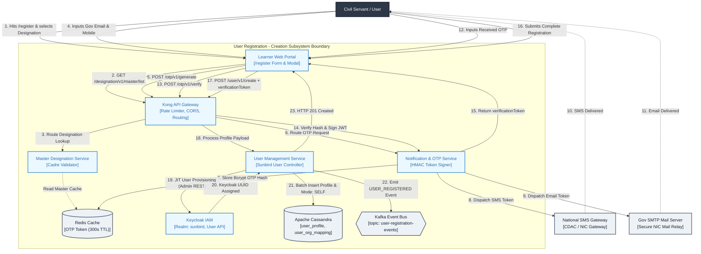
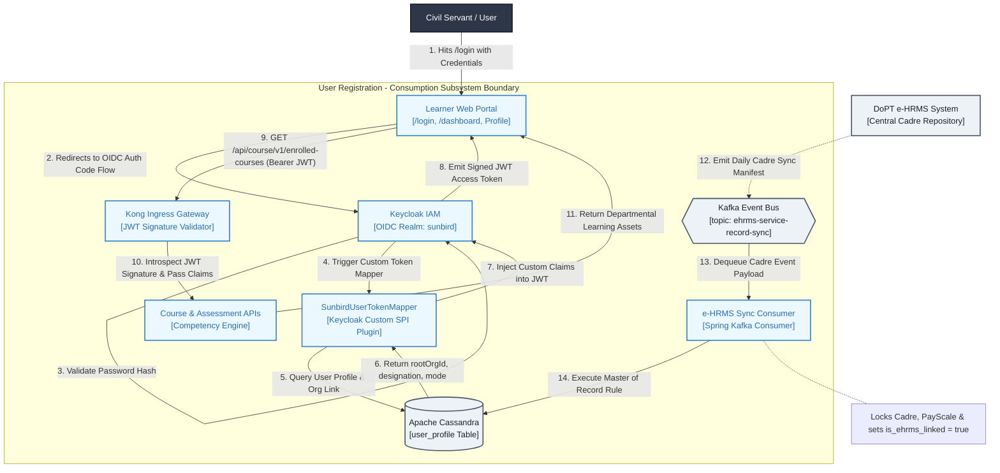
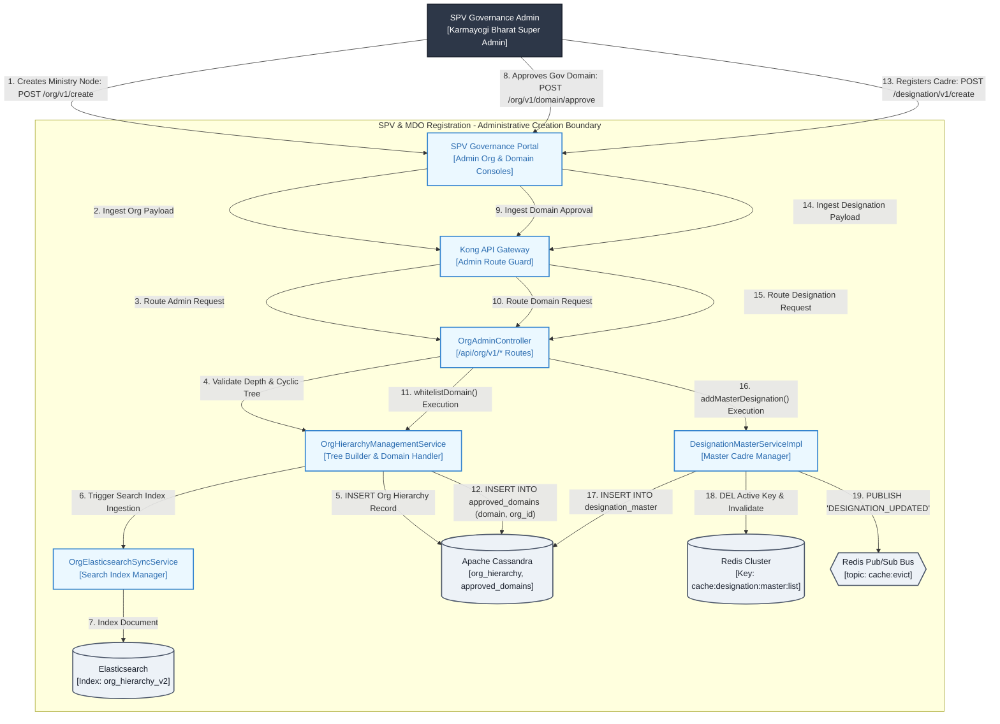
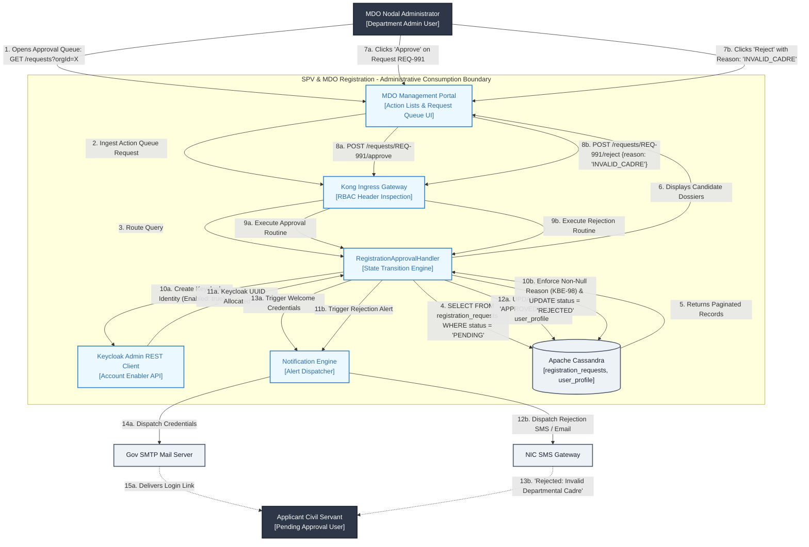
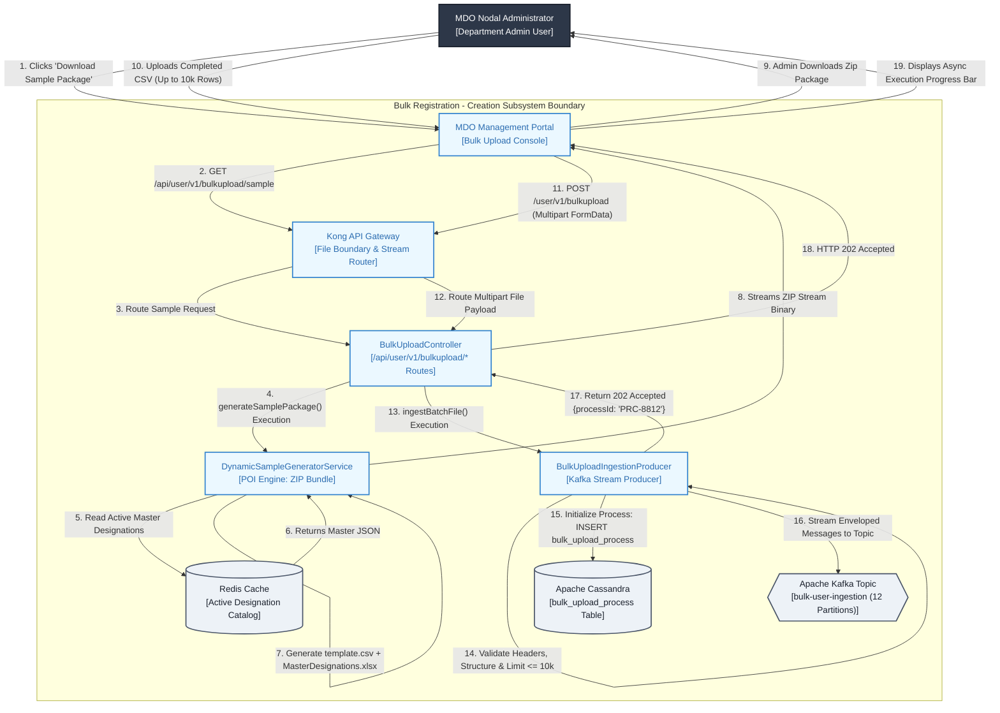
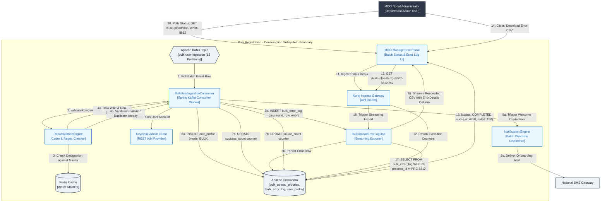
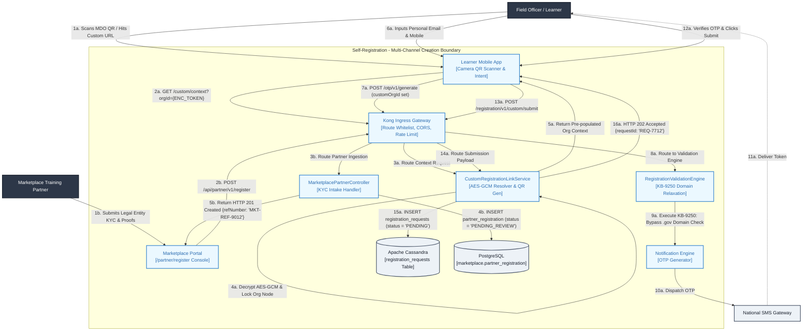
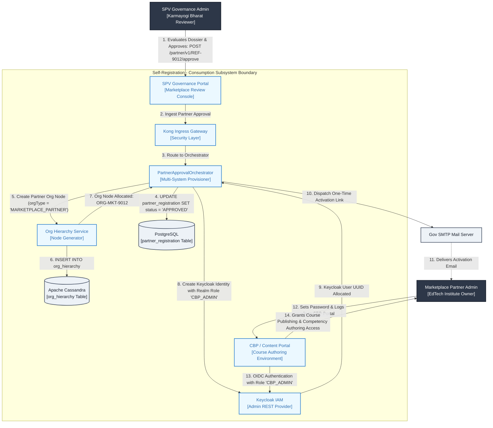

# Registration — System Context Diagram & Architectural Interaction Document

## 1. GLOBAL SYSTEM CONTEXT OVERVIEW (Q2 – Q13)

### 1.1 Architectural Purpose & Context

The **Registration Ecosystem** of the iGOT Karmayogi Platform functions as the national civil service identity and organization federation gateway. Between **Release Q2 and Release Q13**, the ecosystem evolved from a centralized, email-domain-restricted registration form into a multi-channel, federated onboarding platform.

It manages:

1. **Creation:** Administrative provisioning of Ministries, Departments, and Organizations (MDOs); dynamic email domain approvals by the Special Purpose Vehicle (SPV); Designation Master curation; multi-channel user data ingestion (Learner Web, Mobile App QR, MDO Custom Links, Bulk CSV/XLSX, Marketplace KYC, APIs); and credential issuance.
2. **Consumption:** Federated authentication through Keycloak IAM (OIDC); personnel record synchronisation with DoPT's e-HRMS; MDO administrative approval queues; asynchronous batch ingestion through Apache Kafka; and access enablement for downstream course consumption and capacity-building workflows across the Capacity Building Provider (CBP) Portal.

### 1.2 Enterprise Global Context Diagram (C4 Level 1)

```mermaid
flowchart TD
    %% Styling Definitions
    classDef actorStyle fill:#2D3748,stroke:#1A202C,stroke-width:2px,color:#FFFFFF;
    classDef boundaryStyle fill:#F7FAFC,stroke:#2B6CB0,stroke-width:3px,stroke-dasharray: 5 5,color:#2D3748;
    classDef platformStyle fill:#EBF8FF,stroke:#3182CE,stroke-width:2px,color:#2B6CB0;
    classDef externalStyle fill:#EDF2F7,stroke:#4A5568,stroke-width:2px,color:#1A202C;
    classDef gatewayStyle fill:#FEFCBF,stroke:#D69E2E,stroke-width:2px,color:#744210;
    subgraph ACTORS [Human Actors & External Organizations]
        CS["Civil Servant / Individual Learner\n[Cadres: Central, State, Autonomous]"]:::actorStyle
        MDO_A["MDO Administrator / Nodal Officer\n[Ministry / Department Admin]"]:::actorStyle
        SPV_A["SPV Governance Administrator\n[Karmayogi Bharat Super Admin]"]:::actorStyle
        MKT_P["Marketplace Training Partner\n[Universities, EdTech, Private Institutes]"]:::actorStyle
        VOL_U["Civil Defense / Public Volunteer\n[Non-Government Personnel]"]:::actorStyle
    end
    subgraph EXT_SYSTEMS [External Integrated Systems]
        eHRMS["DoPT e-HRMS Service\n[Central Civil Service Cadre Records]"]:::externalStyle
        SMS_GW["NIC / CDAC SMS Gateway\n[Telecommunications Relay]"]:::externalStyle
        MAIL_GW["Gov Mail SMTP Relay\n[NIC Email Gateway]"]:::externalStyle
    end
    subgraph IGOT_PLATFORM [iGOT Karmayogi Enterprise Platform Boundary]
        GW["Kong Ingress & API Gateway\n[Rate Limiting, Routing, JWT Validation]"]:::gatewayStyle
        subgraph INGESTION_SURFACE [Portal & Mobile Ingestion Channels]
            LP["Learner Web Portal\n[/register, Login, Profile]"]:::platformStyle
            LMA["Learner Mobile App\n[Android/iOS, Native QR, SMS API]"]:::platformStyle
            MDOP["MDO Management Portal\n[Approvals, Bulk, Custom Links]"]:::platformStyle
            SPVP["SPV Governance Portal\n[Domain Whitelist, Masters, KYC]"]:::platformStyle
            CBPP["CBP / Marketplace Portal\n[Course Authoring, Partner Console]"]:::platformStyle
        end
        subgraph CORE_IDENTITY [Core Identity & Registration Engine]
            REG_ENG["Registration & Org Services\n[Sunbird Core / User Microservices]"]:::platformStyle
            IAM["Keycloak IAM Subsystem\n[Realm: sunbird, OIDC, RBAC]"]:::platformStyle
            ASYNC_ENG["Dynamic Bulk & Ingestion Engine\n[Apache Kafka Async Processing]"]:::platformStyle
        end
        subgraph DATA_STORES [Enterprise Persistence Subsystem]
            DB_CASS[("Apache Cassandra\n[Profiles, Hierarchies, Requests]")]:::externalStyle
            DB_IAM[("PostgreSQL\n[Keycloak IAM, Partner KYC DB]")]:::externalStyle
            CACHE_REDIS[("Redis Cache Cluster\n[Active Masters, Transient OTPs]")]:::externalStyle
            ES_SEARCH[("Elasticsearch Cluster\n[Org Search Index: org_hierarchy_v2]")]:::externalStyle
        end
    end
    %% Actor Interactions to Portals
    CS -->|1. Public Self-Reg / Profile Updates| LP
    CS -->|2. Mobile Self-Reg & QR Scan| LMA
    MDO_A -->|3. Custom Links, Approvals, Bulk Files| MDOP
    SPV_A -->|4. Root Orgs, Whitelisting, Masters, KYC| SPVP
    MKT_P -->|5. Partner KYC Intake / Login| CBPP
    VOL_U -->|6. Volunteer Intake / QR Scan| LP
    %% Portals to API Gateway
    LP & LMA & MDOP & SPVP & CBPP -->|HTTPS / REST / JSON| GW
    %% Gateway to Internal Services
    GW -->|Route REST Ingress| REG_ENG
    GW -->|Async File Payloads| ASYNC_ENG
    %% Core Services Interconnections
    REG_ENG <-->|JIT Provisioning & RBAC| IAM
    REG_ENG <-->|Org Search & Lookup| ES_SEARCH
    REG_ENG <-->|Active Designation / OTP Cache| CACHE_REDIS
    REG_ENG <-->|Profile & Org Persistence| DB_CASS
    IAM <-->|User Credentials & Realms| DB_IAM
    ASYNC_ENG <-->|Batch Enqueue / Dequeue| REG_ENG
    %% External Systems Interconnections
    eHRMS -.->|Automated Cadre Sync Events| REG_ENG
    REG_ENG -->|Dispatch OTP & Alerts| SMS_GW
    REG_ENG -->|Dispatch Activation Emails| MAIL_GW
    SMS_GW -.->|Inbound SMS OTP Delivery| CS
    MAIL_GW -.->|Inbound Email Activation Links| CS & MKT_P
```

## 2. CONTEXT DIAGRAMS PER REGISTRATION TYPE (CREATION & CONSUMPTION)

To satisfy the multi-stream operational model, context and boundary interactions are decomposed into four independent registration streams, with each stream evaluated across two dedicated dimensions:

- **Sub-Section X.1: Creation Context (Ingress, Validation, Ingestion & Provisioning)**
- **Sub-Section X.2: Consumption Context (Identity Federation, Action Workflows, Sync & Downstream Access)**

**SECTION 2.1: USER REGISTRATION (CORE PLATFORM IDENTITY)**

### 2.1.1 User Registration – Creation Context Diagram

Captures the direct creation of an individual civil servant identity: personal demographic capture, government email verification, cryptographic OTP generation, and account generation between Keycloak IAM and Cassandra data stores.

#### Key Technical Tasks & Interfaces (Creation)

- `TASK-UR-CR-01` (Q2 Baseline): Implement `/api/user/v1/create` orchestration with Keycloak Admin Client and Cassandra schema definition ([KB-949: Q2 | Ad-Hoc Requests | User Onboarding, Creation and Profile changes.](https://karmayogibharat.atlassian.net/browse/KB-949) (KB Review)).
- `TASK-UR-CR-02` (Q7 Telemetry): Add Cassandra column `registration_mode` and enforce mandatory ingestion validation (`SELF`, `BULK`, `CUSTOM_SELF`) ([KB-8017: Q7 | Ad-Hoc | Enhancement | Data Tracking | User registration | Mode of Registration](https://karmayogibharat.atlassian.net/browse/KB-8017) (KB Approved)).
- `TASK-UR-CR-03` (Q10 Master Designation): Integrate `MasterDesignationDropdownComponent` to consume live designations, replacing free-text fields ([KB-12113: Q10 | Ad-hoc | Add designation on registration page](https://karmayogibharat.atlassian.net/browse/KB-12113) (Prod Deployed)).
- `TASK-UR-CR-04` (Q10 Credential Decoupling): Remove plain password inputs from registration forms; generate signed temporary password tokens sent via email ([KB-11810: Q10 | Ad-Hoc | Enhancement to registration and password flow](https://karmayogibharat.atlassian.net/browse/KB-11810) (KB Review)).

### 2.1.2 User Registration – Consumption Context Diagram

Illustrates how provisioned user accounts are consumed: authentication through Keycloak IAM, session context generation, cadre reconciliation with DoPT e-HRMS, and authorization across platform microservices.

#### Key Technical Tasks & Interfaces (Consumption)

- `TASK-UR-CS-01` (Q3 Token Claims): Develop `SunbirdUserTokenMapper` Keycloak SPI to project Cassandra organizational contexts (`rootOrgId`, `roles`, `registrationMode`) into JWT access tokens.
- `TASK-UR-CS-02` (Q4 Cadre Sync): Build `EHrmsSyncConsumer` Kafka listener and Cassandra migration for `is_ehrms_linked` locking ([KB-1678: Q3 | User Profile | Addition of e-HRMS profile for Users onboarded on e-HRMS.](https://karmayogibharat.atlassian.net/browse/KB-1678) (Prod Deployed)).

**SECTION 2.2: SPV AND MDO REGISTRATION (ADMINISTRATIVE & CADRE SETUP)**

### 2.2.1 SPV & MDO Registration – Creation Context Diagram

Illustrates the creation of organizational structures: root node provisioning by SPV Super Administrators, email domain whitelisting, Designation Master catalog management, and initial MDO Administrator role delegation.

#### Key Technical Tasks & Interfaces (Creation)

- `TASK-SPV-CR-01` (Q2 Whitelist): Build `DomainApprovalHandler` and automated persistence into Cassandra `approved_domains` ([KB-396: Q2 | Self Registration | Auto-addition of Domain in the approved list post SPV approval.](https://karmayogibharat.atlassian.net/browse/KB-396) (Prod Deployed)).
- `TASK-SPV-CR-02` (Q6 Designations): Implement `DesignationMasterServiceImpl` with Redis Pub/Sub cache eviction ([KB-6423: Q6 | Self registration | SPV | Designation master on behalf of organisation](https://karmayogibharat.atlassian.net/browse/KB-6423) (Prod Deployed)).
- `TASK-SPV-CR-03` (Q12 Volunteer Tree): Extend `OrgHierarchyManagementService` to support non-government Volunteer Organization structures under supervisory ministries ([KB-13968: Q12 | iGOT for Non-Govt Users/ Volunteer Body](https://karmayogibharat.atlassian.net/browse/KB-13968) (Prod Deployed)).

### 2.2.2 SPV & MDO Registration – Consumption Context Diagram

Illustrates how MDO administrators consume the organizational hierarchy: managing local approval queues, reviewing pending learner applications, logging audited rejection reason codes, and issuing approved credentials.

#### Key Technical Tasks & Interfaces (Consumption)

- `TASK-MDO-CS-01` (Q6 Queue): Build `MDOActionQueueComponent` supporting pagination, cadre filtering, and bulk selection ([KB-7127: Q6 | Custom Self Registration | MDO Portal | Onboarding Action list](https://karmayogibharat.atlassian.net/browse/KB-7127) (Not Required)).
- `TASK-MDO-CS-02` (Q6 Rejection Audit): Enforce non-null `rejection_reason` payload validations in `RegistrationApprovalHandler` ([KBE-98: Self registration|Ability to provide reject reason for the self registration requests](https://karmayogibharat.atlassian.net/browse/KBE-98) (QA In Progress)).
- `TASK-MDO-CS-03` (Q7 Role Governance): Implement role delegation logic allowing MDO Admins to approve external users with restricted `PUBLIC` role scopes ([KBE-143: MDO Admin onboarding PUBLIC role users](https://karmayogibharat.atlassian.net/browse/KBE-143) (QA In Progress)).

**SECTION 2.3: BULK REGISTRATION (BATCH & ASYNCHRONOUS INGESTION)**

### 2.3.1 Bulk Registration – Creation Context Diagram

Illustrates the asynchronous batch ingestion pipeline: dynamic sample generation (`/sample`) containing live Master Designations, batch CSV uploads, payload validation, and streaming into Apache Kafka message topics.

#### Key Technical Tasks & Interfaces (Creation)

- `TASK-BR-CR-01` (Q2 Deprecation): Deprecate synchronous, unvalidated bulk CSV upload endpoints ([KB-1313: User Registration and Onboarding | Put Bulk Upload on hold.](https://karmayogibharat.atlassian.net/browse/KB-1313) (Open)).
- `TASK-BR-CR-02` (Q10 Dynamic Sample): Build `DynamicSampleGeneratorService` using Apache POI to inject live Redis master designations into template ZIPs ([Design Document: User Bulk Upload Sample File API](https://karmayogibharat.atlassian.net/wiki/spaces/TES/pages/1243512856)).
- `TASK-BR-CR-03` (Q12 Scaling): Optimize Kafka partition batch listener concurrency to support 10,000-record batch files ([KB-13968: Q12 | iGOT for Non-Govt Users/ Volunteer Body](https://karmayogibharat.atlassian.net/browse/KB-13968) (Prod Deployed)).

### 2.3.2 Bulk Registration – Consumption Context Diagram

Illustrates how the asynchronous bulk worker processes uploaded records: schema and duplicate validation, Keycloak account creation, error buffering in Cassandra, and error log reconciliation exports.

#### Key Technical Tasks & Interfaces (Consumption)

- `TASK-BR-CS-01` (Q10 Status API): Implement `GET /user/v1/bulkupload/status/{processId}` polling endpoints.
- `TASK-BR-CS-02` (Q10 Error Exporter): Implement `BulkUploadErrorLogDao` and streaming CSV export controller ([Design Document: User Bulk Upload Sample File API](https://karmayogibharat.atlassian.net/wiki/spaces/TES/pages/1243512856)).
- `TASK-BR-CS-03` (Q10 Batch Welcome): Implement automated SMS/Email activation dispatch upon successful batch row completion.

**SECTION 2.4: SELF-REGISTRATION (MULTI-CHANNEL CHANNELS)**

### 2.4.1 Self-Registration – Multi-Channel Creation Context Diagram

Illustrates intake across five self-registration vectors: standard public web registration, custom organization link/QR intake, native mobile app onboarding, Marketplace Partner KYC intake, and Volunteer Body onboarding.

#### Key Technical Tasks & Interfaces (Creation)

- `TASK-SR-CR-01` (Q6 Custom Link): Build `CustomRegistrationLinkService` and ZXing QR generation utilities ([KB-6187: Q6 | Custom Self Registration Onboarding optimization](https://karmayogibharat.atlassian.net/browse/KB-6187) (KB Review), [KB-7025: Q6 | Self registration | MDO | Create custom registration link](https://karmayogibharat.atlassian.net/browse/KB-7025) (Prod Deployed)).
- `TASK-SR-CR-02` (Q8 Domain Bypass): Implement domain relaxation branching in `RegistrationValidationEngine` ([KB-9250: Q8 | Ad-Hoc | Removal of Email Domain Validation for Custom Self-Registration](https://karmayogibharat.atlassian.net/browse/KB-9250) (QA In Progress)).
- `TASK-SR-CR-03` (Q10 Marketplace Intake): Create `MarketplacePartnerController` and PostgreSQL table `partner_registration` ([KB-11937: Q10 | Marketplace | Marketplace Partner Onboarding on iGOT via Self-Registration](https://karmayogibharat.atlassian.net/browse/KB-11937) (KB Review)).

### 2.4.2 Self-Registration – Consumption Context Diagram

Illustrates how self-registered profiles and approved partner identities are consumed: native Android deep-linking and SMS retriever binding, SPV partner application vetting, automated CBP organization provisioning, and `CBP_ADMIN` access enablement.

#### Key Technical Tasks & Interfaces (Consumption)

- `TASK-SR-CS-01` (Q6 Mobile App): Implement native Android deep-link handling and SMS Retriever API integration ([KB-7054: Q6 | Self Registration | Learner | Mobile App based Registration](https://karmayogibharat.atlassian.net/browse/KB-7054) (Prod Deployed)).
- `TASK-SR-CS-02` (Q10 Partner Provisioning): Build `PartnerApprovalOrchestrator` to automate Keycloak `CBP_ADMIN` role assignment and CBP Portal access ([KB-11986: Q10 | Marketplace | Marketplace Partner Self registration and Track application status](https://karmayogibharat.atlassian.net/browse/KB-11986) (Prod Deployed)).

## 3. COMPONENT INGRESS/EGRESS INTERFACE MATRIX

| Subsystem Component | Primary Ingress Consumers | Consumed Ingress Endpoints | Egress Dependencies & Integrations | External Data Store / Cache / Queue |
|---|---|---|---|---|
| **Notification & OTP Engine** | Learner Web Portal, Mobile App | `POST /api/otp/v1/generate` `POST /api/otp/v1/verify` | NIC SMS Gateway, CDAC Relay, Gov SMTP Mail Relay | Redis Cluster (`otp:{id}`), Cassandra (`approved_domains`) |
| **User & Org Service Core** | Learner Web Portal, API Gateway | `POST /api/user/v1/create` `POST /api/org/v1/search` | Keycloak Admin REST Client, Elasticsearch Index Manager | Cassandra (`user_profile`), Elasticsearch (`org_hierarchy_v2`) |
| **Org Admin & Governance** | SPV Governance Portal | `POST /api/org/v1/create` `POST /api/org/v1/domain/approve` `POST /api/designation/v1/create` | Redis Pub/Sub Cluster (`topic:cache:evict`) | Cassandra (`org_hierarchy`, `approved_domains`, `designation_master`) |
| **Custom Registration Link Engine** | MDO Portal, Learner Mobile App | `GET /api/registration/v1/custom/context` `POST /api/registration/v1/custom/submit` | AES-GCM 256 Cryptographic Engine, ZXing QR Library | Cassandra (`registration_requests`) |
| **MDO Approval State Engine** | MDO Management Portal | `GET /api/registration/v1/requests` `POST /api/registration/v1/requests/{id}/action` | Keycloak Admin REST Client, Notification Engine | Cassandra (`registration_requests`, `user_profile`) |
| **Dynamic Bulk Upload Engine** | MDO Management Portal | `GET /api/user/v1/bulkupload/sa``mple` `POST /api/user/v1/bulkupload` `GET /api/user/v1/bulkupload/status/{id}` | Apache POI Streaming Engine, Apache Kafka Producer | Redis (`cache:designation:mas``ter:list`), Kafka (`bulk-user-ingestion`), Cassandra (`bulk_upload_process`) |
| **Marketplace Review Engine** | Marketplace Portal, SPV Portal | `POST /api/partner/v1/register` `POST /api/partner/v1/{refNum}/approve` | Keycloak Admin REST Client, Org Hierarchy Engine | PostgreSQL (`marketplace.partner_registration`), Cassandra (`org_hierarchy`) |
| **e-HRMS Sync Connector** | DoPT e-HRMS Service Bus | Kafka Topic: `ehrms-service-record-sync` | Cassandra User Profile DAO (Master of Record Engine) | Cassandra (`user_profile.is_ehrms_linked`) |
