# Registration — High Level Design (HLD)

## 1. ARCHITECTURAL DRIVERS & SYSTEM CONTEXT

### 1.1 Business & Architectural Context

The **Registration Subsystem** of the iGOT Karmayogi Platform is the distributed identity gateway responsible for ingesting, validating, credentialing, and provisioning civil servants, departmental cadres, public volunteers, and commercial capacity-building partners across the Indian civil services landscape.

Between **Release Q2 and Release Q13**, the architectural requirements shifted from a single, centralized email-domain-restricted registration form into a multi-portal, federated onboarding fabric. The system reconciles strict government administrative hierarchies with high-throughput self-service access and asynchronous batch ingestion pipelines.

### 1.2 Core Architectural Drivers

1. **Federated Identity & Centralized Sovereignty:** Identity lifecycles are decoupled into decentralized intake channels (Web, Mobile, MDO Custom Link, Bulk CSV, API) while maintaining unified credentialing in Keycloak IAM and single-source profile records in Apache Cassandra.
2. **Dynamic Administrative Governance:** Eliminating static configurations in favor of real-time administrative controls: dynamic Domain Whitelisting by the Special Purpose Vehicle (SPV), live Master Designation catalogs, and configurable Ministry/Department/Organization (MDO) Approval Queues.
3. **High-Throughput Asynchronous Ingestion:** Decoupling file-based batch uploads from synchronous web request threads via Apache Kafka to ingest up to 10,000 records per batch without API gateway timeouts.
4. **Acquisition Telemetry:** Comprehensive tracking via the `registrationMode` metadata schema across all Cassandra identity records and Kafka event buses.

### 1.3 System Context Diagram

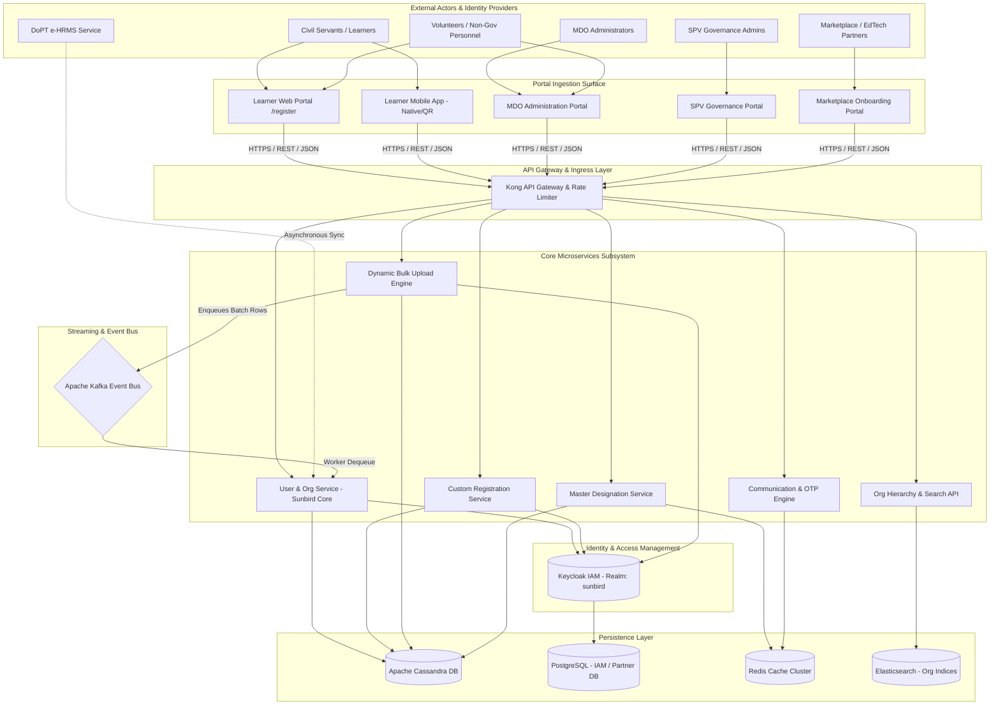

## 2. END-TO-END LOGICAL & COMPONENT ARCHITECTURE

### 2.1 Layered Logical Architecture

The subsystem follows a decoupled, service-oriented multi-tier architectural pattern:

```mermaid
flowchart TD
    subgraph L1["PRESENTATION & INGESTION LAYER"]
        P1["• Learner Web (Angular/React)"]
        P2["• Learner Mobile App (Native Android/iOS with QR Scanner)"]
        P3["• MDO Management Portal"]
        P4["• SPV Governance Console"]
        P5["• Marketplace Partner Form"]
    end
    subgraph L2["INGRESS & API GATEWAY LAYER"]
        G1["• Kong Gateway Proxy Engine"]
        G2["• Rate Limiting Plugin (Max 3 OTP / 15 min per identifier)"]
        G3["• JWT Bearer Token Validation"]
        G4["• Route Whitelisting & CORS Policy Handler"]
    end
    subgraph L3["DOMAIN SERVICES & BUSINESS LOGIC"]
        D1["User & Org Management<br/>- Account Lifecycle<br/>- Org Hierarchy Mapping<br/>- Mode Telemetry Parser"]
        D2["Dynamic Bulk Engine<br/>- Sample Bundle Generator<br/>- Async Batch Streaming<br/>- Error CSV Generator"]
        D3["Communication & OTP Engine<br/>- 6-Digit Cryptographic OTP<br/>- SMS Gateway (NIC / CDAC)<br/>- SMTP Gateway (Gov Relay)"]
        D4["Custom Registration Engine<br/>- Org URL/QR Cryptography<br/>- MDO Action Queue Handler"]
        D5["Master Designation Service<br/>- Master Cadre Repository<br/>- Pub/Sub Redis Eviction"]
        D6["Marketplace Partner Review<br/>- KYC Dossier Handler<br/>- Gated Workflow Orchestrator"]
    end
    subgraph L4["SECURITY & IDENTITY MANAGEMENT LAYER"]
        S1["• Keycloak IAM (OIDC / OAuth2 Engine)"]
        S2["• Realm: 'sunbird'"]
        S3["• Role-Based Access Control (RBAC Engine)"]
        S4["• Argon2 Password Policy Encryption"]
    end
    subgraph L5["DATA & STREAMING PIPELINE LAYER"]
        T1[("• Apache Cassandra : User Profiles, Role Links, Org Nodes, Domain Whitelists")]
        T2[("• PostgreSQL : Keycloak Credentials, Marketplace Partner Applications")]
        T3[("• Redis Cluster : Active Designations (cache:designation:master), Transient OTPs (300s TTL)")]
        T4[("• Elasticsearch : Public Organization Hierarchy Search Index (org_hierarchy_v2)")]
        T5[("• Apache Kafka : Topics: bulk-user-ingestion, user-registration-events")]
    end
    L1 -->|"HTTPS / JSON (TLS 1.3)"| L2
    L2 --> L3
    L3 --> L4
    L4 --> L5
```

## 3. HIGH-LEVEL DESIGN: USER REGISTRATION (CORE PLATFORM IDENTITY)

**SECTION 3.1: USER REGISTRATION – CREATION ARCHITECTURE & END-TO-END FLOW**

### 3.1.1 Creation Architecture Component Interaction

User Registration provides the foundational identity creation mechanism. It captures demographic data, validates government email affiliations, checks one-time passwords, and orchestrates account generation between Keycloak IAM and Sunbird Cassandra stores.

### 3.1.2 Detailed Sequence Diagram: User Registration Creation

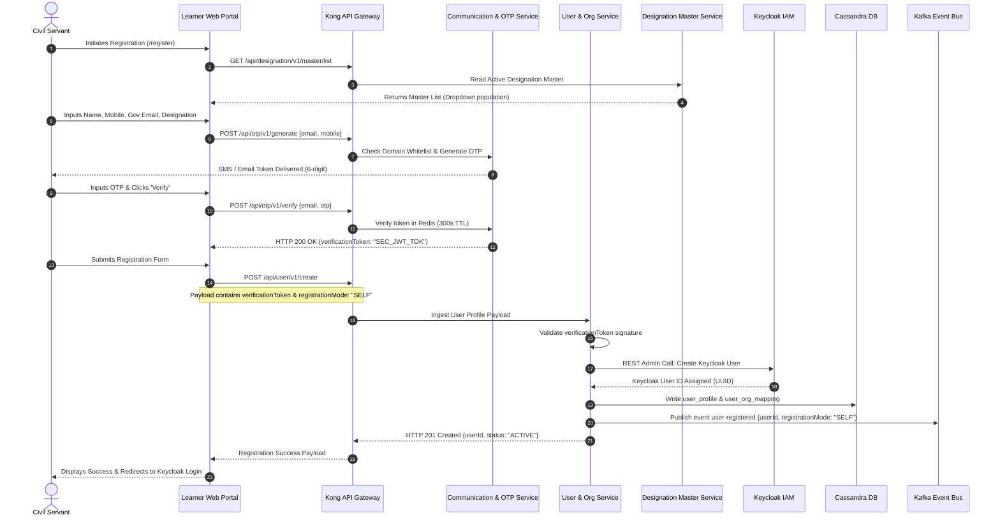

### 3.1.3 Interface & Payload Contracts

#### `POST /api/otp/v1/generate`

- **Consuming Component:** Learner Web Portal / Learner Mobile App
- **Header:** `Content-Type: application/json`

```json
{
  "request": {
    "email": "rajesh.kumar@nic.in",
    "phone": "9811223344",
    "type": "REGISTRATION"
  }
}
```

```json
{
  "id": "api.otp.generate",
  "ver": "1.0",
  "responseCode": "OK",
  "result": {
    "status": "SUCCESS",
    "txnId": "TXN-881293-OTP",
    "expiresIn": 300
  }
}
```

#### `POST /api/user/v1/create`

- **Consuming Component:** Learner Registration Frontend
- **Security Control:** Requires `verificationToken` obtained from successful OTP verification.

```json
{
  "request": {
    "firstName": "Rajesh",
    "lastName": "Kumar",
    "email": "rajesh.kumar@nic.in",
    "phone": "9811223344",
    "designation": "Deputy Secretary",
    "rootOrgId": "ORG-CAB-SEC-001",
    "registrationMode": "SELF",
    "verificationToken": "eyJhbGciOiJIUzI1NiIsInR5cCI6IkpXVCJ9..."
  }
}
```

```json
{
  "id": "api.user.create",
  "ver": "2.0",
  "responseCode": "CREATED",
  "result": {
    "userId": "usr-8a91bc7d-12de-4e32-9011-abcdef123456",
    "status": "ACTIVE"
  }
}
```

**SECTION 3.2: USER REGISTRATION – CONSUMPTION ARCHITECTURE & DOWNSTREAM WORKFLOWS**

### 3.2.1 Identity Consumption Architecture

Once provisioned, user identities are consumed across the platform:

1. **OIDC Authentication Flow:** The user authenticates against Keycloak using verified credentials. Keycloak injects claims (`rootOrgId`, `userId`, roles `['PUBLIC']`) into the signed JWT access token.
2. **e-HRMS Synchronisation Engine:** An integration pipeline periodically synchronizes service records (cadre, pay-band, employment status) with the Department of Personnel and Training (DoPT) e-HRMS system.

### 3.2.2 Sequence Diagram: Authentication & Downstream Service Ingestion

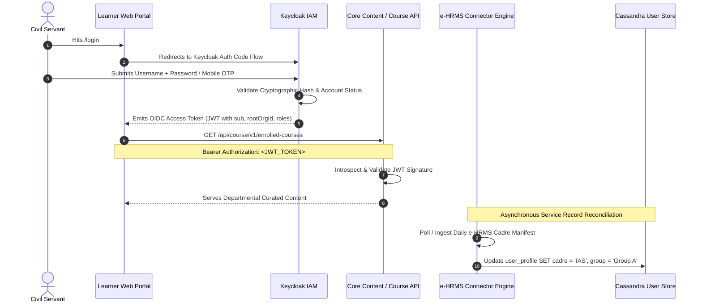

## 4. HIGH-LEVEL DESIGN: SPV AND MDO REGISTRATION (ADMINISTRATIVE & CADRE SETUP)

**SECTION 4.1: SPV & MDO REGISTRATION – CREATION ARCHITECTURE & ADMINISTRATIVE SETUP**

### 4.1.1 Administrative Creation Architecture

SPV and MDO Registration establishes the organizational framework of the platform. The Special Purpose Vehicle (Karmayogi Bharat) provisions root organization nodes, whitelists authorized email domains, curates master designations, and seeds MDO Administrators.

### 4.1.2 High-Level Administrative Setup Workflow

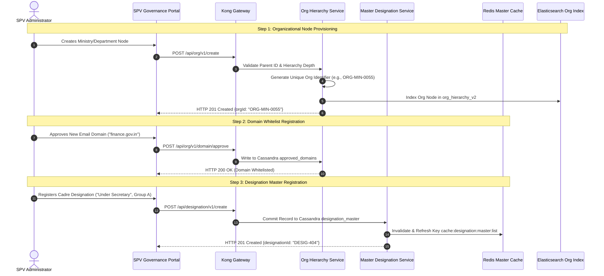

**SECTION 4.2: SPV & MDO REGISTRATION – CONSUMPTION ARCHITECTURE & ACTION QUEUE WORKFLOWS**

### 4.2.1 Consumption Architecture: MDO Governance & Registration Approval

MDO Administrators manage departmental onboarding via the MDO Portal:

1. **Onboarding Action Lists:** A dedicated queue where MDO Admins review pending custom registration requests.
2. **Rejection Workflows with Reason Auditing:** Rejections require selecting an audited reason code (`INVALID_CADRE`, `UNKNOWN_EMPLOYEE`, `INCORRECT_UNIT`), which is communicated back to the user.

### 4.2.2 Sequence Diagram: MDO Action Queue Review & Approval

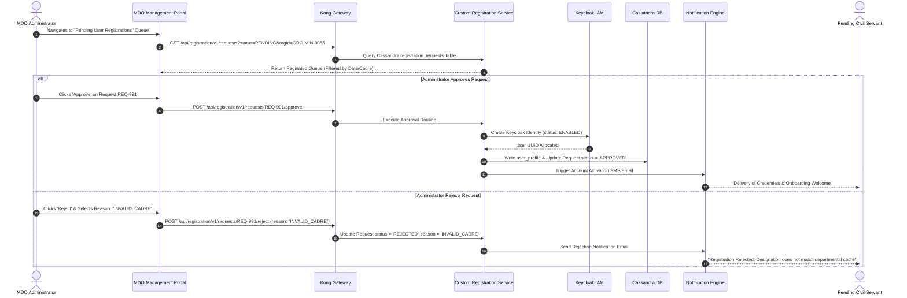

## 5. HIGH-LEVEL DESIGN: BULK REGISTRATION (BATCH & PROGRAMMATIC ONBOARDING)

**SECTION 5.1: BULK REGISTRATION – CREATION ARCHITECTURE & ASYNCHRONOUS INGESTION**

### 5.1.1 Architectural Rationale & Asynchronous Redesign

As documented in **KB-1313**, synchronous CSV uploads caused database deadlocks, gateway timeouts, and dirty writes from unvalidated free-text fields. The redesign established an asynchronous, master-validated bulk upload engine:

- **Dynamic Template API:** Injects live Master Designations directly from Redis into downloadable templates.
- **Non-Blocking Message Pipeline:** Uploads publish rows directly to Kafka, returning an immediate tracking token (`processId`).
- **Scale Capability:** Supports batches up to 10,000 records for large-scale inductions (e.g., Rozgar Mela, volunteer cohorts).

### 5.1.2 Sequence Diagram: Bulk Ingestion Pipeline

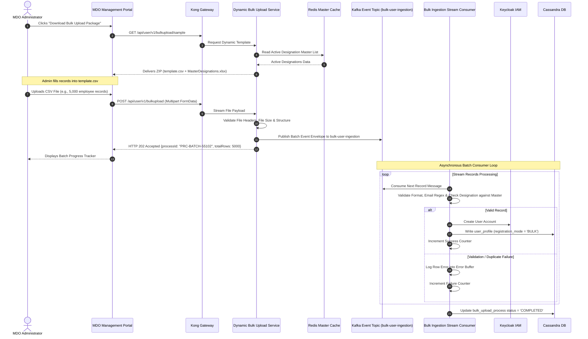

**SECTION 5.2: BULK REGISTRATION – CONSUMPTION ARCHITECTURE & ERROR RECONCILIATION**

### 5.2.1 Consumption Architecture: Batch Lifecycle & Error Reconciliation

MDO Administrators track batch execution and resolve failures through dedicated APIs:

- **Batch Status Polling:** Real-time polling via `GET /api/user/v1/bulkupload/status/{processId}`.
- **Error CSV Export:** Failed records are compiled into a downloadable CSV containing original inputs alongside an `ErrorReason` column for correction and re-upload.

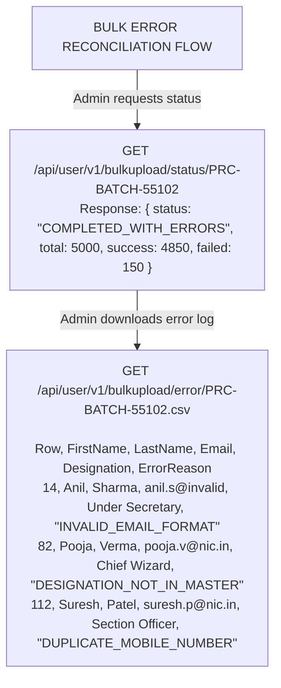

## 6. HIGH-LEVEL DESIGN: SELF-REGISTRATION (MULTI-CHANNEL CHANNELS)

**SECTION 6.1: SELF-REGISTRATION – MULTI-CHANNEL CREATION ARCHITECTURE**

### 6.1.1 Multi-Channel Creation Architecture

Self-Registration serves five distinct entry channels across the ecosystem:

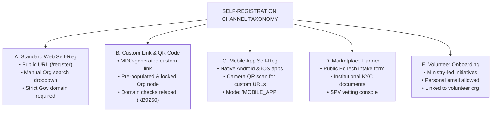

### 6.1.2 Sequence Diagram: Custom Self-Registration (MDO Link/QR Code)

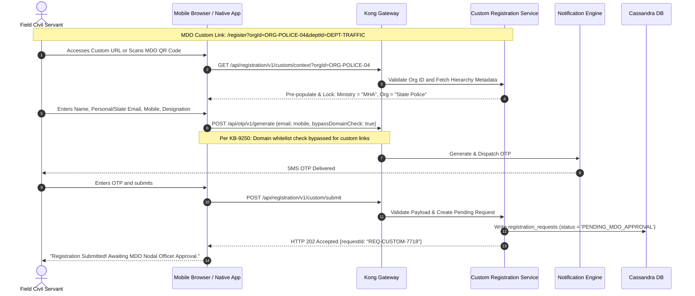

**SECTION 6.2: SELF-REGISTRATION – CONSUMPTION ARCHITECTURE & ACTIVATION HANDSHAKES**

### 6.2.1 Partner & Non-Government Onboarding Consumption (Marketplace Workflow)

Marketplace Partner self-registration provides external EdTech providers and universities with a gated onboarding path:

1. **Application Intake:** Partner submits organization registration proofs, PAN/TAN, and authorized signatory credentials.
2. **Review & Vetting Console:** SPV Administrators evaluate the submitted application in the SPV Portal.
3. **Automated CBP Provisioning:** Upon SPV approval, an organization node is generated, an administrator account is provisioned in Keycloak with `CBP_ADMIN` roles, and the partner is granted course authoring access on the CBP Portal.

### 6.2.2 State Transition Diagram: Registration Lifecycles

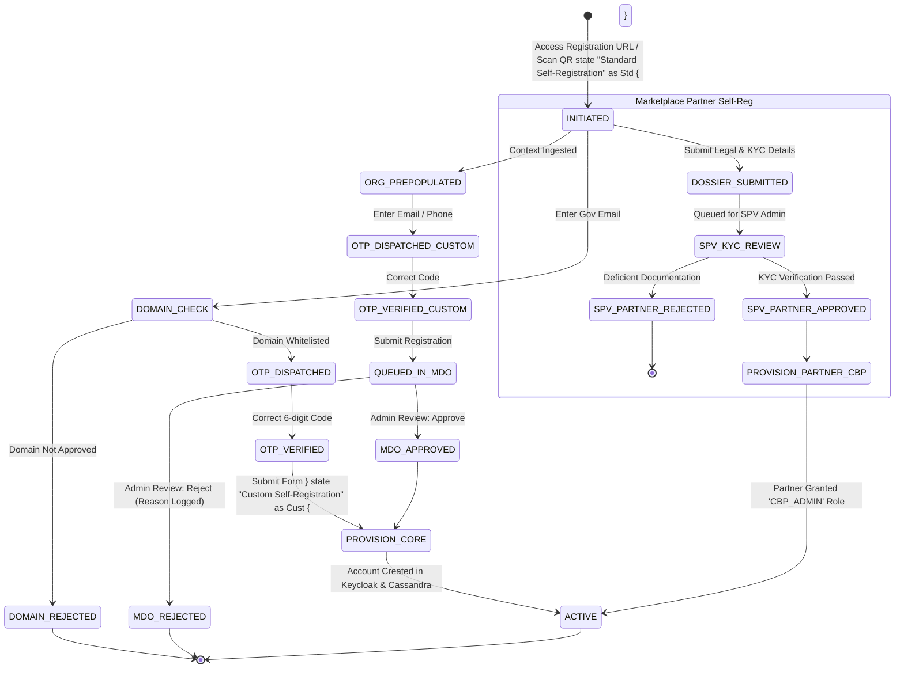

## 7. CROSS-PORTAL INTEGRATION & INTERACTION ARCHITECTURE

### 7.1 Cross-Portal Interaction Matrix

| Subsystem Component | Learner Web Portal | Learner Mobile App | MDO Management Portal | SPV Governance Portal | CBP / Marketplace Portal |
|---|---|---|---|---|---|
| **Org Hierarchy Service** | Consumes `/org/v1/search` for public selection. | Consumes `/org/v1/search` via mobile views. | Reads/writes departmental sub-nodes. | Full administrative CRUD over all root nodes. | Reads partner node mappings. |
| **OTP & Domain Engine** | Invokes OTP generation with strict domain checks. | Invokes OTP generation; auto-extracts SMS codes. | Bypasses domain checks for custom link setups. | Manages domain approvals and whitelisting. | Validates partner business email addresses. |
| **Custom Link Generator** | Resolves custom parameters and pre-locks UI fields. | Resolves custom links via camera QR scanning. | Generates custom links and downloadable QR codes. | Oversees cross-organization custom link policies. | N/A |
| **Master Designation Service** | Populates standard designation dropdowns. | Populates standard designation dropdowns. | Maps departmental designations to master nodes. | Administrative CRUD over Master Designation list. | N/A |
| **Approval Engine** | Displays application status screens. | Displays application status screens. | Reviews, approves, or rejects pending requests. | Reviews Marketplace Partner applications. | N/A |

## 8. SECURITY, IDENTITY & CRYPTOGRAPHIC ARCHITECTURE

### 8.1 Keycloak IAM Integration

The platform utilizes **Keycloak IAM** as its single-source identity provider:

- **Realm Topology:** All registered identities reside in the `sunbird` realm.
- **Role Ingestion Matrix:**
  - Standard User / Self-Registration: Assigned `PUBLIC`, `CONTENT_CONSUMER`.
  - MDO Nodal Officer: Assigned `MDO_ADMIN`, `ORG_ADMIN`.
  - SPV Platform Administrator: Assigned `SPV_ADMIN`.
  - Marketplace Partner Admin: Assigned `CBP_ADMIN`, `CONTENT_CREATOR`.

- **Credential Cryptography:** Passwords are encrypted using Argon2 password hashing. In accordance with Q10 enhancements ([KB-11810: Q10 | Ad-Hoc | Enhancement to registration and password flow](https://karmayogibharat.atlassian.net/browse/KB-11810) (KB Review)), the platform utilizes two-stage registration where user passwords are set post-verification via time-limited, signed cryptographic tokens.

### 8.2 OTP Security Architecture

- **Token Entropy:** 6-digit numeric OTP generated via cryptographically secure pseudo-random number generators (`java.security.SecureRandom`).
- **Cache Management:** Stored in Redis with a 300-second (5-minute) TTL: `SET otp:rajesh@nic.in "<BCRYPT_HASH>" EX 300`.
- **Anti-Brute Force Protection:** Maximum 3 verification attempts allowed per transaction. Upon 3 failed attempts, the token is invalidated and the transaction locked for 15 minutes.

## 9. DATA PERSISTENCE, CACHING & EVENT BUS ARCHITECTURE

**PERSISTENCE ARCHITECTURE SCHEMAS**

```text
1. APACHE CASSANDRA CORE STORAGE

Table: sunbird.user_profile
├── id                : uuid (Partition Key)
├── root_org_id       : text
├── first_name        : text
├── last_name         : text
├── email             : text
├── phone             : text
├── designation       : text
├── cadre_group       : text
├── registration_mode : text [SELF, CUSTOM_SELF, BULK, MDO_ADMIN, API_HRMS]
├── status            : int [0: Pending Approval, 1: Active, 2: Inactive]
└── created_date      : timestamp

Table: sunbird.approved_domains
├── domain_name   : text (Partition Key)
├── org_id        : text
├── approved_by   : text
└── approval_date : timestamp

Table: sunbird.registration_requests
├── request_id       : text (Partition Key)
├── org_id           : text
├── applicant_data   : text (JSON Payload)
├── status           : text [PENDING, APPROVED, REJECTED]
├── rejection_reason : text
└── created_date     : timestamp

2. REDIS ACCELERATION CLUSTER

• Key: otp:{identifier}                 --> String (Bcrypt Hash)       | TTL: 300s
• Key: cache:designation:master:list    --> JSON Array of Cadre Masters | TTL: 3600s
• Key: ratelimit:{client_ip}:otp        --> Rate Counter               | TTL: 900s

3. APACHE KAFKA MESSAGE BUS

• Topic: bulk-user-ingestion     --> 12 Partitions | Key: orgId  | Retention: 7 Days
• Topic: user-registration-events --> 6 Partitions  | Key: userId | Retention: 30 Days
```

## 10. NON-FUNCTIONAL ARCHITECTURE, RESILIENCY & SCALABILITY

### 10.1 High Availability & Fault Tolerance

- **Stateless Service Nodes:** Microservices are deployed as stateless containers in Kubernetes (EKS), scaling horizontally via Horizontal Pod Autoscalers (HPA) targeting 70% average CPU utilization.
- **Graceful Degradation:** If the SMS gateway experiences carrier delays, the OTP engine automatically fails over to the secondary government email relay.
- **Asynchronous Resilience:** Bulk upload requests buffer immediately in Kafka partitions. If worker pods restart, consumer offsets ensure zero row loss.

### 10.2 Scalability Targets

- **Peak OTP Throughput:** Designed for 1,200 requests/second sustained during nationwide onboarding campaigns.
- **Bulk Ingestion Throughput:** Ingests and processes 10,000-row batch files within 15 minutes.
- **Search Latency:** Elasticsearch organization search queries resolve with p99 < 80ms under 500 concurrent lookups.
