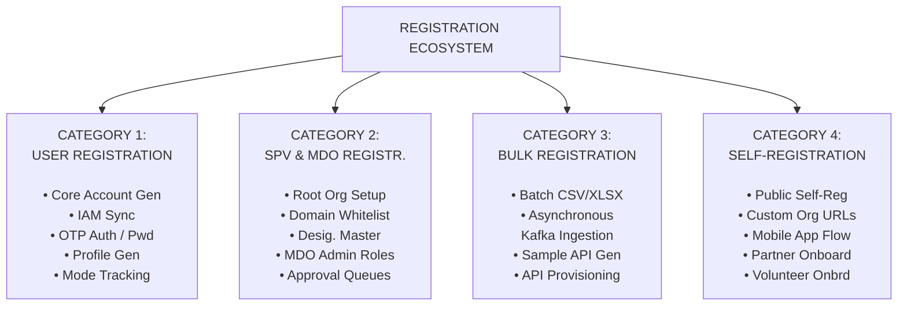
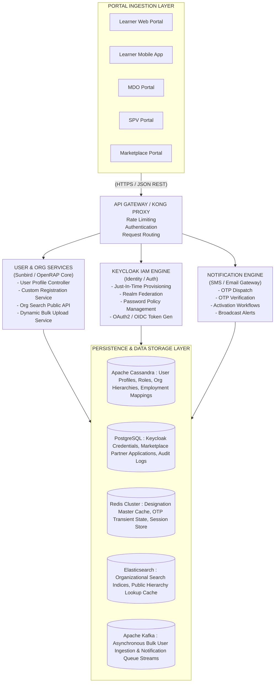
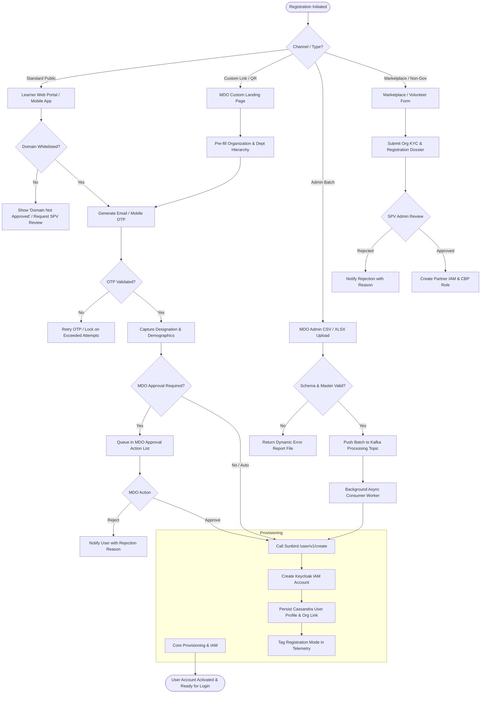
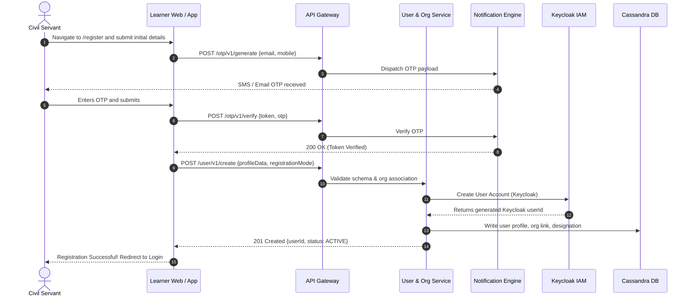
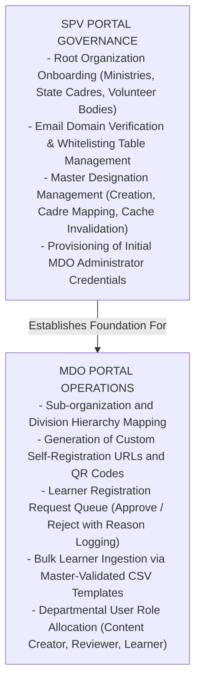
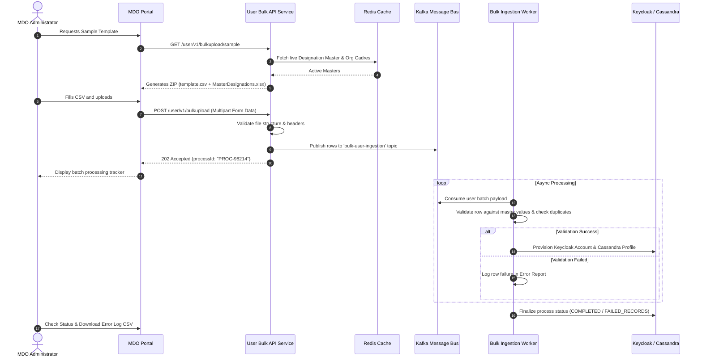

# Registration – Evolution and Consumption Overview Summary

**iGOT Karmayogi Platform**

## PART A – REGISTRATION ECOSYSTEM OVERVIEW

### 1. Executive Summary

The **iGOT (Integrated Government Online Training) Karmayogi Platform** serves as the primary national capacity-building and civil service competency development engine under the Mission Karmayogi mandate. Central to its operational scale is the **Registration Ecosystem**—the foundational identity and organizational onboarding gateway that regulates how individual civil servants, ministries, state cadres, non-government volunteers, and commercial marketplace training providers enter the platform.

Historically launched with a strict email-domain-restricted self-registration paradigm, the registration ecosystem has transformed into a federated, multi-channel onboarding infrastructure. The modern architecture spans four distinct registration typologies: **User Registration**, **SPV and MDO Registration**, **Bulk Registration**, and **Self-Registration** (encompassing Standard, Custom, Domain-based, Mobile, and Partner pathways). This document details its complete evolution from Q2 through Q12 and beyond, establishing the functional requirements, architectural contracts, integration patterns, and operational consumption models governing identity creation on iGOT Karmayogi.

### 2. Registration Ecosystem Introduction

Within the iGOT Karmayogi architecture, **Registration** is defined as the multi-stage lifecycle of:

1. Discovering or capturing institutional and personal identity attributes.
2. Validating organizational eligibility (via email domain verification, administrative vetting, or partner screening).
3. Dispatching and validating multi-factor cryptographic tokens (Email/SMS OTP).
4. Synchronizing federated authentication credentials into Keycloak IAM.
5. Provisioning user profiles and organization-to-cadre associations within Sunbird/Cassandra core data stores.
6. Emitting audit telemetry and registration mode indicators (`registrationMode`) for platform-wide tracking.

### 3. Business Context and Objectives

The iterative design and expansion of the registration subsystem were driven by four core business objectives:

- **Civil Service Democratization:** Providing an accessible digital entry point for civil servants across Union Ministries, State Departments, Attached Offices, and Autonomous Bodies.
- **Institutional Governance & Cadre Alignment:** Ensuring that the Special Purpose Vehicle (**SPV** – Karmayogi Bharat) and Ministries/Departments/Organizations (**MDOs**) retain administrative sovereignty over their organizational structures, authorized email domains, designations, and administrative role hierarchies.
- **Friction Elimination at Scale:** Progressing from rigid domain-whitelisting bottlenecks toward custom organization links/QR codes, mobile-first OTP verification, and API-based ingestion (e.g., e-HRMS and Rozgar Mela).
- **Cross-Sectoral Inclusivity:** Broadening platform consumption through dedicated onboarding channels for external training providers (Marketplace Partners) and non-government volunteers/NGOs aligned with ministry initiatives.

### 4. Registration Type Categorisation

To prevent architectural ambiguity, the ecosystem is categorized into four primary streams:

### 5. Registration Ecosystem Architecture

### 6. Complete Registration Evolution Timeline

| Release Phase | Registration Capability | Registration Category | Core Business Problem Addressed | Enhancement / Architectural Solution | Key Jira / Confluence Artifacts | Implementation Status |
|---|---|---|---|---|---|---|
| **Q2 (Baseline)** | Domain-Restricted Registration | Category 1 / Category 4 | Unauthorized public user creation; lack of institutional affiliation checks. | Restricted OTP triggers exclusively to pre-approved government domains (`.gov.in`, `.nic.in`). | [KB-438: Q2 \| Self Registration \| Users with Email ID having approved domains only, shall be able to request for OTP.](https://karmayogibharat.atlassian.net/browse/KB-438) (KB Approved), [KB-449: Q2 \| Self Registration \| OTP shall be sent to only email IDs whose domains are in the approved list of domains.](https://karmayogibharat.atlassian.net/browse/KB-449) (In-Progress), [KB-450: Q2 \| Self Registration \| User shall see appropriate messaging based on they are trying to verify Email ID with approved Domain.](https://karmayogibharat.atlassian.net/browse/KB-450) (In-Progress) | Production Deployed |
| **Q2 – Q3** | SPV Domain Approval Engine | Category 2 | Manual database seeding of government email domains caused onboarding backlogs. | Automated workflow: SPV Portal receives domain addition requests, approves them, and auto-updates the whitelist. | [KB-439: Q2 \| Self Registration \| Show SPV the received requests of Domains on the SPV Portal for approval.](https://karmayogibharat.atlassian.net/browse/KB-439) (Prod Deployed), [KB-396: Q2 \| Self Registration \| Auto-addition of Domain in the approved list post SPV approval.](https://karmayogibharat.atlassian.net/browse/KB-396) (Prod Deployed), [KB-657: Q2 \| Self Registration \| Users messaging on the Self-Registration Request for Help page for domain addition based on domain status.](https://karmayogibharat.atlassian.net/browse/KB-657) (Prod Deployed) | Production Deployed |
| **Q2 – Q3** | Rozgar Mela & Initial Bulk Onboarding | Category 3 | Need to onboard thousands of new recruits simultaneously. Unvalidated bulk uploads led to data integrity issues. | Specialized ingestion pipelines for Rozgar Mela recruits; standard unvalidated CSV upload placed on hold. | [KB-1371: Q2 \| Ad-Hoc Requests \| User onboarding for Tranch 10 users of Rozgar Mela.](https://karmayogibharat.atlassian.net/browse/KB-1371) (In-Progress), [KB-1313: User Registration and Onboarding \| Put Bulk Upload on hold.](https://karmayogibharat.atlassian.net/browse/KB-1313) (Open) | Prod Deployed / Bulk Upload Refactored |
| **Q3 – Q4** | e-HRMS Profile Synchronisation | Category 1 | Disconnected service records between DOPT's e-HRMS and iGOT user profiles. | Integrated e-HRMS profile mapping for users onboarded via central government human resource pipelines. | [KB-1678: Q3 \| User Profile \| Addition of e-HRMS profile for Users onboarded on e-HRMS.](https://karmayogibharat.atlassian.net/browse/KB-1678) (Prod Deployed), [KB-949: Q2 \| Ad-Hoc Requests \| User Onboarding, Creation and Profile changes.](https://karmayogibharat.atlassian.net/browse/KB-949) (KB Review) | Production Deployed |
| **Q5 – Q6** | Custom Self-Registration Links & QR | Category 4 | MDOs without uniform official email domains could not onboard field staff. | Generated unique organization-specific URLs/QR codes pre-populating organizational hierarchy. | [KB-6187: Q6 \| Custom Self Registration Onboarding optimization](https://karmayogibharat.atlassian.net/browse/KB-6187) (KB Review), [KB-6271: Q6 \| Custom Self Registration Dev Completed](https://karmayogibharat.atlassian.net/browse/KB-6271), [KB-7025: Q6 \| Self registration \| MDO \| Create custom registration link](https://karmayogibharat.atlassian.net/browse/KB-7025) (Prod Deployed) | Production Deployed |
| **Q6 – Q7** | Native Mobile App Self-Registration | Category 4 | Inability of field officers to register smoothly via desktop web browsers. | Native Android/iOS registration workflows supporting SMS/Email OTP and custom link deep-linking. | [KB-7054: Q6 \| Self Registration \| Learner \| Mobile App based Registration](https://karmayogibharat.atlassian.net/browse/KB-7054) (Prod Deployed), [KB-806: Q2 \| Comms Console \| Registration and enabling for Mobile App Push Notification](https://karmayogibharat.atlassian.net/browse/KB-806) (Prod Deployed), [KB-7056: Q6 \| Self Registration \| Learner \| Self Register form redirection update](https://karmayogibharat.atlassian.net/browse/KB-7056) (Prod Deployed) | Production Deployed |
| **Q7 – Q8** | Registration Mode Telemetry | Category 1 | Inability to audit user acquisition channels for platform analytics. | Added mandatory `registrationMode` tracking (`SELF`, `CUSTOM_SELF`, `BULK`, `API`, `MDO`). | [KB-8017: Q7 \| Ad-Hoc \| Enhancement \| Data Tracking \| User registration \| Mode of Registration](https://karmayogibharat.atlassian.net/browse/KB-8017) (KB Approved), [KB-8582: Q7 \| Ad-Hoc \| Enhancement \| Data Tracking \| User registration process QA Deployed](https://karmayogibharat.atlassian.net/browse/KB-8582) | Production Deployed |
| **Q8 – Q9** | Domain Restriction Removal on Custom Links | Category 4 | State officers with commercial email domains were blocked from custom MDO links. | Relaxed mandatory `.gov.in` domain checking specifically on custom self-registration links, shifting trust to MDO approval. | [KB-9250: Q8 \| Ad-Hoc \| Removal of Email Domain Validation for Custom Self-Registration](https://karmayogibharat.atlassian.net/browse/KB-9250) (QA In Progress), [KB-9251: Q8 \| Ad-Hoc \| Removal of domain validation from Custom Self registration page](https://karmayogibharat.atlassian.net/browse/KB-9251) (QA In Progress) | Production Deployed |
| **Q9 – Q10** | SPV Master Designation & Dynamic Bulk APIs | Category 2 / Category 3 | Uncontrolled free-text designations caused duplicate roles and broken learning assignments. | Centralized Designation Master in SPV Portal; dynamic bulk upload APIs (`/v1/bulkupload/sample`) validating against live masters. | [KB-6423: Q6 \| Self registration \| SPV \| Designation master on behalf of organisation](https://karmayogibharat.atlassian.net/browse/KB-6423) (Prod Deployed), [Design Document: User Bulk Upload Sample File API](https://karmayogibharat.atlassian.net/wiki/spaces/TES/pages/1243512856) | Production Deployed |
| **Q10 – Q11** | Marketplace Partner Self-Registration | Category 4 | External training providers (universities, private institutes) had no entry route. | Dedicated public partner registration form with administrative review and status tracking. | [KB-11937: Q10 \| Marketplace \| Marketplace Partner Onboarding on iGOT via Self-Registration](https://karmayogibharat.atlassian.net/browse/KB-11937) (KB Review), [KB-11986: Q10 \| Marketplace \| Marketplace Partner Self registration and Track application status](https://karmayogibharat.atlassian.net/browse/KB-11986) (Prod Deployed), [Q10 \| Marketplace \| Marketplace Partner Onboarding on iGOT via Self-Registration](https://karmayogibharat.atlassian.net/wiki/spaces/TES/pages/688193565) | Production Deployed |
| **Q11 – Q12+** | Volunteer Body & Non-Gov Onboarding | Category 2 / Category 3 | Ministries needed to train civil defense volunteers and non-government personnel. | Hierarchical Volunteer Org structures under ministries, custom volunteer bulk upload (up to 10k rows), and public volunteer onboarding. | [KB-13968: Q12 \| iGOT for Non-Govt Users/ Volunteer Body](https://karmayogibharat.atlassian.net/browse/KB-13968) (Prod Deployed), [KB-13988: Q12 \| iGOT for Non-Govt Users \| Volunteer Onboarding (MDO/SPV Portal)](https://karmayogibharat.atlassian.net/browse/KB-13988) (Prod Deployed), [iGOT for Non Govt Users](https://karmayogibharat.atlassian.net/wiki/spaces/TES/pages/1133084691) | Production Deployed |

### 7. Registration Portal Ecosystem

- **Learner Web Portal** (`/register`): Primary consumer-facing interface. Renders public and custom registration forms, invokes Elasticsearch-backed organization search, manages OTP verification, and routes users into Keycloak authentication upon completion.
- **Learner Mobile App (Android / iOS):** Implements mobile-responsive self-registration views, native SMS retrieval, deep-link handling for custom MDO URLs, and push-notification token enrollment.
- **SPV Portal (Karmayogi Bharat Admin):** Administrative governance center. Allows SPV managers to provision root Ministries/States, review and whitelist email domains, curate the central Designation Master catalog, and evaluate Marketplace Partner registration dossiers.
- **MDO Portal (Ministry/Department/Agency Admin):** Operational hub for departmental administrators. Generates unique Custom Registration URLs/QR codes, reviews pending registration requests (with approval/rejection reason logging), and uploads bulk CSV/XLSX learner files.
- **CBP Portal (Capacity Building Provider):** Content curation console. Consumes identity credentials generated during Marketplace Partner onboarding to allow approved institutes to upload courses.

### 8. Consolidated Registration Lifecycle

## PART B – INDEPENDENT REGISTRATION CATEGORY OVERVIEWS

**SECTION 1: USER REGISTRATION – EVOLUTION AND CONSUMPTION OVERVIEW**

### 1. Category Overview

**User Registration** represents the core identity provisioning and profile activation architecture of the iGOT Karmayogi Platform. It encompasses all direct mechanisms through which an individual's cryptographic credentials, personal demographic data, organizational affiliations, and official designations are verified and committed to persistent storage.

### 2. Business Context

Without a unified user registration framework, disparate departments would maintain isolated credentials, hindering cross-governmental competency planning. User Registration centralizes civil service identity while enforcing data hygiene, preventing duplicate accounts, and establishing an authoritative link between an individual and their official position.

### 3. Evolution Timeline

- **Q2 (Baseline):** Standard form capturing First Name, Last Name, Email, Password, and Organization dropdown. Authentication handled directly by Keycloak.
- **Q3 – Q4:** Integration of e-HRMS profile synchronisation ([KB-1678: Q3 | User Profile | Addition of e-HRMS profile for Users onboarded on e-HRMS.](https://karmayogibharat.atlassian.net/browse/KB-1678) (Prod Deployed)), ensuring that central government employees have their cadre, group, and service history synced upon registration.
- **Q7 – Q8:** Introduction of mandatory registration mode telemetry ([KB-8017: Q7 | Ad-Hoc | Enhancement | Data Tracking | User registration | Mode of Registration](https://karmayogibharat.atlassian.net/browse/KB-8017) (KB Approved), [KB-8582: Q7 | Ad-Hoc | Enhancement | Data Tracking | User registration process QA Deployed](https://karmayogibharat.atlassian.net/browse/KB-8582)) to provide auditability across onboarding channels.
- **Q10 – Q12:** Registration UI overhaul ([KB-11810: Q10 | Ad-Hoc | Enhancement to registration and password flow](https://karmayogibharat.atlassian.net/browse/KB-11810) (KB Review), [KB-11918: Q10 | Ad-hoc | Registration changes | New Registration Flow QA Completed](https://karmayogibharat.atlassian.net/browse/KB-11918), [KB-12113: Q10 | Ad-hoc | Add designation on registration page](https://karmayogibharat.atlassian.net/browse/KB-12113) (Prod Deployed)) replacing free-text designations with dynamic Master Designation selectors, and decoupling password generation to a secure post-verification activation link.

### 4. Functional Capabilities

- **Demographic & Employment Collection:** Captures First Name, Last Name, Official Email, Mobile Number, State/Center Cadre, Organization, Sub-department, and Designation.
- **Cryptographic Token Verification:** Two-way OTP generation and verification via integrated government SMS gateways and secure SMTP relays.
- **Registration Mode Attribution:** Programmatic insertion of `registrationMode` metadata (e.g., `SELF_REGISTRATION`, `CUSTOM_SELF_REGISTRATION`, `BULK_UPLOAD`, `API_HRMS`) into the Cassandra profile entity.
- **Credential Provisioning:** Direct synchronization with Keycloak IAM, assigning unique `userId` UUIDs and mapping default learner security roles (`PUBLIC`, `CONTENT_CONSUMER`).

### 5. User Journey & Registration Workflow

### 6. Portal-wise Consumption

- **Learner Portal:** Renders user intake forms, executes live validation against the Org Search API, and hosts the verification UI.
- **MDO Portal:** Allows MDO administrators to view registered users in their departmental roster.
- **SPV Portal:** Provides cross-platform reporting on total user onboarding counts categorized by registration mode.

### 7. Related Epics and Stories

- **Epics:** [KB-949: Q2 | Ad-Hoc Requests | User Onboarding, Creation and Profile changes.](https://karmayogibharat.atlassian.net/browse/KB-949) (KB Review) (User Onboarding & Profile Changes), [KB-1678: Q3 | User Profile | Addition of e-HRMS profile for Users onboarded on e-HRMS.](https://karmayogibharat.atlassian.net/browse/KB-1678) (Prod Deployed) (e-HRMS Profile Addition), [KB-8017: Q7 | Ad-Hoc | Enhancement | Data Tracking | User registration | Mode of Registration](https://karmayogibharat.atlassian.net/browse/KB-8017) (KB Approved) (Registration Mode Tracking), [KB-11810: Q10 | Ad-Hoc | Enhancement to registration and password flow](https://karmayogibharat.atlassian.net/browse/KB-11810) (KB Review) (Enhancement to Registration & Password Flow).
- **Stories:** [KB-8582: Q7 | Ad-Hoc | Enhancement | Data Tracking | User registration process QA Deployed](https://karmayogibharat.atlassian.net/browse/KB-8582) (Data Tracking Implementation), [KB-11918: Q10 | Ad-hoc | Registration changes | New Registration Flow QA Completed](https://karmayogibharat.atlassian.net/browse/KB-11918) (New Registration Flow), [KB-12113: Q10 | Ad-hoc | Add designation on registration page](https://karmayogibharat.atlassian.net/browse/KB-12113) (Prod Deployed) (Designation Dropdown on Registration Page).

### 8. Implementation Status, Gaps & Enhancements

- **Status:** Production Deployed.
- **Gaps & Enhancements:** Periodic field desynchronization when an officer's e-HRMS designation changes dynamically post-registration, requiring manual profile reconciliation.

**SECTION 2: SPV AND MDO REGISTRATION – EVOLUTION AND CONSUMPTION OVERVIEW**

### 1. Category Overview

**SPV and MDO Registration** encompasses the administrative governance, hierarchy mapping, organizational provisioning, domain whitelisting, and approval workflows managed by Karmayogi Bharat (SPV) and Ministry/Department/Organization (MDO) administrators.

### 2. Business Context

Individual registration cannot function without an established organizational context. SPV and MDO registration creates the institutional framework—ensuring that every department has validated domains, recognized cadres, structured designations, and authorized administrators capable of vetting staff.

### 3. Evolution Timeline

- **Q2 – Q3:** SPV manual domain approval engine ([KB-439: Q2 | Self Registration | Show SPV the received requests of Domains on the SPV Portal for approval.](https://karmayogibharat.atlassian.net/browse/KB-439) (Prod Deployed), [KB-396: Q2 | Self Registration | Auto-addition of Domain in the approved list post SPV approval.](https://karmayogibharat.atlassian.net/browse/KB-396) (Prod Deployed)). Root organizations and domains were verified by SPV administrators to prevent unvetted domains from entering the system.
- **Q5 – Q7:** MDO Portal operationalization ([KB-7127: Q6 | Custom Self Registration | MDO Portal | Onboarding Action list](https://karmayogibharat.atlassian.net/browse/KB-7127) (Not Required), [KB-7025: Q6 | Self registration | MDO | Create custom registration link](https://karmayogibharat.atlassian.net/browse/KB-7025) (Prod Deployed), [KB-6421: Q6 | Self registration | SPV | Organisation creation](https://karmayogibharat.atlassian.net/browse/KB-6421) (Prod Deployed)). MDO Admins were empowered to generate Custom Registration links, review incoming registration queues, and map users to local units.
- **Q8 – Q10:** Master Designation Management ([KB-6423: Q6 | Self registration | SPV | Designation master on behalf of organisation](https://karmayogibharat.atlassian.net/browse/KB-6423) (Prod Deployed)). Centralized designation creation within the SPV Portal, eliminating free-text variations.
- **Q11 – Q12+:** Volunteer Organization Hierarchies ([KB-13968: Q12 | iGOT for Non-Govt Users/ Volunteer Body](https://karmayogibharat.atlassian.net/browse/KB-13968) (Prod Deployed), [iGOT for Non Govt Users](https://karmayogibharat.atlassian.net/wiki/spaces/TES/pages/1133084691)). Enabled SPV to establish non-government and volunteer organizations under supervisory ministry parent nodes.

### 4. Functional Capabilities & Administrative Governance

- **Organizational Hierarchy Provisioning:** Creation of parent-child relationships linking Union Ministries to Departments, Attached Offices, Subordinate Offices, and Field Formations.
- **Domain Whitelist Management:** Administrative screens on the SPV Portal to review incoming domain requests, evaluate MX records, and whitelist domains for public OTP generation.
- **Designation Master Catalog:** Centralized, Redis-cached master designation library ensuring standard cadre taxonomy across departments.
- **MDO Approval Actions:** MDO-specific queues where administrators review pending learner registrations, approve them, or reject them with mandatory rejection reasons ([KBE-98: Self registration|Ability to provide reject reason for the self registration requests](https://karmayogibharat.atlassian.net/browse/KBE-98) (QA In Progress)).
- **Role-Based Delegation:** Granting administrative security roles (`MDO_ADMIN`, `MDO_LEADER`, `SPV_ADMIN`) within Keycloak realms.

### 5. Portal-Specific Consumption Matrix

### 6. Related Epics and Stories

- **Epics:** [KB-396: Q2 | Self Registration | Auto-addition of Domain in the approved list post SPV approval.](https://karmayogibharat.atlassian.net/browse/KB-396) (Prod Deployed) (Auto-addition of Domain post SPV approval), [KB-438: Q2 | Self Registration | Users with Email ID having approved domains only, shall be able to request for OTP.](https://karmayogibharat.atlassian.net/browse/KB-438) (KB Approved) (Approved Domain Domain Validation), [KB-6187: Q6 | Custom Self Registration Onboarding optimization](https://karmayogibharat.atlassian.net/browse/KB-6187) (KB Review) (Custom Self Registration Onboarding), [KBE-523: Q2 | SPV approved Orgs and Domains to reflect in Self Registration page](https://karmayogibharat.atlassian.net/browse/KBE-523) (To Do) (SPV Approved Orgs & Domains).
- **Stories:** [KB-439: Q2 | Self Registration | Show SPV the received requests of Domains on the SPV Portal for approval.](https://karmayogibharat.atlassian.net/browse/KB-439) (Prod Deployed) (SPV Domain Approval Request Queue), [KB-6421: Q6 | Self registration | SPV | Organisation creation](https://karmayogibharat.atlassian.net/browse/KB-6421) (Prod Deployed) (SPV Org Creation), [KB-6423: Q6 | Self registration | SPV | Designation master on behalf of organisation](https://karmayogibharat.atlassian.net/browse/KB-6423) (Prod Deployed) (SPV Designation Master), [KBE-98: Self registration|Ability to provide reject reason for the self registration requests](https://karmayogibharat.atlassian.net/browse/KBE-98) (QA In Progress) (Rejection Reason for Registration Requests), [KBE-114: Self registration | Ability to filter using tags for the MDO Approvals](https://karmayogibharat.atlassian.net/browse/KBE-114) (QA In Progress) (Tag-based Filtering for MDO Approvals).

### 7. Implementation Status, Gaps & Enhancements

- **Status:** Production Deployed.
- **Gaps & Enhancements:** When new designations are added by SPV administrators, a 1-hour Redis cache TTL delay previously impacted the dynamic bulk upload sample generator ([Design Document: User Bulk Upload Sample File API](https://karmayogibharat.atlassian.net/wiki/spaces/TES/pages/1243512856)).

**SECTION 3: BULK REGISTRATION – EVOLUTION AND CONSUMPTION OVERVIEW**

### 1. Category Overview

**Bulk Registration** represents the batch-oriented and programmatic user onboarding engine of iGOT Karmayogi. It is designed to ingest large user cohorts (ranging from hundreds to tens of thousands of civil servants or volunteers) through administrative file uploads (CSV/XLSX) or direct API integrations.

### 2. Business Context & Investigation into Operational Evolution

During early platform expansion (Q2–Q3), massive onboarding drives (such as Rozgar Mela new-recruit inductions) created an urgent need for bulk user creation. However, the initial unvalidated CSV upload functionality led to data quality issues:

1. Free-text designation fields caused profile fragmentation.
2. Incomplete or duplicate mobile and email records caused Keycloak identity collisions.
3. Synchronous REST upload processing triggered gateway timeout failures (HTTP 504) on files with over 500 rows.

**Evolutionary Decision (KB-1313):** Under [KB-1313: User Registration and Onboarding | Put Bulk Upload on hold.](https://karmayogibharat.atlassian.net/browse/KB-1313) (Open) (*"User* *Registration and Onboarding | Put Bulk Upload on hold"*), the unvalidated, ad-hoc bulk upload was placed on hold and removed from standard portal access. In its place, the architecture evolved across three phases:

- **Phase A (Special Ingestion Pipelines):** Controlled backend batch ingestion scripts were implemented for campaign cohorts (e.g., Rozgar Mela Tranche 10 under [KB-1371: Q2 | Ad-Hoc Requests | User onboarding for Tranch 10 users of Rozgar Mela.](https://karmayogibharat.atlassian.net/browse/KB-1371) (In-Progress)).
- **Phase B (Dynamic Master-Validated Bulk Upload):** Redesign of the bulk architecture via [Design Document: User Bulk Upload Sample File API](https://karmayogibharat.atlassian.net/wiki/spaces/TES/pages/1243512856) (*"Design Document: User Bulk Upload Sample File API"*). Introduced dynamic sample generation (`GET /user/v1/bulkupload/sample`) that packages pre-validated Redis-cached Master Designation XLSX workbooks with standard CSV templates, enforcing strict schema validation on upload.
- **Phase C (Volunteer Asynchronous Bulk Ingestion):** Scaled under [KB-13968: Q12 | iGOT for Non-Govt Users/ Volunteer Body](https://karmayogibharat.atlassian.net/browse/KB-13968) (Prod Deployed) and [iGOT for Non Govt Users](https://karmayogibharat.atlassian.net/wiki/spaces/TES/pages/1133084691) to ingest up to 10,000 non-government volunteers per batch through Kafka-backed event streams with asynchronous row-level error reporting.

### 3. Functional Capabilities

- **Dynamic Template Distribution:** `GET /user/v1/bulkupload/sample` dynamically injects live Master Designations, Cadre Groups, Gender, Mother Tongue, and Category codes into downloadable templates.
- **Asynchronous Kafka Pipeline:** Uploaded files are immediately acknowledged with a `processId`, while an asynchronous worker consumes records off Kafka topics to prevent UI thread blocking.
- **Row-Level Error Reporting:** Generates an error CSV highlighting validation failures (e.g., duplicate mobile numbers, non-existent organization IDs, invalid designations).
- **Automated Activation Dispatch:** Valid accounts are created in Keycloak with `status: ACTIVE` and receive automated SMS/Email activation notifications.

### 4. End-to-End Bulk Processing Workflow

### 5. Implementation Status

- **Legacy Unvalidated Upload:** Superseded and Disabled ([KB-1313: User Registration and Onboarding | Put Bulk Upload on hold.](https://karmayogibharat.atlassian.net/browse/KB-1313) (Open)).
- **Dynamic Sample Generator & Validated Bulk Upload:** Production Deployed ([Design Document: User Bulk Upload Sample File API](https://karmayogibharat.atlassian.net/wiki/spaces/TES/pages/1243512856)).
- **Volunteer Asynchronous Bulk Ingestion (10k Rows):** Production Deployed ([iGOT for Non Govt Users](https://karmayogibharat.atlassian.net/wiki/spaces/TES/pages/1133084691)).

**SECTION 4: SELF-REGISTRATION – EVOLUTION AND CONSUMPTION OVERVIEW**

### 1. Category Overview & Subcategorisation

**Self-Registration** empowers prospective learners, external institutional partners, and civil defense volunteers to independently initiate and complete onboarding onto iGOT Karmayogi. It is divided into five operational subcategories:

#### A. Standard Self-Registration

The public self-service path on the Learner Web Portal (`/register`). Users select their Ministry, Department, and Organization via search dropdowns and verify an approved government email address via OTP.

#### B. Custom Self-Registration (Org-Specific URLs & QR Codes)

An MDO-driven onboarding flow introduced under [KB-6187: Q6 | Custom Self Registration Onboarding optimization](https://karmayogibharat.atlassian.net/browse/KB-6187) (KB Review) and [KB-6271: Q6 | Custom Self Registration Dev Completed](https://karmayogibharat.atlassian.net/browse/KB-6271). MDO Administrators generate custom registration URLs (e.g., `https://igotkarmayogi.gov.in/register?orgId=ORG-00123`) or QR codes. When a user accesses this link:

- Target Organization, Department, and Center/State designations are locked or pre-populated.
- Users fill in personal details and designation.
- Verification can be routed to an MDO Approval Queue or configured for instant activation.

#### C. Domain-Based Self-Registration

The verification rule engine governing email domains. Initially, OTP generation was restricted to SPV-whitelisted domains (`.gov.in`, `.nic.in`) to prevent unauthorized access. In Q8–Q9, under [KB-9250: Q8 | Ad-Hoc | Removal of Email Domain Validation for Custom Self-Registration](https://karmayogibharat.atlassian.net/browse/KB-9250) (QA In Progress) and [KB-9251: Q8 | Ad-Hoc | Removal of domain validation from Custom Self registration page](https://karmayogibharat.atlassian.net/browse/KB-9251) (QA In Progress), this domain restriction was removed specifically for Custom Self-Registration, allowing field personnel using commercial or state email providers to register under MDO oversight.

#### D. Mobile-Based Self-Registration

Optimized for the iGOT Karmayogi Mobile App ([KB-7054: Q6 | Self Registration | Learner | Mobile App based Registration](https://karmayogibharat.atlassian.net/browse/KB-7054) (Prod Deployed)). Features mobile-responsive forms, native SMS OTP extraction, camera-based QR code scanning for custom registration links, and automatic registration mode tagging (`MOBILE_APP_REGISTRATION`).

#### E. Partner and Non-Government Self-Registration

- **Marketplace Partner Self-Registration (**[KB-11937: Q10 | Marketplace | Marketplace Partner Onboarding on iGOT via Self-Registration](https://karmayogibharat.atlassian.net/browse/KB-11937) (KB Review)**,** [KB-11986: Q10 | Marketplace | Marketplace Partner Self registration and Track application status](https://karmayogibharat.atlassian.net/browse/KB-11986) (Prod Deployed)**,** [Q10 | Marketplace | Marketplace Partner Onboarding on iGOT via Self-Registration](https://karmayogibharat.atlassian.net/wiki/spaces/TES/pages/688193565)**):** A public onboarding pipeline for non-government training institutions, universities, and commercial content providers. Operates on a "Gated Openness" model:
  - Partner submits institutional KYC, organization registration proofs, and contact details.
  - Receives a unique tracking reference number.
  - SPV administrators evaluate the dossier in an administrative review console.
  - Upon approval, a partner admin account is provisioned with `CBP_ADMIN` roles.

- **Volunteer Onboarding (**[KB-13968: Q12 | iGOT for Non-Govt Users/ Volunteer Body](https://karmayogibharat.atlassian.net/browse/KB-13968) (Prod Deployed)**,** [KB-13988: Q12 | iGOT for Non-Govt Users | Volunteer Onboarding (MDO/SPV Portal)](https://karmayogibharat.atlassian.net/browse/KB-13988) (Prod Deployed)**,** [iGOT for Non Govt Users](https://karmayogibharat.atlassian.net/wiki/spaces/TES/pages/1133084691)**):** Dedicated onboarding for volunteers under civil defense or ministry-partnered programs, linked to parent volunteer organization nodes.

### 2. Functional Capabilities & Validation Matrix

| Subcategory | Initiator | Target Audience | Domain Validation Enforced? | MDO Approval Required? | Pre-populated Org? | Key Reference |
|---|---|---|---|---|---|---|
| **Standard Self-Reg** | Individual Learner | Civil Servants with `.gov` emails | **Yes** (Strict Whitelist) | No (Instant Provisioning) | No (Manual Lookup) | [KB-438: Q2 \| Self Registration \| Users with Email ID having approved domains only, shall be able to request for OTP.](https://karmayogibharat.atlassian.net/browse/KB-438) (KB Approved), [KB-7897: Q7 \| Ad-Hoc \| Self registration Page Update \| Learner Portal & Mobile App](https://karmayogibharat.atlassian.net/browse/KB-7897) (Open) |
| **Custom Self-Reg** | MDO Admin Link | Departmental field staff | **No** (Relaxed under KB-9250) | Configurable / MDO Queue | **Yes** (Pre-populated) | [KB-6187: Q6 \| Custom Self Registration Onboarding optimization](https://karmayogibharat.atlassian.net/browse/KB-6187) (KB Review), [KB-9250: Q8 \| Ad-Hoc \| Removal of Email Domain Validation for Custom Self- Registration](https://karmayogibharat.atlassian.net/browse/KB-9250) (QA In Progress) |
| **Mobile Self-Reg** | Learner Mobile App | Field / Remote Learners | Inherited from URL type | Inherited from URL type | Optional (via QR scan) | [KB-7054: Q6 \| Self Registration \| Learner \| Mobile App based Registration](https://karmayogibharat.atlassian.net/browse/KB-7054) (Prod Deployed), [KB-806: Q2 \| Comms Console \| Registration and enabling for Mobile App Push Notification](https://karmayogibharat.atlassian.net/browse/KB-806) (Prod Deployed) |
| **Marketplace Partner** | Content Partner | Universities / Private EdTech | No (Business Email) | **Yes** (SPV KYC Review) | N/A (Creates New Org) | [KB-11937: Q10 \| Marketplace \| Marketplace Partner Onboarding on iGOT via Self-Registration](https://karmayogibharat.atlassian.net/browse/KB-11937) (KB Review), [Q10 \| Marketplace \| Marketplace Partner Onboarding on iGOT via Self-Registration](https://karmayogibharat.atlassian.net/wiki/spaces/TES/pages/688193565) |
| **Volunteer Onboard** | Volunteer / Admin | Civil Defense & NGO Volunteers | No (Open / Personal Email) | SPV / Ministry Approval | **Yes** (Volunteer Org Node) | [KB-13968: Q12 \| iGOT for Non-Govt Users/ Volunteer Body](https://karmayogibharat.atlassian.net/browse/KB-13968) (Prod Deployed), [iGOT for Non Govt Users](https://karmayogibharat.atlassian.net/wiki/spaces/TES/pages/1133084691) |

### 3. Implementation Status

- **Status:** Production Deployed across all five subcategories.

## PART C – CONSOLIDATED EVOLUTION AND CONSUMPTION

### 1. Cross-Portal Registration Consumption Matrix

| Portal / Component | User Registration | SPV/MDO Registration | Bulk Registration | Self-Registration | Key Responsibilities & APIs Consumed |
|---|---|---|---|---|---|
| **Learner Web Portal** | Primary Entry Point | N/A | N/A | Primary Entry Point | Renders public and custom registration pages; consumes `/org/v1/search`, `/otp/v1/generate`, `/user/v1/create`. |
| **Learner Mobile App** | Native Intake | N/A | N/A | Native Intake | Handles camera QR scanning, native OTP inputs, and mobile push-token enrollment (`/comms/v1/registerDevice`). |
| **SPV Portal** | Oversight / Metrics | Primary Admin Console | Catalog Master Provider | Partner Review Hub | Curates Master Designations, whitelists domains, creates root MDOs, evaluates Marketplace Partner KYC. |
| **MDO Portal** | User Management | Local Unit Governance | Primary Ingestion Engine | Custom Link Generator | Generates org-specific URLs/QR codes, reviews learner approval queues, uploads master-validated bulk CSV files. |
| **CBP / Marketplace** | Downstream Consumer | N/A | N/A | Downstream Consumer | Consumes identity accounts created via Partner Registration, granting content publishing and course building rights. |
| **Backend & IAM APIs** | Identity Persistence | Role / Cadre Mapping | Asynchronous Stream | Token Validation | Keycloak realm user creation, Sunbird Cassandra user profile mapping, Redis designation caching, Kafka processing. |

### 2. Consolidated API and Integration Architecture

| API / Service Endpoint | HTTP Method | Consuming Portal | Registration Category | Core Backend Action & Data Store | Documentation Reference |
|---|---|---|---|---|---|
| `/org/v1/search` | `GET / POST` | Learner Portal | Self-Reg / User Reg | Queries Elasticsearch organization index to return ministry/department hierarchies. | [Org Search Public API – Registration Page API Contract](https://karmayogibharat.atlassian.net/wiki/spaces/TES/pages/616497179) |
| `/otp/v1/generate` | `POST` | Learner Web & App | User Reg / Self-Reg | Validates domain whitelist; triggers SMS/Email OTP via Notification Gateway. | [KB-449: Q2 \| Self Registration \| OTP shall be sent to only email IDs whose domains are in the approved list of domains.](https://karmayogibharat.atlassian.net/browse/KB-449) (In-Progress) |
| `/otp/v1/verify` | `POST` | Learner Web & App | User Reg / Self-Reg | Validates transient OTP against Redis cache; returns verification token. | [KB-438: Q2 \| Self Registration \| Users with Email ID having approved domains only, shall be able to request for OTP.](https://karmayogibharat.atlassian.net/browse/KB-438) (KB Approved) |
| `/user/v1/create` | `POST` | Learner Portal | User Reg / Self-Reg | JIT provisions Keycloak user account and writes profile record to Cassandra. | [User Creation API Places](https://karmayogibharat.atlassian.net/wiki/spaces/TES/pages/198279170)[and API called](https://karmayogibharat.atlassian.net/wiki/spaces/TES/pages/198279170) |
| `/user/v1/bulkupload/sample` | `GET` | MDO Portal | Bulk Registration | Injects Redis-cached Master Designations into dynamic sample CSV/XLSX. | [Design Document: User Bulk Upload Sample File API](https://karmayogibharat.atlassian.net/wiki/spaces/TES/pages/1243512856) |
| `/user/v1/bulkupload` | `POST` | MDO Portal | Bulk Registration | Multipart CSV upload; validates schema and enqueues rows onto Kafka batch topic. | [Design Document: User Bulk Upload Sample File API](https://karmayogibharat.atlassian.net/wiki/spaces/TES/pages/1243512856) |
| `/partner/v1/register` | `POST` | Marketplace Portal | Partner Self-Reg | Creates partner dossier in PostgreSQL with status `PENDING_REVIEW`. | [Q10 \| Marketplace \| Marketplace Partner Onboarding on iGOT via Self-Registration](https://karmayogibharat.atlassian.net/wiki/spaces/TES/pages/688193565) |

### 3. Consolidated Functional Capability Matrix

| Functional Capability | Applicable Category | Portals Involved | Primary Purpose | Lifecycle Stage | Current Status |
|---|---|---|---|---|---|
| **Domain Whitelist Validation** | Self-Reg / User Reg | Learner Portal, SPV | Restricts public OTP generation to approved government domains. | Pre-Verification | Production Deployed |
| **Custom URL & QR Generator** | Self-Reg / MDO | MDO Portal, Learner | Generates pre-mapped departmental onboarding links and QR assets. | Initiation | Production Deployed |
| **Registration Mode Tagging** | All Categories | Core Services | Injects `registrationMode` into user metadata for analytics. | Account Creation | Production Deployed |
| **Dynamic Sample Generator** | Bulk Registration | MDO Portal | Packages live master designations into bulk upload templates. | Template Distribution | Production Deployed |
| **Async Kafka Ingestion** | Bulk Registration | MDO Portal, Backend | Processes large CSV uploads asynchronously without timeout. | Batch Provisioning | Production Deployed |
| **MDO Approval / Rejection Queue** | SPV/MDO / Self-Reg | MDO Portal | Enables departmental review of user requests with rejection logging. | Approval / Activation | Production Deployed |
| **Partner KYC Review Console** | Partner Self-Reg | SPV Portal | Administrative evaluation of external content provider applications. | Identity Vetting | Production Deployed |

### 4. Registration Tracking, Metrics & Analytics

Registration telemetry is captured via platform analytics events and stored in Cassandra / Elasticsearch ([KB-8017: Q7 | Ad-Hoc | Enhancement | Data Tracking | User registration | Mode of Registration](https://karmayogibharat.atlassian.net/browse/KB-8017) (KB Approved), [KB-8582: Q7 | Ad-Hoc | Enhancement | Data Tracking | User registration process QA Deployed](https://karmayogibharat.atlassian.net/browse/KB-8582)):

- **Dimension 1: Channel Origin** (`registrationMode`): Tracks counts across `SELF_REGISTRATION`, `CUSTOM_SELF_REGISTRATION`, `BULK_UPLOAD`, `MDO_CREATED`, `API_HRMS`, and `PARTNER_REGISTRATION`.
- **Dimension 2: Funnel Drop-off Metrics:** Monitors OTP Generation Attempts vs. Successful Verifications, Domain Validation Rejections, and Form Abandonment Rates.
- **Dimension 3: Batch Health Indicators:** Tracks Bulk Upload Processing Latency, Batch Success Ratios, and Row-Level Error Frequency.

### 5. Consolidated Gap Analysis and Future Scope

| Gap ID | Subsystem | Classification | Confirmed Observation / Architectural Gap | Recommended Enhancement & Future Scope |
|---|---|---|---|---|
| **GAP-01** | Bulk Upload | Technical / Cache | The Dynamic Bulk Sample endpoint previously relied on a 1-hour Redis TTL without event-driven cache invalidation when SPV added new designations ([Design Document: User Bulk Upload Sample File API](https://karmayogibharat.atlassian.net/wiki/spaces/TES/pages/1243512856)). | Implement pub/sub cache eviction on Redis whenever SPV Designation Master updates occur. |
| **GAP-02** | Marketplace | UX / Functional | Marketplace Partner self-registration lacked a public, real-time application status tracker for applicants ([Q10 \| Marketplace \| Marketplace Partner Onboarding on iGOT via Self-Registration](https://karmayogibharat.atlassian.net/wiki/spaces/TES/pages/688193565)). | Expose a reference-number-based public status inquiry screen (`/marketplace/track-status`). |
| **GAP-03** | Profile Sync | Integration | Inconsistencies between e-HRMS automated synchronization and manual user profile edits caused designation overwrites ([KB-1678: Q3 \| User Profile \| Addition of e-HRMS profile for Users onboarded on e-HRMS.](https://karmayogibharat.atlassian.net/browse/KB-1678) (Prod Deployed)). | Implement deterministic master-of-record field locking (e-HRMS locks official designation; user updates contact data). |
| **GAP-04** | Approval UX | Operational / UX | Large MDOs with thousands of pending custom self-registration requests experienced list pagination latency in the approval queue ([KBE-114: Self registration \| Ability to filter using tags for the MDO Approvals](https://karmayogibharat.atlassian.net/browse/KBE-114) (QA In Progress)). | Introduce Elasticsearch-backed multi-faceted filtering (by Cadre, Sub-unit, Date) and batch-approval actions. |

## PART D – REFERENCES AND TRACEABILITY

### 1. Complete Epic & Initiative Inventory

- [KB-11937: Q10 | Marketplace | Marketplace Partner Onboarding on iGOT via Self-Registration](https://karmayogibharat.atlassian.net/browse/KB-11937) (KB Review)**:** Q10 | Marketplace | Marketplace Partner Onboarding on iGOT via Self-Registration *(KB Review / Prod Deployed)*
- [KB-11810: Q10 | Ad-Hoc | Enhancement to registration and password flow](https://karmayogibharat.atlassian.net/browse/KB-11810) (KB Review)**:** Q10 | Ad-Hoc | Enhancement to registration and password flow *(KB Review / Prod Deployed)*
- [KB-9250: Q8 | Ad-Hoc | Removal of Email Domain Validation for Custom Self-Registration](https://karmayogibharat.atlassian.net/browse/KB-9250) (QA In Progress)**:** Q8 | Ad-Hoc | Removal of Email Domain Validation for Custom Self-Registration *(Prod Deployed)*
- [KB-8561: Q9 | Registration & Transfer Request | Learner Profile | Learner Portal](https://karmayogibharat.atlassian.net/browse/KB-8561) (KB Approved)**:** Q9 | Registration & Transfer Request | Learner Profile | Learner Portal *(KB Approved)*
- [KB-8336: Q7 | Ad-Hoc | Self-registration enhancements](https://karmayogibharat.atlassian.net/browse/KB-8336) (Open)**:** Q7 | Ad-Hoc | Self-registration enhancements *(Open)*
- [KB-8017: Q7 | Ad-Hoc | Enhancement | Data Tracking | User registration | Mode of Registration](https://karmayogibharat.atlassian.net/browse/KB-8017) (KB Approved)**:** Q7 | Ad-Hoc | Enhancement | Data Tracking | User registration | Mode of Registration *(KB Approved / Prod Deployed)*
- [KB-7897: Q7 | Ad-Hoc | Self registration Page Update | Learner Portal & Mobile App](https://karmayogibharat.atlassian.net/browse/KB-7897) (Open)**:** Q7 | Ad-Hoc | Self registration Page Update | Learner Portal & Mobile App *(Open)*
- [KB-6187: Q6 | Custom Self Registration Onboarding optimization](https://karmayogibharat.atlassian.net/browse/KB-6187) (KB Review)**:** Q6 | Custom Self Registration Onboarding optimization *(Prod Deployed)*
- [KB-6271: Q6 | Custom Self Registration Dev Completed](https://karmayogibharat.atlassian.net/browse/KB-6271)**:** Q6 | Custom Self Registration *(Initiative - Dev Completed)*
- [KB-4966: Q4 | Ad-Hoc Requests | Enhancement to Registration and Login page left pane.](https://karmayogibharat.atlassian.net/browse/KB-4966) (In Progress)**:** Q4 | Ad-Hoc Requests | Enhancement to Registration and Login page left pane *(In Progress)*
- [KB-1678: Q3 | User Profile | Addition of e-HRMS profile for Users onboarded on e-HRMS.](https://karmayogibharat.atlassian.net/browse/KB-1678) (Prod Deployed)**:** Q3 | User Profile | Addition of e-HRMS profile for Users onboarded on e-HRMS *(Prod Deployed)*
- [KB-1313: User Registration and Onboarding | Put Bulk Upload on hold.](https://karmayogibharat.atlassian.net/browse/KB-1313) (Open)**:** User Registration and Onboarding | Put Bulk Upload on hold *(Open / Resolved)*
- [KB-949: Q2 | Ad-Hoc Requests | User Onboarding, Creation and Profile changes.](https://karmayogibharat.atlassian.net/browse/KB-949) (KB Review)**:** Q2 | Ad-Hoc Requests | User Onboarding, Creation and Profile changes *(KB Review / Prod Deployed)*
- [KB-806: Q2 | Comms Console | Registration and enabling for Mobile App Push Notification](https://karmayogibharat.atlassian.net/browse/KB-806) (Prod Deployed)**:** Q2 | Comms Console | Registration and enabling for Mobile App Push Notification *(Prod Deployed)*
- [KB-438: Q2 | Self Registration | Users with Email ID having approved domains only, shall be able to request for OTP.](https://karmayogibharat.atlassian.net/browse/KB-438) (KB Approved)**:** Q2 | Self Registration | Users with Email ID having approved domains only, shall be able to request for OTP *(KB Approved / Prod Deployed)*
- [KB-407: Q2 | Self Registration | Self-Registration messaging on the UI needs refinement.](https://karmayogibharat.atlassian.net/browse/KB-407) (KB Review)**:** Q2 | Self Registration | Self-Registration messaging on the UI needs refinement *(KB Review)*
- [KB-396: Q2 | Self Registration | Auto-addition of Domain in the approved list post SPV approval.](https://karmayogibharat.atlassian.net/browse/KB-396) (Prod Deployed)**:** Q2 | Self Registration | Auto-addition of Domain in the approved list post SPV approval *(Prod Deployed)*
- [KB-13968: Q12 | iGOT for Non-Govt Users/ Volunteer Body](https://karmayogibharat.atlassian.net/browse/KB-13968) (Prod Deployed)**:** Q12 | Volunteer Body / Non-Govt User Onboarding Epic *(Prod Deployed)*
- [KB-9959: Q8 | Marketing and Communications | Netcore Implementation | API based User Creation - MDO and Self](https://karmayogibharat.atlassian.net/browse/KB-9959) (Open)**:** Q8 | API-based User Creation Epic *(Prod Deployed)*
- [KBE-523: Q2 | SPV approved Orgs and Domains to reflect in Self Registration page](https://karmayogibharat.atlassian.net/browse/KBE-523) (To Do)**:** Q2 | SPV approved Orgs and Domains to reflect in Self Registration page *(To Do / Deployed)*

### 2. User Story Inventory

- **Q10 – Q12:** [KB-13988: Q12 | iGOT for Non-Govt Users | Volunteer Onboarding (MDO/SPV Portal)](https://karmayogibharat.atlassian.net/browse/KB-13988) (Prod Deployed) (Volunteer Onboarding), [KB-12283: Q10 | Ad-Hoc | Registration page changes | Domain removal & Message update](https://karmayogibharat.atlassian.net/browse/KB-12283) (Prod Deployed) (Registration page domain removal), [KB-12113: Q10 | Ad-hoc | Add designation on registration page](https://karmayogibharat.atlassian.net/browse/KB-12113) (Prod Deployed) (Designation master dropdown), [KB-12036: Q10 | Ad-Hoc | Registration changes | Change Password](https://karmayogibharat.atlassian.net/browse/KB-12036) (Open) (Registration change password), [KB-11986: Q10 | Marketplace | Marketplace Partner Self registration and Track application status](https://karmayogibharat.atlassian.net/browse/KB-11986) (Prod Deployed) (Marketplace Partner self registration), [KB-11918: Q10 | Ad-hoc | Registration changes | New Registration Flow QA Completed](https://karmayogibharat.atlassian.net/browse/KB-11918) (New registration flow).
- **Q6 – Q9:** [KB-11063: Q9 | Public Registration URL | Learner Portal](https://karmayogibharat.atlassian.net/browse/KB-11063) (Open) (Public registration URL), [KB-10574: Q9 | Custom Self registration Functionality | Org Hierarchy Management](https://karmayogibharat.atlassian.net/browse/KB-10574) (Open) (Custom self registration hierarchy), [KB-9251: Q8 | Ad-Hoc | Removal of domain validation from Custom Self registration page](https://karmayogibharat.atlassian.net/browse/KB-9251) (QA In Progress) (Removal of domain validation from custom self registration), [KB-8582: Q7 | Ad-Hoc | Enhancement | Data Tracking | User registration process QA Deployed](https://karmayogibharat.atlassian.net/browse/KB-8582) (Registration data tracking), [KB-8581: Q7 | Ad-Hoc | Self registration Page Update | Learner Portal & Mobile App](https://karmayogibharat.atlassian.net/browse/KB-8581) (Open) (Self registration page update), [KB-8081: Q7 | Events Hub | iGOT Portal | Share Event registration link QA Deployed](https://karmayogibharat.atlassian.net/browse/KB-8081) (Event registration links), [KB-7127: Q6 | Custom Self Registration | MDO Portal | Onboarding Action list](https://karmayogibharat.atlassian.net/browse/KB-7127) (Not Required) (MDO onboarding action list), [KB-7056: Q6 | Self Registration | Learner | Self Register form redirection update](https://karmayogibharat.atlassian.net/browse/KB-7056) (Prod Deployed) (Self register redirection), [KB-7054: Q6 | Self Registration | Learner | Mobile App based Registration](https://karmayogibharat.atlassian.net/browse/KB-7054) (Prod Deployed) (Mobile app registration), [KB-7027: Q6 | Self registration | SPV | State Creation menu need to Disable](https://karmayogibharat.atlassian.net/browse/KB-7027) (Prod Deployed) (SPV state creation restriction), [KB-7026: Q6 | Self Registration | Web Portal URL and M-site](https://karmayogibharat.atlassian.net/browse/KB-7026) (Prod Deployed) (M-site registration), [KB-7025: Q6 | Self registration | MDO | Create custom registration link](https://karmayogibharat.atlassian.net/browse/KB-7025) (Prod Deployed) (MDO custom registration link), [KB-6423: Q6 | Self registration | SPV | Designation master on behalf of organisation](https://karmayogibharat.atlassian.net/browse/KB-6423) (Prod Deployed) (SPV designation master), [KB-6422: Q6 | Self registration | SPV | Create custom registration link](https://karmayogibharat.atlassian.net/browse/KB-6422) (Prod Deployed) (SPV custom link), [KB-6421: Q6 | Self registration | SPV | Organisation creation](https://karmayogibharat.atlassian.net/browse/KB-6421) (Prod Deployed) (SPV org creation), [KB-6188: Q6 | Self registration | Problem validation](https://karmayogibharat.atlassian.net/browse/KB-6188) (Prod Deployed) (Self registration problem validation).
- **Q2 – Q4:** [KB-5321: Q4 | Ad-Hoc Requests | Enhancement to Registration and Login page left pane.](https://karmayogibharat.atlassian.net/browse/KB-5321) (In-Progress) (Registration left pane), [KB-1371: Q2 | Ad-Hoc Requests | User onboarding for Tranch 10 users of Rozgar Mela.](https://karmayogibharat.atlassian.net/browse/KB-1371) (In-Progress) (Rozgar Mela tranche onboarding), [KB-1152: Q2 | Ad-Hoc Requests | User Profile | User Email Messaging (User Self Registration onboarding and Course completion mails) to be enhanced to include information about updating their profile.](https://karmayogibharat.atlassian.net/browse/KB-1152) (Not Required) (Registration email messaging), [KB-814: Q2 l Comms Console l Bucket l Users onboarded anytime but not signed up for any content](https://karmayogibharat.atlassian.net/browse/KB-814) (Prod Deployed) (Onboarded inactive bucket), [KB-657: Q2 | Self Registration | Users messaging on the Self-Registration Request for Help page for domain addition based on domain status.](https://karmayogibharat.atlassian.net/browse/KB-657) (Prod Deployed) (Domain addition help messaging), [KB-450: Q2 | Self Registration | User shall see appropriate messaging based on they are trying to verify Email ID with approved Domain.](https://karmayogibharat.atlassian.net/browse/KB-450) (In-Progress) (Domain verification messaging), [KB-449: Q2 | Self Registration | OTP shall be sent to only email IDs whose domains are in the approved list of domains.](https://karmayogibharat.atlassian.net/browse/KB-449) (In-Progress) (Approved domain OTP dispatch), [KB-439: Q2 | Self Registration | Show SPV the received requests of Domains on the SPV Portal for approval.](https://karmayogibharat.atlassian.net/browse/KB-439) (Prod Deployed) (SPV domain approval), [KB-437: Q2 | Self Registration | Auto-addition of Domain in the approved list post SPV approval.](https://karmayogibharat.atlassian.net/browse/KB-437) (Prod Deployed) (Domain auto-addition), [KB-358: Q2 | Self registration | Updated self registration messages](https://karmayogibharat.atlassian.net/browse/KB-358) (Prod Deployed) (Registration messaging).
- **KBE Project:** [KBE-533: Self-Registration Messages: Messages to be refined on Self-Registration Page. QA Completed](https://karmayogibharat.atlassian.net/browse/KBE-533) (Self-reg messaging), [KBE-143: MDO Admin onboarding PUBLIC role users](https://karmayogibharat.atlassian.net/browse/KBE-143) (QA In Progress) (MDO Admin onboarding PUBLIC role), [KBE-118: Self registration | Auto populate the fields in request form](https://karmayogibharat.atlassian.net/browse/KBE-118) (QA In Progress) (Auto-populate request form), [KBE-114: Self registration | Ability to filter using tags for the MDO Approvals](https://karmayogibharat.atlassian.net/browse/KBE-114) (QA In Progress) (Tag-based filtering for MDO approvals), [KBE-108: Self- registration |Self register using my group instead of position QA Completed](https://karmayogibharat.atlassian.net/browse/KBE-108) (Self register using group), [KBE-107: Self registration| Create new position from SPV portal QA Completed](https://karmayogibharat.atlassian.net/browse/KBE-107) (SPV position creation), [KBE-98: Self registration|Ability to provide reject reason for the self registration requests](https://karmayogibharat.atlassian.net/browse/KBE-98) (QA In Progress) (Rejection reason for registration requests).

### 3. Confluence Technical Specifications & Architectural Documentation

- **SRS – Custom Self-Registration:** [SRS - Custom self registration](https://karmayogibharat.atlassian.net/wiki/spaces/TES/pages/244809765/SRS+-+Custom+self+registration)
- **SRS – Marketplace Partner Onboarding on iGOT via Self-Registration:** [Q10 | Marketplace | Marketplace Partner Onboarding on iGOT via Self-Registration](https://karmayogibharat.atlassian.net/wiki/spaces/TES/pages/688193565/Q10+Marketplace+Marketplace+Partner+Onboarding+on+iGOT+via+Self-Registration)
- **Technical Design – User Bulk Upload Sample File API:** [Design Document: User Bulk Upload Sample File API](https://karmayogibharat.atlassian.net/wiki/spaces/TES/pages/1243512856)
- **Architecture – iGOT for Non-Govt Users (Volunteer Setup & Ingestion):** [iGOT for Non Govt Users](https://karmayogibharat.atlassian.net/wiki/spaces/TES/pages/1133084691)
- **API Contract – Org Search Public API (Registration Page):** [Org Search Public API – Registration Page API Contract](https://karmayogibharat.atlassian.net/wiki/spaces/TES/pages/616497179/Org+Search+Public+API+Registration+Page+API+Contract)
- **API Architecture – Custom Self-Registration APIs:** [Custom Self Registration APIs](https://karmayogibharat.atlassian.net/wiki/spaces/TES/pages/228818947/Custom+Self+Registration+APIs)
- **Technical Specification – User Creation API Places and Invocations:** [User Creation API Places and API called](https://karmayogibharat.atlassian.net/wiki/spaces/TES/pages/198279170/User+Creation+API+Places+and+API+called)
- **Architecture Flow – Custom Self-Registration Workflow V1.0:** [Custom Self Registration Workflow V1.0](https://karmayogibharat.atlassian.net/wiki/spaces/~71202073eb0a87e5564c1bbf4417dce4389ff0/pages/198869003/Custom+Self+Registration+Workflow+V1.0)
- **Release Notes – Custom Self-Registration Domain Validation Removal:** [Hot Fix Release - 11 Apr 2025](https://karmayogibharat.atlassian.net/wiki/spaces/TES/pages/362414085/Hot+Fix+Release+-+11+Apr+2025)
- **QA Sign-off – Sprint 21 SPV Designation Master Management:** [Sprint 21 Sign off - Designation Master Importing](https://karmayogibharat.atlassian.net/wiki/spaces/KQAS/pages/284196889)
