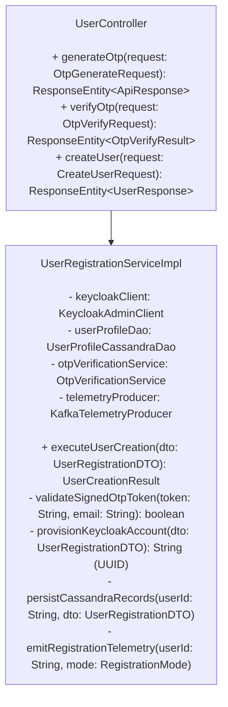
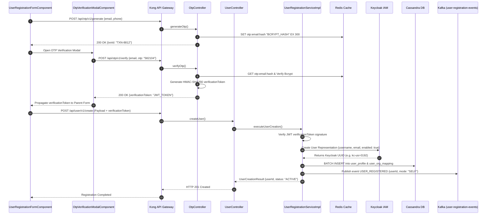
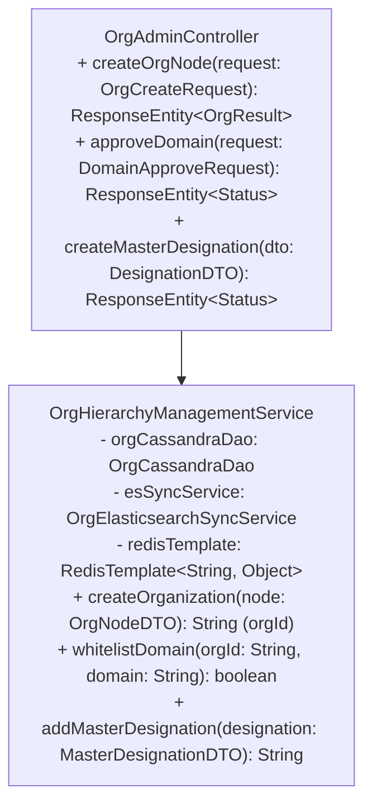
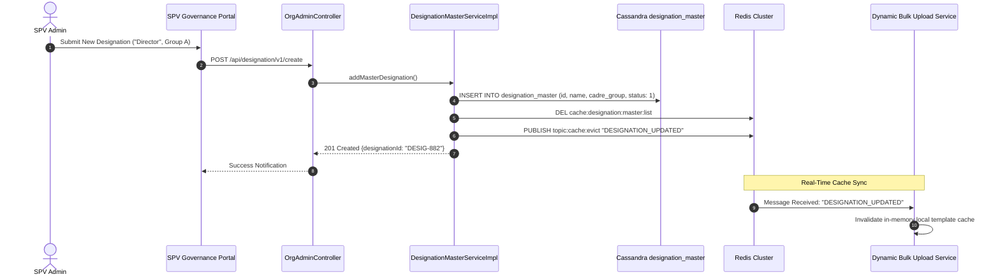
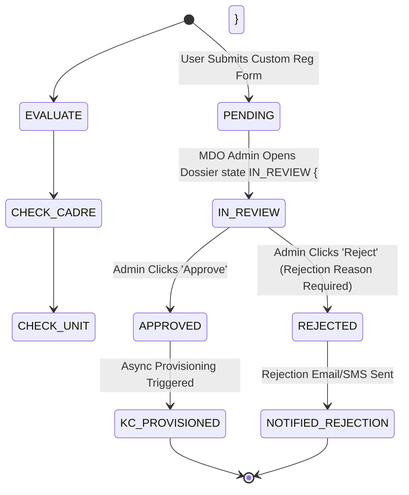
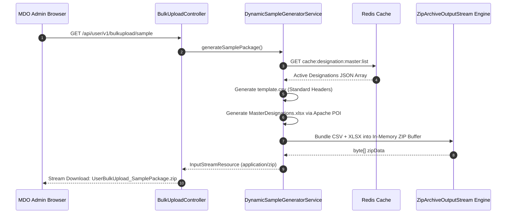
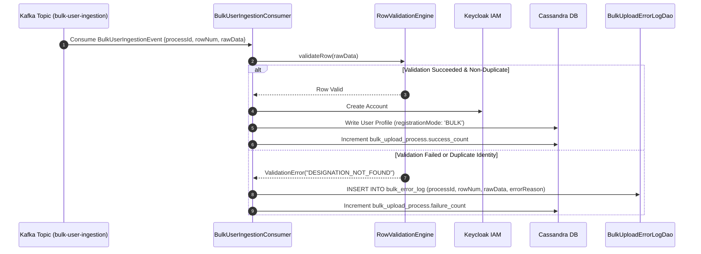

# Registration — Low Level Design (LLD)

## 1. LOW-LEVEL ARCHITECTURE OVERVIEW & TECHNICAL CONVENTIONS

### 1.1 Scope & Design Objective

This Low-Level Design (LLD) document specifies the concrete component implementations, class/controller abstractions, state machines, database DDLs, cache keys, message envelope structures, and low-level sequence flows governing the **Registration Subsystem** of the iGOT Karmayogi Platform from **Release Q2 through Release Q13**.

The subsystem decomposes into four independent registration streams. Each stream is split into:

- **Creation Subsystem:** Frontend UI controllers, form validators, API gateway endpoints, backend service orchestrators, and database persistence layers.
- **Consumption Subsystem:** IAM credential federation, external service reconciliations (e-HRMS), administrative action queues, Kafka stream handlers, and profile activation routines.

### 1.2 Unified Technology Stack & Interface Conventions

- **Frontend Portal Stack:** Angular / React, RxJS State Stores, NgRx / Redux, Native Android (Kotlin) / iOS (Swift).
- **API Gateway & Routing:** Kong API Gateway (Lua plugins for rate limiting, JWT verification, and header routing).
- **Backend Microservices Core:** Java 11 / Node.js (Sunbird OpenRAP framework, Spring Boot / Express).
- **Identity & Access Management:** Keycloak IAM v20+ (OIDC/OAuth2, SPI event listeners).
- **Persistence & Caching:** Apache Cassandra 4.x, PostgreSQL 14+, Redis Cluster 7.x.
- **Message Streaming:** Apache Kafka 3.x (Confluent Platform).

## 2. LOW-LEVEL DESIGN: USER REGISTRATION (CORE PLATFORM IDENTITY)

**SUBSECTION 2.1: USER REGISTRATION – CREATION LOW-LEVEL DESIGN**

### 2.1.1 Frontend Component Design (Learner Web Portal)

- **Component Path:** `src/app/modules/registration/components/user-registration/`
- **Primary Components:**
  - `UserRegistrationFormComponent`: Reactive form handling personal details, dynamic organization lookup, and master designation selection.
  - `OtpVerificationModalComponent`: Transient dialog handling SMS/Email OTP inputs, countdown timers (300s), and retry limits.
  - `MasterDesignationSelectComponent`: Dropdown bound to the Master Designation service with virtual scrolling.

- **Reactive Form State & Validation Schema:**
  ```typescript
  interface UserRegistrationFormState {
    firstName: FormControl<string>;         // Validators: [required, minLength(2), pattern(/^[a-zA-Z\s]+$/)]
    lastName: FormControl<string>;          // Validators: [required, pattern(/^[a-zA-Z\s]+$/)]
    email: FormControl<string>;             // Validators: [required, email, GovDomainValidator]
    phone: FormControl<string>;             // Validators: [required, pattern(/^[6-9]\d{9}$/)]
    rootOrgId: FormControl<string>;         // Validators: [required]
    deptId: FormControl<string>;            // Validators: [optional]
    designationId: FormControl<string>;     // Validators: [required]
    verificationToken: FormControl<string>; // Signed JWT issued by /otp/v1/verify
  }
  ```

### 2.1.2 Backend Component & Class Design

- **Controller:** `UserController.java` (`POST /api/user/v1/create`)
- **Service Orchestrator:** `UserRegistrationServiceImpl.java`
- **Data Access Objects (DAO):** `UserProfileCassandraDao.java`, `UserOrgMappingDao.java`
- **External Client:** `KeycloakAdminClient.java`



### 2.1.3 Low-Level Execution Sequence: User Account Creation



### 2.1.4 Development Tasks & Component Inventory (Q2 – Q13 Evolution)

- `TASK-UR-01` (Q2 Baseline): Implement `/api/user/v1/create` integration with Keycloak Admin REST Client.
- `TASK-UR-02` (Q7 Tracking): Add Cassandra column `registration_mode` and update `UserProfileCassandraDao` to persist telemetry enum values ([KB-8017: Q7 | Ad-Hoc | Enhancement | Data Tracking | User registration | Mode of Registration](https://karmayogibharat.atlassian.net/browse/KB-8017) (KB Approved)).
- `TASK-UR-03` (Q10 UI Overhaul): Refactor `UserRegistrationFormComponent` to replace text designation with `MasterDesignationSelectComponent` ([KB-12113: Q10 | Ad-hoc | Add designation on registration page](https://karmayogibharat.atlassian.net/browse/KB-12113) (Prod Deployed)).
- `TASK-UR-04` (Q10 Security): Decouple password creation; trigger Keycloak `UPDATE_PASSWORD` required-action email link on account creation ([KB-11810: Q10 | Ad-Hoc | Enhancement to registration and password flow](https://karmayogibharat.atlassian.net/browse/KB-11810) (KB Review)).

**SUBSECTION 2.2: USER REGISTRATION – CONSUMPTION LOW-LEVEL DESIGN**

### 2.2.1 Consumption Architecture: Keycloak Token Minting & RBAC Enrichment

When an activated user logs in, the Keycloak custom protocol mapper (`SunbirdUserTokenMapper.java`) executes:

1. Queries Cassandra `user_profile` and `user_org_mapping` by Keycloak `sub` (User ID).
2. Enriches the JWT Access Token with custom claims:
  ```json
  {
    "sub": "kc-usr-0192",
    "rootOrgId": "ORG-CAB-SEC-001",
    "orgRoles": [
      "PUBLIC",
      "CONTENT_CONSUMER"
    ],
    "designation": "Deputy Secretary",
    "cadreGroup": "A",
    "registrationMode": "SELF"
  }
  ```

### 2.2.2 Asynchronous e-HRMS Connector & Reconciliation Engine

- **Component:** `EHrmsSyncConsumer.java` (Spring Kafka Listener)
- **Inbound Topic:** `ehrms-service-record-sync`
- **Low-Level Synchronization Logic:**
  ```java
  @KafkaListener(topics = "ehrms-service-record-sync", groupId = "ehrms-profile-consumer")
  public void consumeEHRMSRecord(ConsumerRecord<String, EHrmsRecordEvent> record) {
      EHrmsRecordEvent payload = record.value();
      UserProfile profile = userProfileDao.findByGovEmail(payload.getGovEmail());
      if (profile != null) {
          // Master of Record Rule: Lock Cadre and PayBand to e-HRMS truth
          profile.setCadre(payload.getCadreCode());
          profile.setPayScale(payload.getPayBand());
          profile.setIsEHRMSLinked(true);
          profile.setLastSyncTimestamp(Instant.now());
          userProfileDao.update(profile);
      }
  }
  ```

### 2.2.3 Development Tasks

- `TASK-UR-CS-01` (Q3 Integration): Implement `SunbirdUserTokenMapper` SPI in Keycloak to inject `rootOrgId` and `registrationMode`.
- `TASK-UR-CS-02` (Q4 Reconciliation): Implement `EHrmsSyncConsumer` Kafka listener and Cassandra migration for `is_ehrms_linked` flag ([KB-1678: Q3 | User Profile | Addition of e-HRMS profile for Users onboarded on e-HRMS.](https://karmayogibharat.atlassian.net/browse/KB-1678) (Prod Deployed)).

## 3. LOW-LEVEL DESIGN: SPV AND MDO REGISTRATION (ADMINISTRATIVE & CADRE SETUP)

**SUBSECTION 3.1: SPV & MDO REGISTRATION – CREATION LOW-LEVEL DESIGN**

### 3.1.1 Organization Hierarchy & Domain Whitelist Component Design

- **Service:** `OrgHierarchyManagementService.java`
- **Controller:** `OrgAdminController.java` (`POST /api/org/v1/create`, `POST /api/org/v1/domain/approve`)
- **Elasticsearch Index Manager:** `OrgElasticsearchSyncService.java`



### 3.1.2 Master Designation Management & Redis Eviction Engine

When an SPV Administrator registers a new master cadre designation ([KB-6423: Q6 | Self registration | SPV | Designation master on behalf of organisation](https://karmayogibharat.atlassian.net/browse/KB-6423) (Prod Deployed)), cache consistency across nodes is enforced via Redis Pub/Sub:



### 3.1.3 Development Tasks

- `TASK-SPV-01` (Q2 Flow): Build `DomainApprovalHandler` and automated insertion into Cassandra `approved_domains` ([KB-396: Q2 | Self Registration | Auto-addition of Domain in the approved list post SPV approval.](https://karmayogibharat.atlassian.net/browse/KB-396) (Prod Deployed)).
- `TASK-SPV-02` (Q6 Designations): Implement `DesignationMasterServiceImpl` with Redis cluster invalidation logic ([KB-6423: Q6 | Self registration | SPV | Designation master on behalf of organisation](https://karmayogibharat.atlassian.net/browse/KB-6423) (Prod Deployed)).
- `TASK-SPV-03` (Q12 Volunteer): Implement multi-tier parent organization creation supporting Volunteer Organization nodes under ministries ([KB-13968: Q12 | iGOT for Non-Govt Users/ Volunteer Body](https://karmayogibharat.atlassian.net/browse/KB-13968) (Prod Deployed)).

**SUBSECTION 3.2: SPV & MDO REGISTRATION – CONSUMPTION LOW-LEVEL DESIGN**

### 3.2.1 MDO Action Queue: Approval/Rejection State Machine

Pending registrations originating from Custom Registration URLs are held in the `registration_requests` table and processed through a state engine:



### 3.2.2 Low-Level Request Approval Handler

- **Class:** `RegistrationApprovalHandler.java`
- **Method Signature:**
  ```java
  public ApprovalExecutionResult processApproval(String requestId, String adminUserId, ApprovalAction action, String rejectionReasonCode) {
      RegistrationRequest req = registrationRequestDao.findById(requestId);
      if (req.getStatus() != RequestStatus.PENDING) {
          throw new InvalidStateTransitionException("Request already processed");
      }
      if (action == ApprovalAction.REJECT) {
          if (StringUtils.isBlank(rejectionReasonCode)) {
              throw new MandatoryFieldMissingException("Rejection reason is mandatory per KBE-98");
          }
          req.setStatus(RequestStatus.REJECTED);
          req.setRejectionReason(rejectionReasonCode);
          req.setProcessedBy(adminUserId);
          req.setProcessedTimestamp(Instant.now());
          registrationRequestDao.update(req);
          notificationService.dispatchRejectionNotification(req);
          return ApprovalExecutionResult.rejected(requestId);
      }
      // Execute Provisioning
      String keycloakUserId = keycloakClient.createUser(req.getApplicantData());
      userProfileDao.persistUserProfile(keycloakUserId, req.getApplicantData(), RegistrationMode.CUSTOM_SELF);
      req.setStatus(RequestStatus.APPROVED);
      req.setProcessedBy(adminUserId);
      registrationRequestDao.update(req);
      notificationService.dispatchWelcomeEmail(req.getApplicantData().getEmail());
      return ApprovalExecutionResult.approved(requestId, keycloakUserId);
  }
  ```

### 3.2.3 Development Tasks

- `TASK-MDO-CS-01` (Q6 Queue): Build `MDOActionQueueComponent` in Angular with pagination and multi-column filtering ([KB-7127: Q6 | Custom Self Registration | MDO Portal | Onboarding Action list](https://karmayogibharat.atlassian.net/browse/KB-7127) (Not Required)).
- `TASK-MDO-CS-02` (Q6 Rejections): Implement `rejection_reason` enum mapping and enforce non-null payload constraints on `/requests/{id}/reject` ([KBE-98: Self registration|Ability to provide reject reason for the self registration requests](https://karmayogibharat.atlassian.net/browse/KBE-98) (QA In Progress)).

## 4. LOW-LEVEL DESIGN: BULK REGISTRATION (BATCH & ASYNCHRONOUS INGESTION)

**SUBSECTION 4.1: BULK REGISTRATION – CREATION LOW-LEVEL DESIGN**

### 4.1.1 Dynamic Sample Bundle Generation Architecture

- **Controller:** `BulkUploadController.java` (`GET /api/user/v1/bulkupload/sample`)
- **Service:** `DynamicSampleGeneratorService.java`
- **Design Specification Reference:** [Design Document: User Bulk Upload Sample File API](https://karmayogibharat.atlassian.net/wiki/spaces/TES/pages/1243512856)



### 4.1.2 Low-Level Asynchronous Kafka Ingestion Producer

- **Class:** `BulkUploadIngestionProducer.java`
- **Method Implementation:**
  ```java
  public BulkUploadBatchResponse ingestBatchFile(MultipartFile file, String orgId, String adminUserId) {
      String processId = "PRC-" + UUID.randomUUID().toString();
      List<String> rawRows = parseAndValidateCsvStructure(file);
      if (rawRows.size() > 10000) {
          throw new BatchThresholdExceededException("Batch size exceeds maximum limit of 10,000 records");
      }
      // Initialize Tracking Metadata in Cassandra
      bulkProcessDao.createInitialBatch(processId, orgId, adminUserId, rawRows.size());
      // Stream records to Kafka
      for (int index = 0; index < rawRows.size(); index++) {
          BulkUserIngestionEvent event = new BulkUserIngestionEvent(processId, index + 1, rawRows.get(index), orgId);
          kafkaTemplate.send("bulk-user-ingestion", orgId, event);
      }
      return new BulkUploadBatchResponse(processId, rawRows.size(), BatchStatus.ACCEPTED);
  }
  ```

### 4.1.3 Development Tasks

- `TASK-BR-01` (Q2 Deprecation): Deprecate legacy unvalidated CSV bulk upload routes per [KB-1313: User Registration and Onboarding | Put Bulk Upload on hold.](https://karmayogibharat.atlassian.net/browse/KB-1313) (Open).
- `TASK-BR-02` (Q10 Sample Generator): Implement `DynamicSampleGeneratorService` utilizing Apache POI to assemble the XLSX/CSV zip bundle ([Design Document: User Bulk Upload Sample File API](https://karmayogibharat.atlassian.net/wiki/spaces/TES/pages/1243512856)).
- `TASK-BR-03` (Q12 Volunteer Scaling): Optimize Kafka partition batch listener concurrency to support 10,000-record files ([KB-13968: Q12 | iGOT for Non-Govt Users/ Volunteer Body](https://karmayogibharat.atlassian.net/browse/KB-13968) (Prod Deployed)).

**SUBSECTION 4.2: BULK REGISTRATION – CONSUMPTION LOW-LEVEL DESIGN**

### 4.2.1 Asynchronous Consumer & Error CSV Generator

- **Class:** `BulkUserIngestionConsumer.java`
- **Error Buffer DAO:** `BulkUploadErrorLogDao.java`
- **Consumer Flow:**



### 4.2.2 Error Log Retrieval Handler

- **Endpoint:** `GET /api/user/v1/bulkupload/error/{processId}.csv`
- **Implementation:** The service streams records directly from `bulk_error_log` where `process_id = :processId`, serializing the original CSV fields with an appended `ErrorDetails` column.

### 4.2.3 Development Tasks

- `TASK-BR-CS-01` (Q10 Error Handling): Implement `BulkUploadErrorLogDao` and streaming CSV export controller.
- `TASK-BR-CS-02` (Q10 Notification): Implement automated SMS/Email activation dispatch upon successful batch row completion.

## 5. LOW-LEVEL DESIGN: SELF-REGISTRATION (MULTI-CHANNEL CHANNELS)

**SUBSECTION 5.1: SELF-REGISTRATION – CREATION LOW-LEVEL DESIGN**

### 5.1.1 Custom Registration Link & QR Code Engine

- **Component:** `CustomRegistrationLinkService.java`
- **URL Structure:** `https://igotkarmayogi.gov.in/register?orgId={encOrgId}&deptId={encDeptId}`
- **Crypto Helper:** AES-GCM 256-bit encryption for organizational URL parameters to prevent query-parameter tampering.
- **QR Generator:** `QrCodeGeneratorUtil.java` (using ZXing library to output SVG and PNG image buffers).

### 5.1.2 Domain Check Relaxation Logic (KB-9250 Implementation)

In `RegistrationValidationEngine.java`, domain checking branches on the presence of a validated `customOrgContext`:

```java
public DomainCheckResult evaluateEmailDomain(String email, String customOrgId) {
    String domain = extractDomain(email);
    // Check if originating from Custom Registration Link (KB-9250 / KB-9251)
    if (StringUtils.isNotBlank(customOrgId)) {
        boolean isOrgValid = orgDao.isActiveOrg(customOrgId);
        if (isOrgValid) {
            // Bypass government domain check; trust delegated to MDO Approval Queue
            return DomainCheckResult.bypassWhitelisting(customOrgId);
        }
    }
    // Standard Self-Registration: Strict Domain Whitelist Enforcement
    boolean isWhitelisted = domainWhitelistDao.isDomainApproved(domain);
    if (!isWhitelisted) {
        return DomainCheckResult.rejected("Domain not approved. Contact your MDO Nodal Officer.");
    }
    return DomainCheckResult.approved();
}
```

### 5.1.3 Marketplace Partner KYC Intake Component

- **Endpoint:** `POST /api/partner/v1/register`
- **Controller:** `MarketplacePartnerController.java`
- **Payload Entity:**
  ```json
  {
    "legalEntityName": "National Institute of Public Policy",
    "entityType": "AUTONOMOUS_ACADEMIC",
    "panTanNumber": "AAACN1234F",
    "authorizedSignatory": {
      "fullName": "Dr. Ramesh Iyer",
      "officialEmail": "director@nipp.edu.in",
      "mobile": "9820011223"
    },
    "kycDocumentUrls": [
      "https://storage.igot.gov.in/kyc/doc_8812a.pdf"
    ]
  }
  ```

### 5.1.4 Development Tasks

- `TASK-SR-01` (Q6 Custom Link): Build `CustomRegistrationLinkService` and ZXing-backed QR generator ([KB-6187: Q6 | Custom Self Registration Onboarding optimization](https://karmayogibharat.atlassian.net/browse/KB-6187) (KB Review)).
- `TASK-SR-02` (Q8 Domain Bypass): Implement domain relaxation branching in `RegistrationValidationEngine` ([KB-9250: Q8 | Ad-Hoc | Removal of Email Domain Validation for Custom Self-Registration](https://karmayogibharat.atlassian.net/browse/KB-9250) (QA In Progress)).
- `TASK-SR-03` (Q10 Marketplace): Create `MarketplacePartnerController` and PostgreSQL table `partner_registration` ([KB-11937: Q10 | Marketplace | Marketplace Partner Onboarding on iGOT via Self-Registration](https://karmayogibharat.atlassian.net/browse/KB-11937) (KB Review)).

**SUBSECTION 5.2: SELF-REGISTRATION – CONSUMPTION LOW-LEVEL DESIGN**

### 5.2.1 Mobile App Registration Deep-Link Handling

- **Platform:** Android Native (`MainActivity.kt` / `CustomRegDeepLinkActivity.kt`)
- **Intent Filter Contract:**
  ```xml
  <activity android:name=".ui.registration.CustomRegDeepLinkActivity">
      <intent-filter android:autoVerify="true">
          <action android:name="android.intent.action.VIEW" />
          <category android:name="android.intent.category.DEFAULT" />
          <category android:name="android.intent.category.BROWSABLE" />
          <data android:scheme="https" android:host="igotkarmayogi.gov.in" android:pathPrefix="/register" />
      </intent-filter>
  </activity>
  ```
- **Execution Flow:**
  - Officer scans MDO QR code using mobile device camera.
  - Android OS intercepts deep link and opens `CustomRegDeepLinkActivity`.
  - App extracts encrypted `orgId` parameter and renders the branded registration form.
  - Google Play SMS Retriever API automatically extracts the incoming 6-digit OTP.

### 5.2.2 Partner Approval & CBP Portal Provisioning Handler

When an SPV Admin approves a partner application via `POST /api/partner/v1/{refNum}/approve`:

1. System generates a new root organization node in Cassandra: `ORG-PARTNER-{UUID}`.
2. Invokes Keycloak Admin API to provision the partner administrator with realm roles: `['CBP_ADMIN', 'CONTENT_CREATOR']`.
3. Sends an automated activation email containing a temporary password creation link.

### 5.2.3 Development Tasks

- `TASK-SR-CS-01` (Q6 Mobile App): Implement native Android intent filter and SMS retriever integration ([KB-7054: Q6 | Self Registration | Learner | Mobile App based Registration](https://karmayogibharat.atlassian.net/browse/KB-7054) (Prod Deployed)).
- `TASK-SR-CS-02` (Q10 CBP Provisioning): Build the automated provisioning pipeline linking approved Marketplace Partners to the CBP Portal ([KB-11986: Q10 | Marketplace | Marketplace Partner Self registration and Track application status](https://karmayogibharat.atlassian.net/browse/KB-11986) (Prod Deployed)).

## 6. DATA MODELS, DDLs & CACHING SCHEMAS

### 6.1 Apache Cassandra DDL Specifications (Keyspace: `sunbird`)

```sql
-- User Profile Core Table
CREATE TABLE sunbird.user_profile (
    id uuid,
    root_org_id text,
    first_name text,
    last_name text,
    email text,
    phone text,
    designation text,
    cadre_group text,
    registration_mode text,  -- ['SELF', 'CUSTOM_SELF', 'BULK', 'MDO_ADMIN', 'API_HRMS']
    status int,  -- 0: Pending, 1: Active, 2: Suspended
    is_ehrms_linked boolean,
    created_date timestamp,
    last_sync_timestamp timestamp,
    PRIMARY KEY (id)
);
CREATE INDEX IF NOT EXISTS idx_user_email ON sunbird.user_profile (email);
CREATE INDEX IF NOT EXISTS idx_user_phone ON sunbird.user_profile (phone);
CREATE INDEX IF NOT EXISTS idx_user_root_org ON sunbird.user_profile (root_org_id);

-- Approved Domain Whitelist
CREATE TABLE sunbird.approved_domains (
    domain_name text,
    org_id text,
    approved_by text,
    approval_date timestamp,
    PRIMARY KEY (domain_name)
);

-- Master Designation Catalog (Redis Cached)
CREATE TABLE sunbird.designation_master (
    id text,
    name text,
    cadre_group text,  -- 'A', 'B', 'C', 'Volunteer'
    status int,  -- 1: Active, 0: Inactive
    created_date timestamp,
    PRIMARY KEY (id)
);

-- Custom Self-Registration Approval Queue
CREATE TABLE sunbird.registration_requests (
    request_id text,
    org_id text,
    applicant_data text,  -- Serialized JSON containing demographics & contact details
    status text,  -- 'PENDING', 'APPROVED', 'REJECTED'
    rejection_reason text,
    -- Mandated by KBE-98
    processed_by text,
    created_date timestamp,
    processed_timestamp timestamp,
    PRIMARY KEY (org_id, request_id)
) WITH CLUSTERING ORDER BY (request_id DESC);

-- Bulk Upload Process Tracking
CREATE TABLE sunbird.bulk_upload_process (
    process_id text,
    org_id text,
    initiated_by text,
    total_records int,
    success_count counter,
    failure_count counter,
    status text,  -- 'IN_PROGRESS', 'COMPLETED'
    created_date timestamp,
    PRIMARY KEY (process_id)
);

-- Bulk Upload Error Buffer
CREATE TABLE sunbird.bulk_error_log (
    process_id text,
    row_num int,
    raw_data text,
    error_reason text,
    created_date timestamp,
    PRIMARY KEY (process_id, row_num)
);
```

### 6.2 PostgreSQL DDL Specifications (Database: `marketplace_db`)

```sql
CREATE TABLE marketplace.partner_registration (
    ref_number VARCHAR(64) PRIMARY KEY,
    legal_entity_name VARCHAR(255) NOT NULL,
    entity_type VARCHAR(64) NOT NULL,
    pan_tan_number VARCHAR(32) NOT NULL,
    signatory_name VARCHAR(128) NOT NULL,
    signatory_email VARCHAR(255) NOT NULL,
    signatory_phone VARCHAR(20) NOT NULL,
    kyc_document_urls TEXT[] NOT NULL,
    application_status VARCHAR(32) NOT NULL DEFAULT 'PENDING_REVIEW',
    spv_reviewed_by VARCHAR(64),
    rejection_reason TEXT,
    created_at TIMESTAMP WITH TIME ZONE DEFAULT CURRENT_TIMESTAMP,
    updated_at TIMESTAMP WITH TIME ZONE DEFAULT CURRENT_TIMESTAMP
);
CREATE INDEX idx_partner_status ON marketplace.partner_registration (application_status);
```

### 6.3 Redis Caching Strategy

| Key Pattern | Data Type | TTL | Invalidation / Refresh Trigger |
|---|---|---|---|
| `otp:{identifier}` | String (Bcrypt Hash) | 300s (5 min) | Key expires or is deleted upon successful verification. |
| `cache:designation:master:list` | String (JSON Array) | 3600s (1 hr) | Evicted immediately on write via Redis Pub/Sub `topic:cache:evict`. |
| `ratelimit:{client_ip}:otp` | Integer (Counter) | 900s (15 min) | Increments on `/otp/v1/generate`; blocks after threshold (10 reqs). |
| `org:context:{orgId}` | Hash | 86400s (24 hr) | Evicted when MDO updates department nodes. |

## 7. ERROR HANDLING, SECURITY PROTOCOLS & RESILIENCY

### 7.1 Unified Error Response Envelope & Status Codes

All registration microservices implement a standard error response structure:

```json
{
  "id": "api.error.response",
  "ver": "1.0",
  "ts": "2026-11-01T08:46:00Z",
  "responseCode": "CLIENT_ERROR",
  "params": {
    "resmsgid": "b1829cd1-419b-4e88-992a-fa1283749210",
    "err": "ERR_DOMAIN_NOT_APPROVED",
    "errmsg": "The submitted email domain is not authorized for standard registration."
  },
  "result": {}
}
```

#### Core Error Code Dictionary

| Error Code | HTTP Status | Root Cause | Client Handling |
|---|---|---|---|
| `ERR_DOMAIN_NOT_APPROVED` | 403 Forbidden | Email domain missing from `approved_domains`. | Show "Domain Not Approved" dialog with help request link ([KB-657: Q2 \| Self Registration \| Users messaging on the Self-Registration Request for Help page for domain addition based on domain status.](https://karmayogibharat.atlassian.net/browse/KB-657) (Prod Deployed)). |
| `ERR_OTP_ATTEMPTS_EXCEEDED` | 429 Too Many Requests | Over 3 failed OTP attempts on transaction. | Lock OTP modal for 15 minutes; instruct user to request a new OTP. |
| `ERR_BATCH_LIMIT_EXCEEDED` | 413 Payload Too Large | Bulk upload file exceeds 10,000 records. | Display error message: "Max row limit is 10,000". |
| `ERR_REJECTION_REASON_EMPTY` | 400 Bad Request | MDO Admin rejects request without reason code. | Highlight rejection reason dropdown as mandatory ([KBE-98: Self registration\|Ability to provide reject reason for the self registration requests](https://karmayogibharat.atlassian.net/browse/KBE-98) (QA In Progress)). |
| `ERR_DESIGNATION_INVALID` | 422 Unprocessable Entity | Designation missing from Master Designation catalog. | Prompt user to pick a designation from the dropdown. |

### 7.2 Security Protocols

- **Zero-Knowledge Password Handling:** Plaintext passwords are never accepted by User Registration or Bulk Upload controllers. Password activation is deferred to Keycloak-issued cryptographic email/SMS tokens ([KB-11810: Q10 | Ad-Hoc | Enhancement to registration and password flow](https://karmayogibharat.atlassian.net/browse/KB-11810) (KB Review)).
- **HMAC-SHA256 Signed Verification Tokens:** Prevents bypassing OTP verification. `/otp/v1/verify` issues a signed, time-bounded JWT containing `{email, phone, exp: now() + 600}` required by `/user/v1/create`.
