# Registration — Software Design Document (SDD)

## 1. SYSTEM OVERVIEW & ARCHITECTURAL DESIGN RATIONALE

### 1.1 System Context & Design Objectives

The **Registration Subsystem** of the iGOT Karmayogi Platform serves as the central identity gateway and organizational entry fabric across the civil service capacity-building ecosystem. The subsystem coordinates user onboarding, credential issuance, administrative vetting, and cadre affiliation across five primary portal surfaces:

- **Learner Web Portal:** Direct public intake, custom organization registration landing pages, and profile management.
- **Learner Mobile App (Android/iOS):** Native intake, QR code deep-linking, SMS retriever integration, and device token binding.
- **MDO Management Portal:** Ministry/Department/Organization administrative console for link/QR generation, approval action queues, and bulk cohort uploads.
- **SPV Governance Portal:** Special Purpose Vehicle (Karmayogi Bharat) console for root organizational tree building, domain whitelisting, master designation curation, and third-party KYC vetting.
- **CBP / Marketplace Portal:** Content authoring interface consuming provisioned partner identities.

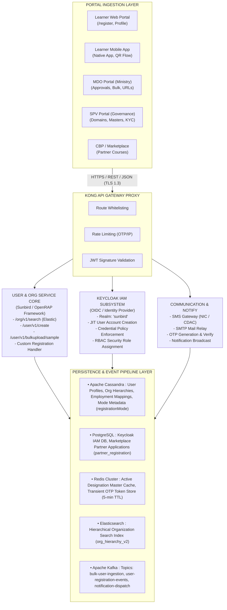

### 1.2 Evolution Timeline (Q2 – Q13) & Architectural Rationale

Between **Release Q2 and Release Q13**, the registration architecture evolved across four distinct generational models:

1. **Q2 – Q4 (Baseline Centralized Validation):** Strict email-domain-restricted registration (`.gov.in`, `.nic.in`), manual database seeding, unvalidated synchronous CSV uploads, and direct Keycloak credential coupling.
2. **Q5 – Q7 (Decentralization & Custom Onboarding):** Introduction of Custom Organization URLs/QR codes ([KB-6187: Q6 | Custom Self Registration Onboarding optimization](https://karmayogibharat.atlassian.net/browse/KB-6187) (KB Review)), MDO-managed approval queues, native mobile app registration ([KB-7054: Q6 | Self Registration | Learner | Mobile App based Registration](https://karmayogibharat.atlassian.net/browse/KB-7054) (Prod Deployed)), and Master Designation services ([KB-6423: Q6 | Self registration | SPV | Designation master on behalf of organisation](https://karmayogibharat.atlassian.net/browse/KB-6423) (Prod Deployed)).
3. **Q8 – Q10 (Federated Expansion & Asynchronous Refactoring):** Bypassing email domain restrictions for custom organization links ([KB-9250: Q8 | Ad-Hoc | Removal of Email Domain Validation for Custom Self-Registration](https://karmayogibharat.atlassian.net/browse/KB-9250) (QA In Progress)), mandatory registration mode tracking (`registrationMode`) ([KB-8017: Q7 | Ad-Hoc | Enhancement | Data Tracking | User registration | Mode of Registration](https://karmayogibharat.atlassian.net/browse/KB-8017) (KB Approved)), refactoring bulk uploads into asynchronous Kafka-backed pipelines with dynamic sample generation ([Design Document: User Bulk Upload Sample File API](https://karmayogibharat.atlassian.net/wiki/spaces/TES/pages/1243512856)), and decoupling password creation ([KB-11810: Q10 | Ad-Hoc | Enhancement to registration and password flow](https://karmayogibharat.atlassian.net/browse/KB-11810) (KB Review)).
4. **Q11 – Q13 (Open Ingestion & Non-Government Scale):** Gated Marketplace Partner onboarding ([KB-11937: Q10 | Marketplace | Marketplace Partner Onboarding on iGOT via Self-Registration](https://karmayogibharat.atlassian.net/browse/KB-11937) (KB Review)), Volunteer Body organization structures, and 10,000-record batch ingestion pipelines ([KB-13968: Q12 | iGOT for Non-Govt Users/ Volunteer Body](https://karmayogibharat.atlassian.net/browse/KB-13968) (Prod Deployed)).

## 2. DECOMPOSITION OF REGISTRATION TYPES (CREATION & CONSUMPTION)

**SECTION 2.1: USER REGISTRATION – CREATION SUBSYSTEM**

### 2.1.1 Architectural Scope & Core Components

The User Registration creation subsystem governs the end-to-end capture and validation of civil servant credentials, organizational bindings, and demographic data. It orchestrates browser/app inputs through Kong API Gateway into the User Service, synchronizing Keycloak identity generation with Apache Cassandra persistence.

### 2.1.2 Frontend-to-Backend Layered Decomposition

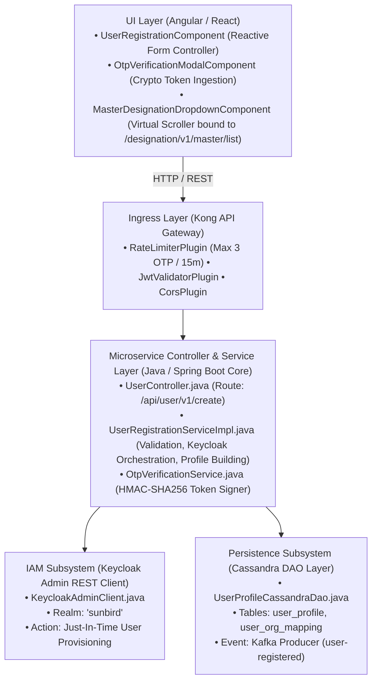

### 2.1.3 Low-Level Dynamic Sequence Diagram

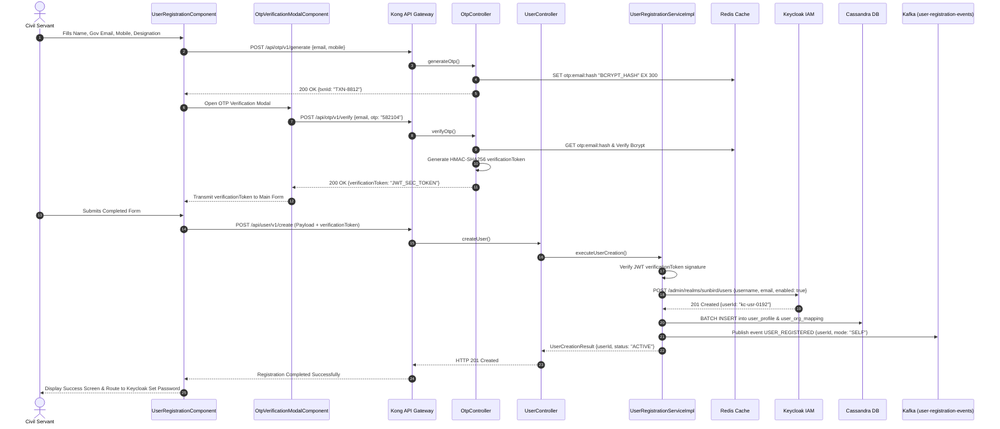

### 2.1.4 Engineering Tasks & Evolution Inventory (Q2 – Q13)

- `TASK-UR-CR-01` (Q2 Baseline): Implement `/api/user/v1/create` orchestration with Keycloak Admin Client and Cassandra schema definition.
- `TASK-UR-CR-02` (Q7 Telemetry): Add Cassandra column `registration_mode` and enforce mandatory ingestion validation ([KB-8017: Q7 | Ad-Hoc | Enhancement | Data Tracking | User registration | Mode of Registration](https://karmayogibharat.atlassian.net/browse/KB-8017) (KB Approved)).
- `TASK-UR-CR-03` (Q10 Master Designation): Integrate `MasterDesignationDropdownComponent` to consume live designations, replacing free-text fields ([KB-12113: Q10 | Ad-hoc | Add designation on registration page](https://karmayogibharat.atlassian.net/browse/KB-12113) (Prod Deployed)).
- `TASK-UR-CR-04` (Q10 Credential Decoupling): Remove plain password inputs from registration forms; generate signed temporary password tokens sent via email ([KB-11810: Q10 | Ad-Hoc | Enhancement to registration and password flow](https://karmayogibharat.atlassian.net/browse/KB-11810) (KB Review)).

**SECTION 2.2: USER REGISTRATION – CONSUMPTION SUBSYSTEM**

### 2.2.1 Consumption Architecture & Downstream Interfaces

The consumption subsystem handles authentication credential resolution, session context construction, service record reconciliation with external government databases (DoPT e-HRMS), and role mapping across platform components.

### 2.2.2 Keycloak Protocol Mapper & e-HRMS Connector Engine

- **Protocol Mapper:** `SunbirdUserTokenMapper.java`<br>Extends Keycloak's `AbstractOIDCProtocolMapper`. Upon authentication, it reads Cassandra `user_profile` using Keycloak's `sub` (User UUID) and enriches the JWT token claims with `rootOrgId`, `designation`, `cadreGroup`, and `registrationMode`.
- **e-HRMS Sync Consumer:** `EHrmsSyncConsumer.java`<br>Consumes personnel cadre manifests from Kafka topic `ehrms-service-record-sync`. Enforces the **Master of Record Rule**: locks `Cadre`, `PayScale`, and `ParentMinistry` in Cassandra against user modification when `is_ehrms_linked == true` ([KB-1678: Q3 | User Profile | Addition of e-HRMS profile for Users onboarded on e-HRMS.](https://karmayogibharat.atlassian.net/browse/KB-1678) (Prod Deployed)).

### 2.2.3 Dynamic Consumption Workflow

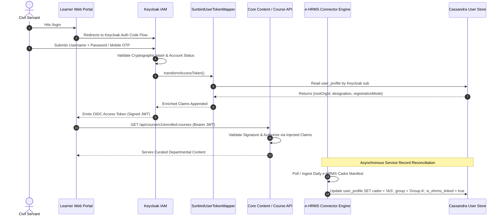

### 2.2.4 Engineering Tasks & Evolution Inventory (Q2 – Q13)

- `TASK-UR-CS-01` (Q3 Token Claims): Develop `SunbirdUserTokenMapper` Keycloak SPI to project Cassandra organizational contexts into JWT payloads.
- `TASK-UR-CS-02` (Q4 Cadre Sync): Build `EHrmsSyncConsumer` Kafka listener and Cassandra migration for `is_ehrms_linked` locking ([KB-1678: Q3 | User Profile | Addition of e-HRMS profile for Users onboarded on e-HRMS.](https://karmayogibharat.atlassian.net/browse/KB-1678) (Prod Deployed)).

**SECTION 2.3: SPV AND MDO REGISTRATION – CREATION SUBSYSTEM**

### 2.3.1 Administrative Hierarchy & Governance Architecture

This subsystem provides the administrative functionality for organizational onboarding. Operated by Karmayogi Bharat SPV Administrators, it creates organizational tree nodes, processes email domain whitelist approvals, curates the central Master Designation repository, and provisions initial MDO Administrator credentials.

### 2.3.2 Backend Service Decomposition

- **Controller:** `OrgAdminController.java` (`POST /api/org/v1/create`, `POST /api/org/v1/domain/approve`, `POST /api/designation/v1/create`)
- **Core Service:** `OrgHierarchyManagementService.java`
- **Designation Manager:** `DesignationMasterServiceImpl.java`
- **Search Synchronization:** `OrgElasticsearchSyncService.java` (indexes nodes into Elasticsearch index `org_hierarchy_v2`)

### 2.3.3 Dynamic Administrative Provisioning Flow

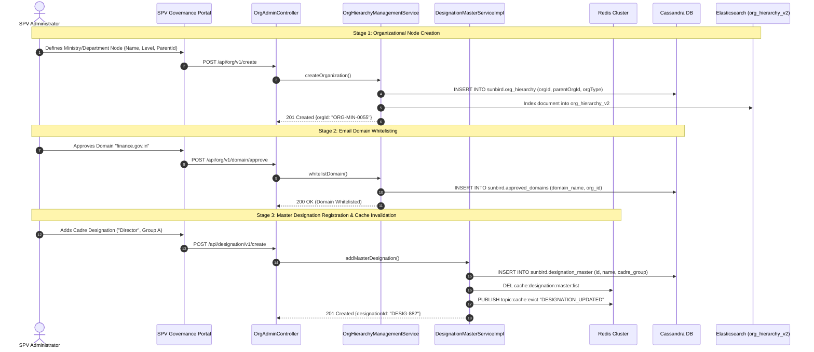

### 2.3.4 Engineering Tasks & Evolution Inventory (Q2 – Q13)

- `TASK-SPV-CR-01` (Q2 Whitelist): Build `DomainApprovalHandler` and automated persistence into Cassandra `approved_domains` ([KB-396: Q2 | Self Registration | Auto-addition of Domain in the approved list post SPV approval.](https://karmayogibharat.atlassian.net/browse/KB-396) (Prod Deployed)).
- `TASK-SPV-CR-02` (Q6 Designations): Implement `DesignationMasterServiceImpl` with Redis Pub/Sub cache eviction ([KB-6423: Q6 | Self registration | SPV | Designation master on behalf of organisation](https://karmayogibharat.atlassian.net/browse/KB-6423) (Prod Deployed)).
- `TASK-SPV-CR-03` (Q12 Volunteer Tree): Extend `OrgHierarchyManagementService` to support non-government Volunteer Organization structures under supervisory ministries ([KB-13968: Q12 | iGOT for Non-Govt Users/ Volunteer Body](https://karmayogibharat.atlassian.net/browse/KB-13968) (Prod Deployed)).

**SECTION 2.4: SPV AND MDO REGISTRATION – CONSUMPTION SUBSYSTEM**

### 2.4.1 MDO Action Queue & Request Lifecycle State Machine

The administrative consumption subsystem runs within the MDO Portal, allowing departmental administrators to manage onboarding requests. Requests originating from Custom Registration links enter the `registration_requests` table and are processed through an approval state engine.

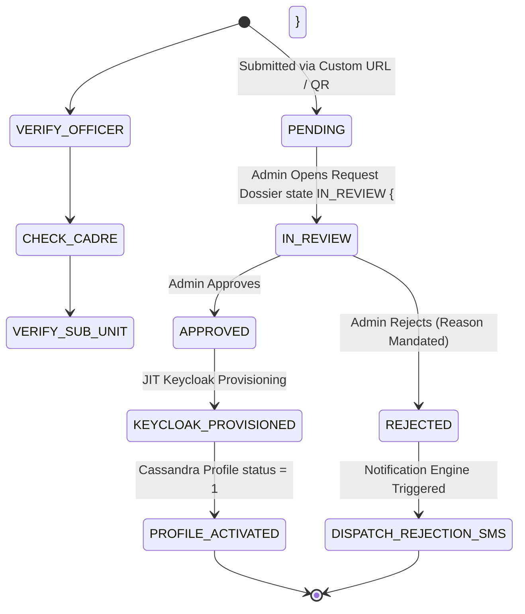

### 2.4.2 Backend Processing Engine: RegistrationApprovalHandler

- **Class:** `RegistrationApprovalHandler.java`
- **Endpoint:** `POST /api/registration/v1/requests/{requestId}/action`
- **Execution Logic:**
  - Reads `registration_requests` by primary key `(org_id, request_id)`.
  - If `action == REJECT`, validates presence of `rejection_reason` enum code ([KBE-98: Self registration|Ability to provide reject reason for the self registration requests](https://karmayogibharat.atlassian.net/browse/KBE-98) (QA In Progress)). Updates record to `REJECTED`, persists reason, and invokes `NotificationService` to deliver rejection SMS/Email.
  - If `action == APPROVE`, calls Keycloak Admin REST Client to create identity, writes user profile to Cassandra with `registration_mode = 'CUSTOM_SELF'`, updates request status to `APPROVED`, and triggers welcome notifications.

### 2.4.3 Engineering Tasks & Evolution Inventory (Q2 – Q13)

- `TASK-MDO-CS-01` (Q6 Queue): Build `MDOActionQueueComponent` supporting pagination, cadre filtering, and bulk selection ([KB-7127: Q6 | Custom Self Registration | MDO Portal | Onboarding Action list](https://karmayogibharat.atlassian.net/browse/KB-7127) (Not Required)).
- `TASK-MDO-CS-02` (Q6 Rejection Audit): Enforce non-null `rejection_reason` payload validations in `RegistrationApprovalHandler` ([KBE-98: Self registration|Ability to provide reject reason for the self registration requests](https://karmayogibharat.atlassian.net/browse/KBE-98) (QA In Progress)).
- `TASK-MDO-CS-03` (Q7 Role Governance): Implement role delegation logic allowing MDO Admins to approve external users with restricted `PUBLIC` role scopes ([KBE-143: MDO Admin onboarding PUBLIC role users](https://karmayogibharat.atlassian.net/browse/KBE-143) (QA In Progress)).

**SECTION 2.5: BULK REGISTRATION – CREATION SUBSYSTEM**

### 2.5.1 High-Throughput Batch Ingestion Architecture

To prevent API gateway timeout failures and eliminate unvalidated data ingestion ([KB-1313: User Registration and Onboarding | Put Bulk Upload on hold.](https://karmayogibharat.atlassian.net/browse/KB-1313) (Open)), the bulk registration creation subsystem utilizes an asynchronous, event-driven streaming pipeline:

- **Dynamic Sample Generator:** Packages pre-validated Master Designations into downloadable ZIP templates.
- **Multipart CSV Ingestion Controller:** Validates file schemas and publishes row records to Kafka.
- **Non-Blocking Execution:** Immediately responds with HTTP `202 Accepted` and a batch tracking token (`processId`).

### 2.5.2 Component Interaction & Data Ingestion Flow

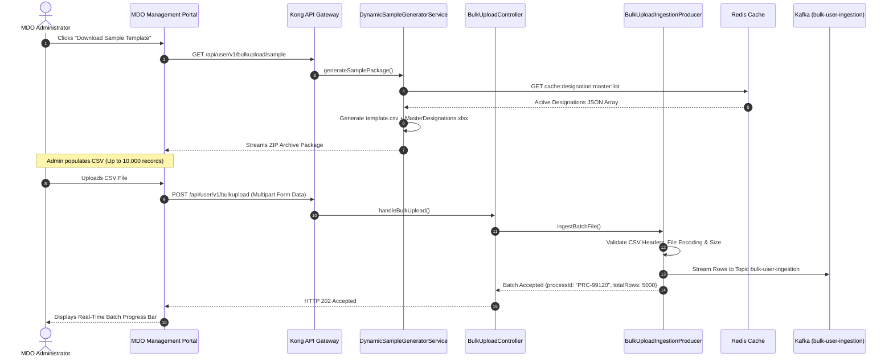

### 2.5.3 Engineering Tasks & Evolution Inventory (Q2 – Q13)

- `TASK-BR-CR-01` (Q2 Deprecation): Deprecate synchronous, unvalidated bulk CSV upload endpoints ([KB-1313: User Registration and Onboarding | Put Bulk Upload on hold.](https://karmayogibharat.atlassian.net/browse/KB-1313) (Open)).
- `TASK-BR-CR-02` (Q10 Dynamic Sample): Build `DynamicSampleGeneratorService` using Apache POI to inject live Redis master designations into template ZIPs ([Design Document: User Bulk Upload Sample File API](https://karmayogibharat.atlassian.net/wiki/spaces/TES/pages/1243512856)).
- `TASK-BR-CR-03` (Q12 Scaling): Optimize Kafka partition batch listener concurrency to support 10,000-record batch files ([KB-13968: Q12 | iGOT for Non-Govt Users/ Volunteer Body](https://karmayogibharat.atlassian.net/browse/KB-13968) (Prod Deployed)).

**SECTION 2.6: BULK REGISTRATION – CONSUMPTION SUBSYSTEM**

### 2.6.1 Consumer Worker Architecture & Error Buffer Logging

The bulk consumption subsystem operates asynchronously:

- **Stream Consumer:** `BulkUserIngestionConsumer.java`<br>Subscribed to `bulk-user-ingestion` (12 Kafka partitions). Processes user records concurrently.
- **Row Validation Engine:** Verifies required fields, email formatting, and checks designations against Redis master data.
- **Error Buffer Log:** Persists failed rows in Cassandra table `bulk_error_log`.
- **Streaming Exporter:** Generates downloadable error CSV reports on demand.

### 2.6.2 Asynchronous Worker & Error Reporting Workflow

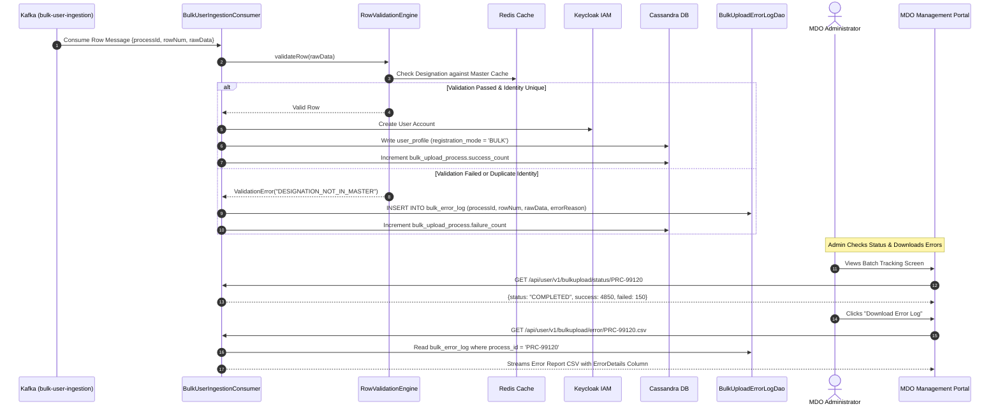

### 2.6.3 Engineering Tasks & Evolution Inventory (Q2 – Q13)

- `TASK-BR-CS-01` (Q10 Status API): Implement `GET /user/v1/bulkupload/status/{processId}` polling endpoints.
- `TASK-BR-CS-02` (Q10 Error Exporter): Implement `BulkUploadErrorLogDao` and streaming CSV export controller ([Design Document: User Bulk Upload Sample File API](https://karmayogibharat.atlassian.net/wiki/spaces/TES/pages/1243512856)).
- `TASK-BR-CS-03` (Q10 Batch Welcome): Implement automated SMS/Email activation dispatch upon successful batch row completion.

**SECTION 2.7: SELF-REGISTRATION – CREATION SUBSYSTEM**

### 2.7.1 Multi-Channel Self-Registration Taxonomy

Self-Registration supports five distinct onboarding vectors:

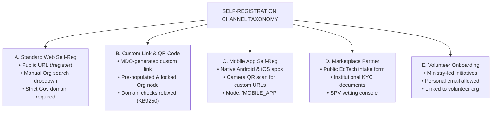

### 2.7.2 Custom Registration Link & Domain Bypassing Engine

- **Crypto Helper:** AES-GCM 256-bit encryption encodes organizational parameters into tamper-proof URLs:<br>`https://igotkarmayogi.gov.in/register?orgId={ENC_ORG_TOKEN}`
- **QR Generation Utility:** `QrCodeGeneratorUtil.java` produces high-resolution vector and PNG QR assets for distribution.
- **Domain Check Relaxation (KB-9250 Logic):**<br>`RegistrationValidationEngine.java` inspects incoming requests. When an encrypted organization context is validated, government email domain whitelist enforcement (`.gov.in`) is bypassed, shifting verification to the MDO Approval Queue ([KB-9250: Q8 | Ad-Hoc | Removal of Email Domain Validation for Custom Self-Registration](https://karmayogibharat.atlassian.net/browse/KB-9250) (QA In Progress), [KB-9251: Q8 | Ad-Hoc | Removal of domain validation from Custom Self registration page](https://karmayogibharat.atlassian.net/browse/KB-9251) (QA In Progress)).

### 2.7.3 Sequence Diagram: Custom Self-Registration Ingestion

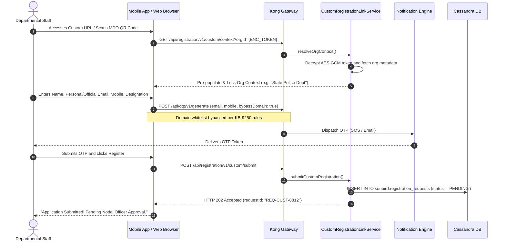

### 2.7.4 Engineering Tasks & Evolution Inventory (Q2 – Q13)

- `TASK-SR-CR-01` (Q6 Custom Link): Build `CustomRegistrationLinkService` and ZXing QR generation utilities ([KB-6187: Q6 | Custom Self Registration Onboarding optimization](https://karmayogibharat.atlassian.net/browse/KB-6187) (KB Review), [KB-7025: Q6 | Self registration | MDO | Create custom registration link](https://karmayogibharat.atlassian.net/browse/KB-7025) (Prod Deployed)).
- `TASK-SR-CR-02` (Q8 Domain Bypass): Implement domain relaxation branching in `RegistrationValidationEngine` ([KB-9250: Q8 | Ad-Hoc | Removal of Email Domain Validation for Custom Self-Registration](https://karmayogibharat.atlassian.net/browse/KB-9250) (QA In Progress)).
- `TASK-SR-CR-03` (Q10 Marketplace Intake): Create `MarketplacePartnerController` and PostgreSQL table `partner_registration` ([KB-11937: Q10 | Marketplace | Marketplace Partner Onboarding on iGOT via Self-Registration](https://karmayogibharat.atlassian.net/browse/KB-11937) (KB Review)).

**SECTION 2.8: SELF-REGISTRATION – CONSUMPTION SUBSYSTEM**

### 2.8.1 Mobile App Deep-Link & Marketplace Gated Activation

The self-registration consumption subsystem covers mobile integration and external partner provisioning:

- **Native Android Deep-Link Interceptor:** `CustomRegDeepLinkActivity.kt` registers intent filters for `https://igotkarmayogi.gov.in/register*`. Scanned QR codes automatically pre-populate organizational context within the native app.
- **SMS Retriever Integration:** Intercepts incoming SMS OTPs directly via Google Play Services API without requiring broad SMS read permissions.
- **Marketplace Gated Provisioning Orchestrator:** Upon SPV administrator approval of a Marketplace Partner application, the system generates an organization node, creates the admin identity in Keycloak, and grants `CBP_ADMIN` roles for content publishing on the CBP Portal ([KB-11986: Q10 | Marketplace | Marketplace Partner Self registration and Track application status](https://karmayogibharat.atlassian.net/browse/KB-11986) (Prod Deployed)).

### 2.8.2 Marketplace Partner Provisioning Flow

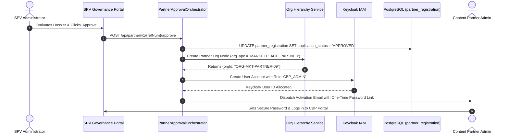

### 2.8.3 Engineering Tasks & Evolution Inventory (Q2 – Q13)

- `TASK-SR-CS-01` (Q6 Mobile App): Implement native Android deep-link handling and SMS Retriever API integration ([KB-7054: Q6 | Self Registration | Learner | Mobile App based Registration](https://karmayogibharat.atlassian.net/browse/KB-7054) (Prod Deployed)).
- `TASK-SR-CS-02` (Q10 Partner Provisioning): Build `PartnerApprovalOrchestrator` to automate Keycloak `CBP_ADMIN` role assignment and CBP Portal access ([KB-11986: Q10 | Marketplace | Marketplace Partner Self registration and Track application status](https://karmayogibharat.atlassian.net/browse/KB-11986) (Prod Deployed)).

## 3. CROSS-CUTTING DATA ARCHITECTURE & SCHEMAS

### 3.1 Entity-Relationship Model

**LOGICAL DATA MODEL (E-R TOPOLOGY)**

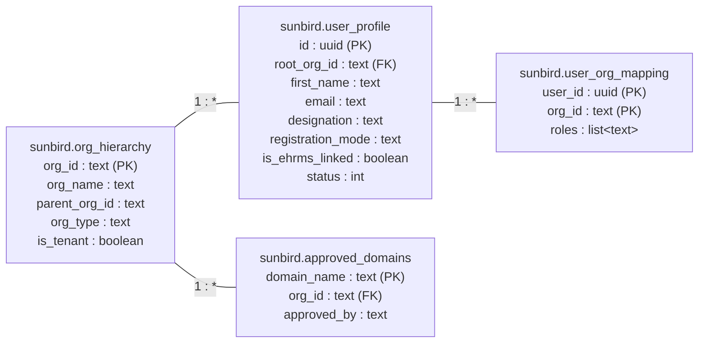

### 3.2 Apache Cassandra DDL Specifications (Keyspace: `sunbird`)

```sql
-- User Profile Persistence Table
CREATE TABLE sunbird.user_profile (
    id uuid,
    root_org_id text,
    first_name text,
    last_name text,
    email text,
    phone text,
    designation text,
    cadre_group text,
    registration_mode text,  -- ['SELF', 'CUSTOM_SELF', 'BULK', 'MDO_ADMIN', 'API_HRMS']
    status int,  -- 0: Pending, 1: Active, 2: Inactive
    is_ehrms_linked boolean,
    created_date timestamp,
    last_sync_timestamp timestamp,
    PRIMARY KEY (id)
);
CREATE INDEX IF NOT EXISTS idx_user_email ON sunbird.user_profile (email);
CREATE INDEX IF NOT EXISTS idx_user_phone ON sunbird.user_profile (phone);
CREATE INDEX IF NOT EXISTS idx_user_root_org ON sunbird.user_profile (root_org_id);

-- Approved Email Domain Whitelist
CREATE TABLE sunbird.approved_domains (
    domain_name text,
    org_id text,
    approved_by text,
    approval_date timestamp,
    PRIMARY KEY (domain_name)
);

-- Master Designation Repository
CREATE TABLE sunbird.designation_master (
    id text,
    name text,
    cadre_group text,  -- 'A', 'B', 'C', 'Volunteer'
    status int,  -- 1: Active, 0: Inactive
    created_date timestamp,
    PRIMARY KEY (id)
);

-- Custom Registration Approval Queue Table
CREATE TABLE sunbird.registration_requests (
    request_id text,
    org_id text,
    applicant_data text,  -- Serialized JSON containing user input
    status text,  -- 'PENDING', 'APPROVED', 'REJECTED'
    rejection_reason text,
    -- Mandated by KBE-98
    processed_by text,
    created_date timestamp,
    processed_timestamp timestamp,
    PRIMARY KEY (org_id, request_id)
) WITH CLUSTERING ORDER BY (request_id DESC);

-- Bulk Ingestion Tracking Tables
CREATE TABLE sunbird.bulk_upload_process (
    process_id text,
    org_id text,
    initiated_by text,
    total_records int,
    success_count counter,
    failure_count counter,
    status text,  -- 'IN_PROGRESS', 'COMPLETED'
    created_date timestamp,
    PRIMARY KEY (process_id)
);
CREATE TABLE sunbird.bulk_error_log (
    process_id text,
    row_num int,
    raw_data text,
    error_reason text,
    created_date timestamp,
    PRIMARY KEY (process_id, row_num)
);
```

### 3.3 PostgreSQL DDL Specifications (Database: `marketplace_db`)

```sql
CREATE TABLE marketplace.partner_registration (
    ref_number VARCHAR(64) PRIMARY KEY,
    legal_entity_name VARCHAR(255) NOT NULL,
    entity_type VARCHAR(64) NOT NULL,
    pan_tan_number VARCHAR(32) NOT NULL,
    signatory_name VARCHAR(128) NOT NULL,
    signatory_email VARCHAR(255) NOT NULL,
    signatory_phone VARCHAR(20) NOT NULL,
    kyc_document_urls TEXT[] NOT NULL,
    application_status VARCHAR(32) NOT NULL DEFAULT 'PENDING_REVIEW',
    spv_reviewed_by VARCHAR(64),
    rejection_reason TEXT,
    created_at TIMESTAMP WITH TIME ZONE DEFAULT CURRENT_TIMESTAMP,
    updated_at TIMESTAMP WITH TIME ZONE DEFAULT CURRENT_TIMESTAMP
);
CREATE INDEX idx_partner_status ON marketplace.partner_registration (application_status);
```

### 3.4 Redis Cluster Caching Strategy

| Cache Key Pattern | Data Structure | TTL | Eviction Policy / Invalidation Mechanism |
|---|---|---|---|
| `otp:{identifier}` | String (Bcrypt Hash) | 300s (5 min) | Key expires or is deleted upon successful verification. |
| `cache:designation:master:list` | String (JSON Array) | 3600s (1 hr) | Evicted immediately on write via Redis Pub/Sub `topic:cache:evict`. |
| `ratelimit:{client_ip}:otp` | Integer (Counter) | 900s (15 min) | Increments on `/otp/v1/generate`; blocks after threshold (10 reqs). |
| `org:context:{orgId}` | Hash | 86400s (24 hr) | Evicted when MDO updates department nodes. |

## 4. INTERFACE & INTEGRATION SPECIFICATIONS

### 4.1 Organization Search API Contract

- **Route:** `POST /api/org/v1/search`
- **Consumer:** Learner Web Portal, Mobile App, Custom Registration Page
- **Source Specification:** [Org Search Public API – Registration Page API Contract](https://karmayogibharat.atlassian.net/wiki/spaces/TES/pages/616497179/Org+Search+Public+API+Registration+Page+API+Contract)

```javascript
// Request Payload:
{
  "request": {
    "filters": {
      "isTenant": true,
      "status": 1
    },
    "query": "Ministry of External Affairs",
    "limit": 10,
    "offset": 0
  }
}

// Success Response (HTTP 200 OK):
{
  "id": "api.org.search",
  "ver": "1.0",
  "ts": "2026-11-01T08:48:00Z",
  "params": {
    "status": "successful"
  },
  "responseCode": "OK",
  "result": {
    "response": {
      "count": 1,
      "content": [
        {
          "identifier": "ORG-MIN-0042",
          "orgName": "Ministry of External Affairs",
          "orgCode": "MEA",
          "orgType": "MINISTRY",
          "isApproved": true,
          "subDepartments": [
            {
              "identifier": "DEPT-MEA-01",
              "deptName": "Consular, Passport and Visa Division"
            }
          ]
        }
      ]
    }
  }
}
```

### 4.2 Dynamic Bulk Upload Sample API Contract

- **Route:** `GET /api/user/v1/bulkupload/sample`
- **Consumer:** MDO Management Portal
- **Source Specification:** [Design Document: User Bulk Upload Sample File API](https://karmayogibharat.atlassian.net/wiki/spaces/TES/pages/1243512856)

```http
GET /api/user/v1/bulkupload/sample HTTP/1.1
Host: igotkarmayogi.gov.in
Authorization: Bearer <MDO_ADMIN_JWT_TOKEN>
Accept: application/zip HTTP/1.1 200 OK
Content-Type: application/zip
Content-Disposition: attachment; filename="UserBulkUpload_SamplePackage.zip" [ZIP Binary Stream
containing: - template.csv (Header
row: firstName,lastName,email,phone,designation,cadreGroup,orgId) - MasterDesignations.xlsx (Reference sheet containing live, Redis-cached active designations) ]
```

### 4.3 Kafka Event Topics & Schemas

| Topic Name | Partitions | Replication | Partition Key | Schema / Payload Description |
|---|---|---|---|---|
| `bulk-user-ingestion` | 12 | 3 | `orgId` | Ingestion envelope: `{processId, rowNum, rawData, orgId}` |
| `user-registration-events` | 6 | 3 | `userId` | Audit event: `{userId, orgId, registrationMode, timestamp}` |
| `notification-dispatch` | 6 | 3 | `recipient` | Notification payload: `{channel, recipient, templateId, params}` |
| `topic:cache:evict` (Redis) | N/A | In-memory | N/A | Cache eviction broadcast: `"DESIGNATION_UPDATED"` |

## 5. SECURITY, IDENTITY FEDERATION & ACCESS CONTROL

### 5.1 Keycloak IAM Integration Architecture

- **Single Source of Truth:** All platform users reside within the Keycloak realm `sunbird`.
- **RBAC Role Matrix:**
  - Learner / Standard Self-Reg: `['PUBLIC', 'CONTENT_CONSUMER']`
  - MDO Nodal Officer: `['MDO_ADMIN', 'ORG_ADMIN']`
  - SPV Administrator: `['SPV_ADMIN']`
  - Marketplace Partner Admin: `['CBP_ADMIN', 'CONTENT_CREATOR']`

- **Cryptographic Credential Policies:** Passwords are encrypted using Argon2 hashing. Direct password ingestion on registration forms is prohibited; account activation uses signed one-time tokens ([KB-11810: Q10 | Ad-Hoc | Enhancement to registration and password flow](https://karmayogibharat.atlassian.net/browse/KB-11810) (KB Review)).

### 5.2 Cryptographic OTP Token Handshake

To prevent skipping verification steps, `/otp/v1/verify` issues a signed, time-limited JWT verification token:

```json
{
  "sub": "otp-verification-token",
  "email": "officer@nic.in",
  "phone": "9811002233",
  "exp": 1793523480,
  "iss": "igot-otp-service",
  "sig": "HMAC-SHA256(secretKey)"
}
```

`/user/v1/create` validates this token signature before processing account creation requests.

## 6. OBSERVABILITY, TELEMETRY & AUDIT ARCHITECTURE

### 6.1 Registration Acquisition Tracking (`registrationMode`)

Every identity record in Cassandra and every emitted Kafka registration event includes a mandatory `registrationMode` field ([KB-8017: Q7 | Ad-Hoc | Enhancement | Data Tracking | User registration | Mode of Registration](https://karmayogibharat.atlassian.net/browse/KB-8017) (KB Approved), [KB-8582: Q7 | Ad-Hoc | Enhancement | Data Tracking | User registration process QA Deployed](https://karmayogibharat.atlassian.net/browse/KB-8582)):

**registrationMode ENUM DICTIONARY**

| Enum Identifier | Acquisition Route Description |
| --- | --- |
| SELF | Public Learner Portal (/register) with government email domain |
| CUSTOM_SELF | MDO-generated custom link / QR code landing page |
| MOBILE_APP | Learner Mobile App native registration flow |
| BULK | MDO Administrator batch CSV/XLSX file upload |
| MDO_ADMIN | Manually created via MDO User Management console |
| API_HRMS | Programmatically provisioned via external HRMS integration |
| PARTNER_ONBOARDING | External training institute via Marketplace workflow |

### 6.2 Monitoring & Alerting Metrics

- **Drop-off Funnel:** Prometheus tracks `registration_otp_generated_total`, `registration_otp_verified_total`, and `registration_account_created_total`. An alert triggers if the OTP verification-to-creation conversion falls below 75%.
- **Batch Processing Health:** Tracks `bulk_upload_processing_seconds_bucket` and `bulk_upload_failed_rows_total`.

## 7. RESILIENCY, DEPLOYMENT & NON-FUNCTIONAL DESIGN

### 7.1 Kubernetes Deployment Topology & Autoscaling

Microservices run as stateless container pods on Amazon EKS:

- **HPA Policies:** Horizontal Pod Autoscalers scale pods between 8 and 40 replicas targeting 70% average CPU utilization.
- **Network Throttling:** Kong enforces IP and identifier rate limits on OTP generation endpoints.
- **Zero-Downtime Cache Invalidation:** Redis Pub/Sub broadcasts cache eviction events across all pod replicas simultaneously.

### 7.2 Non-Functional Performance & Resiliency Targets

| Metric Dimension | Design Target | Production Verification Standard |
|---|---|---|
| **Peak OTP Generation Throughput** | 1,200 RPS sustained | Load tested using Gatling; p99 < 150ms |
| **OTP Carrier Delivery Latency** | < 3 seconds | Telemetry monitored via SMS Gateway ACK callbacks |
| **Bulk File Ingestion Processing** | 10,000 rows in < 15 min | Verified via Kafka partition batch consumer benchmarks |
| **Org Search Response Latency** | p99 < 80ms | Measured under 500 concurrent Elasticsearch query threads |
