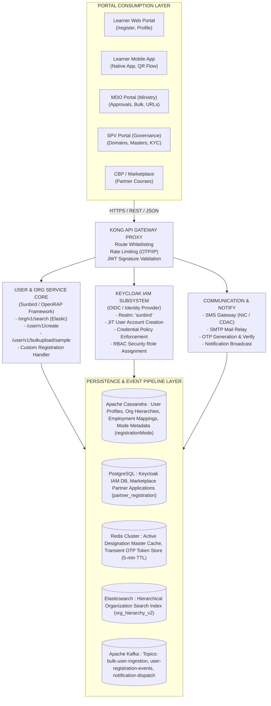
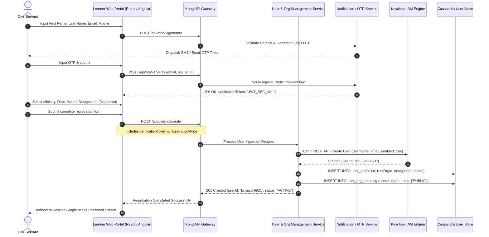
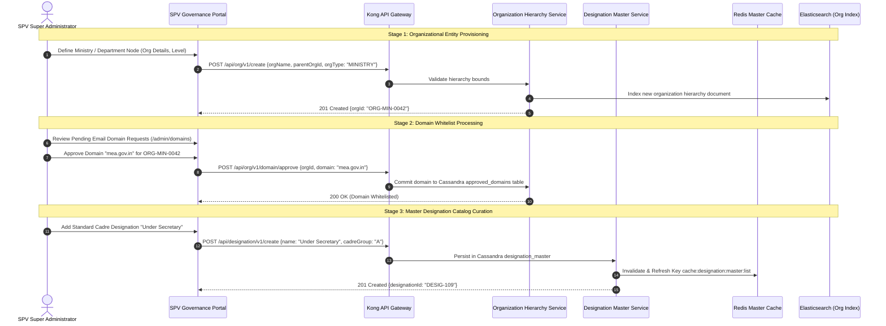
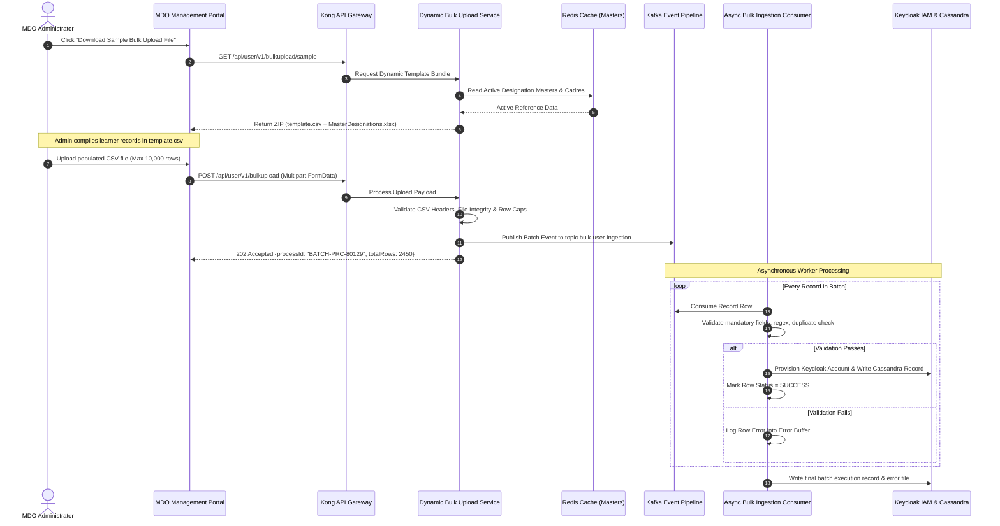
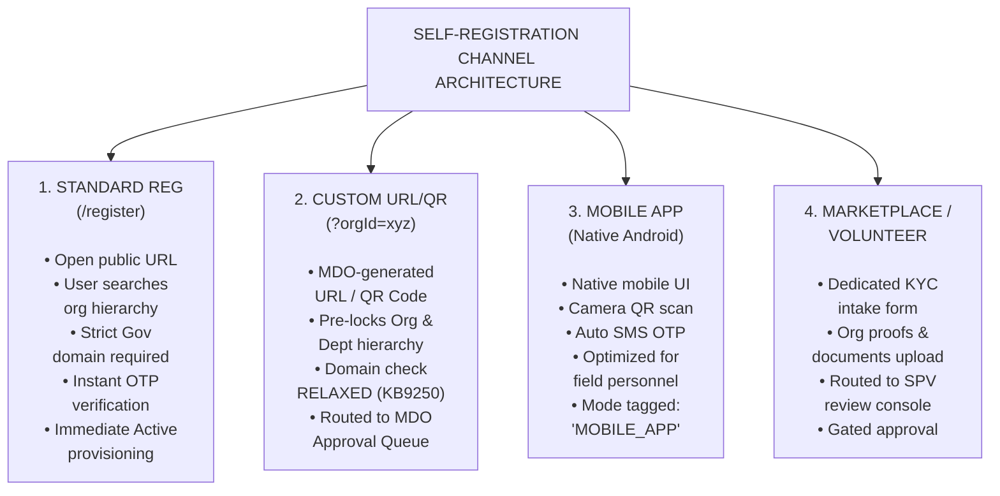

# Registration — Software Requirements Specification (SRS)

## 1. DOCUMENT OVERVIEW & ARCHITECTURAL FOUNDATION

### 1.1 Purpose and Scope

This Software Requirements Specification (SRS) establishes the complete functional, technical, interface, and behavioral requirements for the **Registration Ecosystem** across the **iGOT Karmayogi Platform**. It documents the end-to-end lifecycle—from identity ingestion and administrative governance to cryptographic credential provisioning and downstream consumption—spanning the platform's architectural evolution from **Release Q2 through Release Q13**.

This document captures both:

1. **Creation Workflows:** How user records, organizational nodes, email domains, designation masters, partner applications, and batch ingestion streams are formulated, validated, and provisioned.
2. **Consumption Workflows:** How registered identities, organizational associations, and credentials are authenticated, verified, approved, synchronized with external HRMS pipelines, and consumed across platform portals (Learner Web/Mobile, MDO, SPV, CBP/Marketplace).

### 1.2 System Context & Multi-Portal Environment

The Registration Ecosystem functions as a federated entry point coordinating across five dedicated portals and multiple core backend microservices:



## 2. DEDICATED REGISTRATION TYPE SPECIFICATIONS (CREATION & CONSUMPTION)

To satisfy the multi-stream operational model, requirements are bifurcated for each of the four registration types into:

- **Sub-Section X.1: Creation Architecture & Frontend-to-Backend Flows**
- **Sub-Section X.2: Consumption Architecture, Downstream Integrations & Lifecycle Tasks**

**SECTION 2.1: USER REGISTRATION (CORE PLATFORM IDENTITY)**

### 2.1.1 User Registration – Creation Architecture (Frontend-to-Backend)

- **Functional Scope:** Ingestion of individual civil servant identities, demographic attributes, official contact coordinates, and initial credential setup.
- **Target Audience:** Public civil servants registering independently or accepting programmatic onboarding.
- **Key Traceability:** [KB-949: Q2 | Ad-Hoc Requests | User Onboarding, Creation and Profile changes.](https://karmayogibharat.atlassian.net/browse/KB-949) (KB Review), [KB-1678: Q3 | User Profile | Addition of e-HRMS profile for Users onboarded on e-HRMS.](https://karmayogibharat.atlassian.net/browse/KB-1678) (Prod Deployed), [KB-8017: Q7 | Ad-Hoc | Enhancement | Data Tracking | User registration | Mode of Registration](https://karmayogibharat.atlassian.net/browse/KB-8017) (KB Approved), [KB-11810: Q10 | Ad-Hoc | Enhancement to registration and password flow](https://karmayogibharat.atlassian.net/browse/KB-11810) (KB Review), [KB-11918: Q10 | Ad-hoc | Registration changes | New Registration Flow QA Completed](https://karmayogibharat.atlassian.net/browse/KB-11918), [KB-12113: Q10 | Ad-hoc | Add designation on registration page](https://karmayogibharat.atlassian.net/browse/KB-12113) (Prod Deployed), [User Creation API Places and API called](https://karmayogibharat.atlassian.net/wiki/spaces/TES/pages/198279170/User+Creation+API+Places+and+API+called).

#### Detailed Frontend-to-Backend Creation Lifecycle



#### Functional Creation Requirements

- `REQ-UR-CR-01` Dynamic Master Designation Selection: The frontend must prohibit free-text designation input. The designation selector must query the Master Designation API to bind the profile to a standardized cadre node ([KB-12113: Q10 | Ad-hoc | Add designation on registration page](https://karmayogibharat.atlassian.net/browse/KB-12113) (Prod Deployed)).
- `REQ-UR-CR-02` OTP Verification Handshake: The backend must require a cryptographically signed `verificationToken` generated by `/otp/v1/verify` before accepting requests at `/user/v1/create`.
- `REQ-UR-CR-03` Registration Mode Tagging: Every user creation payload must explicitly record the acquisition vector in the Cassandra table `user_profile.registration_mode` with permitted enum values: `['SELF', 'CUSTOM_SELF', 'BULK', 'MDO_ADMIN', 'API_HRMS']` ([KB-8017: Q7 | Ad-Hoc | Enhancement | Data Tracking | User registration | Mode of Registration](https://karmayogibharat.atlassian.net/browse/KB-8017) (KB Approved)).
- `REQ-UR-CR-04` Two-Stage Credential Policy: In accordance with Q10 security enhancements ([KB-11810: Q10 | Ad-Hoc | Enhancement to registration and password flow](https://karmayogibharat.atlassian.net/browse/KB-11810) (KB Review), [KB-12036: Q10 | Ad-Hoc | Registration changes | Change Password](https://karmayogibharat.atlassian.net/browse/KB-12036) (Open)), registration must not capture plain passwords in the intake form. Keycloak must trigger an encrypted temporary password activation token sent to the user's verified communication channels.

### 2.1.2 User Registration – Consumption Architecture (Lifecycle & Downstream Use)

- **Functional Scope:** Identity activation, authentication consumption, service-record synchronisation (e-HRMS), and role assignment across the learning portal.

#### Detailed Consumption Requirements

- `REQ-UR-CS-01` IAM Authentication Consumption: Upon registration activation, the Keycloak OpenID Connect (OIDC) realm must authenticate the user via Username/Password or Mobile OTP, issuing an access token containing `sub` (User UUID), `rootOrgId`, and platform roles `['PUBLIC', 'CONTENT_CONSUMER']`.
- `REQ-UR-CS-02` e-HRMS Profile Synchronisation: For users onboarded through central personnel pipelines, the system must trigger asynchronous background reconciliation with the Department of Personnel and Training (DoPT) e-HRMS service ([KB-1678: Q3 | User Profile | Addition of e-HRMS profile for Users onboarded on e-HRMS.](https://karmayogibharat.atlassian.net/browse/KB-1678) (Prod Deployed)).
  - **Master of Record Rule:** The e-HRMS service record acts as the master authority for `Cadre`, `Pay Scale`, and `Parent Ministry`. Manual profile edits for these locked fields are disabled in the Learner Profile UI.

- `REQ-UR-CS-03` Telemetry & Audit Consumption: The system must emit a Kafka audit event `AUDIT_USER_REGISTERED` containing `{userId, orgId, registrationMode, timestamp}` consumed by analytics engines for reporting.

**SECTION 2.2: SPV AND MDO REGISTRATION (ADMINISTRATIVE & ORGANIZATIONAL GOVERNANCE)**

### 2.2.1 SPV & MDO Registration – Creation Architecture (Frontend-to-Backend)

- **Functional Scope:** Institutional onboarding of Union Ministries, State Departments, Attached Offices, and Autonomous Bodies; domain whitelisting; centralized Designation Master creation; and MDO Administrator provisioning.
- **Target Audience:** Karmayogi Bharat SPV Super-Administrators and Ministry Nodal Officers.
- **Key Traceability:** [KB-396: Q2 | Self Registration | Auto-addition of Domain in the approved list post SPV approval.](https://karmayogibharat.atlassian.net/browse/KB-396) (Prod Deployed), [KB-438: Q2 | Self Registration | Users with Email ID having approved domains only, shall be able to request for OTP.](https://karmayogibharat.atlassian.net/browse/KB-438) (KB Approved), [KB-439: Q2 | Self Registration | Show SPV the received requests of Domains on the SPV Portal for approval.](https://karmayogibharat.atlassian.net/browse/KB-439) (Prod Deployed), [KB-6421: Q6 | Self registration | SPV | Organisation creation](https://karmayogibharat.atlassian.net/browse/KB-6421) (Prod Deployed), [KB-6423: Q6 | Self registration | SPV | Designation master on behalf of organisation](https://karmayogibharat.atlassian.net/browse/KB-6423) (Prod Deployed), [KB-7027: Q6 | Self registration | SPV | State Creation menu need to Disable](https://karmayogibharat.atlassian.net/browse/KB-7027) (Prod Deployed), [Sprint 21 Sign off - Designation Master Importing](https://karmayogibharat.atlassian.net/wiki/spaces/KQAS/pages/284196889).

#### Detailed Administrative Creation Lifecycle



#### Functional Creation Requirements

- `REQ-SPV-CR-01` Organizational Hierarchy Construction: The SPV Portal must support strict multi-tier tree structures: `Ministry -> Department -> Attached Office -> Autonomous Body`. Cyclic parent references must be rejected at the API layer.
- `REQ-SPV-CR-02` Automated Domain Addition: Following administrative approval in the SPV Portal, the domain must be automatically inserted into the system-wide whitelist without requiring service restarts ([KB-396: Q2 | Self Registration | Auto-addition of Domain in the approved list post SPV approval.](https://karmayogibharat.atlassian.net/browse/KB-396) (Prod Deployed)).
- `REQ-SPV-CR-03` Centralized Designation Master Curation: Designations must be centrally maintained with mandatory mappings to Cadre Groups (`A`, `B`, `C`, `Volunteer`). Modifications must immediately invalidate the Redis cache ([KB-6423: Q6 | Self registration | SPV | Designation master on behalf of organisation](https://karmayogibharat.atlassian.net/browse/KB-6423) (Prod Deployed)).
- `REQ-SPV-CR-04` Provisioning of MDO Administrators: The SPV Portal must support provisioning the initial primary MDO Administrator for each department, assigning Keycloak roles `['MDO_ADMIN', 'ORG_ADMIN']`.

### 2.2.2 SPV & MDO Registration – Consumption Architecture (Administrative Oversight & Action Queues)

- **Functional Scope:** Department-level approval workflows, custom link generation, onboarding action lists, and request filtering.
- **Key Traceability:** [KB-7127: Q6 | Custom Self Registration | MDO Portal | Onboarding Action list](https://karmayogibharat.atlassian.net/browse/KB-7127) (Not Required), [KBE-98: Self registration|Ability to provide reject reason for the self registration requests](https://karmayogibharat.atlassian.net/browse/KBE-98) (QA In Progress), [KBE-114: Self registration | Ability to filter using tags for the MDO Approvals](https://karmayogibharat.atlassian.net/browse/KBE-114) (QA In Progress), [KBE-143: MDO Admin onboarding PUBLIC role users](https://karmayogibharat.atlassian.net/browse/KBE-143) (QA In Progress).

#### Detailed Consumption Requirements

- `REQ-MDO-CS-01` MDO Onboarding Action Queue: The MDO Portal must provide a dedicated queue displaying all pending self-registration requests submitted via Custom Registration links.
- `REQ-MDO-CS-02` Mandatory Rejection Reason Logging: If an MDO Administrator rejects an applicant, the UI must enforce selecting or entering a rejection reason ([KBE-98: Self registration|Ability to provide reject reason for the self registration requests](https://karmayogibharat.atlassian.net/browse/KBE-98) (QA In Progress)). The backend must store this in `registration_requests.rejection_reason` and notify the applicant via email/SMS.
- `REQ-MDO-CS-03` Multi-Faceted Approval Filtering: Administrators must be able to filter pending requests by Designation, Cadre Group, Date Range, and Status ([KBE-114: Self registration | Ability to filter using tags for the MDO Approvals](https://karmayogibharat.atlassian.net/browse/KBE-114) (QA In Progress)).
- `REQ-MDO-CS-04` Public Role Ingestion Governance: When onboarding external or contractual personnel without approved departmental domains, MDO Admins must be able to explicitly approve them with restricted `PUBLIC` profile scopes ([KBE-143: MDO Admin onboarding PUBLIC role users](https://karmayogibharat.atlassian.net/browse/KBE-143) (QA In Progress)).

**SECTION 2.3: BULK REGISTRATION (BATCH & ASYNCHRONOUS INGESTION)**

### 2.3.1 Bulk Registration – Creation Architecture (Dynamic Sample & File Ingestion)

- **Functional Scope:** Ingestion of large user cohorts (e.g., Rozgar Mela batches or ministry-wide rollouts) via CSV/XLSX files, dynamic template generation, and schema validation.
- **Target Audience:** MDO Administrators, Central Nodal Officers, and System Integrators.
- **Key Traceability:** [KB-1313: User Registration and Onboarding | Put Bulk Upload on hold.](https://karmayogibharat.atlassian.net/browse/KB-1313) (Open), [KB-1371: Q2 | Ad-Hoc Requests | User onboarding for Tranch 10 users of Rozgar Mela.](https://karmayogibharat.atlassian.net/browse/KB-1371) (In-Progress), [KB-9959: Q8 | Marketing and Communications | Netcore Implementation | API based User Creation - MDO and Self](https://karmayogibharat.atlassian.net/browse/KB-9959) (Open), [KB-13968: Q12 | iGOT for Non-Govt Users/ Volunteer Body](https://karmayogibharat.atlassian.net/browse/KB-13968) (Prod Deployed), [Design Document: User Bulk Upload Sample File API](https://karmayogibharat.atlassian.net/wiki/spaces/TES/pages/1243512856), [iGOT for Non Govt Users](https://karmayogibharat.atlassian.net/wiki/spaces/TES/pages/1133084691).

#### Detailed Bulk Creation Lifecycle



#### Functional Creation Requirements

- `REQ-BR-CR-01` Dynamic Master-Validated Sample Distribution: The endpoint `GET /user/v1/bulkupload/sample` must dynamically fetch live reference data from Redis and return a bundle containing `template.csv` and a reference `MasterDesignations.xlsx` sheet ([Design Document: User Bulk Upload Sample File API](https://karmayogibharat.atlassian.net/wiki/spaces/TES/pages/1243512856)).
- `REQ-BR-CR-02` Legacy Bulk Upload Deprecation Enforcement: The legacy unvalidated CSV upload identified in [KB-1313: User Registration and Onboarding | Put Bulk Upload on hold.](https://karmayogibharat.atlassian.net/browse/KB-1313) (Open) must remain blocked. All bulk uploads must pass through the master-validated schema service.
- `REQ-BR-CR-03` Batch Scalability & Async Ingestion: The service must accept batches of up to 10,000 records (expanded under Volunteer Onboarding [KB-13968: Q12 | iGOT for Non-Govt Users/ Volunteer Body](https://karmayogibharat.atlassian.net/browse/KB-13968) (Prod Deployed)), returning an immediate `202 Accepted` response with a tracking `processId`.
- `REQ-BR-CR-04` Pre-Ingestion Data Validation Rules:
  - `Email`: Valid format; duplicate checks against Keycloak and Cassandra.
  - `Mobile`: 10-digit standard (with international format support per [KB-1316: User Onboarding, Self Reg and User Profile | Mobile Number field to support International Numbers.](https://karmayogibharat.atlassian.net/browse/KB-1316) (Open)).
  - `Designation`: Must match an active entry in the Master Designation catalog.

### 2.3.2 Bulk Registration – Consumption Architecture (Status Tracking & Error Auditing)

- **Functional Scope:** Monitoring batch execution, downloading error reports, and activating provisioned accounts.

#### Detailed Consumption Requirements

- `REQ-BR-CS-01` Real-Time Status Tracking: The endpoint `GET /user/v1/bulkupload/status/{processId}` must return batch metrics: `{totalRecords, successCount, failureCount, status: 'IN_PROGRESS' | 'COMPLETED' | 'FAILED'}`.
- `REQ-BR-CS-02` Actionable Error Report Generation: For batches with failed rows, the service must generate a downloadable CSV containing original input rows appended with an `ErrorDetails` column specifying exact validation failures.
- `REQ-BR-CS-03` Automated Activation Messaging: Successfully provisioned users must be created in Keycloak with `status: ACTIVE` and automatically sent onboarding welcome notifications containing platform access links.

**SECTION 2.4: SELF-REGISTRATION (STANDARD, CUSTOM, MOBILE, PARTNER & VOLUNTEER)**

### 2.4.1 Self-Registration – Creation Architecture (Multi-Channel Ingestion)

- **Functional Scope:** Public and targeted self-registration journeys across web and mobile, including organization-specific Custom URLs/QR codes, Marketplace Partner onboarding, and Volunteer Body onboarding.
- **Target Audience:** Individual learners, departmental field staff, Marketplace Partners, and Non-Government Volunteers.
- **Key Traceability:** [KB-438: Q2 | Self Registration | Users with Email ID having approved domains only, shall be able to request for OTP.](https://karmayogibharat.atlassian.net/browse/KB-438) (KB Approved), [KB-6187: Q6 | Custom Self Registration Onboarding optimization](https://karmayogibharat.atlassian.net/browse/KB-6187) (KB Review), [KB-6271: Q6 | Custom Self Registration Dev Completed](https://karmayogibharat.atlassian.net/browse/KB-6271), [KB-7025: Q6 | Self registration | MDO | Create custom registration link](https://karmayogibharat.atlassian.net/browse/KB-7025) (Prod Deployed), [KB-7054: Q6 | Self Registration | Learner | Mobile App based Registration](https://karmayogibharat.atlassian.net/browse/KB-7054) (Prod Deployed), [KB-9250: Q8 | Ad-Hoc | Removal of Email Domain Validation for Custom Self-Registration](https://karmayogibharat.atlassian.net/browse/KB-9250) (QA In Progress), [KB-11937: Q10 | Marketplace | Marketplace Partner Onboarding on iGOT via Self-Registration](https://karmayogibharat.atlassian.net/browse/KB-11937) (KB Review), [KB-13968: Q12 | iGOT for Non-Govt Users/ Volunteer Body](https://karmayogibharat.atlassian.net/browse/KB-13968) (Prod Deployed), [SRS - Custom self registration](https://karmayogibharat.atlassian.net/wiki/spaces/TES/pages/244809765/SRS+-+Custom+self+registration), [Q10 | Marketplace | Marketplace Partner Onboarding on iGOT via Self-Registration](https://karmayogibharat.atlassian.net/wiki/spaces/TES/pages/688193565).

#### Multi-Channel Self-Registration Creation Matrix



#### Functional Creation Requirements

- `REQ-SR-CR-01` Standard Self-Registration Domain Gate: For public self-registration (`/register`), the backend must verify the applicant's email domain against the approved whitelist table prior to dispatching an OTP ([KB-438: Q2 | Self Registration | Users with Email ID having approved domains only, shall be able to request for OTP.](https://karmayogibharat.atlassian.net/browse/KB-438) (KB Approved)).
- `REQ-SR-CR-02` Custom Registration URL/QR Generation: MDO Administrators must be able to generate unique Custom Registration links containing encrypted organizational parameters ([KB-6187: Q6 | Custom Self Registration Onboarding optimization](https://karmayogibharat.atlassian.net/browse/KB-6187) (KB Review), [KB-7025: Q6 | Self registration | MDO | Create custom registration link](https://karmayogibharat.atlassian.net/browse/KB-7025) (Prod Deployed)).
- `REQ-SR-CR-03` Domain Validation Removal on Custom Links: In accordance with [KB-9250: Q8 | Ad-Hoc | Removal of Email Domain Validation for Custom Self-Registration](https://karmayogibharat.atlassian.net/browse/KB-9250) (QA In Progress) and [KB-9251: Q8 | Ad-Hoc | Removal of domain validation from Custom Self registration page](https://karmayogibharat.atlassian.net/browse/KB-9251) (QA In Progress), when a registration request originates from a validated custom organization link, the backend must bypass government domain checks, delegating verification to the MDO Approval Queue.
- `REQ-SR-CR-04` Mobile App Registration Experience: The native mobile application must provide registration workflows supporting camera-based QR code scanning to ingest custom organization URLs and native SMS OTP autofill ([KB-7054: Q6 | Self Registration | Learner | Mobile App based Registration](https://karmayogibharat.atlassian.net/browse/KB-7054) (Prod Deployed)).
- `REQ-SR-CR-05` Marketplace Partner Dossier Ingestion: The Marketplace onboarding portal (`/partner/register`) must capture institutional legal entity proofs, authorized signatory credentials, and tax/registration identifiers, generating a unique tracking reference ([KB-11937: Q10 | Marketplace | Marketplace Partner Onboarding on iGOT via Self- Registration](https://karmayogibharat.atlassian.net/browse/KB-11937) (KB Review), [Q10 | Marketplace | Marketplace Partner Onboarding on iGOT via Self-Registration](https://karmayogibharat.atlassian.net/wiki/spaces/TES/pages/688193565)).

### 2.4.2 Self-Registration – Consumption Architecture (Approval Handshake & Access Activation)

- **Functional Scope:** Processing submitted self-registration requests, approval transitions, automated notifications, and access activation.

#### Detailed Consumption Requirements

- `REQ-SR-CS-01` Custom Self-Registration Approval Transition:
  - When submitted, custom self-registration records must be stored in Cassandra with `status: PENDING_APPROVAL`.
  - Approval by the MDO Administrator triggers account provisioning in Keycloak and flips status to `status: ACTIVE`.

- `REQ-SR-CS-02` Marketplace Partner Administrative Review: SPV administrators review submitted partner dossiers in an administrative console ([KB-11986: Q10 | Marketplace | Marketplace Partner Self registration and Track application status](https://karmayogibharat.atlassian.net/browse/KB-11986) (Prod Deployed)). Approval automatically creates an organization node, registers the admin user in Keycloak, and grants `CBP_ADMIN` access to the CBP Portal.
- `REQ-SR-CS-03` Public Application Tracking: Marketplace applicants must be able to track registration status using their reference number at `/partner/v1/track-status` ([GAP-02 resolution]).

## 3. TECHNICAL SPECIFICATIONS & INTERFACE CONTRACTS

### 3.1 Public Organization Search API Contract

- **Endpoint:** `POST /api/org/v1/search`
- **Consuming Components:** Learner Web Portal, Mobile App, Custom Registration Form
- **Specification Source:** [Org Search Public API – Registration Page API Contract](https://karmayogibharat.atlassian.net/wiki/spaces/TES/pages/616497179/Org+Search+Public+API+Registration+Page+API+Contract)

```jsonc
// Request Payload:
{
  "request": {
    "filters": {
      "isTenant": true,
      "status": 1
    },
    "query": "Ministry of External Affairs",
    "limit": 10,
    "offset": 0
  }
}

// Success Response (HTTP 200 OK):
{
  "id": "api.org.search",
  "ver": "1.0",
  "ts": "2026-11-01T08:45:12Z",
  "params": {
    "status": "successful"
  },
  "responseCode": "OK",
  "result": {
    "response": {
      "count": 1,
      "content": [
        {
          "identifier": "ORG-MIN-0042",
          "orgName": "Ministry of External Affairs",
          "orgCode": "MEA",
          "orgType": "MINISTRY",
          "isApproved": true,
          "subDepartments": [
            {
              "identifier": "DEPT-MEA-01",
              "deptName": "Consular, Passport and Visa Division"
            }
          ]
        }
      ]
    }
  }
}
```

### 3.2 Dynamic Bulk Upload Sample API Contract

- **Endpoint:** `GET /api/user/v1/bulkupload/sample`
- **Consuming Components:** MDO Management Portal
- **Specification Source:** [Design Document: User Bulk Upload Sample File API](https://karmayogibharat.atlassian.net/wiki/spaces/TES/pages/1243512856)

```http
GET /api/user/v1/bulkupload/sample HTTP/1.1
Host: igotkarmayogi.gov.in
Authorization: Bearer <MDO_ADMIN_JWT_TOKEN>
Accept: application/zip HTTP/1.1 200 OK
Content-Type: application/zip
Content-Disposition: attachment; filename="UserBulkUpload_SamplePackage.zip" [ZIP Binary Stream
containing: - template.csv (Header
row: firstName,lastName,email,phone,designation,cadreGroup,orgId) - MasterDesignations.xlsx (Reference sheet containing live, Redis-cached active designations) ]
```

### 3.3 Core User Creation API Contract

- **Endpoint:** `POST /api/user/v1/create`
- **Consuming Components:** Core Registration Handler
- **Specification Source:** [User Creation API Places and API called](https://karmayogibharat.atlassian.net/wiki/spaces/TES/pages/198279170/User+Creation+API+Places+and+API+called)

```jsonc
// Request Payload:
{
  "request": {
    "firstName": "Arun",
    "lastName": "Sharma",
    "email": "arun.sharma99@mea.gov.in",
    "phone": "9811002233",
    "designation": "Under Secretary",
    "rootOrgId": "ORG-MIN-0042",
    "subDeptId": "DEPT-MEA-01",
    "registrationMode": "CUSTOM_SELF_REGISTRATION",
    "verificationToken": "eyJhbGciOiJIUzI1NiIsInR5cCI6IkpXVCJ9...",
    "sourceUrl": "https://igotkarmayogi.gov.in/register?orgId=ORG-MIN-0042"
  }
}

// Success Response (HTTP 201 Created):
{
  "id": "api.user.create",
  "ver": "2.0",
  "responseCode": "CREATED",
  "result": {
    "userId": "usr-8a91bc7d-12de-4e32-9011-abcdef123456",
    "status": "ACTIVE",
    "registeredAt": "2026-11-01T08:45:15Z"
  }
}
```

## 4. DATA MODELS & PERSISTENCE ARCHITECTURE

```text
+----------------------------------------------------------------------------------------------------+
|                                    PERSISTENCE ARCHITECTURE MAP                                    |
+----------------------------------------------------------------------------------------------------+

1. APACHE CASSANDRA (Core Identity & Organizational Profiles)
   - Table: sunbird.user_profile
     ├── id: uuid (PK)
     ├── root_org_id: text
     ├── first_name: text
     ├── last_name: text
     ├── email: text
     ├── phone: text
     ├── designation: text
     ├── cadre_group: text
     ├── registration_mode: text  --> Enums: ['SELF', 'CUSTOM_SELF', 'BULK', 'MDO_ADMIN', 'API_HRMS']
     ├── status: int              --> 0: Pending, 1: Active, 2: Suspended
     └── created_date: timestamp

   - Table: sunbird.approved_domains
     ├── domain_name: text (PK)   --> e.g., 'nic.in', 'mea.gov.in'
     ├── org_id: text
     ├── approved_by: text
     └── approval_date: timestamp

2. POSTGRESQL (Keycloak IAM & Marketplace Partner Storage)
   - Table: public.user_entity (Keycloak)
     ├── id: varchar(36) (PK)
     ├── email: varchar(255)
     ├── username: varchar(255)
     └── enabled: boolean

   - Table: marketplace.partner_registration
     ├── ref_number: varchar(64) (PK)
     ├── legal_org_name: varchar(255)
     ├── pan_tan_number: varchar(32)
     ├── application_status: varchar(32)  --> ['PENDING_REVIEW', 'APPROVED', 'REJECTED']
     └── kyc_documents_url: text

3. REDIS CLUSTER (Transient Data & Acceleration Caching)
   - Key: otp:{email_or_mobile}            --> TTL: 300s  (String value: hashed OTP + attempts)
   - Key: cache:designation:master:list    --> TTL: 3600s (JSON array of verified designations)
```

## 5. NON-FUNCTIONAL REQUIREMENTS (NFRs)

### 5.1 Performance & Scalability

- `NFR-PERF-01` Peak Ingestion Capacity: The OTP Generation and Verification subsystem must sustain a minimum throughput of **1,200 requests per second (RPS)** during nationwide onboarding campaigns without response degradation.
- `NFR-PERF-02` OTP Delivery Latency: 95% of generated SMS and Email OTPs must be dispatched to carrier relays within **3 seconds** of user submission.
- `NFR-PERF-03` Asynchronous Batch Scalability: The bulk ingestion service must process a 10,000-record batch file in under **15 minutes**, without triggering HTTP gateway timeout errors.

### 5.2 Security & Data Protection

- `NFR-SEC-01` Transport and Storage Encryption: All registration endpoints must mandate TLS 1.3 in transit. At rest, passwords must be managed exclusively within Keycloak utilizing Argon2 or bcrypt hashing; Cassandra user PII must be encrypted at rest using AES-256.
- `NFR-SEC-02` Anti-Abuse & Rate Limiting: The API Gateway must enforce strict rate limits on `/otp/v1/generate` (maximum 3 requests per identifier per 15-minute window; maximum 10 requests per client IP per hour) to mitigate SMS fraud and denial-of-service attempts.

### 5.3 Reliability, Availability & Auditability

- `NFR-REL-01` Service Availability: The core registration endpoints must guarantee **99.9% uptime** during operational hours.
- `NFR-REL-02` Complete Auditability: Every status change—including domain approvals, registration rejections, and bulk ingestions—must produce an append-only audit record capturing `{actorId, action, targetEntity, ipAddress, timestamp}`.

## 6. REQUIREMENTS TRACEABILITY MATRIX (RTM)

| Requirement ID | Description | Source Epic / Story | Release | Target Component | Verification Method | Current Status |
|---|---|---|---|---|---|---|
| `REQ-UR-CR-01` | Dynamic Master Designation Selector | [KB-12113: Q10 \| Ad-hoc \| Add designation on registration page](https://karmayogibharat.atlassian.net/browse/KB-12113) (Prod Deployed) | Q10 | Learner Web Portal | Functional Test | Production Deployed |
| `REQ-UR-CR-02` | Signed OTP Token Handshake | [KB-438: Q2 \| Self Registration \| Users with Email ID having approved domains only, shall be able to request for OTP.](https://karmayogibharat.atlassian.net/browse/KB-438) (KB Approved), [KB-449: Q2 \| Self Registration \| OTP shall be sent to only email IDs whose domains are in the approved list of domains.](https://karmayogibharat.atlassian.net/browse/KB-449) (In-Progress) | Q2 | Gateway / Notify | API Security Test | Production Deployed |
| `REQ-UR-CR-03` | Registration Mode Telemetry Tagging | [KB-8017: Q7 \| Ad-Hoc \| Enhancement \| Data Tracking \| User registration \| Mode of Registration](https://karmayogibharat.atlassian.net/browse/KB-8017) (KB Approved), [KB-8582: Q7 \| Ad-Hoc \| Enhancement \| Data Tracking \| User registration process QA Deployed](https://karmayogibharat.atlassian.net/browse/KB-8582) | Q7 | Core User Service | Telemetry Verification | Production Deployed |
| `REQ-UR-CR-04` | Two-Stage Password Policy | [KB-11810: Q10 \| Ad-Hoc \| Enhancement to registration and password flow](https://karmayogibharat.atlassian.net/browse/KB-11810) (KB Review), [KB-12036: Q10 \| Ad-Hoc \| Registration changes \| Change Password](https://karmayogibharat.atlassian.net/browse/KB-12036) (Open) | Q10 | Keycloak / Portal | End-to-End Test | Production Deployed |
| `REQ-UR-CS-02` | e-HRMS Service Profile Sync | [KB-1678: Q3 \| User Profile \| Addition of e-HRMS profile for Users onboarded on e-HRMS.](https://karmayogibharat.atlassian.net/browse/KB-1678) (Prod Deployed) | Q3 | e-HRMS Connector | Integration Test | Production Deployed |
| `REQ-SPV-CR-01` | Multi-Tier Org Hierarchy Builder | [KB-6421: Q6 \| Self registration \| SPV \| Organisation creation](https://karmayogibharat.atlassian.net/browse/KB-6421) (Prod Deployed) | Q6 | SPV Portal / Org Svc | Functional Test | Production Deployed |
| `REQ-SPV-CR-02` | Auto Domain Addition post SPV Approval | [KB-396: Q2 \| Self Registration \| Auto-addition of Domain in the approved list post SPV approval.](https://karmayogibharat.atlassian.net/browse/KB-396) (Prod Deployed), [KB-439: Q2 \| Self Registration \| Show SPV the received requests of Domains on the SPV Portal for approval.](https://karmayogibharat.atlassian.net/browse/KB-439) (Prod Deployed) | Q2 | SPV Portal / DB | Database / Event Test | Production Deployed |
| `REQ-SPV-CR-03` | Designation Master & Redis Eviction | [KB-6423: Q6 \| Self registration \| SPV \| Designation master on behalf of organisation](https://karmayogibharat.atlassian.net/browse/KB-6423) (Prod Deployed) | Q6 | Designation Service | Cache Unit Test | Production Deployed |
| `REQ-MDO-CS-02` | Mandatory Rejection Reason Logging | [KBE-98: Self registration\|Ability to provide reject reason for the self registration requests](https://karmayogibharat.atlassian.net/browse/KBE-98) (QA In Progress) | Q6 | MDO Portal | UI / Functional Test | Production Deployed |
| `REQ-BR-CR-01` | Dynamic Sample Bundle (`/sample`) | [Design Document: User Bulk Upload Sample File API](https://karmayogibharat.atlassian.net/wiki/spaces/TES/pages/1243512856) | Q10 | Bulk Upload Service | API Integration Test | Production Deployed |
| `REQ-BR-CR-02` | Legacy Unvalidated Upload Deprecation | [KB-1313: User Registration and Onboarding \| Put Bulk Upload on hold.](https://karmayogibharat.atlassian.net/browse/KB-1313) (Open) | Q2 | MDO Portal / API | Negative API Test | Production Deployed |
| `REQ-BR-CR-03` | 10k Ingestion & Async Kafka Pipeline | [KB-13968: Q12 \| iGOT for Non-Govt Users/ Volunteer Body](https://karmayogibharat.atlassian.net/browse/KB-13968) (Prod Deployed), [iGOT for Non Govt Users](https://karmayogibharat.atlassian.net/wiki/spaces/TES/pages/1133084691) | Q12 | Kafka / Consumer | Load & Stress Test | Production Deployed |
| `REQ-SR-CR-02` | Custom Org URL & QR Generation | [KB-6187: Q6 \| Custom Self Registration Onboarding optimization](https://karmayogibharat.atlassian.net/browse/KB-6187) (KB Review), [KB-7025: Q6 \| Self registration \| MDO \| Create custom registration link](https://karmayogibharat.atlassian.net/browse/KB-7025) (Prod Deployed) | Q6 | MDO Portal / Web | E2E System Test | Production Deployed |
| `REQ-SR-CR-03` | Domain Whitelist Bypass on Custom URLs | [KB-9250: Q8 \| Ad-Hoc \| Removal of Email Domain Validation for Custom Self-Registration](https://karmayogibharat.atlassian.net/browse/KB-9250) (QA In Progress), [KB-9251: Q8 \| Ad-Hoc \| Removal of domain validation from Custom Self registration page](https://karmayogibharat.atlassian.net/browse/KB-9251) (QA In Progress) | Q8 | Registration Service | API Assertion Test | Production Deployed |
| `REQ-SR-CR-04` | Native Mobile Registration & QR Flow | [KB-7054: Q6 \| Self Registration \| Learner \| Mobile App based Registration](https://karmayogibharat.atlassian.net/browse/KB-7054) (Prod Deployed), [KB-806: Q2 \| Comms Console \| Registration and enabling for Mobile App Push Notification](https://karmayogibharat.atlassian.net/browse/KB-806) (Prod Deployed) | Q6 | Learner Mobile App | Mobile Device Testing | Production Deployed |
| `REQ-SR-CR-05` | Marketplace Partner Ingestion Dossier | [KB-11937: Q10 \| Marketplace \| Marketplace Partner Onboarding on iGOT via Self-Registration](https://karmayogibharat.atlassian.net/browse/KB-11937) (KB Review), [Q10 \| Marketplace \| Marketplace Partner Onboarding on iGOT via Self-Registration](https://karmayogibharat.atlassian.net/wiki/spaces/TES/pages/688193565) | Q10 | Marketplace Portal | E2E System Test | Production Deployed |
