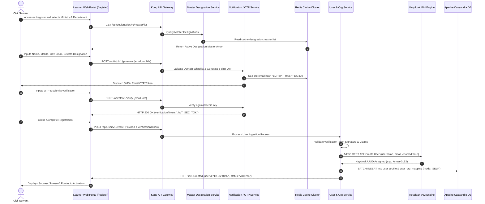
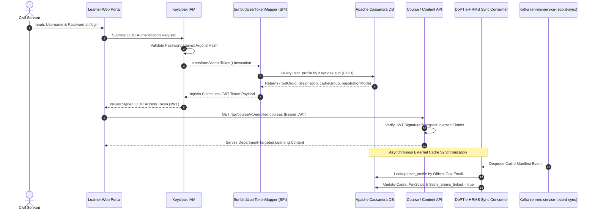
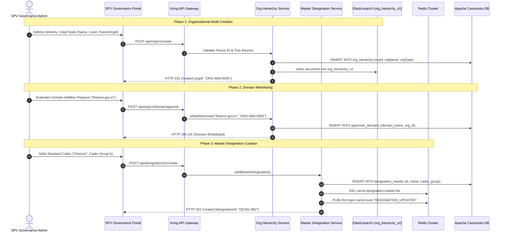
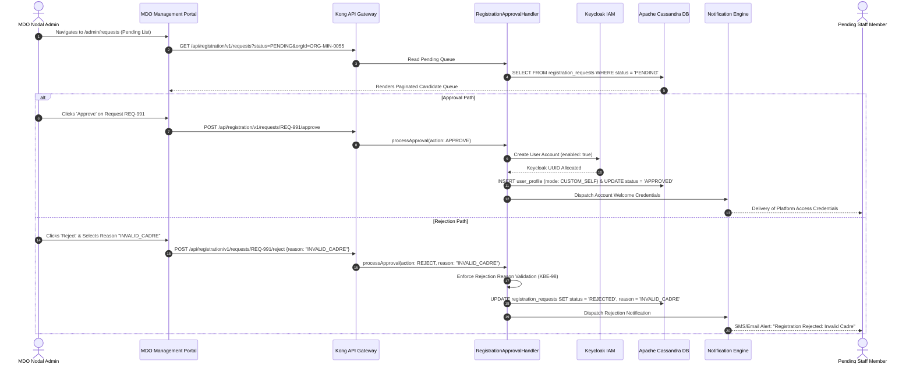
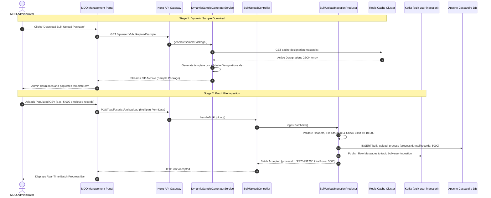
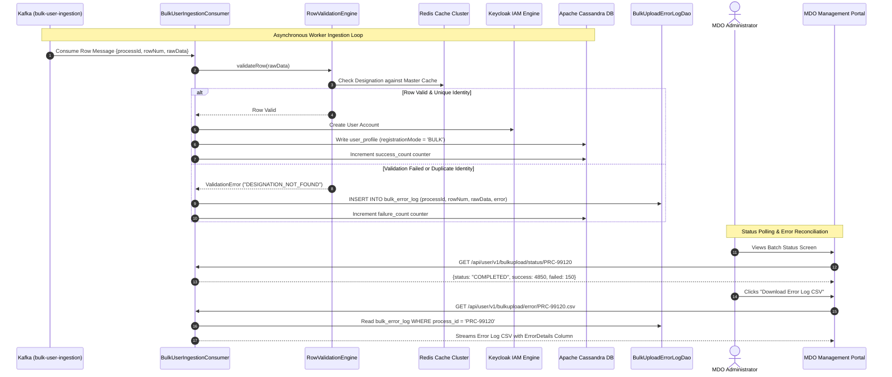
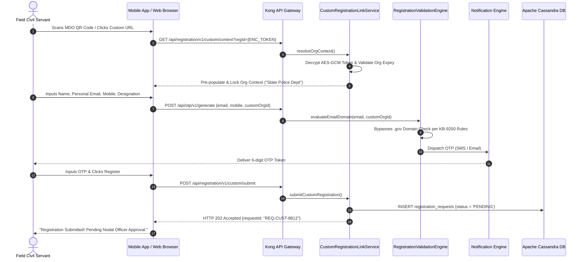
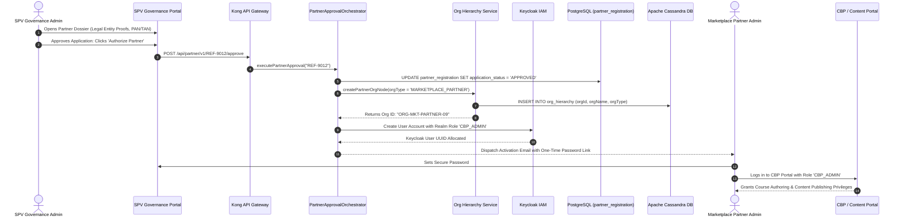

# Registration — Use Cases Specification

## 1. USE CASE MODEL OVERVIEW & ARCHITECTURAL MAPPING

### 1.1 Scope & Framework Definition

This document specifies the authoritative, end-to-end **Generic Use Cases** governing the **Registration Subsystem** of the iGOT Karmayogi Platform. It reflects the complete functional, technical, interface, and operational evolution from **Release Q2 through Release Q13**.

To satisfy enterprise architectural governance, the registration ecosystem decomposes into **four independent registration streams**, each evaluated across two distinct lifecycle perspectives:

1. **Creation Perspective:** How records, hierarchies, links, batches, applications, and cryptographic credentials originate, validate, and provision from frontend interfaces through backend microservices to persistent storage.
2. **Consumption Perspective:** How provisioned identities, credentials, organizational nodes, approval queues, error logs, and telemetry are authenticated, processed, reconciled, and consumed across platform components (Learner Web/Mobile, MDO, SPV, CBP/Marketplace, DoPT e-HRMS).

### 1.2 Enterprise Actor Directory

| Actor Name | Classification | Portal / Interface | Primary Responsibility in Ecosystem |
|---|---|---|---|
| **Civil Servant / Learner** | Human (End User) | Learner Web Portal / Mobile App | Initiates personal registration, completes OTP verification, and consumes learning assets. |
| **MDO Nodal Administrator** | Human (Dept Admin) | MDO Management Portal | Configures custom links/QR codes, reviews pending candidate queues, and uploads bulk files. |
| **SPV Governance Admin** | Human (Platform Admin) | SPV Governance Portal | Builds root organizational nodes, whitelists domains, manages master designations, and reviews KYC. |
| **Marketplace Training Partner** | Human (External Admin) | Marketplace Onboarding Portal | Submits institutional KYC dossiers, manages content publishing credentials, and accesses CBP Portal. |
| **Volunteer Personnel** | Human (Non-Gov User) | Mobile App / Custom Web Link | Registers under supervisory ministry volunteer nodes for public and civil defense capacity building. |
| **DoPT e-HRMS System** | Automated (External) | REST API / Kafka Event Stream | Master of record for central civil service employment records, cadres, and service histories. |
| **Kong Ingress Gateway** | Core Infrastructure | API Gateway Layer | Enforces route whitelisting, rate limiting (anti-abuse OTP rules), and JWT signature verification. |
| **Keycloak IAM Subsystem** | Core Infrastructure | OIDC / OAuth2 Engine | Manages user realm identities (`sunbird`), credential hashing (Argon2), and RBAC role assignments. |
| **Notification Gateway** | Core Infrastructure | CDAC / NIC SMS & SMTP Relays | Dispatches cryptographic 6-digit OTP tokens and automated onboarding activation messages. |

### 1.3 Master Use Case Catalog (Q2 – Q13)

**MASTER USE CASE INVENTORY (CREATION & CONSUMPTION)**

```text
CATEGORY 1: USER REGISTRATION (CORE PLATFORM IDENTITY)
├── UC-UR-01 (Creation)     : Direct Civil Servant Self-Onboarding & Cryptographic Account Provisioning
└── UC-UR-02 (Consumption)  : OIDC Identity Federation, Role Enrichment & Asynchronous e-HRMS Cadre Sync

CATEGORY 2: SPV AND MDO REGISTRATION (ADMINISTRATIVE & CADRE SETUP)
├── UC-SPV-01 (Creation)    : Multi-Tier Institutional Hierarchy Provisioning, Domain Whitelisting & Masters
└── UC-MDO-02 (Consumption) : MDO Administrative Action Queue Processing & Audited Rejection Logging

CATEGORY 3: BULK REGISTRATION (BATCH & ASYNCHRONOUS INGESTION)
├── UC-BR-01 (Creation)     : Master-Validated Dynamic Sample Generation & Kafka-Backed Batch Ingestion
└── UC-BR-02 (Consumption)  : Asynchronous Batch Ingestion Execution, Status Auditing & Error CSV Reconciliation

CATEGORY 4: SELF-REGISTRATION (MULTI-CHANNEL CHANNELS)
├── UC-SR-01 (Creation)     : Multi-Channel Intake via MDO Custom Link/QR, Mobile Intent & Domain Bypass
└── UC-SR-02 (Consumption)  : Gated Marketplace Partner KYC Vetting, Org Node Generation & CBP Access Enablement
```

## 2. DETAILED GENERIC USE CASES PER REGISTRATION TYPE

**SECTION 2.1: USER REGISTRATION (CORE PLATFORM IDENTITY)**

### 2.1.1 `UC-UR-01`: Direct Civil Servant Self-Onboarding & Cryptographic Account Provisioning (Creation)

- **Use Case ID:** `UC-UR-01`
- **Classification:** Core Identity Creation (Frontend-to-Backend)
- **Primary Actor:** Civil Servant / Learner
- **Supporting Actors:** Kong API Gateway, Master Designation Service, Notification Engine (NIC SMS/SMTP), User & Org Service, Keycloak IAM, Apache Cassandra.
- **Pre-Conditions:**
  - The applicant possesses an active official government email address (`.gov.in` or `.nic.in`) or an authorized state domain.
  - The parent Ministry/Department exists as an approved node in Cassandra `org_hierarchy`.
  - The Master Designation catalog is active and cached in Redis.



#### Main Success Scenario (MSS)

1. **Initiation:** User navigates to `/register`. The frontend calls `GET /api/designation/v1/master/list` through Kong Gateway and populates the designation dropdown ([KB-12113: Q10 | Ad-hoc | Add designation on registration page](https://karmayogibharat.atlassian.net/browse/KB-12113) (Prod Deployed)).
2. **Data Capture:** User enters First Name, Last Name, Official Email, Mobile Number, selects Organization, and chooses an official Master Designation.
3. **OTP Dispatch:** Frontend triggers `POST /api/otp/v1/generate`. Kong enforces rate limiting (maximum 3 requests per 15-minute window). The Notification Engine verifies that the domain exists in `approved_domains`, generates a 6-digit OTP, stores a Bcrypt hash in Redis with a 300-second TTL, and dispatches SMS/Email tokens ([KB-438: Q2 | Self Registration | Users with Email ID having approved domains only, shall be able to request for OTP.](https://karmayogibharat.atlassian.net/browse/KB-438) (KB Approved), [KB-449: Q2 | Self Registration | OTP shall be sent to only email IDs whose domains are in the approved list of domains.](https://karmayogibharat.atlassian.net/browse/KB-449) (In-Progress)).
4. **Token Verification:** User inputs the 6-digit OTP. Frontend calls `POST /api/otp/v1/verify`. Notification Engine validates the OTP and returns an HMAC-SHA256-signed `verificationToken`.
5. **Account Creation:** Frontend calls `POST /api/user/v1/create` supplying profile fields and the `verificationToken`. The User Service validates the signature, invokes Keycloak's Admin REST API to provision an account with roles `['PUBLIC', 'CONTENT_CONSUMER']`, commits profile rows to Cassandra `user_profile` with `registration_mode = 'SELF'`, and writes `user_org_mapping` ([KB-8017: Q7 | Ad-Hoc | Enhancement | Data Tracking | User registration | Mode of Registration](https://karmayogibharat.atlassian.net/browse/KB-8017) (KB Approved), [User Creation API Places and API called](https://karmayogibharat.atlassian.net/wiki/spaces/TES/pages/198279170/User+Creation+API+Places+and+API+called)).
6. **Confirmation:** System responds with HTTP `201 Created`. Keycloak sends an asynchronous welcome notification containing a temporary password activation token ([KB-11810: Q10 | Ad-Hoc | Enhancement to registration and password flow](https://karmayogibharat.atlassian.net/browse/KB-11810) (KB Review)).

#### Extensions & Failure Paths

- **3a. Domain Validation Failure:**
  - If the email domain is missing from `approved_domains`, backend rejects the request with HTTP `403 Forbidden` (`ERR_DOMAIN_NOT_APPROVED`).
  - Frontend renders the "Domain Not Approved" modal, prompting the applicant to request administrative domain addition or use their department's custom registration link ([KB-450: Q2 | Self Registration | User shall see appropriate messaging based on they are trying to verify Email ID with approved Domain.](https://karmayogibharat.atlassian.net/browse/KB-450) (In-Progress), [KB-657: Q2 | Self Registration | Users messaging on the Self-Registration Request for Help page for domain addition based on domain status.](https://karmayogibharat.atlassian.net/browse/KB-657) (Prod Deployed)).

- **4a. OTP Mismatch or Expiry:**
  - If verification fails, Redis increments the failure attempt counter.
  - If attempts exceed 3, the transaction locks for 15 minutes (`ERR_OTP_ATTEMPTS_EXCEEDED`).

- **5a. Identity Collision (Duplicate Email/Mobile):**
  - If the email or mobile number already exists in Keycloak or Cassandra, backend returns HTTP `409 Conflict`.
  - Frontend informs the user that an active account exists and offers password recovery.

#### Technical Tasks & Evolution Traceability

- `TASK-UR-01` (Q2 Baseline): Implement Keycloak Admin REST Client user creation and Cassandra DAO layer ([KB-949: Q2 | Ad-Hoc Requests | User Onboarding, Creation and Profile changes.](https://karmayogibharat.atlassian.net/browse/KB-949) (KB Review)).
- `TASK-UR-02` (Q7 Telemetry): Add Cassandra column `registration_mode` and enforce enum validation (`SELF`, `CUSTOM_SELF`, `BULK`, `MDO_ADMIN`, `API_HRMS`) ([KB-8017: Q7 | Ad-Hoc | Enhancement | Data Tracking | User registration | Mode of Registration](https://karmayogibharat.atlassian.net/browse/KB-8017) (KB Approved), [KB-8582: Q7 | Ad-Hoc | Enhancement | Data Tracking | User registration process QA Deployed](https://karmayogibharat.atlassian.net/browse/KB-8582)).
- `TASK-UR-03` (Q10 Designation Selector): Refactor registration form to consume live Redis-cached designations ([KB-12113: Q10 | Ad-hoc | Add designation on registration page](https://karmayogibharat.atlassian.net/browse/KB-12113) (Prod Deployed)).
- `TASK-UR-04` (Q10 Password Decoupling): Replace plain password inputs with Keycloak post-registration activation tokens ([KB-11810: Q10 | Ad-Hoc | Enhancement to registration and password flow](https://karmayogibharat.atlassian.net/browse/KB-11810) (KB Review), [KB-12036: Q10 | Ad-Hoc | Registration changes | Change Password](https://karmayogibharat.atlassian.net/browse/KB-12036) (Open)).

### 2.1.2 `UC-UR-02`: OIDC Identity Federation, Role Enrichment & Asynchronous e-HRMS Cadre Sync (Consumption)

- **Use Case ID:** `UC-UR-02`
- **Classification:** Identity & Session Consumption, Service Record Synchronization
- **Primary Actor:** Civil Servant / Learner
- **Supporting Actors:** Keycloak IAM, Sunbird Token Mapper SPI, Core Content/Assessment APIs, DoPT e-HRMS Connector Engine, Apache Kafka, Apache Cassandra.
- **Pre-Conditions:**
  - User account exists in Keycloak IAM with `enabled = true`.
  - The user has set permanent credentials via the activation link.



#### Main Success Scenario (MSS)

1. **Authentication:** User enters credentials on the Keycloak login screen. Keycloak validates the password hash.
2. **Token Minting & Custom Claims Enrichment:** Keycloak invokes the custom SPI plugin `SunbirdUserTokenMapper`. The mapper queries Cassandra `user_profile` and `user_org_mapping` using Keycloak's `sub` identifier and enriches the JWT token with `rootOrgId`, `designation`, `cadreGroup`, and `registrationMode`.
3. **Platform Authorization:** Frontend attaches the signed JWT in the `Authorization: Bearer` header on API requests. Downstream microservices authenticate the user via the token claims without performing secondary database reads.
4. **Asynchronous Cadre Reconciliation (e-HRMS Sync):** The DoPT e-HRMS connector publishes personnel updates to Kafka topic `ehrms-service-record-sync`. `EHrmsSyncConsumer` reads the message, matches the user by official email, and applies the **Master of Record Rule**: locks `Cadre`, `PayBand`, and `ParentMinistry` in Cassandra and sets `is_ehrms_linked = true` ([KB-1678: Q3 | User Profile | Addition of e-HRMS profile for Users onboarded on e-HRMS.](https://karmayogibharat.atlassian.net/browse/KB-1678) (Prod Deployed)).
5. **UI Field Protection:** The Learner Profile UI marks e-HRMS-linked fields as read-only, preventing manual overwrites.

#### Extensions & Failure Paths

- **2a. Inactive Account Access:**
  - If `user_profile.status != 1`, Keycloak rejects authentication with `ACCOUNT_DISABLED`.

- **4a. e-HRMS Profile Mismatch:**
  - If incoming e-HRMS records contain unmatched national identifier codes, the record moves to a dead-letter queue (`ehrms-sync-dlq`) for administrative reconciliation.

#### Technical Tasks & Evolution Traceability

- `TASK-UR-CS-01` (Q3 Protocol Mapper): Implement `SunbirdUserTokenMapper` Keycloak SPI to project Cassandra organizational contexts into JWT access tokens.
- `TASK-UR-CS-02` (Q4 Cadre Sync): Build `EHrmsSyncConsumer` Kafka listener and Cassandra migration for `is_ehrms_linked` locking ([KB-1678: Q3 | User Profile | Addition of e-HRMS profile for Users onboarded on e-HRMS.](https://karmayogibharat.atlassian.net/browse/KB-1678) (Prod Deployed)).

**SECTION 2.2: SPV AND MDO REGISTRATION (ADMINISTRATIVE & CADRE SETUP)**

### 2.2.1 `UC-SPV-01`: Multi-Tier Institutional Hierarchy Provisioning, Domain Whitelisting & Masters (Creation)

- **Use Case ID:** `UC-SPV-01`
- **Classification:** Administrative & Governance Creation
- **Primary Actor:** SPV Governance Administrator (Karmayogi Bharat Super Admin)
- **Supporting Actors:** SPV Governance Portal, Kong Gateway, Org Hierarchy Management Service, Designation Master Service, Elasticsearch, Redis Cluster, Apache Cassandra.
- **Pre-Conditions:**
  - The administrator possesses an active session with the `SPV_ADMIN` security role.



#### Main Success Scenario (MSS)

1. **Organizational Node Creation:** SPV Admin enters organizational parameters on the SPV Portal. Frontend calls `POST /api/org/v1/create`. Backend validates hierarchy depth, generates an organizational UUID, commits the node to Cassandra `org_hierarchy`, and syncs the document to Elasticsearch index `org_hierarchy_v2` ([KB-6421: Q6 | Self registration | SPV | Organisation creation](https://karmayogibharat.atlassian.net/browse/KB-6421) (Prod Deployed), [Org Search Public API – Registration Page API Contract](https://karmayogibharat.atlassian.net/wiki/spaces/TES/pages/616497179/Org+Search+Public+API+Registration+Page+API+Contract)).
2. **Domain Whitelisting Approval:** SPV Admin reviews pending domain requests at `/admin/domains`. Approving `finance.gov.in` triggers `POST /api/org/v1/domain/approve`. Backend inserts the domain into Cassandra `approved_domains`. The domain is instantly whitelisted across all registration flows without requiring service restarts ([KB-396: Q2 | Self Registration | Auto-addition of Domain in the approved list post SPV approval.](https://karmayogibharat.atlassian.net/browse/KB-396) (Prod Deployed), [KB-439: Q2 | Self Registration | Show SPV the received requests of Domains on the SPV Portal for approval.](https://karmayogibharat.atlassian.net/browse/KB-439) (Prod Deployed)).
3. **Master Designation Management:** SPV Admin creates a designation entry ("Director", Group A). Frontend calls `POST /api/designation/v1/create`. Backend writes the record to Cassandra `designation_master`, purges the Redis key `cache:designation:master:list`, and broadcasts `DESIGNATION_UPDATED` over Redis Pub/Sub topic `topic:cache:evict` to invalidate local caches across worker nodes ([KB-6423: Q6 | Self registration | SPV | Designation master on behalf of organisation](https://karmayogibharat.atlassian.net/browse/KB-6423) (Prod Deployed)).
4. **Volunteer Organization Structures:** SPV Admin provisions non-government Volunteer Organization entities nested under supervisory ministries to support volunteer onboarding pipelines ([KB-13968: Q12 | iGOT for Non-Govt Users/ Volunteer Body](https://karmayogibharat.atlassian.net/browse/KB-13968) (Prod Deployed)).

#### Extensions & Failure Paths

- **1a. Cyclic Organizational Reference:**
  - If `parentOrgId` creates a circular hierarchy loop, backend returns HTTP `422 Unprocessable Entity` (`ERR_CYCLIC_HIERARCHY`).

- **2a. Duplicate Domain Whitelist Request:**
  - If the domain is already whitelisted, backend returns HTTP `409 Conflict`.

#### Technical Tasks & Evolution Traceability

- `TASK-SPV-01` (Q2 Whitelist): Build `DomainApprovalHandler` and automated persistence into Cassandra `approved_domains` ([KB-396: Q2 | Self Registration | Auto-addition of Domain in the approved list post SPV approval.](https://karmayogibharat.atlassian.net/browse/KB-396) (Prod Deployed)).
- `TASK-SPV-02` (Q6 Designations): Implement `DesignationMasterServiceImpl` with Redis Pub/Sub cache eviction ([KB-6423: Q6 | Self registration | SPV | Designation master on behalf of organisation](https://karmayogibharat.atlassian.net/browse/KB-6423) (Prod Deployed)).
- `TASK-SPV-03` (Q12 Volunteer Tree): Extend `OrgHierarchyManagementService` to support non-government Volunteer Organization structures under supervisory ministries ([KB-13968: Q12 | iGOT for Non-Govt Users/ Volunteer Body](https://karmayogibharat.atlassian.net/browse/KB-13968) (Prod Deployed)).

### 2.2.2 `UC-MDO-02`: MDO Administrative Action Queue Processing & Audited Rejection Logging (Consumption)

- **Use Case ID:** `UC-MDO-02`
- **Classification:** Administrative Consumption & Request State Transitions
- **Primary Actor:** MDO Nodal Administrator
- **Supporting Actors:** MDO Management Portal, Registration Approval Handler, Keycloak IAM, Notification Engine, Apache Cassandra.
- **Pre-Conditions:**
  - Departmental staff have submitted self-registration requests via custom links, landing in `registration_requests` with `status = 'PENDING'`.
  - MDO Administrator has authenticated with role `MDO_ADMIN`.



#### Main Success Scenario (MSS)

1. **Queue Inspection:** MDO Admin accesses the "Pending User Registrations" queue. The UI fetches candidate records using multi-faceted filters (Designation, Date Range, Cadre Group) via `GET /api/registration/v1/requests` ([KB-7127: Q6 | Custom Self Registration | MDO Portal | Onboarding Action list](https://karmayogibharat.atlassian.net/browse/KB-7127) (Not Required), [KBE-114: Self registration | Ability to filter using tags for the MDO Approvals](https://karmayogibharat.atlassian.net/browse/KBE-114) (QA In Progress)).
2. **Approval Path:**
  - MDO Admin clicks "Approve". Frontend sends `POST /api/registration/v1/requests/{id}/approve`.
  - `RegistrationApprovalHandler` verifies that the request is in `PENDING` state, creates the user identity in Keycloak with role `PUBLIC`, inserts the profile into Cassandra with `registration_mode = 'CUSTOM_SELF'`, updates request status to `APPROVED`, and triggers welcome credentials via SMS/Email.

3. **Rejection Path:**
  - MDO Admin clicks "Reject". The modal requires selecting an audited rejection reason code (`INVALID_CADRE`, `UNKNOWN_EMPLOYEE`, `INCORRECT_UNIT`) ([KBE-98: Self registration|Ability to provide reject reason for the self registration requests](https://karmayogibharat.atlassian.net/browse/KBE-98) (QA In Progress)).
  - Frontend calls `POST /api/registration/v1/requests/{id}/reject`. Backend validates that the reason code is non-null, updates the record status to `REJECTED`, stores the reason code, and dispatches an explanation notification to the applicant.

4. **Role Delegation for Contractual Staff:** MDO Admins can explicitly approve contractual or external personnel with restricted `PUBLIC` profile scopes without assigning formal cadre memberships ([KBE-143: MDO Admin onboarding PUBLIC role users](https://karmayogibharat.atlassian.net/browse/KBE-143) (QA In Progress)).

#### Extensions & Failure Paths

- **2a. Attempted Unreasoned Rejection:**
  - If the rejection payload lacks a reason code, backend rejects the request with HTTP `400 Bad Request` (`ERR_REJECTION_REASON_EMPTY`), enforcing compliance with [KBE-98: Self registration|Ability to provide reject reason for the self registration requests](https://karmayogibharat.atlassian.net/browse/KBE-98) (QA In Progress).

- **2b. Concurrency Collision:**
  - If another administrator has already processed the request, backend returns HTTP `409 Conflict` (`ERR_REQUEST_ALREADY_PROCESSED`).

#### Technical Tasks & Evolution Traceability

- `TASK-MDO-CS-01` (Q6 Action List): Build `MDOActionQueueComponent` supporting pagination and multi-column filtering ([KB-7127: Q6 | Custom Self Registration | MDO Portal | Onboarding Action list](https://karmayogibharat.atlassian.net/browse/KB-7127) (Not Required), [KBE-114: Self registration | Ability to filter using tags for the MDO Approvals](https://karmayogibharat.atlassian.net/browse/KBE-114) (QA In Progress)).
- `TASK-MDO-CS-02` (Q6 Rejection Mandate): Implement mandatory rejection reason validation in `RegistrationApprovalHandler` ([KBE-98: Self registration|Ability to provide reject reason for the self registration requests](https://karmayogibharat.atlassian.net/browse/KBE-98) (QA In Progress)).

**SECTION 2.3: BULK REGISTRATION (BATCH & ASYNCHRONOUS INGESTION)**

### 2.3.1 `UC-BR-01`: Master-Validated Dynamic Sample Generation & Kafka-Backed Batch Ingestion (Creation)

- **Use Case ID:** `UC-BR-01`
- **Classification:** High-Throughput Batch Creation
- **Primary Actor:** MDO Nodal Administrator
- **Supporting Actors:** MDO Management Portal, Kong Gateway, Dynamic Sample Generator Service, Bulk Upload Ingestion Producer, Redis Cluster, Apache Kafka, Apache Cassandra.
- **Pre-Conditions:**
  - Legacy unvalidated bulk upload routes are deprecated and locked ([KB-1313: User Registration and Onboarding | Put Bulk Upload on hold.](https://karmayogibharat.atlassian.net/browse/KB-1313) (Open)).
  - MDO Administrator has authenticated with departmental upload permissions.



#### Main Success Scenario (MSS)

1. **Dynamic Sample Template Download:** Administrator clicks "Download Sample Package". Frontend calls `GET /api/user/v1/bulkupload/sample`. The Dynamic Sample Generator service reads active designations from Redis, generates a package containing `template.csv` and a reference `MasterDesignations.xlsx` sheet, and streams it as a ZIP file ([Design Document: User Bulk Upload Sample File API](https://karmayogibharat.atlassian.net/wiki/spaces/TES/pages/1243512856)).
2. **File Assembly:** Administrator populates employee records (First Name, Last Name, Email, Mobile, Designation, Cadre Group) using designations matching the reference sheet.
3. **Multipart File Ingestion:** Administrator uploads the CSV file. Frontend calls `POST /api/user/v1/bulkupload`. Kong Gateway streams the multipart payload to `BulkUploadController`.
4. **Pre-Ingestion Validation:** `BulkUploadIngestionProducer` validates CSV headers, checks for structural anomalies, and verifies that the file does not exceed the 10,000-record threshold ([KB-13968: Q12 | iGOT for Non-Govt Users/ Volunteer Body](https://karmayogibharat.atlassian.net/browse/KB-13968) (Prod Deployed)).
5. **Asynchronous Queueing:** Producer creates a tracking record in Cassandra `bulk_upload_process` with `status = 'IN_PROGRESS'`, splits rows into message envelopes, and publishes them across 12 partitions of Kafka topic `bulk-user-ingestion`.
6. **Non-Blocking Acknowledgment:** Backend responds with HTTP `202 Accepted` returning a `processId` (e.g., `PRC-99120`). Frontend renders a real-time progress tracker.

#### Extensions & Failure Paths

- **1a. Attempted Access to Deprecated Endpoints:**
  - Calling legacy endpoints returns HTTP `410 Gone` (`ERR_BULK_UPLOAD_DEPRECATED`), enforcing the [KB-1313: User Registration and Onboarding | Put Bulk Upload on hold.](https://karmayogibharat.atlassian.net/browse/KB-1313) (Open) deprecation policy.

- **4a. Row Threshold Exceeded:**
  - If the file contains more than 10,000 records, backend rejects the upload with HTTP `413 Payload Too Large` (`ERR_BATCH_LIMIT_EXCEEDED`).

- **4b. Malformed Headers or Empty File:**
  - If mandatory CSV headers are missing, backend rejects the file with HTTP `400 Bad Request` (`ERR_INVALID_CSV_HEADERS`).

#### Technical Tasks & Evolution Traceability

- `TASK-BR-01` (Q2 Deprecation): Lock legacy unvalidated bulk upload routes per [KB-1313: User Registration and Onboarding | Put Bulk Upload on hold.](https://karmayogibharat.atlassian.net/browse/KB-1313) (Open).
- `TASK-BR-02` (Q10 Dynamic Sample): Build `DynamicSampleGeneratorService` using Apache POI to assemble the XLSX/CSV zip bundle ([Design Document: User Bulk Upload Sample File API](https://karmayogibharat.atlassian.net/wiki/spaces/TES/pages/1243512856)).
- `TASK-BR-03` (Q12 Volunteer Scaling): Scale Kafka partition batch ingestion pipelines to support 10,000-record batch files ([KB-13968: Q12 | iGOT for Non-Govt Users/ Volunteer Body](https://karmayogibharat.atlassian.net/browse/KB-13968) (Prod Deployed)).

### 2.3.2 `UC-BR-02`: Asynchronous Batch Ingestion Execution, Status Auditing & Error CSV Reconciliation (Consumption)

- **Use Case ID:** `UC-BR-02`
- **Classification:** Asynchronous Worker Processing, Error Logging & Reconciliation
- **Primary Actor:** MDO Nodal Administrator
- **Supporting Actors:** Bulk User Ingestion Consumer, Row Validation Engine, Keycloak IAM, Notification Engine, Cassandra DB (`bulk_error_log`).
- **Pre-Conditions:**
  - A valid batch file has been ingested under `UC-BR-01` and queued in Kafka topic `bulk-user-ingestion`.



#### Main Success Scenario (MSS)

1. **Asynchronous Queue Consumption:** `BulkUserIngestionConsumer` reads messages from Kafka topic `bulk-user-ingestion`.
2. **Row Validation:** `RowValidationEngine` validates field formats, email regex patterns, and checks designations against Redis master data.
3. **Provisioning Valid Records:**
  - Valid, non-duplicate records are provisioned in Keycloak.
  - `user_profile` rows are written to Cassandra with `registration_mode = 'BULK'` and `status = 1`.
  - Cassandra `bulk_upload_process.success_count` increments.
  - Welcome notifications with activation links are dispatched to users.

4. **Error Logging:**
  - Failed rows (schema errors, duplicate email/mobile, invalid designation) write to Cassandra table `bulk_error_log` with detailed failure reasons.
  - Cassandra `bulk_upload_process.failure_count` increments.

5. **Batch Status Inquiries:** Administrator monitors batch progress at `/admin/bulk-status`. The UI polls `GET /api/user/v1/bulkupload/status/{processId}` for real-time progress updates.
6. **Error CSV Export:** When processing completes, administrator clicks "Download Error Log". Backend streams rows from `bulk_error_log`, appending an `ErrorDetails` column for review and re-upload ([Design Document: User Bulk Upload Sample File API](https://karmayogibharat.atlassian.net/wiki/spaces/TES/pages/1243512856)).

#### Extensions & Failure Paths

- **2a. Transient Keycloak Outage:**
  - If Keycloak is unreachable, consumer retries the record 3 times with exponential backoff before sending it to `bulk-user-deadletter` topic for retry.

#### Technical Tasks & Evolution Traceability

- `TASK-BR-CS-01` (Q10 Status Polling): Build `GET /user/v1/bulkupload/status/{processId}` endpoints.
- `TASK-BR-CS-02` (Q10 Error Exporter): Implement `BulkUploadErrorLogDao` and streaming CSV export controller ([Design Document: User Bulk Upload Sample File API](https://karmayogibharat.atlassian.net/wiki/spaces/TES/pages/1243512856)).

**SECTION 2.4: SELF-REGISTRATION (MULTI-CHANNEL CHANNELS)**

### 2.4.1 `UC-SR-01`: Multi-Channel Intake via MDO Custom Link/QR, Mobile Intent & Domain Bypass (Creation)

- **Use Case ID:** `UC-SR-01`
- **Classification:** Multi-Channel End-User Intake
- **Primary Actor:** Field Civil Servant / Volunteer
- **Supporting Actors:** Learner Mobile App (Android/iOS), Kong Gateway, Custom Registration Link Service, Registration Validation Engine, Notification Engine, Apache Cassandra.
- **Pre-Conditions:**
  - MDO Administrator has generated an encrypted custom link or QR code for the department.



#### Main Success Scenario (MSS)

1. **QR Scanning & Context Ingestion:** Field officer scans an MDO QR code or clicks a custom link: `https://igotkarmayogi.gov.in/register?orgId={ENC_TOKEN}` ([KB-6187: Q6 | Custom Self Registration Onboarding optimization](https://karmayogibharat.atlassian.net/browse/KB-6187) (KB Review)). On Android, an OS intent filter intercepts the URL and opens `CustomRegDeepLinkActivity` ([KB-7054: Q6 | Self Registration | Learner | Mobile App based Registration](https://karmayogibharat.atlassian.net/browse/KB-7054) (Prod Deployed)).
2. **Context Resolution:** App calls `GET /api/registration/v1/custom/context`. The backend decrypts the AES-GCM token, verifies that the organization is active, and locks the Ministry, Department, and Cadre fields.
3. **Domain Check Relaxation:** Officer enters personal contact details. App calls `POST /api/otp/v1/generate`. `RegistrationValidationEngine` checks for a valid `customOrgId` and **bypasses the government domain check**, allowing personal or state email domains ([KB-9250: Q8 | Ad-Hoc | Removal of Email Domain Validation for Custom Self-Registration](https://karmayogibharat.atlassian.net/browse/KB-9250) (QA In Progress), [KB- 9251: Q8 | Ad-Hoc | Removal of domain validation from Custom Self registration page QA In Progress](https://karmayogibharat.atlassian.net/browse/KB-9251)).
4. **OTP Extraction & Ingestion:** Notification Engine dispatches an SMS OTP. The mobile app automatically extracts the code using Google Play SMS Retriever API without requiring SMS read permissions.
5. **Request Submission:** User submits the form. Backend records the request in Cassandra `registration_requests` with `status = 'PENDING'` and `registration_mode = 'CUSTOM_SELF'`.
6. **Queue Notification:** Backend returns HTTP `202 Accepted` with a tracking ID (`requestId`). The request moves to the MDO Approval Queue for review (`UC-MDO-02`).

#### Extensions & Failure Paths

- **2a. Tampered or Expired Custom Link:**
  - If the AES-GCM token is invalid or expired, backend returns HTTP `400 Bad Request` (`ERR_INVALID_CUSTOM_TOKEN`).
  - Frontend informs the applicant that the link is invalid and prompts them to contact their MDO Administrator.

#### Technical Tasks & Evolution Traceability

- `TASK-SR-CR-01` (Q6 Custom Link): Build `CustomRegistrationLinkService` and ZXing QR generation utilities ([KB-6187: Q6 | Custom Self Registration Onboarding optimization](https://karmayogibharat.atlassian.net/browse/KB-6187) (KB Review), [KB-7025: Q6 | Self registration | MDO | Create custom registration link](https://karmayogibharat.atlassian.net/browse/KB-7025) (Prod Deployed)).
- `TASK-SR-CR-02` (Q8 Domain Bypass): Implement domain relaxation branching in `RegistrationValidationEngine` ([KB-9250: Q8 | Ad-Hoc | Removal of Email Domain Validation for Custom Self-Registration](https://karmayogibharat.atlassian.net/browse/KB-9250) (QA In Progress)).
- `TASK-SR-CR-03` (Q6 Mobile Deep Link): Implement native Android deep-link handling and SMS Retriever API integration ([KB-7054: Q6 | Self Registration | Learner | Mobile App based Registration](https://karmayogibharat.atlassian.net/browse/KB-7054) (Prod Deployed)).

### 2.4.2 `UC-SR-02`: Gated Marketplace Partner KYC Vetting, Org Node Generation & CBP Access Enablement (Consumption)

- **Use Case ID:** `UC-SR-02`
- **Classification:** External Institutional Partner Vetting & Provisioning
- **Primary Actor:** Marketplace Training Partner / SPV Governance Administrator
- **Supporting Actors:** Marketplace Portal, SPV Governance Portal, Partner Approval Orchestrator, Org Hierarchy Service, Keycloak IAM, PostgreSQL (`partner_registration`), CBP Portal.
- **Pre-Conditions:**
  - The training partner has submitted an institutional KYC application under [KB-11937: Q10 | Marketplace | Marketplace Partner Onboarding on iGOT via Self-Registration](https://karmayogibharat.atlassian.net/browse/KB-11937) (KB Review), currently in `PENDING_REVIEW` state.



#### Main Success Scenario (MSS)

1. **Dossier Evaluation:** SPV Admin opens the submitted Marketplace Partner dossier on the SPV Portal, reviewing legal entity registration certificates, tax identifiers (PAN/TAN), and authorized signatory credentials ([KB-11937: Q10 | Marketplace | Marketplace Partner Onboarding on iGOT via Self-Registration](https://karmayogibharat.atlassian.net/browse/KB-11937) (KB Review), [Q10 | Marketplace | Marketplace Partner Onboarding on iGOT via Self-Registration](https://karmayogibharat.atlassian.net/wiki/spaces/TES/pages/688193565)).
2. **Administrative Approval:** SPV Admin clicks "Authorize Partner". Frontend calls `POST /api/partner/v1/{refNum}/approve`.
3. **Status Update:** `PartnerApprovalOrchestrator` updates application status to `APPROVED` in PostgreSQL table `partner_registration`.
4. **Partner Organization Node Creation:** Orchestrator calls `OrgHierarchyManagementService` to generate a dedicated organization node in Cassandra `org_hierarchy` with `orgType = 'MARKETPLACE_PARTNER'`.
5. **IAM Provisioning with CBP Roles:** Orchestrator calls Keycloak to provision the partner administrator identity and assign the security role `CBP_ADMIN`.
6. **Activation Dispatch:** System sends an activation email with a one-time password setup link to the authorized signatory.
7. **Downstream Content Authoring Access:** Partner sets permanent credentials, logs in to the CBP Portal, and accesses course authoring, assessment authoring, and content publishing workflows ([KB-11986: Q10 | Marketplace | Marketplace Partner Self registration and Track application status](https://karmayogibharat.atlassian.net/browse/KB-11986) (Prod Deployed)).

#### Extensions & Failure Paths

- **2a. KYC Documentation Deficiencies:**
  - SPV Admin clicks "Reject" and enters an audited rejection reason.
  - System updates application status to `REJECTED` in PostgreSQL and notifies the applicant with instructions for document remediation.

#### Technical Tasks & Evolution Traceability

- `TASK-SR-CS-01` (Q10 Marketplace Ingestion): Create `MarketplacePartnerController` and PostgreSQL table `partner_registration` ([KB-11937: Q10 | Marketplace | Marketplace Partner Onboarding on iGOT via Self-Registration](https://karmayogibharat.atlassian.net/browse/KB-11937) (KB Review)).
- `TASK-SR-CS-02` (Q10 CBP Provisioning): Build `PartnerApprovalOrchestrator` to automate Keycloak `CBP_ADMIN` role assignment and CBP Portal access ([KB-11986: Q10 | Marketplace | Marketplace Partner Self registration and Track application status](https://karmayogibharat.atlassian.net/browse/KB-11986) (Prod Deployed)).

## 3. CROSS-CUTTING BUSINESS RULES, VALIDATION & SECURITY ENGINE

**BUSINESS RULES ENGINE ARCHITECTURE**

1. DOMAIN ENFORCEMENT RULES
    - BR-DOM-01: Standard Public Self-Registration enforces strict whitelist validation.
    - BR-DOM-02: Custom Registration links bypass whitelist checks; trust delegates to MDO Admins (KB-9250).
    - BR-DOM-03: Marketplace Partners use business email addresses validated during SPV KYC review.
2. IDENTITY & CREDENTIAL RULES
    - BR-ID-01: Plaintext passwords are never accepted on registration forms (KB-11810).
    - BR-ID-02: OTP tokens expire after 300 seconds and lock for 15 minutes after 3 failed attempts.
    - BR-ID-03: User profiles created via e-HRMS lock Cadre and PayBand fields against manual edits.
3. GOVERNANCE & AUDIT RULES
    - BR-GOV-01: Rejections on MDO Approval Queues require a mandatory reason code (KBE-98).
    - BR-GOV-02: Every user record must record an acquisition mode (registrationMode) (KB-8017).
    - BR-GOV-03: Bulk upload files are capped at 10,000 rows and process asynchronously via Kafka.
